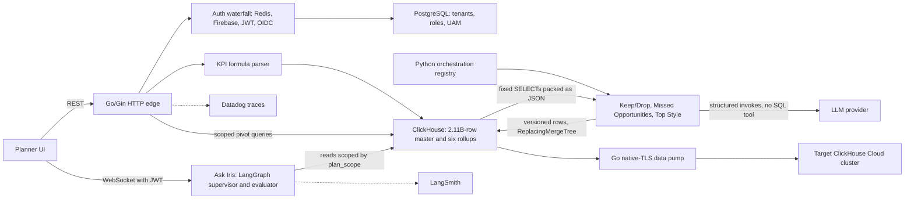
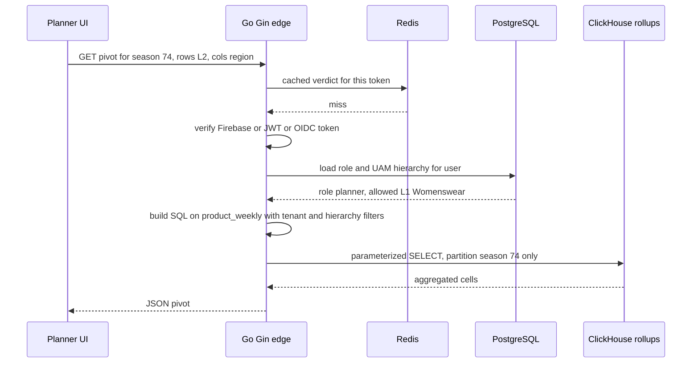
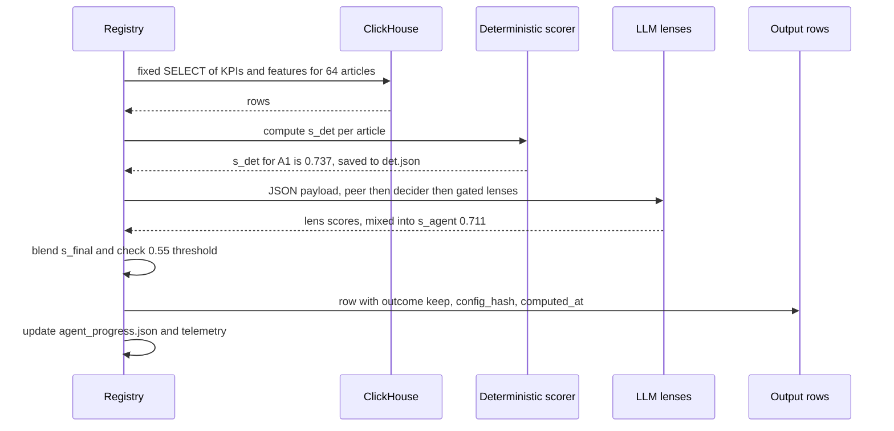
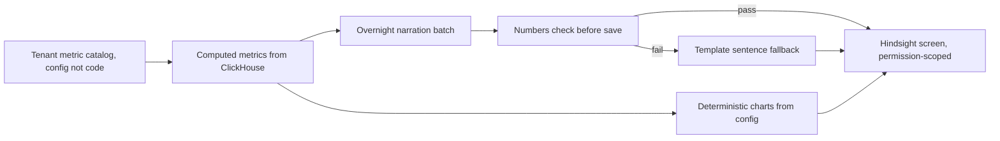

# Architecture: Impact Analytics AssortSmart (Platform and AI)

<div class="callout note">
<b>How to use this page</b>
<ul>
<li><b>What it covers:</b> the full AssortSmart architecture as it appears on the resume. That means the Go/Gin platform, ClickHouse and its rollups, the Python agent plane (Keep/Drop and Ask Iris) and the ClickHouse copier. A separate section at the end covers Hindsight, which is verbal-only.</li>
<li><b>When to read it:</b> before any system design round, and before any "walk me through your current project" question.</li>
<li><b>What to memorise:</b> the main diagram (eight boxes), the planner pivot request and the Keep/Drop batch job step by step, and the split between query-time numbers (15.5×) and load-time numbers (170GB OOM).</li>
</ul>
</div>

<div class="callout warn">
<b>Read this first.</b>
<ul>
<li><b>Hindsight and the Cluster Recommendation Copilot are verbal-only depth.</b> They are not resume bullets. Bring them up only if the interviewer asks what else you are working on, and say "this is in progress, it is not on my resume".</li>
<li><b>Impact Analytics has no Kafka, no Flink, no CDC, no Kubernetes operations, no Milvus and no human review queue (HITL).</b> Kafka and Flink are Uber Menu. Milvus is Uber Menu. The CDC pipeline (pg2ch) was built by a colleague, Ashvin Sharma. Do not claim it.</li>
<li><b>The platform APIs are Go with the Gin framework.</b> The agent plane is Python (FastAPI and LangGraph).</li>
<li><b>LangSmith is on Ask Iris only.</b> The Keep/Drop batch uses custom JSON telemetry, not LangSmith.</li>
</ul>
</div>

**Tags on this page.** MEASURED means there is a log, a doc or code. ESTIMATED means arithmetic I can show. TARGET means a design goal (say "targeting"). HISTORICAL means from past work records.

---

## 1. The one-paragraph version

AssortSmart is a retail merchandise planning product sold as SaaS (software as a service, meaning many retailers share one hosted product). Merchandise planners at a retailer use it to decide, season by season, which products to keep, which to drop and which to add. Planners look at large pivot tables of sales and inventory, and they also get AI recommendations. I work on two halves. The **core platform** is a multi-tenant Go/Gin API in front of ClickHouse (a fast analytics database) and PostgreSQL. The **agent plane** is Python: batch AI pipelines that score every article-season as Keep or Drop, and a chat copilot called Ask Iris that lets planners ask questions about KPIs and AI decisions.

---

## 2. Words you need

Read these once. Each one is used later on the page.

- **Article-season.** One product (an "article") in one selling season. "Blue linen shirt, Summer 2026" is one article-season. The resume scores **348k** of them.
- **Assortment planning.** Choosing the range of products a retailer will carry. Think of a shop owner deciding which items stay on the shelf next season.
- **Pivot.** A summary table where the planner picks rows (for example product category) and columns (for example store region) and the system sums sales for each cell. Like an Excel pivot table, but over hundreds of millions of rows.
- **Multi-tenant.** Many customers (tenants) share the same running system, and each must only ever see its own data. Like flats in one building: shared walls and plumbing, separate locked doors.
- **ClickHouse.** A columnar analytics database. "Columnar" means it stores each column separately, so a query that sums one column reads only that column. Think of a library where every book's page 12 is shelved together: if you only need page 12, you grab one shelf.
- **MergeTree.** The main ClickHouse table type. Data lands in small sorted chunks called "parts", and ClickHouse merges them in the background, like sorting new mail into an already sorted pile later in the day.
- **ReplacingMergeTree (RMT).** A MergeTree variant that keeps only the newest version of rows that share the same key. Think of a notebook where you never erase. You write the new value below the old one, and a cleaner later crosses out the old lines. Until the cleaner comes, readers must pick the newest line themselves.
- **Partition.** A slice of a table, here one season (`PARTITION BY season_code`). You can drop or rebuild one partition without touching the others, like replacing one drawer in a filing cabinet.
- **Rollup or pre-aggregation.** A table of sums computed ahead of time. Instead of adding up every daily sale when a planner opens a chart, you add them once at load time and store the totals. Like keeping a running monthly total instead of re-adding every receipt.
- **OOM (out of memory).** The process needed more RAM than allowed, so the database killed the query.
- **Go and Gin.** Go is a compiled, fast language with cheap concurrency. Gin is a lightweight HTTP framework for Go, the layer that maps URLs to handler functions.
- **Google Wire (compile-time dependency injection).** Dependency injection means a component receives the things it needs (database client, cache, logger) instead of creating them itself. Wire generates that wiring code at build time, so a missing dependency is a compile error, not a crash at startup. Like a checklist the build system ticks before the plane is allowed to take off.
- **Reverse proxy.** A server such as nginx that sits in front of your app and handles timeouts, body limits and HTTP/2. "No reverse proxy" means the Go process does those jobs itself.
- **h2c (HTTP/2 cleartext).** HTTP/2 without TLS at the process. It is normally used when TLS is terminated in front of the process (for example by a cloud load balancer), so the app can speak HTTP/2 directly without nginx in between.
- **Nested timeouts.** A total deadline for the request, with smaller deadlines inside it for each downstream call (auth, Postgres, ClickHouse). Like a 30-minute meeting where each agenda item also has its own 5-minute limit.
- **Distributed tracing (Datadog).** Every request gets a trace ID, and each step records a timed "span" under it, so you can see where time went across services.
- **JWT (JSON Web Token).** A signed token that says who the user is. The server checks the signature instead of looking the user up every time, like checking the hologram on an ID card.
- **OIDC (OpenID Connect).** A standard login protocol on top of OAuth, used here for Google sign-in.
- **Firebase Admin.** Google's server-side SDK that verifies Firebase login tokens.
- **Constant-time comparison.** Comparing two secrets in a way that always takes the same time, so an attacker cannot guess an API key one character at a time by measuring response times.
- **UAM (User Access Management).** The rules for which part of the product hierarchy (for example which departments or regions) each user may see.
- **LLM (large language model).** The AI model (for example a GPT model) that reads text and returns text or structured JSON.
- **Structured invoke.** Calling an LLM and forcing the answer into a fixed JSON schema, so code can parse it reliably.
- **Lens.** One analytical question the LLM answers about an article, such as "is weekly demand accelerating or dying?". There are **7** active lenses.
- **LangGraph.** A Python library for building AI workflows as a graph of steps (nodes) with explicit state and edges. Like a flowchart that the code actually executes.
- **Supervisor.** A LangGraph node that decides which step runs next.
- **Evaluator loop.** A step that checks a draft answer and sends it back for another try if it fails, here capped at **3 attempts**.
- **LangSmith.** A tracing and evaluation tool for LLM apps. It records each prompt, tool call, token count and cost.
- **WebSocket.** A long-lived two-way connection between browser and server, used for chat. The "handshake" is the first request that opens it.
- **Circuit breaker.** A switch that stops calling a failing dependency after too many failures, like a fuse that trips so the whole house does not burn.
- **Checkpoint.** A saved progress file so a crashed job can resume where it stopped instead of starting over.
- **config_hash.** A SHA-256 fingerprint of the exact guardrails, parameters, prompts and catalog used for a run. Stamped on every output row, so you can always tell which configuration produced a decision.
- **CI gate.** An automated check in the build pipeline (CI, continuous integration) that blocks a change from being promoted if it fails.

---

## 3. The architecture diagram



*What to notice: the LLM never touches the database. Python code reads ClickHouse with fixed queries and hands the LLM JSON. The platform half (left) and the agent half (right) meet only at ClickHouse.*

---

## 4. Box-by-box walkthrough

### Planner UI
The browser app planners use. It calls the Go/Gin API for grids, pivots and KPI tiles, and opens a WebSocket for Ask Iris chat.

### Go/Gin HTTP edge
This is the front door for every platform request, scaling to **10k peak RPS** (requests per second).
- **What it does:** routes requests, authenticates them, applies the tenant and hierarchy scope, builds ClickHouse or Postgres queries, and returns JSON.
- **Why Go/Gin:** Go handles many concurrent requests cheaply with goroutines (very light threads), and compiles to one binary. Gin is a thin, fast router.
- **Why Google Wire:** all dependencies (DB pools, Redis client, logger, tracer) are wired at compile time. A missing or mis-typed dependency fails the build instead of failing at 2 a.m.
- **Why no reverse proxy:** the Go process itself enforces timeouts, request body limits and graceful shutdown, and speaks h2c. One fewer hop and one fewer component to configure. The trade-off is that you must implement those protections yourself, carefully.
- **Nested timeouts:** a request deadline wraps smaller deadlines on auth, Postgres and ClickHouse calls. A slow ClickHouse query cannot hold a connection forever.
- **Datadog tracing:** every request carries a trace ID, so a slow pivot shows which span (auth, parse, ClickHouse) took the time.

### Auth waterfall (Redis, Firebase Admin, JWT, Google OIDC, API keys)
Different clients log in different ways, so authentication tries a sequence of verifiers.
1. Check Redis for a cached verdict on this token. Redis is an in-memory key-value store, so this is fast and saves repeated cryptographic checks.
2. On a miss, try Firebase Admin token verification.
3. If that does not apply, verify as a JWT or Google OIDC token.
4. Machine clients use API keys, compared in constant time (in Go, `subtle.ConstantTimeCompare`).
5. Resolve the user's role from PostgreSQL, then compute the UAM hierarchy scope.

Isolation here means "each tenant only reads its own rows and each user only reads their allowed hierarchy". It is not encryption. Do not call it encryption.

### PostgreSQL
A normal relational database (row store) for thin, transactional data: tenants, users, roles, UAM rules and metadata. It is not used for the heavy planner grids.
Background (verbal): planner pivots used to run on PostgreSQL and were slow. We ran proofs of concept comparing Postgres and ClickHouse, ClickHouse won the large analytical reads, and Postgres kept metadata, UAM and roles.

### KPI formula parser
Operators (business users who configure the product) write KPI formulas like `units_sold / (units_sold + eop_units) * 100`. The parser turns them into safe ClickHouse SQL without a code release.
- A Go tokenizer splits the formula into tokens (names, numbers, operators, parentheses).
- A parser builds a tree and checks every function against an allowlist.
- Logical names (`units_sold`) map to physical columns.
- Division is wrapped as `ifNotFinite(toFloat64(expr), 0)`, so divide-by-zero returns 0 instead of infinity or NaN (not a number).
- Unknown tokens fail closed, meaning the formula is rejected rather than guessed.

Tiny example (teaching sketch):

```text
Formula typed by operator:   sell_through = units_sold / (units_sold + eop_units) * 100
Tokens:                      IDENT(units_sold) / ( IDENT(units_sold) + IDENT(eop_units) ) * NUM(100)
Generated SQL fragment:      ifNotFinite(toFloat64(sum(qty) / (sum(qty) + sum(eop_units)) * 100), 0)
Values such as season come in as bound parameters, never pasted into the SQL string.
```

### ClickHouse
The analytics store. Two kinds of data matter here.
- **The master fact table, 2.11B rows.** This is the big table the agent plane reads context from.
- **Six rollup tables.** Product, store and attribute rollups, each at season grain and weekly grain, all `PARTITION BY season_code`. Planner pivots read these instead of raw daily data.

| Grain | Product | Store | Attribute |
|---|---|---|---|
| Season | product_season | store_season | attr_season |
| Weekly | product_weekly | store_weekly | attr_weekly |

The attribute tables are "unpivoted" (one row per attribute and value pair), which is why attr weekly is the largest object.

### Python orchestration registry
One shared runner for the three AI pipelines (Keep/Drop, Missed Opportunities, Top Style). It gives every pipeline the same safety kit:
- **Hard timeouts** on every LLM call. In the current Keep/Drop config the timeout scales with batch size: `min(600, 60 + 8 × articles)` seconds, so a 64-article batch gets 572 seconds (verbal depth from the pipeline docs).
- **Circuit breakers** that stop a step after about 5 consecutive failures, or when the failure fraction passes a limit (0.25 in the current config).
- **Durable checkpoints** (`det.json`, `agent_progress.json`) and a `--resume` flag. A resumed run reloads the saved deterministic scores and skips articles the LLM already finished.
- **config_hash** stamped on every output row.
- **Custom JSON telemetry**: tokens, USD cost, step duration and batch fallbacks.

Why not Airflow or Temporal? Those are workflow orchestrators. We needed resume logic tied directly to ClickHouse inserts and to the config hash, inside the app. Adding a whole orchestration platform was not justified for one team's batch jobs.

### Keep/Drop, Missed Opportunities, Top Style pipelines
Three batch pipelines that evaluate **348k article-seasons**, processing **88k items per pass**. Keep/Drop is the one to explain in depth.
- **No LLM orchestrator.** The batch order is fixed in code: peer context, then the decider, then the lenses, then the blend, then the explanation.
- **Deterministic score (s_det):** pure math from sell-through and rate of sale.
- **Agent score (s_agent):** the 7 lenses, each an LLM call that scores the article from 0 to 1, combined by a "decider" into weighted mixes.
- **Blend:** `s_final = 0.4 × s_det + 0.6 × s_agent`. Keep if `s_final ≥ 0.55`.

The 7 active lenses are trend velocity, size curve, colour cannibalization, channel divergence, multi-season consistency, discount dependency and margin resilience. A cheap gate runs first, so a lens only runs if the article has the data for it. A one-colour item skips the colour cannibalization lens, for example.

Missed Opportunities and Top Style reuse the same registry and scoring infrastructure. If asked for their internals, keep it qualitative.

### LLM provider
The hosted model. It only ever receives JSON context and returns JSON in a fixed schema. It has **no SQL tool**. "Async" on the resume describes how batches run in parallel, not the LLM querying anything.

### Ask Iris (LangGraph supervisor plus evaluator)
A shipped chat copilot for planners to query KPIs and inspect AI decisions.
- **JWT-secured WebSocket.** The JWT is checked at the handshake.
- **Hierarchy scope frozen at the handshake.** The user's `plan_scope` (which part of the hierarchy they may see) is computed once when the socket opens and attached to the session. Nothing the user types later can widen it. That is what prevents cross-tenant leaks.
- **Supervisor** picks the next step. **Evaluator** checks the draft answer. If it fails, the graph retries, up to **MAX_ATTEMPTS = 3**, then stops instead of looping forever.
- **LangSmith** records each run for observability.

### Go native-TLS data pump and target cluster
A custom Go program that copied rollup tables between two ClickHouse Cloud clusters at about **344k rows per second**. Cluster-to-cluster copy was blocked by IP allowlists, so the pump connected to both clusters from an allowlisted machine over ClickHouse's native protocol with TLS (port 9440). Details are in the decisions and numbers sections below.

---

## 5. One request, step by step: a planner opens a pivot

**Example.** A planner at tenant "retailer_a" opens a pivot of revenue by product category (L2) and store region for season 74, weekly grain.



1. The browser sends the request with a token.
2. The edge starts a request deadline and a Datadog trace.
3. Redis has no cached verdict, so the edge verifies the token through the waterfall and caches the result.
4. Postgres says the user is a planner who may only see the Womenswear L1 branch.
5. The edge builds a query on `product_weekly`. It adds `tenant = retailer_a`, `l1 = 'Womenswear'` and `season_code = 74` as bound parameters. Because the table is partitioned by season, ClickHouse only reads partition 74.
6. ClickHouse sums a pre-aggregated table, not 250M raw rows, so the answer comes back in seconds rather than minutes.
7. If ClickHouse is slow, the inner timeout fires, the client gets a clean error, and the trace shows exactly where the time went.

Sample SQL shape (teaching sketch):

```sql
SELECT l2_name, region, sum(revenue) AS revenue
FROM product_weekly
WHERE season_code = {season:UInt16}
  AND tenant_id = {tenant:String}
  AND l1_name IN {allowed_l1:Array(String)}
GROUP BY l2_name, region
```

---

## 6. One job, step by step: a Keep/Drop batch

**Example.** A batch of 64 articles from season 74. Follow one article, "A1".



1. **Read context.** Python code (not the LLM) runs a fixed query and builds one JSON row per article: units sold, revenue, sell-through, rate of sale, number of sizes, colours and channels, and a short weekly sales series.
2. **Deterministic score.** For A1, sell-through and rate of sale map onto 0-to-1 ramps and combine into `s_det = 0.737`. This is saved in the checkpoint so a resumed run never recomputes it.
3. **Lens gate.** In this illustrative example A1 has 3 colours, 5 sizes, 2 channels, history in 2 seasons, some discounting and 10 weeks on sale, so all 7 lenses are eligible. A single-colour, single-size sock sold for 2 weeks would only get the margin lens.
4. **LLM calls.** The peer step adds context about sibling colours. The decider proposes weighted mixes of lenses. Each lens returns a score, an outcome and reason codes in strict JSON. The mixes are averaged into `s_agent = 0.711`.
5. **Blend.** `s_final = 0.4 × 0.737 + 0.6 × 0.711 = 0.295 + 0.427 = 0.721`. Since 0.721 is at least 0.55, A1 is **Keep**.
6. **Write.** The output row carries the outcome, the scores, the explanation, the `config_hash` and a `computed_at` timestamp.
7. **If the LLM times out** for this batch, A1 still gets a usable decision from its deterministic baseline. When the agent score arrives later (for example on `--resume`), a newer row with the same key is written. ReplacingMergeTree keeps the newest version. That is the "eventually consistent write pattern" on the resume: the right answer settles in over time, and the system is never without an answer.

Sample rows for A1 with the same key `(season_code, article)`:

| season_code | article | computed_at | s_final | outcome | source |
|---|---|---|---|---|---|
| 74 | A1 | 10:00 | 0.737 (baseline) | keep | deterministic fallback |
| 74 | A1 | 10:07 | 0.721 | keep | blended |

Readers take the latest `computed_at` per key. Background merges later drop the 10:00 row.

Write-path detail for deep follow-ups: in the current package version, scoring engines write staging files first, and a separate operator command publishes them into ClickHouse. No agent ever holds a write path.

---

## 7. Design decisions

### Decision 1: Go/Gin edge with no reverse proxy
- **What:** the Go process is the HTTP edge. It handles h2c, timeouts, body caps and tracing itself.
- **Why:** fewer moving parts, one place to reason about timeouts, and tracing at the exact process that serves traffic.
- **Alternatives:** nginx or Envoy in front. They are battle-tested, but they add a hop and a second place where timeouts are configured, which often drift apart.
- **Trade-off:** you own every protection a proxy would give you for free. A missed body-size cap is your bug.
- **What I'd do differently:** write the edge protections as a small shared middleware package with its own tests from day one, so new services cannot forget them.

### Decision 2: ClickHouse for planner reads, PostgreSQL for metadata
- **What:** heavy pivots and AI context on ClickHouse. Roles, UAM and metadata on Postgres.
- **Why:** pivots read a few columns across hundreds of millions of rows. Columnar storage reads only those columns and processes them in vectorised batches. Postgres reads whole rows.
- **Alternatives:** Snowflake or BigQuery. Good warehouses, but interactive pivots need predictable latency and cost on a store we operate. Postgres alone was what we started with, and it was slow.
- **Trade-off:** ClickHouse is weak at updating single rows, so writes become insert-new-version (ReplacingMergeTree) rather than UPDATE.
- **What I'd do differently:** decide the versioning and dedup strategy for every output table at design time, not after duplicates show up.

### Decision 3: serve AI context as JSON, never give the LLM a SQL tool
- **What:** Python runs fixed queries and passes JSON to the LLM. The LLM cannot query the 2.11B-row master.
- **Why:** an LLM writing SQL can hallucinate a query that scans billions of rows, leaks another tenant's data or writes garbage. Fixed queries are reviewed, scoped and cheap.
- **Alternatives:** a read-only SQL tool with guardrails. Still risky for cost and scope, and harder to test.
- **Trade-off:** the LLM only sees what we choose to send, so a lens that needs a new field needs a code change.
- **What I'd do differently:** add a schema contract test per lens so a missing field fails CI rather than producing a weak score.

### Decision 4: blend deterministic math with LLM lenses, and fall back to the baseline
- **What:** `s_final = 0.4 × s_det + 0.6 × s_agent`, keep at 0.55 or above. On LLM timeout, use the deterministic baseline.
- **Why:** rules are cheap, explainable and always available. Lenses catch nuance (colour cannibalization, discount dependency). The fallback keeps the product working when the provider is down.
- **Alternatives:** LLM-only decisions (unavailable when the provider fails, hard to audit) or rules-only (too coarse).
- **Trade-off:** two scoring systems to maintain and evaluate.
- **What I'd do differently:** gate on drop recall (catching true drops) from the start, not only on accuracy. See the evals page for why.

### Decision 5: app-native orchestration registry instead of Airflow or Temporal
- **What:** one Python registry gives every pipeline timeouts, breakers, checkpoints, config hashing and telemetry.
- **Why:** resume had to be coupled to ClickHouse inserts and to `config_hash`. That is easier inside the app.
- **Alternatives:** Airflow (task scheduler) or Temporal (durable workflow engine). Both are strong, but they are another platform to run, and they would not remove the need for app-level resume logic.
- **Trade-off:** we own the retry and resume code.
- **What I'd do differently:** if more teams start running agent batches, revisit Temporal.

### Decision 6: pre-aggregated rollups and one-week insert slices
- **What:** six rollup tables, and weekly rollups built one fiscal week per INSERT SELECT.
- **Why:** pay the aggregation cost once at load time, read cheaply at query time. A whole season at weekly grain needed about 170GB of aggregation memory and crashed.
- **Alternatives:** query raw daily data on every request (too slow), or ClickHouse projections (they do not help when queries use `FINAL` on ReplacingMergeTree).
- **Trade-off:** more tables to build, validate and keep in sync.
- **What I'd do differently:** run the incremental `REPLACE PARTITION` design (written, not executed) so rebuilds swap in cleanly for readers.

### Decision 7: a custom Go pump to copy across clusters
- **What:** a Go program reading from one ClickHouse Cloud cluster and writing to another over native TLS.
- **Why:** cross-cluster IP allowlists blocked cluster-to-cluster copy. An allowlisted machine could reach both.
- **Alternatives:** `INSERT SELECT` across clusters (blocked), or exporting to object storage and importing (slower to set up for this one-off).
- **Trade-off:** the copy depends on one machine and is not an atomic swap.
- **What I'd do differently:** for production cutovers, get the allowlist changed or go through object storage, rather than copying through an operator machine.

---

## 8. The numbers on this diagram

| Number | What it measures | Tag |
|---|---|---|
| 10k peak RPS | Peak request rate the Go/Gin edge serves | On PDF |
| 2.11B rows | Size of the ClickHouse master fact table the agent plane reads from | On PDF |
| 348k article-seasons | Article-seasons scored by the decision engine | On PDF |
| 88k items per pass | Items processed in one batch run | On PDF |
| 7 lenses | Active LLM lenses per article | On PDF |
| 15.5×, 189s to 12s on 250M rows | Planner pivot query time before and after rollups | MEASURED |
| 170GB | Aggregation memory a whole-season weekly build needed before it crashed | MEASURED |
| ~344k rows/s | Combined copy rate of the Go pump | MEASURED |
| 4.09B rows | Largest source object copied (attr weekly, two seasons) | MEASURED, copy in flight |
| 500k rows | Batch size in the pump | MEASURED |

**15.5× pivot speed-up.** It measures how long one planner pivot query took on a 250M-row test harness: 189 seconds on the old path, about 12.3 seconds on the rollup tables. The PDF rounds 12.3 to 12. Arithmetic: 189 divided by 12.3 is about 15.4, and 189 divided by 12 is about 15.75. The reported harness ratio is about 15.5×. If someone checks the arithmetic, say the ratio comes from the measured harness timings, and the headline seconds are rounded. Say it as: "a planner pivot went from 189 seconds to 12 seconds, about fifteen and a half times faster." Do not say "sub-second".

**170GB OOM.** It measures memory, not speed. A whole-season weekly INSERT SELECT needed about 170GB of aggregation state. It failed even with 80GB and 200GB memory caps. The fix was one fiscal week per insert, with a 55GB memory cap, 16GB disk spill, 8 threads and 4 weeks in flight (verbal knobs). One product week peaked around 11GB, one attribute week over 40GB. Say it as: "the weekly build kept crashing out of memory, so I sliced it into one-week inserts with memory and spill caps." **This is load time. The 15.5× is query time. One did not cause the other.**

**~344k rows per second.** It measures ingest rate during the copy, not requests per second. Two season streams ran in parallel at roughly 150k to 190k rows per second each, combined about 344k. Say it as "about 344 thousand rows per second", never "344k TPS".

**4.09B rows.** The attr weekly table for two seasons: 2,779,317,472 plus 1,311,108,195 rows. The copy was measured while running. Do not say the cutover finished.

**$100 per pass (off PDF, true).** Token spend for one pass. Arithmetic: $100 divided by 88,000 items is about $0.0011, roughly a tenth of a cent per item (ESTIMATED). With 64 articles per LLM batch, one pass is roughly 88,000 / 64 ≈ 1,375 batches (ESTIMATED).

**1.6M article-seasons (off PDF).** The full product-by-season catalog. It is a different number from the 348k that were scored. Do not mix them.

---

## 9. Failure modes and what the system does

| What breaks | How you notice | What happens |
|---|---|---|
| LLM provider slow or down | Timeouts and fallback counts in JSON telemetry | Hard timeout fires. Article keeps its deterministic baseline score. Circuit breaker stops the step after about 5 consecutive failures. |
| Batch job crashes mid-run | Run stops, checkpoint files remain | `--resume` reloads `det.json` and `agent_progress.json`, skips finished work, and does not re-run deterministic scoring. |
| Prompt or config edited | New `config_hash` on new rows | Old and new decisions are distinguishable. A change must pass the 80% CI gate before promotion. |
| Duplicate rows before merges | Two rows for the same key | Readers pick the latest `computed_at`. ReplacingMergeTree merges later. |
| Slow ClickHouse query | Datadog span shows ClickHouse time | Inner timeout fires, request fails cleanly instead of hanging. |
| Bad KPI formula from an operator | Parser rejects unknown token | Fails closed. No SQL is generated. |
| Divide by zero in a KPI | Would produce infinity or NaN | `ifNotFinite(toFloat64(expr), 0)` returns 0. |
| Ask Iris answer keeps failing evaluation | Attempt counter | Stops after 3 attempts instead of looping. |
| User tries to see another region in chat | Query outside plan_scope | Scope was frozen at handshake, so reads stay inside it. |
| Weekly rollup build out of memory | `MEMORY_LIMIT_EXCEEDED` | One fiscal week per insert, memory and spill caps. |
| Half-loaded weekly partition | Missing entry in the TSV ledger | DROP PARTITION for that season and rebuild. |
| Copier killed mid-season | No `.done` checkpoint for that table | DROP PARTITION then recopy that season. Readers can see a partial season until then. This is not an atomic swap. |

---

## 10. Observability: what a log line looks like

Every Go and Python service emits structured JSON that Datadog can filter on.

```json
{
  "timestamp": "2026-09-03T03:40:39.123Z",
  "level": "ERROR",
  "service": "assortsmart-edge",
  "env": "production",
  "trace_id": "4a6f8c9b2e1d3f5a",
  "span_id": "8b2d1c4f5a6e3",
  "tenant_id": "tenant_xyz_99",
  "message": "LLM batch fallback to deterministic score",
  "metadata": { "pipeline": "keep_drop", "batch_id": "b_981273" }
}
```

Say this carefully: correlate logs with traces through the explicit `trace_id` field. Do not claim automatic Datadog trace-ID log injection unless you have checked the code does it.

---

## 11. Hindsight (verbal-only depth, not on the resume)

<div class="callout warn">
<b>Hindsight is not a resume bullet.</b> It is a module I am building against a functional requirements document (FRD v1.2). Say "building", not "shipped". There is no dollar or latency number for Hindsight. Full defense: <a href="../projects/01b_hindsight_defense.md">../projects/01b_hindsight_defense.md</a>.
</div>

**Plain English.** Hindsight is the first screen of the planning cycle. Before planners buy for next season, they look back at last season: what worked, what did not, which styles to carry forward. It has a scorecard (this year against last year), contribution charts, a store map, an item grid, an attribute heatmap, a carry-forward panel and short AI-written narration.



*What to notice: the AI writes sentences, but it never chooses charts and never calculates metrics. Every number in a sentence is checked against the computed value before it is saved.*

Key design points:
- **Overnight batch narration**, not live, so filter changes do not trigger LLM cost or latency.
- **Grounding check:** numbers in the narration are compared with computed metrics before save. If they do not match, a templated sentence is used instead.
- **Charts come from configuration only.** The narration agent never picks layout.
- **One shared metric catalog per tenant**, and onboarding config goes live without a code deploy.
- **Permission-scoped filters:** "select all" never leaks outside the user's scope.
- **Item grid stays fast at 1,000+ items** via pagination or virtualized scrolling.

---

## 12. Say this, not that

| Say this | Not this |
|---|---|
| "The LLM never gets a SQL tool. Python serves it JSON context." | "The agents query ClickHouse." |
| "80% is the CI promotion gate on a 300-case proxy set." | "We are at 80% accuracy in production for all tenants." |
| "15.5× is query time. The 170GB OOM fix is load time." | "Fixing the OOM made pivots 15.5× faster." |
| "About 344 thousand rows per second during the copy." | "344k TPS" or "344k requests per second." |
| "The 4.09B copy was measured in flight." | "We finished the 4.09B cutover." |
| "Partition rollback means DROP PARTITION then recopy that season." | "Atomic swap with live readers." |
| "Ask Iris is a shipped capability." | Any usage number or SLA for Ask Iris. |
| "Kafka and Flink were on Uber Menu." | Kafka, Flink, CDC or Kubernetes operations on AssortSmart. |
| "Isolation means tenant and hierarchy scoping." | "Encryption." |

---

## 13. How to draw it in 3 minutes

**Minute 1: the platform spine.** Draw the Planner UI on the left, the Go/Gin edge in the middle, and ClickHouse and Postgres on the right. Say: "Planners hit a multi-tenant Go/Gin edge at 10k peak RPS. Wire wires dependencies at compile time, and the process itself handles h2c, nested timeouts and Datadog tracing, with no reverse proxy. Auth is a Redis-fronted waterfall, roles come from Postgres, and every query is scoped by tenant and hierarchy." Add a small KPI parser box between the edge and ClickHouse: "Operator formulas compile to parameterized ClickHouse SQL, with divide-by-zero protection."

**Minute 2: the data layer.** Inside ClickHouse draw the 2.11B master and a 2×3 grid for the six rollups. Say: "Pivots read pre-aggregated rollups partitioned by season. That took a 250M-row pivot from 189 seconds to 12 seconds. Separately, weekly builds were crashing at around 170GB, so I sliced inserts by fiscal week with memory and spill caps." Draw the Go pump to a second cluster: "I copied rollups across Cloud clusters at about 344k rows a second with a native-TLS Go pump, because allowlists blocked cluster-to-cluster copy."

**Minute 3: the agent plane.** Draw the Python registry below ClickHouse with an arrow labelled "JSON" into an LLM box. Say: "The decision engine scores 348k article-seasons, 88k per pass, blending deterministic KPI math with 7 LLM lenses. The LLM only sees JSON, never SQL. Output rows go back as versioned rows in ReplacingMergeTree, and if the LLM times out we keep the deterministic baseline. Timeouts, breakers, checkpoints and a config hash on every row come from a shared registry." Finally draw Ask Iris on the WebSocket: "Planners chat through Ask Iris: JWT WebSocket, scope frozen at handshake, LangGraph supervisor with a 3-attempt evaluator, traced in LangSmith. Changes promote only through an 80% CI gate."

---

## Related

- Interview pack for this project: [../projects/01_impact_analytics.md](../projects/01_impact_analytics.md)
- Evals, guardrails and flow: [../projects/01d_agentic_evals_guardrails_flow.md](../projects/01d_agentic_evals_guardrails_flow.md)
- Hindsight defense (verbal only): [../projects/01b_hindsight_defense.md](../projects/01b_hindsight_defense.md)
- Agent read tools (verbal only): [../projects/01c_agent_read_tools_defense.md](../projects/01c_agent_read_tools_defense.md)
- ClickHouse deep dive: [../tech_depth/clickhouse.md](../tech_depth/clickhouse.md)
- Go/Gin deep dive: [../tech_depth/go_gin.md](../tech_depth/go_gin.md)
- Auth and tenancy: [../tech_depth/auth_tenancy_rate_limits.md](../tech_depth/auth_tenancy_rate_limits.md)
- Rollups and copier detail: [../../../prep/42_clickhouse_rollup_migration.md](../../../prep/42_clickhouse_rollup_migration.md)
