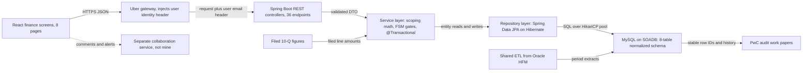
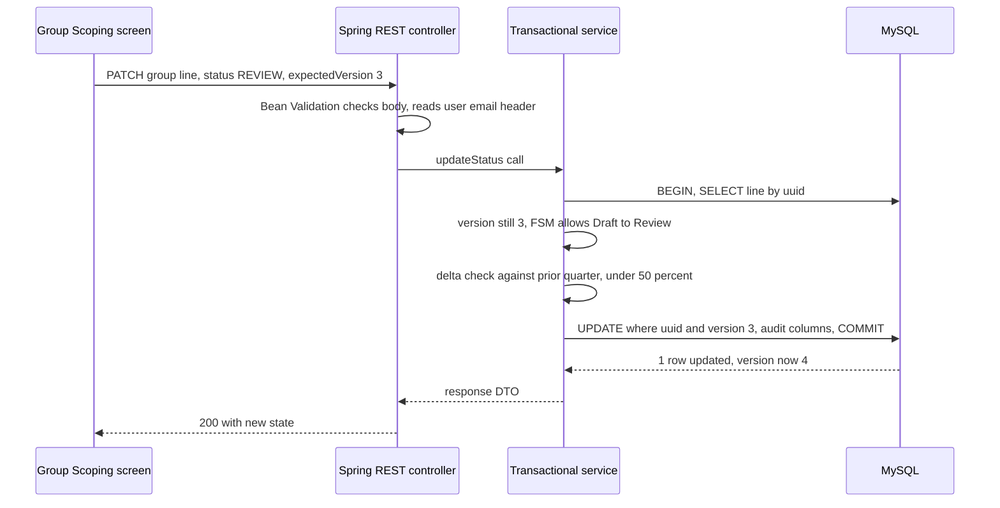

# Architecture: Uber FRM Scoping Platform (Uber via EPAM)

<div class="callout note">
<b>How to use this page</b>
<ul>
<li><b>What it covers:</b> the FRM (Financial Risk Management) scoping backend I owned at Uber Finance via EPAM. That means the Java Spring Boot service, the MySQL schema, how one edit flows through it, and how the quarterly close runs.</li>
<li><b>When to read it:</b> before system design rounds that touch data modelling, concurrency or correctness, and before any "tell me about Uber" question.</li>
<li><b>What to memorise:</b> the six-box diagram, the PATCH request with the version check, and the three numbers: 70% (from 14 days to 3 days), $340M materiality, 36 endpoints.</li>
</ul>
</div>

**Tags on this page.** MEASURED means there is a log, a doc or code. ESTIMATED means arithmetic I can show. TARGET means a design goal (say "targeting"). HISTORICAL means from past work records.

**Stack on this track (Java + AI):** Java, Spring Boot, Spring Data JPA, Hibernate, MySQL, JUnit, Bazel, Docker. Request validation uses Bean Validation. Tests use JUnit 5, Mockito and MockMvc.

---

## 1. The one-paragraph version

Every quarter, Uber's finance team must decide which accounts and which legal entities the auditors (PwC) need to test. That decision is called **scoping**. Before this project it lived in a large Google Sheets workbook with manual formulas, no stable row IDs, no audit trail, and people overwriting each other during the close. I owned the backend that replaced it: a Java Spring Boot service with **36 endpoints** on a normalized MySQL schema, migrating **19M raw GL rows** off Sheets. It automates the financial math, models a 4-level account hierarchy, and keeps an auditable history. The close-related reconciliation work went **from 14 days to 3 days, a 70% cut**, against a **$340M materiality threshold**.

---

## 2. Words you need

### The finance words

- **FRM (Financial Risk Management).** The finance function that decides where the risk of a misstatement in the financial statements is, and therefore what auditors should test.
- **Scoping.** Choosing which accounts and entities are "in scope" for audit testing. Like a teacher deciding which chapters will be on the exam.
- **Materiality.** The size of error that would matter to someone reading the financial statements. Here it was **$340M** for the Q4 2025 close. Anything bigger than that cannot be ignored.
- **Residual risk.** The part of the balance that is not covered by the in-scope items. On the Q4 2025 close the residual threshold was **$170M**.
- **GL (general ledger).** The master list of every accounting entry, by account and entity. Think of the company's full bank statement for every account.
- **FSLI (Financial Statement Line Item).** A line on the balance sheet or income statement, such as "Cash" or "Accounts receivable". FSLIs nest in a hierarchy, here **4 levels, L1 to L4** (for example L1 "Current assets", L2 "Cash and equivalents", down to more detailed lines).
- **HFM (Oracle Hyperion Financial Management).** The consolidation system where entity trial balances are loaded, converted to one currency and combined into group numbers.
- **10-Q.** The quarterly report a US public company files with the SEC (Securities and Exchange Commission). Its numbers are the publicly attested truth.
- **Reconciliation.** Checking that two sources agree, here HFM numbers against the filed 10-Q, line by line. `difference = HFM amount − filed amount`. Like matching your own budget spreadsheet to your bank statement.
- **SOX (Sarbanes-Oxley).** US law that requires companies to have controls over financial reporting. Practically: every change must be traceable and controlled.
- **EMI (Equity Method Investment).** A company Uber partly owns and accounts for by its share of profit or loss. It has its own scoping screen.
- **Quarter-annualization.** Converting a figure for part of a year into an annual figure so it can be compared with annual thresholds. The general idea: a year-to-date number after two quarters is scaled up to a full-year equivalent. "Dynamic" means the scaling depends on which quarter you are in.

### The data and design words

- **SOADB.** Uber's standard for service-owned relational databases: MySQL on InnoDB. InnoDB gives ACID transactions (all-or-nothing writes that stay consistent).
- **Normalized schema.** Each fact stored once, in its own table, linked by keys, instead of copying the same data into many places. Like keeping one contacts list instead of writing a friend's number in every notebook.
- **Natural key.** An ID derived from the data itself rather than a random number. Here, a **SHA-256** hash of meaningful fields, so the same question on the same page always gets the same ID.
- **Optimistic row-locking.** Each row has a version number. An update only succeeds if the version is still what you read. If someone else saved first, your update affects zero rows and you get a conflict instead of silently overwriting. Like a shared document that warns "this was changed since you opened it".
- **Polymorphic review-status model.** One status model reused across many screens. Every screen's rows move through the same states: **Draft, Review, ReOpen, Closed**.
- **FSM (finite state machine).** A fixed set of states and allowed transitions. "Draft can go to Review, Review can go to Closed or ReOpen", and nothing else.
- **Bazel.** Uber's monorepo build and test system. **Stacked PRs** are a chain of small pull requests, each building on the previous, so each can be reviewed and shipped safely.
- **Statement coverage.** The percentage of code lines executed by tests.

### The Java and Spring words

- **Spring Boot.** A Java framework that starts a web service with sensible defaults already wired: an embedded web server (Tomcat), JSON handling, database connection pool, configuration and health checks. Think of a furnished flat: you move in and only change what you need.
- **Spring MVC and `@RestController`.** Spring MVC is the web layer inside Spring Boot. A class marked `@RestController` holds HTTP handlers, and annotations such as `@GetMapping` and `@PatchMapping` map a URL and HTTP verb to a Java method. The return value is turned into JSON automatically.
- **Dependency injection and beans.** Spring creates the controller, service and repository objects (called **beans**) and passes each one the others it needs through its constructor. You never write `new GroupScopingService(...)` yourself. Like a stage manager who hands each actor their props before the scene.
- **Thread-per-request.** Spring MVC on Tomcat gives each incoming request its own thread from a pool. Blocking database calls are normal in this model, so there is no event loop to protect.
- **JPA (Jakarta Persistence API).** The standard Java API for mapping database rows to Java objects. It is a specification, not a library.
- **Hibernate.** The library that implements JPA. It turns object changes into SQL, tracks which objects changed, and writes them at commit. Hibernate is the **ORM (object-relational mapper)** here.
- **Entity.** A Java class marked `@Entity` that maps to one table. One object is one row.
- **Spring Data JPA repository.** An interface such as `GroupLineRepository extends JpaRepository<GroupLine, String>`. Spring generates the implementation, so `findById`, `save` and custom `@Query` methods work without hand-written data access code.
- **JPQL and native queries.** JPQL (Jakarta Persistence Query Language) is SQL-like but written against entity and field names. A **native query** is plain MySQL SQL run through JPA. Both can return a **projection**, which is a small read-only shape (an interface or a record) holding only the selected columns.
- **`@Version`.** A JPA annotation on a numeric field. Hibernate adds `AND version = ?` to every UPDATE and increments the number. If zero rows change, it throws an **`OptimisticLockException`** (Spring wraps it as `ObjectOptimisticLockingFailureException`). This is how optimistic row-locking is implemented.
- **`@Transactional`.** Put on a service method, it opens one database transaction when the method starts and commits when it returns. If an exception escapes, everything in the method rolls back. This is how atomic cross-table syncs work.
- **Bean Validation.** Annotations such as `@NotNull` and `@NotBlank` on request fields. `@Valid` on the request body makes Spring check them before the method runs. A failed check never reaches the business code.
- **DTO (data transfer object).** A plain class or Java `record` that defines the JSON shape of a request or response, kept separate from the entity so the API does not leak database internals.
- **`@RestControllerAdvice`.** One class that turns exceptions into HTTP responses for the whole service, for example a stale version into a 409 and a validation failure into a 400 with an error body.
- **HikariCP.** The database connection pool Spring Boot uses by default. It keeps a fixed number of MySQL connections open and lends one to each request thread for the length of its transaction.
- **JUnit 5, Mockito, MockMvc.** JUnit 5 is the Java test runner. Mockito creates fake versions of dependencies so a service can be tested alone. MockMvc sends fake HTTP requests to a controller without starting a real server, so you can assert status codes and JSON.

---

## 3. The architecture diagram



*What to notice: a classic three-layer service (controller, service, repository) on one transactional database. The ETL from HFM and the collaboration service are shared or separate pieces. I owned the scoping service in the middle.*

---

## 4. Box-by-box walkthrough

### React finance screens (8 pages)
The UI finance managers use. The 8 screens are Reconciliation, Materiality, EMI Scoping, Group Scoping, Threshold Setup, Component Scoping, Residual Risk and Summary. Each screen reads and edits rows through the API. I describe the UI as context; my ownership is the backend.

### Uber gateway
Authenticates the user and injects their identity as a header (for example `x-auth-params-email`). The controller reads it with `@RequestHeader`, and the service writes that email into `created_by` and `updated_by` columns, so every change is attributable. That matters for SOX.

### Spring Boot REST controllers (36 endpoints)
The HTTP layer. Each controller method takes a request DTO checked by Bean Validation, calls the service layer, and returns a typed response DTO, including nested trees for the L1 to L4 hierarchy. If asked for the breakdown: about 31 functional routes live in the scoping service controllers, and the comment and notification APIs specified in the technical design doc (TDD) for the collaboration service make up the rest of the 36.

**Why Spring Boot.** It gives a mature, opinionated stack for a correctness-heavy CRUD service: Spring MVC for the endpoints, Bean Validation at the boundary, Spring Data JPA for data access, declarative transactions, and first-class testing with MockMvc. JPA calls are blocking, and Spring MVC's thread-per-request model handles that naturally, so no extra offloading is needed. Each request thread borrows a MySQL connection from HikariCP for the length of its transaction.

A short controller, so the shape is concrete (teaching sketch, names illustrative):

```java
@RestController
@RequestMapping("/group-scoping/lines")
class GroupScopingController {
    private final GroupScopingService service;

    GroupScopingController(GroupScopingService service) { this.service = service; }

    @PatchMapping("/{uuid}")
    LineResponse updateStatus(@PathVariable String uuid,
                              @Valid @RequestBody StatusUpdateRequest body,
                              @RequestHeader("x-auth-params-email") String email) {
        return service.updateStatus(uuid, body, email);
    }
}

enum ReviewStatus { DRAFT, REVIEW, REOPEN, CLOSED }

record StatusUpdateRequest(@NotNull ReviewStatus status,
                           @NotBlank String conclusionScope,
                           @NotNull Long expectedVersion) {}
```

### Service layer
Where the finance logic lives:
- Group scoping: a line is significant if it passes the quantitative test (compared with materiality) or a qualitative test.
- Component scoping: drills into entities under each FSLI, using a 5% significance threshold.
- Residual risk: computes the balance not covered by in-scope items and compares it with the residual threshold.
- Quarter-annualization for comparisons against annual thresholds.
- **FSM gates**: allowed status transitions only, plus a **50% delta-variance check**. If a line moves by more than half compared with the prior period, the automatic transition is blocked and the line is flagged. This is a SOX control.

Service methods that change data are marked `@Transactional`, so every write inside one method commits together or rolls back together. One Spring detail worth knowing: `@Transactional` works through a proxy (a wrapper object Spring puts around the bean), so calling a transactional method from another method in the same class skips the wrapper. Keep transactional entry points public and call them from the controller.

### Repository layer (Spring Data JPA on Hibernate)
All database access goes through Spring Data JPA repositories, with Hibernate underneath. The **Spring Data JPA / Hibernate migration** I led (with 3 engineers) moved this layer to entities, repositories and explicitly aliased JPQL or native projections. That removed a class of column-aliasing bugs (explained below) and brought module statement coverage to **100%**.

**Reporting SQL allowlists:** reporting queries can only run from an approved list, so nobody ships an ad hoc query against financial tables. In practice the approved queries are named repository methods, and nothing else can reach the financial tables.

### MySQL on SOADB (8-table normalized schema)
The system of record. The schema stores the hierarchy, the per-quarter balances, the reconciliation leaves, thresholds, questionnaires and assessments. Key properties:
- **Fiscal period keys** on every fact row (`fiscal_quarter`, `fiscal_year`) with composite indexes.
- The ETL flattens the recursive FSLI tree into a stable `level_id` in a mapping table, so the API joins facts to a level ID instead of walking a tree in SQL.
- **Optimistic row-locking** through a `@Version` column checked on every update.
- **Atomic cross-table syncs:** when one edit must change rows in several tables, it happens in one `@Transactional` method. Either all change or none.
- **SHA-256 natural keys** so re-imported data updates in place instead of duplicating.

If someone has seen the code and asks why there are 11 ORM models (entities): the resume number is the 8-table normalized schema in the bullet. Keep the answer at that level and do not invent a table-by-table mapping.

### Shared ETL from Oracle HFM
HFM extracts land in MySQL for each fiscal period. The ETL was a shared pipeline responsibility. Do not claim you built it alone.

### Filed 10-Q figures
The reconciliation screen compares HFM amounts with the public 10-Q line amounts, so scoping is built on numbers that match what went to the SEC.

### Separate collaboration service
Comments, notifications and Slack alerts live in a separate service. I did not build it. Scope your ownership to the scoping service.

### PwC audit work papers
The Summary screen and the stored history feed the auditors. Stable row IDs mean an auditor's comment points at the same line every quarter.

---

## 5. One request, step by step: a manager moves a line to Review

**Example.** A finance manager on the Group Scoping screen marks the "Cash and equivalents" line for Q4 2025 as in scope and moves it from Draft to Review.



1. The browser sends a PATCH with the new status, the scoping conclusion and the version it last read (3):

```json
{ "status": "REVIEW", "conclusionScope": "In scope", "expectedVersion": 3 }
```

2. Bean Validation checks the body before the controller method runs. A missing field fails `@NotNull` or `@NotBlank`, and a status that is not one of Draft, Review, ReOpen, Closed cannot be read into the enum. Either way the API returns **400** with an error body, and the service is never called:

```json
{ "code": "VALIDATION_FAILED", "message": "expectedVersion must not be null" }
```

3. The service loads the line and compares its version with `expectedVersion`. Then it checks the FSM: Draft to Review is allowed. Closed straight back to Draft would not be.
4. The service runs the delta-variance check. Illustrative numbers: last quarter $1,000M, this quarter $1,200M, a 20% move. That is under 50%, so the gate passes.
5. The service sets the new fields on the entity. At flush, Hibernate writes one UPDATE that includes the version check. This is the SQL it generates, in plain form:

```sql
UPDATE group_balance_sheet
SET group_status = 'REVIEW', conclusion_scope = 'In scope',
    version = 4, updated_by = :email, updated_at = NOW()
WHERE uuid = :uuid AND version = 3;
```

6. One row changed, so it commits. If another manager had saved first, the version would already be 4. Either the version comparison in step 3 catches it, or, if the other save landed between our read and our write, the UPDATE matches zero rows and Hibernate throws `OptimisticLockException`. Both paths become **409 Conflict** instead of silently overwriting.
7. The UI shows the new state, and the audit columns record who did it.

The entity and the service behind those steps (teaching sketch, names illustrative):

```java
@Entity
@Table(name = "group_balance_sheet")
class GroupLine {
    @Id private String uuid;
    @Enumerated(EnumType.STRING) private ReviewStatus groupStatus;
    private String conclusionScope;
    @Version private Long version;
    private String updatedBy;
    private Instant updatedAt;
    // getters and setters omitted
}

@Service
class GroupScopingService {
    private final GroupLineRepository lines;
    private final ScopingGates gates;

    GroupScopingService(GroupLineRepository lines, ScopingGates gates) {
        this.lines = lines;
        this.gates = gates;
    }

    @Transactional
    public LineResponse updateStatus(String uuid, StatusUpdateRequest req, String email) {
        GroupLine line = lines.findById(uuid)
            .orElseThrow(() -> new LineNotFoundException(uuid));
        if (!line.getVersion().equals(req.expectedVersion())) {
            throw new ObjectOptimisticLockingFailureException(GroupLine.class, uuid);
        }
        gates.requireAllowedTransition(line.getGroupStatus(), req.status());
        gates.requireDeltaUnderThreshold(line);   // the 50% delta-variance check
        line.setGroupStatus(req.status());
        line.setConclusionScope(req.conclusionScope());
        line.setUpdatedBy(email);
        line.setUpdatedAt(Instant.now());
        return LineResponse.from(lines.saveAndFlush(line));
    }
}
```

And the one place that maps exceptions to HTTP responses:

```java
@RestControllerAdvice
class ApiErrors {
    @ExceptionHandler({OptimisticLockingFailureException.class, OptimisticLockException.class})
    ResponseEntity<ErrorBody> staleVersion(Exception e) {
        return ResponseEntity.status(HttpStatus.CONFLICT)
            .body(new ErrorBody("STALE_VERSION", "This line changed since you opened it. Reload and retry."));
    }

    @ExceptionHandler(MethodArgumentNotValidException.class)
    ResponseEntity<ErrorBody> invalidBody(MethodArgumentNotValidException e) {
        String msg = e.getBindingResult().getFieldErrors().stream()
            .map(f -> f.getField() + " " + f.getDefaultMessage())
            .collect(Collectors.joining(", "));
        return ResponseEntity.badRequest().body(new ErrorBody("VALIDATION_FAILED", msg));
    }

    @ExceptionHandler(HttpMessageNotReadableException.class)
    ResponseEntity<ErrorBody> unreadableBody(HttpMessageNotReadableException e) {
        return ResponseEntity.badRequest().body(new ErrorBody("VALIDATION_FAILED", "Malformed body or unknown status"));
    }
}

record ErrorBody(String code, String message) {}
```

### The quarterly close, as one job

1. HFM extracts land in MySQL for the fiscal period (shared ETL).
2. Reconciliation ties HFM to the 10-Q line by line and shows every non-zero difference.
3. Materiality and thresholds are set: **$340M** materiality, **$170M** residual for Q4 2025.
4. Group scoping marks significant FSLIs. Component scoping drills into entities under each.
5. Residual risk computes what is still uncovered. EMI scoping handles part-owned investees.
6. Summary rolls up coverage for PwC.

---

## 6. Design decisions

### Decision 1: move the close off Google Sheets into a normalized MySQL schema
- **What:** an 8-table normalized schema on SOADB replaces the workbook.
- **Why:** Sheets has no stable row IDs (so no comments or audit history per line), no concurrency control, and no way to model a recursive hierarchy safely. Versions drift between copies. Finance had ETL lock contention during the close.
- **Alternatives:** keep Sheets with Apps Script (no real concurrency control), or use a columnar warehouse (built for scans, not transactional edits).
- **Trade-off:** more upfront schema design, and a migration with a parallel run.
- **What I'd do differently:** build the parallel-run comparison report as a first-class feature from day one, not as a side script.

### Decision 2: optimistic row-locking instead of pessimistic locks
- **What:** a JPA `@Version` column on every editable entity, checked on every update.
- **Why:** many managers read and few collide on the same line. Holding row locks while someone thinks in the UI would block others.
- **How:** Hibernate adds the version to the UPDATE's WHERE clause. Zero rows changed means `OptimisticLockException`, and the controller advice turns that into a 409.
- **Alternatives:** `SELECT ... FOR UPDATE` (pessimistic, `@Lock(LockModeType.PESSIMISTIC_WRITE)` in JPA). Safe, but locks pile up during the close.
- **Trade-off:** the UI must handle a conflict response and ask the user to reload.
- **What I'd do differently:** return the current row with the 409 so the UI can show a diff.

### Decision 3: SHA-256 natural keys
- **What:** for example `uuid = SHA-256(question_text + normalized page_name)` for scoping questions.
- **Why:** quarterly re-imports of the same data must update rows, not create duplicates across audit trails.
- **Alternatives:** random UUIDs plus a uniqueness constraint on several columns. That works, but the ID is not reproducible from the data.
- **Trade-off:** if the source text changes (even a typo fix), the key changes. Normalising the inputs first reduces that.

Tiny example (teaching sketch). `MessageDigest` is Java's built-in hashing class, and `HexFormat` turns the bytes into a hex string:

```java
static String questionUuid(String questionText, String pageName) {
    String key = questionText.strip() + "|" + pageName.strip().toLowerCase(Locale.ROOT);
    try {
        byte[] hash = MessageDigest.getInstance("SHA-256")
            .digest(key.getBytes(StandardCharsets.UTF_8));
        return HexFormat.of().formatHex(hash);
    } catch (NoSuchAlgorithmException e) {
        throw new IllegalStateException("SHA-256 not available", e);
    }
}

// questionUuid("Is the balance subject to significant estimates?", "Group Scoping")
// gives the same id next quarter, so the upsert updates in place
```

### Decision 4: one polymorphic review-status model across screens
- **What:** Draft, Review, ReOpen, Closed, shared by every screen. In Java this is one `ReviewStatus` enum and one set of transition rules that every screen's service calls.
- **Why:** one set of FSM rules, one set of tests, one audit format.
- **Alternatives:** a separate status column and rules per screen. Faster to start, but rules drift.
- **Trade-off:** a screen with special needs has to fit the shared model.

### Decision 5: lead a Spring Data JPA / Hibernate migration
- **What:** move the repository layer to JPA entities and Spring Data repositories, with every multi-table read written as an explicitly aliased JPQL or native projection.
- **Why:** a real bug. A raw SQL join returned two columns with the same name. The code built a map from column names, so the second value silently overwrote the first, and some rows were mapped to the wrong uuid.
- **Alternatives:** patch each raw query by hand. Fixes today's bug, not the class of bugs.
- **Trade-off:** a migration across many modules, which needed tests first. That is why coverage reached 100% for the module.
- **What I'd do differently:** add a lint rule that rejects raw SQL with unaliased duplicate column names.

The fix in code (teaching sketch, names illustrative). Every projected column gets its own alias, and Spring Data maps each alias to one getter, so two `uuid` columns can never collide:

```java
interface LevelBalanceRow {
    String getBalanceUuid();
    String getLevelUuid();
    BigDecimal getAmount();
}

interface GlBalanceRepository extends JpaRepository<GlBalance, String> {
    @Query(value = """
        SELECT b.uuid AS balanceUuid, m.uuid AS levelUuid, b.amount AS amount
        FROM gl_balance b
        JOIN fsli_level_map m ON m.level_id = b.level_id
        WHERE b.fiscal_year = :fy AND b.fiscal_quarter = :fq
        """, nativeQuery = true)
    List<LevelBalanceRow> findQuarterBalances(@Param("fy") int fy, @Param("fq") int fq);
}
```

The JPQL version works the same way with a constructor expression, for example `SELECT new com.example.frm.LevelBalance(b.uuid, m.uuid, b.amount) FROM GlBalance b JOIN b.level m`, where each value goes into a named constructor parameter instead of a name-keyed map.

### Decision 6: zero-downtime releases through stacked Bazel PRs
- **What:** each change is a small PR in a stack. Schema changes ship before code that depends on them.
- **Why:** finance cannot have the tool down during the close.
- **Trade-off:** more PRs to coordinate and review.

---

## 7. The numbers on this diagram

| Number | What it measures | Tag |
|---|---|---|
| 70%, from 14 days to 3 days | Quarterly reconciliation time | On PDF |
| $340M | Group materiality threshold, Q4 2025 close | On PDF |
| 19M | Raw GL rows migrated off Sheets | On PDF |
| 36 | Spring Boot API endpoints | On PDF |
| 4 levels, L1 to L4 | FSLI hierarchy depth | On PDF |
| 8 | Tables in the normalized schema | On PDF |
| 3 engineers | People I led on the Spring Data JPA / Hibernate migration | On PDF |
| 100% | Module statement coverage after the migration | On PDF |
| 50% | Delta-variance threshold in the FSM gates | On PDF |
| $170M, 5% | Residual threshold and component significance threshold | Verbal |
| 1,100+ | Tests in the suite | Verbal |

**70% (from 14 days to 3 days).** It measures how long the quarterly reconciliation took before and after. It mattered because the close is time-boxed, and every day spent on manual tie-outs is a day not spent on analysis. Say it as "we cut quarterly reconciliation from 14 days to 3 days, about 70%". If someone does the arithmetic: 14 to 3 is actually about a 79% cut, because (14 − 3) / 14 ≈ 0.79. The 70% headline is the figure the technical design doc framed, so the resume understates rather than overstates. If pressed on source, say "the technical design doc framed that cut and that is what the platform delivered for the close". Do not walk it back unprompted.

**$340M materiality.** It is not a volume metric. It is the threshold that drives the scoping rules. Say "against a $340 million materiality threshold".

**19M raw GL rows.** It is the total migrated off Sheets. Individual quarterly GL extracts were about 38K to 95K rows, about 1.7K to 1.8K accounts and about 400 entities. If asked, say "the value was correctness, hierarchy and auditability, not big-data throughput". Do not invent a breakdown of where 19M comes from beyond "raw GL rows migrated off Sheets".

**36 endpoints.** About 31 functional routes in the scoping service plus the comment and notification APIs from the TDD. Say "36 Spring Boot endpoints". Older prep said "30+ endpoints, do not say 36". That guidance is obsolete. The current resume says 36.

**3 engineers.** I was tech lead of an EPAM pod, not a people manager. Never add this to "mentored 2" from Masters India.

---

## 8. Failure modes and what the system does

| What breaks | How you notice | What happens |
|---|---|---|
| Two managers edit the same line | Version mismatch or UPDATE affects 0 rows | `OptimisticLockException`, API returns 409, nobody's change is silently lost. |
| Request body is missing a field or has an unknown status | Bean Validation or JSON parsing fails | API returns 400 with an error body. The service never runs. |
| An edit must touch several tables and one write fails | Exception inside the `@Transactional` method | Whole transaction rolls back. No half-applied edit. |
| Same data re-imported next quarter | Same SHA-256 key | Upsert updates in place, no duplicates. |
| Large unexpected swing in a line | Delta over 50% | FSM gate blocks the automatic transition and flags the line. |
| Joined raw SQL with duplicate column names | Wrong uuid on rows (the real bug) | Fixed by the Spring Data JPA / Hibernate migration: explicitly aliased projections. |
| HFM and 10-Q do not tie | Non-zero difference on Reconciliation | Shown and commentable on every line. Managers clear breaks before sign-off. The tool makes breaks visible. Humans do the sign-off. |
| Ad hoc reporting query | Not in allowlist | Rejected. |
| Request threads waiting on the database | HikariCP pool exhausted, requests time out waiting for a connection | Keep transactions short, never hold one open across a slow call, and size the pool to what the database allows. |
| Bad release during close | Tests and staged PRs | Small stacked PRs, 100% module coverage, rollback is one small PR. |

---

## 9. Verbal depth (not on the PDF, true)

- **Sheets to MySQL reconciliation, v1 to v2.** Version 2 endpoints ran in parallel beside version 1. The change touched 18 files, +1,268 lines of code. Stable IDs unlocked per-line comments. Cutover happened after staging parity.
- **The column-aliasing bug.** A join of the fact table and the level mapping table returned columns with the same name. The code zipped column names to values, so the last one won, and rows got the wrong uuid. Fix: an explicit `AS` alias on every projected column, read through a Spring Data projection interface or a JPQL constructor expression, so each value has exactly one named home.
- **Q4 2025 sample:** about 55 line items and 14 entities in scope (MEASURED in older prep).
- **Tests:** the suite grew past 1,100 tests because every PR had to add or update tests in the matching folder. CI ran five layer targets (database, schema, repository, service, controller). Service tests used JUnit 5 with Mockito fakes for repositories. Controller tests used MockMvc to assert status codes and JSON, including the 400 and 409 paths. As a general practice, repository tests can run against a real MySQL in a throwaway Docker container (Testcontainers).

A MockMvc test for the conflict path, so the testing style is concrete (teaching sketch):

```java
@WebMvcTest(GroupScopingController.class)
class GroupScopingControllerTest {
    @Autowired MockMvc mvc;
    @MockitoBean GroupScopingService service;

    @Test
    void staleVersionReturns409() throws Exception {
        when(service.updateStatus(eq("abc"), any(), any()))
            .thenThrow(new ObjectOptimisticLockingFailureException(GroupLine.class, "abc"));

        mvc.perform(patch("/group-scoping/lines/abc")
                .header("x-auth-params-email", "manager@example.com")
                .contentType(MediaType.APPLICATION_JSON)
                .content("{\"status\":\"REVIEW\",\"conclusionScope\":\"In scope\",\"expectedVersion\":3}"))
           .andExpect(status().isConflict())
           .andExpect(jsonPath("$.code").value("STALE_VERSION"));
    }
}
```

---

## 10. Say this, not that

| Say this | Not this |
|---|---|
| "Uber via EPAM." | "I worked at Uber" without EPAM. |
| "I owned the scoping backend." | "I built the collaboration and Slack service." |
| "The HFM ETL was a shared pipeline." | "I built the whole data pipeline." |
| "Led 3 engineers as tech lead of an EPAM pod." | "I managed a team" or "led 5". |
| "36 Spring Boot endpoints." | "30+ endpoints" (obsolete prep). |
| "Value was correctness and auditability." | "Big data at 19M rows per quarter." |

Say this carefully about optimistic locking. Older prep notes said version-check concurrency lived in the collaboration service. The current resume claims optimistic row-locking in the schema. If pressed, explain the mechanism (a `@Version` column, the conditional UPDATE Hibernate generates, a 409 on zero rows) and keep the scope to the scoping tables.

---

## 11. How to draw it in 3 minutes

**Minute 1: the problem and the spine.** Write "Google Sheets close, 14 days" on the left and cross it out. Draw UI, gateway, Spring Boot service, MySQL left to right. Say: "Uber's quarterly scoping lived in Sheets: no stable IDs, no audit trail, people overwriting each other. I owned the Spring Boot backend that replaced it, 36 endpoints on MySQL on Uber's SOADB standard, and we migrated 19 million raw GL rows off Sheets."

**Minute 2: inside the service.** Split the Spring Boot box into controller, service, repository. Say: "Controllers validate request DTOs with Bean Validation and return 400 on bad input. The service holds the finance math: materiality at $340 million, the L1 to L4 FSLI hierarchy, quarter-annualization, and a state machine with a 50% delta-variance gate for SOX. The repository is Spring Data JPA on Hibernate. I led 3 engineers on that migration, which killed a column-aliasing bug and took module coverage to 100%."

**Minute 3: the data guarantees.** Draw the 8 tables as a stack under MySQL and write three words next to them: "@Version", "@Transactional", "SHA-256". Say: "Every update checks a version, so two managers cannot overwrite each other. A stale save gets a 409. Cross-table edits run in one transaction. Natural keys are SHA-256 of the meaningful fields, so re-imports never duplicate. The result was reconciliation from 14 days to 3 days." Add HFM and 10-Q arrows into reconciliation and a PwC arrow out of Summary to finish.

---

## Related

- Full FRM deep dive: [../projects/02_frm_deep_dive.md](../projects/02_frm_deep_dive.md)
- Uber FRM and Menu interview pack: [../projects/02_03_uber_frm_menu.md](../projects/02_03_uber_frm_menu.md)
- FRM handbook chapter: [../../../handbook/05_uber_frm.md](../../../handbook/05_uber_frm.md)
- Postgres, MySQL and Redis depth: [../tech_depth/postgres_mysql_redis.md](../tech_depth/postgres_mysql_redis.md)
