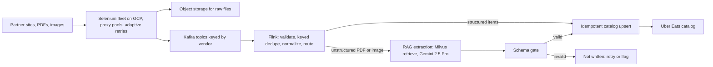
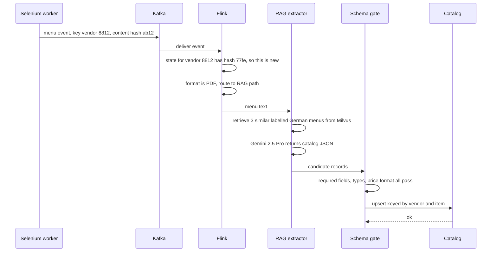

# Architecture: Uber Eats Menu Ingestion and Automation (Uber via EPAM)

<div class="callout note">
<b>How to use this page</b>
<ul>
<li><b>What it covers:</b> the pipeline that turns restaurant menus from partner websites and PDFs into structured Uber Eats catalog entries. That means scraping, Kafka, Flink and the RAG extraction path. A short section covers the separate ANZ document compliance project.</li>
<li><b>When to read it:</b> before streaming, data pipeline or GenAI/RAG system design rounds.</li>
<li><b>What to memorise:</b> the seven-box diagram, one menu traced end to end, the honest meaning of "exactly-once", and the numbers: from 24 hours to 2 hours, $600K a year, 30K+ menus a month, 98% field fidelity (offline), 95%+ extraction success.</li>
</ul>
</div>

**Tags on this page.** MEASURED means there is a log, a doc or code. ESTIMATED means arithmetic I can show. TARGET means a design goal (say "targeting"). HISTORICAL means from past work records.

**Tech on this project:** Python, Selenium, Kafka, Flink, LangChain, Gemini, RAG, Milvus, GCP, Docker. **Not** ClickHouse. **Not** Spark on the PDF.

---

## 1. The one-paragraph version

When a restaurant joins Uber Eats, its menu has to be entered into Uber's catalog: every dish, price, section and option, in a strict schema. Menus arrive as messy websites, PDFs and images, often in several languages. Doing that by hand or through a paid third-party tool was slow and expensive. This pipeline automates it. A fleet of Selenium scrapers collects menus, Kafka buffers the events, Flink deduplicates and normalises them, and unstructured PDFs go through a RAG extraction path (LangChain, Milvus and Gemini 2.5 Pro) that produces schema-valid catalog records. Restaurant onboarding went **from 24 hours to 2 hours**, saving about **$600K a year** across **30K+ menus a month**.

---

## 2. Words you need

- **Menu ingestion.** Getting a restaurant's menu from wherever it lives into Uber's catalog database in the right shape.
- **Catalog schema.** The strict structure every menu must fit: item name, price, currency, section, modifiers (like "extra cheese"), and so on. Like a form with required fields.
- **Selenium.** A tool that drives a real web browser from code. Needed when menus are rendered by JavaScript and there is no clean API. Like a robot that clicks through a website the way a person would.
- **Proxy pool.** A set of intermediate IP addresses the scrapers rotate through, so a site does not block one address for too many requests.
- **Adaptive retries.** Retrying a failed scrape with backoff and per-site budgets that adjust to how that site behaves.
- **Kafka.** A durable, ordered log of events that many consumers can read at their own pace. Think of a conveyor belt that also keeps a recording of everything that passed, so you can rewind and replay.
- **Topic and partition key.** A topic is a named stream. The partition key (here the vendor) decides which partition an event goes to, which keeps one vendor's events in order.
- **Consumer lag.** How far behind a consumer is from the newest event. The main health signal for a streaming pipeline.
- **Flink (Apache Flink).** A stream processing engine that keeps state per key and recovers from crashes using checkpoints. Like a clerk who keeps a folder per restaurant and photocopies all folders every few minutes in case of fire.
- **Keyed state.** Data Flink remembers per key, here "the last content hash I saw for this vendor's menu".
- **Content hash.** A fingerprint of the menu content. If the hash is the same as last time, nothing changed.
- **Deduplication (dedup).** Dropping repeated copies of the same event.
- **Exactly-once.** In marketing language, "every event takes effect exactly one time". In practice here: **at-least-once delivery plus idempotent upserts**. Events may be delivered more than once, but writing the same record twice leaves the catalog unchanged.
- **Idempotent upsert.** "Insert or update" keyed by a stable ID, so repeating it has no extra effect. Like pressing a lift button twice: the lift still comes once.
- **RAG (retrieval-augmented generation).** Before asking the LLM to do a task, you retrieve relevant examples or documents and put them in the prompt. Like giving a new employee three filled-in example forms before asking them to fill in a fourth.
- **Embedding.** A list of numbers that represents the meaning of a piece of text. Similar texts have nearby embeddings.
- **Milvus.** A vector database that stores embeddings and finds the nearest ones fast.
- **LangChain.** A Python framework for chaining LLM steps: load document, retrieve, prompt, parse output.
- **Gemini 2.5 Pro.** Google's large language model, used here to read the menu and return structured JSON.
- **Field fidelity.** The share of extracted fields that match the correct value on a labelled test set. **98%** in offline evaluation.
- **Offline evaluation.** Measuring quality on a fixed labelled set before release, not live in production.

---

## 3. The architecture diagram



*What to notice: there are two paths out of Flink. Structured menus go straight to the catalog. Messy PDFs and images take the RAG detour, and nothing reaches the catalog without passing the schema gate.*

---

## 4. Box-by-box walkthrough

### Partner sites, PDFs, images
The raw sources: restaurant websites, third-party menu platforms, uploaded PDFs and photos. Many are rendered by JavaScript, many are multilingual, and many actively block bots.

### Selenium fleet on GCP
- **What:** Python Selenium workers running in Docker on GCP that load pages like a real browser and emit menu, item and scrape-health events.
- **Why Selenium:** many partner pages only render menus with JavaScript, and there was no complete API.
- **Hardening:** dynamic proxy pools, adaptive retries with per-source budgets, and rotation so one blocked address does not fail a whole run. That took extraction success to **95%+**, up from an estimated 60% to 65%.
- **Alternative:** plain HTTP scraping. Faster and cheaper, but it fails on JavaScript-rendered pages.

### Object storage for raw files
Raw HTML, PDFs and images are kept so a parser bug can be fixed and the data reprocessed without scraping again.

### Kafka topics keyed by vendor
- **What:** the ingest bus between scrapers and processing.
- **Why:** scrapers are bursty. Kafka absorbs bursts so slow catalog writes never block scraping. Keying by vendor keeps one restaurant's events in order. The log can be replayed after a bad parser deploy, and more than one consumer can read the same topic.
- **Alternative:** scrapers call the catalog directly over HTTP. Simple, but a slow catalog stalls the scrapers and there is no replay.

### Flink: validate, keyed dedupe, normalise, route
- **What:** a stateful stream job reading Kafka.
- **Validate:** reject events missing required fields.
- **Keyed dedupe:** state keyed by vendor and menu holds the last content hash. Same hash means no change, so the event is dropped.
- **Normalise:** map different source formats into one internal shape (currency, price format, section names).
- **Route:** structured items go to the catalog upsert. Unstructured PDFs and images go to RAG extraction.
- **Why Flink:** real keyed state, event-time handling for late pages, checkpoint recovery and low latency.
- **Alternatives:** Spark Structured Streaming (micro-batches, seconds of latency, a fine choice for backfills but weaker for this hot path) or Kafka Streams (could work at this event rate if that were the team standard).

### RAG extraction (LangChain, Milvus, Gemini 2.5 Pro)
1. Extract text from the PDF or image and split it into chunks.
2. Embed the chunks and retrieve similar, already-labelled menu examples from Milvus.
3. Build a prompt with the target schema, the retrieved examples and the new menu text.
4. Gemini 2.5 Pro returns JSON in the catalog schema.

Why RAG instead of a bare prompt: retrieved examples show the model exactly how a similar menu was mapped, which grounds field names and formats and reduces invented fields.

### Schema gate
Every extracted record is validated against the catalog schema (required fields, types, price format). Invalid records are not written. They are retried or flagged. Older prep also describes low-confidence results going to manual handling. Keep that qualitative.

### Idempotent catalog upsert and the catalog
Writes are keyed by stable IDs (vendor and item, with the content hash), so a replayed event writes the same record again and the catalog does not change. That is what "exactly-once catalog upserts" means on the resume.

---

## 5. One menu, step by step

**Example (illustrative).** A restaurant in Berlin uploads a two-page German PDF. One line reads "Schnitzel Wiener Art mit Pommes … 14,50 €".



1. The scraper downloads the PDF, stores the raw file, and publishes an event keyed by vendor `8812` with content hash `ab12`.
2. Flink looks up the state for vendor 8812. The last hash was `77fe`, so the menu changed and the event moves on. If the hash had matched, Flink would drop it as a duplicate.
3. The format is PDF, so Flink routes it to RAG extraction.
4. The extractor retrieves similar labelled German menus from Milvus and prompts Gemini 2.5 Pro with the schema and examples.
5. Gemini returns:

```json
{
  "section": "Hauptgerichte",
  "item_name": "Schnitzel Wiener Art mit Pommes",
  "price": 14.50,
  "currency": "EUR",
  "modifiers": []
}
```

6. The schema gate checks required fields, the numeric price and the currency code. It passes.
7. The upsert writes the item keyed by vendor and item. If Kafka redelivers the same event after a crash, the same upsert runs again and nothing changes.

---

## 6. Design decisions

### Decision 1: Kafka between scrapers and processing
- **What:** a durable ingest bus keyed by vendor.
- **Why:** absorb bursts, keep per-vendor order, replay after parser bugs, allow several consumers.
- **Alternatives:** direct HTTP to the catalog (no replay, scrapers stall), or a simple task queue (deletes messages on acknowledge, so no cheap replay).
- **Trade-off:** Kafka is more infrastructure to operate.
- **What I'd do differently:** add consumer-lag alerts per source from day one.

### Decision 2: Flink for dedupe and normalisation
- **What:** a stateful keyed stream job.
- **Why:** dedupe needs memory per vendor. Late pages need event-time handling. Crash recovery needs checkpoints.
- **Alternatives:** Spark Structured Streaming (micro-batch latency) or Kafka Streams (lighter, could work at this rate). Spark is a verbal backfill option only, not on the PDF.
- **Trade-off:** Flink is a separate cluster to understand and tune.

### Decision 3: RAG with Gemini for unstructured menus
- **What:** retrieval of labelled examples from Milvus, then Gemini 2.5 Pro producing schema JSON.
- **Why:** rule-based parsers break on every new PDF layout and language. Retrieved examples ground the model.
- **Alternatives:** template parsers per layout (brittle), or a bare LLM prompt with no examples (more invented fields).
- **Trade-off:** LLM cost and the need for an offline evaluation set to prove quality.
- **What I'd do differently:** grow the labelled evaluation set per language and track fidelity per language, not only overall.

### Decision 4: "exactly-once" as at-least-once plus idempotent upserts
- **What:** accept duplicate delivery and make writes harmless to repeat.
- **Why:** true end-to-end exactly-once across third-party sites, an LLM and an external catalog would need every system to take part in one transaction. That is not possible here.
- **Trade-off:** every writer must use stable keys.

---

## 7. The numbers on this diagram

| Number | What it measures | Tag |
|---|---|---|
| From 24 hours to 2 hours | Restaurant onboarding time | On PDF |
| $600K a year | Money saved | On PDF, conservative floor |
| 30K+ menus a month | Menus processed | On PDF |
| 98% | Field fidelity in offline evaluation | On PDF, offline |
| 95%+, from about 60% to 65% | Extraction success rate | On PDF, baseline ESTIMATED |
| 200 to 500 events a second | Peak event rate during fleet runs | ESTIMATED, prep-only |

**From 24 hours to 2 hours.** Time from a restaurant's menu arriving to it being live in the catalog. Say "from 24 hours to 2 hours". It mattered because restaurants earn nothing on Uber Eats until their menu is live.

**$600K a year.** Derivation: about $2 per menu in third-party or manual cost, times 30K menus a month, times 12 months, is $720K. The resume floors that to $600K to stay conservative. Say "about 600 thousand dollars a year, a conservative floor on roughly 720 thousand".

**30K+ menus a month.** About 1,000 menus a day (30,000 / 30). Each menu produces many item events plus retries and health events, which is why peaks can reach the estimated 200 to 500 events a second. Do not put the events-per-second number on the table unless asked, and call it an estimate.

**98% field fidelity.** On a labelled offline test set, 98% of extracted fields matched the correct value. Always say "offline evaluation". Older prep also mentioned 100% schema consistency in offline evaluation. The resume number is 98%.

**95%+ extraction success.** The share of scrape attempts that produced a usable menu. The starting point of about 60% to 65% is an estimate. Say "from roughly 60 to 65 percent to above 95 percent".

---

## 8. Failure modes and what the system does

| What breaks | How you notice | What happens |
|---|---|---|
| A site blocks the scraper | Scrape-health events, success rate drops | Proxy rotation, adaptive retries with per-source budgets. |
| Catalog writes slow down | Kafka consumer lag rises | Kafka buffers. Scrapers keep running. Flink backpressure slows reading, not scraping. |
| Parser bug deployed | Bad records or schema failures spike | Fix, rewind Kafka offsets to before the bad deploy, replay. Raw files allow reprocessing. |
| Same menu scraped twice | Same content hash | Flink keyed dedupe drops it. |
| Event delivered twice after a crash | Duplicate in the stream | Idempotent upsert, catalog unchanged. |
| Flink worker crashes | Job restarts | Restores state from the last checkpoint and continues. |
| LLM returns malformed or wrong fields | Schema gate fails | Record not written. Retried or flagged. |
| Quality drifts on a new language | Offline evaluation by language | Add labelled examples for that language to Milvus and the test set. |

---

## 9. ANZ document compliance (separate project, Uber Mobility)

This is a different project, on Uber Mobility (rides), not Uber Eats. It automated verification of driver and vehicle documents in Australia and New Zealand against local authority rules, using a **deterministic validation backend**. It reached **99.9% regulatory compliance** and removed about **20 hours a week** of manual effort. Both numbers are HISTORICAL. Do not attach Selenium, Kafka or RAG to this project.

---

## 10. Why Kafka here is not the same story as Kafka at Masters India

Interviewers who read the whole resume sometimes ask why Kafka appears twice. Same technology, different reasons.
- **Menu:** Kafka absorbs bursty scrapers, keeps each vendor's events in order, lets us replay after a bad parse, and feeds Flink.
- **Masters India:** Kafka carries GST e-invoice stages to the government portal, with per-taxpayer ordering, replay for compliance disputes, and several consumer groups. There is no Flink at Masters.

---

## 11. Say this, not that

| Say this | Not this |
|---|---|
| "98% field fidelity in offline evaluation." | "98% accurate in production." |
| "At-least-once delivery plus idempotent upserts." | "Zero message loss" or "two-phase commit across Gemini". |
| "Kafka and Flink for ingestion and processing." | ClickHouse on Menu. |
| "Spark would be my backfill option." | Spark as something on the resume. |
| "About $600K a year, floored from about $720K." | "$600K+" with no derivation. |
| "ANZ is Uber Mobility." | ANZ as part of the Eats menu pipeline. |

---

## 12. How to draw it in 3 minutes

**Minute 1: sources to Kafka.** Draw messy sources on the left, a Selenium box, then a Kafka log. Say: "Restaurant menus live on JavaScript-heavy sites and in multilingual PDFs. A Selenium fleet on GCP with dynamic proxy pools and adaptive retries took extraction success from roughly 60 to 65 percent to above 95. Events land in Kafka keyed by vendor, so bursts are absorbed and we can replay after a parser bug."

**Minute 2: Flink and the two paths.** Draw Flink with a small "state per vendor" note, then two arrows out. Say: "Flink validates, deduplicates by vendor and content hash, normalises, and routes. Structured menus go straight to an idempotent catalog upsert. PDFs and images go to a RAG path: retrieve similar labelled menus from Milvus, and Gemini 2.5 Pro fills the catalog schema, with 98% field fidelity in offline evaluation."

**Minute 3: correctness and impact.** Draw the schema gate and the catalog, and write "at-least-once + idempotent". Say: "Nothing reaches the catalog without passing the schema gate. Exactly-once in practice means at-least-once delivery plus idempotent upserts, so a replay changes nothing. Onboarding went from 24 hours to 2 hours across 30 thousand menus a month, about 600 thousand dollars a year saved."

---

## Related

- Menu deep dive: [../projects/03_menu_deep_dive.md](../projects/03_menu_deep_dive.md)
- Uber FRM and Menu interview pack: [../projects/02_03_uber_frm_menu.md](../projects/02_03_uber_frm_menu.md)
- Flink depth: [../tech_depth/flink.md](../tech_depth/flink.md)
- Kafka depth: [../tech_depth/kafka_streaming.md](../tech_depth/kafka_streaming.md)
- Kafka and Flink scale defense: [../tech_depth/kafka_flink_scale_defense.md](../tech_depth/kafka_flink_scale_defense.md)
- RAG and LangGraph depth: [../tech_depth/langgraph_mcp_rag.md](../tech_depth/langgraph_mcp_rag.md)
- Selenium depth: [../tech_depth/selenium_scraping.md](../tech_depth/selenium_scraping.md)
- Deployment and scale: [../deployment_and_scale.md](../deployment_and_scale.md)
