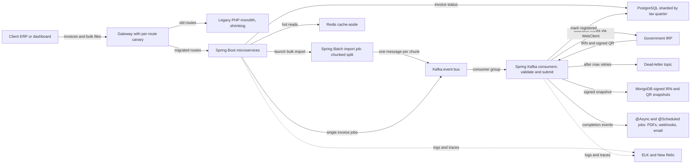
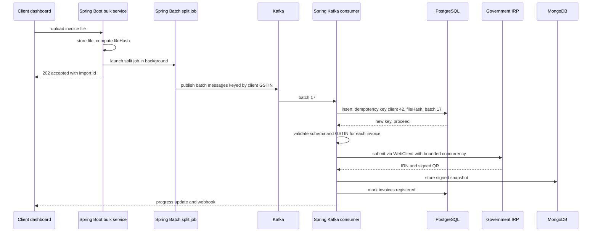

# Architecture: Masters India GST and E-Invoicing

<div class="callout note">
<b>How to use this page</b>
<ul>
<li><b>What it covers:</b> the GST e-invoicing platform at Masters India. That means the strangler migration from a PHP monolith to Spring Boot microservices, the Kafka bulk pipeline to the government portal, quarter sharding in PostgreSQL, idempotency and dead-letter queues, and the observability and caching work.</li>
<li><b>When to read it:</b> before system design rounds on high-volume pipelines, idempotency, migrations or third-party integrations.</li>
<li><b>What to memorise:</b> the diagram, one bulk import traced end to end with the idempotency key, and the numbers: p95 from 1.2 seconds to 300 milliseconds, 700 to 4,000 requests per minute, 1M+ submissions a day, 1,500+ clients.</li>
</ul>
</div>

**Tags on this page.** MEASURED means there is a log, a doc or code. ESTIMATED means arithmetic I can show. TARGET means a design goal (say "targeting"). HISTORICAL means from past work records.

**Stack on this track (Java + AI):** Java, Spring Boot, Hibernate, Kafka, PostgreSQL, MongoDB, Redis, Elasticsearch, Docker, ELK, New Relic, AWS. Tests use JUnit 5 and Mockito, with JaCoCo for coverage.

---

## 1. The one-paragraph version

In India, larger businesses must register every B2B invoice with a government system called the IRP (Invoice Registration Portal) before the invoice is legally valid. The IRP returns an IRN (Invoice Reference Number) and a digitally signed QR code. Masters India sells a SaaS product that does this for enterprises: clients send invoices to our APIs, we validate them, register them with the IRP, and return the signed result. I led the migration of the legacy PHP monolith to Spring Boot microservices, which cut p95 latency **from 1.2 seconds to 300 milliseconds** for **1,500+ enterprise clients**, and I built the bulk pipeline that handles **1M+ government submissions a day** on Kafka and PostgreSQL sharded by tax quarter.

---

## 2. Words you need

### The business and architecture words

- **GST (Goods and Services Tax).** India's indirect tax. Businesses file returns per period.
- **E-invoicing.** Registering each B2B invoice with the government before it is valid.
- **IRP (Invoice Registration Portal).** The government system that accepts invoices and returns an **IRN** and a **signed QR code**. It can be slow or flaky, especially near filing deadlines.
- **GSTIN.** A business's GST registration number, validated on every invoice.
- **Monolith.** One big application where all features are deployed together. One slow part can block everything.
- **Microservices.** Smaller services, each owning one area, deployed separately.
- **Strangler pattern.** Replacing a legacy system piece by piece. New services take over one route at a time while the old system keeps serving the rest, until the old one is "strangled". Like renovating a house room by room while still living in it.
- **Canary release.** Sending a small percentage of traffic to the new version first, watching errors and latency, then ramping up. Named after canaries miners carried to detect gas early.
- **p95 latency.** The response time that 95% of requests beat. It shows the slow tail that averages hide.
- **Non-blocking IO.** While waiting for a slow network call (like the IRP), the thread is free to do other work instead of sitting idle. Like a waiter taking other orders while the kitchen cooks.
- **Connection pooling.** Reusing a set of open database connections instead of opening a new one per request.
- **Kafka.** A durable, ordered event log. Producers write events, consumer groups read them at their own pace, and the log can be replayed.
- **Sharding.** Splitting data across separate tables or databases by a key. Here the key is the **tax quarter**.
- **Idempotency.** Doing the same operation twice has the same effect as doing it once. Critical here, because registering one invoice twice with the government cannot be undone.
- **Idempotency key.** A unique key for an operation, here `client + fileHash + batchIndex`. If the key has been seen, the work is not repeated.
- **Dead-letter queue (DLQ).** A side queue where messages that keep failing are parked, so they do not block everything else and can be replayed after a fix. In Kafka it is just another topic, often called a dead-letter topic (DLT).
- **Bounded retries.** A fixed maximum number of retries with growing waits (exponential backoff), so a failing portal is not hammered forever.
- **Cache-aside.** The app checks Redis first. On a miss it reads the database and writes the result to Redis with an expiry. Like checking your desk drawer before walking to the filing room.
- **ELK.** Elasticsearch, Logstash and Kibana: collect, store, search and visualise logs.
- **New Relic.** An APM (application performance monitoring) tool that traces requests and shows slow calls.

### The Java and Spring words

- **Spring Boot.** A Java framework that starts a service with sensible defaults already wired: an embedded web server, JSON handling, a database connection pool and configuration. Think of a furnished flat: you move in and only change what you need. Each microservice here is one Spring Boot application in its own Docker container.
- **`@RestController`.** A class whose methods handle HTTP requests. `@PostMapping("/invoices")` maps a URL and verb to a Java method, and the return value becomes JSON.
- **Bean Validation.** Annotations such as `@NotBlank` and `@Pattern` on request fields. `@Valid` makes Spring reject a bad request with a 400 before business code runs.
- **Hibernate.** The library that maps Java objects (entities) to database rows and writes the SQL for you. Spring Data JPA sits on top and generates repository classes.
- **N+1 query problem.** Loading a list of 100 invoices and then lazily loading each invoice's line items one by one: 1 query plus 100 more. Fixed in Hibernate with `JOIN FETCH` or an entity graph, which loads everything in one query.
- **HikariCP.** The connection pool Spring Boot uses by default. It keeps a fixed set of PostgreSQL connections open and lends one to each piece of work.
- **Spring Kafka.** Spring's Kafka library. `KafkaTemplate` sends messages. A method marked `@KafkaListener` is called for each message a consumer group receives.
- **`DefaultErrorHandler`.** The Spring Kafka component that decides what happens when a listener throws. It retries the message on a **back-off** schedule.
- **`ExponentialBackOff`.** A back-off schedule where each wait is longer than the last, for example 1 second, 2 seconds, 4 seconds. `ExponentialBackOffWithMaxRetries` adds a hard cap on attempts.
- **`DeadLetterPublishingRecoverer`.** What `DefaultErrorHandler` calls when retries run out. It publishes the failed message, with the error in its headers, to a dead-letter topic.
- **Spring Batch.** A Spring framework for large file and bulk jobs. A **chunked step** reads items, optionally transforms them, and writes them in fixed-size chunks, committing after each chunk. If the job fails, it can restart from the last committed chunk instead of from the start.
- **`@Async` and `@Scheduled`.** `@Async` runs a method on a background thread pool so the caller does not wait. `@Scheduled` runs a method on a timer or cron expression. Together they cover background and periodic jobs inside a Spring Boot service.
- **WebClient.** Spring's non-blocking HTTP client. It can keep many IRP calls in flight without one thread per call, with a timeout and a cap on concurrency.
- **Spring Data Redis.** Spring's Redis library. `RedisTemplate.opsForValue()` gives `get`, `set` with an expiry, and `setIfAbsent`, which sets a key only if it does not exist yet (useful as a short lock).
- **MDC (Mapped Diagnostic Context).** A per-thread map in the Java logging library (SLF4J). Put `requestId` in the MDC once, and every log line on that thread includes it automatically.
- **JUnit 5, Mockito, JaCoCo.** JUnit 5 runs Java tests. Mockito creates fake dependencies, such as a fake IRP client that times out on demand. JaCoCo measures which lines the tests executed and reports coverage, so CI can show the trend.

---

## 3. The architecture diagram



*What to notice: the gateway is where the migration happens, one route at a time. Nothing talks to the government portal synchronously from the request path. Kafka consumers do it, with idempotency, bounded retries and a dead-letter topic.*

---

## 4. Box-by-box walkthrough

### Client ERP or dashboard
Enterprise clients send single invoices from their ERP (enterprise resource planning system) through our API, or upload bulk files from the dashboard.

### Gateway with per-route canary
The gateway (Nginx) decides, per route, whether traffic goes to the old PHP code or the new Spring Boot service. A new route starts with a small percentage, we watch error rates and latency, then ramp to 100%. Rollback is a config change, not a deploy.

### Legacy PHP monolith
The old system. It was synchronous: one slow IRP call held a PHP worker for the whole round trip, deployments were all-or-nothing, and filing-deadline spikes caused pile-ups and timeouts. It kept serving un-migrated routes during the strangler migration. It shared the database during traffic cutover, so there were no dual writes. Table splits came after.

### Spring Boot microservices
The new services: submit, bulk import, reconciliation and others. Each is a Spring Boot application with controller, service and repository layers, packaged as a Docker image.
- **Why Spring Boot:** a mature, strongly typed stack for a compliance product. Spring Kafka gives listeners, retries and dead-lettering out of the box. Spring Data and Hibernate give consistent data access, HikariCP gives pooling by default, Bean Validation rejects bad invoices at the boundary, and OpenAPI docs can be generated from the controllers for enterprise clients.
- **Where the latency win came from:** IRP calls moved off the request path and onto non-blocking WebClient calls inside Kafka consumers, so request threads never wait on the government. HikariCP connection pooling replaced per-request connects. N+1 queries were fixed with `JOIN FETCH` and indexes were added. Redis served hot reads.
- **Mentoring:** I set the conventions (controller, service and repository layers, request DTOs with Bean Validation, shared retry and idempotency helpers, the Kafka error-handler setup) and mentored **2 engineers**, who each extracted a service.

A single-invoice endpoint, so the shape is concrete (teaching sketch, names illustrative):

```java
@RestController
@RequestMapping("/invoices")
class InvoiceController {
    private final InvoiceService service;

    InvoiceController(InvoiceService service) { this.service = service; }

    @PostMapping
    ResponseEntity<Accepted> submit(@Valid @RequestBody InvoiceRequest body) {
        return ResponseEntity.accepted().body(service.accept(body));
    }
}

record InvoiceRequest(
    @NotBlank @Pattern(regexp = "[0-9A-Z]{15}") String sellerGstin,
    @NotBlank String invoiceNumber,
    @NotNull LocalDate invoiceDate,
    @NotEmpty List<@Valid LineItem> items) {}
```

### Redis cache-aside
Caches data read on almost every invoice: client config, GSTIN master lookups, tax-rate masters and short-lived IRP auth tokens. Config keys are deleted on write so nobody sees stale settings. TTL (time to live) values get random jitter so many keys do not expire at the same moment. A short `setIfAbsent` lock means only one worker rebuilds a missing key while the others wait briefly. This cut database read load by about **30%**.

Cache-aside with Spring Data Redis (teaching sketch, TTL values illustrative, constructor omitted):

```java
@Service
class ClientConfigCache {
    private final RedisTemplate<String, ClientConfig> redis;
    private final StringRedisTemplate locks;
    private final ClientConfigRepository repo;

    ClientConfig get(long clientId) {
        String key = "client-config:" + clientId;
        ClientConfig hit = redis.opsForValue().get(key);
        if (hit != null) return hit;

        String lockKey = key + ":lock";
        if (!Boolean.TRUE.equals(locks.opsForValue().setIfAbsent(lockKey, "1", Duration.ofSeconds(5)))) {
            sleepQuietly(Duration.ofMillis(50));            // someone else is rebuilding
            hit = redis.opsForValue().get(key);
            return hit != null ? hit : repo.findById(clientId).orElseThrow();
        }
        try {
            ClientConfig fresh = repo.findById(clientId).orElseThrow();
            Duration ttl = Duration.ofMinutes(10).plusSeconds(ThreadLocalRandom.current().nextInt(60));
            redis.opsForValue().set(key, fresh, ttl);
            return fresh;
        } finally {
            locks.delete(lockKey);
        }
    }

    void evict(long clientId) { redis.delete("client-config:" + clientId); }   // called on every config write
}
```

Spring also has a declarative `@Cacheable` annotation. It is fine for simple reads, but it does not give you the rebuild lock or per-key jitter, so the hot keys here were handled explicitly.

### PostgreSQL sharded by tax quarter
The transactional store for invoices and their status.
- **Why by quarter:** GST reporting is quarter-scoped. Writes concentrate in the current quarter. Older quarters are mostly read for reconciliation and audits. Separate quarter tables keep the hot write set and its indexes small, and let us archive a whole cold quarter cleanly.
- **How:** the quarter is derived from the invoice date at the API boundary, and the data layer picks the matching quarter table. Example: an invoice dated 14 February 2024 belongs to Indian financial year 2023-24, quarter 4 (January to March).
- **Trade-off:** routing lives in application code, which is more moving parts than native database partitioning. A wrong-quarter write is the main risk, so mismatches are rejected at the boundary.
- **Idempotency:** a unique constraint on the idempotency key makes a second attempt fail safely instead of double-registering.

Picking the quarter table (teaching sketch, table naming illustrative). The Indian financial year starts on 1 April, so January to March is Q4 of the previous year's financial year:

```java
static String quarterTable(LocalDate invoiceDate) {
    int month = invoiceDate.getMonthValue();
    int fyStartYear = month >= 4 ? invoiceDate.getYear() : invoiceDate.getYear() - 1;
    int quarter = month >= 4 ? (month - 4) / 3 + 1 : 4;
    return "invoices_fy%d_q%d".formatted(fyStartYear, quarter);
}

// quarterTable(LocalDate.of(2024, 2, 14)) returns "invoices_fy2023_q4"
```

The table name is computed from a date, never from user text, so it is safe to use in SQL.

### Kafka event bus
Carries the asynchronous stages: accepted import chunks, IRP submit jobs, signed-response persistence and client webhooks.
- **Why Kafka:** per-client ordering (partition key is the client GSTIN), durable replay for compliance disputes and bug fixes, and several consumer groups reading the same topic (IRP workers, audit, metrics).
- **How in Spring:** producers call `kafkaTemplate.send(topic, gstin, batchJob)`, so the GSTIN is the message key and all of one taxpayer's batches land on the same partition in order.
- **Alternatives:** SQS (no cheap multi-consumer replay) or RabbitMQ (could have worked at this scale, honestly). Replay and multiple consumer groups tipped it to Kafka.

### Spring Batch import job
Bulk files are split by a Spring Batch job that the API launches in the background, so the upload request returns immediately. A chunked step reads invoice rows from the stored file, and the writer publishes each chunk to Kafka as one batch message with its `batchIndex`. If the job dies halfway, Spring Batch restarts from the last committed chunk.

```java
@Bean
Step splitImport(JobRepository jobRepository, PlatformTransactionManager tx,
                 FlatFileItemReader<InvoiceRow> reader, BatchPublisher publisher) {
    return new StepBuilder("splitImport", jobRepository)
        .<InvoiceRow, InvoiceRow>chunk(CHUNK_SIZE, tx)
        .reader(reader)
        .writer(publisher)   // sends one Kafka message per chunk, keyed by GSTIN
        .build();
}
```

### Spring Kafka consumers (validate and submit)
`@KafkaListener` consumers validate each batch and submit valid invoices to the IRP. Concurrency is bounded twice: by the number of listener threads, and by a cap on in-flight WebClient calls per batch. Failures go through a `DefaultErrorHandler` with exponential back-off and a `DeadLetterPublishingRecoverer`, so a batch that keeps failing is parked on a dead-letter topic instead of blocking its partition.

The error-handler wiring (teaching sketch):

```java
@Bean
DefaultErrorHandler kafkaErrorHandler(KafkaTemplate<String, Object> template) {
    var recoverer = new DeadLetterPublishingRecoverer(template);   // publishes to "<topic>.DLT"
    var backOff = new ExponentialBackOffWithMaxRetries(3);         // waits 1s, 2s, 4s, then gives up
    backOff.setInitialInterval(1_000L);
    backOff.setMultiplier(2.0);
    var handler = new DefaultErrorHandler(recoverer, backOff);
    handler.addNotRetryableExceptions(MalformedBatchException.class);   // straight to the DLT
    return handler;
}
```

Spring Boot attaches a single `DefaultErrorHandler` bean to the listener containers automatically. One trade-off to know: these retries are blocking, which means the consumer pauses that partition while it waits. That is fine for short waits. For longer waits, Spring Kafka's `@RetryableTopic` moves the message to separate retry topics so the main partition keeps flowing.

### Background and scheduled jobs (`@Async` and `@Scheduled`)
PDF generation, client webhooks and email run as `@Async` methods on a bounded thread pool, or as `@Scheduled` jobs that sweep pending work, with retries and idempotency keys, so request threads never block on third parties. The pool is configured with a fixed size and a bounded queue, so a burst of webhooks cannot grow memory without limit.

### Government IRP
The external portal. Volatile near deadlines. Treated as unreliable: never called from the request path, always with timeouts, retries and limits.

IRP calls with bounded concurrency, a timeout and per-call back-off (teaching sketch, `MAX_IN_FLIGHT` is a tuning constant):

```java
List<IrpResult> results = Flux.fromIterable(validInvoices)
    .flatMap(inv -> irp.post().uri("/irn")
            .bodyValue(IrpRequest.from(inv))
            .retrieve()
            .bodyToMono(IrpResult.class)
            .timeout(Duration.ofSeconds(10))
            .retryWhen(Retry.backoff(3, Duration.ofSeconds(1))),
        MAX_IN_FLIGHT)
    .collectList()
    .block();   // fine here: this runs on a Kafka listener thread, not a reactive one
```

Keep the two retry layers small (per call here, per batch in the error handler) so the attempts do not multiply into a storm against a portal that is already struggling. The alternative to WebClient is a plain blocking HTTP client on a fixed-size thread pool. Both bound the load on the IRP. WebClient needs fewer threads.

### Dead-letter topic
After the maximum retries, a failing batch is parked here with its error in the message headers, so the rest of the import keeps flowing and operators can replay it after a fix.

### MongoDB
Stores the signed IRP responses (IRN, signed QR, raw payload) as documents. Their shape varies, and a document store fits that well.

### ELK and New Relic
Structured JSON logs with request IDs go to Elasticsearch and Kibana. New Relic traces requests. One request ID follows a request across the API, the Kafka consumer and the IRP call. This cut incident triage time by about **70%**.

How the request ID travels (teaching sketch): a servlet filter puts it in the MDC on the way in, the producer copies it into a Kafka message header, and the consumer puts it back into the MDC before doing any work.

```java
@Component
class RequestIdFilter extends OncePerRequestFilter {
    @Override
    protected void doFilterInternal(HttpServletRequest req, HttpServletResponse res, FilterChain chain)
            throws ServletException, IOException {
        String id = Optional.ofNullable(req.getHeader("X-Request-Id"))
            .orElseGet(() -> UUID.randomUUID().toString());
        MDC.put("requestId", id);
        res.setHeader("X-Request-Id", id);
        try {
            chain.doFilter(req, res);
        } finally {
            MDC.remove("requestId");
        }
    }
}
```

---

## 5. One job, step by step: a bulk import

**Example (illustrative).** Client 42 uploads a file of invoices before the filing deadline. Follow batch 17.



1. The client uploads the file. The API stores it, computes a hash of the file contents (`fileHash`), launches the Spring Batch split job in the background, and returns **202 Accepted** with an import ID immediately. The client never waits on the government.
2. The split job reads the file in chunks. Each chunk becomes a Kafka message keyed by the client's GSTIN, so one taxpayer's batches stay in order.
3. A consumer picks up batch 17 and inserts the idempotency key `client_42 + fileHash + 17` into PostgreSQL under a unique constraint.
4. The key is new, so the consumer proceeds. If the client had accidentally uploaded the same file again, or a consumer had crashed and Kafka redelivered the batch, the insert would hit the unique constraint and the batch would be skipped. **No invoice is registered twice.**
5. The consumer validates each invoice (schema, GSTIN format and status) and submits valid ones to the IRP through WebClient with bounded concurrency.
6. The IRP times out on the first try. The call retries with exponential backoff (for example after 1 second, then 2, then 4), up to a fixed limit.
7. The IRP returns an IRN and signed QR. The consumer stores the signed snapshot in MongoDB and marks the invoices registered in the quarter table for financial year 2023-24 quarter 4.
8. The dashboard shows progress, and an `@Async` webhook tells the client's ERP.
9. If batch 17 had failed every retry, the `DefaultErrorHandler` would hand it to the `DeadLetterPublishingRecoverer`, which parks it on the dead-letter topic with the error, and the other batches would continue.

Idempotency check (teaching sketch). The SQL does the real work. The unique constraint on `idempotency_key` decides who wins:

```sql
INSERT INTO import_batches (idempotency_key, client_id, status)
VALUES ('42:9f2c...e1:17', 42, 'processing')
ON CONFLICT (idempotency_key) DO NOTHING
RETURNING id;   -- no row returned means this batch was already processed
```

And the consumer that uses it:

```java
@KafkaListener(topics = "irp-submit-batches", groupId = "irp-workers")
void onBatch(BatchJob job) {
    int claimed = jdbc.update("""
        INSERT INTO import_batches (idempotency_key, client_id, status)
        VALUES (?, ?, 'processing')
        ON CONFLICT (idempotency_key) DO NOTHING
        """, job.idempotencyKey(), job.clientId());
    if (claimed == 0) {
        String status = jdbc.queryForObject(
            "SELECT status FROM import_batches WHERE idempotency_key = ?",
            String.class, job.idempotencyKey());
        if ("registered".equals(status)) return;   // already done: skip the IRP call
    }
    submitter.validateAndSubmit(job);  // throws on failure, so the error handler retries
}
```

On a conflict the consumer looks up the existing row's status. It skips the IRP call only if the batch is already `registered`. A `processing` or failed batch (a redelivery after an error, or a DLQ replay) retries through the same key, so the key prevents a double registration without blocking a legitimate retry.

---

## 6. Design decisions

### Decision 1: strangler migration instead of a big-bang rewrite
- **What:** move one route at a time from PHP to Spring Boot behind the gateway with canaries.
- **Why:** a compliance product cannot have a broken filing day. Per-route cutover gives instant rollback.
- **Alternatives:** rewrite everything and switch over in one night. Faster on paper, very risky.
- **Trade-off:** two systems run side by side for months, and the shared database must stay compatible.
- **What I'd do differently:** agree timeout budgets per route before the first canary (see the failure story below).

### Decision 2: Kafka for the bulk pipeline
- **What:** a durable event bus between the API and the Spring Kafka consumers.
- **Why:** per-taxpayer ordering, replay for disputes, several consumer groups.
- **Alternatives:** SQS or RabbitMQ. RabbitMQ could have handled the volume. Replay decided it.
- **Trade-off:** Kafka costs more to operate.

### Decision 3: shard PostgreSQL by tax quarter
- **What:** one table set per GST quarter.
- **Why:** writes hit the current quarter, old quarters are read-mostly, and archiving a quarter must be simple.
- **Alternatives:** native range partitioning in PostgreSQL, which keeps routing inside the database. Also a good option.
- **Trade-off:** application-level routing means a wrong-quarter write is possible, so the boundary validates it.

### Decision 4: idempotency key of client, fileHash and batchIndex
- **What:** a unique key per batch, enforced by the database.
- **Why:** retries, redeliveries and duplicate uploads are normal. Double registration with the government is not reversible.
- **Trade-off:** a client who edits one row and re-uploads gets a new fileHash, so the batch is treated as new. Client-supplied invoice references give a second line of defence.

### Decision 5: cache-aside on Redis for hot reads
- **What:** cache client config, GSTIN lookups, tax masters and IRP tokens with Spring Data Redis.
- **Why:** the same config and GSTIN checks ran on every invoice in a large import. Caching removed most of those repeated reads.
- **Trade-off:** invalidation. Config keys are deleted on write. Masters use TTL with jitter. A `setIfAbsent` lock stops many workers rebuilding the same key at once.

### Decision 6: Kafka consumers, Spring Batch and scheduled jobs for background work
- **What:** IRP submission runs in `@KafkaListener` consumers. Bulk file splitting runs as a Spring Batch chunked step. PDFs, webhooks and email run as `@Async` or `@Scheduled` jobs on bounded pools.
- **Why:** each kind of work gets the tool built for it. Kafka gives ordering, replay and dead-lettering for the government calls. Spring Batch gives chunk commits and restart for big files. `@Async` and `@Scheduled` are enough for small side jobs and need no extra infrastructure.
- **Alternatives:** a separate job-queue service for everything. One more system to run, and it would duplicate what Kafka already gives the pipeline.
- **Trade-off:** three mechanisms to understand instead of one. The shared conventions I set (retry helpers, idempotency keys, MDC request IDs) keep them consistent.

---

## 7. The numbers on this diagram

| Number | What it measures | Tag |
|---|---|---|
| p95 from 1.2s to 300ms, about 75% lower | API response time tail | On PDF |
| 1,500+ | Enterprise clients served | On PDF |
| 700 to 4,000 requests per minute | Sustained API throughput | On PDF |
| 1M+ a day | Government IRP submissions | On PDF |
| 100K+ | Concurrent imports processed idempotently | On PDF |
| 2 | Engineers I mentored | On PDF |
| 70% faster triage | Incident triage time, about 30 minutes to under 10 | On PDF, baseline ESTIMATED |
| 30% | Database read load removed by Redis | On PDF |
| 35% to 82% | Test coverage | On PDF |
| 98% | Deployment success rate | On PDF |

**p95 from 1.2 seconds to 300 milliseconds.** (1.2 − 0.3) / 1.2 = 0.75, so 75% lower. Say "p95 went from 1.2 seconds to 300 milliseconds". The tail moved because slow IRP calls left the request path for non-blocking calls in Kafka consumers, and the synchronous PHP bottlenecks went away. Redis mostly helped the middle of the distribution.

**700 to 4,000 requests per minute.** 700 / 60 ≈ 12 requests per second. 4,000 / 60 ≈ 67 requests per second. Say "from 700 to 4,000 requests per minute, about 12 to 67 per second".

**1M+ submissions a day.** 1,000,000 / 86,400 seconds ≈ 11.6, so about 12 per second on average (ESTIMATED). Filing deadlines bring peaks of roughly 8 to 10 times that, around 100 per second (ESTIMATED). Say "over a million submissions a day, around 12 a second on average, with deadline peaks we sized at roughly 8 to 10 times that". The requests-per-minute number and the daily submissions number measure different things: API capacity versus registered documents.

**100K+ concurrent imports.** The resume says 100K+ concurrent imports processed idempotently. Older prep phrased it as 100K+ invoices per bulk import. Use the resume wording, and explain that idempotency is what makes that volume safe.

**70% faster triage.** Roughly from 30 minutes to under 10 minutes per incident (ESTIMATED baseline). Before: SSH and grep across servers with no request correlation. After: one request ID, carried in the MDC and Kafka headers, searchable across services in Kibana and New Relic.

**35% to 82% test coverage.** Measured with JaCoCo across the services, on JUnit 5 and Mockito tests. Say "we drove test coverage from 35% to 82%, which is what made the 98% deployment success rate possible".

**Mentored 2.** This is Masters India. Never merge it with "led 3" at Uber FRM.

---

## 8. Failure modes and what the system does

| What breaks | How you notice | What happens |
|---|---|---|
| IRP slow or down near a deadline | Error rate and latency in New Relic | WebClient calls time out and retry with backoff up to a limit. Clients already got 202, so the API stays fast. |
| A batch keeps failing | Retry limit reached in `DefaultErrorHandler` | `DeadLetterPublishingRecoverer` parks it on the dead-letter topic. Other batches continue. Replay after fix. |
| Same file uploaded twice | Idempotency key conflict | Second attempt skipped. No double registration. |
| Consumer crashes mid-batch | Kafka redelivers | Idempotency key stops duplicate work. |
| Split job dies halfway through a file | Spring Batch job status is failed | Restart resumes from the last committed chunk. Already published chunks are protected by their idempotency keys. |
| Bad consumer deploy | Wrong outputs | Fix, reset offsets, replay from Kafka. |
| Canary route has errors | Error rate on the canary slice | Roll back by gateway config, no deploy. |
| Wrong-quarter write | Validation at the boundary | Rejected before it reaches the database. |
| Cache stampede when a hot key expires | Spike in DB reads | TTL jitter and a `setIfAbsent` lock so one worker rebuilds. |
| Database connections run out under a spike | HikariCP waits for a connection and times out | Keep transactions short, never hold a connection across an IRP call, and size the pool to what PostgreSQL allows. |

**A real failure story.** During an early canary, the old PHP path allowed 60-second timeouts while the new service used 10 seconds. Some IRP calls legitimately took longer, so they failed on the new path. The fix was to move those calls fully async and return 202 with polling, instead of raising the timeout.

---

## 9. Say this, not that

| Say this | Not this |
|---|---|
| "Strangler migration from PHP to Spring Boot with a canary per route." | "We rewrote everything in one go." |
| "Exactly-once in practice means idempotent processing with a unique key." | "Kafka guarantees exactly-once end to end with the government." |
| "Around 12 per second on average, deadline peaks roughly 8 to 10 times that, estimated." | A peak number stated as measured. |
| "Mentored 2 engineers." | "Led a team of 5." |
| "Kafka here is for compliance ordering and replay." | Flink at Masters India. |
| "Background work ran in Kafka consumers, Spring Batch and scheduled jobs." | Naming a job queue that is not on this resume. |

---

## 10. How to draw it in 3 minutes

**Minute 1: the migration.** Draw the client, a gateway, and two boxes behind it: PHP monolith and Spring Boot services. Say: "Masters India registers enterprise invoices with the government's IRP. The PHP monolith blocked a worker on every slow IRP call. I led a strangler migration to Spring Boot microservices, route by route with canaries at the gateway, and mentored 2 engineers. p95 went from 1.2 seconds to 300 milliseconds for 1,500+ clients, and throughput from 700 to 4,000 requests per minute."

**Minute 2: the bulk pipeline.** Draw a Spring Batch box, Kafka, consumers and the IRP, with a dead-letter box under the consumers. Say: "Bulk imports return 202 immediately. A Spring Batch job splits the file into chunks and publishes them to Kafka keyed by GSTIN. Spring Kafka consumers validate and submit with bounded retries, and batches that keep failing go to a dead-letter topic. That carries over a million submissions a day."

**Minute 3: data and safety.** Draw PostgreSQL split into quarter boxes, plus Redis and MongoDB. Write the key `client + fileHash + batchIndex`. Say: "PostgreSQL is sharded by tax quarter because GST is quarter-scoped and old quarters are read-mostly. Every batch has an idempotency key under a unique constraint, so retries never double-register an invoice. Redis cache-aside cut read load by 30%, and ELK plus New Relic with one request ID cut triage by about 70%."

---

## Related

- Masters and GeeksforGeeks deep dive: [../projects/04_masters_gfg_deep_dive.md](../projects/04_masters_gfg_deep_dive.md)
- Masters and GeeksforGeeks pack: [../projects/04_05_masters_gfg.md](../projects/04_05_masters_gfg.md)
- Masters India handbook chapter: [../../../handbook/07_masters_india.md](../../../handbook/07_masters_india.md)
- Kafka depth: [../tech_depth/kafka_streaming.md](../tech_depth/kafka_streaming.md)
- Postgres, MySQL and Redis depth: [../tech_depth/postgres_mysql_redis.md](../tech_depth/postgres_mysql_redis.md)
- Observability depth: [../tech_depth/observability_cloud.md](../tech_depth/observability_cloud.md)
