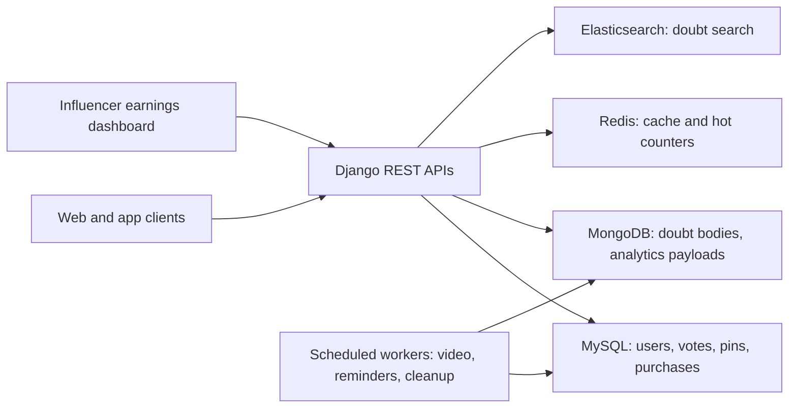
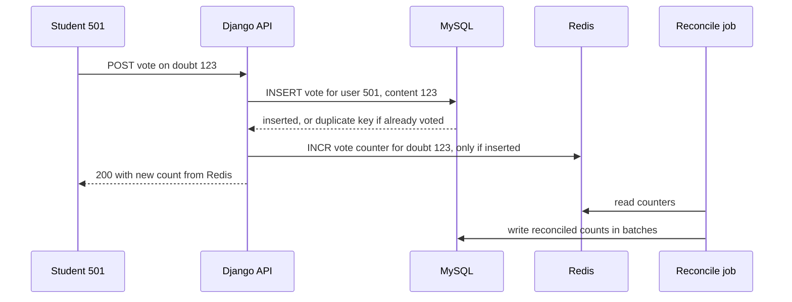

# Architecture: GeeksforGeeks Doubt Support, Influencer Dashboard and Scheduled Workflows

<div class="callout note">
<b>How to use this page</b>
<ul>
<li><b>What it covers:</b> my first job's backend. That means the doubt-support Q&A platform after the PHP to Django migration, the voting, pinning and locking APIs, the influencer earnings dashboard, and the scheduled workflows.</li>
<li><b>When to read it:</b> when an interviewer asks about early career, Django, or handling traffic spikes, or wants a simpler system to design end to end.</li>
<li><b>What to memorise:</b> the diagram, the upvote request during a contest spike, and the numbers: 10K+ daily queries, 10x contest spikes, 20% premium lift, 30% course sales, 70% ops efficiency.</li>
</ul>
</div>

**Tags on this page.** MEASURED means there is a log, a doc or code. ESTIMATED means arithmetic I can show. TARGET means a design goal (say "targeting"). HISTORICAL means from past work records. The business lifts on this page were attributed by the growth and business teams.

---

## 1. The one-paragraph version

GeeksforGeeks is a large learning platform for programmers. Students on its paid courses post "doubts" (questions) and get answers from mentors and peers. During live coding contests, traffic spiked to about ten times normal and the old PHP backend struggled. I migrated the doubt-support backend to Django and built REST APIs for voting, pinning and locking threads on MySQL, MongoDB, Redis and Elasticsearch. That stabilised the platform for **10K+ daily queries** and **10x spikes**, and the growth team attributed a **20% lift in premium subscriptions**. I also built an influencer analytics and earnings dashboard (**+30% course sales**, business-attributed) and asynchronous scheduled workflows for video processing, reminders and data cleanup (**+70% ops efficiency**).

---

## 2. Words you need

- **Doubt.** A student's question on a course or problem, with answers and comments under it, like a forum thread.
- **Django.** A Python web framework with an ORM, admin panel, authentication and a large ecosystem. "Batteries included", like a furnished flat.
- **REST API.** HTTP endpoints that act on resources, for example `POST /doubts/123/votes`.
- **MySQL.** A relational database. Source of truth for users, subscriptions, votes, pins and course purchases.
- **MongoDB.** A document database. Stores records as flexible JSON-like documents, useful when the shape varies (doubt bodies, attachments, analytics payloads).
- **Redis.** An in-memory key-value store. Very fast reads and atomic counters. Used for caching and hot counters.
- **Elasticsearch.** A search engine that builds an inverted index (word to list of documents, like the index at the back of a book), so full-text search is fast.
- **Hot row.** A single database row that many requests update at the same time, for example the vote count on a popular doubt. Writers queue up behind its lock.
- **Unique constraint.** A database rule that a combination of columns appears only once, for example one vote per user per doubt.
- **Scheduled workflow (cron job).** A task that runs on a timetable, for example every night at 2 a.m.
- **Distributed lock or lease.** A short-lived lock so that only one server runs a given job at a time, even if several servers have the same schedule.
- **Affiliate coupon.** A discount code tied to an influencer, so sales through that code are credited to them.

---

## 3. The architecture diagram



*What to notice: each store has one job. MySQL is the source of truth, Redis takes the spike, MongoDB holds flexible content, Elasticsearch handles search. Scheduled workers run outside the request path.*

---

## 4. Box-by-box walkthrough

### Web and app clients
Students, mentors and influencers. Students post and vote on doubts. Influencers check their earnings.

### Django REST APIs
- **What:** the backend after the PHP migration. Endpoints to post doubts, vote, pin answers and lock threads.
- **Why Django:** faster feature delivery with the ORM, built-in auth and admin, and a team comfortable in Python.
- **Alternatives:** keep patching PHP (the spikes kept hurting), or Flask (lighter, but you assemble more yourself).
- **Pinning:** a per-thread ordering column, so a mentor can pin the best answer to the top.
- **Locking:** a thread flag that stops new answers once a doubt is resolved.

### MySQL
Source of truth for relational data with consistency needs: users, subscriptions, votes, pins and course purchases. Votes have a unique constraint on `(user_id, content_id)`, so a double-click cannot create two votes.

### MongoDB
Flexible documents where the shape varies: doubt bodies with code and attachments, and semi-structured influencer analytics payloads.

### Redis
- Caches hot reads so the database is not hit on every page view during a contest.
- Holds display counters (vote counts) that are updated with atomic increments and reconciled to MySQL asynchronously. That removes the hot-row problem on popular doubts.

### Elasticsearch
Full-text search over doubts and content, so students can find an existing answer instead of posting a duplicate. A SQL `LIKE '%term%'` query cannot do that fast at scale.

### Scheduled workers
Asynchronous jobs for video processing handoffs, automated reminders and data cleanup (such as deleting old cloud recordings). Reliability pattern: a lock or lease so two servers never run the same job twice, idempotent job keys, structured success and failure logs, and retries for partial batches.

### Influencer earnings dashboard
Shows each influencer their transactions and affiliate coupon conversions, so they can see what their promotion earned. It reads purchase and coupon data through the Django APIs.

---

## 5. One request, step by step: an upvote during a contest spike

**Example (illustrative).** During a live contest, student 501 upvotes doubt 123, which thousands of others are also viewing.



1. The student clicks upvote. Django receives `POST /doubts/123/votes`.
2. Django inserts a row into `votes`. The unique constraint means a second click returns "duplicate key", and the API treats it as already voted. The operation is idempotent.
3. Only if the insert succeeded, Django increments the Redis counter for doubt 123. Redis increments are atomic and fast, so thousands of votes do not fight over one MySQL row.
4. The student sees the new count, read from Redis.
5. A background job periodically writes the Redis counts back to the doubt rows in MySQL in batches.

Teaching sketch:

```python
from django.db import IntegrityError, transaction

def upvote(user_id, doubt_id):
    try:
        with transaction.atomic():
            Vote.objects.create(user_id=user_id, content_id=doubt_id)
    except IntegrityError:
        return {"status": "already_voted"}
    count = redis.incr(f"doubt:{doubt_id}:votes")
    return {"status": "ok", "votes": count}
```

### One scheduled job, step by step: nightly recording cleanup
1. At the scheduled time, every worker server tries to take a lock named after the job and date.
2. Only one gets it. The others skip.
3. The winner selects recordings past their retention date in small batches and deletes them, logging each batch.
4. If it crashes halfway, the next run picks up the remaining items, because deleting an already-deleted item is a no-op.

---

## 6. Design decisions

### Decision 1: migrate the doubt backend from PHP to Django
- **What:** move the doubt-support backend to Django.
- **Why:** stability under contest spikes and faster feature work for the community product.
- **Alternatives:** tune the PHP stack, or move to Flask.
- **Trade-off:** a migration on a live product, which needed careful cutover.
- **What I'd do differently:** add load tests that replay a contest traffic profile before cutover, not after.

### Decision 2: Redis counters in front of MySQL
- **What:** count votes in Redis and reconcile to MySQL asynchronously.
- **Why:** a popular doubt's vote count was a hot row during contests.
- **Alternatives:** update MySQL directly (lock contention), or only compute counts on read (slow on popular doubts).
- **Trade-off:** counts in Redis and MySQL can briefly differ, which is fine for a display counter.
- **What I'd do differently:** put vote events on a queue and derive counters from the events, so the reconciliation has a full history.

### Decision 3: one store per job
- **What:** MySQL for truth, MongoDB for flexible content, Redis for speed, Elasticsearch for search.
- **Why:** each workload is a natural fit for one store.
- **Trade-off:** four systems to run, and data to keep in sync (for example the search index lags writes slightly).

### Decision 4: asynchronous scheduled workflows
- **What:** video processing, reminders and cleanup as scheduled background jobs with locks and idempotent keys.
- **Why:** these were manual or fragile tasks. Automating them freed the ops team.
- **What I'd do differently:** add idempotency on the reminder job from the start, so a retry can never send a reminder twice.

---

## 7. The numbers on this diagram

| Number | What it measures | Tag |
|---|---|---|
| 10K+ daily queries | Doubt-support traffic the platform was stabilised for | On PDF |
| 10x spikes | Traffic during live coding contests compared with normal | On PDF |
| 20% | Relative lift in premium subscriptions, attributed by the growth team | On PDF |
| +30% | Course sales lift from the influencer dashboard, business-attributed | On PDF |
| +70% | Engineering ops efficiency from scheduled workflows | On PDF, HISTORICAL |

**10K+ daily queries and 10x spikes.** 10,000 a day is only about 0.12 per second on average (10,000 / 86,400). The hard part was the spikes during contests, about ten times normal, all landing on the same popular threads at once. Say "it was about handling the contest spikes, not raw volume". Keep GeeksforGeeks as early-career ownership and do not oversell its scale next to Masters India, Uber or Impact Analytics.

**20% premium lift.** A relative lift attributed by the growth team to the features built on the new backend. Older prep said "15 to 20%". The current resume says 20%. Say "the growth team attributed a 20% lift in premium subscriptions. I owned the engineering. They owned the attribution."

**+30% course sales and +70% ops efficiency.** Same framing: "I owned the engineering, and the business team attributed the lift." The 70% is time saved on manual ops workflows.

---

## 8. Failure modes and what the system does

| What breaks | How you notice | What happens |
|---|---|---|
| Contest spike on one popular doubt | Database lock waits | Redis counters absorb writes. Reads served from cache. |
| Student double-clicks vote | Duplicate key | Unique constraint makes it a no-op. |
| Two servers run the same cron job | Duplicate work or emails | Lock or lease lets only one run. Idempotent job keys. |
| Redis restarts and loses counters | Counts reset in display | Rebuild counters from MySQL vote rows. |
| Search shows a just-posted doubt late | Index lag | Acceptable short delay. Source of truth is MySQL and MongoDB. |
| Cleanup job crashes halfway | Partial batch logged | Next run continues. Deletes are idempotent. |

---

## 9. Say this, not that

| Say this | Not this |
|---|---|
| "I owned the engineering. The growth team attributed the 20% lift." | "My APIs caused a 20% revenue jump." |
| "Stabilised for 10K+ daily queries and 10x contest spikes." | Inflated scale claims next to later jobs. |
| "Migrated the backend from PHP to Django." | "Rewrote all of GeeksforGeeks." |

---

## 10. How to draw it in 3 minutes

**Minute 1: the problem.** Draw clients and a crossed-out PHP box, then a Django box. Say: "GeeksforGeeks' doubt-support platform struggled during live coding contests, with about ten times normal traffic. I migrated the backend from PHP to Django and built REST APIs for voting, pinning and locking threads."

**Minute 2: the stores.** Draw MySQL, MongoDB, Redis and Elasticsearch under Django, each with a one-word label: truth, content, speed, search. Say: "Votes are idempotent through a unique constraint in MySQL. Counters live in Redis so a popular doubt is not a hot row, and get reconciled back. MongoDB holds flexible doubt bodies and Elasticsearch powers search. That stabilised 10K+ daily queries and the contest spikes, and the growth team attributed a 20% lift in premium subscriptions."

**Minute 3: the side systems.** Draw the influencer dashboard and the scheduled workers. Say: "I also built an influencer analytics and earnings dashboard showing transactions and coupon conversions, which the business attributed a 30% course-sales lift to, and scheduled workflows for video processing, reminders and cleanup, with locks so jobs never double-run. That gave about 70% ops efficiency."

---

## Related

- Masters and GeeksforGeeks deep dive: [../projects/04_masters_gfg_deep_dive.md](../projects/04_masters_gfg_deep_dive.md)
- Masters and GeeksforGeeks pack: [../projects/04_05_masters_gfg.md](../projects/04_05_masters_gfg.md)
- Postgres, MySQL and Redis depth: [../tech_depth/postgres_mysql_redis.md](../tech_depth/postgres_mysql_redis.md)
