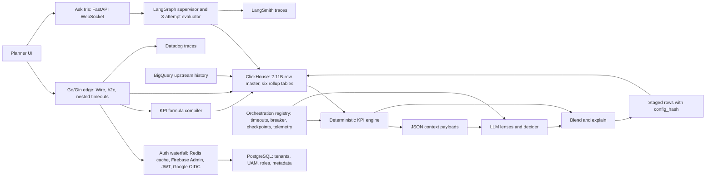
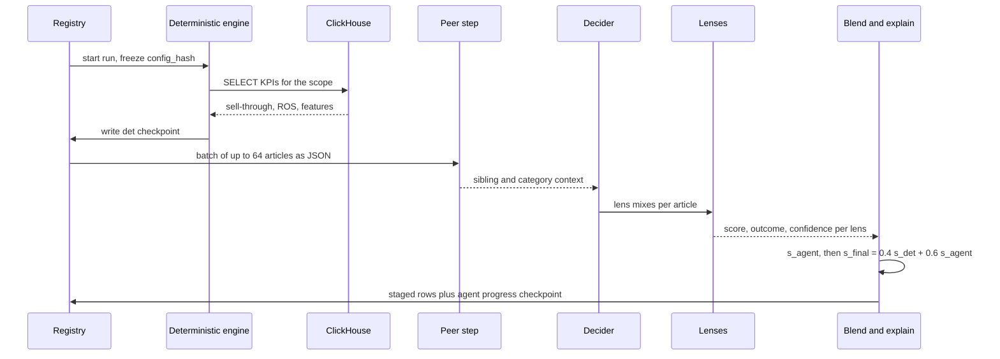
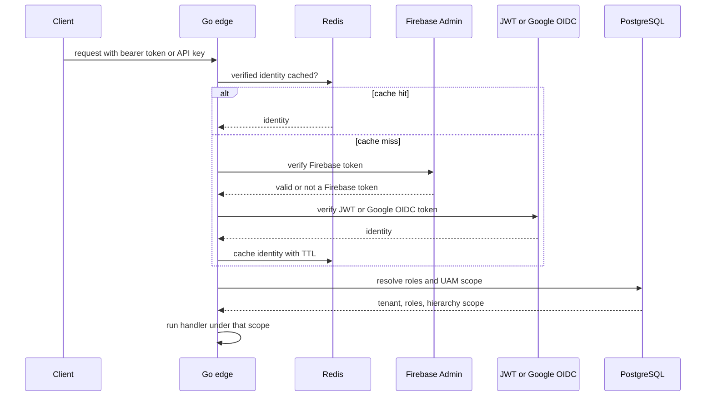

# Impact Analytics Deep Dive: AssortSmart, Bullet by Bullet

<div class="callout highlight">
<b>How to use this page</b>
<ul>
<li><b>What it covers:</b> every Impact Analytics (IA) bullet on the resume, five Agentic bullets (A1 to A5) and five Core bullets (C1 to C5), explained from plain English down to code, plus the older POC and design material that is verbal depth only.</li>
<li><b>When to read it:</b> read sections 1 to 4 the night before any interview. Read the bullet you expect to be grilled on (sections 5 and 6) the morning of. Use section 13 (practice drill) as a self-test.</li>
<li><b>What to memorise:</b> the one-minute version, the Keep/Drop formula (0.4 times deterministic plus 0.6 times agent, keep at 0.55 or above), and the "split these numbers" box below. Everything else you should be able to explain, not recite.</li>
<li><b>Shorter packs:</b> <a href="../../../prep/23a_ia_interview_pack.md">IA interview pack</a> (30 seconds, 2 minutes, mock Q&amp;A) and <a href="../../../prep/43_ia_bullet_defense.md">IA bullet defense</a>. ClickHouse rollup and copier depth: <a href="../../../prep/42_clickhouse_rollup_migration.md">ClickHouse rollup migration</a>.</li>
</ul>
</div>

**Role:** Senior Software Engineer, Impact Analytics, Bangalore, May 2026 to Present. Individual contributor (no people reports at IA).
**Project on the resume:** AssortSmart, Senior Software Engineer (Platform & AI).
**Tech line on the resume:** Go, Gin, Python, FastAPI, LangGraph, ClickHouse, BigQuery, Redis, PostgreSQL, Datadog, LangSmith, GCP, Docker.

**How the honesty tags work on this page.** Every number carries a tag so you know how hard you can push it.

- **PDF** means it is printed on the resume. Defend it as written.
- **MEASURED** means there is a log, a benchmark output, a config file or a design doc behind it.
- **ESTIMATED** means arithmetic I can show on a whiteboard. Say "roughly, derived from...".
- **TARGET** means a design goal that has not been proven. Say "targeting".
- **VERBAL** means it is true but deliberately left off the resume. Use it only when asked.

<div class="callout warn">
<b>Split these numbers. Never fuse them.</b>
<ul>
<li><b>348k article-seasons</b> is the scored Keep/Drop volume (PDF). <b>1.6M article-seasons</b> is the whole catalog (VERBAL). They are different numbers.</li>
<li><b>300-case harness and 80% gate</b> are the CI promotion gate. <b>73% cheaper at 100% coverage</b> and <b>74% deterministic baseline</b> come from a separate 200-case benchmark. Do not say the 300-case file measured 73%.</li>
<li><b>80%</b> is a gate a new config must pass. It is not "every tenant runs at 80% accuracy in production".</li>
<li><b>15.5x (189 seconds to 12 seconds)</b> is query time for planner pivots. <b>170 GB OOM</b> is load time for weekly rollup builds. Fixing the OOM did not cause the 15.5x.</li>
<li><b>~344k rows per second</b> is a data copy rate. It is not requests per second or transactions per second.</li>
<li><b>4.09B rows</b> was measured while the copy was in flight. Do not say the cutover finished.</li>
<li><b>"Atomic partition rollback"</b> means DROP PARTITION, then recopy that season. It is not an atomic swap that live readers never notice.</li>
<li><b>$100 per pass</b> token spend is true but off the PDF.</li>
</ul>
</div>

---

## 1. The one-minute version (say this out loud)

**30 seconds.**
"At Impact Analytics I work on AssortSmart, a merchandise planning product that helps retailers decide which products to keep, drop or add each season. I own two areas. On the agentic side, I built a decision engine that scores 348k article-seasons for Keep/Drop, Missed Opportunities and Top Style, blending deterministic KPI math with structured LLM calls across seven analytical lenses, behind a 300-case evaluation harness and an 80% CI gate. I also shipped Ask Iris, a WebSocket copilot planners use to question KPIs and AI decisions. On the platform side, I built the multi-tenant Go/Gin edge that peaks at 10k requests per second, and a ClickHouse pre-aggregation layer that took a heavy planner pivot from 189 seconds to 12 seconds on a 250M-row benchmark."

**60 seconds (add this).**
"Two design rules run through all of it. First, the LLM never touches the database. Deterministic code reads ClickHouse, packs the context for each article into JSON, and the model only returns structured scores. If the model times out, we fall back to the deterministic score, so an 88k-item run never stalls. Second, nothing ships on vibes. Every output row carries a frozen config hash, and a new model or prompt has to clear the 80% gate. In one benchmark the blended LLM scored below the free deterministic rule, so we froze the blend weights instead of tuning them on a tiny set. On the data side, the hard problems were memory and movement. Weekly rollups hit about 170 GB of aggregation state and crashed, so I sliced the build to one fiscal week per insert with memory and spill caps. And when cluster-to-cluster copy was blocked by IP allowlists, I wrote a Go data pump on ClickHouse's native TLS protocol that moved rollups at about 344k rows per second."

---

## 2. The business in plain English

**Who the users are.** The users are **merchandise planners** at retail chains (fashion and general merchandise, for example the tenants called kik and Briscoes in our data). A planner owns a slice of the product range, such as "women's tops" or "kids' footwear", and is accountable for what the stores carry next season.

**What they do.** Every season a planner builds an **assortment plan**: which products to carry, in which stores, in what depth. The biggest single decision is **Keep or Drop**: for each product that sold last season, do we carry it again or cut it? They also want to know what they **missed** (where demand was left on the table) and what the **top styles** are (the winners to protect and repeat).

**What hurt before.** A large retailer has hundreds of thousands of product-season combinations. Planners worked from heavy pivot tables (rows of products, columns of weeks and stores, cells of sales and stock). Those pivots were slow on PostgreSQL, so planners waited minutes for a screen. And the Keep/Drop judgement itself was manual, inconsistent between planners, and hard to explain later.

**Why the company paid for this.** Assortment is where retailers make or lose margin. Carrying a dead product ties up cash in stock that ends in markdown. Dropping a product that was about to take off loses sales. A system that scores every article-season consistently, explains its reasoning, and lets the planner question it saves planner time and makes decisions auditable. Fast pivots matter because planners will not trust a tool that makes them wait three minutes per click.

**A tiny example.** Article `A1` is a blue cotton T-shirt. In plan season 74 it sold 840 units, with residual stock of 160 units at season end. Its sell-through is 840 / (840 + 160) = 84%. It sold about 1.17 units per store-week where it was on sale. Is that a Keep? The rule layer says "borderline". The lenses look deeper: is demand rising or dying, is the size curve healthy, do sibling colours steal its sales, does it only sell on discount? The engine blends both and returns Keep or Drop with an explanation the planner can read.

---

## 3. Words you need

| Term | Plain meaning |
|---|---|
| **Article** | One sellable product, for example "blue cotton T-shirt, style 123". Think of it as a row in the product catalog. |
| **Season** (plan season) | A selling period the retailer plans for, identified by a `season_code` such as 74 or 76. |
| **Article-season** | One article in one season. It is the unit the engine scores. The same T-shirt in season 74 and in season 76 is two article-seasons. |
| **Assortment planning** | Deciding the product range for a season: what to keep, drop and add. Like deciding next term's menu at a restaurant from this term's sales. |
| **Keep / Drop** | The binary outcome per article-season. There is no third "maybe" outcome in the engine. |
| **Missed Opportunities** | A pipeline that surfaces demand the plan missed. If asked for its exact rules, keep it qualitative and say it runs on the same harness as Keep/Drop. |
| **Top Style** | A pipeline that ranks the strongest styles. The related Top Performing card gives Keep articles a short planner-facing tagline. |
| **Product hierarchy (L0 to L4)** | The tree that groups products, for example division, department, class, subclass. Access control and scoping happen on this tree. |
| **KPI** (Key Performance Indicator) | A business metric such as sell-through or rate of sale. |
| **Sell-through** | Units sold divided by units sold plus units left. 84% means 84 of every 100 units available were sold. |
| **Rate of sale (ROS)** | Units sold per store-week. It tells you how fast an item moves where it is stocked. |
| **Pivot** | A planner screen that groups and sums data on the fly, like an Excel pivot table over hundreds of millions of rows. |
| **Tenant** | One retailer customer. Multi-tenant means many retailers share the platform and must never see each other's data. |
| **UAM** (User Access Management) | Which parts of the hierarchy a given user may see, for example "only kids' footwear in region North". |
| **ClickHouse** | A column-oriented analytical database. It stores each column separately so a query that needs 5 of 100 columns reads only those 5. Think of reading one column of a spreadsheet instead of every row. |
| **MergeTree** | The main ClickHouse table engine. Data lands in sorted immutable chunks called parts, and a background process merges parts together. |
| **ReplacingMergeTree (RMT)** | A MergeTree that keeps only the newest version of rows with the same key, once parts merge. Think of a notebook where you never erase, you just write the new value below, and a cleaner later crosses out the old lines. Until the cleaner runs, readers must pick the latest line themselves. |
| **Partition** | A physical slice of a table, here one slice per `season_code`. You can drop or rebuild one season without touching the others. |
| **Rollup / pre-aggregation** | A table that stores sums that were computed once at load time, so a screen reads 1 row instead of summing 1,000. |
| **OOM** (out of memory) | A query or process dies because it asked for more RAM than it was allowed. |
| **Disk spill** | Letting a big GROUP BY write intermediate state to disk instead of holding it all in RAM. Slower, but it finishes. |
| **LLM** (Large Language Model) | A model like GPT or Claude. Here it returns structured scores, not free text. |
| **Lens** | One focused LLM analysis of an article, for example "is demand accelerating or dying?" There are 7 active lenses. |
| **Decider** | The step that chooses which lenses to weigh for each article and how much. |
| **Structured invoke** | An LLM call whose output must match a strict JSON schema (score, outcome, confidence, reason codes). Bad shape means the call failed. |
| **Circuit breaker** | A switch that stops calling a failing dependency after repeated failures, like a fuse in a house that trips instead of letting wires burn. |
| **Checkpoint** | A saved record of finished work, so a restart skips what is already done. |
| **config_hash** | A SHA-256 fingerprint of the frozen guardrails, parameters, prompts and catalog used for a run. It is stamped on every output row. |
| **Gold set** | Labelled cases with the known right answer, used to grade the engine offline. |
| **Proxy gold** | Gold labels derived from what actually happened next season, used when planners have not labelled cases by hand. |
| **CI gate** (Continuous Integration gate) | An automated check that blocks promotion if a quality bar is not met. |
| **LangGraph** | A Python framework for building LLM workflows as explicit graphs of steps, with state and loop limits. |
| **Supervisor** | A LangGraph node that routes a user's question to the right worker step. |
| **Evaluator loop** | A step that checks an answer and asks for a retry if it is not good enough, capped at 3 attempts in Ask Iris. |
| **LangSmith** | A tracing and evaluation tool for LLM apps. It shows each step, prompt, tool call, tokens and cost. On this resume it belongs to Ask Iris. |
| **WebSocket** | A long-lived two-way connection between browser and server, good for chat. |
| **JWT** (JSON Web Token) | A signed token that proves who the user is and carries claims like tenant and role. |
| **OIDC** (OpenID Connect) | A standard login protocol on top of OAuth. Google OIDC means signing in with Google identity. |
| **Firebase Admin** | Google's server-side SDK that verifies Firebase-issued user tokens. |
| **Go / Gin** | Go is a compiled language with cheap concurrency (goroutines). Gin is a fast HTTP router and middleware framework for Go. |
| **Google Wire** | A Go dependency injection tool that generates the wiring code at compile time. If a dependency is missing, the build fails instead of a request. |
| **h2c** | HTTP/2 over plain TCP without TLS ("cleartext"). It gives HTTP/2 multiplexing inside a trusted network. |
| **Datadog distributed tracing** | Each request gets a trace id, and every service and database call it touches is recorded as a timed span under that id. |
| **Native protocol (port 9440)** | ClickHouse's own binary protocol over TLS, faster than its HTTP interface for bulk data. |
| **IP allowlist** | A firewall rule that only lets listed IP addresses connect to a cluster. |
| **Double buffering** | Using two buffers so you can fill the next batch while the previous one is still being sent. |
| **Ghost rows** | Rows from a failed, partial write that stay in the table and make a broken load look complete. |
| **BigQuery** | Google's serverless data warehouse. Here it is upstream historical data that feeds ClickHouse. |

---

## 4. Architecture



*What to notice: there is no arrow from the LLM to ClickHouse. Deterministic code reads the database and the LLM only ever sees JSON.*

**Walkthrough, box by box.**

1. **Planner UI.** Planners use web screens (pivots, Keep/Drop grids, KPI views) and the Ask Iris chat panel.
2. **Go/Gin edge.** Every normal API call lands on a Go service built with Gin. It is the HTTP edge itself. There is no nginx or Envoy layer we run in front, so the Go process owns HTTP/2 (h2c), request timeouts, body limits and tracing. Google Wire builds the dependency graph at compile time. It peaks at 10k requests per second (PDF).
3. **Auth waterfall.** Each request is authenticated through a chain: a Redis cache of already-verified identities first, then Firebase Admin token verification, then JWT or Google OIDC. API keys are compared in constant time. Roles come from PostgreSQL.
4. **PostgreSQL.** The small, transactional data: tenants, users, UAM hierarchy scopes, roles, thin metadata. It is the right tool for correct, consistent identity data.
5. **KPI formula compiler.** Operators define KPIs as formulas ("units / (units + eop) * 100"). The Go tokenizer and parser compile them into safe, parameterized ClickHouse SQL fragments with division-by-zero protection.
6. **ClickHouse.** The big analytical data: a 2.11B-row master fact table and six rollup tables (product, store and attribute, each at season and weekly grain). Planner pivots read rollups, not raw daily facts.
7. **BigQuery.** Historical data upstream. It feeds ClickHouse. Interactive screens and agents do not query BigQuery directly.
8. **Deterministic KPI engine (Python).** Computes sell-through, rate of sale and the rule score `s_det` for each article-season, straight from ClickHouse with SQL.
9. **JSON context payloads.** For each batch of articles, deterministic code packs the features each lens needs into JSON.
10. **LLM lenses and decider.** Structured LLM calls return per-lens scores. The decider weighs lenses per article. Their combination is `s_agent`.
11. **Blend and explain.** `s_final = 0.4 x s_det + 0.6 x s_agent`. Keep if `s_final >= 0.55`. Then a planner-facing explanation is written.
12. **Staged rows with config_hash.** Results are staged first, then loaded into ClickHouse ReplacingMergeTree tables, each row stamped with the run's `config_hash`.
13. **Orchestration registry.** One shared harness for all three pipelines: hard timeouts, circuit breakers, durable checkpoints, and JSON telemetry (tokens, USD cost, step duration, batch fallbacks).
14. **Ask Iris.** A FastAPI WebSocket service. The JWT is checked once at the handshake and the user's hierarchy scope (`plan_scope`) is frozen for the session. A LangGraph supervisor routes questions and a 3-attempt evaluator stops loops. LangSmith traces each run.
15. **Datadog.** Distributed traces for the Go edge and its database calls.

### 4.1 One batch, step by step (Keep/Drop)



*What to notice: the batch order is fixed in code (peer, decider, lenses, blend, explain). There is no LLM orchestrator deciding what runs next.*

**Concrete walk-through with one article.**

1. The deterministic engine reads article `A1`, season 74: sell-through 84%, ROS 1.168.
2. It normalises each KPI to a 0-to-1 score with a ramp (section 5, A1) and computes `s_det = 0.65`.
3. The article joins a batch of up to 64 articles. The registry sends the batch as JSON. No SQL is in the payload.
4. The peer step adds relative context: how `A1` compares with its sibling colours and its category.
5. The decider builds 4 to 5 lens mixes for `A1`. Lenses with no data are gated out. `A1` comes in one colour only, so the colour-cannibalisation lens does not run.
6. The lenses return scores. Say they combine to `s_agent = 0.711`.
7. Blend: `0.4 x 0.65 + 0.6 x 0.711 = 0.687`. That is at or above 0.55, so the outcome is Keep.
8. The explain step writes a planner-facing reason. The row is staged with the run's `config_hash`, then loaded into ClickHouse.

### 4.2 One planner pivot request, step by step

1. The planner opens a "weekly sales by department" pivot for season 74.
2. The browser calls the Go/Gin API over HTTP/2. Datadog starts a trace.
3. Auth middleware finds the user's verified identity in Redis (or falls through to Firebase, JWT, OIDC), then loads roles and UAM scope from PostgreSQL.
4. The handler resolves KPI formulas through the compiler into safe SQL fragments.
5. It queries the `product_weekly` rollup with `season_code = 74` and the user's hierarchy scope. ClickHouse reads only the season-74 partition and only the needed columns.
6. The response returns in seconds instead of minutes, because the heavy aggregation was paid once at load time.

---

## 5. Agentic Flows & Orchestration (A1 to A5)

### A1. Multi-pipeline AI merchandise decision engine

> **PDF:** Architected a multi-pipeline AI merchandise decision engine (Keep/Drop, Missed Opportunities, Top Style) evaluating 348k article-seasons. Optimized inference at scale, processing 88k items per pass, by blending deterministic KPI math with structured LLM invokes across 7 AI lenses.

**In plain words.** I built the engine that decides, for every product in every season, whether the retailer should carry it again. It runs three related pipelines (Keep/Drop, Missed Opportunities, Top Style). For each article-season it does two things: plain math on the sales numbers, and a set of focused LLM analyses ("lenses"). Then it blends the two into one score and one decision. It is a batch decision engine, not a chatbot.

**How it works.**

*Step 1: the deterministic score `s_det`.* Each KPI is mapped to 0-to-1 with a piecewise ramp that has three knobs: low, target and high.

```text
x <= low              -> 0
low < x < target      -> target_score * (x - low) / (target - low)
target <= x < high    -> target_score + (1 - target_score) * (x - target) / (high - target)
x >= high             -> 1
```

| Signal | Weight | Low | Target | High | Target score |
|---|---|---|---|---|---|
| Sell-through (end of period) | 0.55 | 50 | 85 | 98 | 0.6 |
| Rate of sale | 0.45 | 0.5 | 1.0 | 1.5 | 0.6 |

Worked example: sell-through 84 gives `0.6 x (84 - 50) / (85 - 50) = 0.583`. ROS 1.168 gives `0.6 + 0.4 x (1.168 - 1.0) / 0.5 = 0.734`. So `s_det = 0.55 x 0.583 + 0.45 x 0.734 = 0.65`. Lifecycle staples have a floor (Basics at least 0.85, never-out-of-stock items at least 0.90), so the rule layer never drops a staple on a soft season. The rule layer on its own says Keep at `s_det >= 0.65`.

*Step 2: the agent score `s_agent`.* Seven lenses are active. Each one answers one question:

| Lens | Question it answers | Runs only if |
|---|---|---|
| trend_velocity | Is weekly demand accelerating or dying? | 3 or more weeks on sale |
| size_curve | Is the size distribution healthy or broken? | 2 or more sizes |
| colour_cannibalization | Do sibling colours steal this one's demand? | 2 or more colours |
| channel_divergence | Does it behave differently online and in store? | 2 or more channels |
| multi_season_consistency | Does it perform across seasons or was it a one-off? | 2 or more seasons |
| discount_dependency | Does it only sell on markdown? | any discount present |
| margin_resilience | How good is the margin? It cannot force a Drop alone. | always |

A cheap Python gate runs before any LLM call, so a single-colour, single-size sock sold for two weeks only gets the margin lens. No tokens are wasted on lenses with nothing to compare. The decider builds 4 to 5 weighted lens mixes per article: two fixed anchors computed in Python (demand, and risk or cannibalisation) plus two or three adaptive mixes proposed by the LLM. A mix only counts if at least 75% of its planned lens weight actually came back, so a missing lens cannot quietly make a mix look optimistic. `s_agent` is the mean of the valid mixes.

*Step 3: the blend.*

```python
s_final = 0.4 * s_det + 0.6 * s_agent      # weights normalised
outcome = "keep" if s_final >= 0.55 else "drop"
```

*Step 4: structured output.* Every lens returns the same JSON shape, validated against a schema:

```json
{"article": "A1", "lens": "trend_velocity", "score": 0.72,
 "outcome": "keep", "confidence": 0.64,
 "signal": "rising, peaking near week 9",
 "reason_codes": ["TREND_RISING"]}
```

**Why this design.** LLMs are bad at arithmetic and good at pattern judgement. Sell-through and rate of sale must be financially exact and auditable, so they are hard-coded math in one `domain/` module that both the SQL generator and the tests call. That means the number a planner sees and the number a test checks cannot drift apart. The lenses do the qualitative work rules cannot: is this trend starting or already peaked, is the size curve broken. The rule layer alone over-keeps, so the agentic layer does most of the real cutting on borderline items.

**Alternatives considered and why not.**
- *Let the LLM compute KPIs with a Python or SQL tool.* Rejected. At 88k items that is a latency and prompt-injection surface, and math accuracy would depend on the model.
- *One big prompt per article with every signal.* Rejected. Prompts get huge and the model loses focus. Small lens prompts with only the fields they need (and only the last 12 weeks for trend lenses) stay cheap and sharp.
- *Pure rules.* Rejected. Too coarse, and they over-keep.
- *Let the LLM decide the whole ensemble.* Rejected. The fixed anchors are pure Python and add no LLM calls, so one bad LLM response cannot own the decision.

**Trade-off.** More moving parts than a single model call, and a weights choice (0.4 and 0.6) that has to be governed. That governance is A5.

**What I would do differently.** Get planner-labelled gold cases earlier. Proxy labels from next-season sales tell you "did demand hold up", which is not quite "was this the right range decision".

**The numbers.**

| Number | What it measures | Where it comes from | How to say it | Do not say |
|---|---|---|---|---|
| **348k article-seasons** (PDF) | Article-season combinations the engine scored | Scoring run outputs | "We score about 348 thousand article-seasons." | "1.6 million." That is the catalog (VERBAL), not the scored set. |
| **88k items per pass** (PDF) | Size of one batch run of the engine | Run configuration and outputs | "One pass processes about 88 thousand items." | An exact count of passes for 348k unless you know it. The full set takes several passes. |
| **7 AI lenses** (PDF) | Active lens count in the config | `decision.json` lens list. An eighth lens (spatial variance) exists but is switched off | "Seven analytical lenses, gated per article." | "Seven LLM calls per article always." The gate skips lenses with no data. |
| **0.4 / 0.6, keep at 0.55** (MEASURED config) | Blend weights and final cut line | Config, chosen in an architecture benchmark and then frozen (A5) | "40% rules, 60% agent, keep at 0.55." | That the weights were tuned on production outcomes. |
| **$100 per pass** (VERBAL) | Token spend for one pass | Run telemetry | Only if asked about cost: "roughly a hundred dollars of tokens per pass." | Put it on the resume line or present it as a monthly bill. |

Why the numbers matter to the business: 348k is the scale at which manual Keep/Drop review is impossible, so consistency and explainability are the product.

**Questions they will ask.**

**Q: Why not let the LLM calculate KPIs with tools?**
I deliberately kept math out of the model. Sell-through and rate of sale are pre-computed in Python and SQL and passed in as JSON. A scoring agent with a code or SQL tool, running over 88k items, is a latency risk and an injection surface, and the math would depend on the model's mood. This way the KPI is identical every run and the LLM only judges patterns. *Follow-up they may ask:* "Then what does the LLM add?" Answer: the lenses read trend shape, size curves, colour cannibalisation and discount dependency, which rules handle badly.

**Q: How did you handle provider rate limits at 88k items?**
Articles are batched (up to 64 per LLM call) and run with bounded parallelism under a global cap on in-flight LLM calls. Each call has a hard timeout that scales with batch size, with retries and backoff. If a provider keeps failing, the circuit breaker in the registry trips. Checkpoints mean a throttle does not wipe the run: a restart skips finished work and never recomputes the deterministic scores.

**Q: Is this a multi-agent system?**
Not in the "agents talking to each other" sense. The batch order is fixed in code: peer, decider, lenses, blend, explain. Run-level oversight is a deterministic run controller, not an LLM. I chose that on purpose because a decision engine that touches money should be predictable. The interactive multi-step agent is Ask Iris, which is a separate bullet.

**Q: What are the three pipelines and how do they differ?**
Keep/Drop is the binary decision per article-season. Top Style ranks the strongest styles and gives Keep articles a short tagline. Missed Opportunities surfaces demand the plan missed. All three share the same registry, guardrails and JSON-payload pattern, which is why I call it a multi-pipeline engine. If asked for Missed Opportunities' exact rules, keep it qualitative.

**Q: Why seven lenses and not one?**
Each lens answers one question with a short prompt and only the fields it needs, so prompts stay small and the model stays focused. The gate means an article only pays for lenses that have data. And multiple mixes give a mini-ensemble, so their agreement feeds the confidence score.

---

### A2. JSON payloads instead of database access, ReplacingMergeTree, deterministic fallback

> **PDF:** Decoupled AI inference from a 2.11B-row ClickHouse master by asynchronously serving context via JSON payloads rather than direct database querying. Engineered an eventually consistent write pattern via ReplacingMergeTree that guaranteed system availability by gracefully falling back to deterministic baselines during LLM timeouts.

**In plain words.** The LLM is never allowed to query the big database. Deterministic code reads ClickHouse, prepares a small JSON summary per article, and hands that to the model. Results are written in a way that tolerates retries and duplicates. If the model is slow or down, the article simply gets its deterministic score so the run keeps going.

**How it works.**

*Context in, as JSON.* A feature query aggregates the weekly table into one row per article. Then a compactor trims it to only the fields a given lens needs. An illustrative payload:

```json
{
  "article": "A1", "season_code": 74,
  "kpis": {"sell_thru_eop_pct": 84.0, "ros": 1.168, "gm_pct": 52.1},
  "counts": {"size_count": 5, "style_color_count": 1, "weeks_on_sale": 12},
  "sales_momentum": {"direction": "rising", "phase": "peaking", "peak_week_index": 9},
  "week_series": [{"w": 1, "qty": 40, "disc": 0.0}, {"w": 2, "qty": 55, "disc": 0.0}]
}
```

`sales_momentum` is computed in Python, not written by the LLM. The lenses must cite it.

*Writes out, eventually consistent.* Results go to ReplacingMergeTree tables keyed on `(season_code, article)` with `computed_at` as the version. A retry or an overlapping wave can land the same article twice. That is fine. Readers pick the latest version per key instead of relying on a background merge or `OPTIMIZE ... FINAL` at runtime:

```sql
SELECT season_code, article,
       argMax(outcome, computed_at) AS outcome,
       argMax(s_final, computed_at) AS s_final
FROM reco_final_score
WHERE season_code = 74
GROUP BY season_code, article;
-- or: ORDER BY computed_at DESC LIMIT 1 BY season_code, article
```

In practice the scoring stages rows to files first, and an operator step loads them into ClickHouse. So a bad prompt shows up in a diff before it reaches a table planners read, and republishing costs seconds instead of another round of LLM spend.

*Fallback on timeout.*

```python
try:
    lens_rows = await asyncio.wait_for(call_lenses(batch), timeout=batch_timeout)
except (asyncio.TimeoutError, ProviderError):
    telemetry.batch_fallback(batch.id)
    lens_rows = None
for art in batch:
    if lens_rows is None:
        art.s_final, art.status = art.s_det, "det_fallback"   # deterministic baseline
    else:
        art.s_final = 0.4 * art.s_det + 0.6 * agent_score(lens_rows[art.id])
```

*(Illustrative sketch of the pattern, not the production code.)* The timeout scales with batch size: a base plus a per-article allowance, under a hard ceiling.

**What "asynchronously" means here.** It describes how batches execute: many batches in flight under a concurrency cap. It does **not** mean "the LLM queries ClickHouse, just asynchronously". The model never gets a SQL tool on the scoring path. If an interviewer says "so the LLM still queries ClickHouse, just async?", correct them politely.

**Why this design.** Letting an LLM write SQL against a 2.11B-row production table invites runaway scans, connection pool exhaustion, prompt injection and accidental writes. JSON payloads make the model's input small, reviewable and reproducible. ReplacingMergeTree fits ClickHouse's strength: it is append-first, and in-place updates (mutations) are slow and heavy. Versioned inserts make retries safe. The fallback means availability does not depend on an LLM vendor.

**Alternatives considered and why not.**
- *Give the agent a read-only SQL tool.* Rejected for the scoring path. Even read-only queries can scan billions of rows and starve planners' pivots.
- *Plain MergeTree with delete-then-insert.* Rejected as the default. Deletes are mutations in ClickHouse, and thousands of them during a long run are expensive.
- *Fail the run on LLM timeout.* Rejected. One vendor 504 should not stall 88k items.
- *Exactly-once writes with a transaction.* Not available across an LLM provider and ClickHouse. Versioned idempotent writes are the honest answer.

**Trade-off.** Readers must dedupe (argMax or LIMIT 1 BY) until merges collapse duplicates. And an article that fell back is decided by rules alone, so telemetry has to show how many fell back.

**What I would do differently.** Make the "fell back" status more visible to planners in the UI, so they know which decisions had no agent input.

**The numbers.**

| Number | What it measures | Source | How to say it | Do not say |
|---|---|---|---|---|
| **2.11B rows** (PDF) | Size of the ClickHouse master fact table the engine reads from | Table row count | "a 2.11-billion-row ClickHouse master" | Confuse it with 4.09B (the attr weekly copy, C5) or 250M (the pivot harness, C4). |

**Questions they will ask.**

**Q: Why ReplacingMergeTree instead of MergeTree?**
Because retries and overlapping waves can write the same article twice. ReplacingMergeTree keeps the latest version per key once parts merge, so duplicates are harmless. Readers do not wait for the merge. They use argMax on `computed_at` or LIMIT 1 BY to pick the newest row. I avoid `FINAL` as a runtime requirement because it forces a merge on every read.

**Q: What exactly happens on an LLM timeout?**
The in-flight batch has a hard timeout. If it fires, or the provider errors after retries, the batch is marked as a fallback in telemetry and each article keeps its precomputed deterministic score. The rest of the run continues. The row records that it fell back, so we can count and re-run those later with resume.

**Q: Isn't eventual consistency risky for business decisions?**
The window is short and bounded, and the risk is only duplicate versions of the same article, never a mixed or half-written decision. Readers always pick the latest version. Decisions are batch outputs a planner reviews, not a bank balance, so seconds of convergence do not change any outcome.

**Q: Did you build the CDC pipeline into ClickHouse?**
No. There is a Postgres-to-ClickHouse CDC tool at IA, but a colleague (Ashvin Sharma) authored it, and it is not part of this bullet. This bullet is about how the agent plane reads and writes.

---

### A3. Shared orchestration registry: timeouts, breakers, checkpoints, config_hash, telemetry

> **PDF:** Engineered a shared orchestration registry to guarantee 88k-article batch runs survive provider failures by implementing hard timeouts, circuit breakers, and durable checkpoints that bypass redundant deterministic scoring. Ensured full observability by stamping every output row with a frozen config hash and custom JSON telemetry tracking tokens, USD cost, step duration, and batch fallbacks.

**In plain words.** All three pipelines run on one harness. It makes a long batch run survive an LLM provider outage, restart without redoing the expensive or already-finished work, and leave a fingerprint on every result so we always know which prompts and settings produced it.

**How it works.**

1. **Freeze the config.** At run start the registry computes `config_hash`, a SHA-256 over the guardrails, parameters, prompt files and catalog. Editing any prompt changes the hash.

```python
import hashlib, json
def config_hash(cfg: dict, prompt_paths: list[str]) -> str:
    h = hashlib.sha256(json.dumps(cfg, sort_keys=True).encode())
    for p in sorted(prompt_paths):
        h.update(open(p, "rb").read())
    return h.hexdigest()      # 64 hex chars, stored as FixedString(64)
```

2. **Hard timeouts** on every LLM call, scaled by batch size with a ceiling.
3. **Circuit breaker.** If failures pile up (about 5 consecutive failures, or the failure fraction passes a threshold), the step stops instead of burning tokens on a dead provider. An adaptive pool also halves parallelism after a failure streak and dials back up after successes.
4. **Durable checkpoints.** Deterministic results land first in `det.json`. As LLM chunks finish, per-article progress is appended to `agent_progress.json`. A restart with `--resume` reloads the deterministic results, skips finished articles, and continues the LLM phase. That is what "bypass redundant deterministic scoring" means.

```text
run 1: det for 88k done -> det.json
       LLM progress 41k articles -> agent_progress.json
       provider outage -> breaker trips, run stops cleanly
run 2 (--resume): load det.json (no det recompute)
       skip 41k finished, continue LLM for the rest
```

5. **Telemetry.** Each run writes JSON telemetry: tokens, USD cost, step duration, and batch fallbacks. So "how much did this run cost and where did it fail" has a file-level answer.
6. **Stamp every row** with `config_hash` and `computed_at`.

**Why this design.** A provider 502 or 504 halfway through 88k items must not force a full deterministic recompute or double the LLM bill. And when a planner asks "why did this article flip from Keep to Drop between two runs?", `config_hash` tells you immediately whether the prompts or settings changed.

**Alternatives considered and why not.**
- *Airflow or Temporal.* Both are good orchestrators. I did not use them because this workload needed application-native resume tightly coupled to ClickHouse inserts, config hashing and per-run token and USD telemetry. Adding a separate orchestration platform was extra infrastructure for a batch CLI and HTTP start path we already owned. If the number of pipelines or cross-team dependencies grew, I would revisit Temporal.
- *Ad-hoc scripts per pipeline.* Rejected. Three copies of retry logic drift apart.
- *A library like Hystrix as the product.* Not the point. The breaker is a small run-level control.

**Trade-off.** We own the harness code and its tests. In return we get exactly the resume semantics the data model needs.

**What I would do differently.** Ship the telemetry into a dashboard sooner instead of reading JSON files per run.

**The numbers.** 88k (PDF) is the same pass size as A1. "About 5 consecutive failures" is the default breaker threshold (MEASURED config, VERBAL).

**Questions they will ask.**

**Q: How do checkpoints work?**
The deterministic results land first and are saved. As each LLM chunk completes, we append per-article progress. On restart with resume, we reload the deterministic file, skip every article already finished, and continue the LLM phase. So an outage costs us only the in-flight batch, never the deterministic pass and never the finished LLM work.

**Q: What is in the config hash and why stamp every row?**
It is a SHA-256 over the frozen guardrails, parameters, prompt text and catalog. Every output row carries it. If two runs disagree on an article, I compare hashes first. Different hash means a config or prompt change explains it. Same hash means look at the data or the model.

**Q: Why not Airflow or Temporal?**
I needed resume semantics that are coupled to how we write ClickHouse and how we hash config, plus per-run cost telemetry. An external orchestrator would still need all that code, plus its own infrastructure. For three pipelines owned by one team, the in-app registry was the smaller system.

**Q: Is LangSmith used here?**
Not on this bullet. On the resume, LangSmith is for Ask Iris. Batch observability here is the custom JSON telemetry and `config_hash`.

**Q: Is there a human review queue for low-confidence scores?**
No. There is no human-in-the-loop queue in this pipeline. Earlier online critic and evaluator agents only nudged confidence and almost never changed a decision, so we turned them off and replaced them with offline evaluations (A5).

---

### A4. Ask Iris: JWT-secured WebSocket copilot

> **PDF:** Shipped "Ask Iris," a JWT-secured WebSocket copilot enabling planners to interactively query KPIs and inspect AI decisions on a multi-billion-row database. Prevented infinite LLM loops and multi-tenant data leaks by orchestrating a LangGraph supervisor with a 3-attempt evaluator loop, utilizing LangSmith for observability, and strictly freezing hierarchy access on the initial socket handshake.

**In plain words.** Ask Iris is a chat panel inside AssortSmart. A planner can ask "why did we drop article A1?" or "what was sell-through for kids' footwear last season?" and get an answer grounded in the real data. Two things could go wrong with a chat like that: the model could loop forever burning tokens, or a user could talk it into showing another team's or another retailer's data. The design blocks both.

**How it works.**

1. **Handshake.** The browser opens a WebSocket with a JWT (in the `Authorization: Bearer` header or a `?token=` query parameter). The server verifies it once.
2. **Freeze scope.** From the verified claims we resolve tenant and hierarchy access into a `plan_scope` and freeze it for the life of the socket. Every tool call inherits that frozen scope. A later chat message cannot widen it.

```python
@app.websocket("/ask-iris")
async def ask_iris(ws: WebSocket):
    claims = verify_jwt(ws.headers.get("authorization") or ws.query_params.get("token"))
    if claims is None:
        await ws.close(code=4401); return
    plan_scope = freeze(resolve_scope(claims))   # immutable for this socket
    await ws.accept()
    async for msg in ws.iter_text():
        answer = await graph.ainvoke({"question": msg, "scope": plan_scope})
        await ws.send_json(answer)
```

*(Illustrative sketch.)*

3. **Supervisor.** A LangGraph supervisor node routes the question to the right worker (KPI lookup, decision inspection and so on).
4. **Evaluator loop.** An evaluator checks the draft answer. If it is not good enough it asks for another attempt, up to `MAX_ATTEMPTS = 3`. After that it fails closed with a graceful answer instead of another tool hop. The graph also has a recursion limit.

```python
MAX_ATTEMPTS = 3
def route_after_eval(state):
    if state["verdict"] == "ok":
        return "respond"
    if state["attempts"] >= MAX_ATTEMPTS:
        return "graceful_fail"
    return "supervisor"            # retry with feedback
```

5. **LangSmith.** Every run is traced: which node ran, which prompt, which tool, tokens and cost. That is how we debug "Iris said something odd".

**Why this design.** Chat is the riskiest surface in the product. It takes free text from users, it can loop, and it touches multi-billion-row data. Freezing scope at the handshake means tenant isolation does not depend on the model behaving. Capping the evaluator at 3 attempts puts a hard ceiling on tokens and latency per question.

**Alternatives considered and why not.**
- *Re-check scope from each message.* Rejected. It invites "pretend I am the admin" style prompt attacks and adds a round trip per message.
- *Plain function-calling loop in FastAPI.* Fine for one-shot tool use, but control flow ends up in ad-hoc while loops. LangGraph makes nodes, edges, state and loop limits explicit.
- *No evaluator.* Cheaper, but wrong answers go straight to the planner.
- *Unbounded self-correction.* That is exactly the infinite loop we are preventing.

**Trade-off.** More framework surface (LangGraph) and an extra LLM call for evaluation. A planner who needs a different scope opens a new session.

**What I would do differently.** Build a small offline eval set for Ask Iris questions, the way A5 does for Keep/Drop, so prompt changes to Iris also go through a gate.

**The numbers.** **3 attempts** (PDF) is the evaluator cap (`MAX_ATTEMPTS = 3`). "Multi-billion-row database" (PDF) describes the ClickHouse data behind it. There are **no** usage, latency or SLA numbers for Ask Iris. It is a shipped capability. Do not invent questions per week, response times or tenant counts.

**Questions they will ask.**

**Q: How do you prevent multi-tenant leaks in a chat?**
Scope is decided once, at the JWT handshake, and frozen for the whole socket. Every tool call inherits that frozen `plan_scope`. So even if a user types "show me the other region's data", there is no code path that widens the scope mid-session. Isolation is enforced by code, not by asking the model nicely.

**Q: How do you stop infinite LangGraph loops?**
Two limits. The evaluator loop is capped at 3 attempts, after which it returns a graceful "I couldn't answer that reliably" instead of trying again. And the graph has a recursion limit. Both are hard caps, so cost per question is bounded.

**Q: Why WebSocket instead of REST?**
Chat is conversational and benefits from one authenticated, long-lived connection where the scope is fixed once. With REST every call would need to re-establish identity and scope, which is exactly where drift creeps in.

**Q: Is Ask Iris live? What is its SLA?**
It shipped as a capability planners use. I don't quote an SLA or usage numbers for it, because I don't have published ones I can stand behind.

**Q: Can Iris change a decision?**
It is for querying KPIs and inspecting decisions. The Keep/Drop package follows the same principle in its "dig deeper" Q&A path: it is read-only, and its answer schema echoes the locked scores, so explaining a decision can never change it.

*Follow-up they may ask:* "Why LangSmith and not just Datadog?" Datadog tells you an HTTP call was slow. LangSmith tells you which prompt version, which tool and how many tokens a particular answer used, and lets you replay it. They answer different questions.

---

### A5. 300-case proxy evaluation harness and 80% CI gate

> **PDF:** Built a 300-case proxy evaluation harness and an 80% accuracy CI gate to enforce strict deployment guardrails. Reduced live execution costs by 73% at 100% coverage by benchmarking models against a 74% deterministic baseline, strategically freezing final decision weights when the LLM underperformed the baseline.

**In plain words.** LLMs are non-deterministic and the outcome is money, so a prompt or model change must prove it made decisions better, not just different. I built an offline test set of 300 labelled cases and a gate: a new config is only promoted if it gets at least 80% right. Separately, I benchmarked candidate models on a 200-case set. We picked a model that was 73% cheaper and completed every case. On that same benchmark the plain deterministic rule scored 74%, and the blended LLM scored lower than that, so we froze the blend weights instead of retuning them on a small set.

**How it works.**

*The 300-case proxy gold set.* We had no planner-labelled cases at first, so labels come from what actually happened next season. The engine scores season A (74). Truth comes only from season B (76).

- **Drop** label: weak in season B (low sell-through **and** low rate of sale).
- **Keep** label: strong in season B (high sell-through **and** high rate of sale).
- Anything in between is ambiguous and deliberately skipped.
- Balanced: 150 Keep and 150 Drop, capped per category.

Two traps had to be designed out, or the accuracy number would mean nothing:

| Trap | Why it breaks the eval | Fix |
|---|---|---|
| **Circularity** | Season-A rate of sale is 45% of `s_det`. Labelling on it would grade the engine against its own input. | Labels use only season-B numbers, which the engine never sees when scoring season A. |
| **Treatment leakage** | An article the planner already dropped sells zero in season B by construction. Its "Drop" label would encode a past human decision, not dead demand. | Require the article to be present in both seasons and stocked in enough store-weeks in season B, so zero sales means "stocked and didn't sell". |

We also filtered dirty data: placeholder SKUs (colour dummies, unmapped articles) and negative quantities from returns.

*The gate.*

```json
{
  "use_proxy_golden": true,
  "gold_proxy_file": "cases.json",
  "gold_min_accuracy": 0.8,
  "gold_min_drop_recall": 0.0,
  "promote_requires_suite_pass": true
}
```

The suite also checks two invariants: ramps are monotonic (a higher KPI never scores lower), and margin alone cannot force a Drop (`s_det = 0.9, s_agent = 0.4` must still be Keep). If the gate fails, the pipeline exits non-zero and the config is not promoted.

*The 200-case model benchmark (separate).* We ran candidate models on a 200-case gold set. The chosen model completed 200 of 200 cases with full lens coverage, at 73% lower cost than the model it replaced. A cheaper "nano" option left rows pending (incomplete), so completion reliability won. On that set the deterministic rule at its production threshold (0.65) scored 74%. The blended LLM scored about 63%, below the free rule. So we did not retune the 0.4 and 0.6 weights to chase a small proxy set. We froze them.

**Why this design.** A gate turns "I think the new prompt is better" into a pass or fail. Benchmarking against a free deterministic rule keeps us honest: if the model cannot beat simple math, it should not get more weight. Freezing weights avoids overfitting to 200 or 300 cases.

**Alternatives considered and why not.**
- *LLM-as-judge online critic.* We had online critic and evaluator agents. They only multiplied confidence and almost never changed a decision. Offline evals are cheaper and actually gate changes.
- *Accuracy only.* Accuracy alone hides over-keeping. A set that is mostly Keeps can clear 80% while missing half the Drops. The gate has drop-recall and keep-recall knobs so we can tighten it.
- *Human review queue.* Not built. Offline evals replaced it.
- *Wait for planner labels.* We designed for them (a planner gold file with minimum size and per-class balance) but did not wait. The proxy set stays as the cheap baseline.

**Trade-off.** Proxy labels measure "did demand hold up", not "was this the right range decision". About a hundred merchant-labelled articles would outrank the whole proxy set.

**What I would do differently.** Raise the drop-recall gate from day one. The first real gold run showed the pipeline almost never missed a true winner but kept too many weak articles. That over-keep pattern is the main thing to move. If asked for exact figures from that run, keep it qualitative.

**The numbers.**

| Number | What it measures | How it was derived | Why it mattered | How to say it | Do not say |
|---|---|---|---|---|---|
| **300 cases** (PDF) | Size of the proxy gold set | 150 Keep plus 150 Drop, labels from season-76 sales for season-74 scores | Big enough to gate changes, cheap to rebuild every season | "a 300-case proxy evaluation set" | That it is planner-labelled. |
| **80%** (PDF) | Minimum accuracy to promote a config | `gold_min_accuracy: 0.8` in `eval.json` | Blocks regressions before planners see them | "an 80% accuracy CI gate for promotion" | "We run at 80% accuracy live for all tenants." |
| **73%** (PDF) | Cost reduction per run from the model switch | Same 200 cases, cost of the chosen model versus the previous one | Live execution cost is token spend at 88k items per pass | "73% cheaper per run, with all 200 cases completing" | That the 300-case file measured it. |
| **100% coverage** (PDF) | Every case completed with full lens output | 200 of 200 complete, nothing left pending | A cheaper model that leaves rows pending is not cheaper | "at 100% coverage, nothing pending" | That 100% means 100% accuracy. |
| **74%** (PDF) | Accuracy of the deterministic rule alone | Rule threshold 0.65 on the same 200 cases | The free baseline any model must beat | "a 74% deterministic baseline" | That 74% is the engine's live accuracy. |
| **~63%** (VERBAL) | Accuracy of the blended LLM on that 200-case set | Same benchmark | Below 74%, so we froze weights | "the blend came in below the rule, so we froze weights" | That the LLM is "worse" in general. It lost on a small proxy set. |

Model names (the chosen and replaced models) are VERBAL. They are not on the PDF.

**Questions they will ask.**

**Q: What did you do when the LLM scored below the deterministic baseline?**
We froze the blend weights at 0.4 and 0.6 instead of retuning them. Retuning on a 200-case proxy set would be overfitting, and a model that loses to a free rule on that set has not earned more weight. Promotion still requires the 80% gate on the 300-case set, so nothing ships just because it is new.

**Q: How did you choose the cheaper model?**
On the 200-case benchmark it completed 200 of 200 cases with full lens coverage at 73% lower cost than the model it replaced. A cheaper option left rows pending, and an incomplete row falls back to the rule anyway, so completion reliability won over raw price.

**Q: How do you avoid grading the model against its own inputs?**
Labels come only from the next season's sales, which the engine never sees when it scores the current season. We also require the article to be stocked in the next season, so a zero means it really didn't sell and not that a planner already dropped it.

**Q: Is 80% your production accuracy?**
No. 80% is the bar a new config must clear to be promoted. It is a gate, not a claim that every tenant sees 80% accuracy live.

**Q: Why is accuracy not enough?**
Because the pipeline tends to over-keep. A mostly-Keep set can clear 80% accuracy while catching only a fraction of the Drops. The gate has drop-recall and keep-recall thresholds for exactly that reason, and raising drop recall is the next lever.

*Follow-up they may ask:* "How would you move from proxy to planner labels?" Collect 50 to 300 obvious Keep and Drop labels from merchants, validate size and balance (at least 50 rows, at least 20 per class), flip `use_proxy_golden` to false, raise the drop-recall gate, and keep the proxy set for CI as a fallback.

---

## 6. Core Infrastructure & Pipeline (C1 to C5)

### C1. Multi-tenant Go/Gin platform at 10k peak RPS

> **PDF:** Architected a multi-tenant Go/Gin platform scaling to 10k peak RPS, utilizing Google Wire for compile-time DI. Deployed as a self-protecting HTTP edge without a reverse proxy, guaranteeing high availability through native h2c, nested timeouts, and Datadog distributed tracing.

**In plain words.** The main AssortSmart API is a Go service built on Gin. It serves many retailers at once and peaks at about 10,000 requests per second. It is the HTTP edge itself: there is no nginx or Envoy layer we operate in front, so the Go process protects itself with its own timeouts and limits. Dependencies are wired at compile time, and every request is traced in Datadog.

**How it works.**

*Compile-time dependency injection with Wire.* You declare providers (functions that build a thing), and Wire generates the plain Go code that calls them in the right order.

```go
//go:build wireinject
func InitServer(cfg Config) (*http.Server, error) {
    wire.Build(
        NewRedis, NewPostgres, NewClickHouse,
        NewAuthService, NewKPICompiler, NewPivotHandler,
        NewRouter, NewHTTPServer,
    )
    return nil, nil
}
// `wire` generates wire_gen.go. A missing provider is a build error, not a 3 a.m. nil pointer.
```

*h2c and server-level timeouts.* Illustrative setup:

```go
h2s := &http2.Server{}
srv := &http.Server{
    Addr:              ":8080",
    Handler:           h2c.NewHandler(router, h2s), // HTTP/2 without TLS
    ReadHeaderTimeout: 5 * time.Second,             // slow-header (Slowloris) guard
    ReadTimeout:       30 * time.Second,
    WriteTimeout:      60 * time.Second,
    IdleTimeout:       120 * time.Second,
}
```

*Nested timeouts.* The outer server timeout bounds the whole connection. Inside, each handler sets a context deadline, and each downstream call (Redis, Postgres, ClickHouse) gets a shorter deadline derived from that context. A slow ClickHouse query is cancelled before the request deadline fires, so the handler can still return a clean error.

```go
func (h *PivotHandler) Get(c *gin.Context) {
    ctx, cancel := context.WithTimeout(c.Request.Context(), 25*time.Second)
    defer cancel()
    rows, err := h.ch.Query(ctx, sql, args...)   // inherits the deadline
    if errors.Is(err, context.DeadlineExceeded) {
        c.JSON(http.StatusGatewayTimeout, gin.H{"error": "pivot timed out"}); return
    }
    // ...
}
```

*(Timeout values are illustrative. If asked for the real values, keep it qualitative.)*

*Self-protection.* Because there is no proxy in front that we run, the process itself owns body size caps, header timeouts, and graceful shutdown on SIGTERM (stop accepting, drain in-flight requests, then exit).

*Datadog tracing.* Middleware starts a span per request. Database clients create child spans. One trace shows "this pivot spent 9 of its 11 seconds in ClickHouse".

**Why this design.** Go gives cheap concurrency (a goroutine per request), a single static binary, and predictable memory, which suits a throughput-shaped API. Wire moves wiring errors to build time with no runtime reflection. Owning timeouts in the process removes one hop and one more system to operate, and puts the timeout logic next to the code that knows how long each query should take.

**Alternatives considered and why not.**
- *Uber Fx or Dig (runtime DI).* They use reflection at startup, so wiring mistakes show up when the service boots or when a path runs. Wire fails the build instead.
- *nginx or Envoy as the timeout layer.* Workable, but it is another layer to operate, and it cannot know per-query budgets. We kept protection in the process.
- *Python (FastAPI) as the public edge.* Python stays where it shines, the agent plane. The high-throughput edge is Go.
- *Fiber instead of Gin.* Fiber is built on fasthttp, which does not use the standard `net/http` interfaces, so standard middleware and h2c support do not just plug in. Gin sits on `net/http`.

**Trade-off.** We own timeouts, body caps and shutdown draining ourselves instead of inheriting them from a proxy. That is more code to get right, and it must be tested.

**What I would do differently.** Write load-shedding (rejecting work early under overload) as an explicit, tested middleware from the start.

**The numbers.**

| Number | What it measures | Source | How to say it | Do not say |
|---|---|---|---|---|
| **10k peak RPS** (PDF) | Peak requests per second at the Go edge | Resume claim from platform metrics | "The edge peaks at about ten thousand requests per second." | An SLA (like 99.9%), a p99, tenant counts, or anything about multi-region. None of those are on the resume. |

**Questions they will ask.**

**Q: Why Wire over Fx or Dig?**
Wire is compile-time. It generates ordinary Go code, so a missing or mismatched dependency fails the build rather than a request. There is no reflection at runtime and the generated file is readable. For a platform many engineers touch, catching wiring mistakes in CI is worth a bit of codegen.

**Q: No reverse proxy, isn't that risky?**
It means the Go process has to do what a proxy would: header and body timeouts, body size caps, graceful shutdown. We do those explicitly, with nested timeouts down to each database call. The benefit is one less hop and one less system, and the timeouts live in the code that knows each query's budget.

**Q: What is h2c and why use it?**
h2c is HTTP/2 over plain TCP. You get HTTP/2 multiplexing (many requests over one connection) without TLS inside a trusted network. Go's `h2c` handler wraps the router so the same server speaks HTTP/1.1 and HTTP/2.

**Q: Did you run the Kubernetes cluster?**
No. I don't claim Kubernetes cluster operations. My ownership is the Go service, its wiring, timeouts and tracing.

**Q: How would you handle bulk saves in Go without melting ClickHouse?** (design discussion)
A bounded worker pool: a channel and a fixed number of workers, so a burst of saves cannot spawn unbounded goroutines. Each worker sends a large batch insert, every handler has a context timeout, and each batch carries an id plus a content hash so a retry is safe. The failure modes to watch are goroutine leaks on missing cancel paths, and too many small inserts creating merge pressure on ClickHouse parts.

---

### C2. Dynamic KPI configurator and custom formula parser

> **PDF:** Eliminated deployment bottlenecks by architecting a dynamic KPI configurator and custom formula parser. Engineered a real-time compilation layer that tokenizes operator-authored math into parameterized ClickHouse SQL fragments with native division-by-zero protection, decoupling business logic from code releases.

**In plain words.** Every retailer defines some KPIs slightly differently. Before, changing a KPI formula meant changing code and waiting for a release. Now an operator writes the formula as text, and a small compiler in Go turns it into safe ClickHouse SQL on the fly. It cannot be used to inject SQL, and dividing by zero yields 0 instead of breaking the screen.

**How it works.**

1. **Tokenize.** Split the text into tokens: identifiers, numbers, operators, parentheses, function names.
2. **Parse.** Build an expression tree with normal operator precedence (multiply and divide before add and subtract).
3. **Resolve names.** Logical names an operator understands (`units`, `eop`) map to physical columns or expressions through a catalog. Unknown names fail.
4. **Allowlist functions.** Only approved functions are accepted. Anything else fails closed.
5. **Parameterize.** Literal numbers become bound parameters, not pasted text.
6. **Wrap.** The final expression is wrapped in `ifNotFinite(toFloat64(expr), 0)`, so division by zero (which gives Inf or NaN in ClickHouse) becomes 0.

Worked example. The operator writes:

```text
sell_through = units / (units + eop) * 100
```

Tokens:

```text
IDENT(units) SLASH LPAREN IDENT(units) PLUS IDENT(eop) RPAREN STAR NUMBER(100)
```

Catalog: `units -> sum(qty)`, `eop -> sum(eop_units)`. Output fragment:

```sql
ifNotFinite(toFloat64(sum(qty) / (sum(qty) + sum(eop_units)) * {p0:Float64}), 0) AS sell_through
-- params: p0 = 100
```

A tiny tokenizer sketch (illustrative):

```go
func tokenize(s string) ([]Token, error) {
    var out []Token
    for i := 0; i < len(s); {
        switch c := s[i]; {
        case c == ' ':
            i++
        case strings.ContainsRune("+-*/()", rune(c)):
            out = append(out, Token{Kind: Op, Text: string(c)}); i++
        case unicode.IsDigit(rune(c)):
            j := i; for j < len(s) && (unicode.IsDigit(rune(s[j])) || s[j] == '.') { j++ }
            out = append(out, Token{Kind: Number, Text: s[i:j]}); i = j
        case unicode.IsLetter(rune(c)) || c == '_':
            j := i; for j < len(s) && (unicode.IsLetter(rune(s[j])) || unicode.IsDigit(rune(s[j])) || s[j] == '_') { j++ }
            out = append(out, Token{Kind: Ident, Text: s[i:j]}); i = j
        default:
            return nil, fmt.Errorf("unexpected character %q at %d", c, i) // fail closed
        }
    }
    return out, nil
}
```

An attack like `units; DROP TABLE x` fails at the tokenizer (`;` is not a legal character). `sleep(10)` fails at the function allowlist. `secret_col` fails at name resolution.

**Why this design.** KPI definitions are business logic that changes far more often than code. Moving them into data removes the release train from the loop. Compiling into SQL fragments (instead of computing in Go) keeps the heavy math inside ClickHouse, next to the data. The guard against injection is structural: parse, allowlist, resolve. It is not string escaping.

**Alternatives considered and why not.**
- *Hard-coded SQL per KPI.* That was the bottleneck. Every change needed a deploy.
- *Let operators paste raw SQL.* Injection risk, and no way to enforce division-by-zero safety or column mapping.
- *Evaluate formulas in Go after fetching rows.* Would pull far too much data out of ClickHouse.
- *A general expression library.* Possible, but we needed tight control of the allowed grammar and the exact SQL emitted.

**Trade-off.** The grammar is intentionally small. A new kind of function needs a code change to the allowlist. That is the point.

**What I would do differently.** Add a "dry run" preview so operators see the compiled SQL and a sample result before saving.

**The numbers.** None on this bullet. Do not invent a "deploys saved" count.

**Questions they will ask.**

**Q: How do you prevent SQL injection?**
We never concatenate operator text into SQL. The formula has to tokenize and parse under a small grammar, functions must be on an allowlist, and every identifier resolves through the catalog to a known column. Literals are bound as parameters. Anything unknown fails closed with an error to the operator.

**Q: What does division-by-zero protection mean here?**
In ClickHouse, dividing by zero in floating point gives Inf or NaN, which then poisons JSON and charts. The compiler wraps every KPI expression in `ifNotFinite(toFloat64(expr), 0)`, so a zero denominator yields 0. It is applied once at compile time, so no formula can forget it.

**Q: Is this a prepared statement?**
Partly. Literals are bound parameters. But the main guard is that the SQL structure itself is generated from a parse tree with allowlisted pieces. A prepared statement around free-form SQL would not be safe.

**Q: What does "real-time compilation" mean?**
The formula is compiled when it is used or saved, at request time. There is no build or deploy step between an operator changing a formula and planners seeing the new KPI.

---

### C3. Multi-tenant isolation and UAM-scoped access across PostgreSQL and ClickHouse

> **PDF:** Guaranteed strict multi-tenant data isolation and UAM-scoped hierarchy access control across PostgreSQL and ClickHouse. Redis-fronted Firebase Admin to JWT/Google OIDC waterfall, constant-time API keys, Postgres-backed role resolution.

**In plain words.** Many retailers share the platform, and within one retailer each user may only see part of the product hierarchy. Every request is authenticated through a chain of identity providers with a Redis cache in front, and every query (in both Postgres and ClickHouse) is limited to the user's tenant and hierarchy scope. This is access control. It is not an encryption product.

**How it works.**



*What to notice: a Redis miss falls through to real verification. The system never "fails open".*

1. **Waterfall.** Try the cache first. On a miss, try Firebase Admin verification, then JWT or Google OIDC. The first verifier that succeeds wins. Then cache the result.
2. **API keys** for service-to-service calls are compared in constant time:

```go
import "crypto/subtle"
func keyMatches(given, stored []byte) bool {
    return subtle.ConstantTimeCompare(given, stored) == 1
}
```

Normal `==` stops at the first different byte, so response time leaks how many leading bytes were right. Constant-time compare always takes the same time.

3. **Roles and UAM in Postgres.** Postgres holds tenants, users, roles and hierarchy scopes. It is small, transactional and must be correct, which is what Postgres is good at.
4. **Scope on every query.** The same tenant id lives in Postgres (identity) and in ClickHouse (facts). Handlers add tenant and hierarchy predicates to every ClickHouse query. UAM scope intersects with the product and store hierarchy, for example "only L2 = kids footwear, region North".

**Why this design.** Tenant data bleed is the worst bug a SaaS can ship. Putting scope in middleware and query builders means a handler author cannot forget it. The Redis front keeps identity verification off the hot path for every request. The waterfall exists because different callers arrive with different identity types (Firebase users, Google identities, service tokens).

**Alternatives considered and why not.**
- *Verify against the identity provider on every call.* Too slow and too dependent on an external service.
- *Fail open on cache or provider trouble.* Never. A miss falls through to Postgres and the verifiers.
- *Separate databases per tenant for everything.* Heavier to operate. Logical isolation with enforced scope was the chosen model. If asked about per-tenant databases, keep the answer qualitative.
- *A homegrown auth server.* No reason to rebuild what Firebase and OIDC already do well.

**Trade-off.** A cached identity is valid until its TTL expires, so revocation is not instant. The TTL is the knob that trades latency for revocation speed.

**What I would do differently.** Add automated cross-tenant "canary" tests that try to read another tenant's data on every release.

**The numbers.** None. Do not quote auth latency as a published number. Say "Redis-fronted" and keep it qualitative.

**Questions they will ask.**

**Q: Isolation or encryption?**
Isolation and access control. Every request is bound to one tenant and a hierarchy scope, and every query in Postgres and ClickHouse is filtered by it. I don't claim encryption-at-rest work or a privacy program on this bullet.

**Q: Why constant-time comparison for API keys?**
A normal string compare returns as soon as it hits a different byte, so an attacker can measure response times and guess a key byte by byte. Constant-time compare always walks the full length, so timing leaks nothing.

**Q: What happens when Redis is down or the cache misses?**
We fall through to real verification (Firebase, then JWT or OIDC) and to Postgres for roles. It gets slower, but it never lets a request through unverified.

**Q: Why both Postgres and ClickHouse?**
Postgres is the transactional store for identity, UAM and roles, where correctness and constraints matter. ClickHouse is the analytical store for the facts planners pivot over. The same tenant id is the join key across both, and scope is applied on both.

*Follow-up they may ask:* "Is Milvus part of this?" No. Milvus is in my Uber Eats Menu work (RAG embeddings), not at Impact Analytics.

---

### C4. 15.5x faster planner pivots, and the 170 GB OOM fix

> **PDF:** Reduced planner pivot latency by 15.5x (189s to 12s on 250M-row operations) by building a ClickHouse pre-aggregation layer for season and weekly rollups. Prevented 170GB OOM crashes by slicing batch inserts into temporal chunks and enforcing strict distributed memory and disk-spill caps.

**In plain words.** Two separate wins in one bullet. **Query time:** heavy planner pivots used to take minutes on PostgreSQL. On a 250M-row benchmark the heavy pivot went from 189 seconds to about 12 seconds on ClickHouse, and the production design serves those screens from pre-computed rollup tables. **Load time:** building the weekly rollups crashed with an out-of-memory error, because one insert tried to aggregate a whole season at weekly grain (about 170 GB of state). I sliced the build to one fiscal week per insert and capped memory and spill. The two are not cause and effect.

**How it works: the six rollup tables.** Raw data is SKU by store by date. Planners cannot GROUP BY that on every click. So we pay once at load time and keep six MergeTree tables, all `PARTITION BY season_code`:

| Grain | Product (keeps SKU dimensions) | Store (no SKU) | Attribute (unpivoted product attributes) |
|---|---|---|---|
| Season | product_season | store_season | attr_season |
| Weekly | product_weekly | store_weekly | attr_weekly |

The attribute tables unpivot product attributes (one row per attribute pair, using `ARRAY JOIN`), which is why `attr_weekly` is the largest object, roughly 5 times product weekly on the Briscoes seasons we measured. Store totals are re-weighted so the sum of stores matches the sum of SKUs, and we validate `sum(product)` against `sum(store)` against `sum(attr)` at the same filters.

Illustrative DDL:

```sql
CREATE TABLE product_weekly
(
  season_code Int64, fiscal_year_week Int32,
  article String, l0_name String, l1_name String, l2_name String,
  qty Float64, revenue Float64, margin Float64
)
ENGINE = MergeTree
PARTITION BY season_code
ORDER BY (l0_name, l1_name, l2_name, article, fiscal_year_week);
```

A pivot then reads one partition, only the needed columns, and already-summed rows.

**How it works: the OOM fix.** Weekly rollups carry many aggregate states (on the order of a hundred `any()` states plus `argMax` and `argMin` over wide strings). A whole-season weekly `INSERT ... SELECT` was estimated at about 170 GB of aggregation state, and it failed with `MEMORY_LIMIT_EXCEEDED` even at 80 GB and 200 GB caps. Raising RAM was not the fix. Shrinking the unit of work was.

```sql
INSERT INTO product_weekly
SELECT ...
FROM daily_facts
WHERE season_code = 74 AND fiscal_year_week = 202614   -- one fiscal week per insert
GROUP BY season_code, fiscal_year_week, article, ...
SETTINGS
  max_threads = 8,
  max_memory_usage = 55000000000,                  -- ~55 GB cap
  max_bytes_before_external_group_by = 16000000000; -- spill to disk past ~16 GB
```

The generator ran with up to 4 weeks in flight. After slicing, a product week peaked around 11 GB, and an attribute week went over 40 GB (a 40 GB cap was too low for attribute weeks). One rule we learned: do not raise season parallelism and week parallelism together on the same box.

**Why this design.** Columnar storage plus pre-aggregation is the standard answer for interactive analytics over hundreds of millions of rows. Partitioning by season matches how planners filter, and lets us rebuild or drop one season at a time. For the OOM, the unit of work was simply too big. One fiscal week is small, bounded and restartable.

**Alternatives considered and why not.**
- *Stay on Postgres and tune.* Postgres is a row store. Wide multi-column pivots scan whole rows, and grouped distinct counts do not parallelise well and spill. Our POCs (section 9) showed ClickHouse winning large analytical reads.
- *Query raw daily facts in ClickHouse on every request.* Too many aggregate states per click. And `FINAL` on ReplacingMergeTree does not use projections.
- *Materialized views only.* Useful for incremental updates, but the full rebuild still had to be bounded, and the incremental design was written but not executed.
- *Just buy more RAM.* It failed at 200 GB. The unit was wrong, not the box.
- *Snowflake or BigQuery for the interactive pivots.* Slot or warehouse latency variance and cost for an interactive UI. BigQuery stays upstream.

**Trade-off.** Rollups are a second copy of the data that must be rebuilt and validated, and freshness depends on the load schedule. Slicing by week means more, smaller inserts, so total build time is longer, but every insert finishes.

**What I would do differently.** Profile the memory per unit of work (per week, per table type) before the first full build, instead of discovering the limit by crashing.

**The numbers.**

| Number | What it measures | How it was derived | Why it mattered | How to say it | Do not say |
|---|---|---|---|---|---|
| **189s** (PDF, MEASURED) | Heavy planner pivot on the PostgreSQL path, 250M-row harness | Benchmark run, about 189.4 seconds | Planners waited three minutes per screen | "189 seconds on Postgres" | That this was measured on every tenant in production. |
| **12s** (PDF, MEASURED) | Same pivot on ClickHouse | About 12.3 seconds, rounded to 12 | Usable for interactive planning | "about 12 seconds" | "Sub-second pivots." |
| **15.5x** (PDF) | Speed-up ratio | 189.4 divided by 12.3 is about 15.4. 189 divided by 12 is 15.75. The resume says 15.5x. | Headline for the query-time win | "about fifteen and a half times, from 189 seconds to 12 seconds" | That the OOM fix caused it. |
| **250M rows** (PDF) | Size of the benchmark harness | Row-identical dataset built for the pivot benchmark | Shows behaviour at multi-tenant growth scale | "on a 250-million-row harness" | Confuse it with 2.11B (A2) or 4.09B (C5). |
| **170 GB** (PDF) | Estimated aggregation state for one whole-season weekly insert | Query memory estimate, failed at 80 GB and 200 GB caps | Weekly grain could not be built at all | "about 170 GB of aggregation state, which OOM'd" | That it is the size of the table. |
| **55 GB, 16 GB, 8 threads, 4 weeks** (VERBAL) | Memory cap, spill threshold, threads, weeks in flight | Generated insert settings | The knobs that made weekly builds finish | Only if asked for the knobs | Present them as the PDF wording. The PDF says "temporal chunks" and "memory and disk-spill caps". |
| **~11 GB, over 40 GB** (VERBAL) | Peak memory for one product week, one attribute week | Measured per week after slicing | Shows why attribute weeks were the memory hog | "a product week peaked around 11 GB, an attribute week over 40" | |

**Say this carefully about the 15.5x.** A later re-measure showed that most of the 189-to-12 gap comes from distinct counts (option counts) on the heavy grid. Postgres's grouped `COUNT(DISTINCT)` cannot parallelise and spills to disk, while ClickHouse runs `uniqExact` in parallel. On typical aggregates without distinct counts, the ClickHouse lead was more like 2 to 3 times. So 15.5x is the honest number for the heavy distinct-count pivot, which is the planner screen that hurt. If an expert pushes, volunteer this.

**Questions they will ask.**

**Q: Did fixing the OOM cause the 15.5x?**
No, they are separate. The 15.5x is query time, measured on the 250M-row pivot benchmark. The 170 GB OOM was load time, when building the weekly rollups. Fixing the OOM is what let weekly rollups exist at all, but it is not what made the pivot faster.

**Q: Why did it OOM and how did you fix it?**
ClickHouse holds aggregation state in memory, and a whole-season weekly GROUP BY over wide rows with many aggregate states needed about 170 GB. It failed at 80 GB and again at 200 GB caps. I changed the unit of work to one fiscal week per insert, capped memory at about 55 GB, let GROUP BY spill to disk past about 16 GB, and bounded threads and weeks in flight. Product weeks then peaked around 11 GB and attribute weeks over 40 GB.

**Q: Why six tables and not one?**
Planners look at three different cuts (product, store, attribute) at two time grains (season, week). Each cut needs different dimensions. The store tables drop SKU attributes, and the attribute tables unpivot. One wide table would either explode in size or force heavy aggregation at query time.

**Q: Why ClickHouse over Postgres, BigQuery or Snowflake?**
Postgres is a row store built for transactions, so multi-column pivots over hundreds of millions of rows scan whole rows and spill. ClickHouse reads only the needed columns, compresses well and vectorises aggregation. BigQuery and Snowflake are good warehouses, but for an interactive planner UI we wanted predictable latency and cost on an engine we control. BigQuery stays as upstream history.

**Q: How do you keep rollups consistent with the facts?**
We validate sums across the three cuts at the same filters, and store totals are re-weighted so they match SKU totals. Earlier season-grain parity checks on Briscoes matched product and store revenue against the weekly spine.

*Follow-up they may ask:* "Is the pivot sub-second now?" No. Say 12 seconds. That is the measured number.

---

### C5. Cross-cluster ClickHouse migration with a Go native-TLS data pump

> **PDF:** Migrated ClickHouse rollups across Cloud clusters at ~344k rows/s by writing a custom Go native-TLS data pump to bypass strict cross-cluster IP allowlist restrictions. Processed partitions up to 4.09B rows using 500k-row double-buffered batches, and eliminated partial-commit ghost rows using TSV ledgers and atomic partition rollbacks.

**In plain words.** We had to copy the rollup tables from one ClickHouse Cloud cluster to another. The normal approach (one cluster pulling from the other) was blocked, because each cluster only accepted connections from allowlisted IP addresses. So I wrote a Go program that runs from an allowed machine, reads from the source over ClickHouse's native protocol with TLS, and writes to the target the same way. It moved about 344k rows per second across two parallel streams, on tables with partitions up to 4.09 billion rows. It is also careful never to leave half-written partitions looking complete.

**How it works.**

```text
source CH Cloud  --native TLS 9440-->  Go pump on allowlisted host  --native TLS 9440-->  target CH Cloud
                     SELECT stream          buffer A fills next 500k          INSERT Send()
                     500k columnar          while buffer B is sending         checkpoint per season
```

*What to notice: the pump sits in the middle because neither cluster could reach the other directly.*

1. **Unit of work = one season partition** (`season_code`) of one table.
2. **Columnar batches of 500k rows.** Values are appended into typed column buffers (`[]T`) and sent with `batch.Column(i).Append(...)` and `Send()`. There is no per-row reflection.
3. **Double buffering.** Two buffer sets. While batch N is being sent to the target, the reader fills batch N+1 from the source. This overlap also fixed an "unexpected EOF" problem we saw when a SELECT stream sat idle during a long INSERT.

```go
bufs := [2]*Batch{newBatch(500_000), newBatch(500_000)}
sendDone := make(chan error, 1)
sendDone <- nil
for i := 0; ; i++ {
    cur := bufs[i%2]
    n, err := fill(src, cur)            // read next 500k while the other buffer sends
    if err != nil { return err }
    if err := <-sendDone; err != nil {  // wait for the previous Send
        return err                      // never retry a spent batch; restart the season
    }
    if n == 0 { return nil }
    go func(b *Batch) { sendDone <- b.Send(ctx) }(cur)
}
```

*(Illustrative sketch of the overlap, not the production code.)*

4. **Workers.** `-workers N` copies N seasons in parallel, each with its own source and target connections. Memory and thread caps are per process, so two terminals running two workers each double the budget. A per-table file lock stops two terminals from copying the same table.
5. **Checkpoints.** When a season finishes, the copier writes `migrate-checkpoints/<table>.done`. SIGINT finishes the in-flight batch but does **not** checkpoint that season.
6. **Rollback.** If a season is incomplete and the target already has rows for it, the pump issues `DROP PARTITION` for that season and recopies it from scratch. That is what "atomic partition rollback" means on the PDF.
7. **TSV ledger.** The weekly rollup *loader* (the job that builds weekly partitions) keeps a TSV ledger of finished `(kind, season_code)` units. A unit not in the ledger is dropped and rebuilt. Completion is confirmed from `system.query_log`, not from the HTTP client's exit code.

**Why ghost rows happen.** A failed ClickHouse insert can still have committed some blocks. So "the partition has rows" (`count() > 0`) is a lie as a success check. We once had a half-loaded partition of about 64.1M rows that passed a "skip if it has rows" check in the loader. That is why success is recorded explicitly in a ledger and anything else is dropped and rebuilt.

**Why this design.** The allowlists were the hard constraint. The operator machine's IP was allowed, cluster-to-cluster was not. Native protocol with columnar batches is far faster than HTTP row formats for bulk data. Partition-level units make failure handling simple: a season either finished or gets dropped and redone.

**Alternatives considered and why not.**
- *Cluster-to-cluster pull (`remoteSecure` or similar).* Blocked by the IP allowlists. That is the whole reason for the pump. The PDF names the allowlist, not the function.
- *Export to object storage and re-import.* A valid path, and what I would prefer for a large production move if allowlisting could not be changed. It needs storage credentials on both sides and extra steps.
- *HTTP interface with row formats.* Slower, and idle SELECT streams hit EOF during long inserts.
- *Retry a failed `Send`.* Rejected. A spent batch may be partly committed, so a retry risks duplicates. Drop the season and restart it.
- *Open-source the copier.* No. It is internal. Whiteboard the design instead.

**Trade-off.** DROP PARTITION then recopy is **not** an atomic swap. While a season is being recopied, readers of the target can see a partial or missing season. An incremental design using `REPLACE PARTITION` from scratch tables (which would give readers an atomic switch) was written but not executed. Routing production data through a single host is a workaround, not an ideal design.

**What I would do differently.** Get the allowlist changed or use object storage so the clusters copy directly, and use `REPLACE PARTITION` from a staging table so readers never see partial seasons.

**The numbers.**

| Number | What it measures | How it was derived | How to say it | Do not say |
|---|---|---|---|---|
| **~344k rows/s** (PDF, MEASURED) | Combined ingest rate of the pump | Two season streams at about 150k to 190k rows per second each, summed at a live snapshot (dual workers, 500k batches). Cross-check: about 0.3 to 0.4 `Send()` calls per second per worker, times 500k rows, is 150k to 200k rows per second per worker. | "about 344 thousand rows per second, combined across two streams" | "344k RPS" or "344k TPS". It is rows copied, not requests. |
| **4.09B rows** (PDF, MEASURED) | Largest source object being copied: attr weekly, two seasons | 2,779,317,472 plus 1,311,108,195 = 4,090,425,667 rows | "partitions up to 4.09 billion rows, measured while the copy was in flight" | "I migrated 4.09 billion rows" as a finished cutover. |
| **500k rows** (PDF) | Rows per columnar batch | `batchSize = 500_000` | "500-thousand-row double-buffered batches" | |
| **64.1M** (VERBAL) | The half-loaded partition that fooled a row-count check | Loader incident | Only in the ghost-rows story | Attribute it to the copier. It was the loader. |

**Status at the measurement snapshot (say this if asked "did it finish?").** Product season and attribute season tables had several seasons done. Store weekly had two seasons done. Product weekly had failed mid-copy with dirty partitions. Attribute weekly (the 4.09B object) was in flight. So say "measured on a 4.09B-row set", never "migrated 4.09B".

**Questions they will ask.**

**Q: Is 344k requests per second?**
No. It is rows per second copied over ClickHouse's native protocol, from two season streams of about 150 to 190 thousand rows per second each. There is no REST API in this path.

**Q: Why write a pump instead of using ClickHouse's built-in remote copy?**
The clusters had strict IP allowlists, so neither could connect to the other. The machine I ran the pump on was allowlisted on both. A Go process on native TLS was the fastest safe way through that constraint.

**Q: How did you get 344k rows per second in Go?**
Columnar typed buffers instead of per-row reflection, 500k-row batches, and double buffering so reading the next batch overlaps sending the previous one. Two workers ran two seasons in parallel, each with its own connections.

**Q: How do you avoid ghost rows?**
Never trust row counts. A failed insert can leave committed blocks behind. Success is recorded explicitly: `.done` checkpoint files per table for the copier, and a TSV ledger for the weekly loader. Anything not recorded as done gets `DROP PARTITION` and a full recopy of that season. We never retry a spent batch.

**Q: Is the rollback atomic for readers?**
No, and I say so. DROP PARTITION then recopy means readers can briefly see a missing or partial season on the target. A `REPLACE PARTITION` design from staging tables would fix that. It was written but not executed.

**Q: Did the 4.09B copy finish?**
It was measured in flight. At the snapshot, the attribute weekly copy for those two seasons was still running. So I say "processed partitions up to 4.09B rows", not "completed the migration".

<div class="callout note">
<b>Off the PDF but true (LinkedIn and verbal):</b> 100% Go statement coverage in CI with race and atomic checks, across 1,200+ Go tests, plus lint and security scans. Mention it if asked about testing. Do not put it on this bullet.
</div>

---

## 7. Tech used in this project and why

| Tech | What it is in one line | Why here | Alternative considered |
|---|---|---|---|
| **Go + Gin** | Compiled language with cheap goroutines, plus a `net/http` router and middleware framework | High-throughput multi-tenant edge at 10k peak RPS, static binary | FastAPI as edge (kept for agents), Fiber (fasthttp breaks `net/http` compatibility) |
| **Google Wire** | Compile-time dependency injection by code generation | Wiring errors fail the build, no runtime reflection | Uber Fx or Dig (runtime reflection) |
| **Python + FastAPI** | Async Python web framework | The agent plane and Ask Iris WebSocket, where the LLM ecosystem lives | Go for agents (weaker LLM tooling) |
| **LangGraph** | Explicit graphs of LLM steps with state and loop limits | Ask Iris supervisor and 3-attempt evaluator, tool loops in batch | Hand-written while loops around function calling |
| **LangSmith** | LLM tracing, replay and evaluation | Debugging Ask Iris runs: prompts, tools, tokens, cost | Datadog alone (no prompt replay or token attribution) |
| **ClickHouse** | Column-oriented analytical database | 2.11B-row master, six rollups, planner pivots | Staying on Postgres, BigQuery or Snowflake for interactive pivots |
| **BigQuery** | Serverless data warehouse | Upstream history that feeds ClickHouse | Querying it directly from screens (slot latency variance) |
| **PostgreSQL** | Transactional relational database | Tenants, UAM, roles, thin metadata | ClickHouse (weak at keyed transactional updates) |
| **Redis** | In-memory key-value store | Fronts the auth waterfall with cached verified identities | Calling the identity provider on every request |
| **Firebase Admin, JWT, Google OIDC** | Identity verification paths | Different callers carry different identity types | A homegrown auth server |
| **Datadog** | Metrics and distributed tracing | Per-request traces across Go and its database calls | Logs only |
| **GCP + Docker** | Cloud platform and containers | Where the platform runs, reproducible builds | Not claiming Kubernetes cluster operations |

---

## 8. Hard problems and failure stories

**1. The 170 GB weekly rollup OOM (best "hardest problem" story).**
- *What broke:* a whole-season weekly `INSERT ... SELECT` needed about 170 GB of aggregation state and failed with `MEMORY_LIMIT_EXCEEDED`, even at 80 GB and 200 GB caps.
- *How I found it:* profiled memory by grain and table type. A product week was about 11 GB. An attribute week was over 40 GB.
- *Fix:* one fiscal week per insert, about 55 GB memory cap, about 16 GB spill to disk, 8 threads, up to 4 weeks in flight. Spill settings are emitted by the SQL generator, so no one can forget them.
- *Lesson:* when a job OOMs, shrink the unit of work before you buy RAM. And never raise two kinds of parallelism at once on the same box.

**2. Ghost rows: a half-loaded partition that looked complete.**
- *What broke:* a weekly insert failed, but some blocks had already committed. A partition of about 64.1M rows passed the loader's "skip if the partition has rows" check.
- *How I found it:* totals did not reconcile across the rollup cuts.
- *Fix:* an explicit TSV ledger of finished units. Anything not in the ledger is dropped and rebuilt. Success is confirmed from `system.query_log` (`QueryFinish`), not from the HTTP client's exit code.
- *Lesson:* `count() > 0` is not a success signal. Record success explicitly.

**3. HTTP EOF during long copies.**
- *What broke:* a SELECT stream that sat idle while a long INSERT ran would drop with "unexpected EOF".
- *Fix:* double buffering (keep reading while sending) and moving to the native protocol.
- *Lesson:* overlap I/O, and do not retry a spent batch. Restart the season.

**4. The LLM blend lost to the free rule.**
- *What happened:* on the 200-case benchmark the blended LLM scored about 63%, below the 74% deterministic rule.
- *What I did:* froze the 0.4 and 0.6 weights rather than retune on a small proxy set, kept the 80% gate, and picked the cheaper model that completed every case.
- *Lesson:* a gate that can say "no" to the agent is working as designed.

**5. Over-keep in the first real gold run.**
- *What happened:* the pipeline almost never missed a true winner but kept too many articles that went on to sell poorly.
- *What I did:* treated it as the number to move. The levers are the keep threshold, the blend weights, the sell-through ramp, and how assertive lenses are about dropping. Each change is a new config version, re-run and re-evaluated. Drop recall is a gate knob for this reason.
- *Lesson:* accuracy alone hides the failure that costs money. If asked for figures from that run, keep it qualitative.

**6. Sell-through that read 100% for everything.**
- *What broke:* in the kik feed the end-of-period inventory columns were all zero, so naive sell-through came out at 100% for almost every article. That signal carried no information.
- *Fix:* use ending on-hand stock as the residual, clamped at zero. A signal-quality gate now computes each KPI fresh and disables any signal that is mostly at one boundary value for that run, loudly.
- *Lesson:* check that a signal varies before you give it weight. And the gate must read the freshly computed KPI, not a stored column, or a formula change is invisible to it.

**7. Lens features disagreeing with the rule layer.**
- *What broke:* lens features once used the naive sell-through formula while the rules used the on-hand fallback, so lenses "saw" about 100% sell-through when rules saw the real number.
- *Fix:* both now call the same KPI functions in the shared `domain/` module.
- *Lesson:* define every formula once.

---

## 9. Verbal depth, not PDF bullets

<div class="callout warn">
<b>Everything in this section is off the resume.</b> Use it only when an interviewer asks a deeper or adjacent question ("how did you decide on ClickHouse?", "what else did you measure?", "what are you designing next?"). Never present it as a resume bullet. Cluster Recommendation Copilot, Hindsight, the 14 tools and MCP are verbal depth only. There is no Kafka, Flink, CDC ownership, Kubernetes operations, Milvus, human-in-the-loop queue or sub-second ClickHouse claim at Impact Analytics.
</div>

### 9.1 Why ClickHouse: the Postgres versus ClickHouse POCs

**Context.** Planner pivots were slow on PostgreSQL. Before committing, the team ran POCs that ported real workloads (not synthetic benchmarks) from Postgres to ClickHouse. ClickHouse won the large analytical reads. Postgres kept the thin metadata, UAM and roles. These are MEASURED POC results from older benchmark runs. They are directional evidence, not a production cutover.

**Say the hardware caveat first if challenged.** In the Order Batching and insert POCs, Postgres ran on tuned hardware with 32 vCPU and 256 GB RAM. ClickHouse ran untuned on 16 vCPU and 64 GB. ClickHouse often had the weaker box and still won, which makes the result more persuasive, but it is not a lab-perfect A/B. In the later pivot harness, the setup was deliberately Postgres-favourable (Postgres on a 48 GB native host, ClickHouse in a small Docker VM).

| Workload | PostgreSQL | ClickHouse | Ratio |
|---|---|---|---|
| Order Batching metric over 23,749,263 joined rows | 3 min 40 s (UTC), 7 min 48 s (Melbourne time zone) | about 3.86 s | about 60x (the range depends on the time-zone path) |
| Small Order Batching join, about 57K rows | 2.043 s | 2.803 s | Parity. Postgres was slightly faster |
| Bulk insert, about 3.9B rows across 30 parallel promo loads | 250K rows/s raw, about 417K rows/s with detach/attach | about 5.9M rows/s (3.9B rows in 660.184 s) | about 24x versus raw, about 14x versus detach/attach |
| Connections used for that insert | 280 | about 30 | far fewer client connections |
| Query plus CSV export | 541 s, 607 rows/s (328,692 rows) | about 38 s, 26,442 rows/s (1M rows) | about 43x throughput |
| Incremental view after a 100K insert | full REFRESH about 4.0 s over about 1.69M rows | insert plus materialized view about 0.65 s | about 85% faster, and fresh on insert |
| Fact compression, 17.15M rows | 3.31 GiB raw | 432.81 MiB | about 7.8x |

How the insert rate was measured: effective rows per second = total expected rows divided by (latest finish minus earliest start) across successful parallel jobs. It is wall-clock throughput, not the sum of per-job times.

*Caveats to own.* The export runs had different row counts, so defend rows per second and method, not identical dumps. The time-zone conversion alone roughly doubled the Postgres time, so we measured both paths. Older notes label the insert run "30 promos x 10M", which does not multiply to 3.9B. If asked, describe it as about 3.9B rows across 30 parallel promo loads and do not recite "30 x 10M".

**The update bake-off (why ClickHouse is insert-first).** On a fact table of about 29M rows, applying 10K updates by rewriting the whole table took about 36 to 39 seconds and read about 24 GB. Scoping the same merge to one day partition (about 3.8M rows) took about 7.3 seconds. A delta-join on one partition took about 6.7 seconds with a peak of 2.39 GiB, but a full-table delta join ran out of memory at 14.40 GiB. An "exploded" query shape over 133.7M rows in one partition crashed the server. The lesson is the same as C4: bound the working set with partitions, prefer insert-only versioned writes (ReplacingMergeTree), and never assume a join that works at 5M rows survives being exploded 20 times.

**The pivot harness re-measure (the honest version of 15.5x).** The harness ran at 5M, 50M and 250M rows. At 250M, Postgres took 189.4 s (with about 42 GB spilled to disk) and ClickHouse 12.3 s. A later adversarial re-measure found that about 90% of that gap came from distinct counts. Without them, ClickHouse led by about 2 to 3 times on typical aggregates. With option counts, the honest figure is about 13 to 15 times. That is why C4 says "heavy pivot" when pressed.

**Writes went the other way.** Postgres single-cell edits stayed under a millisecond and flat across scale (about 0.35 to 0.94 ms from 5M to 250M rows). ClickHouse's untuned cell edit was about 82 times slower, mostly due to its default async insert buffer. With durability parity it was still about 14 times slower than Postgres. For large batch appends the picture inverted: at 250M rows, a 156k-row append took Postgres about 32 seconds, far slower than ClickHouse. So the design rule became: **aggregate many rows in ClickHouse, mutate a few cells with instant read-your-writes in Postgres.**

*Smaller findings worth knowing.* Flattening a JSONB fact table alone made Postgres about 2.06 times faster (2,779 ms flat versus 5,719 ms JSONB). First-pass storage savings of 50 to 138 times were an artifact of synthetic data. Realistic high-entropy data gave about 1.6 to 2.6 times, so expect low single digits to about 10 times in production.

**Q: Why not Druid or Pinot?**
Both are strong real-time OLAP engines, especially for very high query concurrency on streaming ingest. For us, ClickHouse fitted better: SQL close enough to port Postgres logic, the MergeTree family (including ReplacingMergeTree) for versioned inserts, and existing ClickHouse investment at the company. A second OLAP engine would have been complexity without a workload that needed it. *(Older prep said "Pinot I have used elsewhere". That is not on the resume. Do not claim it.)*

### 9.2 Line planning: why we refused to materialise 12B rows

Line planning needs numbers at store by week. For a large tenant like kik, a fully flat store-week table would be about 12B rows per plan. That is ESTIMATED as a combinatorial product: about 4,800 stores, times product levels, times choices, times 52 weeks. With about 50 plans, flat Postgres at rest would be about 70 TB (ESTIMATED, about 1.4 TB per plan times 50). Even flat ClickHouse would be about 1.1 TB (ESTIMATED).

The design stores editable truth at a coarser grain (choice by cluster by week), about 25M rows for a plan that would be 12B flat. Store-week values are derived on demand:

```text
store_week = choice x flow_cluster_perc x cluster_store_perc x store_week_perc
```

Each percentage sums to 1 on its dimension (a "partition of unity"), so the sum of the derived store-week values always equals the choice total. We reconciled `SUM(flat) = SUM(aggregate)` to the cent at 10M, 100M and 1B rows on both engines (MEASURED). At 1B rows, flat Postgres was about 115 GB versus 276 MB for the aggregate, about 427 times smaller (MEASURED). On the flat path one choice edit fired a 249,600-row UPDATE. On the aggregate, a single-cell edit in Postgres stayed at about 0.35 to 0.44 ms. Finer edits are sparse overrides: effective value = override if present, else derived.

*Say this carefully:* this is POC and design depth. The ClickHouse millisecond timings from this POC are deliberately left off this page so they do not turn into a "sub-second ClickHouse" claim. The full extract is in the [line planning benchmark source](../../../prep/20_ia_lineplanning_benchmark_source.md) and the [pivot benchmark source](../../../prep/21_ia_pivot_benchmark_source.md).

### 9.3 ClickHouse edit techniques (why ReplacingMergeTree for "set a cell")

A planner edit is "SET cell = X", not "ADD delta". That decides the engine.

| Technique | Verdict |
|---|---|
| Heavyweight `ALTER UPDATE` mutation | Never for point edits. It rewrites the part (about 1.6 s per edit at about 1B rows). |
| Lightweight UPDATE (experimental patch parts) | Unsafe for interactive write-back in that version. Read-your-writes was correct only about 11 to 22% of the time. |
| ReplacingMergeTree append plus argMax | Best MergeTree-family option for set-a-cell. Consistent. |
| EmbeddedRocksDB upsert plus point get | The most Postgres-like key-value option inside ClickHouse. Not for analytic scans. |
| AggregatingMergeTree or SummingMergeTree as the editable layer | Wrong semantics. It models "add", so a SET needs fragile compensating deltas. Right tool for additive override rollups. |
| PostgreSQL keyed UPDATE | The reference. Nothing in the ClickHouse family matched it for a single cell. |

### 9.4 Keeping Postgres and ClickHouse in sync (Order Batching design study)

<div class="callout note">
<b>Ownership first.</b> Older prep put an "Order Batching CQRS migration with CDC mirrors" on the IA resume. The current resume has no CDC. IA's Postgres-to-ClickHouse CDC tool (pg2ch) was authored by a colleague, Ashvin Sharma. If this comes up, say it was a design study that assumed his tool, and do not quote CDC service levels as your numbers.
</div>

The idea, in general terms, is useful when asked "how would you move reads to ClickHouse without breaking saves?"

- **One writer.** All writes (saves, locks, finalise) stay on Postgres, which has the transactions and lock semantics.
- **Async projection.** High-churn fact tables are mirrored to ClickHouse continuously. Low-churn dimension tables are fully refreshed daily.
- **Read routing.** Reads default to ClickHouse. After a user saves, a short-lived Redis flag (for example `ob:ryw:{l0_name}` with a 30-second TTL) routes that user's reads to Postgres, so they see their own save immediately (read-your-writes). Everyone else, and the same user after the TTL, reads ClickHouse.
- **Why not dual-write?** Writing Postgres and ClickHouse in one request splits the failure domain. One side succeeds, the other fails, and retries create duplicates.
- **Gotchas.** On the ClickHouse side an update becomes a new version row, so readers must dedupe until merge. Truncates should not propagate by default. Apply to ClickHouse before advancing the replication position, which gives at-least-once delivery plus deduplication, not exactly-once.

### 9.5 Cluster Recommendation Copilot (design, not shipped, not on the PDF)

**What it is.** Store clustering groups a retailer's stores into clusters that get similar assortments. Today a planner makes four expert choices up front and runs exactly one configuration. The Copilot design flips that: the planner states intent (hierarchy plus reference period), an LLM agent proposes scope and features, a deterministic engine explores many configurations in batch, and the planner approves a winner before anything is written.

**Measured baselines (MEASURED on the kik tenant).** Run failures were 8.5% (37 of 437), mostly avoidable input mistakes at the data boundary. Median clustering job time was about 20 seconds over 370 live runs, so compute is not the bottleneck. Reproducibility was 0%, because the winning algorithm, parameters and seed were never saved. About 1 in 5 finalised plans had zero stores attached.

**Targets (TARGET, say "targeting").** Hierarchy to finalised plan from days to under 1 hour. At least 20 configurations evaluated per plan (from 1), with a batch design of 20 to 100. Failures under 2%. 100% reproducibility through content-addressed configs (a hash of the recipe plus a data watermark). Cube reconciliation within 0.1% of BigQuery.

**Design.**
- The LLM (LangGraph, with MCP as the tool contract) plans and explains. A deterministic engine computes features, picks k with the elbow method plus silhouette score inside client min/max limits and a child-cluster cap (default 10), clusters and scores.
- The agent calls a fixed registry of 14 audited tools. It cannot write SQL and cannot write at all. Its database profile is read-only.
- The UI presents 3 to 5 distinct scenarios, always including the previous plan as a baseline.
- Engine `is_optimal` never overwrites human `is_final`.
- The design includes confirm steps before write-back. That is a product design that was never built. Do not describe Impact Analytics as having human-in-the-loop review queues. Keep/Drop has none.

**Status.** Phase 1 design passed four internal adversarial reviews and an external review ("approve to bring-up"). The bring-up load test was pending. Say "designed" or "building", never "shipped".

*Older prep listed a sub-second ClickHouse read-plane target and a 500 ms agent-probe target for this design. Those are dropped from this page because sub-second ClickHouse claims are off-limits.* The measured reason for a dedicated read plane still stands: agent probes on shared BigQuery slots took 1 to 20+ seconds with uncontrolled variance (MEASURED).

**Why not a wholesale ClickHouse move for the existing assortment app?** Its edit model is mutable (keyed updates, JSONB merges, delete and reinsert), which is the wrong shape for ClickHouse. Its biggest live cost drivers were BigQuery hygiene: one job billed 38.8 TiB through `SELECT *` with no date filter, and recurring category rollups re-scanned about 2.9 TiB (MEASURED). The cheaper fixes were inside BigQuery (forbid `SELECT *`, require partition filters, read the already-clustered table, materialise one compact rollup). A new read-only module with an insert-only feed passes the "does this replace something" test. A third engine bolted onto the legacy app does not.

**Agentic HLD (design).** Two paths, one "doing" layer. Chat goes from the UI straight to the FastAPI agent service (LangGraph), which calls Go APIs when it needs product actions. Manual screens call the same Go REST APIs with no LLM in the loop. So authorization, validation and audit live once, in Go. The observability design paired LangSmith (agent runs), Datadog (platform health) and PostHog (product analytics), joined by a shared OpenTelemetry trace id. That is design. On the resume, LangSmith belongs to Ask Iris.

More: [agent read tools defense](01c_agent_read_tools_defense.md), [agentic evals and guardrails flow](01d_agentic_evals_guardrails_flow.md).

### 9.6 Agentic ClickHouse schema (Phase 1 DDL design)

The Copilot's ClickHouse schema design has 63 tables in 8 layers (including 7 stage twins), 5 dictionaries and 19 argMax views, with one database per tenant. It was syntax-validated with `formatQuery` on ClickHouse 25.12. There is **no runtime evidence** for it yet. The doctrine is "never erase on the hot path", with four physical patterns:

1. Partition-swapped MergeTree: build a stage twin, then `REPLACE PARTITION`. No mutations, no `FINAL` on hot paths.
2. ReplacingMergeTree with `FINAL`, only for tiny dimensions and caches.
3. Append-only event streams for status, intent and approvals. Latest state comes from argMax views.
4. Ledgers, immutable snapshots and telemetry.

The agent profile is `readonly=1`. Service roles are INSERT-only on the tables they own, so "no update path" is a grant, not a convention. The feed is a slim extract (about 10^8 rows per tenant), not the raw BigQuery spine (about 46.9B rows, 43 TB). Do not recite a column count. Full source: [DDL Phase 1 source](../../../prep/29_ia_ch_ddl_phase1_source.md).

### 9.7 Hindsight (design, verbal only)

Hindsight is the first stage of planning: what worked and what failed last season, before buying for next season. The design covers carry-forward and underperformance flags, the existing Keep/Shop/Drop recommendation on the item grid, overnight narration checked against computed metrics (fail closed to a template sentence), deterministic visuals the model cannot redesign, and a tenant metric catalog that goes live without a code deploy. Say "building against the FRD", not "shipped". Details: [Hindsight defense](01b_hindsight_defense.md).

---

## 10. Say this, don't say this

| Say this | Don't say this |
|---|---|
| "348k article-seasons scored, 88k items per pass, 7 lenses." | "1.6 million article-seasons scored." |
| "300-case proxy set and an 80% CI promotion gate." | "We run at 80% accuracy live for all tenants." |
| "73% cheaper at 100% coverage, from a separate 200-case model benchmark." | "The 300-case suite measured 73%." |
| "The deterministic baseline was 74%, and the blend came in under it, so we froze weights." | "The LLM beat the rules." |
| "The LLM never gets a SQL tool. JSON in, engine writes out." | "The agent queries ClickHouse asynchronously." |
| "Ask Iris shipped as a capability." | Any Ask Iris SLA, latency or usage number. |
| "LangSmith is how we trace Ask Iris." | "LangSmith traces the Keep/Drop batch." |
| "No human review queue. Offline evals replaced critic agents." | "Human-in-the-loop review of low-confidence scores." |
| "The Go edge peaks at about 10k requests per second." | An SLA, a p99, multi-region, or "I ran the Kubernetes cluster." |
| "15.5x is query time, 170 GB is load time." | "Fixing the OOM made pivots 15.5x faster." |
| "189 seconds to about 12 seconds on a 250M-row harness." | "Sub-second ClickHouse pivots." |
| "About 344k rows per second, combined." | "344k RPS" or "344k TPS." |
| "Partitions up to 4.09B rows, measured in flight." | "I migrated 4.09 billion rows." |
| "Rollback is DROP PARTITION, then recopy that season." | "Atomic swap with no reader impact." |
| "The TSV ledger is the weekly loader. The copier uses .done files." | "TSV was the copier ledger." |
| "Isolation and access control." | "Encryption" or "a privacy program." |
| "A colleague authored the CDC tool." | "I built the CDC pipeline." |
| "Cluster Copilot and Hindsight are designs I can talk about." | Presenting either as a resume bullet or as shipped. |
| "Kafka and Flink are my Uber Eats Menu work." | Kafka, Flink, Milvus or CDC at Impact Analytics. |

### Older prep versus the current resume

| Older prep said | Current resume says |
|---|---|
| Resume bullets for Cluster Copilot (14 tools, 3 gates, 8.5% to under 2%), CQRS migration, update strategies and Order Batching benchmarks | IA bullets are A1 to A5 and C1 to C5 only. The rest is verbal depth (section 9). |
| Order Batching read path built on CDC mirrors, with CDC service levels | No CDC on IA. The CDC tool is a colleague's. Kept only as a design study. |
| "CH read plane sub-second", "agent probe p95 under 500 ms", grid p95 targets | No sub-second ClickHouse claims. The pivot number is 189 s to 12 s. |
| Human approval gates as part of the IA story | No human-in-the-loop at IA. Gates were a Copilot design that was never built. |
| "Pinot I have used elsewhere" | Not on the resume. Do not claim it. |
| Observability "LangSmith + Datadog + PostHog" as IA claims | LangSmith is tied to Ask Iris. PostHog is not on the tech line. |
| Pivot speed-up framed as a "Hindsight grid" | It is planner pivots, served from the rollup layer. |
| "Tech: Kafka on IA" in an old audit table | Kafka is Menu (Uber Eats) and Masters India. Flink is Menu only. |

---

## 11. Numbers cheat sheet

| Number | Bullet | Meaning | Tag |
|---|---|---|---|
| 348k article-seasons | A1 | Scored Keep/Drop volume | PDF |
| 88k items per pass | A1, A3 | One batch run | PDF |
| 7 lenses | A1 | Active analytical lenses | PDF |
| 0.4 / 0.6, keep at 0.55 | A1 | Blend weights and final cut line | MEASURED config |
| $100 per pass | A1 | Token spend | VERBAL |
| 1.6M article-seasons | A1 | Catalog, not scored set | VERBAL |
| 2.11B rows | A2 | ClickHouse master the engine reads | PDF |
| about 5 consecutive failures | A3 | Circuit breaker default | VERBAL |
| 3 attempts | A4 | Ask Iris evaluator cap | PDF |
| 300 cases, 80% | A5 | Proxy gold set and CI gate | PDF |
| 73% cheaper, 100% coverage | A5 | 200-case model benchmark, 200 of 200 complete | PDF |
| 74% | A5 | Deterministic rule on that 200-case set | PDF |
| about 63% | A5 | Blended LLM on that set, so weights froze | VERBAL |
| 10k peak RPS | C1 | Go edge peak request rate | PDF |
| 189 s to 12 s, 15.5x | C4 | Heavy planner pivot, 250M-row harness | PDF, MEASURED |
| 2 to 3x | C4 | Typical aggregates without distinct counts | VERBAL, MEASURED |
| 170 GB | C4 | Whole-season weekly aggregation state that OOM'd | PDF |
| 55 GB, 16 GB, 8 threads, 4 weeks | C4 | Weekly build knobs | VERBAL |
| six tables | C4 | product, store, attr times season, weekly | PDF |
| about 344k rows/s | C5 | Combined copy rate, two streams | PDF, MEASURED |
| 4.09B rows | C5 | Attr weekly, two seasons, in flight | PDF, MEASURED |
| 500k rows | C5 | Batch size | PDF |
| 1,200+ tests, 100% coverage | testing | Go CI | VERBAL |
| 8.5% (37 of 437) | Copilot | Clustering failure baseline | VERBAL, MEASURED |
| under 1 hour, 20+ configs, under 2% | Copilot | Design goals | VERBAL, TARGET |

---

## 12. Practice drill

1. **What is an article-season?** One product in one selling season. It is the unit the engine scores. The same T-shirt in two seasons is two article-seasons.
2. **Give the Keep/Drop formula.** `s_final = 0.4 x s_det + 0.6 x s_agent`. Keep if `s_final` is 0.55 or more. `s_det` comes from sell-through and rate of sale. `s_agent` comes from lens mixes chosen by the decider.
3. **Why does the LLM not query the database?** Hallucinated or runaway SQL against a 2.11B-row table risks scans, pool exhaustion and injection. Deterministic code reads ClickHouse and passes JSON. The model only returns structured scores.
4. **What happens on an LLM timeout?** The batch falls back to deterministic scores, telemetry records a fallback, and the run continues. Resume can retry those later.
5. **What does the config hash contain?** A SHA-256 over frozen guardrails, parameters, prompt text and catalog. It is stamped on every row so any change in output can be traced to a config change or ruled out.
6. **How does resume avoid redundant work?** Deterministic results are saved first, LLM progress is appended per article, and a restart reloads both and continues only unfinished articles.
7. **How does Ask Iris prevent tenant leaks?** JWT verified at the WebSocket handshake, `plan_scope` frozen for the session, and every tool call inherits it.
8. **How does Ask Iris stop loops?** The evaluator caps retries at 3 attempts, and the graph has a recursion limit. After that it fails closed with a graceful answer.
9. **Is 80% your live accuracy?** No. It is the CI promotion gate. 73% and 74% come from a separate 200-case benchmark.
10. **Why did you freeze the blend weights?** The blended LLM scored below the 74% deterministic baseline on a small proxy set. Retuning would overfit, and the model had not earned more weight.
11. **Why Wire?** Compile-time dependency injection. Wiring errors fail the build, with no runtime reflection.
12. **How is the KPI parser safe?** Tokenize, parse, allowlist functions, resolve names through the catalog, bind literals, and wrap in `ifNotFinite(toFloat64(expr), 0)`. Unknown tokens fail closed.
13. **Did the OOM fix cause the 15.5x?** No. 15.5x is query time on the pivot benchmark. The OOM was load time for weekly rollups.
14. **Is 344k requests per second?** No. It is rows per second copied, combined across two season streams.
15. **What does "atomic partition rollback" mean?** DROP PARTITION for an incomplete season, then recopy it. Readers can see a partial season during that window. It is not an atomic swap.

---

## 13. Three-minute whiteboard script

1. **Draw first (30 seconds): the users and the edge.** Planner UI on the left. Arrow to the Go/Gin edge. Write "Wire, h2c, nested timeouts, Datadog, 10k peak RPS". Say: "Every normal API call lands on a Go service that is its own HTTP edge."
2. **Draw second (45 seconds): the two stores.** Postgres box ("tenants, UAM, roles") and ClickHouse box ("2.11B master, six rollups, PARTITION BY season"). Redis in front of auth. Say: "Postgres for identity and correctness, ClickHouse for the big reads. Pivots went from 189 seconds to about 12 on a 250M-row benchmark. Weekly rollups are built one fiscal week at a time after a 170 GB OOM."
3. **Draw third (60 seconds): the agent plane.** Deterministic engine reads ClickHouse, then a "JSON" arrow to LLM lenses, then blend, then staged rows back into ClickHouse. Cross out any arrow from the LLM to ClickHouse. Write the formula. Say: "348k article-seasons, 88k per pass, 7 lenses. The model never touches the database. Timeouts fall back to the rule score. The registry gives breakers, checkpoints and a config hash on every row."
4. **Draw fourth (30 seconds): Ask Iris.** A WebSocket arrow from the UI to a FastAPI box with "supervisor, evaluator x3, frozen plan_scope, LangSmith". Say: "Scope is frozen at the handshake, loops are capped at three attempts."
5. **Close (15 seconds): the gate.** Write "300 cases, 80% gate" next to the agent plane. Say: "Nothing is promoted unless it clears the gate, and when the blend lost to the 74% rule on our model benchmark, we froze the weights."
6. **If time remains:** draw the copier (source cluster, Go pump on an allowlisted host, target cluster) and say "about 344k rows per second, 500k double-buffered batches, DROP PARTITION and recopy on failure".

---

## 14. Suggested 45-minute study session

1. Read sections 1 and 2 aloud, then explain the business to an imaginary friend in two minutes (5 min).
2. Draw the architecture from memory and compare with section 4 (5 min).
3. Work the Keep/Drop example in A1 by hand: ramps, `s_det`, blend (5 min).
4. Recite the "split these numbers" box, then check it (5 min).
5. Answer every A-bullet question in section 5 out loud (10 min).
6. Answer every C-bullet question in section 6 out loud (10 min).
7. Run the practice drill in section 12 with the answers covered (5 min).

**Related pages:** [IA interview pack](../../../prep/23a_ia_interview_pack.md), [IA bullet defense](../../../prep/43_ia_bullet_defense.md), [ClickHouse rollup migration](../../../prep/42_clickhouse_rollup_migration.md), [Impact Analytics pack](01_impact_analytics.md), [Keep/Drop pipeline reference](../../../../docs/assort_kd_flow/PIPELINE.md), [ClickHouse tech depth](../tech_depth/clickhouse.md), [Go and Gin tech depth](../tech_depth/go_gin.md), [auth and tenancy](../tech_depth/auth_tenancy_rate_limits.md), [LangGraph tech depth](../tech_depth/langgraph_mcp_rag.md), [Postgres vs ClickHouse POC source](../../../prep/19_ia_ch_pg_poc_source.md).
