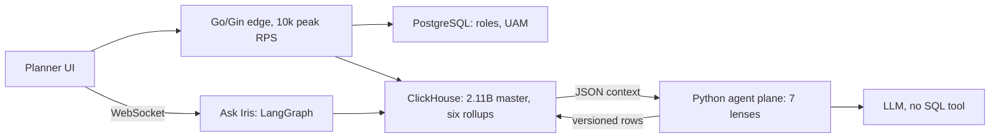

# Impact Analytics: Interview Pack (AssortSmart, Platform and AI)

<div class="callout note">
<b>How to use this page</b>
<ul>
<li><b>What it covers:</b> my current role, explained so you can talk about it for 30 seconds, 2 minutes or 45 minutes. It decodes all ten resume bullets, the design decisions, and the questions interviewers ask.</li>
<li><b>When to read it:</b> before every interview. This is the project most interviewers will spend the most time on.</li>
<li><b>What to memorise:</b> the 30-second pitch, the numbers table in section 5, and the "do not say" list at the end.</li>
</ul>
</div>

<div class="callout warn">
<b>What is on the resume and what is not.</b>
<ul>
<li>The resume has two Impact Analytics subsections: <b>Agentic Flows and Orchestration</b> (5 bullets) and <b>Core Infrastructure and Pipeline</b> (5 bullets). The canonical wording is in <code>docs/ASSORTSMART_TAB_RESUME.md</code> at the repo root.</li>
<li><b>Verbal-only, not on the PDF:</b> the Cluster Recommendation Copilot (14 tools, the 8.5% failure baseline, its confirm steps), Hindsight, the 63-table / 8-layer ClickHouse DDL design, and the line-plan 12B work. Only bring these up if asked what else you are working on. Hindsight defense: <a href="01b_hindsight_defense.md">01b_hindsight_defense.md</a>.</li>
<li><b>True but off the PDF:</b> $100 token spend per pass, the 1.6M article-season catalog, 100% Go statement coverage over 1,200+ tests, the 55GB / 16GB weekly insert caps.</li>
<li><b>Never on Impact Analytics:</b> Kafka, Flink, CDC, Kubernetes operations, Milvus, sub-second ClickHouse, human review queues (HITL).</li>
</ul>
</div>

**Tags on this page.** MEASURED means there is a log, a doc or code. ESTIMATED means arithmetic I can show. TARGET means a design goal (say "targeting"). HISTORICAL means from past work records.

**Role:** Senior Software Engineer, Impact Analytics, May 2026 to present. Individual contributor.
**Project title on the resume:** "AssortSmart — Senior Software Engineer (Platform & AI)".
**Tech line:** Go, Gin, Python, FastAPI, LangGraph, ClickHouse, BigQuery, Redis, PostgreSQL, Datadog, LangSmith, GCP, Docker.

---

## 1. The business in plain English

AssortSmart is assortment planning software for retailers. A merchandise planner at a fashion or home retailer has to decide, every season, which products to keep in the range, which to drop and which to add, and how much to buy for which stores. Those decisions are worth a lot of money: keeping a dead product ties up stock and shelf space, and dropping a good one loses sales.

Planners use AssortSmart in two ways. They explore big pivot tables of sales and inventory, sliced by product, store, attribute and week. And they get AI recommendations: should this article be kept or dropped next season, which opportunities did we miss, which styles are top performers. They can also chat with an assistant called Ask Iris to ask about KPIs and about why the AI decided something.

Before my work, pivots on PostgreSQL were slow, KPI changes needed code releases, and AI decisions had no strict guardrails or evaluation. My work sits on both halves: the core platform (Go/Gin on ClickHouse and PostgreSQL) and the agent plane (Python, FastAPI, LangGraph).

---

## 2. Say it out loud

### 30 seconds

"At Impact Analytics I work on AssortSmart, a retail assortment planning SaaS. On the platform side, I own a multi-tenant Go/Gin edge at 10k peak RPS on top of ClickHouse and Postgres. I built the pre-aggregation layer that took a planner pivot from 189 seconds to 12 seconds, a KPI formula compiler, and tenant and hierarchy isolation. On the AI side, I architected a decision engine that scores 348 thousand article-seasons as Keep or Drop by blending deterministic KPI math with seven LLM lenses, with the LLM fed JSON rather than database access. I also shipped Ask Iris, a LangGraph copilot for planners, and an 80% CI gate that every model or prompt change must pass."

### 2 minutes

"AssortSmart helps retail planners decide what to keep, drop and add each season. I work on both halves of the system.

The platform is a multi-tenant Go/Gin API at 10k peak RPS. It uses Google Wire for compile-time dependency injection, and runs as its own HTTP edge with no reverse proxy, so it handles h2c, nested timeouts and Datadog tracing itself. Auth is a Redis-fronted waterfall of Firebase, JWT and Google OIDC, roles come from Postgres, and every query is scoped by tenant and by the user's hierarchy access. Planner pivots used to be slow, so I built six ClickHouse rollup tables. A 250 million row pivot went from 189 seconds to 12 seconds. Separately, weekly rollup builds were crashing out of memory at around 170 GB, so I sliced inserts into one-week chunks with memory and spill caps. I also wrote a Go pump that copied rollups between ClickHouse Cloud clusters at about 344 thousand rows a second.

The AI side is a batch decision engine: Keep/Drop, Missed Opportunities and Top Style, over 348 thousand article-seasons, 88 thousand items per pass. Each article gets a deterministic score and an LLM score from seven lenses, blended 40/60. The LLM never queries the 2.11 billion row ClickHouse master. It gets JSON. If it times out, we fall back to the deterministic score. A shared registry gives every pipeline timeouts, circuit breakers, checkpoints and a config hash on every row. Planners chat through Ask Iris, which I shipped: a JWT WebSocket with a LangGraph supervisor and a 3-attempt evaluator. Nothing gets promoted unless it passes an 80% accuracy gate on a 300-case evaluation set."

---

## 3. The architecture in one picture



*What to notice: the LLM sits behind Python code and only sees JSON. Full box-by-box walkthrough, sample request and failure modes are on the architecture page: [../architecture/01_ia_assortsmart_hindsight.md](../architecture/01_ia_assortsmart_hindsight.md).*

---

## 4. Each resume bullet decoded

For each bullet: the exact resume line, what it means in plain words, how it works, the numbers, and the question you will get.

### A1. The decision engine

> Architected a multi-pipeline AI merchandise decision engine (Keep/Drop, Missed Opportunities, Top Style) evaluating 348k article-seasons. Optimized inference at scale—processing 88k items per pass—by blending deterministic KPI math with structured LLM invokes across 7 AI lenses.

**In plain words.** Three batch pipelines decide things about products. Keep/Drop is the main one. Each article gets a rules-based score and an AI score, and the two are blended.

**How it works.**
- Deterministic score `s_det` from sell-through and rate of sale, each mapped onto a 0-to-1 ramp.
- Agent score `s_agent` from 7 lenses (trend velocity, size curve, colour cannibalization, channel divergence, multi-season consistency, discount dependency, margin resilience), combined by a decider.
- `s_final = 0.4 × s_det + 0.6 × s_agent`. Keep if `s_final ≥ 0.55`.
- Worked example: `s_det = 0.737`, `s_agent = 0.711`, so `s_final = 0.295 + 0.427 = 0.721`, which is Keep.
- "Structured invoke" means the LLM must answer in a fixed JSON schema.
- There is no LLM orchestrator. The batch order is fixed: peer context, decider, lenses, blend, explanation.

**The numbers.** 348k is the number of article-seasons scored. 88k is the number of items in one pass. 1.6M (off PDF) is the whole catalog, a different number. Do not mix them.

**Question they will ask:** "Why not let the LLM decide everything?"
"Because rules are cheap, explainable and always available, and the LLM is none of those things all the time. The deterministic score anchors the decision and gives reason codes a planner can read. The lenses add judgement on things rules handle badly, like colour cannibalization or discount dependency. Blending them, with the deterministic score as fallback, means a provider outage never leaves a planner without a decision."

### A2. Decoupling inference from the database

> Decoupled AI inference from a 2.11B-row ClickHouse master by asynchronously serving context via JSON payloads rather than direct database querying. Engineered an eventually consistent write pattern via ReplacingMergeTree that guaranteed system availability by gracefully falling back to deterministic baselines during LLM timeouts.

**In plain words.** The AI never touches the big database. Code fetches what the AI needs, packs it as JSON and hands it over. Results are written as new versions of rows, and if the AI is slow, the rules-based score stands in.

**How it works.**
- Python runs fixed, reviewed queries and builds one compact JSON row per article. The LLM gets no SQL tool.
- "Asynchronously" describes how batches run in parallel. It does not mean the LLM queries anything.
- ReplacingMergeTree keeps the newest version of rows with the same key, here `(season_code, article)`, versioned by `computed_at`. Until background merges run, readers pick the latest row per key.
- On an LLM timeout, the article keeps its deterministic baseline. When the agent score arrives later (for example on resume), a newer row replaces it. That is "eventually consistent".

**Question they will ask:** "What stops the LLM from leaking another tenant's data?"
"It never has a query tool. The only data it sees is the JSON our code built for that batch, and that code applies the tenant and season scope. There is no prompt that can make it read something we did not send."

### A3. The orchestration registry

> Engineered a shared orchestration registry to guarantee 88k-article batch runs survive provider failures by implementing hard timeouts, circuit breakers, and durable checkpoints that bypass redundant deterministic scoring. Ensured full observability by stamping every output row with a frozen config hash and custom JSON telemetry tracking tokens, USD cost, step duration, and batch fallbacks.

**In plain words.** One shared runner makes every AI pipeline crash-safe, cost-visible and traceable.

**How it works.**
- **Hard timeouts** on every LLM call. In the current config: `min(600, 60 + 8 × articles)` seconds, so a 64-article batch gets 572 seconds.
- **Circuit breakers** stop a step after about 5 consecutive failures, or when the failure fraction passes a limit (0.25 in the current config).
- **Durable checkpoints:** `det.json` holds deterministic scores, `agent_progress.json` holds which articles the LLM finished. `--resume` reloads both, so a restart never re-runs deterministic scoring.
- **config_hash:** SHA-256 of guardrails, parameters, prompts and catalog. Change one word in a prompt and the hash changes, so every decision can be traced to its exact configuration.
- **JSON telemetry:** tokens, USD cost, step duration, batch fallbacks.

**Why not Airflow or Temporal:** "I needed resume logic tied directly to our ClickHouse inserts and to the config hash, inside the app. A separate orchestration platform would not have removed that need, and it was extra infrastructure one team's batch jobs did not justify."

### A4. Ask Iris

> Shipped "Ask Iris," a JWT-secured WebSocket copilot enabling planners to interactively query KPIs and inspect AI decisions on a multi-billion-row database. Prevented infinite LLM loops and multi-tenant data leaks by orchestrating a LangGraph supervisor with a 3-attempt evaluator loop, utilizing LangSmith for observability, and strictly freezing hierarchy access on the initial socket handshake.

**In plain words.** A chat assistant for planners. It is secure by design: who you are and what you may see is fixed the moment you connect, and the AI cannot loop forever.

**How it works.**
- JWT checked at the WebSocket handshake.
- The user's `plan_scope` (their allowed hierarchy) is computed once at the handshake and frozen for the session. Later messages cannot widen it.
- A LangGraph supervisor picks the next step. An evaluator checks the draft answer. `MAX_ATTEMPTS = 3`, then it stops.
- LangSmith traces every run (prompts, tool calls, tokens, cost).

**Say this carefully:** Ask Iris is a shipped capability. There are no usage numbers or SLA to quote. Do not invent any.

**Question they will ask:** "Why freeze scope at the handshake instead of checking per message?"
"Because per-message checks depend on every code path remembering to do them, and a chat prompt is exactly where someone will try 'show me the other region too'. Freezing scope once, at authentication time, means the session physically carries only that scope. It is simpler to reason about and simpler to test."

### A5. Evaluation harness and CI gate

> Built a 300-case proxy evaluation harness and an 80% accuracy CI gate to enforce strict deployment guardrails. Reduced live execution costs by 73% at 100% coverage by benchmarking models against a 74% deterministic baseline, strategically freezing final decision weights when the LLM underperformed the baseline.

**In plain words.** Two separate evaluation pieces. A 300-case test set with an 80% pass mark guards every change. A separate 200-case benchmark was used to pick a cheaper model and decide not to retune the blend.

**How it works.**
- **The 300-case harness:** a "proxy gold" set built from what actually happened next season (150 keeps, 150 drops). The CI gate (`gold_min_accuracy = 0.8` in `eval.json`) blocks promotion below 80%.
- **The gold-200 benchmark (separate):** two models compared on 200 labelled cases, both completing 200 of 200. The chosen one cost 73% less to run at 100% coverage. On the same set, the deterministic baseline (production threshold 0.65) scored 74%.
- The blended LLM scored about 63%, below the 74% deterministic baseline. So we froze the blend weights instead of retuning them to chase that one benchmark.

**The numbers.** 80% is a gate, not live accuracy. 73% and 74% come from the gold-200 benchmark, not the 300-case file. Model names are not on the PDF. Full detail: [01d_agentic_evals_guardrails_flow.md](01d_agentic_evals_guardrails_flow.md).

**Question they will ask:** "Your LLM scored worse than the rules. Why ship it?"
"Because the gate did its job. The benchmark told us the blend did not beat the deterministic baseline on that set, so we did not pretend it did. We froze the weights rather than overfit them to 200 cases, kept the deterministic fallback, and any future change must pass the 80% gate before promotion. The cost work still stood: the model we picked ran 73% cheaper at full coverage."

### C1. The Go/Gin platform

> Architected a multi-tenant Go/Gin platform scaling to 10k peak RPS, utilizing Google Wire for compile-time DI. Deployed as a self-protecting HTTP edge without a reverse proxy, guaranteeing high availability through native h2c, nested timeouts, and Datadog distributed tracing.

**In plain words.** The main API is written in Go. It protects itself instead of relying on nginx, and every request is traced.

**How it works.** Wire generates dependency wiring at build time, so a missing dependency is a compile error. The process enforces request deadlines with smaller deadlines inside for each downstream call, caps request bodies, speaks h2c (HTTP/2 without TLS at the process, typically behind a TLS-terminating load balancer) and emits Datadog traces.

**Say this carefully:** no SLA numbers, no Kubernetes cluster operations claim.

### C2. KPI configurator and formula parser

> Eliminated deployment bottlenecks by architecting a dynamic KPI configurator and custom formula parser. Engineered a real-time compilation layer that tokenizes operator-authored math into parameterized ClickHouse SQL fragments with native division-by-zero protection, decoupling business logic from code releases.

**In plain words.** Business users type KPI formulas. A Go compiler turns them into safe SQL. New KPIs no longer need a release.

**How it works.** Tokenizer, then parser, then an allowlist of functions. Logical names map to physical columns. Divisions are wrapped in `ifNotFinite(toFloat64(expr), 0)`. Unknown tokens fail closed. Values are bound parameters, never pasted into SQL.

```text
operator types:  margin_pct = margin / revenue * 100
compiles to:     ifNotFinite(toFloat64(sum(margin) / sum(revenue) * 100), 0)
```

### C3. Multi-tenant isolation and auth

> Guaranteed strict multi-tenant data isolation and UAM-scoped hierarchy access control across PostgreSQL and ClickHouse. Redis-fronted Firebase Admin to JWT/Google OIDC waterfall, constant-time API keys, Postgres-backed role resolution.

**In plain words.** Every request is tied to a tenant and a slice of the product hierarchy, and every query is filtered by both.

**How it works.** Redis caches token verdicts. On a miss: Firebase Admin, then JWT or Google OIDC. API keys compared in constant time. Roles from Postgres. UAM scope applied to queries in both databases.

**Say this carefully:** isolation is scoping, not encryption.

### C4. Pre-aggregation and the OOM fix

> Reduced planner pivot latency by 15.5× (189s to 12s on 250M-row operations) by building a ClickHouse pre-aggregation layer for season and weekly rollups. Prevented 170GB OOM crashes by slicing batch inserts into temporal chunks and enforcing strict distributed memory and disk-spill caps.

**In plain words.** Two separate wins. Pivots got fast because they read pre-summed tables. Weekly table builds stopped crashing because they were built one week at a time.

**How it works.** Six MergeTree rollups (product, store, attribute, each at season and weekly grain), all `PARTITION BY season_code`. Weekly builds use one fiscal week per INSERT SELECT, with verbal knobs of 55GB memory cap, 16GB spill, 8 threads, 4 weeks in flight. A whole-season weekly build needed about 170GB and failed even at 80GB and 200GB caps.

**Say this carefully:** 15.5× is query time. 170GB is load time. They are not cause and effect. The PDF rounds 12.3 seconds to 12.

### C5. Cross-cluster copy with a Go pump

> Migrated ClickHouse rollups across Cloud clusters at ~344k rows/s by writing a custom Go native-TLS data pump to bypass strict cross-cluster IP allowlist restrictions. Processed partitions up to 4.09B rows using 500k-row double-buffered batches, and eliminated partial-commit ghost rows using TSV ledgers and atomic partition rollbacks.

**In plain words.** Two ClickHouse clusters could not talk to each other directly, so I wrote a Go program that read from one and wrote to the other, fast and safely.

**How it works.**
- Native ClickHouse protocol over TLS (port 9440) from an allowlisted machine.
- 500k-row columnar batches, double-buffered: read the next batch while the previous one is being sent.
- Two season streams of about 150k to 190k rows per second each, about 344k combined.
- Ghost rows (rows from a half-finished insert) prevented by a TSV ledger (the weekly loader's skip file) and copier checkpoint files `migrate-checkpoints/<table>.done`.
- "Atomic partition rollback" means DROP PARTITION then recopy that season. It is not an atomic swap with live readers.

**Say this carefully:** 344k is rows per second, not requests. The 4.09B copy (2,779,317,472 + 1,311,108,195 rows of attr weekly) was measured in flight. Do not say the cutover finished. Never offer to open-source the copier.

---

## 5. All the numbers in one table

| Number | Meaning | Where | Tag |
|---|---|---|---|
| 348k | Article-seasons scored | A1 | On PDF |
| 88k | Items per pass | A1, A3 | On PDF |
| 7 | AI lenses | A1 | On PDF |
| 2.11B | Rows in the ClickHouse master | A2 | On PDF |
| 3 | Max evaluator attempts in Ask Iris | A4 | On PDF |
| 300 | Cases in the proxy evaluation harness | A5 | On PDF |
| 80% | CI promotion gate | A5 | On PDF |
| 73% | Lower execution cost at 100% coverage, gold-200 | A5 | On PDF |
| 74% | Deterministic baseline on gold-200 | A5 | On PDF |
| 10k | Peak RPS on the Go/Gin edge | C1 | On PDF |
| 15.5×, 189s to 12s, 250M | Pivot query speed-up | C4 | MEASURED |
| 170GB | Memory a whole-season weekly build needed | C4 | MEASURED |
| ~344k rows/s | Copy rate | C5 | MEASURED |
| 4.09B | Largest partition set copied | C5 | MEASURED, in flight |
| 500k | Rows per pump batch | C5 | On PDF |
| $100 | Token spend per pass, about a tenth of a cent per item | Off PDF | ESTIMATED per-item |
| 1.6M | Catalog article-seasons | Off PDF | Verbal |
| 100%, 1,200+ | Go statement coverage and test count | Off PDF | Verbal |

---

## 6. Design decisions, short form

Each of these has a full What / Why / Alternatives / Trade-off / What I'd do differently write-up on the [architecture page](../architecture/01_ia_assortsmart_hindsight.md).

- **Go/Gin edge without a reverse proxy.** Fewer hops, one place for timeouts, tracing at the serving process. Trade-off: I own every protection nginx would give for free.
- **ClickHouse versus PostgreSQL versus Snowflake.** Postgres is a row store built for transactions: multi-column pivots read whole rows. ClickHouse reads only the needed columns and processes them in vectorised batches. Snowflake and BigQuery are strong warehouses, but interactive pivots wanted predictable latency and cost on a store we control. Trade-off: ClickHouse is weak at single-row updates, so writes become new versions.
- **JSON context instead of an LLM SQL tool.** Safer, cheaper, testable. Trade-off: a lens needing a new field needs a code change.
- **LangGraph supervisor with a 3-attempt evaluator for Ask Iris.** Explicit control flow, a hard cap on loops, and a frozen scope. Trade-off: one more framework to learn and maintain.
- **80% CI gate against a deterministic baseline.** A change must beat a free rule, not just "look better". Trade-off: the gate will sometimes block a model. That is the point.
- **Kafka and Flink.** These are Uber Menu. Not used on AssortSmart.

---

## 7. Mock-interview notes

**"Is Ask Iris actually shipped?"**
"Yes, as a capability: a JWT WebSocket copilot with scope frozen at the handshake and a 3-attempt evaluator loop. I do not have usage or SLA numbers to quote, so I will not make any up."

**"Did you build the Postgres-to-ClickHouse CDC pipeline?"**
"No. That was a colleague, Ashvin Sharma. I can discuss the design pattern, but I did not author it."

**"Tell me about an out-of-memory incident."**
"The one on my resume is the weekly ClickHouse rollup build at around 170 GB, fixed with one-week slices and memory and spill caps." There is also a Python/FastAPI connection-leak OOM story in older prep. That one is a packet story, not a resume bullet. If you tell it, say so, and do not attach Kubernetes cluster operations to it.

**"What about the Cluster Recommendation Copilot?"**
"That is in progress and not on my resume. Happy to talk about its design." Details: [01c_agent_read_tools_defense.md](01c_agent_read_tools_defense.md) and [01d_agentic_evals_guardrails_flow.md](01d_agentic_evals_guardrails_flow.md).

**"Is 80% your production accuracy?"**
"No. 80% is the promotion gate on a 300-case proxy set. A change cannot ship unless it clears that bar."

---

## 8. Practice drill

1. **What is an article-season?** One product in one selling season. We score 348 thousand of them.
2. **What is the blend formula?** `s_final = 0.4 × s_det + 0.6 × s_agent`, keep at 0.55 or above.
3. **Name the seven lenses.** Trend velocity, size curve, colour cannibalization, channel divergence, multi-season consistency, discount dependency, margin resilience.
4. **What happens when the LLM times out?** The article keeps its deterministic score, and a newer row replaces it when the agent score arrives. ReplacingMergeTree keeps the newest.
5. **What is config_hash?** A SHA-256 fingerprint of guardrails, parameters, prompts and catalog, stamped on every output row so every decision is traceable.
6. **How does resume work?** `det.json` and `agent_progress.json` checkpoints with `--resume`. Deterministic scoring is never redone.
7. **Why freeze scope at the WebSocket handshake?** So nothing typed later can widen access, which prevents cross-tenant leaks.
8. **Is 80% production accuracy?** No. It is the CI promotion gate on a 300-case proxy set.
9. **Where do 73% and 74% come from?** A separate gold-200 benchmark, not the 300-case file.
10. **Does 15.5× come from the OOM fix?** No. 15.5× is query time on rollups. The 170GB OOM fix is load time.
11. **Is 344k requests per second?** No. It is rows per second during the copy.
12. **Did the 4.09B cutover finish?** I measured the copy in flight. I do not claim the cutover finished.
13. **What does partition rollback mean?** DROP PARTITION then recopy that season. Not an atomic swap.
14. **Why no reverse proxy?** Fewer hops and one place for timeouts. I own the protections myself.
15. **Did you use Kafka at Impact Analytics?** No. Kafka and Flink were Uber Menu.

---

## 9. Do not say

- "All tenants are live at 80% accuracy."
- Any throughput beyond the PDF's 10k peak RPS, or any SLA.
- Spark, Pinot, Kubernetes operations, Terraform, Flink, Kafka or CDC on Impact Analytics.
- MCP as an Impact Analytics resume skill. It is skills-level.
- Cluster Copilot or Hindsight as resume bullets.
- "Sub-second ClickHouse pivots."
- "LangSmith on the Keep/Drop batch." LangSmith is on Ask Iris.
- "Human review queue" or "HITL" on Impact Analytics.

---

## Related

- Architecture page: [../architecture/01_ia_assortsmart_hindsight.md](../architecture/01_ia_assortsmart_hindsight.md)
- Evals, guardrails and flow: [01d_agentic_evals_guardrails_flow.md](01d_agentic_evals_guardrails_flow.md)
- Full deep dive: [01_ia_deep_dive.md](01_ia_deep_dive.md)
- Full bullet tables (A1 to A5, P1 to P5): [../../../prep/23a_ia_interview_pack.md](../../../prep/23a_ia_interview_pack.md)
- Rollups and copier detail: [../../../prep/42_clickhouse_rollup_migration.md](../../../prep/42_clickhouse_rollup_migration.md)
