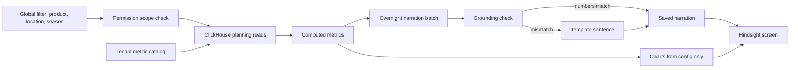

# Hindsight Module Defense (verbal-only depth)

<b>Verbal-only. Not a resume bullet.</b>
<ul>
<li>Hindsight is <b>not on the PDF</b>. Older prep called this a "resume claim". That is obsolete. The current resume does not mention Hindsight.</li>
<li>Use this page only when an interviewer asks "what else are you working on?" or "how do planners use last season's data?". Say "this is in progress and not on my resume".</li>
<li>Status: <b>building</b> against a functional requirements document. Do not say shipped or live for all tenants.</li>
<li>There is no dollar, latency or adoption number for Hindsight. Do not invent one. Speed numbers stay with the ClickHouse rollup bullet.</li>
<li>Defend the live resume from <code>docs/ASSORTSMART_TAB_RESUME.md</code>: 10k RPS, 189s to 12s with six rollup tables, the 170GB OOM fix, Ask Iris shipped, the 300-case / 80% promotion gate.</li>
</ul>

<b>How to use this page</b>
<ul>
<li><b>What it covers:</b> what Hindsight is, how it is designed, and the engineering judgement behind it, mapped to the requirement numbers in the source document.</li>
<li><b>When to read it:</b> after you know the main Impact Analytics pack, as extra depth for a long technical round.</li>
<li><b>What to memorise:</b> the 60-second talk track, the four design principles (the AI is not the chart designer, not the calculator, runs overnight, and config beats code), and the honesty lines.</li>
</ul>

**Source:** `KNOWLEDGE-MATERIAL/Impact-Analytics-work/PRD'S/Hindsight_Module_Functional_Requirements-2.docx` (version 1.2).

**Tags on this page.** MEASURED means there is a log, a doc or code. ESTIMATED means arithmetic I can show. TARGET means a design goal (say "targeting"). HISTORICAL means from past work records. Most of this page is DESIGN: what the requirements document specifies.

---

## 1. What Hindsight is, in plain English

AssortSmart's planning cycle runs in stages: **hindsight, then strategy, then clustering, then line plan, then buy**. Hindsight is the first stage. Before planners decide what to buy next season, they look back at last season: what sold, what did not, which styles deserve to come back, and which should be dropped.

Without it, planners start next season half blind, piecing together last season from spreadsheets. Hindsight puts that review on one screen, with numbers, charts and short AI-written summaries, all limited to the part of the business each planner is allowed to see.

So the honest pitch is: **Hindsight is buying-decision support, not a vanity dashboard.** It feeds the decisions that cost real money in the next stages.

---

## 2. Words you need

- **FRD (functional requirements document).** The product spec that lists what the system must do. Each requirement has a number, like FR-6.1.
- **TY vs LY.** This year compared with last year. The scorecard also offers an "Optimised LY" comparison defined in the FRD. If asked for its exact definition, keep it qualitative.
- **Scorecard.** A row of headline KPI tiles, such as sales, margin and sell-through, each compared with last year.
- **Contribution chart.** Shows how much each category or store contributed to the total.
- **Carry-forward.** Styles recommended to bring back next season.
- **Underperformance flag.** A marker on items that did worse than a threshold.
- **Keep / Shop / Drop.** The recommendation labels on the item grid in the FRD. (The Keep/Drop engine on my resume outputs binary Keep or Drop. See the honesty section.)
- **Narration.** Short sentences written by an LLM that describe what happened, for example "Dresses grew 12% while Knitwear fell".
- **Grounding check.** Before a narration sentence is saved, every number in it is compared with the computed metric. If they do not match, the sentence is rejected. Like a fact-checker reading a news article before it is printed.
- **Template fallback.** A pre-written sentence with blanks filled from computed metrics, used when narration fails the check. Boring but always correct.
- **Template library and metric metadata.** A shared set of sentence patterns, chosen based on each metric's description (is higher better, is it a percentage, and so on).
- **Metric catalog.** One list per tenant of every metric, its formula and its display rules, shared by every widget.
- **Config vs code.** A new metric or chart for a retailer is added as configuration data, not as a software release.
- **Permission scope.** The part of the product and store hierarchy a user is allowed to see.
- **Virtualized scrolling.** A grid that only renders the rows currently on screen, so 1,000+ items stay smooth. Like a train window: you only see the stretch of track you are passing.

---

## 3. What is on the screen (FRD v1.2)

- A **scorecard**: this year against last year, or against the "Optimised LY" baseline.
- **Contribution charts**.
- A **store performance map**.
- **Configurable bar charts**.
- **Top performers**.
- A **By Item grid** with Keep/Shop/Drop recommendations and a per-item note.
- A **By Attribute heatmap** (for example colour by size).
- A **Carry-Forward / What Didn't Work panel**.
- **Agent narration** on the widgets.

---

## 4. How it is designed

*What to notice: metrics are computed by code. Charts are chosen by configuration. The LLM only writes sentences, overnight, and every sentence is fact-checked against the computed numbers before it is saved.*

### One narration, step by step (illustrative)

1. Overnight, the batch computes metrics for each tenant and scope. For example, "Dresses, season 74: sales up 12% against last year, sell-through 81%".
2. The narration step picks a template family from the metric metadata (a growth metric, higher is better) and asks the LLM for one sentence.
3. The LLM returns: "Dresses grew 12% year on year with strong sell-through of 81%."
4. The grounding check extracts 12% and 81% and compares them with the computed values. Both match, so the sentence is saved.
5. If the LLM had written "grew 15%", the check would fail and the template would be saved instead: "Dresses sales changed by +12% versus last year. Sell-through: 81%."
6. In the morning, the planner opens Hindsight. Charts render from config, and the narration is read from storage. No LLM call happens on the page.

---

## 5. Requirement mapping, explained

| What I say | FRD reference | What it means in practice |
|---|---|---|
| "Prior-season decision layer" | Overview and pipeline position | Hindsight exists so next-season buys are based on evidence. |
| "Carry-forward and underperformance flags" | FR-6.1 | The panel shows candidates and underperformers with the metric values beside any narration, never narration alone. The threshold can be personalised by the user within tenant bounds. |
| "Keep/Shop/Drop recommendations" | FR-16.5 | The item grid keeps the existing recommendation plus a per-item note, with the same grounding and fallback as other narration. |
| "Overnight narration checked against computed metrics" | FR-2.3, FR-4.3, FR-5.3, FR-8.1 | Batch, not live. Shared template library driven by metric metadata. Numbers checked before save. On failure, a templated sentence. No invented KPIs. |
| "Deterministic visuals" | FR-9.1 | Chart type, colours and icons come from configuration only. The narration agent never chooses layout. |
| "Permission-scoped filters" | FR-0.1 to FR-0.5 | One global product, location and season filter. "Select all" never reaches outside the user's permission scope. |
| "Shared metric catalog" | Section 1.2, FR-1.1 | One catalog for scorecard, bars, item grid and attribute heatmap. No per-widget metric lists that drift apart. |
| "Tenant catalogs without a code deploy" | FR-1.3 | Onboarding configuration (catalog and chart instances) applies to all tenant users without a code deployment. Changes are versioned with a last-updated stamp. |
| "Item grid at scale" | FR-16.6 | Stays fast at 1,000+ items through pagination or virtualized scrolling. |

---

## 6. Engineering judgement to defend

### Principle 1: the LLM is not the chart designer and not the calculator
- **What:** charts come from config (FR-9.1). Metrics come from code. The LLM only writes sentences, which are checked.
- **Why:** an LLM that picks charts makes every tenant's screen unpredictable. An LLM that computes numbers will sometimes compute them wrong. Both destroy trust.
- **Alternative:** let the agent generate the whole dashboard. Impressive in a demo, unreliable in front of a buyer.
- **Trade-off:** less "magic". The AI's job is small and boring, which is exactly what makes it safe.

### Principle 2: narration runs overnight in batch
- **What:** narration is generated once a night (FRD section 13). Live, on-demand narration is Phase 2, for narrow cases only (FR-11.1), with the same grounding check.
- **Why:** planners change filters constantly. A live LLM call on every filter change would add seconds of latency and real cost, for sentences that barely change.
- **Trade-off:** narration can be up to a day old. For last-season review, that is fine, because last season does not change.

### Principle 3: config, not code
- **What:** new retailer metrics and charts are data (FR-1.3), versioned.
- **Why:** onboarding a retailer should not wait for a release train.
- **Trade-off:** configuration needs its own validation, versioning and review, or a bad config breaks a tenant just like bad code.

### Principle 4: multi-tenant safety on every widget
- **What:** permission scope applies to every widget, including the store map and the item grid.
- **Why:** "select all" is the classic leak. It must mean "all that I am allowed to see".
- **Trade-off:** every query path must carry the scope, which needs tests per widget.

---

## 7. Honesty

- **Status is "building".** It is in AssortSmart's Phase 1 posture. Do not claim it is fully shipped to all tenants.
- **Keep/Shop/Drop is existing behaviour** that the FRD keeps on the item grid (FR-16.5). I am hardening and shipping it inside the Hindsight surface. I am not claiming a brand-new model.
- **Keep/Shop/Drop versus Keep/Drop.** The FRD's item grid uses three labels. The Keep/Drop engine on my resume outputs binary Keep or Drop only. If an interviewer connects the two, say: "the resume engine is binary. The three labels are the item-grid language in the Hindsight spec."
- **No Hindsight numbers.** No dollars, latency or adoption figures exist for Hindsight alone. The pivot speed numbers belong to the ClickHouse bullet.
- **No human review queue.** Narration falls back to a template automatically. Nothing is queued for a human to approve.

---

## 8. 60-second talk track

"Something I am building that is not on my resume is Hindsight. It is how planners learn from last season before they buy for the next one. It is a decision layer: carry-forward and underperformance flags, Keep/Shop/Drop on the item grid, a scorecard and contribution views, all behind permission-scoped filters and a shared tenant metric catalog that goes live without a code deploy. The AI part is deliberately small. Narration runs overnight from a shared template library, and every number in a sentence is checked against the computed metric before it is saved. If it does not match, we save a template sentence instead. Charts are chosen by configuration, so the model can never invent a layout or a KPI."

---

## 9. Likely questions

**"Does the agent ever invent metrics?"**
"No. Every number in a narration sentence is checked against the computed value before save, which is FR-2.3. If anything does not match, we fall back to a template sentence built from the computed metrics. It fails closed, so the planner sees a plain but correct sentence rather than a confident wrong one."

**"Why overnight and not live?"**
"Because planners change filters constantly, and last season's data does not change. Generating narration live on every filter change would add latency and cost for nearly identical sentences. Version 1 batches overnight. Live narration is a Phase 2 option for narrow cases, with the same grounding check."

**"What is Keep/Shop/Drop?"**
"It is the per-item recommendation on the By Item grid, with a short note, grounded like the other narration. It guides the planner on what to carry into the next plan. The Keep/Drop engine on my resume is the binary version that scores articles. The three labels are the item-grid language in the Hindsight spec."

**"How does this relate to ClickHouse?"**
"Hindsight reads are scan-heavy, like pivots: sums over many rows sliced by product, store and week. Those reads sit on the ClickHouse planning store and rollups. The FRD is the product contract. ClickHouse is the serving engine. The measured speed numbers belong to the rollup work, not to Hindsight."

**"How do you add a new metric for a retailer?"**
"Through the tenant metric catalog. It is configuration, versioned, and it applies to all of that tenant's users without a code deploy. That is FR-1.3."

**"What stops a planner seeing another region?"**
"The global filter is permission-scoped, FR-0.1 to FR-0.5. Select-all means all within your scope, on every widget including the map and the item grid."

---

## 10. Practice drill

1. **Where does Hindsight sit in the planning cycle?** First: hindsight, strategy, clustering, line plan, buy.
2. **Is it on your resume?** No. It is in progress. I mention it only if asked.
3. **What does the LLM do in Hindsight?** Writes short narration sentences overnight. Nothing else.
4. **What happens if a narration number is wrong?** The grounding check fails and a template sentence is saved instead.
5. **Who picks the chart type?** Configuration. Never the model (FR-9.1).
6. **How does a new tenant get its metrics?** Through the versioned metric catalog, without a code deploy (FR-1.3).
7. **How does the item grid stay fast?** Pagination or virtualized scrolling at 1,000+ items (FR-16.6).
8. **Is there a Hindsight latency number?** No. Do not invent one.
9. **Is there a human approval step?** No. Fallback is automatic.
10. **Is Keep/Shop/Drop new?** No. It is existing behaviour kept on the item grid.

---

## Related

- Architecture page (Hindsight section at the end): [../architecture/01_ia_assortsmart_hindsight.md](../architecture/01_ia_assortsmart_hindsight.md)
- Main Impact Analytics pack: [01_impact_analytics.md](01_impact_analytics.md)
- Agent read tools (also verbal-only): [01c_agent_read_tools_defense.md](01c_agent_read_tools_defense.md)
