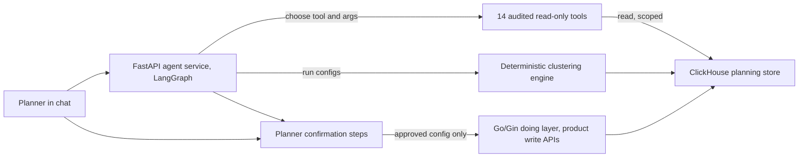

# Agent Tools That Only Read Planning Data (verbal-only depth)

<div class="callout warn">
<b>Verbal-only. Not a resume bullet.</b>
<ul>
<li>This page is about the <b>Cluster Recommendation Copilot</b> design at Impact Analytics. It is <b>not on the PDF</b>. Older prep wrote "what the resume means" here. That is obsolete. The current resume does not mention the copilot or its 14 tools.</li>
<li>Status: <b>design</b>. The Phase 1 design passed internal and external review. The bring-up load test is <b>pending</b>. Say "designing" or "building", never "shipped".</li>
<li><b>MCP and tool calling are skills-level</b> on my resume. The 14-tool design is something I can explain verbally. It is not an Impact Analytics bullet.</li>
<li>Do not call the confirm steps "HITL" or a "human review queue". Impact Analytics has no human review queue in shipped code. The design has planner confirmation clicks, which is a different thing (explained below).</li>
<li>Defend the live resume from <code>docs/ASSORTSMART_TAB_RESUME.md</code>: 10k RPS, 189s to 12s with six rollup tables, the 170GB OOM fix, Ask Iris shipped, the 300-case / 80% promotion gate.</li>
</ul>
</div>

<div class="callout note">
<b>How to use this page</b>
<ul>
<li><b>What it covers:</b> what "the agent's tools only read data" means, why we phrase it that way instead of "the agent never writes SQL", and how the design keeps writes safe.</li>
<li><b>When to read it:</b> before a GenAI or agent-design round, after you know the main Impact Analytics pack.</li>
<li><b>What to memorise:</b> the one-sentence principle ("the LLM proposes and reads, the engine computes, the planner confirms, writes go through product APIs"), the 8.5% (37 of 437) measured baseline, and that under 2% is a target.</li>
</ul>
</div>

**Tags on this page.** MEASURED means there is a log, a doc or code. ESTIMATED means arithmetic I can show. TARGET means a design goal (say "targeting"). HISTORICAL means from past work records. DESIGN means it is specified in a design document but not built or measured in production.

---

## 1. The problem in plain English

Before planners can decide which products go to which stores, they group stores into **clusters**: stores that behave alike (similar customers, similar sales patterns) get a similar assortment. Today a planner makes four expert choices more or less blind (attributes, time window, store scope and number of clusters), runs **one** configuration, and takes what comes out. The system even computes significance scores and then ignores them. On one live tenant's data, **8.5% of runs fail (37 of 437)**, and most of those failures are avoidable input mistakes. The winning settings are not saved, so a result cannot be reproduced.

The Cluster Recommendation Copilot is the design that fixes this. A planner says what they want in chat. An LLM agent plans the search and calls tools to read data. A deterministic engine (normal code, not the LLM) computes the clusters across many configurations. The planner confirms. Only then is anything saved.

---

## 2. Words you need

- **Agent.** An LLM in a loop that can decide to call tools, read the results and decide the next step. Like an assistant who can look things up, not just answer from memory.
- **Tool.** A function the agent is allowed to call, with a fixed name, typed inputs and typed outputs. The agent never writes the code inside the tool. It only chooses which tool and which arguments.
- **Tool calling.** The LLM returns a structured request like `{"tool": "get_store_attributes", "args": {...}}`. Our code runs the tool and gives back the result.
- **MCP (Model Context Protocol).** A standard way to describe tools so different LLM clients can call them. In this design it is the tool protocol. On my resume MCP is skills-level.
- **Allowlist.** The fixed list of the only tools that exist. If a tool is not on the list, the agent cannot call it.
- **Audited tool.** A tool whose code has been reviewed, whose inputs are validated, and whose every call is logged.
- **Read-scoped.** The tool can only read data, inside the user's tenant and permission scope.
- **Write path.** The only code route allowed to change plans or clusters. Here, the existing product APIs in the Go service.
- **Doing layer.** The Go (Gin) services that actually perform product operations: clustering, Hindsight, strategy. The agent asks. The doing layer does.
- **Input boundary.** The point where user input enters the system. "Input-boundary mistakes" are things like a wrong season code, a hierarchy node that does not exist, or a store set too small to cluster.
- **Grounding.** Checking the agent's understanding against real data before acting, for example confirming the hierarchy node exists in the catalog and the season exists in the fiscal calendar.
- **k.** The number of clusters.

---

## 3. The claim, stated precisely

"The copilot design exposes **14 audited tools**. Those tools **only read** planning and clustering data. The LLM never gets a raw SQL shell. Any change to plans or clusters happens only after **three planner confirmation steps**, and then goes through the existing product write path in the Go services, never through model-generated SQL."

The three confirmation steps in the design are:
1. The planner approves the **search plan** (which attributes, and how many configurations to explore).
2. The planner approves the **winning recommendation**.
3. **Governance sign-off** where the tenant requires it.

These are confirm buttons in the product flow, the same way you confirm a bank transfer. They are not a review queue where someone else checks the AI's work. And none of it is shipped yet.

---

## 4. The design in one picture



*What to notice: there is no arrow from the agent to a write. The only write arrow starts at the Go doing layer, and only after confirmation.*

---

## 5. One tool call, step by step (illustrative)

Tool names below are **illustrative**, to show the shape. They are not the real tool registry.

1. The planner types: "Cluster my Womenswear stores for Summer 2026, I care about size mix."
2. The agent calls a grounding tool:

```json
{ "tool": "resolve_hierarchy_node", "args": { "text": "Womenswear" } }
```

The tool looks the name up in the product catalog and returns `{"node_id": "L1_204", "found": true}`. If it did not exist, the agent would ask the planner instead of guessing. This is exactly the class of input mistake behind most of the 8.5% failures.

3. The agent calls a read tool for the fiscal calendar to confirm "Summer 2026" maps to a real season code.
4. The agent calls a read tool that checks sample size: enough stores with enough history to cluster.
5. The agent proposes a search plan: attributes including size mix, a range of k within the client's minimum and maximum, and a batch of configurations. **Confirmation step 1:** the planner approves.
6. The deterministic engine runs the configurations. The LLM does not compute clusters.
7. The agent presents 3 to 5 distinct scenarios with evidence. **Confirmation step 2:** the planner picks one.
8. The approved configuration (recipe, data watermark, seed) is saved, and the Go doing layer writes the clusters through the existing product API.

At no point can the agent issue `INSERT`, `UPDATE` or `DELETE`. It has no tool that does.

---

## 6. Why we do not say "the agent never writes SQL"

That phrase sounds absolute and confusing. Engineers write SQL all the time, the services write to databases all the time, and an interviewer will poke holes in "never". The accurate claim is about **tool permissioning**:
- Agent tools are read-scoped.
- The agent cannot author SQL. It can only call fixed tools with validated arguments.
- Writes happen only through the product write path, after confirmation.

That is precise, testable and defensible.

---

## 7. How the same principle shows up in shipped code

If an interviewer asks "is any of this real?", anchor on what is shipped, carefully.

- **Keep/Drop (on the resume):** the scoring lenses receive JSON context only. The LLM never gets a SQL tool. In the current package, a small peer-context step can call two fixed, batch-level read functions (at most 2 per batch). They are SELECT-only, restricted to an allowlist of tables, have a 15-second query timeout, and any write or DDL statement is rejected. No agent has a write path. Engines write staging files, and an operator command publishes them.
- **The dig-deeper Q&A agent on locked decisions:** `allow_writes` is false and locked. It cannot change a decision.
- **Ask Iris (on the resume):** hierarchy scope frozen at the WebSocket handshake, and a 3-attempt evaluator cap.

So the copilot design extends a principle the team already runs: the model reads and proposes, code computes, and writes go through controlled paths.

---

## 8. Design decisions

### Read-only tools instead of a guarded SQL tool
- **Why:** a guarded SQL tool still lets the model write a query that scans billions of rows or slips past a filter. A fixed tool has a known cost and a known scope.
- **Alternative:** an LLM SQL tool with a read-only database user. Safer than nothing, but cost and scope are still open-ended, and testing it is hard.
- **Trade-off:** every new question the agent should answer needs a new tool, written and reviewed.

### Grounding tools before compute
- **Why:** over 80% of the measured failures were input-boundary mistakes. Resolving hierarchy, season and sample size first removes that class before the engine runs.
- **Trade-off:** a few more tool calls per session.

### Deterministic engine for the clusters
- **Why:** clustering math must be reproducible and explainable. The LLM chooses what to explore. Code computes.
- **Trade-off:** the agent's creativity is limited to the search plan, which is the point.

### Confirmation before write-back
- **Why:** clusters drive buying decisions worth real money. A planner owns that decision.
- **Trade-off:** one or two extra clicks per session.

---

## 9. The numbers

| Number | What it measures | Tag |
|---|---|---|
| 14 | Audited read-only tools in the copilot design | DESIGN |
| 3 | Planner confirmation steps before write-back | DESIGN |
| 8.5% (37 of 437) | Clustering runs that failed on one live tenant's data | MEASURED baseline |
| Over 80% of those | Failures that were input-boundary mistakes | MEASURED |
| ~20 seconds | Median clustering job time over 370 live runs (engine only, not the full chat) | MEASURED |
| 0% | Reproducibility, because winning settings were never saved | MEASURED baseline |
| Under 2% | Failure rate the design targets | TARGET |

**8.5%.** 37 divided by 437 is 0.0847, about 8.5%. Say "on live data, about 8.5 percent of clustering runs failed, 37 out of 437, mostly avoidable input mistakes". Never say "we cut it to under 2%". Say "the design targets under 2%".

---

## 10. How to defend it in an interview

**"Can your agent write to the database?"**
"No. In the design, the agent only has 14 audited tools, and they only read planning data within the user's scope. It cannot write SQL at all. It picks a tool and arguments, and our code runs the tool. Any change goes through the existing Go product APIs, and only after the planner confirms the plan and the recommendation."

**"What failure rate do you see?"**
"On one live tenant, about 8.5% of clustering runs failed, 37 out of 437, and more than 80% of those were input-boundary mistakes like a wrong season or a hierarchy node that did not exist. The design adds grounding tools that resolve those before anything runs. Under 2% is the target. I will not claim it until the load test is done."

**"Is this shipped?"**
"No. It is a Phase 1 design that passed review, with the bring-up load test pending. It is not on my resume. The same read-only principle is already shipped in the Keep/Drop engine and in Ask Iris."

**"Why not just give the model a read-only SQL user?"**
"Read-only stops writes, but not a query that scans billions of rows or forgets a tenant filter. Fixed tools give me known cost, known scope and something I can unit test."

---

## 11. Say this, not that

| Say this | Not this |
|---|---|
| "Tools are read-scoped. Writes go through product APIs after confirmation." | "The agent never writes SQL." |
| "Measured 8.5%, targeting under 2%." | "We reduced failures to under 2%." |
| "Planner confirmation steps in the design." | "HITL" or "human review queue". |
| "Design, load test pending." | "Shipped copilot." |
| "MCP is skills-level for me." | MCP as an Impact Analytics resume bullet. |

---

## Related

- Evals, guardrails and the copilot flow: [01d_agentic_evals_guardrails_flow.md](01d_agentic_evals_guardrails_flow.md)
- Main Impact Analytics pack: [01_impact_analytics.md](01_impact_analytics.md)
- Hindsight (also verbal-only): [01b_hindsight_defense.md](01b_hindsight_defense.md)
- LangGraph, MCP and RAG depth: [../tech_depth/langgraph_mcp_rag.md](../tech_depth/langgraph_mcp_rag.md)
