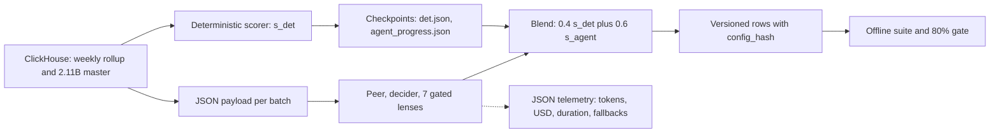
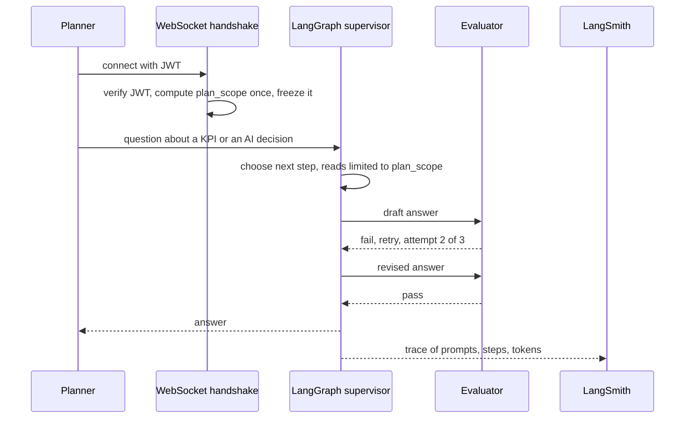
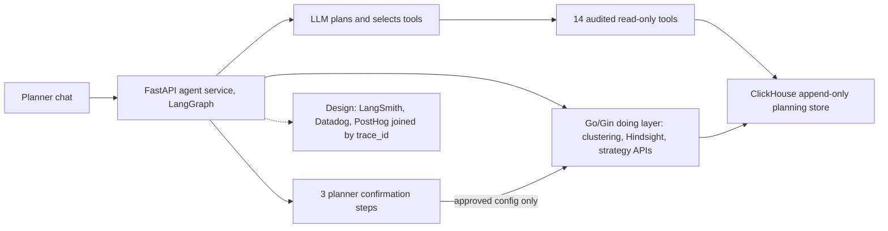

# Agentic AssortSmart: Flow, Guardrails, Evals and Benchmarking Honesty

<b>How to use this page</b>
<ul>
<li><b>What it covers:</b> how the AI side of AssortSmart is kept safe and measured. <b>Part A</b> is resume-backed: the Keep/Drop decision engine and Ask Iris, their guardrails, the 300-case harness, the 80% gate and the gold-200 benchmark. <b>Part B</b> is verbal-only: the Cluster Recommendation Copilot design and its measured baselines and targets.</li>
<li><b>When to read it:</b> before any GenAI, LLM evaluation or "how do you know your AI works?" round.</li>
<li><b>What to memorise:</b> the 80% / 73% / 74% / 63% story and which benchmark each number belongs to, the guardrails list, and the sentence "80% is a promotion gate, not production accuracy".</li>
</ul>

<b>Never break these.</b>
<ul>
<li><b>80%</b> is a CI promotion gate on a <b>300-case</b> proxy evaluation set. It is not "all tenants live at 80%".</li>
<li><b>73%</b> lower cost at 100% coverage and the <b>74%</b> deterministic baseline come from a separate <b>gold-200</b> benchmark. They do not come from the 300-case file. Never fuse the two.</li>
<li><b>Ask Iris</b> is a shipped capability. No usage numbers, no SLA.</li>
<li><b>LangSmith</b> is on Ask Iris. The Keep/Drop batch uses custom JSON telemetry.</li>
<li><b>No human review queue (HITL)</b> in Impact Analytics code. Offline evals replaced the critic and evaluator agents in Keep/Drop.</li>
<li><b>Part B is verbal-only.</b> The Copilot, its 14 tools, its confirm steps and its 8.5% baseline are not on the resume.</li>
</ul>

**Tags on this page.** MEASURED means there is a log, a doc or code. ESTIMATED means arithmetic I can show. TARGET means a design goal (say "targeting"). HISTORICAL means from past work records. DESIGN means specified in a design document, not built or measured in production.

---

## Words you need

- **Guardrail.** A rule enforced by code that limits what the AI can do or how badly it can fail. Like the rails on a bowling lane for children.
- **Offline evaluation.** Testing the system on a fixed labelled set before release, not on live users.
- **Gold set.** A set of cases where the right answer is known (the "gold" label).
- **Proxy gold.** Labels built from a stand-in for the truth. Here: what actually sold next season, instead of a merchant's judgement.
- **Promotion gate.** A CI check that a new config, prompt or model must pass before it replaces the current one.
- **Accuracy.** The share of cases where the system's answer matches the gold label.
- **Recall (keep recall, drop recall).** Of all the true drops, how many did the system catch? Accuracy can look fine while drop recall is terrible, if most cases are keeps.
- **Over-keep.** The failure where the system keeps products that should have been dropped.
- **Coverage.** The share of cases that got a complete answer, without timeouts or missing pieces.
- **Deterministic baseline.** The rules-only score with no LLM. Free to run and always available, so every LLM change must beat it.
- **Circularity.** Grading a system against labels derived from its own inputs. The score looks good whether or not the system is any good.
- **Treatment leakage.** When a label encodes a past human decision instead of real demand. For example, a product a planner already dropped sells zero next season because it was not stocked, not because nobody wanted it.

---

# Part A: Resume-backed (Keep/Drop and Ask Iris)

## A1. End-to-end flow of a Keep/Drop run

In plain English: a batch job reads sales data, computes a rules-based score for every article, asks the LLM lenses for a second opinion using JSON only, blends the two, and writes versioned results. A shared registry wraps everything with timeouts, breakers and checkpoints. Before any change to prompts, weights or models is promoted, it must pass the 80% gate.

*What to notice: the LLM sits in one box, fed by JSON, and its output is blended with a score that exists without it. Evaluation reads the outputs, never the other way round.*

The batch order is fixed in code: peer context, then decider, then lenses, then blend, then explanation. There is no LLM orchestrator deciding what runs next.

## A2. Ask Iris flow

1. The JWT is verified when the socket opens.
2. The user's `plan_scope` is computed once and frozen for the session. Nothing typed later can widen it.
3. The supervisor picks steps. The evaluator checks the draft. `MAX_ATTEMPTS = 3`, then the graph stops instead of looping forever.
4. LangSmith records the run.

## A3. Guardrails (what stops bad decisions and runaway runs)

| Layer | Mechanism | Why it exists |
|---|---|---|
| No SQL tool | Lenses get JSON built by our code from fixed queries | The LLM cannot scan billions of rows, leak a tenant, or write |
| Read-only helpers | The peer-context step may call two fixed batch read functions, at most 2 per batch. SELECT-only, allowlisted tables, 15-second timeout, writes and DDL rejected | Peer context without giving the model a query language |
| Lens gate | A lens runs only if the article has the data for it (for example 2+ colours for colour cannibalization) | No wasted calls, no confident answers from missing data |
| Structured output | Fixed JSON schema. Unknown lens names dropped, weights renormalised, at most 5 lenses per mix | Parseable, bounded output |
| Coverage rules | A mix counts only if at least 75% of its planned weight came back. An article is marked pending if fewer than 75% of mixes are valid | Missing answers cannot silently make a score look optimistic |
| Demand over margin | The margin lens can never force a Drop on its own | Encodes a business rule the model might ignore |
| Hard timeouts | `min(600, 60 + 8 × articles)` seconds per LLM call, so 572 seconds for 64 articles | A hung provider cannot hold a batch forever |
| Retries | 2 retries per call, then the row is pending | Transient errors recover. Persistent ones do not loop |
| Circuit breaker | Stop a step after about 5 consecutive failures, or past a 0.25 failure fraction | Stop burning money on a dead provider |
| Signal-quality abort | The deterministic step aborts if a KPI signal is broken (for example almost every article showing 100% sell-through) | A broken input cannot dominate scores at full weight |
| Deterministic fallback | On LLM timeout the article keeps its rules-based score | Planners always have a decision |
| Checkpoints | `det.json`, `agent_progress.json`, `--resume` | A crash costs minutes, not a full re-run |
| config_hash | SHA-256 of guardrails, parameters, prompts and catalog on every row | Every decision traceable to its exact configuration |
| Telemetry | Tokens, USD cost, step duration, batch fallbacks as JSON | Cost and failure visible per run |
| Ask Iris scope | `plan_scope` frozen at handshake | No cross-tenant leaks through chat |
| Ask Iris loop cap | `MAX_ATTEMPTS = 3` | No infinite LLM loops |

**Why no critic or evaluator agent in Keep/Drop?** Earlier designs had a critic agent and a batch evaluator agent. In practice they mostly adjusted confidence and almost never changed a Keep or Drop. They cost tokens and added non-determinism. They are disabled, and offline evaluation does that job instead, before promotion, where it is cheaper and repeatable.

## A4. Evaluations

### The offline suite
Every promotion runs three checks:
- **Ramp monotonic:** editing a scoring ramp must never make a better KPI score lower.
- **Demand blend guard:** a strong deterministic score with a weak agent score must still Keep. For example `s_det = 0.9`, `s_agent = 0.4` gives `s_final = 0.36 + 0.24 = 0.60`, which is Keep.
- **Gold outcomes:** the pipeline's Keep/Drop must match the gold labels at the gate threshold.

### The 300-case proxy harness and the 80% gate
- **What it is:** 300 labelled article-seasons, 150 keeps and 150 drops. Season 74 is scored. The labels come only from what happened in season 76.
- **How the labels avoid cheating:**
  - *Circularity:* rate of sale in season 74 is part of the deterministic score, so labelling on it would grade the pipeline against its own input. Labels use only season 76 sell-through and rate of sale.
  - *Treatment leakage:* an article a planner already dropped sells zero in season 76 because it was not stocked. The builder only keeps articles present in both seasons with enough store-weeks in season 76, so "zero sales" means stocked and still did not sell.
  - Ambiguous cases between the keep and drop bands are skipped on purpose. Placeholder SKUs and negative quantities are filtered out.
- **The gate:** `gold_min_accuracy = 0.8` in `eval.json`. Below 80%, the change does not promote.
- **The honest lesson:** accuracy alone hides over-keep. The first real proxy run showed the pipeline caught almost every true keep but very few true drops. That is why drop recall matters, and why the config has a drop-recall gate that can be raised.

### The gold-200 benchmark (separate)
- **What:** 200 labelled cases used to compare two models. Both completed 200 of 200.
- **Result 1:** the chosen model cut live execution cost by **73% at 100% coverage**.
- **Result 2:** on the same 200 cases, the deterministic baseline (production threshold 0.65) scored **74%**.
- **Result 3:** the blended LLM score came in at about **63%**, below the 74% baseline.
- **Decision:** freeze the blend weights (0.4 / 0.6) instead of retuning them. Retuning on 200 cases to chase the baseline would overfit one benchmark. The 80% gate still blocks promotion, and the deterministic fallback keeps decisions available.
- Model names (gpt-5.6-luna and gpt-5.4-mini) are not on the PDF. Mention them only if asked.

### Benchmarks that are not quality evidence
A mock architecture benchmark compared aggregation methods and weights on synthetic data, and supported keeping the mean aggregation and the 0.4 / 0.6 weights as defaults. It proves the code behaves as designed. It is not production quality evidence. Say so if you mention it.

## A5. How to say the whole evaluation story in 45 seconds

"Every change to prompts, weights or models has to pass an offline suite before promotion. The main gate is 80% accuracy on a 300-case proxy set built from held-out next-season sales, designed so the labels do not leak the pipeline's own inputs. Separately, we benchmarked two models on a 200-case gold set: the one we picked cut execution cost 73% at full coverage. On that same set the rules-only baseline scored 74% and the blend about 63%, so we did not pretend the LLM was winning. We froze the weights rather than overfit them, kept the deterministic fallback, and left the gate to block anything that does not clear 80%."

---

# Part B: Verbal-only (Cluster Recommendation Copilot design)

<b>Not on the resume.</b> Everything in Part B is design or measured baselines for an in-progress module. Status: Phase 1 design passed internal adversarial passes and an external review. The bring-up load test is pending. Say "building", not "shipped". Shipped LangSmith use is Ask Iris only. PostHog appears in the design document but is not on my resume, so do not bring it up unprompted.

## B1. Flow

*One sentence: the LLM proposes and reads, the deterministic engine computes, the planner confirms, and writes go through product APIs, never through model-generated SQL.*

## B2. Guardrails in the design

| Layer | Mechanism | Why |
|---|---|---|
| Tool allowlist | 14 audited tools only | No raw SQL shell, no arbitrary code |
| Read scope | Tools only read planning and clustering data | Separates exploring from changing |
| Input grounding | Catalog lookup for hierarchy, fiscal calendar for seasons, sample-size guards | Removes input-boundary failures, the majority of the 8.5% |
| k and scenario caps | Client minimum and maximum k, a child-cluster cap of about 10, 3 to 5 scenarios in the UI | Business limits over pure statistical optimum |
| Planner confirmations | 3 confirm steps before write-back: search plan, recommendation, governance sign-off where required | Money decisions stay with the planner. These are confirm clicks, not a review queue |
| Content-addressed config | Save recipe, data watermark and seed, keyed by their hash | Reproducibility from 0% toward 100% (TARGET) |
| Quotas and timeouts | Per-tenant concurrency and tool budgets | Protect ClickHouse and the Go services from agent storms |

Auth and rate-limit depth: [../tech_depth/auth_tenancy_rate_limits.md](../tech_depth/auth_tenancy_rate_limits.md).

Do not say "the agent never fails" or "we never write SQL". Say: "tools are read-scoped, the planner confirms before write-back, and engineers still write SQL in services".

## B3. What is measured and what is a target

| Item | What it measures | Status |
|---|---|---|
| 8.5% (37 of 437) | Clustering run failures on one live tenant. Over 80% were input-boundary mistakes | MEASURED baseline |
| ~20 seconds median over 370 runs | Clustering engine job time, not the full chat flow | MEASURED |
| 0% | Reproducibility, because winning config and seed were never saved | MEASURED baseline |
| Tool contract tests | Allowlist, schema validators, no write paths on tools | DESIGN, CI |
| LangSmith run replay | Prompt version, tool arguments, tokens and cost per agent run | DESIGN |
| Scenario quality rubric | Scenarios distinct by lens, time horizon, scope and k, with evidence attached | DESIGN |
| 20 to 100 configs explored per run, 3 to 5 shown | Search breadth | TARGET |
| Days to under 1 hour | Plan turnaround | TARGET |
| 8.5% to under 2% | Failure rate | TARGET |

### The honest status of production benchmarking
We have **not** finished a production load test that proves "days to under 1 hour" or "8.5% to under 2%" on the full path from chat to tools to Go to ClickHouse to confirmation to write.

Correct lines:
- "The baselines are measured on live clustering runs."
- "The targets are design goals we engineer against."
- "The Phase 1 design passed review. The load test is pending, so I say building, not shipped."
- "LangSmith would be for agent quality and regression. Datadog pages on platform health."

Wrong line: "We benchmarked the agentic flow in production and hit under 2% and under 1 hour."

## B4. How I would benchmark it (method, not results)

When asked "how do you benchmark an agent?":

1. **Freeze the baseline.** Failure rate, median job time and reproducibility on a named tenant extract. We already have these.
2. **Offline agent suites.** Fixed planner prompts with expected tool sequences and expected evidence, run on every change.
3. **Tool latency budgets.** p95 per tool against ClickHouse. Reject any tool that can scan unbounded data.
4. **Confirmation funnel.** What share of sessions reach each confirmation step, and where planners abandon.
5. **Load test.** Concurrent planners times tool fan-out against the Go services and ClickHouse. Pass only when the targets hold under load.
6. **Canary.** One tenant first. Compare the failure mix before expanding.

## B5. The copilot safety story in 30 seconds

"On live data, about 8.5% of clustering runs failed, 37 out of 437, mostly bad inputs. The design cuts that class with grounding tools and validators, explores many configurations in batch with a deterministic engine, and only writes back through the Go APIs after the planner confirms. Under 2% failures and under 1 hour turnaround are targets until the load test lands. It is not on my resume, it is what I am building next."

---

## Practice drill

1. **Is 80% your production accuracy?** No. It is the promotion gate on the 300-case proxy set.
2. **Where does 73% come from?** The gold-200 model benchmark: the chosen model cost 73% less at 100% coverage.
3. **What scored 74%?** The deterministic baseline on the gold-200 set, at production threshold 0.65.
4. **What scored about 63%?** The blended LLM score on the same gold-200 set.
5. **So why freeze the weights?** Retuning on 200 cases would overfit. The gate and fallback already protect production.
6. **How were the 300 labels built?** From season 76 outcomes for articles scored in season 74, with filters against circularity and treatment leakage.
7. **Why is accuracy not enough?** It hides over-keep. Drop recall shows it.
8. **Why disable critic and evaluator agents in Keep/Drop?** They rarely changed decisions, cost tokens and added noise. Offline evals do the job better.
9. **What stops an infinite loop in Ask Iris?** `MAX_ATTEMPTS = 3`.
10. **What stops a cross-tenant leak in Ask Iris?** `plan_scope` frozen at the WebSocket handshake.
11. **Is the Copilot shipped?** No. Design passed review, load test pending, not on my resume.
12. **Is 8.5% to under 2% a result?** No. 8.5% is measured. Under 2% is a target.

---

## Related

- Agent read tools (verbal-only): [01c_agent_read_tools_defense.md](01c_agent_read_tools_defense.md)
- Main Impact Analytics pack: [01_impact_analytics.md](01_impact_analytics.md)
- Full deep dive, observability section: [01_ia_deep_dive.md](01_ia_deep_dive.md)
- Architecture page: [../architecture/01_ia_assortsmart_hindsight.md](../architecture/01_ia_assortsmart_hindsight.md)
