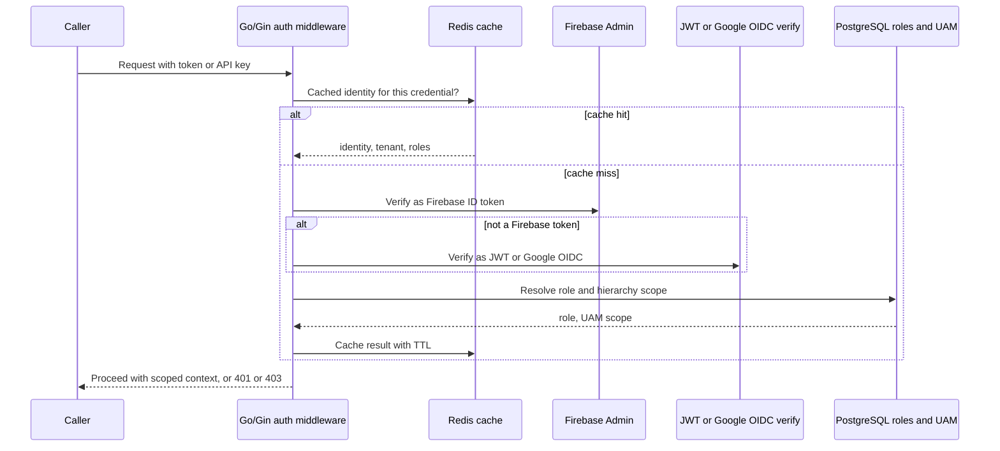
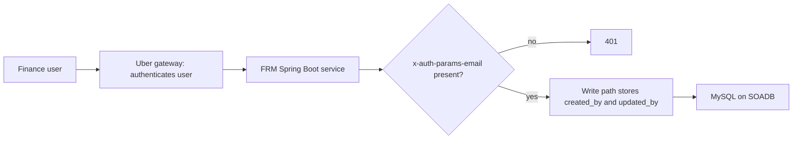

# Authentication, authorization, tenancy and rate limits (API level and AI level)

<div class="callout note">

**How to use this page**

- **What it covers:** how identity, permissions, tenant isolation and throttling worked on each resume project. Most depth goes to Impact Analytics (the Go auth waterfall, UAM hierarchy scope, Ask Iris handshake freeze, AI-level budgets). Uber FRM, Masters India, Uber Menu and GeeksforGeeks are covered more briefly. It also teaches the general concepts: JWT, OIDC, RBAC, constant-time comparison, token buckets, noisy neighbours.
- **When to read it:** before any security, multi-tenant SaaS, API design or "how do you stop the agent leaking data?" question.
- **What to memorise:** the IA waterfall order (Redis, then Firebase Admin, then JWT or Google OIDC, constant-time API keys, Postgres roles). Tenant and hierarchy come from the token, never the request body. Ask Iris freezes `plan_scope` at the WebSocket handshake. The Keep/Drop LLM has no SQL tool. And isolation is access control, not encryption.

</div>

**Labels used on this page.** MEASURED means we have a log, doc or code for it. HISTORICAL means from my past work records. TARGET means a design goal. DESIGN or verbal means a mechanism I can describe but that is not a resume bullet; say "the design was..." and do not quote numbers.

<div class="callout warn">

**Say these carefully**

- **Do not invent quota numbers** ("50 requests per minute per tenant"). Describe the mechanism.
- **Do not claim org-wide IAM ownership** (Okta, corporate identity provider). I built service-level auth.
- **Isolation is not encryption.** C3 is access control and data scoping.
- **No human review queues (HITL) at Impact Analytics.** Older prep described "3 human confirm gates before write-back". That belongs to the **Cluster Recommendation Copilot design, which is verbal only**, not to shipped IA systems. In shipped Keep/Drop, offline evals replaced critic agents, and the LLM never writes directly.
- **LangSmith is Ask Iris only**, not the Keep/Drop batch.
- **Uber FRM:** authorization was enforced upstream by Uber's gateway. Say so before the interviewer does.

</div>

---

## 1. The concepts in plain English

### 1.1 Authentication versus authorization

- **Authentication (AuthN)** answers "who are you?" Think of showing your ID at a building's front desk.
- **Authorization (AuthZ)** answers "what are you allowed to do?" Your badge opens floors 3 and 4 but not the server room.

A failed AuthN is HTTP **401 Unauthorized** (we don't know who you are). A failed AuthZ is **403 Forbidden** (we know who you are, and you can't do this). Too many requests is **429 Too Many Requests**.

### 1.2 JWT

A **JWT** (JSON Web Token) is a signed, compact token that carries claims such as user id, tenant id, roles and expiry. The server verifies the signature with a key, so it can trust the claims without a database lookup. Analogy: a wristband at a festival. Security checks the stamp, not a guest list. Two warnings: a JWT is signed, not encrypted (anyone can read the claims), and you cannot easily revoke one before it expires, so keep them short-lived.

```text
header.payload.signature
payload example: {"sub": "u_123", "tenant_id": "t_acme", "roles": ["planner"], "exp": 1760000000}
```

### 1.3 OIDC and Firebase

- **OAuth 2.0** is a standard for delegated access. **OIDC** (OpenID Connect) adds identity on top of it: after you sign in with Google, Google issues an **ID token** (a JWT) saying who you are. The service verifies it against Google's published public keys.
- **Firebase Authentication** is Google's hosted sign-in product. The **Firebase Admin SDK** lets a backend verify Firebase-issued ID tokens.

### 1.4 API keys and constant-time comparison

An **API key** is a long secret string for machine callers. Compare it in **constant time**: a normal string compare stops at the first wrong character, so a wrong first character returns slightly faster than a wrong last character. An attacker can measure that and guess the key one character at a time. That is a **timing attack**. Constant-time compare always takes the same time.

### 1.5 RBAC and hierarchy scope

- **RBAC** (Role-Based Access Control) gives permissions to roles (planner, admin, read-only) and roles to users.
- **Hierarchy scope** goes further. A planner may only see part of the merchandise hierarchy, for example "Womenswear, Tops, all regions". At IA this is **UAM** (User Access Management) scoping.

### 1.6 Multi-tenancy

A **tenant** is one customer company sharing the SaaS. Common isolation models:

| Model | Isolation | Cost |
|---|---|---|
| Database or cluster per tenant | Strongest, smallest blast radius | Most expensive to run |
| Schema per tenant | Strong | Many schemas to migrate |
| Shared tables with a `tenant_id` column | Weakest, depends on every query filtering | Cheapest |

Whatever the model, the golden rule is that **the tenant comes from the verified token, never from the request body or URL alone**.

A **noisy neighbour** is one tenant whose heavy usage slows everyone else.

### 1.7 Rate limiting algorithms

- **Token bucket:** a bucket refills at R tokens per second up to a capacity B. Each request takes one token. That allows bursts up to B and an average of R. This is the most common algorithm.
- **Leaky bucket:** requests drain at a fixed rate, which smooths bursts.
- **Fixed window:** count requests per minute. Simple, but it allows double bursts at window edges.
- **Sliding window:** a smoother count over the last N seconds.

```python
# Teaching sketch: token bucket.
def allow(bucket, now):
    bucket.tokens = min(bucket.capacity, bucket.tokens + (now - bucket.last) * bucket.rate)
    bucket.last = now
    if bucket.tokens >= 1:
        bucket.tokens -= 1
        return True
    return False   # caller returns HTTP 429
```

---

## 2. Map by project

| Project | Authentication | Authorization | Throttling and budgets | Tenant isolation |
|---|---|---|---|---|
| **IA AssortSmart, platform** (Go/Gin) | Redis-fronted waterfall: Firebase Admin, then JWT or Google OIDC. Constant-time API keys for machines | Postgres-backed role resolution plus UAM hierarchy scope | Self-protecting edge: nested timeouts, bounded downstream concurrency | Tenant and hierarchy scope applied across PostgreSQL and ClickHouse |
| **IA, Ask Iris** (Python agent plane) | JWT verified on the WebSocket handshake | `plan_scope` frozen at handshake. Later messages cannot widen it | Evaluator loop capped at 3 attempts, plus a graph recursion limit | Inherits the frozen scope |
| **IA, Keep/Drop batch** | Service-level job | The LLM has no SQL tool. Code builds JSON payloads and writes results | Hard timeouts, circuit breakers, checkpoints, token and USD telemetry | Batch runs per tenant scope |
| **Uber FRM** (Spring Boot) | Gateway injects `x-auth-params-email`, read with `@RequestHeader` | Upstream of the service, at Uber's gateway | Platform gateway limits (not owned in-service) | Single Uber Finance tenant, period-scoped data |
| **Uber Menu** | Service identities for jobs on GCP | Catalog write permissions via service accounts | Scraper backoff and proxy pools (the reverse problem). Kafka lag as backpressure | Keyed by vendor and menu. Not multi-tenant SaaS |
| **Masters India** (Spring Boot) | JWT access plus refresh tokens. IP allowlists for some enterprises | RBAC on mutating APIs. Audit of who, what and when | Gateway and service capacity. Fixed Spring Kafka consumer threads cap IRP calls. Kafka absorbs bulk | Per-client config, GSTIN partition keys |
| **GeeksforGeeks** | Django session auth | Permissions on threads and content | Classic web limits | User and content permissions |

---

## 3. Impact Analytics in depth

### 3.1 Bullet C3

> Guaranteed strict **multi-tenant data isolation** and UAM-scoped hierarchy **access control** across **PostgreSQL** and **ClickHouse**. Secured system entry by implementing a Redis-fronted Firebase Admin to JWT/Google OIDC verification waterfall, constant-time API keys, and Postgres-backed role resolution.

**In plain words:** every request into the Go platform proves who it is, and we work out which tenant and which part of the merchandise hierarchy it may see. Then every query to Postgres and ClickHouse is limited to that scope. Redis caches verification results so most requests don't repeat expensive checks.

### 3.2 The authentication waterfall

A **waterfall** here means "try verifiers in a fixed order until one succeeds". Different callers carry different credentials: browser users with Firebase tokens, others with Google OIDC tokens or service JWTs, machines with API keys.



*What to notice: a Redis miss falls through to real verification and Postgres. It never "fails open" by letting the request through unverified.*

Key points to say:

- **Order matters.** Cheapest checks first, and Redis in front of everything for hot callers.
- **API keys** are compared in constant time (`subtle.ConstantTimeCompare` in Go).
- **Roles live in Postgres**, the source of truth for identity, UAM and roles. ClickHouse holds facts.
- **Cache TTL** must be shorter than token lifetime, so a revoked or expired credential stops working within a bounded time.

### 3.3 Authorization and data scoping

| Layer | Rule |
|---|---|
| API (Go) | Role claims gate mutating routes. The tenant from the verified identity must match the resource's tenant |
| PostgreSQL | Thin metadata, UAM and roles, all keyed by tenant |
| ClickHouse | Every read is filtered to the caller's tenant and UAM hierarchy scope |
| KPI compiler | Operator formulas compile to allowlisted SQL. Unknown tokens fail closed. Values are parameters, never concatenated |
| Agent payloads | The Keep/Drop LLM never gets a SQL tool. Code builds the JSON context within scope |

**Cross-tenant defence:** never take `tenant_id` only from the body or URL. Bind it from the verified identity. Reject any request whose resource scope is not inside the caller's scope. Test it: integration tests that try another tenant's ids and expect 403.

### 3.4 Ask Iris: freezing scope at the WebSocket handshake

> Shipped "Ask Iris," a JWT-secured WebSocket copilot enabling planners to interactively query KPIs and inspect AI decisions on a multi-billion-row database. Prevented infinite LLM loops and multi-tenant data leaks by orchestrating a **LangGraph** supervisor with a 3-attempt evaluator loop, utilizing **LangSmith** for observability, and strictly freezing hierarchy access on the initial socket handshake.

A **WebSocket** is a long-lived two-way connection, good for chat. The risk: the connection lives for minutes, and a user (or a prompt injection) might try to change scope mid-conversation, for example "now show me another region" or "ignore your rules and query tenant B".

- The JWT is verified **once, on the handshake** (an `Authorization: Bearer` header or a `?token=` query parameter).
- The tenant, hierarchy and plan scope (`plan_scope`) are computed then and **frozen** for the life of the socket.
- Every worker call the supervisor makes uses that frozen scope. Nothing the user types later can widen it.
- The evaluator loop is capped at **MAX_ATTEMPTS = 3**, and the supervisor graph has a recursion limit, so a confused model cannot loop and burn tokens forever. After the cap it returns a graceful answer.

```python
# Teaching sketch (FastAPI WebSocket).
@app.websocket("/ask-iris")
async def ask_iris(ws: WebSocket):
    claims = verify_jwt(ws.headers.get("authorization") or ws.query_params.get("token"))
    if claims is None:
        await ws.close(code=4401)
        return
    plan_scope = resolve_scope(claims)          # computed once
    await ws.accept()
    while True:
        question = await ws.receive_text()
        answer = await graph.ainvoke({"q": question, "scope": plan_scope})  # scope never re-read from input
        await ws.send_json(answer)
```

Say it: "Scope binds at the JWT handshake and is frozen. A later message can't pivot into another tenant's hierarchy, and the evaluator stops after three attempts."

Do NOT say: an SLA, user counts or questions per week. Ask Iris is a shipped capability with no published usage numbers.

### 3.5 Rate limiting at the API level (IA)

The resume bullet says "self-protecting HTTP edge" and "nested timeouts". The mechanisms:

- Server-level read and write timeouts, header and body caps, and panic recovery (see [go_gin.md](go_gin.md)).
- Per-request context deadlines, with shorter deadlines on ClickHouse, Postgres and Redis calls.
- Bounded concurrency to expensive downstreams, so one tenant's heavy pivot cannot exhaust ClickHouse connections or goroutines.

Older prep also described per-route request and burst limits on interactive APIs, with stricter quotas on bulk saves than on reads. Present that as the mechanism I would apply. **There is no numeric quota on the resume, so do not invent one.**

### 3.6 Budgets at the AI level (IA)

An HTTP 429 cannot stop an LLM job that is already running. AI work needs its own limits.

| Control | Where | What it stops |
|---|---|---|
| Hard timeouts per LLM call | Keep/Drop orchestration registry (A3) | A hung provider call stalling an 88k-item pass |
| Circuit breakers | Registry. Trips after about 5 consecutive failures or a failure fraction (verbal) | Hammering a failing provider |
| Deterministic fallback | A2. Timeout means the deterministic baseline score is written | The run stalling or leaving gaps |
| Durable checkpoints and `--resume` | Registry. `det.json`, `agent_progress.json` | Paying again for work already done after a crash |
| Token, USD cost, step duration and fallback telemetry | Custom JSON telemetry on every run (A3) | Cost surprises. About $100 per pass is true but off the PDF |
| `config_hash` on every output row | SHA-256 of guardrails, params, prompts and catalog | Not knowing which config produced a decision |
| Evaluator cap of 3 attempts and a recursion limit | Ask Iris (A4) | Infinite LLM loops |
| No SQL tool for the model | A2 | Runaway or hallucinated queries against a 2.11B-row master |

**Say:** "AI limits are product budgets, not just an Nginx `limit_req`. The dangerous amplifier is fan-out times retries, so the budgets are timeouts, breakers, attempt caps and cost telemetry."

### 3.7 Noisy neighbours (IA)

1. **Scope everything by tenant** in Postgres and ClickHouse, which limits the blast radius of a bug.
2. **Onboarding is configuration, not a code fork.** The KPI configurator lets a tenant's formulas change without a release.
3. **Bounded concurrency and deadlines** at the Go edge, so one tenant's heavy pivot cannot starve others' interactive reads.
4. **Traces carry request context**, so a slow tenant-specific path is visible in Datadog.

<div class="callout highlight">

**Verbal only: Cluster Recommendation Copilot design (not a resume bullet)**

Use this only if an interviewer asks how I would design tool access and budgets for an agent that can propose write-backs. It is design depth. Say "the design was...", and say "building", not "shipped".

- **14 audited tools**, all read-only over planning data. No free-form SQL from the LLM.
- **3 confirm gates** in the design before any write-back through normal product APIs. This is a confirmation flow in a design, not a shipped human review queue.
- **Budgets in the design:** tool calls per session, parallel clustering jobs per tenant, token and cost caps, per-tool timeouts, scenario caps (3 to 5 in the UI, 20 to 100 in batch explore), and child-cluster caps (about 10 by default, client min and max k).
- **Hindsight** tenant metric catalogs were designed as configuration that goes live without a code deploy, still behind admin authorization.
- A measured clustering failure rate of 8.5% (37 out of 437) with a TARGET under 2%.
- Older prep also mentioned keeping "the ~0.4 ms interactive edit path" protected from batch explore. I cannot source that figure, so do not quote it.

</div>

---

## 4. Uber FRM: trusting the gateway, capturing identity for audit



*What to notice: the service does not check passwords. It trusts the header the gateway injects and records it on every write.*

- **In the service:** every write endpoint reads the `x-auth-params-email` header with `@RequestHeader`, returns 401 if it is missing, and stores the email as `created_by` / `updated_by`. That is identity capture for a SOX-adjacent audit trail. **SOX** (Sarbanes-Oxley) is the US law requiring auditable controls over financial reporting.
- **Not in the service:** fine-grained "who may edit Materiality" decisions. Those were enforced upstream.
- **Why it is acceptable:** inside Uber's mesh, only the gateway can inject that header. It would not be acceptable on the public internet.
- **If I hardened it standalone:** verify a signed token instead of a plain header, using Spring Security as an OAuth2 resource server (a filter that validates the JWT before any controller runs), and add role checks with `@PreAuthorize` on mutating methods.

```java
// Teaching sketch. The header is required for writes, and its value goes into the audit columns.
@PatchMapping("/thresholds/{uuid}")
public ThresholdDto update(@PathVariable String uuid,
                           @Valid @RequestBody ThresholdUpdate body,
                           @RequestHeader(value = "x-auth-params-email", required = false) String email) {
    if (email == null || email.isBlank()) {
        throw new UnauthorizedException();        // mapped to 401 by @RestControllerAdvice
    }
    return service.update(uuid, body, email);     // service sets updated_by = email
}
```

*What to notice: `@Valid` runs Bean Validation on the request body (for example `@NotNull`, `@Positive` on its fields) before the method body runs, and the identity check is the first line.*

There is no retail-style multi-tenancy here. The data is Uber Finance's, scoped by fiscal period.

---

## 5. Masters India: JWT, RBAC and compliance data

| Control | How |
|---|---|
| Authentication | Short-lived JWT access tokens plus refresh tokens, over TLS |
| Authorization | RBAC on mutating e-invoice and reconciliation APIs |
| Audit | Who, what, when, and before and after values on mutations |
| Enterprise | IP allowlisting for some clients |
| Secrets | AWS KMS (HISTORICAL framing) |
| Cache | Redis for IRP auth tokens (TTL shorter than the token's life) and client config |
| Throughput | Gateway and service capacity (from 700 to 4,000 requests per minute). A fixed number of Spring Kafka consumer threads caps concurrent IRP calls. Kafka absorbs bulk (100K+ concurrent imports), so the HTTP tier is not the bulk meter |
| Per client | Config and feature flags. GSTIN-keyed Kafka partitions for ordering. Not separate databases per tenant |

Two Masters specifics worth explaining:

- **Outbound rate limiting.** The government IRP is the fragile party. We used bounded concurrency and exponential backoff with jitter on calls to it, so our retries did not make its bad day worse.
- **Caching IRP auth tokens.** The IRP issues a session token. Caching it in Redis with a TTL safely under its lifetime avoids re-authenticating on every invoice.

---

## 6. Uber Menu: service identity and the reverse rate-limit problem

- Jobs run under **service accounts**, not end-user JWTs.
- Here "rate limiting" is about **us being limited by others**. Vendor sites block bots, so we used IP rotation, dynamic proxy pools and adaptive backoff. That drove extraction success to 95%+. This protects against external blocks. It is not multi-tenant fairness.
- Downstream, Kafka consumer lag is the backpressure signal, and Flink parallelism is bounded by partitions.

Do not mix up Menu proxy backoff with IA tenant budgets. They are opposite problems.

---

## 7. GeeksforGeeks, briefly

Django's built-in session authentication and permission system. Voting, pinning and locking threads are permission-checked actions. Locking or pinning is a moderator-style permission. Vote APIs are idempotent through a unique (user, content) constraint, so double-submitting a vote does nothing.

---

## 8. API level versus AI level: cheat sheet

| Concern | API level (Gin, FastAPI, Spring Boot) | AI level (LangGraph, LLM calls) |
|---|---|---|
| Identity | JWT, OIDC, Firebase, API key, gateway header | Same identity propagated into the agent's context, frozen at handshake |
| Authorization | Route plus role plus tenant match | Frozen scope. No SQL tool. Only code-built JSON payloads |
| Abuse | Request floods, slow clients, oversized bodies | Loops, prompt injection, cost blow-ups |
| Limit unit | HTTP requests, connections | Attempts, LLM calls, tokens, USD |
| Failure response | 401, 403, 429, 504 | Graceful answer after 3 attempts, deterministic fallback, circuit open |
| Audit | Access and mutation logs, Datadog traces | LangSmith traces (Ask Iris), JSON telemetry and `config_hash` (Keep/Drop) |
| Write path | Authenticated handlers | Code writes validated results. The model never writes directly |

**One sentence to say:** "APIs authenticate who you are and throttle requests. The agent stack freezes what you can see and budgets how much non-determinism you can burn."

---

## 9. Interview questions with speakable answers

**Q1. How do you stop cross-tenant data leaks?**
The tenant and hierarchy scope come from the verified identity, never from the request body. Every Postgres and ClickHouse read applies that scope. For Ask Iris, the scope is frozen at the WebSocket handshake, so nothing typed later can widen it. And the Keep/Drop model never gets a SQL tool. Code builds its context. I'd also test it: integration tests that try another tenant's ids and expect a 403.

**Q2. Walk me through your auth waterfall.**
The Go middleware first checks Redis for a cached identity for this credential. On a miss, it tries Firebase Admin verification, and if the token isn't a Firebase token it verifies it as a JWT or Google OIDC token. API keys are compared in constant time. Then it resolves role and UAM hierarchy scope from Postgres and caches the result with a TTL shorter than the token's life. A cache miss falls through to real verification. It never fails open.

**Q3. Why constant-time comparison for API keys?**
A normal comparison returns as soon as one character differs, so response time leaks how many leading characters were right. With enough requests an attacker can guess a key character by character. Constant-time comparison always does the same work. In Go that is `subtle.ConstantTimeCompare`.

**Q4. How do you rate-limit the agent differently from the API?**
An HTTP limit can't stop an LLM job that has already started, so AI work needs its own budgets. On the Keep/Drop batch: hard timeouts per call, circuit breakers that trip after about five consecutive failures, a deterministic fallback on timeout, and token and USD telemetry on every run. On Ask Iris, the evaluator is capped at three attempts with a recursion limit. The API side is classic: timeouts, body caps and bounded concurrency at the Go edge.

**Q5. What if the LLM ignores a "read-only" instruction?**
Instructions are not the control. The control is what the model can physically do. In Keep/Drop the model only receives JSON and returns a structured score, and code validates it and writes it. In Ask Iris the scope is frozen in code, outside the model's reach. A prompt injection can make the model say something wrong, but it cannot make it read another tenant's data or write to the database.

**Q6. Per-tenant limits: give me the numbers.**
I won't invent a quota figure that isn't documented. The mechanism is tenant-scoped data access, bounded concurrency and deadlines at the Go edge, and, on the AI side, attempt caps, timeouts, breakers and cost telemetry. Onboarding is configuration, through the KPI configurator, not code. If you want a concrete design, I'd use a token bucket per tenant and route class, with bulk routes on a smaller bucket than interactive reads.

**Q7. At Uber FRM you trusted a header. Isn't that insecure?**
Inside Uber's network only the gateway can inject that header, after it authenticates the user, so the service's job was identity capture for the audit trail. It returns 401 if the header is missing and stores the email on every write. The honest limitation is that authorization was upstream, not in my service. If it ever faced the internet, I'd verify a signed token and add role checks in a dependency.

**Q8. At Masters, JWT or sessions?**
Stateless short-lived JWT access tokens with refresh tokens, because there were many microservices behind a gateway and we didn't want a shared session store on every call. RBAC protected the mutating money paths, and every mutation was audited with before and after values for GST compliance. Some enterprise clients also had IP allowlists.

---

## 10. Thirty-second story (IA)

"AssortSmart is multi-tenant. At the Go edge, a Redis-fronted waterfall verifies Firebase, JWT or Google OIDC tokens, compares API keys in constant time, and resolves roles and hierarchy scope from Postgres. Every Postgres and ClickHouse read is scoped to that. In the AI layer, Ask Iris freezes scope at the WebSocket handshake and caps its evaluator at three attempts. The Keep/Drop batch model never gets a SQL tool, and it is budgeted with timeouts, breakers and cost telemetry."

---

## Related

- [go_gin.md](go_gin.md) for the Go edge and middleware
- [langgraph_mcp_rag.md](langgraph_mcp_rag.md) for Ask Iris and the Keep/Drop pipeline
- [../projects/01d_agentic_evals_guardrails_flow.md](../projects/01d_agentic_evals_guardrails_flow.md)
- [../projects/01c_agent_read_tools_defense.md](../projects/01c_agent_read_tools_defense.md) (Copilot tool design, verbal only)
- [../architecture/01_ia_assortsmart_hindsight.md](../architecture/01_ia_assortsmart_hindsight.md)
- [../architecture/02_uber_frm.md](../architecture/02_uber_frm.md)
- [../architecture/04_masters_gst.md](../architecture/04_masters_gst.md)
