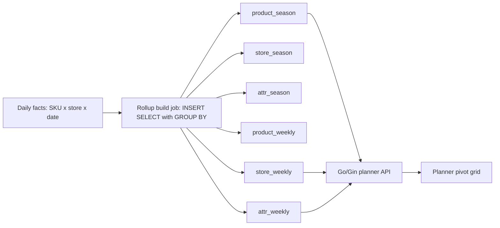
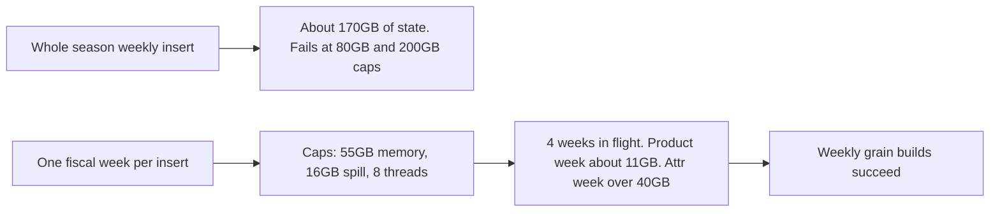
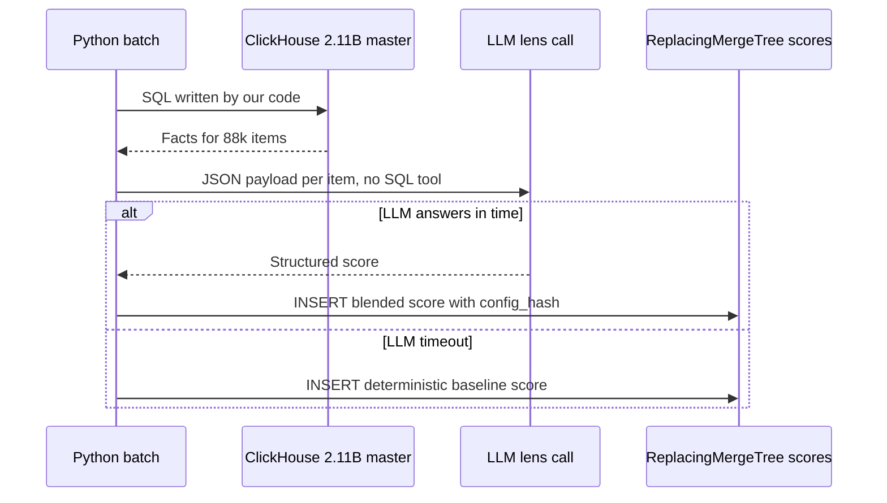

# ClickHouse

<div class="callout note">

**How to use this page**

- **What it covers:** what ClickHouse is, how MergeTree tables, partitions and ReplacingMergeTree work, and exactly how I used it at Impact Analytics (AssortSmart). That includes the rollup layer, the 170GB OOM fix, the Go copier and the 2.11B-row agentic master.
- **When to read it:** before any IA deep dive, any data-platform or analytics round, or any "hardest technical problem" question.
- **What to memorise:** from 189 seconds to 12 seconds (15.5x) on a 250M-row harness, 170GB OOM fixed by one-week inserts, about 344k rows per second, partitions up to 4.09B rows, the 2.11B-row master. Also memorise the two traps: 15.5x is query time and 170GB is load time, and 344k is rows per second, not requests.

</div>

**Labels used on this page.** MEASURED means we have a log, doc or code for it. ESTIMATED means arithmetic I can show. HISTORICAL means it comes from my past work records. TARGET means a design goal (say "targeting"). "Verbal" means true and safe to say if asked, but not printed on the resume.

<div class="callout warn">

**Say these carefully**

- **15.5x is query time** (planner pivots). **170GB OOM is load time** (weekly rollup builds). One did not cause the other.
- **344k is rows per second** of copy throughput. It is not requests per second or transactions per second.
- **4.09B was measured in flight.** Say "measured on a partition set of up to 4.09B rows". Do not say "I finished migrating 4.09B rows".
- **"Atomic partition rollback" means DROP PARTITION, then recopy that season.** It is not an atomic swap with live readers. The REPLACE PARTITION incremental design was written but not executed.
- ClickHouse is an **Impact Analytics** story only. No Kafka, Flink or CDC on IA. The CDC pipeline (pg2ch) was written by a colleague, Ashvin Sharma. Do not claim it.
- No sub-second ClickHouse claims. The number is 12 seconds.

</div>

---

## 1. What ClickHouse is, in plain English

ClickHouse is an open-source database built for analytics. It answers questions like "total sales by store and week for this season" over hundreds of millions or billions of rows. It is not built for "update this one customer's email address". It is called an **OLAP** database (Online Analytical Processing), which means it is tuned for big reads that scan, filter and aggregate many rows. The opposite is **OLTP** (Online Transaction Processing), like PostgreSQL or MySQL, which is tuned for many small reads and writes of single rows.

**Columnar storage** is the core idea. A normal database stores a row together: product, store, date, units, revenue, all side by side. ClickHouse stores each column separately. Think of a filing cabinet where each drawer holds one column for every record. If you want total revenue, you open only the revenue drawer and the date drawer. You never touch the 100 other columns. That is why a column store can scan billions of values per second on one machine. Values in one column also look alike, so they compress very well.

Who uses it: product analytics teams, observability platforms, ad-tech, and in my case a retail planning SaaS where merchandise planners pivot sales data on screen.

### Where it sits in my work

| Where | What ClickHouse did | Resume bullet |
|---|---|---|
| Impact Analytics, Core | Six rollup tables that cut planner pivots from 189 seconds to 12 seconds | C4 |
| Impact Analytics, Core | Weekly rollup builds that stopped hitting a 170GB OOM | C4 |
| Impact Analytics, Core | A Go native-TLS copier that moved rollups between ClickHouse Cloud clusters at about 344k rows per second | C5 |
| Impact Analytics, Core | Tenant-scoped analytics store next to PostgreSQL metadata | C3 |
| Impact Analytics, Core | Target of the KPI formula compiler (`ifNotFinite` wrapped SQL) | C2 |
| Impact Analytics, Agentic | The 2.11B-row master that the LLM is never allowed to query, and the ReplacingMergeTree that stores scores | A2 |

Nowhere else. Uber Menu used Kafka and Flink into a catalog, not ClickHouse. Masters India used PostgreSQL.

---

## 2. How ClickHouse works: the ideas interviewers probe

### 2.1 MergeTree: the default table engine

A **table engine** in ClickHouse decides how data is stored on disk. **MergeTree** is the main family.

- Every INSERT writes a new immutable chunk called a **part**. The rows inside a part are sorted by the table's `ORDER BY` key.
- In the background, ClickHouse **merges** small parts into bigger sorted parts. Think of sorting index cards in small piles as they arrive, then a clerk later merges the small sorted piles into one big sorted pile.
- Because parts never change in place, updates and deletes are expensive. ClickHouse prefers you to insert new rows rather than edit old ones.

```sql
-- Teaching sketch. Column names are illustrative, not the production schema.
CREATE TABLE product_season
(
    tenant_id     String,
    season_code   String,
    product_id    String,
    store_count   UInt32,
    sales_units   Float64,
    sales_revenue Float64
)
ENGINE = MergeTree
PARTITION BY season_code
ORDER BY (tenant_id, product_id);
```

### 2.2 The sparse primary index

The `ORDER BY` key doubles as a **sparse primary index**. ClickHouse does not index every row. By default it keeps one index entry (a "mark") for every 8,192 rows. When you filter on the leading columns of the key, it uses the marks to skip whole blocks it knows cannot match. Analogy: a phone book with only the first name on each page printed in the corner. You can jump to the right page quickly without an entry for every person.

Lesson for design: put the columns you filter on most at the front of `ORDER BY`.

### 2.3 Partitions

`PARTITION BY season_code` splits the table into separate folders, one per season. Two big benefits:

1. **Pruning.** A query for season 7 only opens the season-7 folder.
2. **Operations by unit.** You can `DROP PARTITION '7'` and reload just that season. That was the basis of our recovery story for the copier and the weekly loader.

Do not over-partition. Thousands of tiny partitions create too many parts and slow merges. Season is a coarse, natural unit for retail planning.

### 2.4 ReplacingMergeTree

**ReplacingMergeTree** is a MergeTree variant that keeps only the newest version of rows that share the same `ORDER BY` key. Think of a notebook where you never erase. You write the new value on a new line, and a cleaner later crosses out the old lines with the same key.

```sql
-- Teaching sketch.
CREATE TABLE article_scores
(
    tenant_id   String,
    article_id  String,
    season_code String,
    s_final     Float64,
    source      String,     -- e.g. 'blend' or 'det_fallback'
    config_hash String,
    updated_at  DateTime
)
ENGINE = ReplacingMergeTree(updated_at)
ORDER BY (tenant_id, season_code, article_id);
```

Two things interviewers check:

- **Deduplication happens at merge time, not at insert time.** Until a merge runs, a query can see two versions of the same key. That is why we call it **eventually consistent**: it becomes correct after the background merge.
- To read only the latest version right now, you either add `FINAL` to the query (slower, and older prep notes it does not use projections) or use an aggregate such as `argMax(s_final, updated_at)` grouped by the key.

### 2.5 Aggregate functions that matter in my story

- `any(x)` keeps some value of `x` for the group. It is cheap and is used for "carry this attribute along" columns.
- `argMax(value, time)` returns the value that has the largest `time`. It is used for "latest attribute wins".
- `ARRAY JOIN` turns one row with an array into many rows. We used it to **unpivot** attribute pairs, which is why the attribute rollup is so much bigger than the product rollup.

### 2.6 Memory and spill settings

A `GROUP BY` keeps one in-memory state per group. With many groups and many `any()` / `argMax` states on wide strings, memory explodes. ClickHouse gives you knobs:

| Setting | What it does |
|---|---|
| `max_memory_usage` | Hard cap on memory for one query. Over the cap, the query fails with `MEMORY_LIMIT_EXCEEDED`. |
| `max_bytes_before_external_group_by` | When the GROUP BY state passes this size, spill partial results to disk instead of failing. |
| `max_threads` | How many threads one query may use. More threads means more parallel state in memory. |

---

## 3. Bullet C4: the rollup layer and the 15.5x pivot win

> Reduced planner pivot latency by **15.5x** (**189s to 12s** on **250M-row** operations) by building a ClickHouse pre-aggregation layer for season and weekly rollups. Prevented **170GB** OOM crashes by slicing batch inserts into temporal chunks and enforcing strict distributed memory and disk-spill caps.

### 3.1 In plain words

Planners look at sales grids (pivots) such as "units by product by store for this season". A **pivot** is the spreadsheet-like grid: rows by product hierarchy, columns by week or store, cells aggregated. On PostgreSQL the heavy pivot grid took 189 seconds on a 250M-row benchmark harness. On ClickHouse the same query on the same 250M rows took about 12 seconds (12.3 seconds, rounded on the resume). That engine comparison is where 15.5x comes from. In production, the grids are served from a **pre-aggregation layer**: six rollup tables, so most of the summing happens once at load time and the screen reads small summarised tables.

Say this carefully: the 189-to-12 measurement is PostgreSQL versus ClickHouse on the same heavy query. The rollup layer is how production serves those grids on ClickHouse. If an interviewer asks "was 189 seconds the daily table and 12 seconds the rollup?", the honest answer is no. It was the engine comparison that justified moving the grids to ClickHouse, and the rollups are the production design built on that decision.

### 3.2 How it works



*What to notice: all the heavy GROUP BY work moves to the left (load time). The planner screen on the right only reads small tables.*

Six MergeTree tables, all `PARTITION BY season_code`:

| Grain | Product (keeps SKU dimensions) | Store (no SKU) | Attribute (unpivoted with ARRAY JOIN) |
|---|---|---|---|
| Season | product_season | store_season | attr_season |
| Weekly | product_weekly | store_weekly | attr_weekly |

A worked example. Suppose the daily table has these rows for one product in one store:

| product | store | date | units |
|---|---|---|---|
| P1 | S1 | 2026-03-02 | 4 |
| P1 | S1 | 2026-03-03 | 6 |
| P1 | S1 | 2026-03-09 | 5 |

The weekly rollup stores two rows (week 10: 10 units, week 11: 5 units). The season rollup stores one row (15 units). Multiply this by every day of a season and every store, and the planner reads a table that is orders of magnitude smaller.

```sql
-- Teaching sketch of a season rollup build.
INSERT INTO product_season
SELECT tenant_id, season_code, product_id,
       uniqExact(store_id)   AS store_count,
       sum(units)            AS sales_units,
       sum(revenue)          AS sales_revenue
FROM daily_facts
WHERE season_code = '7'
GROUP BY tenant_id, season_code, product_id;
```

Two design details worth saying:

- **Store and attribute totals must match the SKU totals.** Older prep describes two-pass weighted sums with re-weighting, then validating `sum(product)` against `sum(store)` against `sum(attr)` at the same filters. Earlier season-grain parity checks showed 0% difference on revenue across seasons 1 to 7 (verbal).
- **The attribute table is an unpivot.** One product with several attribute pairs becomes several rows. That is why attr weekly is roughly 5 times the size of product weekly on the same seasons (verbal).

### 3.3 Why this design

- **What:** pay once at load, read cheap at query time.
- **Why:** planners click through grids all day. Waiting minutes per pivot kills the product. A GROUP BY over a wide daily table with many `any()` / `argMax` states is the wrong thing to run per click.
- **How:** six rollup tables, partitioned by season, generated load SQL, build order product then store then attribute per grain.
- **Alternatives considered:**
  - *Stay on PostgreSQL.* Planner pivots were slow on PostgreSQL. We ran POCs comparing Postgres and ClickHouse at 5M, 50M and 250M rows. ClickHouse won the heavy grid at every size (13.8x at 5M, 13.0x at 50M, 15.5x at 250M), and Postgres also spilled about 42 GB of sort files to disk on the 250M run. The harness was not tilted toward ClickHouse: Postgres ran natively on a 48 GB host with 8 parallel workers, while ClickHouse ran in a 10-CPU, 3.3 GB Docker VM. The same POCs showed Postgres much faster for single-cell write-back (POC history, verbal only), which is why the verdict was hybrid. Postgres stays for thin metadata, UAM (User Access Management), roles and writes.
  - *Query BigQuery directly.* BigQuery is on the IA tech line. Older Copilot design notes compared against BigQuery's variable interactive latency (roughly 1 to 20+ seconds). That comparison is verbal only. The simple point is that a serverless warehouse billed per bytes scanned is a poor fit for a click-heavy grid.
  - *Snowflake.* Older prep lists cost and latency for this interactive UI as the reasons against.
  - *Materialized views in ClickHouse.* They update on insert, which is great for simple sums. Our rollups carry many attribute states and need controlled rebuilds, so explicit build jobs were easier to reason about and to recover.
- **Trade-off:** data in rollups is only as fresh as the last build. Rollups also take disk and build time. And rollups do not help every query shape (see the caveat below).
- **What I'd do differently:** design the incremental path (only rebuild changed partitions, with REPLACE PARTITION from scratch tables) from day one. That design exists on paper. It was not executed.

### 3.4 The numbers

| Number | What it measures | How derived | Tag |
|---|---|---|---|
| 189s to 12s | Wall time of the heavy pivot grid query (group-by plus contribution percent plus option count) on PostgreSQL, then on ClickHouse | Benchmark harness: Postgres 189,408 ms, ClickHouse 12,256 ms on the same query and the same 250M rows. 12.3s rounds to 12s | MEASURED |
| 15.5x | Speed ratio of the two | 189,408 / 12,256 is about 15.45, which rounds to 15.5x | MEASURED |
| 250M rows | Size of the benchmark dataset | Built at 5M, 50M and 250M. The largest client was around 5M at the time, so 250M tested growth. It is not the production table size (the master is 2.11B) | MEASURED |

Why it mattered: at 189 seconds the grid is unusable, because planners wait three minutes per click. At about 12 seconds it becomes workable.

Say it out loud: "Planner pivots got about fifteen and a half times faster, from 189 seconds to 12 seconds on 250 million rows. We benchmarked at 250 million so the decision would survive growth."

Do NOT say: "sub-second", "every query is 15x faster", "our production table is 250M rows", or "the OOM fix made it 15x faster".

Caveat to keep in your pocket: 15.5x is the heavy grid query. The benchmark's own adversarial review said typical aggregates are closer to 2 to 3 times faster. If asked whether every query got 15x faster, say no and give that number.

---

## 4. Bullet C4 continued: the 170GB OOM on weekly builds

This is my best "hardest technical problem" story. **OOM** means out of memory: the database killed the query because it needed more RAM than it was allowed.

### 4.1 What broke

Weekly rollups need about 110 `any()` states plus `argMax` / `argMin` over wide string columns. A whole-season weekly `INSERT SELECT` was estimated at around **170GB** of aggregation state. It failed with `MEMORY_LIMIT_EXCEEDED` even at an 80GB cap, and again at a 200GB cap. The replica had about 59 cores and about 234 to 236 GiB of RAM (verbal).

### 4.2 How I fixed it

The unit of work became **one fiscal week per INSERT**, not one season. Then I capped each insert.

| Knob (verbal, off PDF) | Value |
|---|---|
| Memory cap per insert | 55 GB |
| Disk spill threshold | 16 GB |
| Threads per insert | 8 |
| Weeks in flight at once | 4 |
| Observed peak, product week | about 11 GB |
| Observed peak, attribute week | over 40 GB (a 40GB cap was too low) |

```sql
-- Teaching sketch: one fiscal week per insert, with caps.
INSERT INTO attr_weekly
SELECT ...
FROM daily_facts
WHERE season_code = '7' AND fiscal_year_week = 202611
GROUP BY ...
SETTINGS max_memory_usage = 55000000000,
         max_bytes_before_external_group_by = 16000000000,
         max_threads = 8;
```



*What to notice: I made the work unit smaller before I touched the memory limit. Raising RAM had already failed twice.*

### 4.3 Lessons to say

- Profile by grain first. Attribute weeks were the memory hog.
- Shrink the unit before raising the cap.
- Do not raise season parallelism and week parallelism together on the same box, because caps are per query and they add up.

### 4.4 Ghost rows on the weekly loader

A **ghost row** here means rows left behind by a half-finished load that look like a complete load. A failed HTTP INSERT in ClickHouse can still commit some blocks. Once, a half-loaded partition of 64.1M rows passed a naive "skip this season if the partition already has rows" check (verbal). The fix:

- Keep a **TSV ledger** (a simple tab-separated file) of finished `(kind, season_code)` pairs. Resume only skips entries in the ledger.
- If a season is not in the ledger, `DROP PARTITION` for that season and rebuild it.
- Treat an insert as finished only when `system.query_log` shows it completed (`QueryFinish` for that query id), not when the HTTP client exits.

---

## 5. Bullet C5: the Go native-TLS copier

> Migrated ClickHouse rollups across Cloud clusters at **~344k rows/s** by writing a custom Go native-TLS data pump to bypass strict cross-cluster IP allowlist restrictions. Processed partitions up to **4.09B** rows using **500k-row** double-buffered batches, and eliminated partial-commit ghost rows using TSV ledgers and atomic partition rollbacks.

### 5.1 In plain words

We had to move rollup tables from one ClickHouse Cloud cluster to another. The normal approach is to have the target cluster pull from the source directly. That was blocked: each cluster only accepted connections from an **IP allowlist** (a list of approved network addresses), and cluster-to-cluster pulls were not on it. An operator machine was allowlisted on both sides. So I wrote a Go program that reads from the source and writes to the target over ClickHouse's **native protocol** with TLS (port 9440), streaming columnar batches through that machine.

### 5.2 How it works

```text
source ClickHouse Cloud  --native TLS-->  Go copier  --native TLS-->  target ClickHouse Cloud
        SELECT stream                     buffer A fills              INSERT Send() of buffer B
        500k rows, columnar               while B sends               checkpoint per season
```

*What to notice: reading the next batch overlaps with sending the previous one. That overlap is "double buffering".*

- **Native protocol, not HTTP.** It sends data in columnar blocks, which is cheaper than text formats. Older prep notes HTTP SELECT streams also hit "unexpected EOF" while sitting idle during a long INSERT.
- **Columnar 500k batches.** `batchSize = 500_000`. Values go into typed slices per column (`batch.Column(i).Append`), then `Send()`. No per-row reflection.
- **Double buffering.** Two buffer sets. While batch N is being sent, batch N+1 is being read.
- **Partition unit is `season_code`.** `-workers N` copies N seasons in parallel, each with its own source and target connections.
- **Checkpoints.** A finished season is recorded in `migrate-checkpoints/<table>.done`. A per-table file lock stops two terminals copying the same table.
- **Failure handling.** On SIGINT the copier finishes the in-flight batch but does not mark that season done. Never retry `Send()` on a spent batch, because that risks duplicates. An incomplete season gets `DROP PARTITION`, then a recopy.

```go
// Teaching sketch of double buffering. Not the production code.
next := make(chan *Batch, 1)
go func() {
    for rows.Next() {
        b := readBatch(rows, 500_000) // fill buffer while the other one sends
        next <- b
    }
    close(next)
}()
for b := range next {
    if err := b.Send(ctx); err != nil {
        return err // do not retry a spent batch; season is not checkpointed
    }
}
markDone(table, season) // writes migrate-checkpoints/<table>.done
```

### 5.3 Why this design and alternatives

- **Why:** the allowlists made the simple path impossible. The pump is a workaround for a network constraint, not an architecture goal.
- **Alternatives:**
  - *Use ClickHouse's built-in cluster-to-cluster copy (INSERT SELECT with the `remoteSecure` table function).* This is the right answer when the clusters can reach each other. The allowlists blocked it.
  - *Export to object storage and re-import.* This is a valid approach for frozen data. It adds a staging hop and storage cost.
  - *Write CSV over HTTP.* Slower, and it hit the EOF problem.
- **Trade-off:** copying through one operator machine means its network and CPU are the ceiling, and a connection reset crashes the run. Checkpointing only finished seasons limits the blast radius.
- **What I'd do differently:** for production cutovers, push for the allowlist change or an object-storage freeze, and run the REPLACE PARTITION design so readers never see a partial season.

### 5.4 The numbers

| Number | What it measures | How derived | Tag |
|---|---|---|---|
| ~344k rows/s | Combined copy throughput of two season streams | Each stream sends a 500k-row batch about 0.3 to 0.4 times a second, so 0.3 x 500,000 = 150k and 0.4 x 500,000 = 200k rows per second per stream. Observed about 150k to 190k each at a live snapshot about 34 minutes in. Two streams combined gave about 344k | MEASURED snapshot |
| 4.09B | Largest object copied: attr weekly, two seasons | 2,779,317,472 + 1,311,108,195 | MEASURED, copy in flight |
| 500k | Rows per batch | Code constant | MEASURED |

Say it out loud: "The copier ran two season streams at about 150 to 190 thousand rows a second each, so about 344 thousand rows a second combined. I measured that on the largest object, an attribute weekly table of about 4.09 billion rows across two seasons."

For scale only: 4.09B rows at 344k rows per second would take roughly 11,900 seconds, a bit over 3 hours, and 4.09B / 500k is about 8,180 batches. That is arithmetic, not a measured duration.

Do NOT say "344k RPS", "344k TPS", or "migrated 4.09 billion rows" as if it finished. If asked "did it finish?", say: "At the snapshot, some tables were done and attr weekly was still in flight. So I say measured on, not migrated."

---

## 6. Bullet A2: the 2.11B-row master and why the LLM never queries it

> Decoupled AI inference from a **2.11B-row** ClickHouse master by asynchronously serving context via JSON payloads rather than direct database querying. Engineered an eventually consistent write pattern via ReplacingMergeTree that guaranteed system availability by gracefully falling back to deterministic baselines during LLM timeouts.

In plain words: the Keep/Drop engine needs facts about each article-season (an article-season is one product in one selling season). Instead of giving the LLM a database tool, our code queries ClickHouse, builds a small **JSON payload** of the facts for each item, and sends that to the LLM. The LLM returns a structured score. Our code writes the result back as a new row version into a ReplacingMergeTree table. If the LLM times out, we write the deterministic baseline score instead, so every item still gets a decision.



*What to notice: the LLM only ever sees JSON. It has no way to run a query against 2.11 billion rows.*

- **Why:** a 2.11B-row master cannot take hallucinated queries, and the model must never write. "Async" describes how batches run. The isolation rule is that the model has no SQL tool.
- **Why ReplacingMergeTree:** a re-run or a fallback simply inserts a newer version. No UPDATE statements on a column store. Readers converge on the latest version after merges.
- **Trade-off:** an extra hop to build payloads, and readers may briefly see two versions until a merge, unless they read with `argMax` or `FINAL`.
- **Different table:** the 2.11B master is the agentic fact table. It is not the 4.09B attr weekly rollup and not the 250M harness. Keep the three numbers apart.

---

## 7. Tenancy and the KPI compiler (bullets C2 and C3), briefly

- **C3:** every ClickHouse read is scoped to the caller's tenant and their UAM hierarchy. The same tenant id lives in PostgreSQL (identity, UAM, roles) and in ClickHouse (facts). Isolation is access control, not encryption. Details: [auth_tenancy_rate_limits.md](auth_tenancy_rate_limits.md).
- **C2:** operators write KPI formulas such as `sales_units / (sales_units + eoh_units)`. A Go tokenizer and parser turn them into parameterized ClickHouse SQL fragments with allowlisted functions, map logical names to physical columns, and wrap the result in `ifNotFinite(toFloat64(expr), 0)`. A divide by zero produces 0 instead of `inf` or `nan`, so bad values never reach the planner's JSON. Unknown tokens fail closed. Details: [go_gin.md](go_gin.md).

```sql
-- Illustrative output of the KPI compiler for "sell-through".
ifNotFinite(toFloat64(sum(sales_units) / (sum(sales_units) + sum(eoh_units))), 0) AS sell_through
```

---

## 8. Verbal-only ClickHouse material (not on the resume)

Use only if the interviewer goes deeper and you are comfortable.

- Older prep described a per-tenant planning-store DDL design of **63 tables across 8 layers**, insert-only, with partition swaps, and an agent connection set to `readonly=1`. That belongs to the Cluster Recommendation Copilot and Hindsight designs, which are **verbal only and not resume bullets**. Present it as design work, not as shipped tables.
- Older prep also said not to quote a "624 columns" figure. Leave it out.
- The catalog is about **1.6M article-seasons** (off PDF). That is different from the **348k** article-seasons scored by the Keep/Drop engine.
- Product weekly for seasons 6 and 7 is about 839M rows (569.4M + 269.8M). This is verbal scale context.
- Older prep quoted "2.4B weekly rollups". The current resume uses 4.09B (attr weekly, two seasons). Do not quote 2.4B.
- POC history behind the hybrid verdict ("Order Batching 60x", "Postgres single-cell edit about 82x faster") is background, not a resume claim.

---

## 9. ClickHouse versus the alternatives

| Option | Best at | Why not for planner pivots |
|---|---|---|
| PostgreSQL | Transactions, joins, row updates, metadata | Row store. The heavy grid took 189 seconds at 250M rows in our benchmark |
| BigQuery | Serverless warehouse, ad hoc analysis | Variable interactive latency, cost per bytes scanned |
| Snowflake | Managed warehouse | Cost and latency for a click-heavy UI (older prep) |
| Apache Druid / Pinot | Real-time OLAP from streams | Not used. More moving parts. Do not claim |
| ClickHouse | Fast columnar scans and aggregation, cheap compression | Painful updates and deletes, eventual dedupe, needs care with memory |

When I would pick something else: if the workload is mostly single-row updates with strict transactions, PostgreSQL. If the team has no ops capacity and queries are ad hoc and rare, a managed warehouse.

---

## 10. Interview questions with speakable answers

**Q1. Why ClickHouse and not PostgreSQL for everything?**
Postgres is a row store built for transactions. Planner pivots scan and aggregate hundreds of millions of rows, which is a columnar workload. We benchmarked both at 5M, 50M and 250M rows, and on the heavy grid ClickHouse took about 12 seconds where Postgres took 189 seconds at 250M. Postgres was still better at single-cell write-back, so the answer was hybrid: Postgres keeps thin metadata, UAM, roles and writes, and ClickHouse serves the facts and rollups.
*Follow-up they may ask:* "How do you keep the two consistent?" The same tenant id and hierarchy keys exist in both, and the access layer applies scope to both. Postgres is not replicating facts into ClickHouse in my story.

**Q2. Explain MergeTree and partitions.**
Every insert writes an immutable sorted part, and background merges combine parts. The ORDER BY key is also a sparse index, one mark per block of rows, so filters on the key skip whole blocks. Partitions split the table by a coarse key. We used season, so queries prune to one season and we can drop and reload a single season. That made recovery simple: if a season load was incomplete, drop that partition and rebuild it.

**Q3. Tell me about the 170GB OOM.**
Weekly rollups carry about 110 `any()` states plus argMax over wide strings. A whole-season weekly insert needed about 170GB of aggregation state, and it failed even at 80GB and 200GB caps. I changed the unit of work to one fiscal week per insert, capped each insert at 55GB with a 16GB disk spill and 8 threads, and ran 4 weeks in flight. A product week peaked around 11GB and an attribute week over 40GB, and the weekly grain built cleanly.
*Follow-up:* "Did that cause the 15.5x?" No. The OOM was load time. 15.5x is query time on a separate harness.

**Q4. How did you get about 344k rows per second?**
It is copy throughput, not request rate. Two season streams over the native protocol with TLS, each about 150 to 190 thousand rows a second. The copier uses 500k-row columnar batches with typed buffers and double buffering, so the read of the next batch overlaps the send of the previous one. I measured it on the largest object, about 4.09 billion rows of attribute weekly data, while that copy was in flight.

**Q5. How did you make billion-row copies safe to restart?**
The unit is one season partition. A season is marked done in a checkpoint file only after every batch is sent. If a run dies mid-season, I drop that partition on the target and recopy it. I never retry a spent batch, because that is how you get duplicates. I am careful to say this is not an atomic swap: readers can see a partial season until the recopy finishes. The REPLACE PARTITION design that fixes that was written but not run.

**Q6. What is ReplacingMergeTree and why use it for AI scores?**
It keeps the latest version of rows with the same key, using a version column, and it deduplicates during background merges. For scores, that means a re-run or a fallback just inserts a newer version, with no UPDATE on a column store. If the LLM times out, we insert the deterministic baseline so every article still has a decision. The trade-off is that until a merge runs, a reader can see two versions, so reads use argMax or FINAL when they need exactly one.

**Q7. Why did you not let the LLM query ClickHouse directly?**
Because a hallucinated query against a 2.11-billion-row master is a cost and safety risk, and the model must never write. Our code runs known SQL, builds a JSON payload per item and sends that to the model. The model returns a structured score that our code validates and inserts. It is one extra hop, and it is the isolation guarantee.

**Q8. What are ClickHouse's weaknesses?**
Updates and deletes are expensive mutations. Deduplication is eventual. Joins on very large right-hand tables need care. And memory blows up on high-cardinality GROUP BYs, which is exactly what bit us on weekly builds. I design around those by inserting new versions instead of updating, partitioning by a coarse unit, and slicing heavy builds.

---

## Related

- [go_gin.md](go_gin.md) for the KPI compiler and the Go edge
- [auth_tenancy_rate_limits.md](auth_tenancy_rate_limits.md) for tenant scoping
- [postgres_mysql_redis.md](postgres_mysql_redis.md) for the PostgreSQL side
- [../architecture/01_ia_assortsmart_hindsight.md](../architecture/01_ia_assortsmart_hindsight.md)
- [../../../prep/42_clickhouse_rollup_migration.md](../../../prep/42_clickhouse_rollup_migration.md) for the full rollup and copier defense
- [../../../handbook/09_tech_glossary.md](../../../handbook/09_tech_glossary.md)
