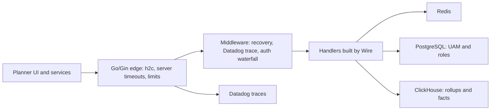

# Go and Gin (Impact Analytics platform)

<div class="callout note">

**How to use this page**

- **What it covers:** what Go and the Gin framework are, the Go ideas interviewers probe (goroutines, context, middleware, timeouts, HTTP/2, dependency injection), and exactly how I used Go at Impact Analytics. That means the 10k-peak-RPS Gin platform with Google Wire, h2c, nested timeouts and Datadog, the KPI formula compiler, the auth middleware and the ClickHouse copier.
- **When to read it:** before any Go round, any backend or platform system design round, and the IA Core Infrastructure deep dive.
- **What to memorise:** "self-protecting HTTP edge without a reverse proxy" means the Go process itself owns timeouts, limits, HTTP/2 and tracing. Also memorise what Wire, h2c and `ifNotFinite` each do in one sentence, and that 10k peak RPS is the stated peak with no SLA attached.

</div>

**Labels used on this page.** MEASURED means we have a log, doc or code for it. STATED means it is printed on the resume from the project's own source, with no extra arithmetic in prep; if asked how it was measured, keep it qualitative. ESTIMATED means arithmetic I can show. TARGET means a design goal. Verbal means true but off the resume.

<div class="callout warn">

**Say these carefully**

- **IA platform APIs are Go/Gin.** The IA agent plane (Keep/Drop batch, Ask Iris) is Python with FastAPI and LangGraph.
- **10k peak RPS is the stated peak** of the Go edge. Do not add a latency SLA, a p99, a tenant count or any other IA throughput number.
- **No Kubernetes cluster operations claim.** Kubernetes is skills-level literacy only.
- **Snippets on this page are teaching sketches** with illustrative values. They show the mechanism. They are not copies of company code.
- 100% Go statement coverage and 1,200+ Go tests are true but **off the resume** (LinkedIn and verbal).

</div>

---

## 1. What Go and Gin are, in plain English

**Go** (also called Golang) is a programming language from Google. It compiles to a single native binary, has static types, a garbage collector, and very cheap concurrency built into the language. It is popular for network services, infrastructure tools and APIs because it gives predictable latency and low memory use without the complexity of C++.

**Gin** is a lightweight web framework for Go. It sits on top of Go's standard `net/http` server and adds a fast router, middleware chaining, request binding and validation, and JSON helpers. Think of `net/http` as the engine and Gin as the dashboard and steering wheel.

Who uses them: cloud infrastructure companies, fintech backends, and API platforms that need many concurrent connections per machine.

### Where Go sits in my work

| Where | What Go did | Resume bullet |
|---|---|---|
| IA Core | Multi-tenant Go/Gin platform, 10k peak RPS, Wire, h2c, nested timeouts, Datadog tracing | C1 |
| IA Core | KPI configurator: Go tokenizer and parser that compiles formulas to ClickHouse SQL | C2 |
| IA Core | Auth waterfall middleware (Redis, Firebase Admin, JWT and Google OIDC, API keys, Postgres roles) | C3 |
| IA Core | Native-TLS ClickHouse copier at about 344k rows per second | C5 |

Go appears only at Impact Analytics. Uber FRM and Masters India were Java with Spring Boot. Uber Menu was Python. GeeksforGeeks was Django.

---

## 2. How Go works: the ideas interviewers probe

### 2.1 Goroutines and the scheduler

A **goroutine** is a very lightweight thread managed by the Go runtime. It starts with a few kilobytes of stack, so a server can run tens of thousands of them. Go's `net/http` server starts one goroutine per connection or request. The runtime scheduler multiplexes many goroutines onto a few OS threads. When a goroutine waits on network I/O, the scheduler parks it and runs another one. Analogy: a restaurant with a few cooks (OS threads) and hundreds of order tickets (goroutines). A cook never stands still waiting for an oven; they pick up the next ticket.

### 2.2 Channels and sync

**Channels** pass values between goroutines safely ("share memory by communicating"). The `sync` package gives mutexes and wait groups, and `errgroup` runs several goroutines and returns the first error. My copier's double buffering is a goroutine reading batches into a channel while the main loop sends the previous batch.

### 2.3 context.Context: deadlines and cancellation

A `context.Context` is passed down every call. It carries a **deadline** and a **cancel signal**. If the client disconnects or the deadline passes, every downstream call that respects the context (database query, HTTP call) stops. This is how Go services avoid doing work nobody is waiting for. It is the foundation of nested timeouts (section 3.3).

### 2.4 Middleware

**Middleware** is a function that wraps a handler, doing something before and after it: auth, logging, tracing, panic recovery, timeouts. Gin chains them in order.

```go
// Teaching sketch.
r := gin.New()
r.Use(gin.Recovery())        // turn panics into 500s instead of crashing the process
r.Use(tracing())              // Datadog span per request
r.Use(authWaterfall(deps))    // who is calling, which tenant, which hierarchy
r.GET("/v1/plans/:id/pivot", pivotHandler)
```

### 2.5 Errors and panics

Go returns errors as values (`val, err := f()`), so failure handling is explicit at each step. A **panic** is a crash of the current goroutine. In a server, an unrecovered panic in a handler would kill the process, which is why recovery middleware is the first thing in the chain.

### 2.6 Garbage collection

Go's garbage collector is concurrent and tuned for low pause times. For high-throughput code, the lesson is to avoid allocating per row or per request where you can. My copier reuses typed column buffers instead of reflecting per row for exactly this reason.

---

## 3. Bullet C1: the Go/Gin platform

> Architected a multi-tenant **Go/Gin** platform scaling to **10k peak RPS**, utilizing **Google Wire** for compile-time DI. Deployed as a self-protecting HTTP edge without a reverse proxy, guaranteeing high availability through native **h2c**, nested timeouts, and **Datadog** distributed tracing.

### 3.1 In plain words

AssortSmart's planner screens and services call one Go/Gin platform for plan data, KPIs and pivots. It handles up to about 10 thousand requests per second at peak. Usually a web service sits behind a **reverse proxy** such as Nginx or Envoy, which handles slow clients, timeouts, body limits and protocol details. We deployed the Go service without one, so the Go process itself had to protect itself. It does that with careful server timeouts, per-request deadlines, HTTP/2 support in plain text (h2c), and tracing for every request.



*What to notice: there is no Nginx or Envoy box. Everything a proxy would do for safety lives inside the Go edge.*

### 3.2 Google Wire: compile-time dependency injection

**Dependency injection (DI)** means a component receives the things it needs (database client, cache, config) instead of creating them itself. That makes code testable, because tests can pass fakes. Many DI frameworks do this at runtime with reflection. **Google Wire** does it at **compile time**: you declare provider functions, Wire generates plain Go code that wires them together, and if a dependency is missing the build fails. Analogy: instead of a stage manager running around during the show to find props, the props list is checked and laid out before the curtain goes up.

```go
// Teaching sketch.
// providers.go
func NewClickHouse(cfg Config) (*ch.Conn, error) { /* ... */ }
func NewRedis(cfg Config) *redis.Client          { /* ... */ }
func NewPivotService(c *ch.Conn, r *redis.Client) *PivotService { /* ... */ }
func NewServer(p *PivotService) *gin.Engine      { /* ... */ }

// wire.go (build tag: wireinject)
func InitializeServer(cfg Config) (*gin.Engine, error) {
    wire.Build(NewClickHouse, NewRedis, NewPivotService, NewServer)
    return nil, nil
}
// `wire` generates wire_gen.go with the real constructor calls in order.
```

- **Why Wire:** no runtime reflection, no startup surprises, errors at build time, and the generated code is readable.
- **Alternatives:** manual wiring in `main.go` (fine for small services, gets messy), Uber's `fx` or `dig` (runtime DI with lifecycle hooks, more magic).
- **Trade-off:** one more code generation step to keep in sync.

### 3.3 Nested timeouts

Nested timeouts means each layer has a deadline, and inner deadlines are shorter than outer ones, so the innermost work gives up first and the outer layer still has time to return a clean error.

```text
Server level      ReadHeaderTimeout, ReadTimeout, WriteTimeout, IdleTimeout
  Request level     context deadline for this route
    Downstream        ClickHouse query timeout  <  request deadline
                      Redis / Postgres call timeout  <  request deadline
```

```go
// Teaching sketch. Values are illustrative, not production settings.
srv := &http.Server{
    Addr:              ":8080",
    Handler:           h2c.NewHandler(router, &http2.Server{}),
    ReadHeaderTimeout: 5 * time.Second,  // stops slow-header (slowloris) clients
    ReadTimeout:       30 * time.Second,
    WriteTimeout:      60 * time.Second,
    IdleTimeout:       120 * time.Second,
    MaxHeaderBytes:    1 << 20,
}

func pivotHandler(c *gin.Context) {
    ctx, cancel := context.WithTimeout(c.Request.Context(), 25*time.Second)
    defer cancel()
    rows, err := pivots.Query(ctx, req) // ClickHouse call honours ctx
    // ...
}
```

Why this matters without a proxy: a single slow client or a stuck query must not hold a goroutine and a database connection forever. With nested deadlines, the stuck work is cancelled, the client gets an error, and resources are freed.

### 3.4 Other self-protection the process owns

Older prep summarises the trade-off as "you own the caps and SIGTERM". The general list of what a proxy normally provides, and what a self-protecting Go edge must therefore handle itself:

- **Header and body size caps** (`MaxHeaderBytes`, `http.MaxBytesReader` on request bodies).
- **Slow client protection** (`ReadHeaderTimeout`).
- **Panic recovery** so one bad request does not crash the process.
- **Graceful shutdown on SIGTERM**: stop accepting new connections, let in-flight requests finish within a deadline, then exit. This matters for rolling deploys.
- **Bounded concurrency** to expensive downstreams, so one tenant's heavy pivot cannot exhaust ClickHouse connections.

Keep this as "how the edge protects itself". Do not quote numeric limits.

### 3.5 h2c: HTTP/2 in cleartext

**HTTP/2** sends many requests over one TCP connection at once (multiplexing), with compressed headers. Normally HTTP/2 runs inside TLS. **h2c** is HTTP/2 without TLS, in "cleartext". It is used when something in front (typically a managed load balancer or platform front door) terminates TLS and forwards traffic to the service over a private network. Go's standard server only speaks HTTP/2 over TLS by default, so you wrap the handler with `h2c.NewHandler` to accept HTTP/2 in plain text.

- **Why:** without a proxy translating protocols, the service itself must speak HTTP/2 to get multiplexing from the front door. Fewer connections, less head-of-line blocking at the HTTP layer.
- **Trade-off:** h2c must only be exposed on a trusted network. Never on the public internet.
- If asked exactly what terminates TLS in front, keep it general unless you are sure of the product name.

### 3.6 Datadog distributed tracing

**Distributed tracing** follows one request across services. Each unit of work is a **span** (for example "HTTP GET /pivot", "ClickHouse query", "Redis GET"), and spans share a **trace id**. Datadog shows them as a waterfall, so you can see that a slow request spent 90% of its time in one ClickHouse query.

```go
// Teaching sketch using Datadog's Go tracer.
import gintrace "gopkg.in/DataDog/dd-trace-go.v1/contrib/gin-gonic/gin"

tracer.Start(tracer.WithService("assortsmart-api"))
defer tracer.Stop()
r.Use(gintrace.Middleware("assortsmart-api"))
```

More on Datadog versus LangSmith in [observability_cloud.md](observability_cloud.md).

### 3.7 Why this design, alternatives and trade-offs

- **What:** a single Go/Gin edge, no reverse proxy, with protection built into the process.
- **Why:** fewer hops and moving parts, and one place to reason about timeouts and traces. Go gives predictable latency and cheap concurrency at 10k peak RPS.
- **Alternatives considered:**
  - *Nginx or Envoy in front.* Battle-tested protection and TLS. It is an extra hop and an extra config surface, and timeouts then live in two places.
  - *A Python (FastAPI) platform.* Great for the LLM ecosystem and fast to write. For a high-RPS, CPU-and-I/O-mixed edge, Go's concurrency and memory profile are more predictable. The agent plane stays in Python, where the LLM libraries are.
  - *A Java Spring Boot platform.* If asked "you know Spring, why Go here?": Spring Boot is excellent for large business services with many entities and transactions, which is how I used it at Uber FRM and Masters India. A thin, high-RPS edge over Redis, Postgres and ClickHouse benefits more from Go's small memory footprint per instance, fast startup and goroutine-per-request model. Never describe the IA platform as Spring Boot.
  - *Runtime DI (fx, dig, or Spring's container).* More magic, and wiring errors show up at startup instead of build time. Wire generates plain Go constructor calls, so a missing dependency fails the compile.
- **Trade-off:** we own every safety knob a proxy would have given us. A missing timeout is our bug.
- **What I'd do differently:** write the timeout and limit budget down per route as a table in the repo, so new routes inherit sane defaults instead of copying them.

### 3.8 The number

| Number | What it measures | How derived | Tag |
|---|---|---|---|
| 10k peak RPS | Peak HTTP requests per second handled by the Go/Gin platform | Stated on the AssortSmart tab. No separate arithmetic in prep | STATED |

Why it mattered: it is the load the edge has to absorb without a reverse proxy, which is why timeouts, h2c and tracing live inside the process.

Say it: "The Go platform scales to about 10 thousand requests per second at peak."

Do NOT say: "99.9% availability", "p99 under X ms", "N tenants", or that you operated the Kubernetes cluster it runs on. If pressed for the measurement source, say it is the stated peak for the edge and keep the rest qualitative.

---

## 4. Bullet C2: the KPI formula compiler in Go

> Eliminated deployment bottlenecks by architecting a dynamic KPI configurator and custom formula parser. Engineered a real-time compilation layer that tokenizes operator-authored math into parameterized ClickHouse SQL fragments with native division-by-zero protection, decoupling business logic from code releases.

### 4.1 In plain words

Retailers define KPIs (Key Performance Indicators) differently. "Sell-through" at one retailer is units sold divided by units sold plus ending inventory. Before this, each new KPI meant a code change and a release. Now an operator types the formula in a configurator, and Go compiles it into a safe SQL fragment for ClickHouse.

### 4.2 How it works

1. **Tokenize.** Break the text into tokens: names, numbers, operators, parentheses, function names.
2. **Parse.** Build a tree that respects operator precedence (multiplication before addition), for example with a recursive-descent parser.
3. **Validate.** Every function must be on an **allowlist**. Every logical name (such as `sales_units`) must map to a known physical column. **Unknown tokens fail closed**: the formula is rejected, never passed through.
4. **Emit SQL.** Walk the tree and produce a SQL fragment with values passed as **parameters**, not string-concatenated.
5. **Protect.** Wrap the result in `ifNotFinite(toFloat64(expr), 0)`. If a division by zero produces infinity or NaN (not a number), the KPI becomes 0 instead of breaking the planner's JSON.

```text
Operator types:   sell_through = sales_units / (sales_units + eoh_units)

Tokens:           IDENT(sales_units) SLASH LPAREN IDENT(sales_units) PLUS IDENT(eoh_units) RPAREN

Tree:                    (/)
                        /   \
             sales_units     (+)
                            /   \
                   sales_units   eoh_units

Emitted SQL (illustrative column names):
  ifNotFinite(toFloat64(sum(sls_u) / (sum(sls_u) + sum(eoh_u))), 0) AS sell_through
```

*What to notice: logical names on the left become physical columns on the right, and the whole expression is wrapped so a zero denominator gives 0.*

```go
// Teaching sketch of fail-closed identifier mapping.
var columns = map[string]string{"sales_units": "sls_u", "eoh_units": "eoh_u"}
var allowedFuncs = map[string]bool{"sum": true, "avg": true, "min": true, "max": true}

func (p *parser) ident(tok Token) (Node, error) {
    col, ok := columns[tok.Text]
    if !ok {
        return nil, fmt.Errorf("unknown identifier %q", tok.Text) // fail closed
    }
    return Column{Name: col}, nil
}
```

### 4.3 Why this design

- **Why a parser and not "let operators write SQL":** raw SQL from users is an injection and cost risk. An allowlisted grammar only allows math on known columns.
- **Alternatives:** hard-code KPIs in Go (safe but needs a release per KPI), a general expression library (more power than we wanted, harder to restrict), or store SQL snippets in config (injection risk).
- **Trade-off:** the grammar is deliberately small, so exotic formulas need a new allowed function and a code change.
- **What I'd do differently:** add a "dry run" that shows operators the generated SQL and a sample result before saving.

---

## 5. Bullet C3 in Go: the auth waterfall middleware (summary)

The Go edge resolves identity in a fixed order. It checks Redis first for a cached result. On a miss it tries Firebase Admin token verification, then JWT or Google OIDC verification. It compares API keys in constant time. Then it resolves the caller's role and UAM-scoped hierarchy from PostgreSQL. A cache miss falls through to Postgres; it does not "fail open". Full walk-through: [auth_tenancy_rate_limits.md](auth_tenancy_rate_limits.md).

```go
// Teaching sketch: constant-time API key comparison.
if subtle.ConstantTimeCompare([]byte(presented), []byte(expected)) != 1 {
    c.AbortWithStatus(http.StatusUnauthorized)
    return
}
```

Constant-time comparison takes the same time whether the first character or the last character is wrong. Without it, an attacker can measure response times and guess a key one character at a time (a **timing attack**).

---

## 6. Bullet C5 in Go: the copier (summary)

The ClickHouse copier is also Go: native protocol over TLS on port 9440, 500k-row columnar batches, double buffering with a goroutine and a channel, per-season checkpoint files, and per-table file locks. About 344k rows per second combined across two season streams, measured on partitions up to 4.09B rows while that copy was in flight. Full story: [clickhouse.md](clickhouse.md).

---

## 7. Failure modes to talk about

These are general risks of a Go platform shared by UI and agent callers. Older prep listed them for a Python-plus-Go design. Use them as "what I watch for", not as incidents.

| Risk | Why it happens | Guard |
|---|---|---|
| Missing tenant or scope check on a new route | Someone adds a handler and forgets the scoping helper | Scope applied in middleware, plus tests that try cross-tenant ids and expect 403 |
| Divergent auth between Python and Go services | Two code paths verify identity differently | One identity contract, same claims, same tenant binding |
| Lost trace context across services | A caller does not forward the trace id | Tracing middleware on both sides. Trace id in JSON logs |
| A stuck downstream holds goroutines | No deadline on a ClickHouse or Redis call | Nested timeouts, context everywhere |
| LLM logic creeping into the Go edge | Convenience | Keep LLM orchestration in the Python agent plane. Go stays deterministic |

---

## 8. Verbal-only Go material (not on the resume)

- Older prep called the Go service the shared "doing layer" for the Hindsight clustering strategy, where both the manual UI and agent tool calls would hit the same Go engines so authorization and business rules stay in one place. **Hindsight and the Cluster Recommendation Copilot are verbal-only designs, not resume bullets.** Use this only as "how I would let agents call platform logic safely": the agent plans in Python, then calls audited Go endpoints with the same identity, rather than duplicating business rules.
- Tool contract drift (an agent's tool schema getting out of sync with the Go API) is the main risk in that design. Version the contracts and test them.
- 100% Go statement coverage and 1,200+ Go tests are on LinkedIn and verbal, not the PDF.

---

## 9. Interview questions with speakable answers

**Q1. Why Go for the platform when the agent plane is Python?**
Different jobs. The platform is a high-concurrency HTTP edge that talks to Redis, Postgres and ClickHouse at up to about 10 thousand requests per second at peak. Go gives cheap goroutines, predictable latency and low memory for that. The agent plane needs the LLM ecosystem (LangGraph, provider SDKs), which is strongest in Python. Keeping the deterministic platform in Go and the non-deterministic LLM work in Python also keeps the blast radius of each clear.

**Q2. What does "self-protecting HTTP edge without a reverse proxy" mean?**
It means we did not put Nginx or Envoy in front, so the Go process does the protective work a proxy would. That includes server timeouts for slow clients, per-request context deadlines, header and body size caps, panic recovery, graceful shutdown on SIGTERM, and native h2c so it speaks HTTP/2 to the front door. The benefit is one fewer hop and one place to reason about timeouts. The cost is that every safety knob is our responsibility.

**Q3. Explain nested timeouts.**
Every layer has a deadline, and inner ones are shorter. The server has read and write timeouts, each route sets a context deadline, and each downstream call like a ClickHouse query gets a deadline shorter than the route's. So if ClickHouse is stuck, the query is cancelled first, the handler still has time to return a clean error, and the goroutine and connection are freed. Without that, one slow dependency slowly eats all your connections.

**Q4. What is Google Wire and why use it?**
Wire is compile-time dependency injection. I declare provider functions for things like the ClickHouse client, Redis client and services, and Wire generates the Go code that constructs them in the right order. If something is missing, the build fails instead of the service crashing at startup. Compared with runtime DI like fx, or the Spring container I used in the Java services at Uber FRM and Masters India, there is no reflection and the generated code is just readable Go.

**Q5. What is h2c and when is it safe?**
h2c is HTTP/2 over plain TCP without TLS. You use it when TLS is terminated in front of the service and traffic to the service is on a trusted private network. Go's server needs the h2c handler wrapper to accept it. It gives HTTP/2 multiplexing without the service doing TLS. It is not safe to expose h2c on the public internet.

**Q6. How does your KPI parser stay safe?**
It is a small grammar, not a SQL passthrough. The tokenizer and parser only accept numbers, operators, parentheses, allowlisted functions and known logical names, which are mapped to physical columns. Anything unknown fails closed. Values are passed as parameters, and the result is wrapped in `ifNotFinite(toFloat64(expr), 0)`, so a divide by zero produces 0 rather than infinity in the planner's JSON. That let business users add KPIs without a code release.

**Q7. How do goroutines differ from threads?**
Goroutines are managed by the Go runtime and start with a tiny stack, so you can run tens of thousands cheaply. The scheduler maps them onto a small number of OS threads and parks a goroutine when it blocks on I/O. OS threads are heavier and are scheduled by the kernel. That is why Go's one-goroutine-per-request model scales well for I/O-heavy servers.

**Q8. How would you debug a latency spike on the Go edge?**
Start with Datadog traces for the slow route and look at which span dominates: usually a ClickHouse query, sometimes the auth path on a Redis miss. Then check saturation, meaning goroutine count, connection pool usage and ClickHouse concurrency. If it is one tenant's heavy pivot, bounded concurrency and deadlines contain it. Then fix the root cause, for example a query that is not hitting a rollup.

---

## Related

- [auth_tenancy_rate_limits.md](auth_tenancy_rate_limits.md) for the auth waterfall and tenant scope
- [clickhouse.md](clickhouse.md) for rollups, the KPI SQL target and the copier
- [observability_cloud.md](observability_cloud.md) for Datadog
- [python_fastapi.md](python_fastapi.md) for the Python agent plane
- [../architecture/01_ia_assortsmart_hindsight.md](../architecture/01_ia_assortsmart_hindsight.md)
- [../../../prep/43_ia_bullet_defense.md](../../../prep/43_ia_bullet_defense.md)
