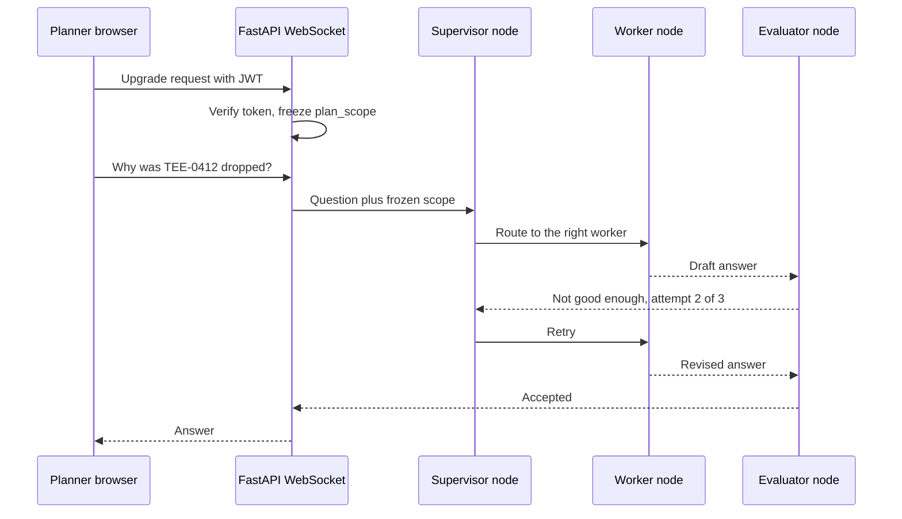
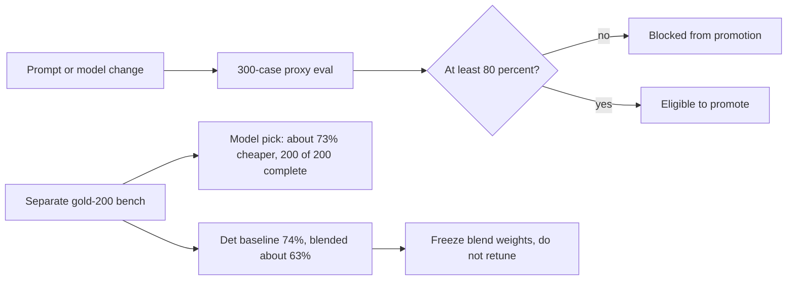
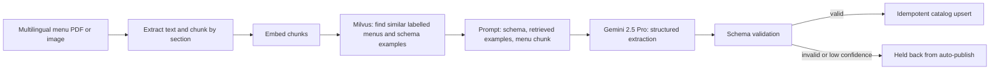

# LangGraph, LLM agents, tool calling, MCP, RAG, Milvus, LangSmith and offline evaluation

<div class="callout note">

**How to use this page**

- **What it covers:** every item on the **Generative AI** skills line, explained from scratch, and mapped to where I actually used it. That means Ask Iris (LangGraph supervisor plus evaluator, LangSmith) and the Keep/Drop decision engine (structured LLM invokes, 7 lenses, offline eval gate) at Impact Analytics, and the menu RAG pipeline (LangChain, Gemini 2.5 Pro, Milvus) at Uber Menu. MCP, tool calling and pgvector are explained honestly as skills-level.
- **When to read it:** before any AI engineer, applied ML or "LLM in production" round, and before the IA Agentic deep dive.
- **What to memorise:** LangGraph is Ask Iris. Keep/Drop has a fixed step order and no LLM orchestrator. RAG and Milvus are Uber Menu. MCP is skills-level. LangSmith is Ask Iris. 80% is a CI gate on 300 cases, while 73% and 74% come from a separate 200-case benchmark.

</div>

**Labels used on this page.** MEASURED means we have a log, doc, config or code for it. ESTIMATED means arithmetic I can show. HISTORICAL means from my past work records. TARGET means a design goal (say "targeting"). Verbal means true but off the resume.

<div class="callout warn">

**Say these carefully**

- **80% is a CI promotion gate** on the 300-case proxy set. It does not mean "every tenant runs at 80% accuracy live".
- **73% lower cost at 100% coverage, and the 74% baseline, come from the gold-200 benchmark**, not the 300-case file. Never fuse them. Model names are not on the resume.
- **Keep/Drop has no LLM orchestrator.** Its step order is fixed in code: peer benchmark, then decider, then lenses, then blend, then explanation. Do not call it "seven agents talking to each other".
- **LangGraph and LangSmith are Ask Iris.** The Keep/Drop batch uses custom JSON telemetry, not LangSmith.
- **RAG and Milvus are Uber Menu only.** Never Impact Analytics. Menu's 98% is **offline evaluation**.
- **MCP and tool calling are skills-level.** The Cluster Recommendation Copilot tool design (14 tools) is verbal depth only, not a resume bullet. Say "building", not "shipped", for the Copilot.
- **No human review queues (HITL) at IA.** Offline evals replaced critic and evaluator agents in Keep/Drop.
- Ask Iris is a **shipped capability** with no SLA or usage numbers. Do not invent any.
- No fine-tuning or SFT claims on the resume.

</div>

---

## 0. Where each skill lives

| Skill on the resume | Where I used it | Resume bullet | Strength |
|---|---|---|---|
| LLM agents (OpenAI / Gemini / Claude) | IA Ask Iris and Keep/Drop LLM lenses. Uber Menu Gemini 2.5 Pro | A1, A4, M1 | Production |
| LangGraph | IA Ask Iris: supervisor plus 3-attempt evaluator | A4 | Production |
| LangChain | Uber Menu RAG pipeline | M1 | Production (historical) |
| RAG | Uber Menu extraction | M1 | Production, 98% offline |
| Milvus | Uber Menu vector store | M1 | Production (historical) |
| pgvector | None | n/a | Literacy only |
| Tool calling | Concept and design. IA scoring deliberately has no tools | Skills line | Skills-level |
| MCP | Concept and design | Skills line | Skills-level |
| Prompt engineering | IA lens prompts, Menu extraction prompts | A1, M1 | Production |
| LangSmith | IA Ask Iris tracing | A4 | Production |
| Offline evaluation | IA 300-case gate and gold-200 bench. Menu 98% field fidelity | A5, M1 | Production |

---

## 1. LLM agents and structured outputs

### 1.1 Plain English

A **large language model (LLM)** predicts text. An **LLM agent** is a program that uses an LLM to decide steps: which tool to call, what to ask next, when to stop. A plain "chain" always runs the same steps in the same order. An agent chooses its path at runtime. That flexibility is also the danger, because agents can loop, wander, or take actions you did not intend.

A **structured LLM invoke** is a call where the model must return JSON that matches a schema. Think of a form with fixed boxes instead of a blank page. You validate the answer like any API response.

```python
# Teaching sketch: a structured lens call with Pydantic validation.
class LensScore(BaseModel):
    lens: Literal["trend_velocity", "size_curve", "colour_cannibalization"]
    score: float = Field(ge=0, le=1)
    rationale: str

raw = llm.invoke(prompt, response_format=LensScore.model_json_schema())
result = LensScore.model_validate_json(raw)   # rejects anything off-schema
```

### 1.2 Where I used it: the Keep/Drop decision engine (A1, A2, A3)

> Architected a **multi-pipeline AI merchandise decision engine (Keep/Drop, Missed Opportunities, Top Style)** evaluating **348k** article-seasons. Optimized inference at scale, processing **88k** items per pass, by blending deterministic KPI math with structured LLM invokes across **7 AI lenses**.

In plain words: for each **article-season** (one product in one selling season), code computes hard KPIs such as **sell-through** (share of stock that sold) and **rate of sale** (units per selling store per week). Then the LLM answers up to seven focused questions, the **lenses**, and the two are blended into a keep-or-drop recommendation.

The seven active lenses are trend_velocity, size_curve, colour_cannibalization, channel_divergence, multi_season_consistency, discount_dependency and margin_resilience. An eighth exists but is switched off. A cheap Python **lens gate** runs first and skips lenses that make no sense, for example size_curve for a single-size product.

```mermaid
flowchart LR
    CH["ClickHouse facts"] --> DET["Deterministic KPI math: s_det"]
    DET --> PAY["JSON payload per article, batches up to 64"]
    PAY --> PEER["Peer benchmark"]
    PEER --> DEC["Decider"]
    DEC --> LENS["Lens calls, structured JSON"]
    LENS --> BLEND["Blend: s_final = 0.4 x s_det + 0.6 x s_agent"]
    BLEND --> EXP["Explanation"]
    EXP --> OUT["Output rows with config_hash"]
```



*What to notice: the order of steps is fixed in code. No LLM decides what runs next.*

Worked example (from prep): a tee with sell-through 84% and rate of sale 1.168 gets `s_det` of about 0.65 from code. The gate sees five sizes, two colours and 12 weeks on sale, so size_curve, colour_cannibalization and trend_velocity are eligible. If `s_agent = 0.711`, then `s_final = 0.4 x 0.65 + 0.6 x 0.711`, which is about 0.687. That is at or above 0.55, so it is a keep.

**Why the LLM gets JSON, not tools:** the master table is 2.11B rows. A scoring model with a SQL or code tool across 88k items is a latency, cost and injection risk. Code computes the KPIs. The model does judgement, not arithmetic. On timeout, the deterministic score stands (A2).

**Why the step order is fixed:** a batch of 88k items needs predictable cost and behaviour. An LLM choosing the path per item would make cost and evaluation unpredictable.

**Numbers:** 348k article-seasons evaluated (MEASURED, and not the 1.6M catalog), 88k items per pass (MEASURED), 7 lenses (MEASURED, config). About $100 per pass in tokens is true but off the PDF.

---

## 2. LangGraph and Ask Iris

### 2.1 What LangGraph is

**LangGraph** is a library from the LangChain team for building LLM applications as a **graph of steps with shared state**. Each **node** is a function (call a model, call a worker, check an answer). **Edges** connect nodes. **Conditional edges** choose the next node from the current state. Graphs can loop, which is what agents need, and LangGraph adds **checkpointing** (save state between steps) and a **recursion limit** (a maximum number of steps per run).

Analogy: a hospital triage desk. The triage nurse (supervisor) looks at the patient and sends them to a specialist (worker). A senior doctor (evaluator) reviews the specialist's note and can send it back. Hospital policy says "no more than three reviews", so nobody circles forever.

### 2.2 How Ask Iris uses it (A4)

> **Shipped "Ask Iris,"** a JWT-secured WebSocket copilot enabling planners to interactively query KPIs and inspect AI decisions on a multi-billion-row database. Prevented infinite LLM loops and multi-tenant data leaks by orchestrating a **LangGraph** supervisor with a 3-attempt evaluator loop, utilizing **LangSmith** for observability, and strictly freezing hierarchy access on the initial socket handshake.



*What to notice: scope is set once at the top. The evaluator can send work back, but never more than three times.*

```python
# Teaching sketch of the graph shape. Not production code.
MAX_ATTEMPTS = 3

def evaluator(state):
    ok = judge(state["draft"], state["question"])
    if ok or state["attempts"] >= MAX_ATTEMPTS:
        return {"final": state["draft"] if ok else graceful_fallback(state)}
    return {"attempts": state["attempts"] + 1}

g = StateGraph(IrisState)
g.add_node("supervisor", supervisor)
g.add_node("worker", worker)
g.add_node("evaluator", evaluator)
g.add_edge("supervisor", "worker")
g.add_edge("worker", "evaluator")
g.add_conditional_edges("evaluator", lambda s: END if "final" in s else "supervisor")
app = g.compile()
app.invoke(state, config={"recursion_limit": 25})   # illustrative limit
```

### 2.3 Design decisions for Ask Iris

- **What:** a supervisor graph with a capped evaluator, behind a JWT-verified WebSocket, with scope frozen at handshake, traced in LangSmith.
- **Why:** chat is the riskiest LLM surface. Scope that can change mid-session invites tenant bleed, and uncapped self-critique loops burn tokens.
- **Alternatives considered:**
  - *A plain chain (no graph).* Simpler, but it cannot route different question types to different workers or retry.
  - *A fully autonomous agent with free tool use.* More flexible and much harder to bound or test.
  - *Re-check permissions per message.* Then scope depends on message content. Freezing at the handshake makes widening scope structurally impossible.
- **Trade-off:** if a user's permissions change mid-session, they must reconnect. A capped evaluator sometimes returns a "best effort" answer.
- **What I'd do differently:** build an Ask Iris-specific offline eval set from real planner questions early, so routing changes are gated like Keep/Drop changes.

### 2.4 What not to claim

No SLA, latency target, user count or questions per week. It is a shipped capability.

---

## 3. Tool calling and MCP (skills-level)

### 3.1 Tool calling

**Tool calling** (also called function calling) lets a model ask the application to run a function. You describe the tools with names and JSON schemas. The model returns "call `get_kpis` with `{article: 'TEE-0412'}`". Your code validates the arguments, runs the function and gives the result back to the model. The model never runs anything itself. Your code does.

```json
{"name": "get_article_kpis",
 "description": "Read KPIs for one article within the caller's scope",
 "parameters": {"type": "object",
   "properties": {"article_id": {"type": "string"}, "season": {"type": "integer"}},
   "required": ["article_id", "season"]}}
```

Rules I follow when designing tools:

1. **Read-only by default.** Writes go through normal product APIs with their own checks.
2. **Typed arguments, validated.** Reject anything off-schema before it touches data.
3. **Scope comes from the session, not the arguments.** The model cannot pass a tenant id.
4. **No free-form SQL tools.** Narrow functions with known cost.
5. **Budgets:** a cap on tool calls per turn and per-tool timeouts.

**Where:** IA's Keep/Drop scoring deliberately uses **no tools**. It is JSON in, structured score out. Ask Iris workers read data within the frozen `plan_scope`. On the resume, tool calling is a **skills-line item**, and I present my tool design depth verbally through the Copilot design below.

### 3.2 MCP (Model Context Protocol)

**MCP** is an open protocol that standardises how LLM applications connect to tools and data. Think of it as USB-C for AI tools: one plug shape, so any compliant app can use any compliant tool server.

- An **MCP host** is the LLM app (an IDE assistant, a chat app).
- An **MCP client** inside the host keeps a connection to each server.
- An **MCP server** exposes **tools** (functions the model can call), **resources** (data the app can read) and **prompts** (reusable templates).
- Messages use **JSON-RPC**, over stdio for local servers or HTTP for remote ones.

Why it matters: without MCP, every app writes custom glue for every tool. With MCP, you write a tool server once.

**Where:** skills-level. I understand the protocol and how I would expose platform reads as MCP tools. It is not a shipped IA bullet. Older prep said IA had "MCP-hosted tool calling to audited read-only planning tools". That is the Copilot design, verbal only.

<div class="callout highlight">

**Verbal only: Cluster Recommendation Copilot tool design**

Use this if an interviewer wants depth on tool design. Say "the design was..." and "building", not "shipped".

- **14 audited read-only tools** over planning data. No free-form SQL.
- **3 confirm gates** in the design before any write-back through product APIs. This is a design flow, not a shipped human review queue.
- Budgets in the design: tool calls per session, parallel clustering jobs per tenant, token caps, per-tool timeouts.
- Measured baseline: an 8.5% clustering failure rate (37 out of 437), with a TARGET under 2%. TARGET turnaround from days to under 1 hour.
- Phase 1 design review passed. Load test pending.

</div>

---

## 4. Prompt engineering

**Prompt engineering** is designing the instructions, context and output format you give a model so it behaves reliably. In production that means:

- **One narrow job per prompt.** Each lens has its own rubric instead of one giant "decide everything" prompt. Narrow prompts are easier to evaluate and fix.
- **Strict output schemas.** JSON with bounded numeric fields.
- **Context as data, not instructions.** Facts go in a JSON block, clearly separated from the instructions. That reduces prompt-injection risk from data fields.
- **Versioning.** At IA, prompt text is part of the `config_hash` (SHA-256 of guardrails, parameters, prompts and catalog) stamped on every output row. Change one word and the hash changes, so you always know which prompt produced a decision.
- **Few-shot examples.** At Menu, retrieval supplied similar labelled menus as examples (section 6).

---

## 5. Offline evaluation and the CI gate (A5)

> Built a **300-case** proxy evaluation harness and an **80%** accuracy CI gate to enforce strict deployment guardrails. Reduced live execution costs by **73%** at **100%** coverage by benchmarking models against a **74%** deterministic baseline, strategically freezing final decision weights when the LLM underperformed the baseline.

### 5.1 Plain words

**Offline evaluation** means testing a model or prompt on a fixed labelled set before it reaches users. A **proxy** set uses labels that stand in for the truth, because the real "right answer" for Keep/Drop is only known after the season ends. A **CI gate** is an automated check in the continuous integration pipeline that blocks promotion if a number is too low.

### 5.2 Two different test sets. Keep them apart.

| Set | Size | What it gave us | Tag |
|---|---|---|---|
| Proxy eval harness | 300 cases (`cases.json`) | The promotion gate: `eval.json` has `gold_min_accuracy: 0.8`. Below 80%, a change cannot be promoted | MEASURED (config) |
| Gold-200 benchmark | 200 cases | Chosen model about 73% cheaper than the previous one, with 200 out of 200 completed (100% coverage). Deterministic baseline at the production threshold 0.65 scored 74%. Blended LLM scored about 63% | MEASURED |



*What to notice: two separate boxes. The 80% gate lives on the 300-case path. The 73% and 74% live on the gold-200 path.*

### 5.3 The judgement call interviewers like

The rule-only baseline scored 74% on gold-200. The blended LLM score came in around 63%, which is lower. Instead of retuning blend weights on a 200-case set (overfitting), we **froze** the weights. The model has to beat a free rule before it is allowed to move decisions more. That is a senior call: the eval system can, and did, say no to the AI.

### 5.4 How to say the numbers

- "Promotion requires at least 80% on a 300-case proxy set. It's a CI gate."
- "On a separate 200-case benchmark, the model we picked cost about 73% less and still completed all 200 cases."
- "The rule-only baseline scored 74% on that same 200 set. When the blend came in lower, we froze the weights."

Do NOT say: "80% accuracy in production", "the 300 cases showed 73%", "100% test coverage" for this bullet, or the model names as if they were on the resume.

### 5.5 Menu's offline evaluation

98% field fidelity on the Menu RAG pipeline was measured offline against labelled menus. Each field (item name, price, description, modifier) is compared with ground truth. Older prep also quoted "100% schema consistency". The current resume does not, so stick to 98%.

---

## 6. RAG, embeddings, Milvus and LangChain (Uber Menu)

> Accelerated restaurant onboarding from **24 hours to 2 hours** and saved **$600K** annually by architecting an automated ingestion pipeline processing **30K+** menus monthly. Converted unstructured, multilingual PDFs into a strict catalog schema at **98%** field fidelity utilizing a **Gemini 2.5 Pro** and **LangChain RAG** pipeline over **Milvus** vector embeddings.

### 6.1 Plain English

**RAG** (Retrieval-Augmented Generation) means: before asking the model, fetch relevant reference material and put it in the prompt. It is an open-book exam instead of a closed-book one.

An **embedding** is a list of numbers (a vector) that represents the meaning of a piece of text. Texts with similar meaning have vectors that are close together. A **vector database** such as **Milvus** stores millions of these vectors and quickly finds the nearest ones to a query. It uses **approximate nearest neighbour (ANN)** indexes such as HNSW (a layered graph you walk greedily towards the target) or IVF (cluster the vectors, then only search the closest clusters).

**LangChain** is a Python framework with building blocks for LLM apps: document loaders, text splitters, embedding wrappers, vector store connectors, retrievers and prompt templates. We used it as the glue for the RAG pipeline.

### 6.2 How the menu pipeline worked



*What to notice: retrieval supplies examples of what correct output looks like, and a schema gate sits between the model and the catalog.*

1. A messy PDF menu arrives (multiple languages, columns, images).
2. The text is extracted and split into chunks such as a section or a block of items.
3. Each chunk is embedded, and Milvus returns similar, already-labelled menus and schema examples.
4. The prompt gives Gemini 2.5 Pro the target catalog schema, the retrieved examples and the menu chunk.
5. Gemini returns structured items: name, price, description, modifiers.
6. A schema validator checks types, required fields and price formats. Valid output becomes an idempotent catalog upsert. Invalid or low-confidence output is held back from auto-publish (older prep describes a manual review path for these).

### 6.3 Why this design

- **Why RAG over plain prompting:** menus vary wildly. Showing the model similar solved examples makes output more consistent than instructions alone.
- **Why not regex or templates:** they break on every new layout and language.
- **Why not fine-tuning:** it costs more to iterate and needs a labelled training set per change. Retrieval examples can be updated by adding labelled menus. No fine-tuning is claimed on the resume.
- **Why Milvus:** a dedicated, scalable vector database with ANN indexes. pgvector is a reasonable alternative when vectors live next to relational data in Postgres at moderate scale (see 6.5).
- **Trade-off:** retrieval quality depends on the labelled corpus. A stale index or poor chunking hurts accuracy quietly.
- **What I'd do differently:** track retrieval quality separately from generation quality in the offline eval, so you know which half regressed.

### 6.4 The numbers

| Number | Meaning | Tag |
|---|---|---|
| 98% field fidelity | Share of extracted fields matching labelled ground truth | HISTORICAL, offline evaluation |
| From 24 hours to 2 hours | Restaurant onboarding time, about 92% faster | HISTORICAL |
| 30K+ menus a month | Volume | HISTORICAL |
| $600K a year | About $2 per menu x 30,000 x 12 = $720K list, floored to $600K | ESTIMATED on HISTORICAL inputs |

Say it: "98% field fidelity on our offline evaluation set." Do NOT say "98% accuracy in production" or "$720K saved".

### 6.5 pgvector (literacy)

**pgvector** is a PostgreSQL extension that adds a vector column type and nearest-neighbour search (HNSW and IVFFlat indexes). It is great when you want vectors next to your relational data, with one database to operate and SQL joins between vectors and metadata. A dedicated vector database such as Milvus scales further and offers more index options. **I have not run pgvector in production. It is skills-level.**

---

## 7. LangSmith and LLM observability

**LangSmith** is a tracing and evaluation tool for LLM apps from the LangChain team. Every run becomes a **trace tree**: each node, model call, prompt, response, token count and latency. You can replay a bad answer, see which step went wrong, and build datasets from real traces.

| What | Tool | Why |
|---|---|---|
| Ask Iris graph runs | LangSmith | See supervisor routing, evaluator retries and tokens per question |
| Keep/Drop batch runs | Custom JSON telemetry (tokens, USD cost, step duration, batch fallbacks) plus `config_hash` | A batch of 88k items needs per-run cost accounting tied to output rows |
| Go platform HTTP and database calls | Datadog | Distributed tracing of the edge |

Debugging a bad Ask Iris answer, end to end: find the trace in LangSmith, check which worker the supervisor chose, read the evaluator's reasons, see the data the worker had. If the data was wrong, follow the request into Datadog on the Go side.

---

## 8. Model providers (OpenAI, Gemini, Claude)

- **OpenAI:** the gold-200 benchmark compared OpenAI models for the Keep/Drop lenses. The specific model names are not on the resume. Do not volunteer them.
- **Gemini:** Gemini 2.5 Pro powered the Uber Menu extraction.
- **Claude:** on the skills line as a provider I can work with. I have no resume project that names it, so keep it at skills level.

What I compare when choosing a model: quality on my offline set, cost per item, **completion reliability** (does it finish every case, or leave rows pending), latency, context length and structured output support. On gold-200, a third, even cheaper model left rows pending, so completion reliability decided the pick.

---

## 9. Failure modes and guards

| Failure | Guard |
|---|---|
| Hallucinated or malformed output | Strict JSON schemas, Pydantic validation, reject and fall back |
| Hallucinated tool arguments | Typed schemas, scope from session not arguments, read-only tools |
| Infinite loops and cost blow-ups | MAX_ATTEMPTS = 3, recursion limit, circuit breakers, hard timeouts |
| Provider outage mid-run | Circuit breaker, deterministic fallback, checkpoints with `--resume` |
| Prompt drift | Prompts inside `config_hash`. Every change re-runs the 300-case gate |
| Eval leakage (offline does not equal production) | Say "offline" every time. Keep proxy and gold sets separate. Monitor fallbacks in telemetry |
| Stale embeddings or RAG index (Menu) | Re-embed when the labelled corpus changes. Track retrieval quality |
| Prompt injection from data | Facts passed as JSON data, not instructions. Model has no SQL or write access |

---

## 10. Interview questions with speakable answers

**Q1. Why LangGraph instead of a plain chain?**
Because Ask Iris needs routing and bounded retries, which are a graph with a loop, not a straight line. The supervisor picks a worker per question, and the evaluator can send a draft back. LangGraph gives me explicit state, conditional edges and a recursion limit, so I can cap the evaluator at three attempts. A chain can't loop, and a free-form agent is harder to bound.

**Q2. Is Keep/Drop an agent?**
Not in the "LLM decides the next step" sense, and I'm careful about that. It is a batch pipeline with a fixed order in code: peer benchmark, decider, lenses, blend, explanation. The LLM parts are structured invokes that return JSON scores. I chose that because 88k items per pass needs predictable cost and behaviour, and offline evals replaced critic agents.

**Q3. Why not give the scoring model a SQL tool?**
The master is 2.11 billion rows. A SQL tool across 88k items is a latency, cost and injection surface, and a hallucinated query could scan billions of rows. Code computes the KPIs and packs a JSON payload. The model only judges patterns. On timeout the deterministic score stands, so the run never stalls.

**Q4. How do you evaluate an LLM feature before shipping?**
Offline, on a fixed labelled set, as a CI gate. For Keep/Drop, every prompt or model change has to score at least 80% on a 300-case proxy set to be promoted. Separately, we benchmark models on a 200-case gold set for cost and coverage. That's where the chosen model was about 73% cheaper with all 200 completed. And we always compare with the free deterministic baseline, which scored 74% on that set.
*Follow-up they may ask:* "Is 80% your production accuracy?" No. It's the promotion threshold.

**Q5. The LLM scored below the rule baseline. What did you do?**
We froze the blend weights instead of retuning them on a small set. The blended score was about 63% against the rule's 74% on gold-200. Retuning weights on 200 cases would just fit noise. The principle is that a model must beat a free rule before it gets more say. The eval system saying no is the eval system working.

**Q6. Explain RAG and how you used it.**
RAG means retrieving relevant reference material and putting it in the prompt before generating. At Uber Menu we embedded menu chunks, used Milvus to find similar labelled menus and schema examples, and gave those to Gemini 2.5 Pro with the target catalog schema. Its structured output went through a schema validator before an idempotent catalog upsert. That got 98% field fidelity on our offline evaluation and helped onboarding go from 24 hours to 2 hours.

**Q7. What is MCP and have you used it?**
MCP is an open protocol for connecting LLM apps to tools and data. A host app talks to MCP servers that expose tools, resources and prompts over JSON-RPC, so a tool server written once works with any compliant app. It's on my skills line at skills level. I haven't shipped an MCP server as a resume bullet. My tool-design depth comes from a copilot design with 14 read-only tools and confirm steps before any write-back. That design is still being built.

**Q8. How do you stop prompt injection?**
Instructions are not the control. Capabilities are. In Keep/Drop, the model has no tools and no database access, and data goes in as a JSON block separated from instructions. Its output is schema-validated before code writes it. In Ask Iris, scope is frozen in code at the handshake, so an injected "show me tenant B" can't widen it. The worst case is a wrong sentence, not a data leak or a write.

**Q9. Prompt engineering or fine-tuning?**
I start with prompt engineering, retrieval and structured outputs, because they are cheap to iterate and easy to evaluate offline. Fine-tuning is for when you have a large labelled set and a stable task where prompting has plateaued. Neither of my production projects claims fine-tuning.

**Q10. LangSmith or Datadog?**
Both, for different layers. LangSmith traces Ask Iris graph runs: routing, evaluator retries, tokens. Datadog traces the Go platform's HTTP and database calls. The Keep/Drop batch uses custom JSON telemetry for tokens, USD cost, step duration and fallbacks, stamped with a config hash, because batch cost accounting per run is what we need there.

---

## Related

- [auth_tenancy_rate_limits.md](auth_tenancy_rate_limits.md) for scope freezing and AI budgets
- [clickhouse.md](clickhouse.md) for the 2.11B master and ReplacingMergeTree
- [observability_cloud.md](observability_cloud.md) for LangSmith, Datadog and telemetry
- [flink.md](flink.md) for how menus reach the RAG path
- [../projects/01d_agentic_evals_guardrails_flow.md](../projects/01d_agentic_evals_guardrails_flow.md)
- [../../../prep/36_skills_ai_agents_defense.md](../../../prep/36_skills_ai_agents_defense.md)
- [../../../prep/43_ia_bullet_defense.md](../../../prep/43_ia_bullet_defense.md)
