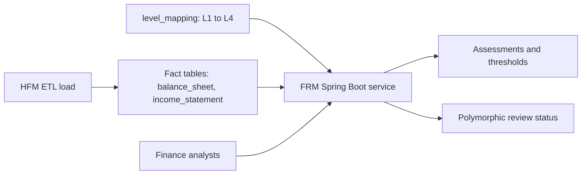
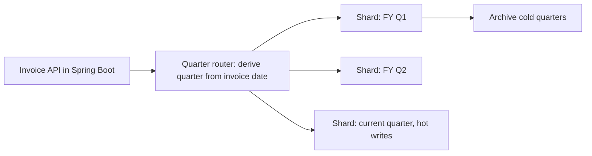

# PostgreSQL, MySQL, Redis and Spring Data JPA / Hibernate (plus MongoDB and Elasticsearch, briefly)

<div class="callout note">

**How to use this page**

- **What it covers:** the relational databases and cache on my resume, taught from scratch: transactions, indexes, locking, sharding, cache-aside and stampedes. It also covers the Java data layer (Spring Data JPA, Hibernate, JdbcTemplate, HikariCP, Spring Data Redis) and where I used each one: Uber FRM on MySQL, Masters India on sharded PostgreSQL with Redis, Impact Analytics' thin Postgres plus a Redis-fronted auth path, and GeeksforGeeks on MySQL, MongoDB, Redis and Elasticsearch.
- **When to read it:** before any database, data modelling or "design the schema" round, and before the FRM and Masters deep dives.
- **What to memorise:** FRM is an 8-table normalized MySQL schema on SOADB, with SHA-256 natural keys, optimistic row-locking through a JPA `@Version` field, and `@Transactional` cross-table syncs. The column-aliasing bug story and its fix (a JPQL query with an explicit, unique alias on every column, mapped into a typed projection). Masters is PostgreSQL sharded by tax quarter, reached through Hibernate and JdbcTemplate over HikariCP pools, with Redis cache-aside cutting read load 30%. At IA, Postgres keeps thin metadata, UAM and roles while ClickHouse holds the facts.

</div>

**Labels used on this page.** MEASURED means we have a log, doc or code for it. STATED means printed on the resume from the project source. ESTIMATED means arithmetic I can show. HISTORICAL means from my past work records. Verbal means true but off the resume.

<div class="callout warn">

**Say these carefully**

- **FRM schema is 8 tables** on the resume. 11 is the ORM entity count in code (verbal). Older prep said "11-table schema". Use 8.
- **100% is module statement coverage** for the FRM migration. It is not all of Uber Finance.
- **Led 3 engineers** is Uber FRM (tech lead of an EPAM pod, not people manager). **Mentored 2** is Masters India. Do not merge them.
- **30% is database read load**, not latency.
- The FRM real-time collaboration and Slack notification service was a **separate service** I did not build.
- Snippets are teaching sketches. Column, table and class names are illustrative unless stated.

</div>

---

## 1. Relational database ideas interviewers probe

A **relational database** stores data in tables of rows and columns, links tables with keys, and guarantees **transactions**. PostgreSQL and MySQL are the two most common open-source ones. Both are **OLTP** databases (Online Transaction Processing): many small, correct reads and writes. ClickHouse, by contrast, is built for big analytical scans (see [clickhouse.md](clickhouse.md)).

### 1.1 Transactions and ACID

A **transaction** groups statements so they all happen or none do. **ACID** stands for:

- **Atomic:** all or nothing. A bank transfer debits and credits together.
- **Consistent:** constraints hold before and after.
- **Isolated:** concurrent transactions don't see each other's half-done work.
- **Durable:** once committed, it survives a crash.

**Isolation levels** trade safety for concurrency: Read Committed (Postgres default), Repeatable Read (MySQL InnoDB default), Serializable (strictest).

### 1.2 Indexes

An **index** is a sorted lookup structure, usually a **B-tree**, that lets the database find rows without scanning the table. It is like the index at the back of a book. A **composite index** on `(client_id, invoice_date)` serves queries that filter by client and then by date range, but not queries that filter by date alone (the leftmost-prefix rule). Indexes speed reads and slow writes. Use `EXPLAIN` / `EXPLAIN ANALYZE` to see whether the planner uses them.

### 1.3 The N+1 query problem

Loading 100 invoices, then running one extra query per invoice for its client, is 1 + 100 queries. The fix is a join or a batched `IN (...)` query. ORMs make this easy to do by accident. In Hibernate the classic cause is a lazily loaded association touched inside a loop. The usual fix is a `join fetch` in the JPQL query or an entity graph.

### 1.4 Locking: pessimistic versus optimistic

- **Pessimistic locking** locks the row while you work on it (`SELECT ... FOR UPDATE`). It is safe, but others wait, and long locks cause contention.
- **Optimistic locking** does not lock. Each row has a `version` column. You update only if the version is still what you read, and bump it. If someone else changed it first, your update affects 0 rows and you retry or tell the user. Analogy: editing a shared document that warns "this was changed since you opened it".

```sql
-- Optimistic row-locking, the SQL underneath. Teaching sketch.
UPDATE scoping_assessment
SET status = 'Review', version = version + 1, updated_by = :email
WHERE uuid = :uuid AND version = :version_read;
-- 0 rows affected means someone else won: reload and retry.
```

In Java with JPA you rarely write that SQL by hand. Section 2.7 shows how a `@Version` field makes Hibernate write it for you.

### 1.5 Connection pooling

Opening a database connection is expensive (TCP, TLS, auth). A **pool** keeps a set of open connections and lends them out per request. Without pooling, a traffic spike becomes a connection storm. **HikariCP** is the connection pool Spring Boot uses by default: you set a maximum pool size and a connection timeout, and each request borrows a connection and returns it when done. At Masters, per-service HikariCP pools replaced PHP-FPM's per-request connections and were one of the causes of the latency win.

### 1.6 Partitioning versus sharding

- **Partitioning** splits one table into pieces inside one database (Postgres declarative `PARTITION BY RANGE`).
- **Sharding** splits data across separate tables, schemas or servers, with routing logic choosing where each row goes.

Both let you prune what a query touches and archive old data cheaply. Sharding also spreads write load, at the cost of routing complexity.

### 1.7 Natural keys versus surrogate keys

A **surrogate key** is an arbitrary id (auto-increment, random UUID). A **natural key** comes from the data itself. A **deterministic hashed natural key** computes the id from the identifying fields, so the same logical record always gets the same id, and re-imports cannot create duplicates.

---

## 2. MySQL at Uber FRM (Uber via EPAM)

### 2.1 The bullets

> Owned the Financial Risk Management scoping backend, reducing quarterly reconciliation time by **70%** (from **14 days to 3 days**) against a **$340M** materiality threshold. Engineered the Sheets-to-MySQL migration across **19M** raw GL rows, shipping **36 Spring Boot** endpoints to automate custom financial math and a nested 4-level FSLI (L1-L4) hierarchy with dynamic quarter-annualization.

> Resolved ETL pipeline lock contention during financial close by designing an **8-table normalized MySQL schema on Uber's SOADB** featuring a polymorphic review-status model. Guaranteed real-time, multi-user collaboration integrity by implementing optimistic row-locking, atomic cross-table syncs, and deterministic SHA-256 natural-key hashing to eliminate data duplication across quarterly audit trails.

> Led **3 engineers** in a core Spring Data JPA / Hibernate migration that eliminated latent column-aliasing bugs and raised module statement coverage to **100%**. Orchestrated zero-downtime releases via stacked Bazel PRs, embedding reporting SQL allowlists and automated FSM gates with **50%** delta-variance checks to enforce SOX compliance.

### 2.2 In plain words

Uber Finance used Google Sheets to decide each quarter which financial line items and entities were material enough to need audit testing. **FRM** is Financial Risk Management. A **GL** (general ledger) is the master record of accounting entries. An **FSLI** (Financial Statement Line Item) is one line on the balance sheet or income statement, organised in four levels, L1 (broadest) to L4 (most detailed). **SOADB** is Uber's service-owned MySQL standard. We moved the data and the math from Sheets into MySQL behind a Java Spring Boot service.

### 2.3 How the schema solved lock contention

During financial close, an ETL load and several analysts were writing at the same time. With wide, denormalised tables, the load and the analysts' edits fought over the same rows and locks. An **8-table normalized schema** separated the fact data (balance sheet and income statement rows) from mappings, assessments, thresholds and review status, so loads and edits touch different rows and tables.

Facts about the schema (verbal depth):

- Every table carries a fiscal period key (`fiscal_quarter`, `fiscal_year`) and audit columns (`created_at/by`, `updated_at/by`).
- Relationships are logical joins on `level_id` plus fiscal period, not database-level foreign keys. That matters for the bug story below.
- There are 11 JPA entity classes in code. The resume number is 8 tables.



*What to notice: the ETL writes facts while analysts mostly write assessments and review status, so the two stop fighting over the same rows.*

### 2.4 The polymorphic review-status model

One review-status model is reused across all eight screens (Reconciliation, Materiality, EMI Scoping, Group Scoping, Threshold Setup, Component Scoping, Residual Risk, Summary) instead of a status column per screen. The statuses are Draft, Review, ReOpen and Closed. The allowed moves between them form a **finite state machine (FSM)**, with automated gates such as the **50% delta-variance check**: a period-over-period change of 50% or more is flagged at a gate, supporting **SOX** (Sarbanes-Oxley) controls.

```text
Draft --submit--> Review --approve--> Closed
                    |                   |
                    +--reject--> Draft  +--reopen--> ReOpen --submit--> Review
(illustrative transitions)
```

In Java the statuses are a single enum shared by every entity that can be reviewed, stored as a string column with `@Enumerated(EnumType.STRING)`, and the service checks each transition against the allowed moves before saving.

### 2.5 Atomic cross-table syncs

Some edits must update two tables together. For example, patching an EMI "Total" also mirrors the amount into `balance_sheet` / `income_statement`, and updating benchmark metrics touches two benchmark tables. These run inside **one `@Transactional` service method**. `@Transactional` is a Spring annotation that means "run this whole method as one database transaction": Spring opens a transaction when the method starts, commits when it returns, and rolls back if it throws an unchecked exception. If the dependent sync affects zero rows, the method throws and the whole thing rolls back. No half-updated audit trail.

```java
// Teaching sketch.
@Transactional
public void patchEmiTotal(String uuid, BigDecimal amount, String email) {
    EmiLine line = emiRepo.findById(uuid).orElseThrow(NotFoundException::new);
    line.setTotal(amount);
    line.setUpdatedBy(email);                       // written at commit (dirty checking)
    int synced = balanceSheetRepo.mirrorAmount(line.getLevelId(), amount, email);
    if (synced == 0) {
        throw new SyncFailedException(uuid);        // unchecked, so Spring rolls back both writes
    }
}
```

*What to notice: both writes commit together or not at all. **Dirty checking** means Hibernate notices which loaded entities changed and writes them at commit, so there is no explicit `save` call for `line`.*

### 2.6 SHA-256 natural keys

Each quarter's import must not duplicate rows from the previous one. The uuid is computed deterministically, for example `uuid = SHA-256(question_text + normalized page_name)`. **SHA-256** turns any input into a fixed 64-character fingerprint, and the same input always gives the same fingerprint. Importing the same logical record twice gives the same key, and the upsert becomes a no-op.

```java
// Teaching sketch.
static String naturalKey(String questionText, String pageName) {
    String norm = pageName.strip().toLowerCase(Locale.ROOT);
    try {
        byte[] digest = MessageDigest.getInstance("SHA-256")
                .digest((questionText + "|" + norm).getBytes(StandardCharsets.UTF_8));
        return HexFormat.of().formatHex(digest);
    } catch (NoSuchAlgorithmException e) {
        throw new IllegalStateException(e);   // SHA-256 is always present in the JDK
    }
}
```

### 2.7 Optimistic row-locking with `@Version`

Several analysts can edit during close. Optimistic locking (section 1.4) means nobody holds long locks, and a stale edit is rejected rather than silently overwriting a colleague's change.

In JPA (the Java Persistence API, the standard for mapping Java classes to tables) you get this by adding a `@Version` field to the entity. Hibernate then adds `AND version = ?` and `version = version + 1` to every UPDATE it generates. If the row changed since you loaded it, zero rows match and Hibernate throws an optimistic-locking exception, which the API maps to **409 Conflict** so the user reloads.

```java
// Teaching sketch.
@Entity
@Table(name = "scoping_assessment")
public class ScopingAssessment {
    @Id
    private String uuid;
    @Enumerated(EnumType.STRING)
    private ReviewStatus status;
    private String updatedBy;
    @Version
    private long version;          // Hibernate checks and bumps this on every update
    // getters and setters omitted
}

@Transactional
public AssessmentDto submit(String uuid, long versionFromClient, String email) {
    ScopingAssessment a = repo.findById(uuid).orElseThrow(NotFoundException::new);
    if (a.getVersion() != versionFromClient) {
        throw new StaleVersionException(uuid);      // mapped to 409
    }
    a.setStatus(ReviewStatus.REVIEW);
    a.setUpdatedBy(email);
    return AssessmentDto.from(a);   // at commit: UPDATE ... WHERE uuid = ? AND version = ?
}
```

*What to notice: the service compares the version the browser saw with the one it loaded. Hibernate's own check at commit catches the race where someone else writes in between.*

Say this carefully if pressed on the real-time side: the real-time collaboration and notification service was a separate service I did not build. Older prep notes that the version-check layer for real-time sync lives partly in that collaboration service and the client, so keep your detailed claims to the scoping service's transactional, per-uuid writes.

### 2.8 The numbers

| Number | Meaning | Tag |
|---|---|---|
| 70%, from 14 days to 3 days | Quarterly reconciliation time | STATED. The technical design doc framed that cut and the platform delivered it for the close. (14 - 3) / 14 is about 79%, so 70% is the conservative figure |
| $340M | Group materiality threshold on the Q4 2025 close. It is a threshold, not a volume | MEASURED (config row) |
| 19M | Raw GL rows migrated off Sheets | STATED. Per-quarter extracts were about 38K to 95K rows. The value was correctness, hierarchy and auditability, not big-data throughput |
| 36 endpoints | Spring Boot endpoints: about 31 functional routes in the scoping service plus the collaboration-service APIs from the design doc | MEASURED |
| 8 tables | Normalized schema on SOADB | MEASURED |
| 100% | Module statement coverage after the Spring Data JPA / Hibernate migration. 1,100+ tests (verbal) | STATED |
| 50% | Delta-variance threshold at FSM gates | STATED |

---

## 3. Spring Data JPA, Hibernate and the column-aliasing bug

### 3.1 What these are

- **JPA** (Jakarta Persistence API) is the Java standard for mapping classes to tables. It is a specification, a set of annotations and interfaces, not a library you run.
- **Hibernate** is the most widely used JPA implementation. It turns entity changes into SQL, tracks which loaded objects changed (dirty checking), and handles `@Version` checks. An **ORM** (Object-Relational Mapper) like Hibernate lets you work with objects instead of raw SQL strings. Analogy: a translator who speaks both Java and SQL, so you talk in objects and it writes the SQL.
- **Spring Data JPA** sits on top. You declare a repository interface, and Spring generates the implementation: `findById`, `save`, and query methods derived from names like `findByFiscalQuarterAndFiscalYear`. For anything more complex you write **JPQL**, a SQL-like language that talks about entities and fields instead of tables and columns.
- An **entity** is a class marked `@Entity` that maps to a table. A **projection** is a query that returns only some columns into a small typed result instead of whole entities. Spring Data maps each result column to a projection getter **by its alias**, which is why aliases matter in the bug story.

```java
// Teaching sketch.
@Entity
@Table(name = "level_mapping")
public class LevelMapping {
    @Id
    private String uuid;
    private String levelId;
    private String fiscalQuarter;
    private int fiscalYear;
}

public interface LevelMappingRepository extends JpaRepository<LevelMapping, String> {
    List<LevelMapping> findByFiscalQuarterAndFiscalYear(String quarter, int year);
}
```

*What to notice: the repository is just an interface. Spring writes the query from the method name.*

### 3.2 The bug (tell this precisely)

The legacy read path ran raw SQL through JDBC and built each result row into a map keyed by column label. That is only safe when column names are unique. The component aggregate **joined the fact table to `level_mapping`**, and both had columns named `uuid`, `level_id`, `fiscal_quarter` and `fiscal_year`. The result had two columns literally labelled `uuid`. The loop walked columns by position, and `Map.put` with a key that already exists replaces the old value, so each row silently kept the **last** one: the `level_mapping` uuid instead of the fact uuid.

Symptom: rows looked right on screen, but a PATCH by uuid or a comment pointed at the wrong line. It surfaced when editing one reconciliation line appeared to change a different line.

```java
// Before: silent collision. Two columns labelled "uuid", the last one wins.
for (int c = 1; c <= meta.getColumnCount(); c++) {
    row.put(meta.getColumnLabel(c), rs.getObject(c));
}
```

```java
// After: JPQL with an explicit, unique alias on every column, mapped to a typed projection.
public interface ComponentRow {
    String getFsliId();
    String getLevelMappingUuid();
    String getFactQuarter();
}

@Query("""
    select min(i.uuid)          as fsliId,
           max(lm.uuid)         as levelMappingUuid,
           max(i.fiscalQuarter) as factQuarter
    from ComponentEntity i
    join LevelMapping lm on lm.levelId = i.levelId and lm.fiscalQuarter = i.fiscalQuarter
    where i.fiscalQuarter = :quarter and i.fiscalYear = :year
    group by lm.level1
    """)
List<ComponentRow> findComponentRows(@Param("quarter") String quarter, @Param("year") int year);
```

*What to notice: with explicit aliases, no two result columns can share a name, and each value lands in its own typed getter.*

### 3.3 Leading the migration

- **Led 3 engineers** as tech lead of the EPAM pod. Work was sliced along controller, service, repository and entity layers, so two people could build one feature without merge collisions.
- **Transaction discipline:** `@Transactional` on service methods replaced hand-written commit and rollback code in every repository. Short, single-purpose transactions also kept locks short during close.
- **Thread model:** Spring Boot's servlet stack serves each request on its own thread from a pool, so blocking JDBC calls are normal and need no special offloading.
- **Stacked Bazel PRs:** small dependent PRs, each passing Bazel test targets per layer (JUnit 5 with Mockito, and MockMvc for controllers), so the migration shipped in steps with zero downtime.
- **Reporting SQL allowlists:** only known, reviewed reporting queries may run.
- **Defences against double-counting:** a parent-equals-sum-of-children invariant in the test plan, an explicit alias on every projected column, and active-flag filters so stale rows drop out.

### 3.4 Alternatives and trade-offs

- *Keep raw SQL and just fix the one query.* Fixes the symptom, not the class of bug.
- *MyBatis or jOOQ.* More direct control over SQL, but no built-in `@Version` checks or dirty checking, and the platform's Spring conventions already pointed at JPA.
- *Trade-off:* migrating every query is slow work, and an ORM can hide what SQL runs. That is why coverage had to reach 100% on the module, to prove nothing regressed, and why we kept explicit aliases even inside JPQL.

---

## 4. PostgreSQL at Masters India: sharded by tax quarter

> Architected a high-concurrency bulk e-invoicing pipeline processing **1M+** daily government submissions by orchestrating a Kafka event bus and a **PostgreSQL** database horizontally sharded by tax quarter. Enforced exactly-once, idempotent processing for **100K+** concurrent imports with fault-tolerant state management via dead-letter queues and bounded retries against volatile state IRP portals.

### 4.1 Why shard by tax quarter

Indian GST (Goods and Services Tax) reporting is quarter-scoped and deadline-driven. Writes concentrate in the current quarter. Older quarters are mostly read for reconciliation and audits. Separate per-quarter tables or schemas:

- keep the hot write set and its indexes small,
- let us archive or prune a whole cold quarter without touching the hot one,
- give clear runbooks ("Q3 is frozen").



*What to notice: routing happens in application code, from the invoice date, before any write.*

- **Trade-off versus native partitioning:** we owned routing in application code, which is more moving parts than Postgres declarative partitions, in exchange for explicit control over archiving whole quarters.
- **The main risk:** a write going to the wrong quarter. We derived the quarter from the invoice date at the API boundary and rejected mismatches.
- **In Spring terms:** if quarters are separate tables, the repository picks the table name from the derived quarter. If they are separate schemas, Spring's `AbstractRoutingDataSource` does the same job one level down: the service sets the quarter for the current call and the routing data source hands Hibernate a connection to that quarter's schema. Either shape is an illustration of "routing in application code".

### 4.2 How the services talked to PostgreSQL

- **Hibernate entities** for normal reads and writes of invoices, clients and import batches.
- **JdbcTemplate** for hot paths that are one SQL statement, such as the idempotency claim below and bulk inserts. `JdbcTemplate` (and `NamedParameterJdbcTemplate`) is Spring's thin helper for running plain SQL with parameters, without loading entities.
- **HikariCP** pools per service, so no request pays for opening a connection.

### 4.3 Idempotency in the database

Each import chunk carries an idempotency key like `client + fileHash + batchIndex`. A unique constraint on it means a re-delivered Kafka message cannot create a second registration. Duplicate registration with the government is a compliance problem, not just a data bug.

```java
// Teaching sketch. Returns true only for the first delivery of this chunk.
boolean claim(String idemKey, long clientId) {
    int inserted = jdbc.update("""
        INSERT INTO import_batches (idem_key, client_id, status)
        VALUES (:k, :client, 'processing')
        ON CONFLICT (idem_key) DO NOTHING
        """, Map.of("k", idemKey, "client", clientId));
    return inserted == 1;          // 0 means already seen: skip
}
```

*What to notice: the database's unique constraint is the referee. Two consumers racing on the same chunk cannot both win.*

### 4.4 Where the latency win came from

p95 went from 1.2 seconds to 300 milliseconds (HISTORICAL) across 1,500+ clients during the PHP-to-Spring Boot migration. The database-related causes: per-service HikariCP connection pooling, composite indexes such as `(client_id, invoice_date)`, removing N+1 list queries, and pagination. Moving slow IRP calls off the request path into Kafka consumers and Redis for reads were the other causes.

---

## 5. PostgreSQL at Impact Analytics: thin metadata

Planner pivots were slow on PostgreSQL, and POCs showed ClickHouse winning large analytical reads. Postgres stayed for what it is good at: thin metadata, **UAM** (User Access Management), roles, and single-row writes. The Go auth waterfall resolves roles and hierarchy scope from Postgres (see [auth_tenancy_rate_limits.md](auth_tenancy_rate_limits.md)). The same tenant id exists in both stores.

---

## 6. Redis

### 6.1 What Redis is

**Redis** is an in-memory key-value store. Reads and writes take well under a millisecond because data lives in RAM. It has rich data types (strings, hashes, lists, sets, sorted sets), **TTLs** (keys that expire automatically) and atomic operations such as `INCR` and `SET NX`. It is used for caching, counters, rate limiting, sessions and locks.

### 6.2 Cache-aside

**Cache-aside** means the application checks the cache first. On a miss it reads the database, stores the result with a TTL, and returns it. On a write, it updates the database and deletes the cache key.

At Masters this ran through **Spring Data Redis**, Spring's Redis integration. `StringRedisTemplate` is its ready-made client for string keys and values.

```java
// Teaching sketch. TTL values are illustrative.
public ClientConfig get(long clientId) {
    String key = "cfg:" + clientId;
    String hit = redis.opsForValue().get(key);
    if (hit != null) {
        return json.readValue(hit, ClientConfig.class);
    }
    ClientConfig cfg = db.findClientConfig(clientId);
    long ttl = 300 + ThreadLocalRandom.current().nextInt(61);     // TTL with jitter
    redis.opsForValue().set(key, json.writeValueAsString(cfg), Duration.ofSeconds(ttl));
    return cfg;
}

@Transactional
public void update(long clientId, ClientConfig cfg) {
    db.saveClientConfig(clientId, cfg);
    redis.delete("cfg:" + clientId);                              // invalidate on write
}
```

For slow-changing reference data such as tax-rate masters, Spring's cache annotations are simpler. `@Cacheable` means "look in the cache first and only run this method on a miss". Backed by a Redis cache manager with a TTL, it is cache-aside in one line:

```java
@Cacheable(cacheNames = "taxRates", key = "#hsnCode")
public TaxRate rateFor(String hsnCode) {
    return taxRateRepo.findByHsnCode(hsnCode);
}
```

### 6.3 Cache stampede

A **stampede** (thundering herd) is when a hot key expires and hundreds of requests miss at once and all hit the database. Guards:

- **TTL jitter**, so keys don't all expire together.
- **A short lock** (`SET key:lock 1 NX EX 5`), so one worker recomputes while others wait briefly or serve slightly stale data. In Spring Data Redis that is `setIfAbsent(lockKey, "1", Duration.ofSeconds(5))`.

### 6.4 Where I used Redis

| Project | Use | Number |
|---|---|---|
| Masters India | Cache-aside through Spring Data Redis for client config, feature flags, GSTIN master lookups, tax-rate masters, and IRP auth tokens (TTL under the token's life). Invalidate on write for config. TTL with jitter for slow-changing masters | Database read load down **30%** (HISTORICAL) |
| Impact Analytics | Front cache of the Go auth waterfall, so verified identities are not re-verified on every request. A miss falls through to real verification | No number on the resume |
| GeeksforGeeks | Vote counters and unread counts for display, reconciled to MySQL asynchronously to avoid hot-row contention | Part of the 10K+ daily queries story |

Why 30% fewer reads is plausible at Masters: the same client config and GSTIN validation ran for every invoice in a bulk import. Caching those across a 100K-row import removes a huge amount of duplicate reading. Caching mostly helped p50 and read-heavy endpoints. Moving IRP calls off the request path and query fixes drove the p95 tail.

### 6.5 Alternatives

- *Memcached:* simpler and very fast, but no rich types, persistence options or atomic data structures.
- *An in-process cache (for example Caffeine in Java):* fastest, but each instance has its own copy and invalidation across instances is hard.
- *No cache, just more database replicas:* moves the load around without removing duplicate reads.

---

## 7. MongoDB and Elasticsearch, briefly

- **MongoDB** is a document database that stores flexible JSON-like documents. At Masters it held invoice payload snapshots and signed IRP responses, whose shape varied. At GeeksforGeeks it held doubt bodies and attachments with varying structure.
- **Elasticsearch** is a search engine built on inverted indexes (a map from each word to the documents containing it). At Masters it powered invoice search and was the storage of the ELK logging stack. At GeeksforGeeks it powered search across doubts and content.

More depth: [../../../prep/02_mongodb_elasticsearch.md](../../../prep/02_mongodb_elasticsearch.md).

---

## 8. Interview questions with speakable answers

**Q1. Walk me through your FRM schema design.**
It was an 8-table normalized MySQL schema on SOADB, Uber's service-owned MySQL standard. Fact tables hold the balance sheet and income statement lines, separate from level mappings, assessments, thresholds and review status. Every table carries the fiscal period and audit columns. Normalizing meant the close-time ETL load and analysts' edits stopped fighting over the same rows, which is how it resolved lock contention. SHA-256 natural keys stopped duplicates across quarters, and one polymorphic review-status model served all eight screens.

**Q2. Tell me about the column-aliasing bug.**
The legacy code ran raw SQL through JDBC and built each row into a map keyed by column label. A join between the fact table and `level_mapping` returned two columns both labelled `uuid`, and the map kept the last one. So rows silently carried the mapping's uuid instead of the fact's. It surfaced when editing one reconciliation line seemed to change another. The fix was moving reads to Spring Data JPA queries with an explicit, unique alias on every column, mapped into typed projections, so values can't collide. We raised the module's statement coverage to 100% to prove nothing else regressed.

**Q3. Optimistic or pessimistic locking, and why?**
Optimistic, for analyst edits during close. Edits are short and conflicts are rare, so holding locks would only create contention with the ETL. With a JPA `@Version` field, Hibernate only updates the row if the version still matches, so a stale edit is rejected with a 409 instead of silently overwriting a colleague's work. Pessimistic locking makes sense when conflicts are frequent and retries are expensive.
*Follow-up they may ask:* "What does `@Transactional` do if you call the method from inside the same class?" Nothing. Spring applies it through a proxy around the bean, and a call from inside the same object skips the proxy. So transactional methods live on the service and are called from the controller.

**Q4. Why shard Postgres by tax quarter?**
GST work is quarter-scoped. Writes land in the current quarter, while old quarters are mostly read for reconciliation and audits. Per-quarter shards keep the hot write set and its indexes small and let us archive a whole cold quarter safely. The trade-off is that routing lived in our code, so the risk was a write going to the wrong quarter. We derived the quarter from the invoice date at the API boundary and rejected mismatches.

**Q5. How did Redis cut read load 30% at Masters?**
Cache-aside through Spring Data Redis on hot, repeated reads: client config, feature flags, GSTIN masters, tax rates and IRP auth tokens. In a 100K-row import the same lookups ran for every invoice, so caching them removed most of the duplicates. Config keys were invalidated on write, and slow-changing masters used TTL with jitter or `@Cacheable`. A short `SET NX` lock prevented stampedes.

**Q6. How do you invalidate a cache correctly?**
Write to the database first, then delete the key, so the next read refills it from the truth. Don't update the cache in place, because racing writers can leave stale values. Add TTLs as a safety net, and jitter them. For data where staleness is dangerous, such as credentials, use short TTLs that stay below the real lifetime.

**Q7. How do you find a slow query?**
Start from the slow endpoint in tracing, find the query, and run `EXPLAIN ANALYZE`. Look for sequential scans on big tables, bad row estimates and sorts spilling to disk. In a Hibernate service, also turn on SQL logging for that path to catch N+1 patterns from lazy loading. Common fixes from my work: a composite index matching the filter order, a join or `IN` batch instead of N+1, and pagination on list endpoints.

**Q8. PostgreSQL or MySQL?**
Both are solid OLTP databases, and the choice is usually the platform standard. At Uber it was MySQL because SOADB is the service-owned standard. At Masters it was Postgres. Postgres has richer SQL features, extensions like pgvector, and native declarative partitioning. MySQL InnoDB is very well understood for high-volume simple OLTP. I design for transactions, indexes and keys either way, and JPA keeps the Java code largely the same on both.

**Q9. Why Spring Data JPA and Hibernate at FRM instead of plain JDBC?**
Plain JDBC with maps keyed by column name is what caused the aliasing bug. With entities and typed projections, each value lands in a named, typed field. `@Version` gave optimistic locking without hand-written SQL, and `@Transactional` gave one consistent way to make cross-table writes atomic. The cost is that an ORM can hide the SQL it runs, so we kept explicit aliases, reviewed reporting queries against an allowlist, and tested every layer.

---

## Related

- [clickhouse.md](clickhouse.md) for why analytics moved off Postgres at IA
- [python_fastapi.md](python_fastapi.md) for the Python services and the Spring equivalents table
- [kafka_streaming.md](kafka_streaming.md) for the Masters bus and Spring Kafka
- [auth_tenancy_rate_limits.md](auth_tenancy_rate_limits.md)
- [../../../handbook/05_uber_frm.md](../../../handbook/05_uber_frm.md) and [../../../handbook/07_masters_india.md](../../../handbook/07_masters_india.md)
- [../architecture/02_uber_frm.md](../architecture/02_uber_frm.md)
- [../architecture/04_masters_gst.md](../architecture/04_masters_gst.md)
