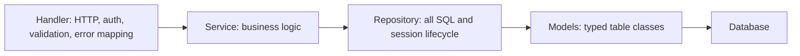

# Python, FastAPI, Pydantic, asyncio, Celery (and Django)

<div class="callout note">

**How to use this page**

- **What it covers:** Python as a backend language (the GIL, async versus threads), how FastAPI and Pydantic work, Celery and asyncio as skills, and Django briefly. Then where I used Python on this resume: the Impact Analytics agent plane (the Ask Iris WebSocket and the Keep/Drop batch pipeline), Uber Menu's Python services, and GeeksforGeeks on Django.
- **When to read it:** before any Python backend or AI-engineering round, and before the IA Agentic deep dive.
- **What to memorise:** at IA the platform is Go and the agent plane is Python. Ask Iris is a FastAPI WebSocket that verifies a JWT on the handshake, freezes `plan_scope`, and runs a LangGraph supervisor with a 3-attempt evaluator. Uber Menu's scrapers and RAG extraction were Python. GeeksforGeeks moved from PHP to Django. Uber FRM and Masters India are Java and Spring Boot services on this resume (section 4 points to that material).

</div>

**Labels used on this page.** MEASURED means we have a log, doc or code for it. STATED means printed on the resume from the project source. ESTIMATED means arithmetic I can show. HISTORICAL means from my past work records. Verbal means true but off the resume.

<div class="callout warn">

**Say these carefully**

- **IA platform APIs are Go/Gin.** Python at IA is the agent plane: the Keep/Drop batch pipeline and Ask Iris (FastAPI WebSocket plus LangGraph). Older prep said "FastAPI hosts LangGraph/MCP agent chat endpoints". Drop "MCP", which is skills-level.
- **FastAPI on this resume means Impact Analytics' agent plane.** Uber FRM (36 Spring Boot endpoints) and Masters India (PHP monolith to Spring Boot microservices) are Java services. Do not describe them as FastAPI.
- **Celery and asyncio are skills-line items.** No resume bullet names them. Explain them well, but don't attach them to a project outcome.
- **Ask Iris is a shipped capability with no SLA or usage numbers.** Don't invent any.
- Snippets are teaching sketches, not company code.

</div>

---

## 1. Python for backends, in plain English

Python is a high-level, dynamically typed language with a huge ecosystem. For backends its strengths are speed of development, readable code, and the best libraries for data and AI work. Its weakness is raw CPU speed and the GIL.

### 1.1 The GIL

The **GIL** (Global Interpreter Lock) in CPython means only one thread runs Python bytecode at a time inside one process. Think of a kitchen with one knife: several cooks can be in the kitchen, but only one can chop at a time.

- For **I/O-bound** work (waiting on databases, HTTP calls, LLM APIs), the GIL is released while waiting, so threads and async work well.
- For **CPU-bound** work (heavy number crunching in pure Python), threads don't help. You use multiple processes, native libraries (NumPy) or another language.

That is part of why IA's high-RPS platform is Go while the LLM-heavy agent plane is Python. The agent plane mostly waits on model APIs.

### 1.2 asyncio

**asyncio** is Python's built-in framework for cooperative concurrency. An `async def` function can `await` a slow operation, and while it waits the **event loop** runs other tasks. One thread can juggle thousands of waiting network calls. Analogy: a waiter who takes an order, hands it to the kitchen, and serves other tables instead of standing at the kitchen door.

The main rule: **never block the event loop.** A synchronous database call or `time.sleep` inside an `async def` freezes every other request on that worker. Offload blocking work with `await asyncio.to_thread(fn)` or use an async driver.

```python
# Teaching sketch, generic.
async def fetch_all(client, urls, store):
    pages = await asyncio.gather(*(client.get(u, timeout=10) for u in urls))  # concurrent I/O
    await asyncio.to_thread(store.save_many, pages)   # sync DB call off the event loop
    return pages
```

*What to notice: `gather` runs the waits side by side, and `to_thread` keeps the one blocking call from freezing the loop.*

### 1.3 Typing

Python type hints (`def f(x: int) -> str`) are not enforced at runtime by Python itself, but tools such as mypy check them, and frameworks such as Pydantic and FastAPI **use them at runtime** to validate data.

---

## 2. FastAPI and Pydantic

### 2.1 What they are

**FastAPI** is a modern Python web framework built on **Starlette** (the async web toolkit) and **Pydantic** (data validation). It runs on an **ASGI** server such as Uvicorn. **ASGI** (Asynchronous Server Gateway Interface) is the async successor to WSGI and supports async handlers and WebSockets.

**Pydantic** turns type-annotated classes into validators. Incoming JSON is parsed into a typed object or rejected with a clear 422 error. The same idea validates LLM output: you describe the shape you expect, and anything else is rejected.

### 2.2 The ideas interviewers probe

```python
# Teaching sketch of a FastAPI route. Names are generic.
class ScenarioRequest(BaseModel):
    season_code: str = Field(min_length=1)
    max_items: int = Field(gt=0, le=1000)

def get_claims(request: Request) -> dict:
    claims = verify_jwt(request.headers.get("authorization"))
    if claims is None:
        raise HTTPException(status_code=401)
    return claims

@router.post("/scenarios", response_model=ScenarioOut)
async def create_scenario(body: ScenarioRequest,
                          claims: dict = Depends(get_claims),
                          svc: ScenarioService = Depends(get_service)):
    return await svc.create(body, tenant=claims["tenant_id"])
```

- **Validation from types.** `ScenarioRequest` rejects an empty season or a negative item count before your code runs.
- **Dependency injection with `Depends`.** Auth, database sessions and services are injected per request, and tests can override them with `app.dependency_overrides`.
- **Automatic OpenAPI docs.** Every route's schema is published at `/docs`.
- **`async def` versus `def`.** FastAPI runs `async def` handlers on the event loop and plain `def` handlers in a thread pool. Mixing them wrongly (sync I/O inside `async def`) is the most common performance bug.
- **WebSockets** are first-class, which is how Ask Iris is served.

### 2.3 Layering I use in any service



*What to notice: dependencies point one way, so each layer can be unit tested with the layer below mocked.*

- **Handlers** stay thin: HTTP, auth, parameter validation, mapping errors to status codes.
- **Services** own orchestration and business rules.
- **Repositories** own every query and the session: open, commit on success, roll back on any exception, close at the end.
- **Models** hold column definitions.

This is framework-neutral. The Uber FRM service used the same shape in Spring Boot (controller, service, repository, entity). See section 4.

---

## 3. Where I used Python and FastAPI

### 3.1 Impact Analytics: the Python agent plane

> Shipped "Ask Iris," a JWT-secured WebSocket copilot enabling planners to interactively query KPIs and inspect AI decisions on a multi-billion-row database. Prevented infinite LLM loops and multi-tenant data leaks by orchestrating a **LangGraph** supervisor with a 3-attempt evaluator loop, utilizing **LangSmith** for observability, and strictly freezing hierarchy access on the initial socket handshake.

**In plain words:** Impact Analytics has two halves. The **platform** is a Go/Gin API that serves planner screens at up to 10k peak RPS. The **agent plane** is Python, because the LLM libraries (LangGraph, provider SDKs, Pydantic schemas for structured output) are strongest there and the work mostly waits on model APIs.

- **Ask Iris** is a FastAPI WebSocket endpoint. A **WebSocket** is a long-lived, two-way connection, which suits a chat copilot. The handler verifies the JWT on the handshake, computes `plan_scope` once and freezes it for the life of the socket, then runs a LangGraph supervisor whose evaluator loop stops after 3 attempts (`MAX_ATTEMPTS = 3`). LangSmith traces each run.
- **Keep/Drop, Missed Opportunities and Top Style** run as a Python batch pipeline: deterministic KPI math, structured LLM lens calls validated against schemas, blending, durable checkpoints (`det.json`, `agent_progress.json`, `--resume`) and JSON telemetry. The step order is fixed, with no LLM orchestrator. See [langgraph_mcp_rag.md](langgraph_mcp_rag.md).

```python
# Teaching sketch (FastAPI WebSocket).
@app.websocket("/ask-iris")
async def ask_iris(ws: WebSocket):
    claims = verify_jwt(ws.headers.get("authorization") or ws.query_params.get("token"))
    if claims is None:
        await ws.close(code=4401)
        return
    plan_scope = resolve_scope(claims)          # computed once, frozen
    await ws.accept()
    while True:
        question = await ws.receive_text()
        answer = await graph.ainvoke({"q": question, "scope": plan_scope})
        await ws.send_json(answer)
```

*What to notice: the scope is read once from the verified token. Nothing the user types later is used to widen it.*

**Why FastAPI here:** WebSockets are built in, handlers are async (one worker can hold many idle chat sockets), and it is the same language as LangGraph, so there is no extra hop between the socket and the graph.

### 3.2 Uber Menu: Python services (Uber via EPAM)

The Selenium scrapers and the LangChain RAG extraction with Gemini 2.5 Pro over Milvus were Python services on GCP. Python was the natural choice because Selenium's richest bindings, LangChain and the Gemini SDK all live there. See [selenium_scraping.md](selenium_scraping.md) and [langgraph_mcp_rag.md](langgraph_mcp_rag.md).

### 3.3 GeeksforGeeks: Django

> Stabilized the doubt-support platform to handle **10K+** daily queries and **10x** traffic spikes during live coding contests by migrating the backend to **Django**. Engineered high-throughput REST APIs for voting, pinning, and locking threads utilizing MySQL, MongoDB, Redis, and Elasticsearch, driving a **20%** lift in premium subscriptions.

**Django** is a "batteries included" Python web framework: ORM, admin, auth, forms and migrations out of the box. Django REST Framework (DRF) adds API tooling. We rebuilt the PHP doubt platform incrementally, page by page, behind the same URLs. Reliability came from ORM-managed transactions, request validation and separating reads from writes. Votes used a unique (user, content) constraint, so double-submitting is idempotent, with Redis counters for display.

10K+ a day averages about 0.1 per second, so the engineering challenge was the 10x contest spikes, not the average.

**Why Django at GFG and FastAPI for Ask Iris?** In 2021 GFG was a CMS-style product that benefited from Django's admin, auth and ORM. Ask Iris is a small async service whose main job is holding WebSockets and calling a LangGraph graph, which FastAPI does natively with almost no framework weight.

### 3.4 Celery and asyncio: skills-level

Both are on my skills line. Neither is named in a resume bullet, so I explain them as skills, not as project outcomes.

**Celery** is a Python distributed task queue. Your code enqueues a task onto a **broker** (such as Redis or RabbitMQ), and worker processes pick it up and run it, with retries, rate limits and scheduling. Think of a ticket rail in a kitchen: the waiter clips tickets, cooks take them in turn.

```python
# Teaching sketch, generic.
@app.task(bind=True, max_retries=5, rate_limit="50/s")   # illustrative values
def send_report(self, idem_key, payload):
    if already_done(idem_key):
        return
    try:
        mailer.send(payload)
    except TemporaryError as exc:
        raise self.retry(exc=exc, countdown=2 ** self.request.retries)
```

*What to notice: the idempotency check makes a retried task safe, and the countdown doubles on each retry (exponential backoff).*

**Celery or Kafka?** Celery is for "run this job, retry it, rate-limit it". Kafka is for "keep this ordered stream, let several consumers read it, replay it later". See [kafka_streaming.md](kafka_streaming.md) for Kafka on this resume.

The GeeksforGeeks bullet mentions "asynchronous scheduled workflows" for video processing, reminders and cleanup. The resume does not name the tool behind them, so if asked, describe the pattern (scheduled background jobs with retries) and only name a tool you are sure of.

---

## 4. On this resume, the Java services

Two projects on this resume are Java and Spring Boot, not Python. Their depth lives on other pages. Here is the short map so you don't mix them up.

**Spring Boot in one paragraph.** Spring is the most widely used Java framework for backend services. Its core is a **container** that creates your objects (called **beans**) and passes each one the other objects it needs, which is **dependency injection**. **Spring Boot** is Spring with sensible defaults and an embedded web server, so a service starts with one `main` method. A controller class marked `@RestController` turns methods into HTTP endpoints. Analogy: Spring is a stage manager who builds the set and hands every actor their props before the curtain rises, so actors (your classes) never fetch props themselves.

| Project | What it is on this resume | Where to read |
|---|---|---|
| **Uber FRM** (Uber via EPAM) | 36 Spring Boot endpoints over an 8-table MySQL schema on SOADB. Led 3 engineers on a Spring Data JPA / Hibernate migration that removed column-aliasing bugs and reached 100% module statement coverage | [postgres_mysql_redis.md](postgres_mysql_redis.md), [../../../handbook/05_uber_frm.md](../../../handbook/05_uber_frm.md) |
| **Masters India** | PHP monolith to Spring Boot microservices. p95 from 1.2 seconds to 300 milliseconds, throughput from 700 to 4,000 requests per minute, mentored 2 engineers. Spring Kafka consumers for the 1M+ a day IRP pipeline | [kafka_streaming.md](kafka_streaming.md), [postgres_mysql_redis.md](postgres_mysql_redis.md), [../../../handbook/07_masters_india.md](../../../handbook/07_masters_india.md) |

Remember for Masters: the latency win came from moving slow IRP calls off the request path into Kafka consumers, HikariCP connection pooling, query and index fixes, and Redis cache-aside for reads. It was not "the framework is fast".

**Python idea and its Spring counterpart** (useful when an interviewer compares them):

| Python / FastAPI | Spring Boot equivalent |
|---|---|
| Pydantic request model | DTO class with Bean Validation (`@Valid`, `@NotNull`) |
| `Depends(...)` injection | Constructor injection by the Spring container |
| Router function with `@router.patch` | `@RestController` method with `@PatchMapping` |
| SQLAlchemy session and commit | Spring Data JPA repository plus `@Transactional` service method |
| `async def` on an event loop | Thread-per-request servlet model, or WebClient for non-blocking HTTP |
| Celery task | Kafka consumer (`@KafkaListener`), `@Async` method, `@Scheduled` job or Spring Batch step |
| pytest with `TestClient` | JUnit 5 with Mockito and MockMvc |

Per-technology entries for Java, Spring Boot, Spring MVC, Spring Security, Spring Data JPA, Hibernate, Spring Batch, Spring Kafka, Maven and JUnit are in [../../../handbook/09_tech_glossary.md](../../../handbook/09_tech_glossary.md).

---

## 5. Design decisions

### Python for the agent plane, Go for the platform (IA)

- **What:** the Go/Gin platform serves planner screens and APIs. The Python agent plane runs Keep/Drop batches and Ask Iris.
- **Why:** the LLM ecosystem is strongest in Python, and agent work waits on model APIs, so the GIL barely matters. The platform needs predictable latency at 10k peak RPS, where Go's goroutines and memory profile shine.
- **Alternatives and why not:**
  - *Everything in Python.* Simpler stack, but a high-RPS analytical edge is where Python's per-request overhead and the GIL show up.
  - *Everything in Go.* Go LLM libraries are thinner, so we would rebuild what LangGraph and the provider SDKs give for free.
- **Trade-off:** two languages and two identity code paths to keep consistent. The fix is one identity contract (same claims, same tenant binding) in both.
- **What I'd do differently:** write that identity contract down as a shared spec with tests on both sides from day one.

### FastAPI for Ask Iris

- **Why:** native WebSockets, async handlers that hold many idle sockets cheaply, Pydantic validation, and no language hop to LangGraph.
- **Alternatives and why not:** *Django Channels* brings Django's weight for a service that needs none of its batteries. *A Go WebSocket server calling a Python graph* adds a network hop and a second deployment for no gain at this point.
- **Trade-off:** you must be disciplined about blocking calls inside async code.

### When I'd pick Spring Boot, FastAPI or Go for a new service

- **Spring Boot:** a large, long-lived business service with many entities, transactions and integrations, and a team that values strong typing and a standard structure. That is the FRM and Masters profile.
- **FastAPI:** an AI or data service that lives next to Python libraries, or a small async service.
- **Go:** a hot, latency-critical edge at high RPS with stable, deterministic logic.

---

## 6. Failure modes

| Failure | Symptom | Guard |
|---|---|---|
| Blocking call inside `async def` | Latency spikes for every request or socket on the worker | Async drivers or `asyncio.to_thread`. Lint for it in review |
| Fat handlers | Business logic untestable without HTTP | Handler, service and repository layering |
| Pydantic models drifting from the real data | 500s or silent field loss | Response models, contract tests, schema changes reviewed together |
| LLM call hangs or provider fails | A batch stalls or burns money | Hard timeouts, circuit breakers, deterministic fallback score (IA A2 and A3) |
| Agent loops forever | Token cost climbs, user waits | Evaluator capped at 3 attempts plus a graph recursion limit (Ask Iris) |
| Scope changes mid-conversation | Cross-tenant leak risk | Freeze `plan_scope` at the WebSocket handshake |
| Unbounded retries | Retry storms against a fragile dependency | Bounded retries with exponential backoff and jitter |

---

## 7. Interview questions with speakable answers

**Q1. Why is the IA agent plane Python when the platform is Go?**
Different jobs. The platform is a high-concurrency HTTP edge at up to 10k requests per second at peak, where Go gives cheap goroutines and predictable latency. The agent plane mostly waits on LLM APIs and needs LangGraph and the provider SDKs, which are strongest in Python. Keeping deterministic platform logic in Go and non-deterministic LLM work in Python also keeps each blast radius clear.

**Q2. How is Ask Iris served?**
It's a FastAPI WebSocket endpoint. On the handshake it verifies the JWT, computes the planner's hierarchy scope and freezes it for the life of the socket. Each question runs through a LangGraph supervisor with an evaluator that stops after three attempts, and LangSmith traces every run. Because the scope is frozen, nothing typed later can widen access to another tenant's data.
*Follow-up they may ask:* "What usage does it get?" It's a shipped capability. I don't quote usage or latency numbers for it.

**Q3. `async def` or `def` for a FastAPI route?**
Use `async def` when everything inside is non-blocking, for example async HTTP clients and async drivers. Use plain `def` when the code is synchronous, and FastAPI will run it in a thread pool. The bug to avoid is synchronous I/O inside `async def`, which freezes the event loop for every other request. If one blocking call is unavoidable, offload it with `asyncio.to_thread`.

**Q4. What is the GIL and when does it matter?**
It's a lock in CPython that lets only one thread run Python bytecode at a time per process. For I/O-bound services it barely matters, because the lock is released while waiting on the network. For CPU-bound work you need processes, native libraries or another language. That's one reason our high-RPS platform at IA is Go, while the agent plane, which mostly waits on model APIs, is Python.

**Q5. How do you structure a Python service?**
Thin handlers that only do HTTP, auth and error mapping. Services that own business logic. Repositories that own every query and the session lifecycle. Typed models underneath. Dependencies point one way, so I can test a handler with a mocked service and a service with a mocked repository. It's the same layering I used in Spring Boot at Uber FRM, just with different framework names.

**Q6. Why Django at GeeksforGeeks?**
It was a content-heavy product that benefited from Django's admin, auth, ORM and migrations. We moved the doubt platform off PHP page by page behind the same URLs. Votes were idempotent through a unique user-and-content constraint, with Redis counters for display. The hard part was the 10x spikes during live contests, not the 10K+ daily average.

**Q7. Celery versus Kafka?**
Different tools. Celery is a task queue: run this job, retry it, rate-limit it, schedule it. Kafka is a durable, ordered log that many consumers can read and replay. I know Celery well as a skill, but my production queue story on this resume is Kafka, at Masters India with Spring Kafka consumers and at Uber Menu feeding Flink.

**Q8. You've shipped both Spring Boot and FastAPI. How do they compare?**
Spring Boot gives a standard structure for large business services: dependency injection, `@Transactional` boundaries, JPA repositories, Bean Validation and mature testing with JUnit and MockMvc. That fit FRM's finance rules and Masters' many services. FastAPI is lighter and async-native and sits next to the Python AI libraries, which is why Ask Iris uses it. I pick by the service's job and the team's ecosystem, not by habit.

**Q9. How would you test a FastAPI service?**
Use `TestClient` and override dependencies with `app.dependency_overrides`, so auth and services are fakes and no database is needed. Assert status codes, response shapes, the 401 path and error mapping. For LLM code, test the deterministic parts directly and gate model changes with an offline eval set, which at IA is the 300-case proxy set with an 80% promotion gate.

---

## Related

- [go_gin.md](go_gin.md) for the Go platform at IA
- [langgraph_mcp_rag.md](langgraph_mcp_rag.md) for the IA agent plane and Menu RAG
- [selenium_scraping.md](selenium_scraping.md) for the Menu scrapers
- [postgres_mysql_redis.md](postgres_mysql_redis.md) for Spring Data JPA, Hibernate, schemas and caching at FRM and Masters
- [kafka_streaming.md](kafka_streaming.md) for Spring Kafka at Masters and Kafka at Menu
- [../../../handbook/09_tech_glossary.md](../../../handbook/09_tech_glossary.md) for Java and Spring entries
- [../architecture/02_uber_frm.md](../architecture/02_uber_frm.md)
- [../architecture/04_masters_gst.md](../architecture/04_masters_gst.md)
