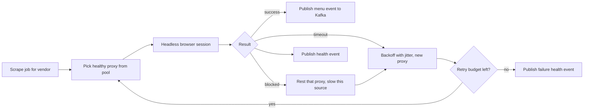

# Selenium and anti-bot scraping (Uber Menu)

<div class="callout note">

**How to use this page**

- **What it covers:** what Selenium is, how browser automation works (WebDriver, locators, waits), why scrapers fail (bot detection, layout changes, rate limits), and how I hardened the Uber Menu Selenium fleet with dynamic proxy pools and adaptive retries to reach 95%+ extraction success.
- **When to read it:** before the Uber Menu deep dive, and before any "design a web crawler" or "how do you make a flaky dependency reliable" question.
- **What to memorise:** extraction success went from an estimated 60 to 65% to 95%+. The tools were dynamic proxy pools, IP rotation and adaptive retries with backoff. Scrapers only publish events to Kafka and never write to the catalog directly. Selenium is Uber Menu only, never ANZ Document Compliance.

</div>

**Labels used on this page.** MEASURED means we have a log, doc or code for it. ESTIMATED means arithmetic I can show. HISTORICAL means from my past work records. TARGET means a design goal.

<div class="callout warn">

**Say these carefully**

- **The 60 to 65% baseline is ESTIMATED.** The 95%+ outcome is HISTORICAL. Say "from roughly 60 to 65% to over 95%".
- **Selenium is Uber Menu.** Do not add Selenium or RAG to the Uber Mobility ANZ document compliance story. That was a deterministic validation backend.
- **$600K a year** is the resume figure (about $2 per menu x 30,000 x 12 = $720K list, floored). Older prep wrote "$600K+". Use $600K.
- On the resume, I **architected the ingestion pipeline** and **hardened the Selenium fleet**. Older prep said "owned Eats menu ingestion end to end". Stick to the resume wording.
- Anti-bot work is about **getting through external limits**. It is not the same as multi-tenant rate limiting at Impact Analytics.

</div>

---

## 1. What Selenium is, in plain English

Selenium is a tool for controlling a real web browser from code. Your program tells Chrome (or Firefox) to open a page, wait for it to load, click a button, scroll, and read what is on screen, exactly as a person would. It was built for automated testing of websites and is also widely used for scraping sites that need JavaScript to render.

Analogy: a robot sitting at a computer, following a script. "Open this restaurant's page. Wait until the menu section appears. Click 'Download menu'. Save the PDF."

Why a real browser and not a simple HTTP request? Many modern sites build the page with JavaScript after it loads. A plain HTTP request just gets an empty shell. A browser runs the JavaScript and sees the real content.

### Where I used it

> Scaled menu extraction success to **95%+** by hardening a Selenium fleet with dynamic proxy pools and adaptive retries. Designed a large-scale data ingestion and processing pipeline using **Kafka** and **Apache Flink**, with stateful keyed deduplication and schema normalization to guarantee exactly-once catalog upserts.

Uber Eats needs restaurant menus in a strict catalog schema. Many menus live on restaurant or partner web pages, often JavaScript-heavy, or as PDFs and images linked from them. A **fleet** of Selenium browsers on GCP fetched them. The fleet's output fed Kafka, then Flink, then the catalog or the RAG extraction path.

---

## 2. How Selenium works: the ideas interviewers probe

### 2.1 WebDriver

**WebDriver** is a W3C standard protocol for controlling browsers. Your code (the Selenium client library) sends commands such as "navigate to URL" or "find element" to a **driver** (ChromeDriver), which controls the browser. **Headless** mode runs the browser without a visible window, which is what you want on servers.

### 2.2 Locators

You find elements by **locators**: CSS selectors, XPath, id or link text. Brittle locators (`div:nth-child(7) > span`) break on any layout change. Robust ones target stable attributes or text.

### 2.3 Waits

Pages load asynchronously. **Implicit waits** apply a global timeout to all lookups. **Explicit waits** wait for a specific condition, such as "the menu section is visible". Explicit waits are the reliable choice. `time.sleep` is the classic anti-pattern: too short and it fails, too long and it wastes time.

```python
# Teaching sketch. Selectors and URLs are illustrative.
opts = webdriver.ChromeOptions()
opts.add_argument("--headless=new")
opts.add_argument(f"--proxy-server={proxy.url}")      # one proxy per session
driver = webdriver.Chrome(options=opts)
try:
    driver.get(vendor.menu_url)
    WebDriverWait(driver, 20).until(
        EC.presence_of_element_located((By.CSS_SELECTOR, "[data-section='menu']"))
    )
    html = driver.page_source
    pdf_links = [a.get_attribute("href") for a in driver.find_elements(By.CSS_SELECTOR, "a[href$='.pdf']")]
finally:
    driver.quit()
```

### 2.4 Why scrapers fail

| Cause | What it looks like |
|---|---|
| Bot detection | CAPTCHAs, 403 or 429 responses, empty pages, "access denied" interstitials |
| IP reputation and rate limits | One IP making many requests gets throttled or blocked |
| Browser fingerprinting | Sites detect automation from headers, user agent, `navigator.webdriver` and similar signals |
| Layout changes | A selector that worked yesterday finds nothing today |
| Slow or flaky pages | Timeouts, half-loaded content |
| Resource leaks | Browsers not closed, so memory fills up and nodes crash |

---

## 3. How I hardened the fleet

### 3.1 The mechanisms

- **Dynamic proxy pools and IP rotation.** A **proxy** is an intermediate server your request goes through, so the site sees the proxy's IP instead of yours. A **pool** is many proxies. "Dynamic" means the pool is managed at runtime: proxies that get blocked or slow are rested or removed, and healthy ones get more traffic. Each browser session uses one proxy.
- **User-agent rotation.** Older prep also mentions varying the browser identity string (UA spoofing) so the fleet does not look like one machine.
- **Adaptive retries.** On a failure, retry with **exponential backoff and jitter** (wait 2s, 4s, 8s plus randomness), on a **different proxy**, within a **per-source retry budget**. "Adaptive" means the retry policy reacts to the failure type: a block means switch proxy and slow down for that source, a timeout means retry soon, a "page not found" means do not retry.
- **Health events.** Each attempt publishes a scrape-health event (success, failure type, source, proxy) to Kafka, so failure patterns per source are visible and the proxy pool can react.



*What to notice: a failure changes the proxy and the pace, not just "try again". Every attempt leaves a health signal.*

```python
# Teaching sketch of adaptive retry.
def scrape_with_retries(vendor, pool, budget=4):
    for attempt in range(budget):
        proxy = pool.pick(source=vendor.source)
        outcome = scrape_once(vendor, proxy)
        publish_health(vendor, proxy, outcome)
        if outcome.ok:
            return outcome
        if outcome.kind == "blocked":
            pool.rest(proxy); pool.slow_down(vendor.source)
        elif outcome.kind == "not_found":
            return outcome                      # retrying will not help
        time.sleep(min(60, 2 ** attempt) + random.random())
    return outcome
```

### 3.2 Why scrapers publish to Kafka and never write the catalog

Scrapers are the flakiest part of the system. If each scraper also called the catalog and the RAG path synchronously, slow downstreams would hold browsers open, and a scraper crash would lose work. Publishing to Kafka means a scrape is done once its event is stored. Downstream can be slow, fail or replay without touching the fleet. See [kafka_streaming.md](kafka_streaming.md) and [flink.md](flink.md).

### 3.3 Running a fleet

- **Docker images** with pinned browser and driver versions, so a Chrome auto-update does not silently break the fleet.
- **One browser per job, always closed in `finally`,** to avoid memory leaks.
- **Bounded concurrency per source,** so we do not hammer one site.
- **Monitoring success rate per source,** so a layout change on one site is noticed as "source X dropped from 97% to 20%" rather than buried in a global average.

---

## 4. Design decisions

- **What:** a Selenium fleet with dynamic proxy pools, adaptive retries and health events, publishing to Kafka.
- **Why:** many menu sources are JavaScript-heavy and have no API, and blocks were the main cause of failed extractions.
- **Alternatives considered:**
  - *Partner APIs or direct menu uploads.* Best when available, and always preferred. Coverage was incomplete, which is why scraping existed.
  - *Plain HTTP plus an HTML parser* (requests and BeautifulSoup). Much cheaper per page, but fails on JavaScript-rendered pages. A good first try per source.
  - *Playwright or Puppeteer.* Modern browser automation with better auto-waiting and network interception. A reasonable alternative. If asked, say I would evaluate Playwright for a new build.
  - *A third-party scraping or menu-processing vendor.* That is part of what the pipeline replaced. The $600K a year saving is derived from about $2 per menu in third-party or manual cost.
- **Trade-off:** browsers are heavy (CPU and memory per session) and brittle to layout changes. Proxy pools cost money.
- **What I'd do differently:** try plain HTTP first per source and only escalate to a browser when needed, and add automatic selector health checks on a sample of sources every day.

---

## 5. The numbers

| Number | What it measures | How derived | Tag |
|---|---|---|---|
| 95%+ | Share of scrape attempts that produced a usable menu | Work records | HISTORICAL |
| About 60 to 65% | Success rate before hardening | Estimate from before proxy pools and adaptive retries | ESTIMATED |
| 30K+ menus a month | Volume through the pipeline. About 1,000 a day | Work records | HISTORICAL |
| From 24 hours to 2 hours | Restaurant onboarding time, about 92% faster | Work records | HISTORICAL |
| $600K a year | About $2 per menu x 30,000 x 12 = $720K list, floored to $600K | Arithmetic on HISTORICAL inputs | ESTIMATED |

Why it mattered: every failed scrape is a manual fallback, and a restaurant that is not live is not earning.

Say it: "Extraction success went to over 95%, from roughly 60 to 65% before, by adding dynamic proxy pools and adaptive retries to the Selenium fleet."

Do NOT say: the baseline as measured, "100% success", or "$720K saved".

---

## 6. Interview questions with speakable answers

**Q1. Why scrape at all instead of using APIs?**
We used partner feeds and uploads wherever they existed, but coverage was incomplete. Many restaurants only had menus on JavaScript-heavy pages or as linked PDFs. Without automation those went to a manual or third-party process that cost about $2 a menu and took about a day. Scraping plus RAG extraction closed that gap, and onboarding went from 24 hours to 2 hours.

**Q2. How did you get from about 60% to 95%+ success?**
Most failures were blocks and timeouts, not bad parsing. We added dynamic proxy pools, so each session used a healthy proxy and blocked ones were rested. We added adaptive retries: exponential backoff with jitter on a different proxy, within a per-source budget, and no retry on errors that won't change. Every attempt published a health event, so we could see which sources and proxies were failing.

**Q3. How do you detect that a site changed its layout?**
Track success per source, not just globally, so one site dropping sharply stands out. Downstream schema validation also catches pages that load but parse into nonsense. A sudden spike of "selector not found" or empty extractions for one source is the alert. Then you fix the selector, and Kafka replay lets you reprocess the stored raw payloads without re-scraping.

**Q4. How does backoff with jitter work and why the jitter?**
After each failure you wait longer, for example 2, 4, then 8 seconds, up to a cap. Jitter adds randomness to each wait. Without jitter, thousands of failed jobs retry at exactly the same moments and hit the site in synchronized waves, which looks even more like a bot and makes blocks worse. With jitter, retries spread out.

**Q5. What about the ethics and legality of scraping?**
Respect the site's terms and robots rules where they apply, keep request rates polite with per-source concurrency limits, and prefer official feeds or partner uploads whenever they exist. Business and legal decisions about which sources to use were not mine to make, and I would say that plainly. My job was to make the approved sources reliable and gentle on the sites.

**Q6. Selenium or Playwright today?**
For a new build I'd evaluate Playwright first. It has better auto-waiting, network interception and multi-browser support in one API. Selenium is a mature W3C WebDriver standard with a huge ecosystem, which is why fleets built on it are common. The reliability techniques I used, proxy pools, adaptive retries and health signals, apply to either.

**Q7. How do you keep a browser fleet from leaking memory?**
One browser per job, always quit in a `finally` block, with a hard timeout per job. Pin browser and driver versions in the Docker image so updates are deliberate. Recycle workers periodically, and alert on node memory. Most "fleet falls over" incidents are orphaned browser processes.

---

## Related

- [kafka_streaming.md](kafka_streaming.md) and [flink.md](flink.md) for what happens after the scrape
- [langgraph_mcp_rag.md](langgraph_mcp_rag.md) for the RAG extraction path
- [auth_tenancy_rate_limits.md](auth_tenancy_rate_limits.md) for how this differs from tenant rate limiting
- [../architecture/03_uber_menu.md](../architecture/03_uber_menu.md)
