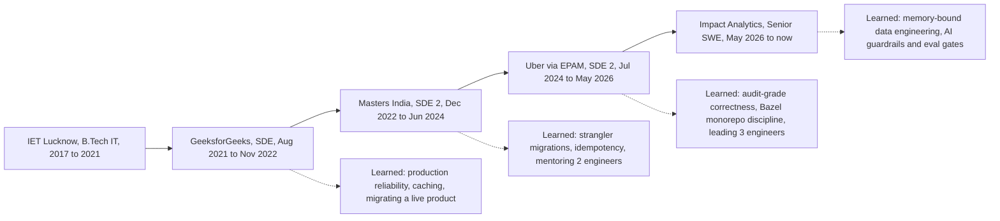
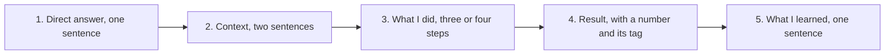

# 01. Introductions and career story

<b>How to use this page</b>
<ul>
<li>It covers the first five minutes of almost every interview: "tell me about yourself", "walk me through your resume", "why are you looking", "why did you move", and "what are you most proud of".</li>
<li>Read it the night before any screen. Say the 30-second and 90-second intros out loud three times each until they feel like your own words.</li>
<li>Memorise the numbers in the intros and the one-line reason for each career move. Everything else you can paraphrase.</li>
<li>For the stories behind these answers, go to <a href="11_star_stories.md">STAR stories</a>. For how each number was derived, go to <a href="02_numbers_explained.md">Numbers explained</a>.</li>
</ul>

**Tags used on this page.** MEASURED means there is a log, document or code behind the number. ESTIMATED means it is arithmetic I can show. HISTORICAL means it comes from my past work records and resumes. TARGET means it was a design goal, so I say "targeting". If a number has no tag here, it is a resume number and the derivation lives in [Numbers explained](02_numbers_explained.md).

---

## 1. The career at a glance

In plain words: I have spent five years building backend and data systems. I started on a consumer education product, moved to a regulated tax-compliance product, then worked inside Uber through the consulting firm EPAM, and I now work at Impact Analytics on a retail planning product with an AI layer. Each move added one new layer of difficulty: first reliability, then scale and correctness under deadlines, then finance-grade auditability and leading people, and now data platforms plus applied AI.

*What to notice:* the solid arrows are the jobs in order. The dotted arrows are the one thing I took from each job. When you tell the story, say the dotted-arrow lesson, not just the company name.

| Company | Role | Dates | Rough tenure | Product in one line |
|---|---|---|---|---|
| GeeksforGeeks | SDE | Aug 2021 to Nov 2022 | about 1 year 3 months | Courses platform, doubt-support forum, influencer dashboard |
| Masters India | SDE 2 | Dec 2022 to Jun 2024 | about 1.5 years | GST (Goods and Services Tax) compliance and e-invoicing SaaS for Indian enterprises |
| Uber via EPAM | Software Development Engineer 2 | Jul 2024 to May 2026 | almost 2 years | Finance risk-scoping platform (FRM), Uber Eats menu ingestion, Mobility ANZ document compliance |
| Impact Analytics | Senior Software Engineer | May 2026 to present | a few months | AssortSmart, retail merchandise planning SaaS with an AI decision layer |

Education and extras you can mention if asked: B.Tech in Information Technology from IET Lucknow (2017 to 2021), Google Code Jam 2021 qualifier (rank 2260 out of 37,000+), Smart India Hackathon 2020 finalist (top 3 nationally), the Global AI Hackathon at EPAM, and HackerRank Problem Solving and LangChain Academy certificates. CGPA is not on the resume, so do not volunteer it.

---

## 2. Words you may need to explain in an intro

You will not define these in the intro itself. But interviewers often interrupt with "what does that mean?", so have one sentence ready.

- **Backend.** The server-side code that stores data, applies business rules and answers requests from apps and websites. Think of the kitchen of a restaurant, not the dining room.
- **Microservices.** Splitting one big application into small services that each own one job and can be deployed separately. Like a food court instead of one giant kitchen.
- **p95 latency.** The response time that 95 out of 100 requests beat. It tells you how slow the bad-but-normal requests are, not just the average.
- **RPS (requests per second).** How many API calls the system answers each second.
- **ClickHouse.** A database built for analytics. It stores data by column, so summing one column over hundreds of millions of rows is fast. Postgres is a filing cabinet of complete records. ClickHouse is a stack of ledgers, one per column.
- **Pivot.** A planner's summary table, for example "sales by store by week for this season". On raw data it means grouping hundreds of millions of rows.
- **Reconciliation.** Checking that two sets of numbers that should match actually match, for example the finance system against the filed quarterly report.
- **Materiality.** The dollar size above which an error in the financial statements would matter to a reader. At Uber's Q4 2025 close it was $340M.
- **Strangler pattern.** Replacing an old system piece by piece behind the same front door, so the old one keeps serving whatever has not moved yet. Like renovating a house one room at a time while you still live in it.
- **LLM (large language model).** A model like GPT, Gemini or Claude that reads and writes text.
- **Eval gate.** An automatic test in CI (continuous integration, the pipeline that runs on every code change) that scores the AI on a fixed set of cases and blocks a release if the score is too low.
- **Via EPAM.** EPAM Systems is a global engineering services company. I was employed by EPAM and embedded full-time in Uber teams, working in Uber's codebase. Always say "Uber via EPAM".

---

## 3. The three introductions

All three use only resume numbers. Speaking pace is about 150 words a minute, so the word counts below match the times.

### 3.1 The 30-second intro (about 90 words)

Use this for a recruiter screen, a panel where five people introduce themselves, or when someone says "quickly, tell me about yourself".

> I'm Tarun Mittal, a senior software engineer with five years in Java, Python and Go backends and data platforms. At Impact Analytics I work on AssortSmart, a retail planning product. I own a Go platform that peaks at 10,000 requests per second, and I built a ClickHouse layer that took planner pivots from 189 seconds to 12 seconds. Before that, at Uber via EPAM, I owned a Finance risk-scoping backend that cut quarterly reconciliation from 14 days to 3 days. I'm looking for a senior role with bigger scope and a strong design-review culture.

**Why this shape.** One sentence of identity, two proofs from the current job, one proof from the previous job, one sentence of what I want. Then stop. If they want more they will ask.

### 3.2 The 90-second intro (about 230 words)

Use this as the default for a hiring manager or the start of a technical round.

> I'm Tarun Mittal, a senior software engineer with five years building backend and data systems in Java, Python and Go.
>
> I joined Impact Analytics in May 2026. I work on AssortSmart, which helps retailers decide which products to keep, drop or add each season. On the platform side I own a multi-tenant Go service that handles 10,000 requests per second at peak, and I built a ClickHouse pre-aggregation layer that took a planner pivot from 189 seconds to 12 seconds on a 250-million-row test. On the AI side I built a decision engine that scores 348,000 article-seasons by blending fixed KPI math with LLM judgement, and I shipped Ask Iris, a chat copilot for planners. Every model change has to pass an 80% accuracy gate in CI before it is promoted.
>
> Before that I spent almost two years at Uber via EPAM. I owned the backend of the Finance risk-scoping platform, which cut quarterly reconciliation from 14 days to 3 days, and I led three engineers on its ORM migration. I also worked on Uber Eats menu ingestion, which took restaurant onboarding from 24 hours to 2 hours.
>
> Earlier, at Masters India, I led a PHP-to-Spring Boot migration that cut p95 latency from 1.2 seconds to 300 milliseconds, and I started my career at GeeksforGeeks on Django.
>
> I'm looking for a senior role with bigger scope and a strong design-review bar.

**If they cut you off at 30 seconds,** stop after the ClickHouse sentence and the Uber sentence. Do not keep listing companies.

### 3.3 The 3-minute intro (about 450 words)

Use this only when they explicitly say "take your time" or "walk me through your background". It is chronological and it explains *why* each move made sense. This is also your answer to "walk me through your resume" (section 5).

> I'm Tarun Mittal. I've been a backend engineer for five years, in Java, Python and Go, and over time my work has moved from product APIs towards data platforms and applied AI.
>
> I started at GeeksforGeeks in 2021, straight out of IET Lucknow. I migrated the doubt-support forum from PHP to Django so it could handle 10,000-plus daily queries and the 10x traffic spikes during live coding contests. I also built an influencer earnings dashboard and scheduled background jobs. That job taught me production basics: caching, hot rows, and how to migrate a product people are using every day.
>
> After about a year and a quarter I moved to Masters India, a GST e-invoicing company, because I wanted to own a regulated product and a real migration, not just features. I led the move from a PHP monolith to Spring Boot microservices for 1,500-plus enterprise clients. p95 latency dropped from 1.2 seconds to 300 milliseconds, and the bulk pipeline handled over a million government submissions a day. I also mentored two engineers. The big lesson there was that sequencing a migration matters more than the target architecture.
>
> Then I joined Uber via EPAM, because I wanted a higher engineering bar and work that sat close to Finance and audit. I owned the backend of the FRM risk-scoping platform: 36 endpoints, an 8-table MySQL schema, and a move off Google Sheets that cut quarterly reconciliation from 14 days to 3 days against a $340 million materiality threshold. I led three engineers on the Spring Data JPA / Hibernate migration that took the module to 100% statement coverage. I also worked on Uber Eats menu ingestion, which cut restaurant onboarding from 24 hours to 2 hours and saved about $600K a year. Uber taught me what audit-grade correctness feels like.
>
> In May 2026 I joined Impact Analytics to go deep on data platforms and AI. I own AssortSmart's Go platform at 10,000 requests per second at peak. I moved planner pivots onto ClickHouse rollups, from 189 seconds to 12 seconds, and I fixed a 170 GB out-of-memory failure in the weekly builds by processing one fiscal week at a time. On the AI side I built the keep-or-drop decision engine over 348,000 article-seasons, with an 80% accuracy gate in CI before any change is promoted, and I shipped Ask Iris, a planner copilot.
>
> The thread through all of it is that I own a system end to end and I decide with measurements. Next I want a senior role with bigger scope and a stronger design-review bar, where I can do that for several years.

**Pacing tip.** Pause for one breath after each company. If the interviewer's face says "enough", jump to the last paragraph.

---

## 4. The career arc: why each move made sense

Interviewers ask "why did you leave X?" for every job. They are testing two things: whether you move towards something (good) or run away from something (worrying), and whether you learned anything. Each answer below is under 45 seconds, positive, and ends with what I learned.

### 4.1 Starting at GeeksforGeeks (Aug 2021 to Nov 2022)

**What the job was.** GeeksforGeeks is a large learning platform for programmers. I worked on the courses platform: the doubt-support forum where students post questions about courses and articles, and an analytics and earnings dashboard for influencer partners who sell courses.

**What I did.** I migrated the doubt-support backend from PHP to Django, page by page behind the same URLs. I built REST APIs for voting, pinning and locking threads on MySQL, MongoDB, Redis and Elasticsearch. It handled 10K+ daily queries and 10x spikes during live coding contests. The growth team attributed a 20% lift in premium subscriptions (relative) to the features. I also built the influencer analytics dashboard and asynchronous scheduled workflows for video processing, reminders and data cleanup. The business team attributed a 30% lift in course sales and a 70% gain in operations efficiency. All of these are HISTORICAL. The honest framing is: "I owned the engineering, and the business team attributed the lift."

**What I learned.** How to keep a live product reliable while changing it underneath. Practical things like a unique database constraint for vote idempotency (a user voting twice still counts once), counters in Redis to avoid one hot database row, and reconciling counts back to MySQL.

### 4.2 GeeksforGeeks to Masters India

**Why the move made sense.**

> At GeeksforGeeks I was shipping features on a consumer content platform. Masters India offered ownership of a regulated financial product and a real platform migration. I wanted to grow from feature delivery into owning a service cutover and mentoring people. That's exactly what happened: I led the PHP-to-Spring Boot migration and mentored two engineers.

**What the job was.** Masters India sells GST compliance and e-invoicing software to Indian enterprises. Clients send invoices to our APIs. We validate them and register them with the government's IRP (Invoice Registration Portal), which returns an IRN (Invoice Reference Number) and a signed QR code. Without that registration a business-to-business invoice is not valid. So correctness matters more than speed, and filing-deadline days bring big spikes.

**What I did.** I led the strangler migration from a PHP monolith to Spring Boot microservices, one route at a time with canaries. p95 latency went from 1.2s to 300ms (75% lower) across 1,500+ enterprise clients, and throughput went from 700 to 4,000 requests per minute. I built the bulk e-invoicing pipeline on Kafka with PostgreSQL sharded by tax quarter, idempotent processing for 100K+ concurrent imports, dead-letter queues and bounded retries. It carried 1M+ government submissions a day. I added ELK and New Relic tracing plus a Redis cache-aside layer, which cut incident triage by 70% and database read load by 30%. Test coverage went from 35% to 82%, with 98% deployment success. All HISTORICAL.

**What I learned.** Three things. Sequencing is the real risk tool in a migration. Idempotency is not optional when the other side (a government portal) cannot undo a duplicate. And mentoring is mostly setting conventions and reviewing early, then stepping back.

### 4.3 Masters India to Uber via EPAM

**Why the move made sense.**

> I had taken the GST platform through its migration and scale-up. Uber via EPAM was a jump in engineering bar, product surface and systems complexity. I wanted Bazel monorepo discipline, Uber-scale practices, and work that sat next to Finance and audit. That's where I owned the FRM scoping backend and the reconciliation migration.

**What "via EPAM" means, if asked.** I was an EPAM employee embedded in Uber teams. I worked in Uber's monorepo, under Uber's review process, on Uber products. On FRM I was the tech lead of an EPAM pod of three engineers, not a people manager.

**What I did.** Three products:

1. **FRM (Financial Risk Management) Scoping Platform for Uber Finance.** Every quarter, Finance decides which financial line items and legal entities are "in scope" for audit testing. It used to live in Google Sheets. I owned the backend: 36 Spring Boot endpoints, a migration of 19M raw general-ledger rows off Sheets into MySQL, a nested 4-level FSLI (Financial Statement Line Item) hierarchy, and an 8-table normalized schema on SOADB (Uber's standard for service-owned MySQL). Quarterly reconciliation went from 14 days to 3 days (70%) against a $340M materiality threshold. I led three engineers on the Spring Data JPA / Hibernate migration that removed latent column-aliasing bugs and took module statement coverage to 100%.
2. **Uber Eats menu ingestion.** Turning restaurant menus (often messy multilingual PDFs) into Uber's strict catalog format. Onboarding went from 24 hours to 2 hours, saving about $600K a year across 30K+ menus a month, with 98% field fidelity on an offline evaluation. Extraction success reached 95%+ after hardening the scraper fleet, with Kafka and Apache Flink for ingestion.
3. **Uber Mobility ANZ document compliance.** Automated driver and vehicle document checks against local rules: 99.9% regulatory compliance and 20 hours a week of manual work removed. HISTORICAL.

**What I learned.** What audit-grade correctness feels like: every number traceable, every change reviewed, stacked PRs so nothing big lands at once. I also learned to call my own mistakes quickly and turn them into team process (see the refactor story in [STAR stories](11_star_stories.md)).

### 4.4 Uber via EPAM to Impact Analytics

**Why the move made sense.**

> I wanted deeper ownership of a data platform and agentic AI systems, not only service APIs, and I wanted to own them directly at a product company. Impact Analytics offered a senior charter on AssortSmart: the Go platform, the ClickHouse analytics path, and the AI decision layer. That matched where I want to go deep.

**What the job is.** AssortSmart is retail merchandise planning software. Planners at retailers decide which articles (products) to keep, drop or add each season, and the system needs fast analytics over billions of rows plus AI-assisted recommendations.

**What I do.** Two areas:

1. **Core infrastructure.** A multi-tenant Go/Gin platform at 10k peak RPS with Google Wire dependency injection, native HTTP/2 cleartext (h2c) and Datadog tracing. A ClickHouse pre-aggregation layer that made planner pivots 15.5x faster (189s to 12s on a 250M-row test). Weekly rollup builds that used to hit a 170 GB out-of-memory failure, fixed by slicing work into one fiscal week per insert. A custom Go data pump that copies rollups between ClickHouse Cloud clusters at about 344k rows per second.
2. **Agentic AI.** A decision engine (Keep/Drop, Missed Opportunities, Top Style) that evaluates 348k article-seasons, 88k items per pass, across 7 AI "lenses". The LLM never queries the 2.11B-row database directly. It gets prepared JSON context. A 300-case evaluation harness with an 80% accuracy CI gate decides what gets promoted. And Ask Iris, a secure chat copilot for planners built on LangGraph.

**What I am learning.** Measure first, then choose the tool. Shrink the unit of work before you buy more memory. And with AI, put a deterministic contract around the probabilistic part, and freeze a change when the data says it is not better yet.

---

## 5. "Walk me through your resume"

This is different from "tell me about yourself". They want the order of events and a quick sense of scope for each role, so they can choose what to dig into. Go oldest to newest, two or three sentences per role, then hand control back.

**Say this (about 2 minutes)**

> Sure, I'll go in order and you can stop me anywhere.
>
> GeeksforGeeks, 2021 to 2022: my first job. I migrated the doubt-support forum from PHP to Django to handle 10,000-plus daily queries and 10x contest spikes, and built an influencer dashboard and background jobs.
>
> Masters India, end of 2022 to mid 2024: GST e-invoicing. I led a strangler migration from a PHP monolith to Spring Boot microservices for 1,500-plus clients, with p95 going from 1.2 seconds to 300 milliseconds, and built a Kafka pipeline doing over a million government submissions a day. I mentored two engineers.
>
> Uber via EPAM, mid 2024 to May 2026: I owned the Finance risk-scoping backend, which cut reconciliation from 14 days to 3, and I led three engineers on its ORM migration. I also worked on Uber Eats menu ingestion, 24 hours to 2 hours for onboarding, and earlier on driver document compliance for Australia and New Zealand.
>
> Impact Analytics, since May 2026: I own AssortSmart's Go platform and ClickHouse analytics layer, 189 seconds to 12 for pivots, and the AI decision engine and the Ask Iris copilot.
>
> Which of those would be most useful to go deeper on?

**Why end with a question.** It turns a monologue into a conversation, and it lets them pick the project they care about instead of you guessing.

---

## 6. "Why are you looking?" (the short-tenure question)

**What they are testing.** Flight risk. I joined Impact Analytics in May 2026, so looking now is early. They want to know whether I will leave them in five months too, and whether I am running from a problem I caused.

**The rule.** Acknowledge "early" in the first sentence. People who dodge the word "soon" sound like they are hiding something. Then say what I am moving *towards*. Never criticise an employer, a manager or a team.

**Say this**

> It's early, and I won't pretend otherwise. I joined Impact Analytics in May 2026 and the work is real: the ClickHouse path, the decision engine and Ask Iris are all in production, and I'm proud of them. I'm not leaving because something went wrong.
>
> What I want next is a senior role with bigger scope and a stronger design-review bar: a larger production surface, written design reviews before code, and peers who push back hard on designs. That's the environment where I do my best work.
>
> I'm being selective. I'm talking to a few companies carefully, including yours, because I want my next move to be a multi-year run. And I'll do a proper handover on my current work, whatever my notice period says.

**Follow-up they may ask: "Four companies in five years. Why should we believe you'll stay?"**

> Each move added a layer: product features at GeeksforGeeks, a regulated SaaS migration and mentoring at Masters India, Uber-scale finance and data work via EPAM, and data platforms plus AI at Impact Analytics. The tenures before this one were about a year and a quarter, a year and a half, and almost two years. The short one is the current role, and I'm being open about why. I stay when the scope keeps growing, and that's what I'm optimising for now.

**Follow-up: "Does your manager know?"**

> Not yet. I don't start that conversation before I have a decision. And I won't accept an offer and then leave my current team stuck.

**Follow-up: "When can you join?"**

> I'll confirm the exact notice period from my contract and tell you in writing before we agree a date. I'd rather give you a real date than a guess.

**Say this / don't say this**

| Say | Do not say |
|---|---|
| "It's early, and I won't pretend otherwise." | "The role isn't what I was promised." |
| "I want bigger scope and a stronger design-review bar." | Anything about chaos, a bad manager, a boring stack, or being underpaid. |
| "I'll do a proper handover." | "My current job doesn't really count." |
| "I'm being selective this time." | "I'm always exploring." |
| Mention money only if they ask, and ask for their band first. | Lead with compensation. |

---

## 7. "What are you most proud of?"

Pick one, say it in under 90 seconds, and connect it to a lesson. My strongest answer is the ClickHouse decision because it shows technical depth, influence without authority, and measuring before arguing. The backup is the Uber column-aliasing fix, if they want a correctness or debugging angle.

**Primary answer: turning a database argument into an evidence-based decision**

> The thing I'm proudest of is how we chose ClickHouse at Impact Analytics. Planner pivots on Postgres were taking up to 189 seconds on 250 million rows, and the org was split. One group had audited the old system and concluded "no ClickHouse". Senior experts wanted it everywhere. Both sides had real evidence.
>
> I didn't pick a side. I accepted every measured fact from the audit, and showed that their "no" came from the old system doing in-place updates, which ClickHouse is bad at, not from analytical reads, which it's great at. I proposed a staged path with measurable gates and ran a row-identical proof of concept on the same 250 million rows. The pivot went from 189 seconds to 12 seconds, and the org committed to ClickHouse for planning analytics. Postgres kept roles and transactional data.
>
> What I'm proud of isn't the speed-up. It's that nobody "lost". The decision was made on numbers both camps trusted.

The full story, with follow-ups, is Story 3 in [STAR stories](11_star_stories.md).

**Backup answer: the bug that pointed edits at the wrong line**

> At Uber, the Finance risk-scoping tool read joined SQL results into maps keyed by column name. Two joined tables both had a column called `uuid`, and the map silently kept the wrong one. Edits and comments could land on a different financial line than the one on screen. I moved the reads to Spring Data JPA queries with an explicit alias on every column, so names can't collide, and ran the new reconciliation path in parallel with the old one before cutting over. In a tool that feeds audit evidence, a silent wrong answer is the worst kind of bug. Making that class of bug impossible is the work I'm proudest of at Uber.

Full version: Story 6 in [STAR stories](11_star_stories.md).

---

## 8. A simple framework for answering any question

Most weak interview answers bury the answer at the end. Use this five-step shape for behavioural questions, project questions and even many technical "why" questions.

*What to notice:* the answer comes first. If they cut you off after step 1, they still got the answer.

1. **Direct answer.** Answer the actual question in one sentence. "Yes, I disagreed with a team standard at Uber and we ended up documenting an exception."
2. **Context.** Just enough for the answer to make sense. Who, what system, why it mattered. Two sentences, not a history lesson.
3. **What I did.** Use "I", not "we", for your part. Three or four concrete actions. Credit others by name of role ("the data pipeline team", "my two mentees").
4. **Result.** A number if you have one, and say how solid it is ("measured on a 250-million-row harness", "estimated"). If there is no number, say the qualitative outcome honestly.
5. **What I learned.** One sentence that would change how you act next time.

**Worked example: "Tell me about a time you made a mistake."**

> **(Answer)** Yes. At Uber I slipped a behaviour change into what was supposed to be a pure refactor, and a test caught it. **(Context)** It was the second of three stacked PRs, consolidating constants across 31 files, on the Finance scoping service. **(What I did)** When a downstream test failed, I diffed my own PR line by line, found a small helper I'd added that changed the selection strategy, removed it, and then added "pure refactor means zero test diff" to the team's stacked-PR checklist. **(Result)** It shipped as a true refactor, and the checklist caught a similar issue for a teammate a few weeks later. **(Learned)** Call your own fouls fast and turn them into process.

**Three more rules that make any answer better**

- **Stop after the number.** The urge to keep talking after a good result weakens it.
- **If the question is unclear, ask.** "Do you want the technical deep dive or the leadership side?"
- **If you have not done the thing, say so.** "I haven't owned that exact case. Here's how I'd approach it, using a related example." Never invent.

---

## 9. Tailoring the intro to the role

Keep the same skeleton (who I am, two current proofs, one past proof, what I want). Swap which proofs you lead with.

### 9.1 Backend / platform engineering roles

**Lead with:** the Go platform, FRM ownership, the Masters latency win, idempotency.

> I'm Tarun Mittal, a senior backend engineer with five years in Java and Python microservices. At Impact Analytics I own AssortSmart's multi-tenant Go/Gin platform. It peaks at 10,000 requests per second, uses compile-time dependency injection with Google Wire, and protects itself at the HTTP edge with nested timeouts, with Datadog tracing throughout. I also built the tenant isolation and access control across Postgres and ClickHouse. At Uber via EPAM I owned the Finance risk-scoping backend: 36 Spring Boot endpoints on an 8-table MySQL schema, with optimistic locking and deterministic keys so quarterly audit trails never duplicate, and reconciliation went from 14 days to 3. At Masters India I led a strangler migration from PHP to Spring Boot that took p95 from 1.2 seconds to 300 milliseconds, and built idempotent bulk processing for a million-plus government submissions a day. I'm looking for a senior backend role with bigger scope and a strong design-review bar.

**Have ready:** why no reverse proxy in front of the Go service, how optimistic locking works, how the idempotency key was built (client + file hash + batch index). See [IA core platform](03_ia_core_platform.md), [Uber FRM](05_uber_frm.md), [Masters India](07_masters_india.md).

### 9.2 Data / infrastructure roles

**Lead with:** ClickHouse rollups, the 170 GB out-of-memory fix, the Go data pump, Kafka at Masters, Kafka and Flink on Uber Menu.

> I'm Tarun Mittal, a senior engineer with five years on backends and data platforms. At Impact Analytics I moved planner analytics onto ClickHouse. Six pre-aggregated rollup tables took a pivot from 189 seconds to 12 seconds on a 250-million-row harness. The weekly rollup build was failing with about 170 GB of memory needed for a full season, so I sliced it into one fiscal week per insert with memory and disk-spill caps. I also wrote a Go data pump over ClickHouse's native TLS protocol to copy rollups between Cloud clusters at about 344,000 rows per second, on partitions up to 4.09 billion rows, because IP allowlists blocked a direct cluster-to-cluster copy. Before that, on Uber Eats I worked on a Kafka and Flink ingestion pipeline with keyed deduplication and idempotent catalog upserts, and at Masters India I built a Kafka e-invoicing pipeline doing over a million submissions a day on Postgres sharded by tax quarter. I'm looking for a senior data platform role with bigger scope.

**Say this carefully.** 344k is rows per second of copy throughput, not requests per second. The 4.09B-row copy was measured while it was in flight. Do not say the cutover finished. The 15.5x speed-up is query time and the 170 GB fix is load time, so one did not cause the other. Kafka and Flink belong to Uber Menu, never Impact Analytics.

**Have ready:** why week-sized chunks, what double-buffered batches means, why "atomic partition rollback" is really drop the partition then recopy. See [IA core platform](03_ia_core_platform.md) and [Uber Menu and ANZ](06_uber_menu_and_anz.md).

### 9.3 AI / agents roles

**Lead with:** the decision engine, isolating the LLM from the database, Ask Iris, the eval gate, Uber Menu RAG.

> I'm Tarun Mittal, a senior engineer with five years in Java, Python and Go, and a growing part of my work is production AI. At Impact Analytics I built AssortSmart's merchandise decision engine. It scores 348,000 article-seasons by blending deterministic KPI math with structured LLM calls across seven "lenses". The LLM never touches our 2.11-billion-row ClickHouse table. It gets prepared JSON context, and if the model times out we fall back to the deterministic score. Runs have hard timeouts, circuit breakers and checkpoints, and every output row is stamped with a config hash so we can reproduce it. I also shipped Ask Iris, a LangGraph supervisor copilot for planners, with a three-attempt evaluator loop, LangSmith tracing, and tenant scope frozen when the WebSocket opens. Nothing gets promoted unless it passes an 80% accuracy gate on a 300-case harness. Before that, on Uber Eats, I used Gemini 2.5 Pro with LangChain RAG over Milvus to turn multilingual PDF menus into catalog data at 98% field fidelity on an offline evaluation. I'm looking for a senior role building AI systems that are measured and safe in production.

**Say this carefully.** 80% is a CI promotion gate, not live accuracy for every tenant. The 73% lower cost and the 74% deterministic baseline come from a separate 200-case gold benchmark, not the 300-case file. When the blended LLM score came in below the deterministic baseline, we froze the blend weights instead of retuning them. Ask Iris is a shipped capability with no usage or SLA numbers. Menu's 98% is an offline evaluation. LangSmith is on Ask Iris only.

**Have ready:** why not let the LLM write SQL, why a three-attempt cap, how the blend works (final score = 0.4 x deterministic + 0.6 x agent, keep if 0.55 or higher). See [IA agentic AI](04_ia_agentic_ai.md).

---

## 10. Other questions that come up in the first five minutes

**"What's your biggest weakness?"**

> I over-invest in written artifacts: decision docs, playbooks, comparisons. They're useful, but a 20-page analysis nobody reads is its own failure. So I now time-box them and lead with a one-page summary that says the decision and the evidence, with the detail underneath for whoever needs it.

**"Why should we hire you?" (30 seconds)**

> You get someone who owns a system end to end and can defend every number. At Uber via EPAM I owned a finance-grade backend that cut reconciliation from 14 days to 3. At Masters India I scaled e-invoicing to over a million submissions a day. At Impact Analytics I run a Go platform at 10,000 requests per second, made pivots 15.5 times faster with ClickHouse, and shipped AI behind real evaluation gates. And I'm honest about what a number means. An 80% CI gate is a gate, not a claim that every customer sees 80%.

**"What are you looking for in your next role?"**

> A senior role where I own a meaningful system for several years. Written design reviews before code, measurement as the default, and a team that argues about designs on evidence. Over three to five years I want to grow into a staff-level engineer or tech lead who owns a domain. Mentoring matters more to me than a management title.

**"What do you do outside work?"** Only answer if asked. Do not add hobbies to the intro.

---

## 11. Say this / don't say this (honesty box)

<b>Say this carefully.</b>
<ul>
<li>Always "Uber via EPAM". On FRM I was tech lead of an EPAM pod of three, not a people manager.</li>
<li>"Led 3 engineers" is Uber FRM. "Mentored 2 engineers" is Masters India. Never merge them into "led 5".</li>
<li>FRM's 70% (14 days to 3 days) is on the resume as the outcome. Do not walk it back unprompted. If pressed: "the technical design doc framed that cut, and that's what the platform delivered for the close."</li>
<li>The HFM data load into MySQL was a shared pipeline responsibility, and the real-time collaboration and Slack notification service was a separate team's. Do not claim them.</li>
<li>Menu's 98% is an offline evaluation. ANZ's 99.9% is historical, and it was Mobility, not Eats.</li>
<li>At Impact Analytics: no Kafka, Flink, CDC, Milvus or Kubernetes operations. The Cluster Recommendation Copilot and Hindsight are verbal only, not resume bullets.</li>
<li>The 4.09B-row copy was measured in flight, not a finished cutover. 15.5x (query time) and 170 GB (load time) are separate wins.</li>
<li>Never criticise a past or current employer.</li>
</ul>

---

## 12. Practice drill

Say each answer out loud, then check it against the section in brackets.

1. Give your 30-second intro. Did you stop after "design-review culture"? (3.1)
2. Give your 90-second intro to a hiring manager for a backend role. (3.2 and 9.1)
3. Why did you leave GeeksforGeeks? (4.2)
4. What does "via EPAM" mean? Were you an Uber employee? (4.3)
5. Why did you leave Uber? (4.4)
6. You joined in May. Why are you already looking? (6)
7. Four companies in five years. Why will you stay with us? (6)
8. What are you most proud of? (7)
9. Walk me through your resume in two minutes. (5)
10. Give the data/infra version of your intro. Did you say "rows per second", not "requests per second", for 344k? (9.2)
11. Give the AI version of your intro. Did you call 80% a gate? (9.3)
12. What's your biggest weakness? (10)
13. Answer "tell me about a mistake" using the five-step framework. Did the direct answer come first? (8)

---

**Next:** [Numbers explained](02_numbers_explained.md) · [STAR stories](11_star_stories.md) · [Start here](00_START_HERE.md)
