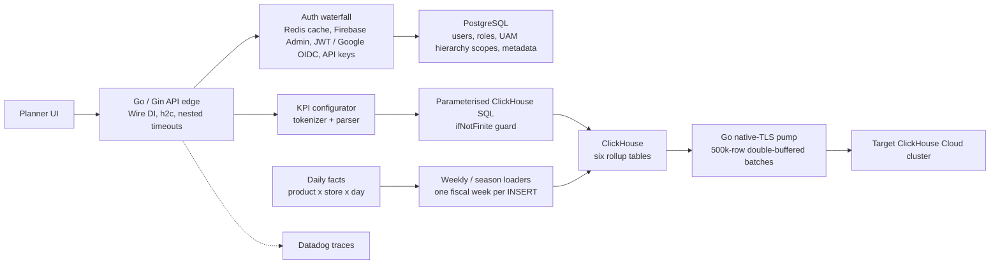
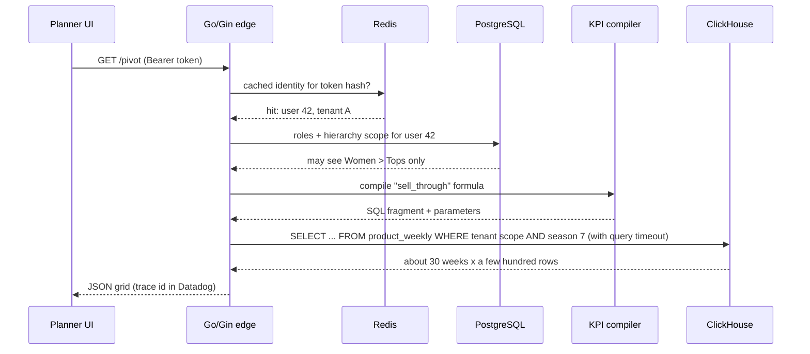
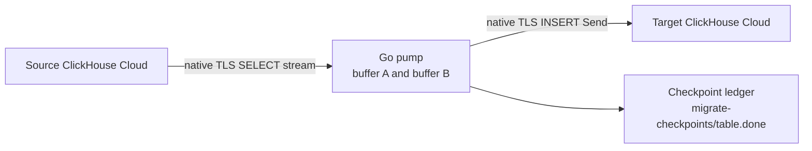

# Chapter 3 — Impact Analytics: AssortSmart Core Infrastructure & Pipeline

<div class="callout note">
<b>How to use this chapter</b><br>
• Read sections 1–4 once to understand the product and the big picture. Then study one bullet (C1–C5) per sitting.<br>
• Memorise the one-minute version and the "Say this / don't say this" box.<br>
• Practise the 3-minute whiteboard script at the end out loud, drawing as you talk.<br>
• Companion chapters: <a href="04_ia_agentic_ai.md">Chapter 4 (Agentic AI)</a>, <a href="02_numbers_explained.md">Chapter 2 (numbers)</a>, <a href="10_core_concepts_explained.md">Chapter 10 (concepts)</a>.
</div>

Role: **Senior Software Engineer, Impact Analytics, May 2026 to Present.** Project title on the resume: **AssortSmart — Senior Software Engineer (Platform & AI)**. The resume has two sub-sections for this job. This chapter is the second one, **Core Infrastructure & Pipeline**: the Go platform, the formula engine, security and tenancy, the ClickHouse speed-up, and the cluster-to-cluster data copy.

---

## 1. The one-minute version (say this out loud)

> "At Impact Analytics I work on AssortSmart, a planning product that retailers use to decide which products to carry each season. On the platform side I own the Go and Gin API layer. It is multi-tenant, peaks at about 10,000 requests per second, uses Google Wire for compile-time dependency injection, and protects itself with nested timeouts and Datadog tracing instead of relying on a reverse proxy. I built a formula engine so business users can define KPIs without a code release; it compiles their formulas into safe, parameterised ClickHouse SQL. I made planner pivot screens 15.5 times faster, from 189 seconds to 12 seconds on a 250-million-row test, by pre-aggregating data into six ClickHouse rollup tables, and I fixed a 170 GB out-of-memory crash in how those rollups are built. Finally, I wrote a Go data pump that copies those rollups between ClickHouse Cloud clusters at about 344,000 rows per second, with ledgers and partition rollbacks so a crash never leaves half-copied data that looks complete."

---

## 2. The business in plain English

**Who uses it.** Merchandise planners at retail companies. A planner is the person who decides, for example, "next autumn we will sell these 400 women's tops in these 120 stores, and we will stop selling these 60."

**What they do in the product.** They open big pivot grids. Rows might be product categories, columns might be weeks, cells are numbers like units sold, revenue, margin, sell-through (the share of stock that actually sold) and rate of sale (units sold per store per week). They slice by product, by store, by product attribute (colour, size, fabric) and by season or week. They also define their own KPIs ("my margin after discount").

**What hurt before.**
1. **Slow screens.** The raw data is at the grain of "one product in one store on one day". Adding that up live for every screen was slow. On a 250-million-row test, a typical pivot took **189 seconds** on the old PostgreSQL path. Nobody waits three minutes for a grid.
2. **Every new KPI needed a code release.** If a client wanted a new formula, an engineer had to write it.
3. **Many clients on one platform.** Each retailer (tenant) must only ever see its own data, and inside a retailer each planner should only see the part of the product hierarchy they are allowed to see.
4. **Data had to move between clusters.** Rollup tables needed to be copied between ClickHouse Cloud clusters, and the normal cluster-to-cluster copy was blocked by network allowlists.

**Why the company paid for it.** Fast screens mean planners actually use the tool during planning season. Self-serve KPIs mean fewer engineering tickets per client. Strong isolation is a contract requirement for enterprise retail clients.

---

## 3. Words you need

| Term | Plain meaning (with analogy) |
|---|---|
| **Tenant** | One customer company on a shared platform. Like flats in one building: shared plumbing, separate locked doors. |
| **Article / article-season** | An article is one product. An article-season is that product in one selling season. "Blue linen shirt, Summer 2026" is one article-season. |
| **Go / Gin** | Go is a compiled language built for network servers. Gin is a lightweight Go web framework (routing, middleware, JSON). |
| **RPS** | Requests per second that the API serves. |
| **Dependency injection (DI)** | Instead of a component creating its own database client, logger, etc., someone hands them in. Like a restaurant kitchen where ingredients are delivered to each station instead of every cook going shopping. |
| **Google Wire** | A Go tool that writes the "hand everything in" code for you **at build time**. If something is missing, the build fails, not production. |
| **Reverse proxy** | A server in front of your app (Nginx, Envoy) that forwards traffic, often adding timeouts, TLS, rate limits. |
| **h2c** | HTTP/2 over plain TCP (no TLS on that hop). HTTP/2 lets many requests share one connection. |
| **Nested timeouts** | Several time limits inside each other: the whole request gets, say, 30 s; the database call inside it gets less; the server itself also limits slow clients. |
| **Distributed tracing** | Following one request across services, with a timeline of each step. Like a parcel tracking page. Datadog is the tool. |
| **ClickHouse** | A columnar analytics database. It stores each column separately and compresses it, so "sum revenue over 250M rows" is fast. |
| **OLTP vs OLAP** | OLTP = many small reads and writes (PostgreSQL, MySQL). OLAP = big scans and aggregations (ClickHouse, BigQuery). |
| **MergeTree** | ClickHouse's main table engine. Data is written in sorted chunks ("parts") that are merged in the background. |
| **Partition** | A slice of a table you can manage as a unit, here one season (`PARTITION BY season_code`). You can drop or replace one partition without touching others. |
| **Rollup / pre-aggregation** | Adding numbers up ahead of time and storing the totals, so screens read totals instead of raw rows. Like keeping a monthly bank summary instead of re-adding every transaction. |
| **OOM** | Out of memory. The query tried to use more RAM than allowed and was killed. |
| **Spill to disk** | When an aggregation gets too big for RAM, ClickHouse writes partial results to disk and continues, slower but alive. |
| **UAM** | User Access Management: which user may see which part of the data. |
| **OIDC / JWT / Firebase Admin** | Ways to prove who a user is. A JWT is a signed token. OIDC is a standard for logging in with an identity provider (here Google). Firebase Admin is Google's server SDK to verify Firebase-issued login tokens. |
| **Constant-time comparison** | Comparing two secrets in a way that always takes the same time, so an attacker can't guess the key one character at a time by measuring response speed. |
| **Native protocol / port 9440** | ClickHouse's own binary protocol (faster than HTTP). 9440 is its TLS-encrypted port. |
| **Double buffering** | Using two buffers so you can fill one while the other is being sent. Like two buckets in a bucket brigade. |

---

## 4. Architecture



*What to notice: reads come from rollups, not raw facts; the write side (loaders, pump) is separate from the request side; auth and tenant scope are decided once at the edge and carried into every query.*

**Box by box.**
- **Planner UI** sends HTTP requests: "give me this pivot", "save this KPI".
- **Go/Gin edge** is the single entry point. Routing, JSON, auth middleware, timeouts and tracing all live in this one Go process. Wire assembled its dependencies at build time.
- **Auth waterfall** answers "who is this?" cheaply. Redis first (cached verified identity), then the slower verifiers. **PostgreSQL** answers "what may they see?" (roles and hierarchy scopes).
- **KPI configurator** turns a formula a business user typed into a safe SQL fragment.
- **ClickHouse rollups** are six pre-aggregated tables that make screens fast.
- **Loaders** build those rollups from raw daily facts, one fiscal week at a time so they never run out of memory.
- **Go pump** copies rollup partitions to another ClickHouse Cloud cluster.

---

## 5. One request, step by step

Example: a planner at tenant "Retailer A" opens a pivot "Women > Tops, revenue and sell-through by week, Season 7".



1. The request arrives with a token. The server has a request deadline (for example 30 seconds; the exact values are configuration, keep them qualitative if asked).
2. The auth middleware hashes the token and checks Redis. A hit means "already verified recently". A miss means verifying with Firebase Admin, or as a JWT / Google OIDC token, then caching the result.
3. PostgreSQL returns the user's role and hierarchy scope: Retailer A, Women > Tops.
4. The KPI compiler turns "sell-through" into SQL with parameters and a divide-by-zero guard.
5. The query hits `product_weekly`, a rollup table, with partition pruning on Season 7 and a filter for the user's scope. It is bounded by its own timeout, shorter than the request deadline.
6. JSON goes back. Datadog has a trace showing auth time, compile time and ClickHouse time.

---

## 6. Each resume bullet decoded

### C1 — Go/Gin platform, 10k peak RPS, Wire, no reverse proxy, h2c, nested timeouts, Datadog

> **Resume:** Architected a multi-tenant Go/Gin platform scaling to 10k peak RPS, utilizing Google Wire for compile-time DI. Deployed as a self-protecting HTTP edge without a reverse proxy, guaranteeing high availability through native h2c, nested timeouts, and Datadog distributed tracing.

**In plain words.** I designed the main API server. It serves many retail clients, handles about 10,000 requests per second at peak, is assembled safely at compile time, and protects itself (timeouts, HTTP/2 handling, tracing) instead of depending on a separate proxy server in front of it.

**How it works.**

*Wire, compile-time DI.* You declare "providers" (functions that build things) and Wire generates the wiring code.

```go
// wire.go (illustrative)
func InitServer(cfg Config) (*Server, error) {
    wire.Build(NewRedis, NewPostgres, NewClickHouse, NewAuth, NewKPIService, NewRouter, NewServer)
    return nil, nil
}
```

If `NewKPIService` needs a `*ClickHouse` and no provider returns one, `wire` fails at build time. Runtime DI libraries (Uber Fx, Dig) use reflection and would fail when the app starts or, worse, on a code path.

*Self-protecting edge.* Without Nginx or Envoy in front, the Go process must enforce its own limits. Go's `http.Server` has them built in:

```go
srv := &http.Server{
    Handler:           h2c.NewHandler(router, &http2.Server{}), // HTTP/2 without TLS on this hop
    ReadHeaderTimeout: 5 * time.Second,  // slow-loris protection
    ReadTimeout:       15 * time.Second,
    WriteTimeout:      30 * time.Second,
    IdleTimeout:       120 * time.Second,
}
// per request: ctx, cancel := context.WithTimeout(r.Context(), 30*time.Second)
// per ClickHouse call: a shorter context deadline derived from ctx
```

(The numbers above are illustrative. In an interview say "server-level timeouts, a per-request deadline, and shorter per-dependency deadlines inside it".)

*Nested timeouts* mean the inner call always gives up before the outer one, so the server can still return a clean error instead of hanging. Example: request deadline 30 s, ClickHouse 25 s, Redis 100 ms.

*h2c* lets one TCP connection carry many concurrent requests (HTTP/2 multiplexing), which cuts connection overhead at high RPS. TLS is handled before traffic reaches this hop. If asked exactly where, describe it at that level and don't invent a specific load balancer.

*Datadog tracing.* Each request gets a trace ID. Spans for auth, compile and ClickHouse show where time went. This is how you find "pivots are slow because of query X for tenant Y".

**Why this design.** One less hop means less latency and one less thing to operate. The process owns its own timeouts, so behaviour is the same in every environment. Compile-time DI catches wiring mistakes before deploy.

**Alternatives and why not.**
- Nginx/Envoy in front: a perfectly good choice, and many teams do it. We didn't need its features enough to justify another component to configure and monitor.
- Fx/Dig runtime DI: more flexible, but errors show up at runtime and reflection makes code harder to follow.

**The numbers.**
- **10k peak RPS**: peak requests per second the platform serves. It is on the resume as a peak, not an average and not an SLA. If asked how you know, name the actual source you saw (for example a Datadog request-rate graph or a load test). Only say the one that is true for you. Don't invent an uptime percentage.

**Questions they will ask.**
- *"Why Gin and not the standard library?"* Gin gives fast routing, middleware chaining and JSON binding with very little overhead. The standard library is fine too; Gin saves boilerplate across many routes.
- *"How do you stop one slow tenant from hurting others?"* Per-request deadlines and per-query timeouts, so a heavy pivot can't hold a connection forever. Rollups make the heavy work cheap in the first place.
- *"What happens if ClickHouse is slow?"* The inner deadline fires, we return a clear error to the UI, the trace shows the slow span, and the server keeps serving other requests.

---

### C2 — Dynamic KPI configurator and formula parser

> **Resume:** Eliminated deployment bottlenecks by architecting a dynamic KPI configurator and custom formula parser. Engineered a real-time compilation layer that tokenizes operator-authored math into parameterized ClickHouse SQL fragments with native division-by-zero protection, decoupling business logic from code releases.

**In plain words.** Business users can type a KPI formula. My code checks it, converts it into a safe SQL snippet, and the next request uses it. No engineer, no release.

**How it works, with an example.**

The user types: `margin_pct = (revenue - cost) / revenue * 100`

1. **Tokenize**: split into pieces: `(`, `revenue`, `-`, `cost`, `)`, `/`, `revenue`, `*`, `100`.
2. **Parse**: build a tree that respects operator precedence (multiply and divide before add and subtract, brackets first).
3. **Resolve names**: `revenue` and `cost` are *logical* names. A catalog maps them to physical columns such as `sum(revenue)` and `sum(cost)`. Unknown names are rejected.
4. **Allowlist functions**: only approved functions (for example sum, min, max, if-style helpers) are allowed. Anything else fails.
5. **Emit SQL**, wrapped in a guard:

```sql
ifNotFinite(toFloat64((sum(revenue) - sum(cost)) / sum(revenue) * 100), 0) AS margin_pct
```

6. **Parameters**: any literal values (thresholds, dates) are sent as query parameters, never pasted into the SQL string.

`ifNotFinite(x, 0)` returns 0 when x is infinity or NaN (not-a-number). In ClickHouse, dividing by zero gives `inf` or `nan`, not an error. Without the guard, a store with zero revenue would put `inf` into the JSON and break the planner's grid. That is the "native division-by-zero protection" on the resume.

**Why this design.** Formulas change often and differ per client. Hard-coding them meant a release for every change. Compiling them keeps the logic data-driven but still safe.

**Alternatives and why not.**
- *Let users write raw SQL*: SQL injection risk and they could scan any table. No.
- *Evaluate formulas in Go after fetching rows*: you'd pull millions of rows out of ClickHouse to compute in Go. Pushing the math into SQL lets ClickHouse do it where the data lives.
- *A general expression library*: possible, but we needed tight control over allowed names and functions and the exact SQL produced.

**Questions they will ask.**
- *"How do you prevent SQL injection?"* We never concatenate user text into SQL. Every token must parse. Identifiers must exist in the catalog. Functions must be on the allowlist. Literals become parameters. Unknown input fails closed.
- *"What if the formula is valid but slow?"* It only references rollup columns, so the cost is bounded by the rollup's size, not the raw facts.
- *"Is it a prepared statement?"* Not in the generic sense. The guard is parse plus allowlist plus parameters plus `ifNotFinite`. Say that precisely.

---

### C3 — Multi-tenant isolation and hierarchy access control

> **Resume:** Guaranteed strict multi-tenant data isolation and UAM-scoped hierarchy access control across PostgreSQL and ClickHouse. Redis-fronted Firebase Admin to JWT/Google OIDC waterfall, constant-time API keys, Postgres-backed role resolution.

**In plain words.** Every request is tied to one tenant and one user scope, and every query to PostgreSQL or ClickHouse is filtered by that scope. Login checks are fast because verified identities are cached in Redis.

**How it works.**

*The waterfall* is an ordered list of ways to verify a caller:

```go
func identify(ctx context.Context, token string) (Identity, error) {
    if id, ok := cache.Get(ctx, hash(token)); ok {
        return id, nil                        // fast path: verified recently
    }
    if id, err := firebaseVerify(ctx, token); err == nil {
        cache.Set(ctx, hash(token), id, ttl); return id, nil
    }
    if id, err := jwtOrGoogleOIDCVerify(ctx, token); err == nil {
        cache.Set(ctx, hash(token), id, ttl); return id, nil
    }
    return Identity{}, ErrUnauthorized          // fails closed, never open
}
```

*Constant-time API keys.* Service callers use API keys. Ordinary string comparison stops at the first wrong character, so a wrong first character returns slightly faster than a wrong tenth character. Over many tries an attacker can learn the key. `subtle.ConstantTimeCompare(a, b)` always takes the same time.

*Role resolution.* After identity, PostgreSQL returns the user's role and hierarchy scope, for example "Retailer A, Women > Tops". That scope is attached to the request context and added to every query as a filter.

**Why this design.** Verifying a token with an external provider on every call is slow and costly. Caching verified results in Redis keeps auth cheap at high RPS. If Redis misses, we fall through to real verification. We never "fail open".

**Important honesty line.** Isolation is not encryption. Say "tenant isolation and access control", not "we encrypted each tenant's data".

**Questions they will ask.**
- *"What if a user's role changes?"* Cached entries have a TTL (time to live). Role data comes from PostgreSQL, so changes apply when the cache entry expires or is cleared.
- *"How do you test isolation?"* Tests that call endpoints as user A and assert no rows from tenant B come back, plus scope filters applied in one shared query-building layer so no endpoint forgets them.

---

### C4 — 15.5× faster pivots with rollups, and the 170 GB OOM fix

> **Resume:** Reduced planner pivot latency by 15.5× (189s to 12s on 250M-row operations) by building a ClickHouse pre-aggregation layer for season and weekly rollups. Prevented 170GB OOM crashes by slicing batch inserts into temporal chunks and enforcing strict distributed memory and disk-spill caps.

This bullet has **two separate stories**. Keep them apart.

#### Story 1: query time, 189 s to 12 s

**In plain words.** Instead of adding up raw daily rows on every screen, we pre-compute totals into six tables and the screens read those.

**The six tables** (all ClickHouse MergeTree, `PARTITION BY season_code`):

| Grain | Product (per SKU) | Store (per store, no SKU) | Attribute (per colour, size, etc.) |
|---|---|---|---|
| Season | product_season | store_season | attr_season |
| Weekly | product_weekly | store_weekly | attr_weekly |

Example rows, so it feels real:

```text
product_weekly: season 7 | week 2026-W14 | article 123 (blue linen shirt) | units 1,240 | revenue 37,200 | margin 14,900 | closing stock 3,100
store_weekly:   season 7 | week 2026-W14 | store 55 | units 9,870 | revenue 288,000 ...
attr_weekly:    season 7 | week 2026-W14 | attr colour = blue | units 22,400 ...
```

The attribute table is an "unpivot": one product row becomes several rows, one per attribute. That is why `attr_weekly` is about five times bigger than `product_weekly`.

**The number.** On a 250-million-row harness, the same pivot took **189 seconds** on the old PostgreSQL path and **12.3 seconds** on ClickHouse rollups (the resume rounds to 12). The harness reported the speed-up as about 15.5× (plain division gives 189 ÷ 12.3 ≈ 15.4, so if someone checks, "about 15 times" is the safe spoken version). Say it as "from 189 seconds to 12 seconds, about 15.5 times faster, on a 250-million-row test". It is a benchmark harness result, not a promise that every screen is 12 seconds, and not "sub-second".

**Why ClickHouse.** Pivots read a few columns over many rows. A columnar database reads only those columns, compressed, using many cores. PostgreSQL reads whole rows and is built for transactions. PostgreSQL still keeps the small, transactional stuff: users, roles, metadata.

**Alternatives.** BigQuery (we have it on the tech line, but per-query slot variance makes interactive latency unpredictable), PostgreSQL materialized views (still row storage, refresh is heavy), Apache Druid or Pinot (another system to run). ClickHouse fit both the speed need and the team's skills.

#### Story 2: load time, the 170 GB out-of-memory crash

**What broke.** Building the **weekly** rollups with one `INSERT ... SELECT ... GROUP BY` for a **whole season** needed about **170 GB** of RAM for the aggregation state (each group keeps around 110 `any()` values plus `argMax` / `argMin` over wide strings). The query was killed with `MEMORY_LIMIT_EXCEEDED`. It failed even when we tried caps of 80 GB and 200 GB. The replica has roughly 59 cores and about 236 GiB of RAM.

**How we found the real unit of work.** We measured memory per slice. One fiscal week of the product table peaked at about **11 GB**. One week of the attribute table peaked at **over 40 GB**. So the problem was the size of the unit, not the size of the machine.

**The fix.**
1. **Temporal chunks.** One INSERT per fiscal week instead of per season.
2. **Caps.** Per query: memory cap about **55 GB**, spill to disk after about **16 GB** of GROUP BY state, 8 threads, at most 4 weeks in flight.

```sql
INSERT INTO product_weekly
SELECT season_code, fiscal_year_week, article, sum(units), sum(revenue), any(colour), argMax(price, ts) ...
FROM daily_facts
WHERE season_code = 7 AND fiscal_year_week = '2026-W14'      -- one week only
GROUP BY season_code, fiscal_year_week, article
SETTINGS max_memory_usage = 55000000000,                    -- about 55 GB hard cap
         max_bytes_before_external_group_by = 16000000000,  -- spill after about 16 GB
         max_threads = 8;
```

`max_memory_usage` is the hard limit. `max_bytes_before_external_group_by` tells ClickHouse to write partial GROUP BY results to disk once they get that big, instead of dying.

**Trap to avoid.** "So fixing the OOM made pivots 15.5× faster?" No. The OOM was about **building** the tables. The 15.5× is about **reading** them. Say this before they ask.

**Questions they will ask.**
- *"Why not just buy more RAM?"* It failed at 200 GB too. And bigger boxes only delay the problem as data grows. Smaller units scale.
- *"How do you keep store totals equal to the sum of product rows?"* Two-pass weighted sums, then validation that product, store and attribute totals match at the same filters.
- *"Why not query daily facts with `FINAL`?"* `FINAL` forces merge-on-read, which is slow and skips projections. Pay once at load, read cheaply.

---

### C5 — Cross-cluster migration with a Go native-TLS pump

> **Resume:** Migrated ClickHouse rollups across Cloud clusters at ~344k rows/s by writing a custom Go native-TLS data pump to bypass strict cross-cluster IP allowlist restrictions. Processed partitions up to 4.09B rows using 500k-row double-buffered batches, and eliminated partial-commit ghost rows using TSV ledgers and atomic partition rollbacks.

**In plain words.** We needed to copy big tables from one ClickHouse Cloud cluster to another. The built-in way (one cluster pulling from the other) was blocked because each cluster only accepts connections from approved IP addresses. My machine's IP was approved on both. So I wrote a Go program that reads from one and writes to the other, fast and safely.



**How it works.**
1. **Unit of work = one season partition** of one table.
2. **Batches of 500,000 rows**, held as columns (`[]int64`, `[]string`...) rather than row objects, so there's no per-row reflection cost.
3. **Double buffering.** While batch A is being sent to the target, the next 500,000 rows are read into batch B. Then they swap. Reading and writing overlap. This also fixed a real error: when the read stream sat idle during a long insert, the source connection dropped with "unexpected EOF".

```go
// illustrative shape
for {
    next := readBatch(src, 500_000)        // fill buffer B
    if err := <-sendDone; err != nil { return err } // wait for A's Send()
    go func(b Batch) { sendDone <- b.Send() }(next) // send B, then refill A
    if next.Len() == 0 { break }
}
```

4. **Workers.** `-workers N` copies N seasons in parallel, each with its own connections. Thread and memory caps are per process.
5. **Ledger and rollback.** When a season finishes, a checkpoint is written (`migrate-checkpoints/<table>.done`). On restart, an unfinished season that already has rows in the target gets `DROP PARTITION`, then is copied again from scratch. Ctrl-C finishes the in-flight batch but does **not** mark that season done.

**What "ghost rows" means.** A failed ClickHouse INSERT can still have committed some blocks. So "the partition has rows, skip it" is a lie. We once saw a half-loaded partition of 64.1 million rows pass that check in the **loader** (the weekly build job, a different program). That's why the loader keeps a **TSV ledger** of finished (kind, season) pairs, and the copier keeps `.done` files. Only the ledger, never "row count > 0", decides what is complete.

**The numbers.**
- **~344k rows/s**: combined ingest rate of two season streams of about 150k–190k rows/s each, measured at a live snapshot. It is **rows per second**, not requests per second. If someone says "344k TPS" or "344k RPS", correct them politely.
- **4.09B rows**: the largest object, the attribute weekly table for two seasons (2,779,317,472 + 1,311,108,195). The copy of that set was **measured in flight**. Don't say the cutover finished. Rough arithmetic if asked how long it takes: 4.09 billion ÷ 344,000 ≈ 11,900 seconds, a bit over 3 hours at that rate (ESTIMATED).
- **500k-row batches**: the batch size, chosen to keep about 0.3–0.4 sends per second per worker. Big enough to be efficient, small enough to fit in memory.

**"Atomic partition rollbacks" — say it precisely.** It means: if a season's copy didn't finish, drop that whole partition and copy it again, so you never keep a half season. It is **not** an atomic swap that live readers never notice. During a recopy, readers of the target can see a partial season. A swap-based design (`REPLACE PARTITION` from scratch tables) was written but not executed. Don't claim it ran.

**Why not the alternatives.**
- `remoteSecure` / cluster-to-cluster `INSERT SELECT`: blocked by IP allowlists. The best option if networking allows it.
- Export to object storage and re-import: valid, more moving parts and storage cost for a one-off move.
- Kafka or CDC: wrong tool for a one-off bulk copy, and not part of this project.

**Rules you must keep.** Never paste cluster hosts, passwords or `.env` values anywhere. Don't offer to open-source the copier. Whiteboard it instead.

**Questions they will ask.**
- *"How did you get 344k rows/s?"* Native protocol instead of HTTP, columnar batches with no per-row reflection, 500k-row batches, overlap of read and write through double buffering, and two seasons in parallel.
- *"What's the biggest risk?"* No atomic swap. A crash leaves a truncated season until it's dropped and recopied. For production I'd prefer a network path that allows server-side copy, or an object-storage freeze.
- *"Why a laptop?"* Its IP was on both allowlists. That was a pragmatic workaround, and I say so openly.

---

## 7. Tech used in this chapter and why

| Tech | One line | Why here | Alternative considered |
|---|---|---|---|
| Go | Compiled, fast, great concurrency | High-RPS API and a high-throughput copier | Python (slower for this), Java (heavier runtime) |
| Gin | Light Go web framework | Routing and middleware with little overhead | Standard library, Echo, Fiber |
| Google Wire | Compile-time DI | Wiring errors fail the build | Uber Fx / Dig (runtime) |
| h2c / HTTP/2 | Many requests per connection | Lower connection overhead at high RPS | HTTP/1.1 keep-alive |
| Datadog | Traces, metrics, logs | See where each request spends time | OpenTelemetry + Jaeger, New Relic |
| PostgreSQL | Transactional database | Users, roles, scopes, metadata | MySQL |
| Redis | In-memory cache | Cache verified identities, keep auth cheap | In-process cache (not shared across instances) |
| ClickHouse | Columnar analytics database | Fast scans and aggregations for pivots | BigQuery, Druid, Pinot |
| BigQuery | Google's serverless warehouse | On the IA tech line as part of the analytics stack | — |
| GCP, Docker | Cloud and containers | Where the platform runs and how it's packaged | — |

---

## 8. Hard problems and failure stories

1. **The 170 GB OOM** (best "hardest technical problem" story). Symptom: weekly rollup builds killed. Investigation: memory per grain (product week ~11 GB, attr week >40 GB). Fix: one week per INSERT plus memory and spill caps. Lesson: shrink the unit of work before you buy a bigger machine.
2. **Ghost rows from failed inserts.** Symptom: a half-loaded 64.1M-row partition looked "done". Fix: ledgers decide completeness, and DROP PARTITION before retry. Lesson: never use "row count > 0" as proof of success.
3. **"Unexpected EOF" in the copier.** Symptom: source connection dropped during long inserts. Fix: double buffering kept the read stream active. Lesson: overlapping read and write is both faster and more stable.
4. **Inf / NaN breaking grids.** Fix: `ifNotFinite` wrapper in the formula compiler. Lesson: make bad values impossible at the source, not in every screen.

---

## 9. Say this / don't say this

<div class="callout warn">
<b>Say:</b> "from 189 seconds to 12 seconds on a 250-million-row test" · "344k rows per second, combined, two streams" · "measured on a 4.09-billion-row set while the copy was in flight" · "partition rollback means drop the partition and recopy it" · "isolation and access control".<br><br>
<b>Don't say:</b> sub-second ClickHouse · the OOM fix caused the 15.5× · 344k TPS / RPS · the 4.09B cutover finished · atomic swap with no reader impact · Kafka, Flink, CDC or Kubernetes operations at Impact Analytics · that you built the CDC pipeline (a colleague did) · encryption when you mean isolation · that you'll open-source the copier · any host, password or .env value.
</div>

Off-PDF but true (fine to say if relevant): 100% Go statement coverage with race detection across 1,200+ tests (that's on LinkedIn), 1.6M article-seasons in the catalog, the 55 GB / 16 GB / one-week knobs.

---

## 10. Practice drill

1. **What does AssortSmart do?** It helps retail planners decide which products to carry each season, using pivots, KPIs and AI recommendations.
2. **Why Go for the API?** Fast, low memory, simple concurrency, single binary. It fits a 10k-peak-RPS edge.
3. **What is Wire and why compile-time?** It generates dependency wiring code. Missing dependencies fail the build, not production.
4. **Why no reverse proxy?** One less hop and one less component. Go's server handles timeouts and HTTP/2 itself.
5. **What are nested timeouts?** A request deadline with shorter deadlines for each dependency inside it, so inner calls fail first and the server still answers cleanly.
6. **How does the formula engine stay safe?** Tokenize, parse, map names through a catalog, allowlist functions, parameterise literals, fail closed.
7. **What does `ifNotFinite` do?** It turns infinity or NaN (for example from dividing by zero) into 0.
8. **How is tenant isolation enforced?** Identity and scope are resolved once at the edge and attached as filters to every PostgreSQL and ClickHouse query.
9. **Why constant-time comparison?** Normal comparison leaks timing information that can reveal a key character by character.
10. **Why rollups?** Screens read pre-computed totals instead of adding up hundreds of millions of raw rows each time.
11. **Name the six tables.** Product, store and attribute, each at season and weekly grain.
12. **Why did weekly builds OOM?** A whole-season weekly GROUP BY needed about 170 GB of state. One week needs ~11 GB (product) to >40 GB (attribute).
13. **What is 344k?** Combined rows per second of the copier across two season streams. Not requests per second.
14. **What is a ghost row?** Data left behind by a failed insert that makes a partition look complete.
15. **What would you improve?** A swap-based publish so readers never see partial seasons, and a server-side copy path once networking allows it.

---

## 11. 3-minute whiteboard script

1. **Draw the request path (45 s).** UI → Go/Gin edge → auth (Redis, then Firebase/JWT/OIDC) → PostgreSQL for roles → ClickHouse rollups. Say: "Everything a request needs to be safe is decided once at the edge."
2. **Draw the six-table grid (45 s).** Product, store, attr × season, weekly, partitioned by season. Say: "Pay once at load, read cheap. This took a 250M-row pivot from 189 s to 12 s."
3. **Draw the loader (40 s).** Daily facts → one fiscal week per INSERT → weekly tables, with "55 GB cap, 16 GB spill" written next to it. Say: "A whole season needed 170 GB and died. A week fits."
4. **Draw the pump (40 s).** Source cluster → Go pump with buffers A and B → target cluster, ledger file on the side. Say: "344k rows per second combined. Ledgers decide what's done. Unfinished seasons are dropped and recopied."
5. **Close (10 s).** "If I did it again, I'd add a swap-based publish so readers never see a partial season."
