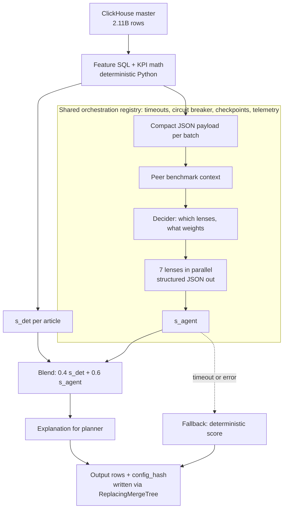
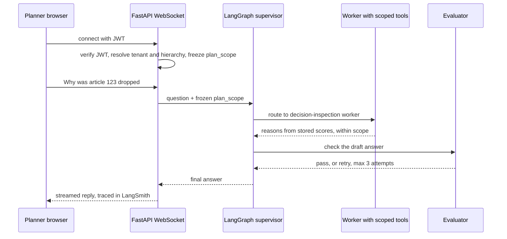

# Chapter 4 — Impact Analytics: AssortSmart Agentic Flows & Orchestration

<div class="callout note">
<b>How to use this chapter</b><br>
• Sections 1–5 give you the mental model: what the AI decides, how a score is made, and where the LLM is and isn't allowed to act.<br>
• Then study one bullet (A1–A5) per sitting. A5 (the evaluation numbers) is the one interviewers try to trip you on. Learn the split table by heart.<br>
• Practise the worked score example in section 5 until you can do it on a whiteboard.<br>
• Companion chapters: <a href="03_ia_core_platform.md">Chapter 3 (Core platform)</a>, <a href="02_numbers_explained.md">Chapter 2 (numbers)</a>, <a href="10_core_concepts_explained.md">Chapter 10 (concepts: circuit breakers, checkpoints, RAG, evals)</a>.
</div>

Role: **Senior Software Engineer, Impact Analytics, May 2026 to Present** (AssortSmart — Platform & AI). This is the first IA sub-section on the resume: **Agentic Flows & Orchestration**. The agent plane is **Python** (FastAPI, LangGraph). The platform APIs it sits next to are **Go/Gin** (see Chapter 3).

---

## 1. The one-minute version

> "On the AI side of AssortSmart I built a decision engine that tells retail planners which products to keep or drop each season, plus two sister pipelines, Missed Opportunities and Top Style. It evaluates 348,000 article-seasons, about 88,000 items per pass. The important design choice is that the money math is deterministic Python and the LLM only does qualitative judgement through seven structured 'lenses'. The model never queries our 2.11-billion-row ClickHouse table. It gets prepared JSON. If the model times out, the article falls back to its deterministic score, so a run always finishes. All three pipelines share an orchestration registry with timeouts, circuit breakers, checkpoints and per-row config hashes. I also shipped Ask Iris, a secure chat copilot for planners built on a LangGraph supervisor with a three-attempt evaluator loop, where the user's data scope is frozen when the socket connects. Nothing gets promoted unless it passes an 80% accuracy gate on a 300-case evaluation set in CI. A separate 200-case benchmark let us pick a model that cut live cost by 73% at full coverage, and when the LLM blend lost to our 74% deterministic baseline, we froze the weights instead of shipping it."

---

## 2. The business in plain English

**The decision.** Every season a retailer must decide, for each product (article), whether to **keep** it in the range or **drop** it. Keep a bad product and you're stuck with unsold stock and markdowns. Drop a good one and you lose sales. A large retailer has hundreds of thousands of article-seasons to look at. Planners can't review them all by hand.

**The three pipelines (named on the resume).**
- **Keep/Drop**: a keep or drop recommendation per article-season, with a short explanation a planner can read.
- **Missed Opportunities** and **Top Style**: sister pipelines on the same framework that surface opportunities and top-performing styles for planners. If an interviewer asks for their exact logic, describe them at the level you personally built and know. Keep/Drop is the one to go deep on.

**Why AI at all?** Simple rules ("drop if sell-through below 40%") miss context: a product may sell slowly because it launched late, because it's cannibalised by its own other colours, or because it only sells when discounted. Those patterns are qualitative. An LLM is good at weighing several pieces of evidence and explaining its reasoning in words. But LLMs are bad at arithmetic and can be confidently wrong. So the design uses each for what it's good at.

**Why the company cares.** Better range decisions directly affect stock, markdowns and sales. Explanations make planners trust and adopt the recommendation. Cost and reliability controls make it affordable to run on every client every season.

---

## 3. Words you need

| Term | Plain meaning (with analogy) |
|---|---|
| **LLM** | Large language model (OpenAI, Gemini, Claude). Reads text, writes text. |
| **Token** | A chunk of text, roughly ¾ of a word. LLM providers charge per token in and out. |
| **Structured output / structured invoke** | Asking the LLM to reply in a strict JSON shape (schema), and rejecting replies that don't fit. Like a form with fixed boxes instead of a blank letter. |
| **Deterministic** | Same input always gives the same output. Normal code is deterministic; LLM calls aren't. |
| **Sell-through** | Share of available stock that sold. Sold 80 of 100 units = 80%. |
| **Rate of sale** | Units sold per store per week. A speed measure. |
| **s_det** | The deterministic score (0 to 1) from KPI rules like sell-through and rate of sale. |
| **Lens** | One focused LLM question about an article, like "Is this product cannibalised by its other colours?" Each lens returns a score, a confidence and reason codes. |
| **Decider** | An LLM step that picks which lenses matter for this article and how to weight them. |
| **s_agent** | The combined score from the lenses. |
| **Blend / s_final** | `s_final = 0.4 × s_det + 0.6 × s_agent`. Keep if `s_final ≥ 0.55`. |
| **Payload** | The prepared JSON data the LLM receives. |
| **ReplacingMergeTree (RMT)** | A ClickHouse table type that keeps only the newest version of each key. Like a notebook where you never erase; you write the new value below and a cleaner later crosses out old lines. |
| **Eventually consistent** | For a short time you may see an old and a new version. Soon, only the newest remains. |
| **Circuit breaker** | After too many failures in a row, stop calling the failing service for a while. Like a home fuse that trips to protect the wiring. |
| **Checkpoint** | Saved progress so a job can resume where it stopped. Like a video game save point. |
| **config_hash** | A SHA-256 fingerprint of all the settings and prompts used in a run, stamped on every output row. |
| **Telemetry** | Data the system records about itself: tokens, cost, time, fallbacks. |
| **WebSocket** | A connection that stays open so the server and browser can send messages both ways, which suits chat. |
| **JWT handshake** | When the WebSocket opens, the client sends a signed token. The server verifies it once at that moment. |
| **LangGraph** | A Python library for building LLM workflows as a graph of steps with state, loops and limits. |
| **Supervisor pattern** | One coordinator node that decides which worker handles each step. Like a dispatcher. |
| **Evaluator loop** | A check step that grades an answer and asks for a retry if it's not good enough, here at most 3 attempts. |
| **LangSmith** | A tracing tool for LLM apps: shows each prompt, tool call, tokens and timing. |
| **Gold set** | Test cases with known correct answers, used to grade the system. |
| **CI gate** | An automated check in the build pipeline that blocks promotion if a score is below a threshold. |
| **Coverage (eval sense)** | Share of articles that received a complete score. 100% = no article left pending. |

---

## 4. Architecture



*What to notice: the LLM only ever sees JSON; the database reads and writes are done by our code; every failure path still produces a row.*

**Box by box.**
- **ClickHouse master (2.11B rows)**: the big fact table of sales and stock.
- **Feature SQL + KPI math**: our Python code reads ClickHouse and computes KPIs (sell-through, rate of sale, trends) once, the same way tests do. The formulas live in one place so the number a planner sees and the number a test checks can't drift.
- **s_det**: the rule-based score.
- **JSON payload**: only the fields each lens needs, trimmed (for example, the last 12 weeks for trend lenses) to keep token cost down.
- **Peer → Decider → Lenses**: the fixed batch order. There's **no LLM orchestrator** choosing the order. The Decider only picks lens weights, and Python validates them.
- **Blend** and **Explain**: the final score and a planner-readable reason.
- **Output**: rows written by our code, each stamped with the `config_hash`.

**The seven lenses** (each only runs if the article has the data for it):

| Lens | Question it asks | Runs only if |
|---|---|---|
| colour_cannibalization | Are other colours of this style stealing its sales? | at least 2 colours |
| size_curve | Is demand concentrated in a few sizes? | at least 2 sizes |
| channel_divergence | Does it sell differently online vs in store? | at least 2 channels |
| multi_season_consistency | Did it perform consistently across seasons? | at least 2 seasons |
| trend_velocity | Is demand speeding up or slowing down? | at least 3 weeks on sale |
| discount_dependency | Does it only sell when discounted? | any discount present |
| margin_resilience | Does it hold margin? | always |

Example: a single-colour, single-size sock sold in one channel for two weeks only qualifies for `margin_resilience`. No tokens are wasted on lenses with nothing to compare.

---

## 5. One article, step by step (worked example)

*The numbers below are illustrative to show the mechanics. The formulas and the threshold are the real ones.*

Article: **blue linen shirt, Season 7**.

1. **Deterministic KPIs.** Sell-through 64%, rate of sale slightly below category median. The rule ramps turn this into **s_det = 0.62**.
2. **Gate.** It has 3 colours, 5 sizes, 2 channels, 9 weeks on sale, some discounts. All seven lenses are eligible.
3. **Decider.** Picks mixes, for example a demand-focused mix (trend_velocity, size_curve, channel_divergence) and a risk-focused mix (colour_cannibalization, discount_dependency). Python adds two fixed anchor mixes and renormalises weights.
4. **Lenses** return, for example: trend_velocity 0.35 (slowing), discount_dependency 0.40 (sells mostly on discount), colour_cannibalization 0.55, margin_resilience 0.60, others around 0.5.
5. **Mixes combine to s_agent = 0.50.** The spread between mixes feeds a confidence score.
6. **Blend:** s_final = 0.4 × 0.62 + 0.6 × 0.50 = 0.248 + 0.300 = **0.548**.
7. **Rule:** keep if s_final ≥ 0.55. 0.548 < 0.55, so **Drop**, with an explanation: "Sell-through is acceptable, but demand is slowing and most units sold on discount."
8. **Write.** The row is written with `config_hash`, `computed_at`, per-lens results and `agent_status = ok`.

**If the LLM had timed out at step 4:** the batch hits its hard timeout, the article is marked as a fallback, and it gets its deterministic outcome (s_det 0.62 → Keep). The run continues for the other 87,999 items.

---

## 6. Each resume bullet decoded

### A1 — Multi-pipeline decision engine: 348k article-seasons, 88k per pass, 7 lenses

> **Resume:** Architected a multi-pipeline AI merchandise decision engine (Keep/Drop, Missed Opportunities, Top Style) evaluating 348k article-seasons. Optimized inference at scale—processing 88k items per pass—by blending deterministic KPI math with structured LLM invokes across 7 AI lenses.

**In plain words.** One framework, three pipelines. The math is ordinary code. The LLM gives structured opinions through seven lenses. We blend both.

**Why this design.**
- LLMs make arithmetic mistakes. Financial numbers must be exactly right, so code computes them.
- Qualitative patterns (cannibalisation, discount dependency) are where an LLM adds value.
- Structured JSON outputs can be validated: wrong shape means retry or fallback, never a silent bad value.

**Alternatives and why not.**
- *One giant prompt per article*: expensive, hard to debug, hard to evaluate lens by lens.
- *Let the LLM compute KPIs with a code or SQL tool*: at 88k items, that's a latency, cost and prompt-injection risk, and the math would no longer be deterministic.
- *Pure rules, no LLM*: cheaper, but misses context and gives poor explanations. Our evaluation keeps this honest (see A5).

**The numbers.**
- **348k article-seasons**: the number of product-in-a-season items the engine scores. It's not the same as the **1.6M** article-seasons in the full catalog (off the PDF). Never mix the two.
- **88k items per pass**: the batch size of one run, chosen to fit memory and provider rate limits.
- **7 lenses**: the seven active lens types above.
- **$100 per pass**: true, but not on the resume. Use it only if they ask about cost.

**Questions they will ask.**
- *"How did you handle rate limits at 88k?"* Parallel batches with hard per-batch timeouts and backoff. A circuit breaker stops hammering a failing provider. Checkpoints mean a throttle doesn't restart the run.
- *"Why not fine-tune a model?"* Structured prompts with few-shot examples plus offline evals got us there. Fine-tuning would add a training pipeline we didn't need. It's also not on the resume.

---

### A2 — JSON payloads, not database access; ReplacingMergeTree writes; timeout fallback

> **Resume:** Decoupled AI inference from a 2.11B-row ClickHouse master by asynchronously serving context via JSON payloads rather than direct database querying. Engineered an eventually consistent write pattern via ReplacingMergeTree that guaranteed system availability by gracefully falling back to deterministic baselines during LLM timeouts.

**In plain words.** The LLM never touches the database. Our code reads the data and gives the model a JSON summary. Our code writes the results. If the model is slow, the article gets its rule-based score so the system stays available.

**How it works.**
- **Read side.** Feature SQL runs in our code against ClickHouse. The result is packed into JSON per batch. The model gets **no SQL tool** on the scoring path.
- **"Asynchronously"** describes how batches are executed (concurrently, without blocking each other). It doesn't mean the model queries the database "async". If an interviewer says "so the LLM still queries ClickHouse, just asynchronously?", correct them: JSON in, our code writes out.
- **Write side.** Rows land in ReplacingMergeTree tables keyed by `(season_code, article)` with a version (latest `computed_at`). If a retry writes the same article twice, ClickHouse keeps the newest in the background. Readers use `argMax(..., computed_at)` or `LIMIT 1 BY` to read the latest row now, instead of relying on `OPTIMIZE FINAL`.

```sql
SELECT article, argMax(outcome, computed_at) AS outcome
FROM reco_final_score
WHERE season_code = 7
GROUP BY article;
```

- **Fallback.** Each LLM batch has a hard timeout. On timeout or error, the article is marked fallback and written with its deterministic score.

**Why.** Letting an LLM run SQL against a production analytical table invites runaway queries, connection-pool exhaustion and prompt-injection attacks. Separating them also makes cost predictable.

**Alternatives.** Plain MergeTree would keep duplicate rows on retries. A transactional database for results would be slower to scan for screens. Two-phase commit across an LLM provider isn't possible.

**Don't say:** "zero corruption guaranteed", "physical air-gap" (old wording), or that the LLM writes to ClickHouse.

---

### A3 — Shared orchestration registry: timeouts, circuit breakers, checkpoints, config_hash, telemetry

> **Resume:** Engineered a shared orchestration registry to guarantee 88k-article batch runs survive provider failures by implementing hard timeouts, circuit breakers, and durable checkpoints that bypass redundant deterministic scoring. Ensured full observability by stamping every output row with a frozen config hash and custom JSON telemetry tracking tokens, USD cost, step duration, and batch fallbacks.

**In plain words.** One shared harness that all three pipelines use, so a run of 88k items survives an LLM provider outage, can resume without redoing work, and records exactly what config produced each row and what it cost.

**How it works.**
1. **Freeze config.** At run start, weights, guardrails, parameters, prompt files and catalog are frozen. Their SHA-256 hash becomes `config_hash`. Because prompt text is part of the hash, editing a prompt creates a new config version.
2. **Deterministic phase first.** s_det for all articles is computed and saved (`det.json`).
3. **LLM phase in timed batches.** Each batch has a hard timeout.
4. **Circuit breaker.** If about 5 calls fail in a row, or too large a fraction fail, the breaker opens: stop calling the provider, mark affected articles as fallback, and wait before trying again. This prevents burning money and time on a provider that's down.

```text
CLOSED  --(about 5 consecutive failures)-->  OPEN  --(cool-down)-->  HALF-OPEN
HALF-OPEN --(test call succeeds)--> CLOSED          HALF-OPEN --(fails)--> OPEN
```

5. **Checkpoints.** As LLM chunks finish, per-article progress is appended (`agent_progress.json`). On `--resume`, the job reloads `det.json`, skips finished articles, and continues. That's what "bypass redundant deterministic scoring" means.
6. **Telemetry.** Each step writes JSON like this (values illustrative):

```json
{"run_id": "kd-s7-0412", "step": "lens.trend_velocity", "batch": 17,
 "tokens_in": 48210, "tokens_out": 6120, "usd": 0.41, "duration_ms": 18400, "fallbacks": 2}
```

**Why not Airflow or Temporal?** Those are great general workflow engines. This workload needed resume logic tightly tied to our checkpoints, config hashing and per-run cost JSON. Adding a big external orchestrator was more infrastructure than a batch CLI with an HTTP start path needed.

**Don't say:** human-in-the-loop review queues (not in this system; offline evals replaced earlier critic/evaluator agents in Keep/Drop), LangSmith on this bullet (LangSmith is Ask Iris), or that it's "Hystrix".

---

### A4 — Ask Iris: JWT-secured WebSocket copilot

> **Resume:** Shipped "Ask Iris," a JWT-secured WebSocket copilot enabling planners to interactively query KPIs and inspect AI decisions on a multi-billion-row database. Prevented infinite LLM loops and multi-tenant data leaks by orchestrating a LangGraph supervisor with a 3-attempt evaluator loop, utilizing LangSmith for observability, and strictly freezing hierarchy access on the initial socket handshake.

**In plain words.** A chat assistant inside the product. A planner can ask "What was sell-through for Women's Tops last week?" or "Why did you drop article 123?" Security is set once when the chat connects and can't be changed by later messages. Answers are checked, and the loop can't run forever.



**How it works.**
- **Handshake.** The JWT comes in the `Authorization: Bearer` header or a `?token=` query parameter. The server verifies it and resolves `plan_scope` (tenant, hierarchy, plan) **once**. Every tool call in that session inherits the frozen scope. A message like "now show me Retailer B" can't widen it.
- **Supervisor.** Routes each question to the right worker (for example, KPI questions vs decision-inspection questions). Workers call predefined, scope-bound tools. The model doesn't get a raw SQL shell.
- **Evaluator loop.** Checks the draft answer. If it fails, it retries, capped at `MAX_ATTEMPTS = 3`. A recursion limit on the graph is a second safety net. After the cap, it returns a graceful "I couldn't answer that reliably" instead of looping.
- **LangSmith** traces every step: prompts, tool calls, tokens, latency. That's how you debug a bad answer.

**Why WebSocket?** Chat is two-way and streaming. Re-sending auth on every HTTP call is more surface for mistakes. Freezing scope at the start makes the security model simple to reason about.

**The number "3".** Three attempts balance answer quality against cost and latency. One attempt gives no recovery. Unlimited attempts risk infinite loops and runaway token spend.

**Honesty.** Ask Iris is a **shipped capability**. Don't invent usage numbers, accuracy figures or SLAs for it. Don't claim it "generates dynamic charts" (that phrase was dropped).

---

### A5 — 300-case harness, 80% CI gate, 73% cost cut, 74% baseline, frozen weights

> **Resume:** Built a 300-case proxy evaluation harness and an 80% accuracy CI gate to enforce strict deployment guardrails. Reduced live execution costs by 73% at 100% coverage by benchmarking models against a 74% deterministic baseline, strategically freezing final decision weights when the LLM underperformed the baseline.

**In plain words.** We grade the system on test cases before anything ships. CI blocks promotion below 80%. Separately, we benchmarked models and switched to one that's 73% cheaper while still scoring every article. We also compared against the free rule-based baseline (74%). When the LLM blend did worse than that, we didn't "tune" our way around it. We froze the weights.

**The split table: memorise this.**

| Number | Where it comes from | What it means |
|---|---|---|
| **300 cases** | The proxy gold evaluation file (`cases.json`) | The test set that CI runs |
| **80%** | `eval.json` setting `gold_min_accuracy: 0.8` | The **promotion gate**: below 80%, a config can't be promoted |
| **73% cheaper, 100% coverage** | A separate **gold-200 benchmark**: the newer model vs the previous mini model, 200 of 200 cases completed | The model choice for live scoring: same coverage, much lower cost |
| **74%** | The production deterministic rule (threshold 0.65) on that same 200-case set | The free baseline the LLM must beat |
| **Frozen weights** | Same bench: blended LLM about 63%, below the 74% baseline | Don't retune the 0.4 / 0.6 blend from a small proxy set |

**How to say it.** "Promotion requires 80% on a 300-case proxy set in CI. Separately, on a 200-case gold benchmark, we picked a model that was 73% cheaper with every article scored, and we compared everything against a 74% deterministic baseline. When the blend scored lower than the baseline, we froze the weights."

**Why the model choice.** The cheaper model completed all 200 cases at 73% lower cost. An even cheaper option returned some pending (incomplete) rows. Completion reliability won over the last few cents. The model names aren't on the resume. If asked, say "a newer, cheaper model vs the previous mini model".

**Why freezing was the right call.** A small proxy set is easy to overfit. Changing weights to beat a test you've seen is how you fool yourself. Shipping something that loses to a free rule would be worse than shipping nothing.

**Don't say:** "80% accuracy for all tenants in production", "the 300-case suite measured 73%", or any fusion of the two benchmarks into one run.

---

## 7. Tech used in this chapter and why

| Tech | One line | Why here | Alternative |
|---|---|---|---|
| Python | The AI ecosystem language | LLM SDKs, LangGraph, data tooling | Go (fewer AI libraries) |
| FastAPI | Async Python web framework | Ask Iris WebSocket and run-start HTTP path | Django Channels, Flask |
| LangGraph | Graph-based LLM workflows with state and limits | Supervisor and evaluator loop with a recursion cap | Hand-rolled loop, CrewAI |
| LLM providers (OpenAI, Gemini, Claude) | Hosted models | Lens scoring, explanations, chat | Self-hosted models (ops cost) |
| LangSmith | LLM tracing | Debug Ask Iris prompts and tool calls | Langfuse, custom logs |
| ClickHouse | Columnar analytics DB | The 2.11B-row master, ReplacingMergeTree outputs | BigQuery |
| Redis, PostgreSQL | Cache and transactional DB | Shared with the platform (auth, scopes) | — |

---

## 8. Hard problems

1. **Over-keeping.** Early lens prompts kept too many weak articles (a single strong week or good margin looked fine). Fix: few-shot examples weighted toward "weak or declining demand with thin evidence must Drop", and "thin evidence → neutral score, capped confidence". Any prompt change creates a new config_hash, so it must pass the eval gate.
2. **KPI drift between lenses and rules.** Lens features once used a naive sell-through formula while the rules used the correct one, so lenses saw about 100% sell-through. Fix: one KPI source of truth used by both SQL generation and tests.
3. **Provider outages mid-run.** Fix: timeouts, circuit breaker, checkpoints and deterministic fallback, so a 504 doesn't sink 88k items.
4. **The LLM lost to the baseline.** Fix: freeze weights, keep the gate. This is a good "data over ego" story.

---

## 9. Say this / don't say this

<div class="callout warn">
<b>Say:</b> "the LLM never gets a SQL tool on the scoring path" · "80% is a CI promotion gate" · "73% and 74% come from a separate 200-case benchmark" · "Ask Iris is shipped; I don't quote SLAs for it" · "the batch order is fixed; there's no LLM orchestrator in Keep/Drop".<br><br>
<b>Don't say:</b> all tenants live at 80% · human review queues / HITL · LangSmith on the Keep/Drop batch · Milvus or vector search at IA (that's Uber Menu) · Kafka, Flink, CDC or Kubernetes operations at IA · that Cluster Recommendation Copilot or Hindsight are resume bullets (they're verbal-only depth) · 348k = 1.6M.
</div>

---

## 10. Practice drill

1. **Why not let the LLM compute KPIs?** Math must be exact and repeatable. Code does it once. The LLM judges patterns.
2. **What is a lens?** One focused, structured LLM question about an article, returning score, confidence and reason codes.
3. **How is the final score computed?** 0.4 × s_det + 0.6 × s_agent. Keep at 0.55 or above.
4. **What happens on an LLM timeout?** That article gets its deterministic outcome, is marked fallback, and the run continues.
5. **Why ReplacingMergeTree?** Retries can write the same article twice. RMT keeps the newest version per key.
6. **What does config_hash prove?** Exactly which settings and prompts produced a row, so results are reproducible and auditable.
7. **How does resume work?** Deterministic results are saved first. LLM progress is appended per article. Restart skips finished work.
8. **What trips the circuit breaker?** Consecutive failures (about 5) or a high failure fraction.
9. **How does Ask Iris prevent cross-tenant leaks?** Scope is resolved from the JWT at the handshake, frozen, and inherited by every tool call.
10. **How do you prevent infinite loops?** The evaluator is capped at 3 attempts, and the graph has a recursion limit.
11. **What is the 300-case set?** The proxy gold set that the CI promotion gate runs.
12. **Where does 73% come from?** A separate 200-case model benchmark, at 100% coverage.
13. **What is the 74%?** The production deterministic rule's accuracy on that benchmark.
14. **Why freeze weights?** The blend scored about 63%, below the baseline. Retuning on a small set would overfit.
15. **What would you do next?** Grow the gold set, add per-lens evals, and measure held-out Drop recall before any prompt change.

---

## 11. 3-minute whiteboard script

1. **Left side (40 s):** ClickHouse 2.11B → our feature SQL and KPI code → two arrows: s_det, and JSON payload. Say: "The model never sees the database."
2. **Middle box (50 s):** the registry around Peer → Decider → 7 lenses → s_agent. Write "timeouts, breaker, checkpoints, telemetry" on the border. Say: "Fixed order, no LLM orchestrator. Failures fall back to s_det."
3. **Right side (30 s):** blend formula, keep ≥ 0.55, explanation, RMT write with config_hash.
4. **Below (40 s):** Ask Iris sequence: JWT handshake → frozen scope → supervisor → worker → evaluator ×3 → LangSmith.
5. **Corner (20 s):** the eval split table: 300 / 80% gate; 200 bench: 73% cheaper, 100% coverage, 74% baseline, frozen weights. Say: "We refused to ship when the AI lost to the rule."
