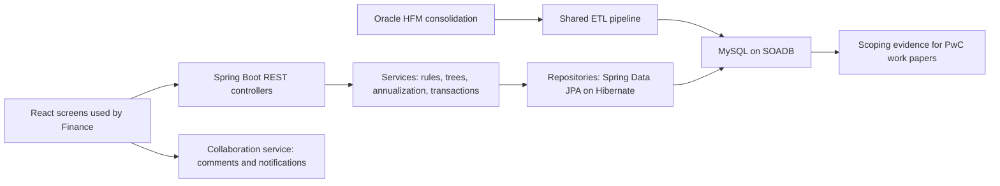
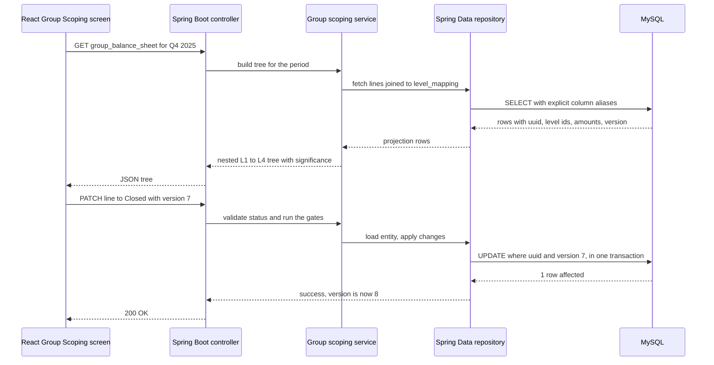
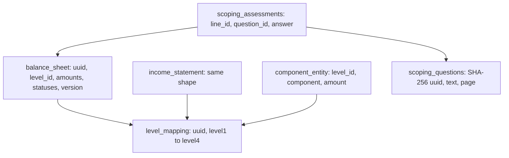

# Chapter 5. Uber FRM Scoping Platform (Uber via EPAM)

## 1. How to use this chapter

<div class="callout note">

**How to use this chapter**

- **What it covers:** the Financial Risk Management (FRM) Scoping Platform I built for Uber Finance while employed by EPAM Systems (always say "Uber via EPAM"). It teaches the finance ideas from zero, then the engineering (Java, Spring Boot, Spring Data JPA and Hibernate on MySQL), then every number on the resume.
- **When to read it:** before any interview where Uber, fintech, Java or Spring Boot backends, MySQL, data modelling, migrations or "tell me about a hard bug" might come up.
- **What to memorise:** the one-minute version (section 2), the five numbers 70%, $340M, 19M, 36 and 100% with their derivations (section 7), the column-aliasing bug story (sections 7 and 9), and the whiteboard script (section 12).

</div>

**Tags used in this chapter.** MEASURED means there is a log, document or code behind it. TARGET means it was a design goal, so you say "targeting". ESTIMATED means arithmetic I can show. HISTORICAL means it comes from my past work records. Numbers printed on the resume are the resume's claims and you defend them as written.

Related chapters: [Start here](00_START_HERE.md) · [Numbers explained](02_numbers_explained.md) · [Menu and ANZ](06_uber_menu_and_anz.md) · [Tech glossary](09_tech_glossary.md) · [Core concepts](10_core_concepts_explained.md) · [STAR stories](11_star_stories.md). Older, denser source material lives in [the FRM deep dive](../prep/11_uber_frm_deep_dive.md) and [the Uber interview packs](../prep/23b_uber_interview_packs.md). Where those older pages say "30+ endpoints, do not say 36" or "do not say 19M", this chapter wins, because the current resume prints 36 and 19M.

---

## 2. The one-minute version

Say this out loud, in your own rhythm:

> "At Uber, through EPAM, I owned the backend of the FRM Scoping Platform for Uber Finance. Every quarter, Finance has to decide which line items and which legal entities are important enough to be tested by the auditors, PwC. That process used to live in a big Google Sheets workbook, and the reconciliation part alone took about 14 days. I moved it onto a Java, Spring Boot and MySQL service: I migrated 19 million raw general-ledger rows off Sheets into an 8-table normalized schema on Uber's service-owned MySQL standard, and shipped 36 Spring Boot endpoints that do the financial math, a four-level line-item hierarchy and quarter-annualization. The quarterly reconciliation came down from 14 days to 3 days, a 70% cut, measured against a $340M materiality threshold. Because several managers edit the same close at once, I designed optimistic row-locking, atomic cross-table writes and SHA-256 natural keys so we never got duplicates in the audit trail. I also led 3 engineers on a Spring Data JPA and Hibernate migration that removed a nasty column-aliasing bug and brought the module to 100% statement coverage, shipped through stacked Bazel PRs with SQL allowlists and state-machine gates for SOX."

If you only get 20 seconds: "I owned Uber Finance's quarterly audit-scoping backend through EPAM. Sheets to MySQL, 36 Spring Boot endpoints, reconciliation from 14 days to 3 days, and I led 3 engineers on the Spring Data JPA and Hibernate migration that got the module to 100% statement coverage."

Every Spring term in this script (Spring Boot, JPA, Hibernate, entity, repository) is explained in plain words in section 4.

---

## 3. The business in plain English

### What a quarterly close is

A public company like Uber must publish its financial results every quarter. Before it can publish, Finance runs the **quarterly close**: a few intense weeks where every team finalises its numbers, books the last adjustments, checks that the numbers add up across systems, and produces the official financial statements. Think of it like closing a shop's till at the end of the day, but for a company with hundreds of legal entities in dozens of countries, and with outside auditors checking your work.

Uber files those results with the US Securities and Exchange Commission (SEC) in a quarterly report called the **10-Q** (the annual version is the 10-K). Once filed, the numbers are public and legally binding.

### Who the users are

- **The FRM team (Financial Risk Management) inside Uber Finance.** Once a quarter they run the **scoping process**. Scoping means deciding which financial line items and which entities are "in scope" for risk assessment and audit testing.
- **Finance managers** who own specific lines or entities. They review numbers, answer qualitative questions ("Is there a new risk on this line?"), and move each line through review statuses.
- **PwC, Uber's external auditor.** PwC uses the scoping output as evidence in its **audit work papers**, the documented record of what the auditor tested and why.

### What hurt before

Before this platform, scoping lived in a large Google Sheets workbook. It had formulas, manual parent-child mapping of line items, and copy-pasted data from the finance systems. The technical design document described the core problem as flat-file storage that could not handle recursive financial hierarchies, which led to manual mapping errors and no real-time visibility.

In practical terms:

- **No stable IDs.** A row in a sheet has no permanent identity. You cannot attach a comment or an audit history to "row 412", because row 412 moves when someone inserts a row.
- **No concurrency control.** Two managers editing the same sheet overwrite each other.
- **No single source of truth.** Copies of the workbook drift apart.
- **Slow reconciliation.** Checking the internal numbers against the filed numbers was manual and took about 14 days.

### Why Uber paid for this

Scoping is a SOX control (explained in section 4). If scoping is too narrow, a real risk goes untested and the auditors may flag a control deficiency. If it is too broad, the company wastes expensive audit hours. A wrong number here does not stay internal: it flows into audit evidence for an SEC filing. Uber needed the process to be faster, repeatable, auditable and safe for several people to edit at once. That is what the platform gave them.

---

## 4. Words you need

This chapter has two vocabularies. Learn the finance words first, because interviewers will test whether you understand the domain you built for.

### Finance words

**General ledger (GL).** The master record of every account and every balance a company keeps. Think of it as the company's complete bank statement for every account at once: cash, receivables, revenue, payroll and so on. A "raw GL row" is one balance for one account, one entity, one period. The resume says I migrated **19M raw GL rows** off Sheets.

**Oracle HFM (Hyperion Financial Management).** The consolidation system Uber uses. Each entity's ledger is loaded into HFM, converted to one currency, and intercompany transactions are removed so the group's numbers are not double-counted. HFM produces Uber's internal source-of-truth group numbers. Analogy: HFM is the kitchen where each branch's ingredients are combined into one meal.

**10-Q reconciliation (HFM vs filed 10-Q).** A line-by-line check that the HFM amount for each line equals the amount in the publicly filed 10-Q. The code computes `difference = hfm_amount_in_millions - financial_statement_amount_in_millions`. A non-zero difference is a "break" that someone must explain before scoping proceeds. Analogy: checking that the receipt in your hand matches the amount on your card statement.

**FSLI (Financial Statement Line Item).** One line on the balance sheet or income statement, for example Cash, Accounts Receivable, or Revenue.

**The L1 to L4 FSLI hierarchy.** Line items nest inside each other, like folders. Level 1 is the broadest heading, level 4 the most detailed. Parents are the sum of their children. Here is an illustrative tree (labels are generic examples, not a copy of Uber's chart of accounts):

```text
L1  Assets
├── L2  Current assets
│   ├── L3  Cash and cash equivalents
│   │   ├── L4  Cash in bank
│   │   └── L4  Short-term deposits
│   └── L3  Accounts receivable
│       ├── L4  Trade receivables
│       └── L4  Allowance for doubtful accounts
└── L2  Non-current assets
    └── L3  Property and equipment
        └── L4  Equipment, net
```

What to notice: every L3 amount must equal the sum of its L4 children, and every L2 must equal the sum of its L3 children. If one leaf is duplicated, every parent above it is wrong. That invariant shows up again in the bug story.

**Materiality.** The dollar size of a mistake that would change the decision of a reasonable reader of the financial statements. Auditors usually set it as a percentage of a key figure such as pre-tax income, revenue or total assets. Anything smaller than materiality is "not big enough to matter on its own". On the Q4 2025 close, group materiality was **$340M** (MEASURED, stored as a row in the metrics table with `metric_key = "materiality"`).

A worked example with $340M (line amounts are illustrative):

| Line item | HFM amount | Bigger than $340M? | Quantitative material? |
|---|---|---|---|
| Accounts receivable | $1,200M | Yes | YES |
| Prepaid expenses | $90M | No | NO |
| Short-term investments | $410M | Yes | YES |

Prepaid expenses is not quantitatively material. It can still become significant if a manager answers a qualitative question with yes, for example "there was a new type of transaction this quarter". The platform's rule, which is in the code, is: **Overall significance is Significant if quantitative OR qualitative is YES.**

**Group scoping.** Looking at the consolidated Uber balance sheet and income statement line by line and asking "is this FSLI significant to the group?" This is the top of the tree.

**Component scoping.** Drilling down under each significant FSLI to the individual entities or components and deciding which ones get tested. This is the leaves.

**The 5% significance rule.** A component (a legal entity) is a **Financially Significant Component** if its revenue is more than 5% of group revenue, or the absolute value of its assets is more than 5% of group assets. Illustrative example: if group revenue were $10,000M and Entity A had $600M of revenue, Entity A is at 6%, which is above 5%, so it is financially significant and lands in scope. The 5% values are not hard-coded. They are configurable benchmarks (`assets_benchmark`, `revenue_benchmark`), and changing them triggers a recompute through `PUT /update_benchmark_thresholds`.

**Residual risk.** After you put the big components in scope, some balance is still left uncovered. Residual risk asks: "is what's left over still big enough to worry about?" Per leaf line: `Residual balance = HFM amount - total in scope` and `Residual multiple = residual balance / materiality`. On Q4 2025 the residual threshold was **$170M**, which is exactly half of $340M. Example: a line has $1,200M in HFM and $1,000M covered by in-scope components. Residual is $200M. The multiple is 200 / 340 ≈ 0.59, which is above 50% of materiality, so the line is flagged and a manager must look again.

**EMI (Equity Method Investments).** Stakes Uber holds in other companies where it owns a share but does not consolidate them. They are scoped on their own screen, one column per investee, with fields like ownership percentage, asset balance and auditor.

**SOX (Sarbanes-Oxley Act, 2002).** A US law passed after accounting scandals like Enron. Section 404 requires public companies to maintain and test **internal controls over financial reporting**, and the external auditor must attest to them. In plain words: it is not enough for the numbers to be right, you must prove you have a reliable, repeatable process that makes them right. That is why auditors like PwC care about who changed what, when, and whether a change was reviewed. An audit trail, stable IDs and enforced review steps are exactly what SOX evidence looks like.

**Quarter-annualization.** Income statement lines (revenue, expenses) are flows that build up during the year. Balance sheet lines are snapshots at a point in time. To compare a partial-year flow with annual benchmarks, you scale it up to a full-year estimate. Two common generic forms:

- From a single quarter: `annualized = quarter amount × 4`. If Q1 revenue is $90M, the annualized estimate is $360M.
- From year-to-date (YTD) after `n` quarters: `annualized = YTD × 4 / n`. If YTD revenue after Q3 is $270M, the estimate is 270 × 4 / 3 = $360M.

The resume calls it "dynamic" because the factor depends on which quarter you are in. In the code, the income-statement component endpoint carries YTD annualization rules. **If asked for the exact formula, say it is applied per FSLI according to Finance's rules, and describe the generic YTD × 4 / n idea.** Do not invent a specific rule per line.

### Engineering words

**SOADB.** Uber's standard for service-owned MySQL databases (MySQL on the InnoDB engine). Each service owns its own database under a shared operating model. Analogy: every team gets its own locker in a building that the facilities team maintains.

**Spring Boot.** The most widely used framework for building backend services in Java. It gives you a web server, JSON handling, database wiring and configuration out of the box, so you write business code instead of plumbing. Analogy: a furnished flat. You move in and arrange things, you do not build the walls.

**Bean and dependency injection.** In Spring, a **bean** is an object that Spring creates and manages for you, such as a controller, a service or a repository. **Dependency injection** means a class declares what it needs in its constructor, and Spring hands it the right bean at startup. Analogy: a restaurant kitchen where the chef says "I need a knife" and the kitchen porter puts one on the station. The chef never forges the knife. In tests you hand the class a fake instead.

**`@RestController` and mappings.** A `@RestController` is a Java class whose methods answer HTTP requests. `@GetMapping("/path")` and `@PatchMapping("/path")` say which URL and HTTP method each method answers. `@RequestParam`, `@PathVariable`, `@RequestHeader` and `@RequestBody` pull values out of the query string, the URL, the headers and the JSON body.

**`@RestControllerAdvice`.** One central class that turns Java exceptions into HTTP status codes. Instead of every controller writing its own try/catch, a "not found" exception thrown anywhere becomes a 404 in one place. Analogy: a single complaints desk for the whole shop.

**DTO (Data Transfer Object).** A small class that only carries data in or out of the API, kept separate from the database classes. Here they are Java **records**, which are compact, immutable data classes: `record GroupLinePatch(String conclusionScope, ReviewStatus groupStatus, long version) {}`. Analogy: the order slip a waiter carries, not the kitchen's stock ledger.

**Bean Validation.** A Java standard for declaring rules on fields with annotations such as `@NotNull`, `@NotBlank` and `@Pattern`. When a controller parameter is marked `@Valid`, Spring checks those rules before your code runs and rejects bad input with a 400. Analogy: the bouncer who checks IDs at the door so the bar staff never have to.

**ORM (Object-Relational Mapper).** A library that lets you work with database rows as objects in your language instead of hand-writing SQL for every read and write. Analogy: an interpreter between your code, which thinks in objects, and the database, which thinks in tables.

**JPA (Jakarta Persistence API).** The Java standard that defines how an ORM must behave: how a class maps to a table, how to load and save it, how to query it. JPA is the rulebook. It is not code that runs by itself.

**Hibernate.** The most widely used implementation of JPA, and the one Spring Boot uses by default. Hibernate is the engine that actually generates the SQL, tracks which objects changed, and writes them back. If JPA is the driving code, Hibernate is the car.

**Entity.** A Java class marked `@Entity` that maps to one table. Each field maps to a column, and one object is one row. `BalanceSheetLine` is the entity for the `balance_sheet` table.

**Spring Data JPA and repositories.** Spring Data JPA sits on top of JPA and Hibernate and removes boilerplate. You write a **repository**, which is just a Java interface such as `interface BalanceSheetRepository extends JpaRepository<BalanceSheetLine, String>`, and Spring generates the implementation at startup: `findById`, `save`, `findAll`, plus queries derived from method names like `findByFiscalQuarterAndFiscalYear`. Analogy: a librarian who already knows how to fetch any book by its catalogue number, so you only describe what you want.

**JPQL, native queries and projections.** **JPQL** (Jakarta Persistence Query Language) looks like SQL but talks about entities and fields instead of tables and columns, and Hibernate translates it to MySQL SQL. A **native query** is raw MySQL SQL passed straight through. A **projection** is a query that returns only some columns into a small result type instead of whole entities. In Spring Data, an interface projection maps each result column to a getter by its **alias** (the name after `AS`), which matters a lot in the bug story.

**`@Transactional`.** An annotation on a service method that says "run all of this as one database transaction". Spring opens a transaction when the method starts, commits when it returns normally, and rolls back if it throws an unchecked (runtime) exception. Analogy: a bank transfer form that is either fully processed or shredded, never half-done.

**`@Version` (optimistic locking in JPA).** A numeric field on an entity that Hibernate checks and increments on every update. If the row's version in the database is no longer the one you loaded, Hibernate refuses the update and throws an optimistic-locking exception. Section 7 shows exactly what SQL it writes.

**Thread-per-request.** Spring Boot's standard web stack (Spring MVC on a servlet container such as Tomcat) gives each incoming HTTP request its own thread. Blocking database calls are therefore normal and need no special handling. Analogy: every customer gets their own cashier for the length of their visit.

**JUnit 5, Mockito and MockMvc.** **JUnit 5** is the standard Java test framework: you write methods marked `@Test` with assertions. **Mockito** creates fake versions of classes ("mocks") so you can test a service without a real repository, and check what it was called with. **MockMvc** sends fake HTTP requests to your controllers without starting a real server, so you can assert status codes and JSON. Analogy: a flight simulator. Everything behaves like the real cockpit, but nothing leaves the ground.

**Normalized schema.** A database design where each fact is stored once, in one place, and other tables point to it by key. The opposite of a spreadsheet where the same label is typed in a thousand rows.

**Natural key.** An ID derived from the data itself rather than a random number. If the same data arrives twice, it gets the same ID, so you can detect the duplicate. Analogy: identifying a book by its ISBN instead of by a sticker number the library made up.

**SHA-256.** A cryptographic hash function. It turns any input into a fixed-length fingerprint. Same input always gives the same fingerprint, and different inputs almost never collide. In Java you compute it with the built-in `java.security.MessageDigest` class.

**Optimistic locking.** A way to stop two people from silently overwriting each other without holding a database lock while they think. Each row has a version number. You may only save if the version is still the one you read. Analogy: a shared document that says "someone else edited this since you opened it, please reload" instead of locking everyone else out.

**Lock contention.** When many writers wait on the same database locks, everything slows down or times out. During a close, the data load jobs (ETL, Extract-Transform-Load) and the managers' edits were competing for the same data.

**Atomic transaction.** A group of writes that either all succeed or all fail. No half-done state is ever visible.

**FSM (finite state machine).** A model where an item is always in exactly one named state, and only certain moves between states are allowed. Here the states are the review statuses: Draft, Review, ReOpen, Closed. A **gate** is a check that can block a move.

**Delta-variance.** The percentage change of a line between periods. A 50% delta-variance check flags a line whose amount moved by more than half since the prior period.

**Bazel.** Google's open-source build system, used for Uber's monorepo. It builds and tests only what changed, and every target is declared explicitly.

**Stacked PRs.** A chain of small pull requests where each builds on the previous one. Reviewers read one small step at a time, and each step can merge and deploy on its own.

**SQL allowlist.** A fixed list of permitted values (columns, filters, page names, statuses or query shapes). Anything not on the list is rejected. It keeps user input from ever turning into arbitrary SQL.

**Statement coverage.** The percentage of code lines (statements) that run at least once during the test suite. 100% means no line in that module is untested.

---

## 5. Architecture



*What to notice: the service is strictly layered. Requests only flow controller, then service, then repository, then MySQL. The ETL and the collaboration service are neighbours I integrate with, not systems I claim to have built.*

Walking through it box by box:

1. **Oracle HFM** holds Uber's consolidated numbers for each quarter.
2. **The shared ETL pipeline** extracts raw GL balances and entity data from HFM, resolves the parent-child hierarchy into stable IDs, and loads the rows into MySQL. This was a shared pipeline responsibility. I say "the service consumes HFM-loaded tables".
3. **MySQL on SOADB** is the system of record. Every row carries the fiscal period (`fiscal_quarter`, `fiscal_year`) and audit columns (`created_by`, `updated_by`, timestamps).
4. **Spring Boot REST controllers** are thin. They only do HTTP work: read the caller's identity from the `x-auth-params-email` header that Uber's gateway injects after login (401 if missing), validate inputs with Bean Validation on request DTOs, and hand off to a service. One `@RestControllerAdvice` maps exceptions to status codes: a "not found" exception becomes 404, a validation failure becomes 400, a stale version becomes 409, a Sheets outage on the legacy path becomes 503, and anything else 500.
5. **Services** own the business logic: materiality and significance rules, the 5% component rule, residual risk, building the nested L1 to L4 tree and summing children into parents, and quarter-annualization. Services also own the transaction boundary with `@Transactional`, so a multi-step write commits once or rolls back as a whole.
6. **Repositories** own every query. They are Spring Data JPA interfaces over Hibernate entities, with JPQL queries where a derived method name is not enough. Each request runs on its own servlet thread, so these blocking database calls need no special handling.
7. **The React screens** (built by others) call the 36 endpoints. There are eight screens: Reconciliation, Materiality, EMI Scoping, Group Scoping, Threshold Setup, Component Scoping, Residual Risk and Summary.
8. **The collaboration service** handles comments and Slack-style notifications. It was a separate service. I did not build it.
9. **PwC** receives the scoping output as audit evidence.

Here is what the controller layer looks like, simplified:

```java
@RestController
@RequestMapping("/frm-scoping")
class GroupScopingController {
    private final GroupScopingService service;

    GroupScopingController(GroupScopingService service) {
        this.service = service;
    }

    @GetMapping("/group_balance_sheet")
    List<FsliNodeDto> groupBalanceSheet(@RequestParam("fiscal_quarter") String fiscalQuarter,
                                        @RequestParam("fiscal_year") int fiscalYear) {
        return service.buildGroupTree(fiscalQuarter, fiscalYear);
    }

    @PatchMapping("/group_balance_sheet/{uuid}")
    GroupLineDto updateLine(@PathVariable String uuid,
                            @Valid @RequestBody GroupLinePatch body,
                            @RequestHeader("x-auth-params-email") String email) {
        return service.updateLine(uuid, body, email);
    }
}
```

*What to notice: the controller has no business logic and no SQL. Spring injects the service through the constructor. A missing `fiscal_quarter` or a missing identity header is rejected by Spring before the method body runs.*

And the one place where exceptions become status codes:

```java
@RestControllerAdvice
class ApiErrors {
    @ExceptionHandler(MissingRequestHeaderException.class)
    ResponseEntity<String> noIdentity() {
        return ResponseEntity.status(HttpStatus.UNAUTHORIZED).body("missing identity");
    }

    @ExceptionHandler(NotFoundException.class)
    ResponseEntity<String> notFound(NotFoundException e) {
        return ResponseEntity.status(HttpStatus.NOT_FOUND).body(e.getMessage());
    }

    @ExceptionHandler(ObjectOptimisticLockingFailureException.class)
    ResponseEntity<String> stale() {
        return ResponseEntity.status(HttpStatus.CONFLICT).body("changed by someone else, please reload");
    }
}
```

*Simplified sketch. Validation failures (`MethodArgumentNotValidException`, `MissingServletRequestParameterException`) map to 400 the same way.*

**Why layering matters here.** Each layer can be tested with the layer below mocked out. A controller test uses a mock service. A service test uses a mock repository. No database is needed for those unit tests. It also let three engineers work on one feature at the same time without stepping on each other.

---

## 6. One job, step by step: a manager closes a balance-sheet line

Sample situation (illustrative data): it is the Q4 2025 close. Priya, a Finance manager, is on the Group Scoping screen looking at "Accounts receivable", which has an HFM amount of $1,200M. Materiality is $340M. Last quarter the line was $1,000M.



*What to notice: the read path builds the whole tree on the server, and the write path is a single guarded UPDATE that Hibernate writes for us, checking the version, after the service has passed the state-machine gate.*

The same flow in numbered steps:

1. The screen calls `GET /frm-scoping/group_balance_sheet?fiscal_quarter=Q4&fiscal_year=2025`.
2. The controller binds the query parameters with `@RequestParam`. If `fiscal_quarter` is missing, Spring rejects the call with a 400 before any of my code runs.
3. The service asks the repository for all balance-sheet lines for that period, joined to the `level_mapping` table that holds the L1 to L4 labels.
4. The repository runs a JPQL query where every selected column has an explicit, unique alias, so a fact row's `uuid` can never be confused with the mapping row's `uuid`.
5. The service applies the rules. $1,200M is above $340M, so `quantitative_material = YES` and the line is Significant. It also builds the tree and sums children into parents.
6. Priya marks the line "In scope" and moves it to Closed. The screen sends `PATCH /frm-scoping/group_balance_sheet/{uuid}` with `{"conclusion_scope": "In Scope", "group_status": "Closed", "version": 7}`. Jackson, the JSON library inside Spring Boot, turns that body into a `GroupLinePatch` record, and `@Valid` checks it.
7. The controller reads `x-auth-params-email` (Priya's email) with `@RequestHeader` for the audit trail.
8. The status field is a Java enum, so only Draft, Review, ReOpen or Closed can even be parsed. The service then runs the delta-variance gate: the line moved from $1,000M to $1,200M, a 20% change, which is under 50%, so the move to Closed is allowed.
9. Inside one `@Transactional` method, the service loads the entity, confirms the version Priya sent is still 7, sets the new fields and `updated_by`, and flushes. Hibernate writes `UPDATE ... WHERE uuid = ? AND version = 7` and sets the version to 8. One row is affected, so the write succeeded.
10. If another manager had saved first, the version check would fail. Hibernate throws an optimistic-locking exception, the advice class turns it into a 409 Conflict, and Priya is asked to reload instead of silently overwriting.

---

## 7. Each resume bullet decoded

### Bullet 1: ownership, 70%, $340M, 19M rows, 36 endpoints, L1 to L4, quarter-annualization

> "Owned the Financial Risk Management scoping backend, reducing quarterly reconciliation time by 70% (from 14 days to 3 days) against a $340M materiality threshold. Engineered the Sheets-to-MySQL migration across 19M raw GL rows, shipping 36 Spring Boot endpoints to automate custom financial math and a nested 4-level FSLI (L1–L4) hierarchy with dynamic quarter-annualization."

#### In plain words

I owned the backend that Finance uses to scope the quarterly audit. I moved the data out of Google Sheets into MySQL, built the API that does the finance calculations and the four-level line-item tree, and that cut the reconciliation part of the close from about two weeks to three days.

#### How it works

**Sheets to MySQL.** The ETL loads HFM data into MySQL tables keyed by fiscal period. Every line gets a permanent `uuid`. The text hierarchy (L1 to L4 labels) lives once in `level_mapping`, and fact rows store only a `level_id` that points to it. A rename of a parent heading therefore does not rewrite thousands of fact rows.

**The recon v1 to v2 parallel run (the migration I personally owned).** The old reconciliation endpoints read from Google Sheets. I added new MySQL-backed endpoints next to them instead of replacing them:

- v1, Sheets-backed: `GET /recon_balance_sheet`, `GET /recon_income_statement`
- v2, MySQL-backed: `GET /v2/recon_balance_sheet`, `GET /v2/recon_income_statement`

The change touched 18 files with about 1,268 lines added (MEASURED from the migration write-up). It added two JPA entities, response DTOs for each tree level, repository readers, and a service that builds the L1 to L3 recon tree and sums children into parents. QA compared v1 and v2 responses for the same period side by side. The test plan covered happy paths, an empty period returning an empty list, missing parameters returning 400, a check that the v1 response shape was unchanged, and a check that each parent equals the sum of its children. The UI was pointed at v2 once it matched on staging. v1 stayed in place as a fallback.

**Building the tree.** The service reads flat rows, groups them by L1, then L2, then L3 (and L4 where the screen needs it), and sums amounts upward. The display order of FSLIs follows the order of the financial statements, defined in a lookup keyed by parent path. Unknown FSLIs are appended at the end rather than dropped, so new source data cannot crash the API.

```java
class TreeNode {
    BigDecimal amount = BigDecimal.ZERO;
    String uuid;
    final Map<String, TreeNode> children = new LinkedHashMap<>();

    TreeNode child(String label) {
        return children.computeIfAbsent(label, k -> new TreeNode());
    }
}

TreeNode buildTree(List<FsliRow> rows) {
    TreeNode root = new TreeNode();
    for (FsliRow r : rows) {
        TreeNode l1 = root.child(r.level1());
        TreeNode l2 = l1.child(r.level2());
        TreeNode l3 = l2.child(r.level3());
        l3.uuid = r.uuid();
        l3.amount = r.hfmAmount();
        l2.amount = l2.amount.add(r.hfmAmount());
        l1.amount = l1.amount.add(r.hfmAmount());
    }
    return root;
}
```

*Simplified sketch to explain the idea. `LinkedHashMap` keeps insertion order, and money is `BigDecimal` rather than `double` so amounts never pick up floating-point rounding errors. The real service also handles ordering, display formatting such as `($8)` for negatives, and the difference column.*

**The materiality rule.** Two independent tests and an OR:

```java
static String overallSignificance(BigDecimal hfmAmount, BigDecimal materiality, String qualitativeAnswer) {
    boolean quantitative = hfmAmount.compareTo(materiality) > 0;
    boolean qualitative = "YES".equals(qualitativeAnswer);
    return (quantitative || qualitative) ? "Significant" : "Not Significant";
}
```

*`BigDecimal` values are compared with `compareTo`, not `>` or `equals`, because `equals` also compares scale (so 340.0 and 340.00 would not be equal).*

**Quarter-annualization.** For income-statement component views, YTD amounts are scaled to a full-year estimate using the quarter number, so a Q1 figure is not compared with an annual benchmark as if it were a full year. Generic form: `YTD × 4 / n`.

**The 36 endpoints.** All live under one base path, declared once with `@RequestMapping("/frm-scoping")`, and spread across a few controllers by screen. The main groups are:

| Group | Examples |
|---|---|
| Health and smoke | `GET /health`, `POST /scoping` |
| Reconciliation v1 and v2 | `GET /recon_balance_sheet`, `GET /v2/recon_balance_sheet` and the income-statement pair |
| Group scoping | `GET` and `PATCH /group_balance_sheet/{uuid}`, same for income statement |
| Component scoping | `GET /bs_components`, `GET /is_components`, cascading filter endpoints |
| Residual risk | `GET /residual_risk?fsli_type=bs` or `is` |
| EMI | `GET /emi_scoping`, `GET /emi_data`, `PATCH /emi_data/{uuid}` |
| Metrics, materiality, thresholds | `GET` and `PUT /materiality`, `PUT /update_benchmark_thresholds`, `GET` and `PATCH /threshold-setup/{uuid}` |
| Questions and assessments | `POST /scoping_questions/bulk`, `GET`, `POST` and `PATCH /scoping_assessments` |

#### Why this design

- **MySQL over Sheets** because Sheets has no stable row identity, no concurrency control and no audit trail, which are exactly what a SOX control needs.
- **A parallel run instead of a big-bang switch** because the close has a hard deadline. If v2 had a bug, Finance could keep using v1 that same day.
- **Hierarchy flattened into `level_id` by the ETL, tree built in Java** because the data per quarter is small, and building the tree in application code is simpler to test than recursive SQL.

#### Alternatives and why not

- **Keep Sheets and add scripts.** Still no stable IDs, no concurrency control. Rejected.
- **A data warehouse (columnar store).** Good for big analytical scans, poor at many small transactional edits by managers. The workload is transactional. Rejected.
- **PostgreSQL with recursive queries.** A fine database, but Uber's service standard is MySQL on SOADB, and we did not need recursive SQL because the ETL flattens the hierarchy. Fighting the platform would have bought nothing.
- **Replace v1 in place.** Faster to write, but no fallback during a live close. Rejected.

**Trade-off.** Two code paths existed for a while, so a fix sometimes had to be checked in both. **What I'd do differently:** add an automated parity job that diffs v1 and v2 for every period nightly, instead of relying on QA side-by-side checks.

#### The numbers

**70% (from 14 days to 3 days).**
- *What it measures:* the time Finance spent on quarterly reconciliation, before and after the platform.
- *How derived:* (14 − 3) / 14 = 78.6%, which the resume states conservatively as 70%. The technical design document framed a 70% cut in manual ingestion and reconciliation time as the goal, and that is what the platform delivered for the close.
- *Why it mattered:* reconciliation sits at the front of scoping. Every day saved there gives managers and PwC more time for real review before the filing deadline.
- *How to say it:* "Quarterly reconciliation went from 14 days to 3 days, about a 70% cut."
- *What not to say:* do not walk it back unprompted. If pressed on measurement, say: "The technical design doc framed that cut, and that's what the platform delivered for the close." Do not claim a precise hour-by-hour time study.

**$340M materiality threshold.**
- *What it measures:* the group materiality on the Q4 2025 close, stored as a metric row (MEASURED).
- *How derived:* set by Finance and the auditors, not by me. The residual threshold on the same close was $170M, half of it.
- *Why it mattered:* it is the bar every line is measured against. Any line above $340M is quantitatively material.
- *How to say it:* "Against a $340M materiality threshold on the Q4 2025 close."
- *What not to say:* do not present it as a permanent constant. It is configurable and changes by period.

**19M raw GL rows.**
- *What it measures:* the raw general-ledger rows migrated off Sheets into MySQL.
- *How derived:* this is the resume figure for the migration. Individual quarterly GL extracts were roughly 38K to 95K rows, covering about 1.7K to 1.8K accounts and about 400 entities.
- *Why it mattered:* moving that history into a relational store gave every line a stable ID and a period key.
- *How to say it:* "I migrated 19 million raw GL rows off Sheets into MySQL."
- *What not to say:* do not invent where the 19M breaks down beyond "raw GL rows migrated off Sheets". If someone asks about data volume per quarter, say: "Each quarterly extract was tens of thousands of rows. The value was correctness, the hierarchy and auditability, not big-data throughput." Never call this a big-data system.

**36 Spring Boot endpoints.**
- *What it measures:* the platform's API surface.
- *How derived:* about 31 functional routes in the scoping service controllers, plus the collaboration-service comment and notification APIs defined in the technical design doc, make 36.
- *Why it mattered:* each endpoint replaced a manual spreadsheet step: a calculation, a status move, a filter.
- *How to say it:* "36 Spring Boot endpoints automating the financial math and the hierarchy."
- *What not to say:* do not say you personally built the collaboration service. If asked for the breakdown, give it calmly as above.

#### Questions they will ask

**"What exactly did you own?"**
I owned the scoping service backend: the Spring Boot controllers, the services that hold the finance rules, the Spring Data repositories and the JPA entities. I personally drove the reconciliation migration from Sheets to MySQL. The ETL from HFM was a shared pipeline responsibility, and the comments and notifications service was a separate team's service. The React screens were built by front-end engineers on top of my APIs.

**"Explain materiality to me like I'm not in finance."**
Materiality is the size of mistake that would actually change someone's decision when reading the financial statements. On our Q4 2025 close it was $340M. So a $1.2 billion receivables line is material on its own, and a $90M prepaid line is not, unless a manager flags a qualitative risk. In the platform it is just a configurable metric row, and the rule is "significant if over materiality or qualitatively flagged".

**"How did you make sure v2 gave the same numbers as v1?"**
I ran them side by side. Both endpoints were live at the same time for the same period, and QA compared the responses. I also checked invariants like "every parent equals the sum of its children" and "the v1 response shape is unchanged". The UI only switched to v2 once staging matched, and v1 stayed as a fallback.

**"19 million rows in MySQL is not much. Why is this hard?"**
Agreed, it is not a scale problem. The hard part is correctness: a recursive hierarchy where one duplicated leaf silently inflates every parent, several managers editing at once, and the output becoming audit evidence for an SEC filing. I'd rather be honest that this is a correctness and auditability system than dress it up as big data.

*Follow-up they may ask:* "Then why the 70%?" Because the slow part was never compute. It was manual mapping, copy-paste and chasing differences, and the platform automated those.

**"Why Spring Boot for this service?"**
It gave us a standard, well-understood structure: thin `@RestController` classes, services with `@Transactional` boundaries, and Spring Data repositories, all wired by dependency injection so every layer is easy to mock in tests. Bean Validation rejects bad input at the edge, and JPA's `@Version` gives optimistic locking without hand-written SQL. For a finance service that has to be correct and auditable, boring and predictable is a feature.

---

### Bullet 2: 8-table schema, SOADB, polymorphic review-status, optimistic locking, atomic syncs, SHA-256 keys

> "Resolved ETL pipeline lock contention during financial close by designing an 8-table normalized MySQL schema on Uber's SOADB featuring a polymorphic review-status model. Guaranteed real-time, multi-user collaboration integrity by implementing optimistic row-locking, atomic cross-table syncs, and deterministic SHA-256 natural-key hashing to eliminate data duplication across quarterly audit trails."

#### In plain words

During close, data loads and managers' edits were fighting over the same data. I designed a clean MySQL schema where each fact lives once, gave every reviewable item the same status model, and added three safety mechanisms: version checks so nobody overwrites someone else, all-or-nothing writes across tables, and IDs computed from the content so the same item can never be inserted twice.

#### How it works

**The schema.** The spine is `level_mapping`, which holds the L1 to L4 labels and a stable `uuid`. Fact tables (`balance_sheet`, `income_statement`, `component_entity`) store a `level_id` pointing at it. Joins always also match `fiscal_quarter`, `fiscal_year` and active flags, because the same line exists once per period. Supporting tables hold metrics such as materiality, legal-entity thresholds, EMI data, scoping questions and the answers to them.



*What to notice: `level_mapping` is the spine, and nothing stores the hierarchy text twice. The version check on reviewable rows is how optimistic locking works. Column lists are simplified for the whiteboard.*

The PDF says 8 tables, which is the normalized core design. The scoping service code ends up with 11 JPA entities in total (verbal depth), because supporting tables were added as screens landed, for example the two recon v2 tables from the reconciliation migration. Say "an 8-table normalized core, 11 JPA entities in the service code". Do not try to map 8 to 11 one by one unless asked, and if asked, name the spine tables above.

**Each table as a JPA entity.** Here is the balance-sheet line, simplified:

```java
@Entity
@Table(name = "balance_sheet")
public class BalanceSheetLine {
    @Id
    private String uuid;

    @Column(name = "level_id")
    private String levelId;

    @Column(name = "hfm_amount")
    private BigDecimal hfmAmount;

    @Column(name = "conclusion_scope")
    private String conclusionScope;

    @Enumerated(EnumType.STRING)
    @Column(name = "group_status")
    private ReviewStatus groupStatus;

    @Column(name = "updated_by")
    private String updatedBy;

    @Version
    private long version;

    // getters and setters
}

public interface BalanceSheetRepository extends JpaRepository<BalanceSheetLine, String> {}
```

*What to notice: `@Entity` and `@Table` map the class to the table, `@Column` maps each field to a column, `@Id` is the primary key, and `@Version` turns on optimistic locking. The repository is one line, and Spring generates `findById`, `save` and the rest.*

**Polymorphic review-status.** "Polymorphic" means one status model reused across different kinds of items. Group lines, component lines, residual lines and legal-entity threshold rows each carry a status column (`group_status`, `component_status`, `residual_status`, `review_status`), and all use the same vocabulary: **Draft, Review, ReOpen, Closed**. In Java that vocabulary is a single enum that every entity reuses:

```java
public enum ReviewStatus { Draft, Review, ReOpen, Closed }
```

`@Enumerated(EnumType.STRING)` stores the constant's name, so the column holds exactly `Draft`, `Review`, `ReOpen` or `Closed`. That is why the constants are spelled like the stored values rather than in the usual upper case. Because a request DTO declares the field as `ReviewStatus`, Jackson cannot even parse a value like `"Approved"`, and the request fails with a 400. One type, one set of transitions and one UI component serve every screen.

**Optimistic row-locking, a worked SQL example.** Two managers open the same line at the same time:

```sql
-- Both managers read the line. Each sees version = 7.
SELECT uuid, conclusion_scope, group_status, version
FROM balance_sheet
WHERE uuid = 'a1f3c9...';

-- Manager A saves first.
UPDATE balance_sheet
SET conclusion_scope = 'In Scope',
    group_status     = 'Review',
    version          = version + 1,
    updated_by       = 'manager.a@uber.com'
WHERE uuid = 'a1f3c9...' AND version = 7;
-- 1 row affected. The row is now at version 8.

-- Manager B saves using the version B read earlier.
UPDATE balance_sheet
SET conclusion_scope = 'Out of Scope',
    version          = version + 1,
    updated_by       = 'manager.b@uber.com'
WHERE uuid = 'a1f3c9...' AND version = 7;
-- 0 rows affected. B's view is stale.
```

*Illustrative SQL with simplified columns.* With JPA you do not write that `WHERE ... AND version = 7` yourself. Because the entity has a `@Version` field, Hibernate adds the version check and the `version + 1` to every UPDATE it generates. The service only has to compare the version the browser sent with the one it loaded:

```java
@Transactional
public GroupLineDto updateLine(String uuid, GroupLinePatch patch, String email) {
    BalanceSheetLine line = repo.findById(uuid)
            .orElseThrow(() -> new NotFoundException(uuid));
    if (line.getVersion() != patch.version()) {
        throw new ObjectOptimisticLockingFailureException(BalanceSheetLine.class, uuid);
    }
    gates.checkCanMove(line, patch.groupStatus());
    line.setConclusionScope(patch.conclusionScope());
    line.setGroupStatus(patch.groupStatus());
    line.setUpdatedBy(email);
    return GroupLineDto.from(repo.saveAndFlush(line));
}
```

*Simplified sketch.* There are two layers of protection here. The explicit comparison catches the common case, where Manager B's screen is minutes out of date. Hibernate's own version check in the UPDATE catches the rare race where someone else commits in the milliseconds between `findById` and the flush. In that case zero rows are affected, Hibernate throws an `OptimisticLockException`, and Spring wraps it as `ObjectOptimisticLockingFailureException`. Either way the `@RestControllerAdvice` turns it into a 409 Conflict, and the screen asks Manager B to reload and reapply. Nobody waited on a lock while thinking, and nobody's work was silently lost.

**Atomic cross-table syncs.** Some edits must change two tables together. For example, when a manager answers a qualitative scoping question, the answer row is saved and the mapped balance-sheet line's qualitative field is updated in the same transaction. If the line update hits zero rows, the whole thing rolls back. Another example: updating the asset and revenue benchmarks writes both metric rows and commits once.

```java
@Transactional
public void saveAnswerAndSync(String assessmentUuid, String answer, String lineUuid, String user) {
    ScopingAssessment assessment = assessments.findById(assessmentUuid)
            .orElseThrow(() -> new NotFoundException(assessmentUuid));
    assessment.setAnswerText(answer);
    assessment.setUpdatedBy(user);

    int updated = balanceSheets.updateQualitative(lineUuid, "Yes".equals(answer) ? "YES" : "NO", user);
    if (updated == 0) {
        throw new NotFoundException("mapped line not found");
    }
}
```

```java
@Modifying
@Query("update BalanceSheetLine b set b.qualitativeMaterial = :flag, b.updatedBy = :user where b.uuid = :uuid")
int updateQualitative(@Param("uuid") String uuid, @Param("flag") String flag, @Param("user") String user);
```

*Simplified sketch of the pattern.* `@Transactional` means one transaction for the whole method. The assessment change is tracked by Hibernate and written at commit (this is called **dirty checking**: Hibernate notices which loaded entities changed and writes only those). The `@Modifying` query is a JPQL bulk update that returns the number of rows changed. If it is zero, the method throws, and Spring rolls back the assessment change too. Two details worth knowing: Spring only rolls back automatically on unchecked exceptions, so `NotFoundException` extends `RuntimeException`. And a JPQL bulk update skips `@Version`, so where the line itself needs a version check, you load the entity and change it instead, as in `updateLine` above.

**SHA-256 natural keys.** Scoping questions are re-loaded every quarter. Without care, each reload would insert duplicates. The ID is computed from the content: the SHA-256 of the question text plus the normalized page name.

```java
static String questionUuid(String questionText, String pageName) {
    String normalizedPage = pageName.strip().toLowerCase(Locale.ROOT);
    try {
        MessageDigest sha256 = MessageDigest.getInstance("SHA-256");
        byte[] digest = sha256.digest((questionText + normalizedPage).getBytes(StandardCharsets.UTF_8));
        return HexFormat.of().formatHex(digest).substring(0, 32);
    } catch (NoSuchAlgorithmException e) {
        throw new IllegalStateException("SHA-256 is always available on the JVM", e);
    }
}
```

The upsert is a write, so it runs as a native MySQL query from the repository:

```sql
INSERT INTO scoping_questions (uuid, question_text, page_name, is_active)
VALUES ('5e1b...', 'Any new revenue streams this quarter?', 'group_scoping', 'true')
ON DUPLICATE KEY UPDATE is_active = VALUES(is_active);
```

*The normalization shown is illustrative. Check the code for the exact rule.* Fixing the character set to UTF-8 and the locale to `Locale.ROOT` matters: otherwise the same text could hash differently on a machine with a different default setting. The same question on the same page always produces the same ID, so re-sending the bulk payload updates rows in place. The bulk endpoint returns the IDs in input order.

**Lock contention, explained.** During close, the ETL was loading data while managers were editing. Long transactions and wide, spreadsheet-shaped data mean writers queue on the same locks. The design reduces that in three ways: short single-purpose `@Transactional` service methods, optimistic version checks instead of holding locks while a user thinks, and a normalized layout where a load and an edit are less likely to fight over the same rows.

#### Why this design

- **Optimistic over pessimistic locking** because conflicts are rare (managers usually own different lines), and holding a lock for the minutes a human takes to edit would block everyone else and the ETL.
- **Natural keys over random IDs** for re-loaded reference data, because the same content must map to the same row every quarter.
- **One status model** because eight screens with eight slightly different status rules would be eight places for a SOX bug.

#### Alternatives and why not

- **Pessimistic locks everywhere** (`SELECT ... FOR UPDATE`, which in JPA is `@Lock(LockModeType.PESSIMISTIC_WRITE)`). Safe, but it serialises everyone during the busiest weeks and makes lock contention worse.
- **Last write wins.** Simple, but silently loses a manager's work. Unacceptable for audit evidence.
- **Auto-increment IDs plus a "check if exists" query.** Racy under concurrent loads, and the ID changes between environments.
- **Separate status tables per screen.** More flexible, but duplicates logic.

**Trade-off.** Optimistic locking pushes conflict handling to the user, who sometimes has to reload. **What I'd do differently:** show who changed the row in the conflict message, so the second manager knows whom to talk to.

#### The numbers

**8 tables.**
- *What it measures:* the normalized core MySQL schema on the PDF.
- *How derived:* from the schema design. Verbal depth: 11 JPA entities in the service code.
- *How to say it:* "An 8-table normalized MySQL schema on SOADB."
- *What not to say:* do not say "the whole database is 11 tables". The comments and notifications tables live in the separate collaboration service.

#### Questions they will ask

**"Why optimistic locking and not row locks?"**
Because conflicts are rare and humans are slow. Managers mostly own different lines, so blocking everyone for the minutes it takes someone to type a conclusion would hurt far more than the occasional reload. With a `@Version` field, the second writer gets a clear 409 "this changed, please reload" instead of silently overwriting. It also keeps database locks short, which was the lock-contention problem we were solving during close.

**"How does `@Version` actually work?"**
Hibernate reads the version with the row, and every UPDATE it generates includes `AND version = <the value I read>` and sets `version = version + 1`. If another transaction committed first, the WHERE matches zero rows, and Hibernate throws an optimistic-locking exception instead of pretending it saved. Spring wraps that as `ObjectOptimisticLockingFailureException`, and our advice class maps it to 409.

*Follow-up they may ask:* "What does `@Transactional` do if you call the method from inside the same class?" Nothing, because Spring applies it through a proxy that wraps the bean. A call from inside the same object skips the proxy. So transactional methods live on the service and are called from the controller.

**"Why SHA-256 for a key? Isn't that overkill?"**
I needed a deterministic ID, meaning the same question on the same page always gets the same ID, in every environment and every quarter. A hash of the content gives exactly that and makes the bulk load idempotent. SHA-256 ships with every JVM through `MessageDigest`, collisions are not a practical concern, and the cost is trivial at this volume.

*Follow-up they may ask:* "What if the question text has a typo fixed?" Then it is a new question with a new ID, which is actually correct for an audit trail. The old one can be deactivated.

**"What does polymorphic mean here?"**
One status model used by different kinds of rows. Group lines, component lines, residual lines and threshold rows all move through Draft, Review, ReOpen and Closed. One Java enum, one state machine, one UI pattern.

---

### Bullet 3: led 3 engineers, Spring Data JPA / Hibernate migration, column-aliasing bug, 100% coverage, stacked Bazel PRs, SQL allowlists, FSM gates, 50%

> "Led 3 engineers in a core Spring Data JPA / Hibernate migration that eliminated latent column-aliasing bugs and raised module statement coverage to 100%. Orchestrated zero-downtime releases via stacked Bazel PRs, embedding reporting SQL allowlists and automated FSM gates with 50% delta-variance checks to enforce SOX compliance."

#### In plain words

I was tech lead of a three-person EPAM pod. We moved the data layer from hand-written raw SQL to Spring Data JPA on Hibernate, which killed a class of bugs where joined columns with the same name silently overwrote each other. We tested every line of that module. We shipped it in small chained pull requests with no downtime, locked reporting queries to an approved list, and added a state-machine check that stops a line being closed if its amount jumped by more than half without review.

#### How it works

**The column-aliasing bug, told precisely.** The legacy read path ran raw SQL through JDBC and turned each result row into a map keyed by column name:

```java
List<Map<String, Object>> rows = jdbc.query(sql, (rs, rowNum) -> {
    ResultSetMetaData meta = rs.getMetaData();
    Map<String, Object> row = new LinkedHashMap<>();
    for (int c = 1; c <= meta.getColumnCount(); c++) {
        row.put(meta.getColumnLabel(c), rs.getObject(c));
    }
    return row;
}, params);
```

That is only safe if every column name in the result is unique. The component query joined a fact table (aliased `i`) to `level_mapping` (aliased `lm`), and both tables have columns called `uuid`, `level_id`, `fiscal_quarter` and `fiscal_year`. When the query selected both `i.uuid` and `lm.uuid` without distinct aliases, the result had two columns literally labelled `uuid`. The loop walks columns by position, and `Map.put` with a key that is already present replaces the old value. So the map keeps the **last** `uuid`, and each row silently held the `level_mapping` uuid instead of the fact row's uuid.

A tiny demonstration:

```java
List<String> keys = List.of("uuid", "amount", "uuid");        // fact uuid, amount, mapping uuid
List<Object> values = List.of("fact-111", 1200, "map-999");
Map<String, Object> row = new LinkedHashMap<>();
for (int i = 0; i < keys.size(); i++) {
    row.put(keys.get(i), values.get(i));
}
// {uuid=map-999, amount=1200}    the fact uuid is gone
```

*Symptom:* rows looked correct on screen, but they carried the wrong identifier. A PATCH by uuid or a comment attached to a line pointed at a different line. It surfaced when an edit to one recon line appeared to affect another.

*The fix:* move the read to a Spring Data JPA repository query that gives every projected column an explicit, unique alias, and map the result into a typed projection whose getters must match those aliases:

```java
public interface ComponentRow {
    String getFsliId();
    String getLevelId();
    String getLevelMappingUuid();
    String getLevel1();
    String getLevelMappingFiscalQuarter();
}

@Query("""
    select min(i.uuid)            as fsliId,
           min(i.levelId)         as levelId,
           max(lm.uuid)           as levelMappingUuid,
           lm.level1              as level1,
           max(lm.fiscalQuarter)  as levelMappingFiscalQuarter
    from ComponentEntity i
    join LevelMapping lm on lm.uuid = i.levelId
         and lm.fiscalQuarter = i.fiscalQuarter and lm.fiscalYear = i.fiscalYear
    where i.fiscalQuarter = :quarter and i.fiscalYear = :year
    group by lm.level1
    """)
List<ComponentRow> findComponentRows(@Param("quarter") String quarter, @Param("year") int year);
```

*Simplified sketch.* Now no two result columns can share a name. Spring Data maps each alias to the matching getter, so `fsliId` and `levelMappingUuid` arrive as separate fields, and the service maps `fsliId` back onto the DTO's `uuid` deterministically. The general lesson: when you build rows keyed by column name, duplicate names across joined tables cause a silent last-write-wins overwrite. Give every column an explicit alias, or load whole entities.

**What else Spring Data JPA and Hibernate brought.** Every table became a typed `@Entity`, so the compiler sees real field types instead of `Object` values pulled out of a map. Simple reads became repository methods like `findById` or `findByFiscalQuarterAndFiscalYear`, and joins became JPQL with named parameters, never string-built SQL. Transactions became one consistent pattern, `@Transactional` on service methods, instead of hand-written commit and rollback code in every repository. And `@Version` gave us optimistic locking as a built-in feature.

**100% statement coverage.** Every statement in the migrated module runs in at least one test. The suite uses JUnit 5 with Mockito mocks: controller tests use MockMvc with a mocked service, and service tests use mocked repositories, so these tests need no database. They check status codes, response shapes, the 401 path when the identity header is missing, and error-to-status mapping. Across the service there are 1,100+ tests (verbal depth).

```java
@WebMvcTest(GroupScopingController.class)
class GroupScopingControllerTest {
    @Autowired MockMvc mvc;
    @MockBean GroupScopingService service;

    @Test
    void patchWithoutIdentityHeaderIsRejected() throws Exception {
        mvc.perform(patch("/frm-scoping/group_balance_sheet/a1f3")
                        .contentType(MediaType.APPLICATION_JSON)
                        .content("{\"conclusion_scope\":\"In Scope\",\"group_status\":\"Closed\",\"version\":7}"))
           .andExpect(status().isUnauthorized());
        verifyNoInteractions(service);
    }
}
```

*What to notice: `@WebMvcTest` starts only the web layer, `@MockBean` swaps the real service for a Mockito mock, and `verifyNoInteractions` proves the request never reached business logic.* For repository queries themselves, a common practice is a `@DataJpaTest` against a throwaway MySQL started by Testcontainers. Describe that as general practice if asked, not as a number from this project.

**Stacked Bazel PRs and zero downtime.** Each package has a Bazel test target, and CI runs the targets layer by layer: entities, DTOs, repositories, services, controllers. All must pass before merge. Work was split into a chain of small PRs in that same order, so a reviewer read one layer at a time and each PR was safe to deploy on its own. Changes were additive: new code paths appeared next to old ones (as with recon v2 next to v1), and the switch happened only after verification. Nothing had to go down.

**Reporting SQL allowlists.** User input never becomes raw SQL. Only approved values are accepted for things like page names, statuses, filter levels and statement types (`fsli_type` is `bs` or `is`), and reporting queries are built from approved, parameterized shapes. Two concrete examples in the code: `GET /scoping_questions` only accepts allowlisted page names, and status updates only accept Draft, Review, ReOpen or Closed (enforced by the `ReviewStatus` enum).

```java
private static final Set<String> ALLOWED_PAGES =
        Set.of("group_scoping", "component_scoping", "residual_risk");   // illustrative names

public List<QuestionDto> getQuestions(String pageName) {
    if (!ALLOWED_PAGES.contains(pageName)) {
        throw new BadRequestException("unknown page");
    }
    return questions.findByPageNameAndIsActive(pageName, "true");    // bound parameter, never string concat
}
```

**FSM gates with 50% delta-variance.** Each reviewable line is in one state: Draft, Review, ReOpen or Closed. The gate is a check that blocks moving a scoping item forward, for example to Closed, when the line's quarter-over-quarter change is more than 50% and it has not been reviewed.

```java
static double deltaVariance(BigDecimal current, BigDecimal prior) {
    if (prior.signum() == 0) {
        return Double.POSITIVE_INFINITY;
    }
    return current.subtract(prior).abs()
            .divide(prior.abs(), MathContext.DECIMAL64)
            .doubleValue();
}

static void checkCanClose(ScopingLine line, boolean reviewed) {
    if (deltaVariance(line.getCurrentAmount(), line.getPriorAmount()) > 0.50 && !reviewed) {
        throw new GateViolationException("variance above 50 percent needs review before Closed");
    }
}
```

*Sketch with illustrative names, to explain the mechanism.* Worked example: a line was $400M last quarter and is $650M now. The change is 250 / 400 = 62.5%, above 50%, so the move to Closed is blocked until the line has been reviewed. A line that went from $1,000M to $1,200M (20%) passes. Keep it at this mechanism level. Do not invent extra rules.

Do not confuse this 50% with the residual-risk flag, which checks whether residual balance is above 50% of materiality ($170M on Q4 2025). They are separate checks.

**Leading 3 engineers.** I was tech lead of the EPAM pod, not a people manager. Concretely:
- **Task split by layer.** Work was cut along the controller, service, repository and entity boundary, so two people could build the same feature without merge collisions. One person took the request DTOs and controller, another took the repository and entities.
- **Conventions.** Thin controllers. Services own the logic, the tree building and the `@Transactional` boundary. Repositories own every query, with an explicit alias on every projected column. Every write records `updated_by` from the identity header. No catch block that swallows an exception. These came out of our backend team syncs, and the uniformity across the codebase is the evidence they were enforced.
- **Review gate.** Every PR had to add or update tests in the matching test folder and pass the Bazel targets.

#### Why this design

- **Aliases on every column** because the bug was silent. A crash you notice. A wrong ID you do not.
- **100% on the module** because this code produces audit evidence. Untested lines in a SOX-relevant path are a liability.
- **Stacked PRs** because a 1,000-line PR in a finance service is unreviewable, and reviewers miss bugs in big diffs.
- **Allowlists** because reporting endpoints take user-chosen filters. An allowlist is the simplest way to guarantee no SQL injection and no surprise query shapes.
- **A state-machine gate** because SOX is about enforced process. A big unexplained movement must not slip through to Closed.

#### Alternatives and why not

- **Patch each raw query by hand.** Fixes today's bug, leaves the pattern for the next person. Rejected in favour of the Spring Data JPA migration.
- **Lower coverage target with integration tests only.** Slower, flakier, and leaves branches unexercised.
- **One big migration PR with a feature flag.** Possible, but review quality drops and rollback is all-or-nothing.
- **Free-form SQL for reporting with escaping.** Escaping is easy to get wrong. Rejected.
- **A purely manual variance review.** Humans forget under deadline pressure. The gate makes it impossible to forget.

**Trade-off.** Strict aliasing and allowlists add boilerplate to every new query and filter. **What I'd do differently:** add a static-analysis rule that fails CI when a repository builds rows into a `Map` by column name or uses a native SELECT without an explicit alias on every column, so the old pattern cannot creep back in.

#### The numbers

**3 engineers.**
- *What it measures:* the size of the EPAM pod I led as tech lead.
- *How to say it:* "I led a pod of 3 engineers."
- *What not to say:* do not call it people management, and do not merge it with "mentored 2 engineers" at Masters India. Those are different jobs.

**100% statement coverage.**
- *What it measures:* statement coverage of the module touched by the Spring Data JPA / Hibernate migration.
- *How to say it:* "We raised module statement coverage to 100%."
- *What not to say:* do not claim 100% of the whole monorepo or the whole service. Do not borrow the 82% coverage number from Masters India.

**50% delta-variance.**
- *What it measures:* the threshold for period-over-period change that triggers the gate.
- *How derived:* `|current − prior| / |prior| > 0.5`.
- *How to say it:* "A state-machine gate blocks closing a line if it moved more than 50% quarter over quarter without review."

#### Questions they will ask

**"Tell me about the column-aliasing bug."**
The legacy code ran raw SQL and built each row into a map keyed by column label. We joined a fact table to the hierarchy table, and both had a column called `uuid`. The result had two `uuid` columns, and putting the second one into the map replaced the first, so every row silently carried the hierarchy's uuid instead of the line's own uuid. Edits and comments landed on the wrong line. I fixed it by moving to a Spring Data JPA query with an explicit, unique alias on every column, like `fsliId` versus `levelMappingUuid`, mapped into a typed projection. Then we made that pattern the standard in the migration so it could not come back.

*Follow-up they may ask:* "How would you catch that class of bug earlier?" A test that asserts the uuid on each returned row exists in the fact table, and a static-analysis rule that forbids building rows into maps by column name in repositories.

**"Why did a JPA migration fix it, and not just better SQL?"**
Better SQL would have fixed that one query. The migration fixed the pattern. With entities and typed projections, each value lands in a named, typed field chosen by alias, so there is no shared map for two columns to collide in. And because every repository now looks the same, reviewers can spot a missing alias at a glance.

**"What does leading 3 engineers actually mean for you?"**
I was the tech lead of the pod, not their manager. I sliced work by layer so people could work in parallel, set the conventions everyone followed, reviewed PRs, and held the gate that every PR comes with tests and passes Bazel. The recon migration is a good example: 18 files cleanly split across layers.

**"How do stacked PRs give you zero downtime?"**
Each PR is small and additive, and deployable on its own. New code lives alongside old code until it is verified. For the recon migration, the v2 endpoints existed next to v1, and the UI switched only after staging matched. At no point did we have to take the service down or break the old path.

**"What is the 50% check for?"**
SOX wants evidence that big movements were looked at. If a line moved more than 50% since the prior quarter, the state machine refuses to move it to Closed until someone has reviewed it. It turns a "please remember to check" into a rule the system enforces.

---

## 8. Tech used in this project and why

| Tech | What it is | Why here | Alternative considered |
|---|---|---|---|
| Java | Statically typed language on the JVM | The service's language. Static types and `BigDecimal` suit financial math | None, it was the team's standard |
| Spring Boot | Java framework for REST services, with dependency injection | Thin `@RestController` classes, `@RestControllerAdvice` error mapping, Bean Validation on request DTOs | Plain Spring MVC wired by hand, more setup for the same result |
| Spring Data JPA | Repository layer that generates queries from interfaces | One-line repositories, derived queries, JPQL with named parameters and aliased projections | Hand-written JDBC SQL, which caused the bug |
| Hibernate | The JPA implementation that generates SQL and tracks changes | `@Entity` mapping, dirty checking, `@Version` optimistic locking | MyBatis or jOOQ, more SQL control but no built-in version checks |
| MySQL on SOADB | Relational database under Uber's service-owned standard | ACID transactions for concurrent edits, platform standard | PostgreSQL, a columnar warehouse |
| JUnit | Java test framework (JUnit 5), used with Mockito and MockMvc | Layer-by-layer unit tests with mocks, no database needed, 100% module coverage | Integration-only tests, slower and flakier |
| Bazel | Monorepo build and test system | Uber's monorepo, per-layer test targets gate every merge | None, it is the environment |
| Docker | Container packaging | Reproducible local and CI runs | Running on a bare local JVM |

---

## 9. Hard problems and failure stories

**1. The column-aliasing bug.**
- *What broke:* joined queries returned duplicate column names, and the row map kept the last one. Rows carried the wrong uuid.
- *How found:* an edit to one recon line appeared to change a different line.
- *How fixed:* Spring Data JPA queries with an explicit, unique alias on every column, mapped into typed projections, then made that the standard in the Spring Data JPA / Hibernate migration.
- *What I learned:* silent bugs are worse than crashes. Any code that maps rows by column name must guarantee unique names.

**2. Keeping v1 and v2 reconciliation identical during a live close.**
- *What broke (risk):* any difference between the Sheets and MySQL paths would put wrong numbers in front of Finance.
- *How handled:* parallel endpoints, side-by-side QA for the same period, invariant checks (parent equals sum of children, empty period returns an empty list, v1 shape unchanged), and v1 kept as fallback.
- *What I learned:* during a deadline, the ability to fall back is worth more than a clean cutover.

**3. Lines silently disappearing (active-flag drift).**
- *What can break:* joins require both `is_active` and `is_level_active` to be true. If the ETL loads a row with the wrong flag, the line vanishes from the tree with no error.
- *How handled:* I call it out as a known risk and check totals against expected parents.
- *What I'd add:* a reconciliation alert that compares row counts and totals per period after each load.

**4. Malformed currency strings.**
- *What can break:* some amounts arrive as display strings. A malformed string can parse to zero silently.
- *What I'd add:* strict parsing into `BigDecimal` that fails loudly, plus validation on load.

**5. Hardcoded FSLI order.**
- *Risk:* if Finance renames a line, it falls to the bottom instead of its proper place.
- *Why acceptable:* it degrades safely (nothing is dropped), but it can look out of order. A config table would fix it.

---

## 10. Say this / don't say this

<div class="callout warn">

**Say this carefully**

- **Always say "Uber via EPAM".** I was an EPAM employee working on Uber's platform.
- **70%:** state it as the outcome, "from 14 days to 3 days". If pressed: "The technical design doc framed that cut, and that's what the platform delivered for the close." Do not walk it back unprompted.
- **36 Spring Boot endpoints:** if asked for the breakdown, about 31 functional routes in the scoping service plus the collaboration-service comment and notification APIs. I did not build the collaboration service.
- **19M:** "raw GL rows migrated off Sheets." Per-quarter extracts were tens of thousands of rows. The value was correctness, hierarchy and auditability, not throughput. Do not invent a further breakdown.
- **$340M:** materiality on the Q4 2025 close. Residual threshold $170M. Not permanent constants.
- **8 tables vs 11 entities:** 8 is the normalized core on the PDF. 11 JPA entities in the service code is verbal depth.
- **ETL:** shared pipeline. "The service consumes HFM-loaded tables."
- **Real-time collaboration and Slack-style notifications:** a separate service I did not build.
- **Led 3:** tech lead of an EPAM pod, not a people manager. Never merge with "mentored 2" at Masters India.
- **100%:** module statement coverage, not the whole codebase. 1,100+ tests is verbal depth.
- **50% gate:** describe the mechanism only. Do not invent extra rules or transitions.
- **Quarter-annualization:** describe the generic `YTD × 4 / n` idea. The exact formula is per FSLI.

</div>

**Don't say:** "I built the HFM ETL." "I built the comments and notifications service." "This is a big-data system." "We had Redis caching" (there was no server-side response cache). Any latency number for this platform (none was measured). "I was an Uber employee."

---

## 11. Practice drill

**1. What is a quarterly close?**
It is the few weeks after each quarter where Finance finalises the books, reconciles numbers across systems and produces the financial statements that get filed with the SEC in the 10-Q. My platform supported the scoping step inside that close.

**2. What is scoping?**
Deciding which line items and which entities are significant enough to be tested by the auditors. Too narrow misses risk, too broad wastes audit hours.

**3. Explain FSLI and the L1 to L4 hierarchy.**
An FSLI is one line on the financial statements, like Accounts Receivable. They nest four levels deep, from broad headings like Assets down to detailed lines. Parents are the sum of their children, so one duplicated leaf corrupts every parent above it.

**4. What does the $340M mean?**
It was group materiality on the Q4 2025 close, the size of error that would matter to a reader of the financials. Any line above it is quantitatively material.

**5. Group vs component scoping?**
Group scoping asks whether an FSLI matters for Uber as a whole. Component scoping then decides which entities under that FSLI get tested, using the 5% revenue or assets rule.

**6. What is residual risk?**
What is left uncovered after the in-scope components. Residual balance divided by materiality gives a multiple. If the residual is above half of materiality, $170M on that close, the line is flagged.

**7. Why does PwC care about this platform?**
Scoping is a SOX control, and PwC uses the output in its work papers. They need evidence that the process is reliable: stable IDs, who changed what, enforced reviews. Sheets could not provide that.

**8. How did you prevent two managers overwriting each other?**
Optimistic locking with a JPA `@Version` field. Hibernate only updates the row if the version still matches what the user read. Otherwise zero rows change, Hibernate throws an optimistic-locking exception, the API returns 409 and the user reloads.

**9. How did you stop duplicates across quarterly reloads?**
Deterministic SHA-256 natural keys, computed with Java's `MessageDigest`. The question's ID is a hash of its text and normalized page, so re-sending the same question updates the existing row instead of inserting a new one.

**10. What does atomic cross-table sync mean in your system?**
Writes that span two tables happen in one `@Transactional` service method. Saving an assessment answer and updating the line's qualitative flag either both commit or both roll back.

**11. Tell me the column-aliasing bug in 30 seconds.**
Raw SQL joined two tables that both had a `uuid` column. We built each row into a map keyed by column name, and the second `uuid` replaced the first, so rows carried the wrong uuid and edits hit the wrong line. I fixed it with Spring Data JPA queries that give every column an explicit, unique alias, mapped into a typed projection.

**12. How did you release without downtime?**
Small stacked Bazel PRs, each additive and safe to deploy on its own, with new paths running next to old ones until verified, like recon v2 next to v1.

**13. What is the 50% delta-variance gate?**
A state-machine rule that refuses to move a line to Closed if its amount changed more than 50% quarter over quarter without review. Example: $400M to $650M is 62.5%, so it is blocked.

**14. Why MySQL and not Postgres?**
Uber's service standard is MySQL on SOADB, and it gives the transactional guarantees concurrent edits need. We did not need recursive SQL because the ETL flattens the hierarchy into stable IDs.

**15. What is the difference between JPA, Hibernate and Spring Data JPA?**
JPA is the Java standard that says how objects map to tables. Hibernate is the library that implements it and actually writes the SQL. Spring Data JPA sits on top and generates repository code from interfaces, so a one-line `JpaRepository` gives you `findById` and `save`.

**16. What would you do differently?**
An automated nightly parity diff between old and new paths during migrations, a static-analysis rule that bans building rows into maps by column name in repositories, and loud validation on currency parsing instead of silent zeros.

---

## 12. 3-minute whiteboard script

**First, draw the business (30 seconds).** Draw a box "HFM" on the left, an arrow to "MySQL", and a box "PwC" on the right. Say: "Every quarter Uber Finance decides which line items and entities the auditors test. That used to be a Google Sheets workbook. I owned the backend that replaced it, through EPAM."

**Second, draw the service layers (60 seconds).** Draw a vertical stack between the screens and MySQL: "Controller", "Service", "Repository". Say: "Spring Boot controllers only do HTTP, identity and Bean Validation. Services hold the finance rules: materiality at $340M, the 5% component rule, residual risk, the L1 to L4 tree and quarter-annualization, and they own the `@Transactional` boundaries. Repositories are Spring Data JPA interfaces over Hibernate entities. 36 Spring Boot endpoints in total. That layering let my pod of 3 engineers work in parallel and test every layer with Mockito mocks, without a database."

**Third, draw the schema spine (45 seconds).** Draw `level_mapping` in the middle with `balance_sheet`, `income_statement` and `component_entity` pointing at it. Write `uuid`, `level_id`, `version`. Say: "An 8-table normalized schema on SOADB. The hierarchy lives once. Every reviewable row uses the same Draft, Review, ReOpen, Closed status enum. Writes use optimistic locking through a JPA `@Version` field, which turns a stale save into a 409. Cross-table writes are one transaction, and reference data uses SHA-256 natural keys so quarterly reloads never duplicate."

**Fourth, tell the migration and the bug (45 seconds).** Draw "v1 Sheets" and "v2 MySQL" side by side under reconciliation. Say: "I ran v1 and v2 in parallel and compared them before switching. Along the way we found that joined raw SQL had two columns named `uuid`, and building each row into a map by column name kept the wrong one. The Spring Data JPA and Hibernate migration, with an explicit alias on every column, removed that class of bug, and we got the module to 100% statement coverage. We shipped in stacked Bazel PRs with SQL allowlists and a state-machine gate that blocks closing a line that moved more than 50% without review."

**Close with the outcome (15 seconds).** Write "14 days → 3 days" and "19M GL rows". Say: "Reconciliation went from 14 days to 3 days, about 70%, and 19 million raw GL rows now live in a system with stable IDs and an audit trail instead of a spreadsheet."
