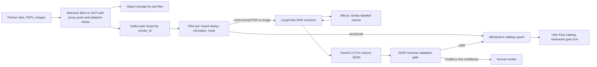
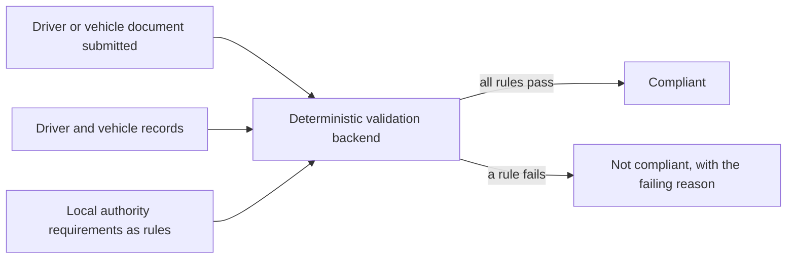
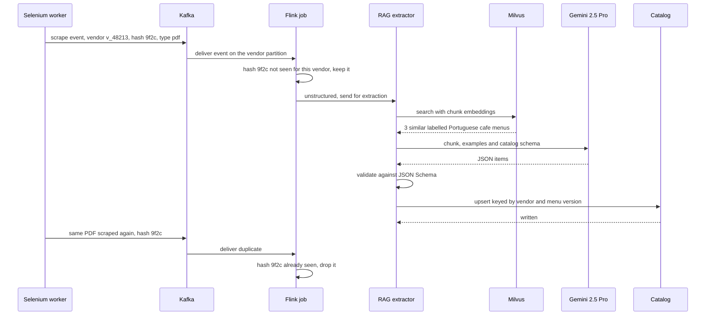

# Chapter 6. Uber Eats Menu Ingestion and Uber Mobility ANZ Document Compliance (Uber via EPAM)

## 1. How to use this chapter

<div class="callout note">

**How to use this chapter**

- **What it covers:** two separate Uber projects I worked on through EPAM. The main one is Uber Eats Menu Ingestion & Automation: scraping restaurant menus, streaming them through Kafka and Flink, and using RAG with Gemini 2.5 Pro over Milvus to turn messy multilingual PDFs into clean catalog data. The second is a smaller Uber Mobility project in Australia and New Zealand (ANZ) that automated driver and vehicle document checks.
- **When to read it:** before any interview that touches streaming (Kafka, Flink), scraping, RAG or LLM systems, data pipelines, idempotency, or "tell me about an AI system you shipped".
- **What to memorise:** the one-minute version (section 2), the numbers 24h to 2h, $600K, 30K+, 98%, 95%+, 99.9% and 20 hours a week with their derivations (section 7), the honest "exactly-once" answer, and the whiteboard script (section 12).

</div>

**Tags used in this chapter.** MEASURED means there is a log, document or code behind it. TARGET means a design goal, so you say "targeting". ESTIMATED means arithmetic I can show. HISTORICAL means it comes from my past work records. Menu outcomes and both ANZ numbers are HISTORICAL. The 98% is an **offline evaluation** number.

Related chapters: [Start here](00_START_HERE.md) · [Numbers explained](02_numbers_explained.md) · [Uber FRM](05_uber_frm.md) · [Tech glossary](09_tech_glossary.md) · [Core concepts](10_core_concepts_explained.md) · [STAR stories](11_star_stories.md). Older source material: [Menu deep dive](../prep/14_uber_menu_deep_dive.md) and [Uber interview packs](../prep/23b_uber_interview_packs.md). Those older pages also discuss Spark and Pinot. Neither is on the current resume, so treat them as study-only.

---

## 2. The one-minute version

> "At Uber Eats, through EPAM, I worked on menu ingestion: getting a new restaurant's menu into Uber's catalog so it can start taking orders. Menus arrive as JavaScript-heavy websites, PDFs and images, in many languages. I architected an automated pipeline: a Selenium scraping fleet that I hardened with dynamic proxy pools and adaptive retries, which took extraction success from an estimated 60 to 65% up to 95% plus. Scraped content flows through Kafka into an Apache Flink job that deduplicates per vendor using a content hash, normalizes everything to one schema and does idempotent catalog upserts. For unstructured PDFs we used RAG: we retrieve similar, already-labelled menus from Milvus and give them to Gemini 2.5 Pro, which outputs structured JSON that must pass schema validation. That reached 98% field fidelity in offline evaluation. Onboarding went from 24 hours to 2 hours at more than 30,000 menus a month, and replacing a roughly $2-per-menu manual and third-party cost saved about $600K a year. Separately, on Uber Mobility in ANZ, I automated driver and vehicle document checks with a deterministic validation backend, which reached 99.9% compliance and removed about 20 hours a week of manual review."

If you only get 20 seconds: "Through EPAM at Uber Eats, I built menu ingestion: Selenium, Kafka and Flink, plus a Gemini RAG path over Milvus for messy PDFs. Onboarding went from 24 hours to 2 hours at 30K+ menus a month, saving about $600K a year."

---

## 3. The business in plain English

### Restaurant onboarding

When a restaurant signs up for Uber Eats, it cannot take orders until its menu is in Uber's **catalog**: every dish, description, price, size option and add-on, in a strict format the app understands. Getting that menu in is called **onboarding**. Until it is done, the restaurant earns nothing and Uber earns nothing. Every hour of delay is lost orders and an unhappy new partner.

### Why menus are hard

- **Websites are built with JavaScript.** Many restaurant or partner pages only show the menu after scripts run in a browser. A simple download of the page HTML misses the items and prices.
- **PDFs and images.** A lot of menus are scanned PDFs or photos. There is no clean text structure, just layout: columns, boxes, prices floating next to names.
- **Many languages and formats.** A menu can be in Portuguese, Japanese or Arabic, with prices like "8,50 €" or "¥1,200", and sizes written as "Grande" or "L".
- **Anti-bot defences.** Sites block automated traffic with IP bans, CAPTCHAs and soft errors.
- **Duplicates and retries.** The same menu gets scraped more than once. If you are careless, you create duplicate dishes.

### What hurt before

Onboarding a menu took around 24 hours, and Uber paid roughly $2 per menu for manual and third-party processing. At more than 30,000 menus a month, that is slow and expensive.

### Why Uber paid for this

Faster onboarding means restaurants go live the same day, and cutting the per-menu cost at this volume is real money: about $600K a year by the conservative figure on the resume.

### The ANZ project, in plain English

Uber Mobility is the rides business, not Eats. In Australia and New Zealand, local authorities set rules for who may drive for a ride-hailing platform and which vehicles may be used. Drivers must provide documents (generic examples: a driver licence, a vehicle registration), and those documents must be valid, of the right type, not expired, and must match the driver and vehicle on record. Checking this by hand is slow and error-prone, and a miss is a regulatory problem. I automated those checks with a deterministic validation backend.

**Do not mix the two projects.** ANZ is Mobility, not Eats. It does not use the Selenium, Kafka, Flink or RAG stack.

---

## 4. Words you need

**Catalog and catalog schema.** The catalog is Uber Eats' structured store of what each restaurant sells. The schema is the strict shape every menu must fit: item name, description, price, currency, modifiers, availability. Analogy: a form with fixed boxes. Free-form menus have to be poured into those boxes.

**Selenium.** A tool that drives a real web browser from code. It clicks, scrolls and waits for JavaScript like a human would, so you see the page as a person sees it. A **headless** browser is one that runs without a visible window.

**Proxy and proxy pool.** A proxy is a middleman server that makes your request on your behalf, so the website sees the proxy's IP address, not yours. A proxy pool is a set of proxies you rotate through. A **dynamic** pool adds healthy proxies and removes banned or slow ones automatically. Analogy: a team of couriers. If one courier gets turned away at a door, you send a different one.

**Adaptive retries, backoff and jitter.** When a request fails, you try again, but wait longer each time (**exponential backoff**: 1 second, 2, 4, 8), add a random extra delay (**jitter**) so many workers do not retry in lockstep, and adapt to the kind of failure: a ban means switch proxy, a timeout means wait, a broken page means stop. A **retry budget** caps how many retries one source can consume so one hostile site does not burn the whole fleet.

**Kafka.** A distributed, durable log of messages. Producers append messages, and consumers read them at their own pace. Analogy: a conveyor belt that records everything that went past it, so you can rewind and watch again.

- **Topic:** a named stream of messages, like "raw menu scrapes".
- **Partition:** a topic is split into partitions so it can be read in parallel. Order is guaranteed only within one partition.
- **Key:** each message has a key. Messages with the same key always go to the same partition, so they stay in order. We keyed by `vendor_id`, so all events for one restaurant stay in order.
- **Offset:** the position of a message in a partition, like a line number.
- **Consumer group:** a set of workers sharing the reading of a topic. Each partition is read by exactly one worker in the group. Different groups read the same topic independently.
- **Replay:** because Kafka keeps messages for a while, a consumer can rewind its offset and reprocess, for example after a buggy parser was deployed.

**Apache Flink.** A stream processing engine. It reads events continuously and processes them one by one, with memory. Analogy: an assembly line worker who also keeps a notebook about each customer.

- **Keyed state:** Flink can group events by a key (here `vendor_id`) and keep a small piece of memory per key, for example "the last menu hash I saw for this vendor". Flink can store large state on local disk with RocksDB.
- **Event time vs processing time:** event time is when something actually happened (when the page was scraped). Processing time is when Flink happens to see it. Events can arrive late or out of order, so serious pipelines reason in event time.
- **Watermark:** Flink's running statement that "I believe I have now seen all events up to time T". It lets the job decide when it is safe to finalise, while tolerating a bounded amount of lateness.
- **Checkpoint:** a periodic consistent snapshot of all state plus the Kafka offsets read so far. After a crash, Flink restores the last checkpoint and rewinds Kafka to the matching offsets.

**Deduplication (dedup) and content hash.** A content hash is a fingerprint of the menu's content (for example SHA-256 of the normalized menu). Same content, same hash. Dedup means dropping an event whose hash we have already processed for that vendor.

**Schema normalization.** Converting many input shapes into one standard shape. "8,50 €", "EUR 8.50" and "8.5" all become `{"price_amount": 8.50, "currency": "EUR"}`.

**Upsert and idempotency.** An upsert inserts a row if it does not exist and updates it if it does. An operation is idempotent if doing it twice has the same effect as doing it once. An idempotent upsert keyed by a stable ID means replays and retries cannot create duplicates.

**At-least-once vs exactly-once.** At-least-once means every message is processed, but some may be processed more than once after a failure. Exactly-once means each message affects the result exactly one time. In practice, across systems you do not control, you get exactly-once **effects** by combining at-least-once delivery with idempotent writes.

**RAG (Retrieval-Augmented Generation).** Before asking a large language model (LLM) to do a task, you first retrieve relevant examples or facts and put them in the prompt. Analogy: an open-book exam. The model answers better because it can look at worked examples.

**Embedding.** A list of numbers that represents the meaning of a piece of text, so similar texts get nearby vectors. "Margherita pizza 12" and "Pizza margarita 12,00" end up close together.

**Vector database and Milvus.** A database built to store embeddings and quickly find the nearest ones to a query vector (vector similarity search). Milvus is an open-source vector database. We used it to store embeddings of already-labelled menus.

**LangChain.** A Python framework for wiring LLM steps together: load a document, split it, retrieve from a vector store, build a prompt, call the model, parse the output.

**Gemini 2.5 Pro.** Google's large language model. It reads long, multilingual and visual inputs and can be asked to return structured JSON.

**JSON Schema validation.** A machine-checkable description of the exact JSON shape you expect (required fields, types, allowed values). Output that does not match is rejected.

**Offline evaluation.** Measuring a system on a fixed, labelled test set in a controlled run, not on live production traffic.

**Field fidelity.** Of all the individual fields the system extracted (each item's name, price, description, modifiers), the share that exactly match the human-labelled correct answer.

**Deterministic validation backend (ANZ).** A rules engine where the same input always gives the same answer. No machine learning and no guessing, just explicit rules like "the expiry date must be in the future".

---

## 5. Architecture

### Menu pipeline



*What to notice: acquisition (Selenium), transport (Kafka), processing (Flink) and AI extraction (RAG) are separate stages. Nothing reaches the catalog without either passing Flink's normalization or the schema gate.*

Walking through it box by box:

1. **Partner sites, PDFs, images.** The sources of menus.
2. **Selenium fleet on GCP.** Browser workers, packaged with Docker, load each source like a person would. They route traffic through a dynamic proxy pool and retry adaptively. Each scrape emits an event and stores the raw file (HTML, PDF or image) in object storage, so the event can point at it instead of carrying a large payload.
3. **Kafka, keyed by `vendor_id`.** Scrapers write and move on. They never wait for the catalog. The key keeps each restaurant's events in order on one partition. Kafka retains events so we can replay them.
4. **Flink job.** Reads Kafka continuously. Per vendor, it compares the content hash with the last one seen and drops duplicates, normalizes fields to the catalog schema, and routes: structured content goes straight to the catalog, unstructured PDFs and images go to the RAG extractor.
5. **LangChain RAG extractor.** Splits the document into chunks, embeds them, and asks Milvus for the most similar already-labelled menus.
6. **Milvus.** Stores embeddings of labelled menu chunks with metadata such as vendor, locale and source.
7. **Gemini 2.5 Pro.** Gets the target chunk, the retrieved examples and the required schema, and returns structured JSON.
8. **JSON Schema validation gate.** Valid output goes to the catalog. Invalid or low-confidence output goes to human review instead of becoming bad data.
9. **Idempotent catalog upsert.** Writes keyed by stable IDs, so a retry or replay cannot duplicate items.
10. **Uber Eats catalog.** The restaurant can go live.

### ANZ document compliance (separate project)



*What to notice: the same document always gets the same verdict, and every verdict carries the rule that decided it. That is what makes it auditable.*

---

## 6. One job, step by step: a Portuguese PDF menu from a Lisbon café

Sample data (illustrative): vendor `v_48213`, a café in Lisbon, uploads its menu as a scanned PDF in Portuguese.



*What to notice: the second scrape of the same PDF never reaches the LLM or the catalog, because Flink's per-vendor state already holds that hash.*

The same flow in numbered steps:

1. **Scrape.** A Selenium worker downloads the PDF through a proxy. It stores the file and publishes an event:

```json
{
  "event_id": "e7b1...",
  "event_time": "2025-03-04T10:15:02Z",
  "vendor_id": "v_48213",
  "content_type": "pdf",
  "content_hash": "9f2c...",
  "object_uri": "gs://menus-raw/v_48213/9f2c.pdf",
  "locale": "pt",
  "scrape_attempt": 1,
  "status": "ok"
}
```

2. **Kafka.** The event lands on the partition for `v_48213`.
3. **Flink dedup.** Flink looks up the state for `v_48213`. The last hash was different, so this is a new menu version. It updates the state to `9f2c` and continues.
4. **Route.** The content type is PDF, so it goes to the RAG extractor.
5. **Retrieve.** The extractor splits the PDF into chunks, embeds them, and asks Milvus for the nearest labelled examples. It gets back three Portuguese café menus that humans had already mapped to the catalog schema.
6. **Generate.** Gemini 2.5 Pro receives the chunk ("Tosta mista ..... 4,50 €", "Galão ..... 1,80 €"), the examples and the schema, and returns:

```json
{
  "vendor_id": "v_48213",
  "menu_version": "9f2c...",
  "items": [
    {"name": "Tosta mista", "description": "Ham and cheese toastie",
     "price_amount": 4.50, "currency": "EUR", "modifiers": [], "availability": true},
    {"name": "Galão", "description": "Milky coffee",
     "price_amount": 1.80, "currency": "EUR", "modifiers": [], "availability": true}
  ]
}
```

7. **Validate.** The JSON is checked against the schema: required fields present, price is a number, currency is a valid code. It passes.
8. **Upsert.** The catalog write is keyed by `vendor_id` plus `menu_version`, and each item by a stable item key, so a retry cannot double-insert.
9. **Duplicate arrives.** Ten minutes later the same PDF is scraped again. Same hash. Flink drops it. No LLM cost, no catalog write.

---

## 7. Each resume bullet decoded

### Bullet 1: onboarding 24h to 2h, $600K, 30K+ menus, 98% field fidelity with Gemini, LangChain RAG and Milvus

> "Accelerated restaurant onboarding from 24 hours to 2 hours and saved $600K annually by architecting an automated ingestion pipeline processing 30K+ menus monthly. Converted unstructured, multilingual PDFs into a strict catalog schema at 98% field fidelity utilizing a Gemini 2.5 Pro and LangChain RAG pipeline over Milvus vector embeddings."

#### In plain words

I architected the automated pipeline that gets restaurant menus into Uber Eats. It handles more than 30,000 menus a month, cut onboarding from a day to two hours, and removed about $600K a year of per-menu cost. For the hardest inputs, messy PDFs in many languages, we used an LLM with retrieval of similar examples, and in offline evaluation it got 98% of fields right.

#### How it works

**The RAG extraction path, from zero.**

1. **Parse and chunk.** The PDF or image is turned into text chunks, roughly one menu section per chunk, so each prompt is focused.
2. **Embed.** Each chunk becomes an embedding vector.
3. **Retrieve.** Milvus returns the most similar chunks from menus that humans already labelled in the catalog schema. A Portuguese café menu tends to retrieve other Portuguese café menus, with their layout quirks and price formats.
4. **Generate.** LangChain builds a prompt: the target chunk, the retrieved labelled examples, and the exact JSON schema. Gemini 2.5 Pro returns JSON.
5. **Validate.** JSON Schema validation is a hard gate. Anything malformed, or flagged as low confidence, goes to human review instead of the catalog.

```python
def extract_menu(chunk_text: str, locale: str) -> dict:
    examples = milvus_search(embed(chunk_text), top_k=3, filter={"locale": locale})
    prompt = build_prompt(chunk=chunk_text, examples=examples, schema=CATALOG_SCHEMA)
    raw = gemini_generate(prompt)          # Gemini 2.5 Pro, asked for JSON only
    menu = json.loads(raw)
    jsonschema.validate(menu, CATALOG_SCHEMA)   # raises if the shape is wrong
    return menu
```

*Simplified sketch of the flow. Function names and the `top_k` value are illustrative.*

What Milvus stores per labelled chunk (logical fields): the embedding vector, menu and vendor IDs, locale, the chunk text, label tags and the source location.

**Why retrieval helps.** Without examples, an LLM guesses at layout conventions, might invent an item, or might drift from the schema. With two or three labelled examples of similar menus, it copies the right patterns: which number is the price, how sizes become modifiers, how the currency is written.

#### Why this design

- **An LLM** because regex rules and fixed templates break on every new layout and language. Menus are too varied.
- **RAG rather than a bare prompt** because grounding on similar labelled menus keeps output on-schema and reduces invented items.
- **A hard schema gate** because the catalog is strict. A malformed menu is worse than a delayed one.
- **Human review for low-confidence output** because protecting catalog quality matters more than squeezing out the last few percent of automation.

#### Alternatives and why not

- **Regex or template parsers per layout.** Cheap per call, but an endless maintenance treadmill across thousands of layouts and many languages.
- **OCR plus hand-written rules.** Gets the text, but not the structure (which number belongs to which dish).
- **A prompt with no retrieval.** Simpler, but less consistent across cuisines and languages.
- **Training a custom model.** Needs a large labelled set and retraining whenever the schema changes. With retrieval, a newly labelled menu helps the very next extraction.
- **Other vector stores** (pgvector, managed services). Workable. Milvus is what we used, and it is built for vector similarity search at scale.

**Trade-off.** LLM calls cost money and add latency, and offline evaluation is not the same as live monitoring. **What I'd do differently:** add continuous sampling of live extractions against human spot checks, so we track fidelity in production, not only offline.

#### The numbers

**From 24 hours to 2 hours.**
- *What it measures:* restaurant onboarding cycle time, from the menu being available to it being live in the catalog (HISTORICAL).
- *How derived:* (24 − 2) / 24 ≈ 92%, so "roughly a 90% cut".
- *Why it mattered:* restaurants start earning the same day instead of the next.
- *How to say it:* "Onboarding went from 24 hours to 2 hours."
- *What not to say:* do not present it as a per-request latency.

**$600K a year.**
- *What it measures:* annual cost removed by replacing manual and third-party menu processing.
- *How derived:* about $2 per menu × 30,000 menus a month × 12 months = $720,000 list. The resume floors it to $600K to be conservative. Monthly that is about $60K.
- *Why it mattered:* direct cost saving at a volume that keeps growing.
- *How to say it:* "About $2 a menu at 30K menus a month is $720K a year. I quote $600K to be conservative."
- *What not to say:* do not claim $720K as the saving, and do not invent a breakdown by vendor.

**30K+ menus a month.**
- *What it measures:* menus processed by the pipeline per month (HISTORICAL).
- *How derived:* 30,000 / 30 days ≈ 1,000 menus a day.
- *How to say it:* "More than 30,000 menus a month, roughly a thousand a day."
- *What not to say:* do not call it "hundreds of millions of transactions". If someone asks for peak event rate, a rough prep-only estimate is about 200 to 500 events per second during fleet runs, because each menu produces many item, retry and health events in bursts. It is ESTIMATED. Only say it if asked, and say "order-of-magnitude estimate".

**98% field fidelity (offline evaluation).**
- *What it measures:* the share of extracted fields that exactly match human labels on an offline test set.
- *How derived:* example: a test menu has 50 items with 4 fields each (name, price, description, modifiers), so 200 fields. If 196 match the labels, fidelity is 196 / 200 = 98%. The real evaluation aggregates this across the labelled set.
- *Why it mattered:* it showed the RAG path was accurate enough to trust automatically, with the gate and human review catching the rest.
- *How to say it:* "98% field fidelity in offline evaluation."
- *What not to say:* never call it a live production accuracy or an SLA. If asked how big the test set was, keep it qualitative. Older prep also mentioned "100% schema consistency". It is not on the current PDF. If you bring it up, explain it simply follows from the gate: nothing malformed is written.

#### Questions they will ask

**"How does RAG help Gemini here?"**
Before asking Gemini to extract a menu, we search Milvus for the most similar menus that humans already labelled, and put two or three of them in the prompt. That shows the model exactly how this kind of menu maps to our schema: which number is the price, how sizes become modifiers. It keeps output on-schema across languages and cuts down invented items. Then a JSON Schema check acts as a hard gate before anything is written.

**"Is 98% a production number?"**
No, it is offline evaluation on a labelled set. Field fidelity means the share of individual fields, like each item's price or name, that exactly match the human label. In production the protection is the schema gate plus human review for low-confidence output.

*Follow-up they may ask:* "How would you monitor it live?" Sample a small percentage of live extractions for human spot checks, and alert on spikes in schema-gate rejections.

**"How did you get to $600K?"**
About $2 per menu for the manual and third-party processing we replaced, times 30,000 menus a month, times 12. That is $720K. I quote $600K as a conservative floor.

**"What stops the LLM from inventing a dish?"**
Three layers. Retrieval grounds it on real labelled examples. The schema gate rejects anything malformed. Low-confidence output goes to a human instead of the catalog.

---

### Bullet 2: 95%+ extraction success, Selenium hardening, Kafka and Flink, keyed dedup, normalization, exactly-once upserts

> "Scaled menu extraction success to 95%+ by hardening a Selenium fleet with dynamic proxy pools and adaptive retries. Designed a large-scale data ingestion and processing pipeline using Kafka and Apache Flink, with stateful keyed deduplication and schema normalization to guarantee exactly-once catalog upserts."

#### In plain words

Scrapers were failing about a third of the time because sites blocked them. I made the fleet resilient, and success went to 95% plus. Then I designed the pipeline behind the scrapers: Kafka as a durable buffer, and Flink to drop duplicates per restaurant, clean up the data into one format, and write to the catalog in a way that can never double-write.

#### How it works

**Hardening the Selenium fleet.**

- **Dynamic proxy pools.** Each worker takes a proxy from a pool. Proxies that start getting banned or slow are evicted and replaced, so the pool heals itself.
- **IP rotation.** Requests spread across many egress addresses, so no single address hammers one site.
- **Adaptive retries.** The retry decision depends on the failure type, with exponential backoff, jitter and a per-source retry budget.

```python
def scrape_with_retries(url, source, max_attempts=4):
    for attempt in range(1, max_attempts + 1):
        proxy = proxy_pool.get_healthy(source)
        try:
            page = selenium_fetch(url, proxy=proxy)
            if looks_blocked(page):            # CAPTCHA wall or soft 403
                proxy_pool.mark_banned(proxy)
                continue                       # switch proxy immediately
            if item_count(page) == 0:
                raise EmptyMenuError(url)      # do not green-light an empty menu
            return page
        except TimeoutError:
            if not retry_budget.allow(source):
                break                          # protect the fleet from one hostile site
            time.sleep(min(2 ** attempt, 30) + random.uniform(0, 1))
    raise ScrapeFailed(url)
```

*Simplified sketch. Thresholds and helper names are illustrative.*

**Kafka as the ingest bus.** Scrape events go to a topic keyed by `vendor_id`. Separate streams carry retries and scrape-health signals. Because the key decides the partition, every event for one restaurant is processed in order. Consumers in a group share partitions, so we can scale Flink's parallelism roughly to the partition count. When a parser bug ships, we rewind offsets to before the bad deploy and replay.

**Flink keyed deduplication, with an example.** The Flink job keys the stream by `vendor_id` and keeps one value of state per vendor: the last processed content hash, which identifies the vendor's menu version.

```python
class DedupByMenuVersion(KeyedProcessFunction):     # keyed by vendor_id
    def open(self, ctx):
        self.last_hash = ctx.get_state(ValueStateDescriptor("last_hash", Types.STRING()))

    def process_element(self, event, ctx):
        if self.last_hash.value() == event["content_hash"]:
            return                                  # same menu version, drop
        self.last_hash.update(event["content_hash"])
        yield normalize(event)
```

*Python-style pseudocode of the pattern, not a claim about which Flink API language the job used.*

Example timeline for vendor `v_48213`:

| Event time | Content hash | State before | Result |
|---|---|---|---|
| 10:15 | 9f2c | empty | keep, state becomes 9f2c |
| 10:25 | 9f2c | 9f2c | drop, duplicate scrape |
| next day 09:00 | a71d | 9f2c | keep, the restaurant changed its menu |

A time-to-live on this state stops it growing forever as vendors come and go.

**Event time and watermarks.** Scrapes can arrive late, for example after retries. Flink uses the scrape timestamp as event time and a watermark with bounded lateness (for example a few minutes, illustrative), so a late page from an older version does not overwrite a newer one.

**Checkpoints.** Flink periodically snapshots its state together with the Kafka offsets. If a worker dies, the job restores the last checkpoint and Kafka rewinds to those offsets. Some events get processed again. That is fine, because the sink is idempotent.

**Schema normalization.** Every source becomes one shape. Examples (illustrative): "8,50 €" becomes `8.50` and `EUR`, item names are trimmed and whitespace-normalized, size words like "Grande" or "Large" become modifiers, and each item gets a stable key built from vendor, normalized name and size.

**Exactly-once catalog upserts, the honest version.** The resume says "guarantee exactly-once catalog upserts". What that means in practice: delivery through Selenium, Kafka and Flink is **at-least-once** (after a failure, some events are processed again), and the catalog write is an **idempotent upsert** keyed by vendor, menu version and item key. Replaying the same event produces the same final row. So the catalog sees exactly-once **effects**. It is not a two-phase commit across Gemini, partner sites and the catalog.

```sql
INSERT INTO catalog_items (vendor_id, item_key, menu_version, name, price_amount, currency)
VALUES ('v_48213', 'v_48213|tosta mista|regular', '9f2c', 'Tosta mista', 4.50, 'EUR')
ON CONFLICT (vendor_id, item_key) DO UPDATE
SET name = EXCLUDED.name,
    price_amount = EXCLUDED.price_amount,
    menu_version = EXCLUDED.menu_version;
```

*Generic SQL-style illustration of the contract. The real catalog is an internal Uber service, so describe the idempotency contract, not its storage engine.*

#### Why this design

- **Selenium** because many partner pages only render menus after JavaScript runs.
- **Kafka between scrapers and processing** because scrapers must never block on a slow catalog, we need replay after parser bugs, and several consumers (processing, health monitoring) can share one log.
- **Flink** because we needed per-vendor state for dedup, event-time handling for late pages, and continuous low-latency processing to hit a 2-hour onboarding cycle.
- **Idempotent upserts** because at-least-once delivery is the realistic guarantee, and idempotency turns it into correct results.

#### Alternatives and why not

- **Plain HTTP fetches instead of Selenium.** Miss JavaScript-rendered items and prices.
- **Scrapers calling the catalog directly.** No buffer, no replay, and a slow catalog would stall the fleet.
- **Spark for the hot path.** Spark is excellent for batch, but micro-batches add delay and per-key state is less natural. Spark is **not on the resume**. If asked, it is a reasonable option for large historical backfills, and that is study-level talk, not a claim.
- **Kafka Streams.** A lighter option that could work at this event rate. Flink gave richer event-time support and larger keyed state.
- **True end-to-end exactly-once with transactions.** Impossible across third-party sites and an LLM. Idempotency is the practical answer.

**Trade-off.** Kafka plus Flink is more infrastructure than a simple queue and worker, at a volume of about 1,000 menus a day. The justification is the shape of the load (bursts, retries, replay, per-vendor state), not raw throughput. **What I'd do differently:** add scrape-health dashboards earlier, such as item count per vendor over time, to catch silent DOM changes faster.

#### The numbers

**95%+ extraction success (from an estimated 60 to 65%).**
- *What it measures:* the share of scrape jobs that return a complete, usable menu.
- *How derived:* the 95%+ endpoint is HISTORICAL. The 60 to 65% starting point is ESTIMATED.
- *Why it mattered:* every failed scrape meant manual work or a delayed restaurant.
- *How to say it:* "Extraction success went to 95% plus, from roughly 60 to 65% before the hardening."
- *What not to say:* do not present the 60 to 65% baseline as measured. Say "estimated".

#### Questions they will ask

**"Is 30K menus a month really enough to need Kafka and Flink?"**
On average volume alone, no. The reasons are the shape of the load. Scrapes come in bursts with lots of retries, the same menu gets scraped repeatedly so we need per-vendor dedup state, pages arrive late so we need event time, and when a parser bug ships we need to replay. Kafka gives buffering and replay, Flink gives keyed state and event time. A simple worker queue could cover part of that, but we would end up rebuilding those features by hand.

**"Do you really have exactly-once?"**
We have exactly-once effects in the catalog, not exactly-once delivery end to end. Delivery is at-least-once, so after a failure Flink can reprocess some events. The catalog upsert is keyed by vendor, menu version and item key, so reprocessing writes the same row again instead of a new one. There is no two-phase commit across Gemini or partner sites, and I would not claim zero message loss.

**"What is your dedup key?"**
The stream is keyed by `vendor_id`, and the state holds the last content hash, the fingerprint of the menu version. Same vendor plus same hash means the event is dropped. A new hash means the restaurant changed its menu, so it goes through.

**"What happens when a Flink checkpoint fails mid-run?"**
The job restores from the last successful checkpoint, Kafka offsets rewind to match it, and events since then are reprocessed. The idempotent upserts mean no duplicates. Consumer lag goes up and alerts until the job catches up.

**"How do you know a scraper broke silently?"**
The dangerous failure is a page that loads fine but has no menu, because the site changed its layout or showed a CAPTCHA. We treat an empty or suspiciously small item count as a failure, not a success, and watch per-vendor item counts and success rates.

---

### Bullet 3: ANZ document compliance (Uber Mobility)

> "Achieved 99.9% regulatory compliance for Uber Mobility ANZ by automating driver and vehicle document verification workflows against local authority requirements. Eliminated 20 hours of manual operational overhead per week by replacing manual review queues with a deterministic validation backend."

#### In plain words

In Australia and New Zealand, drivers and vehicles must meet local authority rules. People used to check submitted documents by hand from review queues. I replaced that with a rules-based backend that checks every document the same way every time, which reached 99.9% compliance and freed about 20 hours a week of manual work. This is a HISTORICAL project from my past work records.

#### How it works

A **deterministic validation backend** is a rules engine. For each submitted document it runs explicit checks and returns pass or fail with the reason. The same input always produces the same verdict. Generic examples of the kinds of rules (do not present these as the exact production rule list):

- **Expiry:** the document's expiry date is after today.
- **Document type:** the document is the type the authority requires for this role or vehicle.
- **Record match:** the name or ID on the document matches the driver record, and the vehicle details match the vehicle record.
- **Local authority requirements:** the required set of documents for that region is complete.

```python
def validate(doc, driver, vehicle, region_rules, today):
    failures = []
    if doc.expiry_date <= today:
        failures.append("expired")
    if doc.doc_type not in region_rules.required_types:
        failures.append("wrong document type")
    if doc.holder_id != driver.id:
        failures.append("does not match driver record")
    if doc.vehicle_id and doc.vehicle_id != vehicle.id:
        failures.append("does not match vehicle record")
    return ("compliant", []) if not failures else ("non_compliant", failures)
```

*Generic illustrative sketch of what "deterministic validation" means, not the production code.*

#### Why this design

- **Deterministic rules, not ML,** because regulatory compliance needs explainable, repeatable decisions. "Rejected because it expired on 3 March" is auditable. A probability score is not.
- **Automated checks instead of manual queues** because humans get tired and inconsistent, and queues add delay.

#### Alternatives and why not

- **Keep manual review.** Slow and error-prone, costing about 20 hours a week.
- **An ML classifier.** Harder to explain to a regulator, and unnecessary when the rules are explicit.

**Trade-off.** Rules must be updated whenever the authorities change requirements. **What I'd do differently:** keep the rules in versioned configuration so a rule change is reviewed and auditable without a code deploy. Say this as an idea, not as something I claim shipped.

#### The numbers

**99.9% regulatory compliance.**
- *What it measures:* the compliance rate for driver and vehicle documents after automation (HISTORICAL).
- *How derived:* from my past work records. If asked about the exact denominator, keep it qualitative.
- *How to say it:* "We reached 99.9% compliance."
- *What not to say:* do not invent counts of drivers or documents.

**20 hours a week.**
- *What it measures:* manual verification effort removed (HISTORICAL).
- *How to say it:* "It removed about 20 hours a week of manual review."
- *What not to say:* do not claim it was re-measured from logs, and do not invent a team size behind it.

#### Questions they will ask

**"Is this part of Uber Eats?"**
No. It was Uber Mobility, the rides side, for drivers in Australia and New Zealand. Same employer arrangement, Uber via EPAM, but a separate project from the menu pipeline.

**"What does deterministic mean here?"**
The same document always gets the same answer, because the decision is a set of explicit rules, not a model. Every rejection carries the rule that failed, like "expired" or "does not match the vehicle record", which is what makes it auditable.

**"What tech did you use?"**
My past work records describe it as Python automation behind a validation backend. I keep it at that level and do not claim the menu stack for it. If pressed on specifics I do not remember precisely, I say so and explain the design instead.

---

## 8. Tech used in this project and why

| Tech | What it is | Why here | Alternative considered |
|---|---|---|---|
| Python | General-purpose language | Scrapers, extraction workers, AI glue | Go, less natural for browser automation and LLM tooling |
| Selenium | Code-driven real browser | JavaScript-rendered menu pages | Plain HTTP clients, which miss rendered content |
| Kafka | Durable, partitioned message log | Buffer bursts, per-vendor order, replay | Scrapers calling the catalog directly |
| Apache Flink | Stateful stream processor | Keyed dedup state, event time, low latency | Spark (not on the resume, batch-shaped), Kafka Streams |
| LangChain | Framework for wiring LLM steps | Load, chunk, retrieve, prompt, parse | Hand-written glue code |
| Gemini 2.5 Pro | Google's large language model | Multilingual, long inputs, structured JSON output | Template and regex parsers |
| RAG | Retrieve examples, then generate | Grounds extraction in labelled menus | Bare prompting |
| Milvus | Open-source vector database | Similarity search over labelled menu embeddings | pgvector, managed vector services |
| GCP | Google Cloud | Where the workloads ran | None considered for this workstream |
| Docker | Container packaging | Repeatable deploys of scraper and worker fleets | Bare VMs |

---

## 9. Hard problems and failure stories

**1. Silent empty menus.**
- *What broke:* a site changed its layout or showed a CAPTCHA, the page loaded "successfully", and the scraper returned zero items, which looked like success.
- *How found:* per-vendor item counts dropped suddenly.
- *How fixed:* treat an empty or suspiciously small menu as a failure, and route it to retry or review.
- *What I learned:* in scraping, "HTTP 200" means nothing. Validate the content.

**2. Proxy bans and pool exhaustion.**
- *What broke:* hostile sites banned proxies, and naive retries burned through the pool, dragging down every other source.
- *How fixed:* a dynamic pool that evicts banned proxies, failure-aware retries, and per-source retry budgets.
- *What I learned:* isolate the blast radius. One bad site must not take the fleet down.

**3. A bad parser deploy.**
- *What can break:* a normalization bug writes wrong prices for an hour.
- *How handled:* fix the parser, rewind Kafka offsets to before the bad deploy, and replay. Idempotent upserts overwrite the bad rows with correct ones without duplicates.
- *What I learned:* replayability is a feature you design for on day one, not after the incident.

**4. The LLM inventing items.**
- *Risk:* without grounding, a model can add a plausible dish that is not on the menu.
- *How handled:* retrieval of similar labelled menus, a strict schema gate, and human review for low-confidence output.

**5. Flink state growth.**
- *Risk:* per-vendor state grows as vendors come and go, and idle partitions can stall watermarks.
- *How handled:* a time-to-live on dedup state, and watching watermark progress and consumer lag.

---

## 10. Say this / don't say this

<div class="callout warn">

**Say this carefully**

- **Always say "Uber via EPAM".**
- **98% is offline evaluation.** Field fidelity on a labelled set, not a live SLA.
- **"Exactly-once" means exactly-once effects:** at-least-once delivery plus idempotent upserts. No two-phase commit across Gemini or partner sites. Never claim zero message loss.
- **60 to 65% baseline is ESTIMATED.** The 95%+ endpoint is HISTORICAL.
- **$600K:** about $2 × 30K × 12 = $720K, floored to $600K.
- **Peak 200 to 500 events per second** is a prep-only ESTIMATE. Only if asked.
- **Spark is not on the resume.** Mention only as a possible backfill tool if asked. Pinot is not on the resume either.
- **No ClickHouse on Menu.** ClickHouse belongs to the Impact Analytics chapter.
- **Milvus is Menu only.** Do not attach it to any other project, and do not name Pinecone or another vector vendor.
- **Do not claim fine-tuning (SFT).** It is not on the current resume.
- **ANZ is Uber Mobility, not Eats, and HISTORICAL.** Do not invent Selenium, RAG or Kafka for it, and do not invent counts behind 99.9% or 20 hours a week.
- **Masters India Kafka is a different product.** Do not merge the two Kafka stories.

</div>

**Don't say:** "I owned all of Uber Eats' catalog platform." "98% accuracy in production." "We guaranteed no message is ever lost." "We used Spark Streaming." "ANZ used the menu pipeline."

---

## 11. Practice drill

**1. Why is menu onboarding hard?**
Menus come as JavaScript-heavy sites, scanned PDFs and photos in many languages, and sites block bots. All of it has to fit a strict catalog schema before the restaurant can sell.

**2. Why Selenium?**
Many menu pages only show items after JavaScript runs. Selenium drives a real browser, so we see what a customer sees.

**3. How did you get extraction success to 95% plus?**
Dynamic proxy pools that evict banned proxies, IP rotation, and adaptive retries with backoff, jitter and per-source budgets. That took success from an estimated 60 to 65% to 95% plus.

**4. What does Kafka do in this pipeline?**
It is the buffer between scrapers and processing. Scrapers write and move on, events for one vendor stay in order because we key by `vendor_id`, and we can replay after a bad deploy.

**5. What is a consumer group?**
A set of workers sharing a topic. Each partition goes to exactly one worker in the group, which is how we scale processing.

**6. What does Flink do?**
It reads Kafka continuously, keeps per-vendor state to drop duplicate menu versions, normalizes data to the catalog schema, and routes structured content to the catalog and unstructured content to the RAG extractor.

**7. Explain watermarks.**
A watermark is Flink saying "I've probably seen everything up to time T". It lets the job handle late events within a bounded delay without waiting forever.

**8. What happens on a crash?**
Flink restores the last checkpoint, Kafka rewinds to the matching offsets, some events are reprocessed, and idempotent upserts prevent duplicates.

**9. Is it really exactly-once?**
Exactly-once effects. At-least-once delivery plus idempotent upserts keyed by vendor, menu version and item key.

**10. Explain RAG in this project.**
For a messy PDF we embed its chunks, find similar labelled menus in Milvus, and give those examples plus the schema to Gemini 2.5 Pro, which returns JSON. A JSON Schema check gates the write.

**11. What is field fidelity?**
The share of extracted fields that exactly match human labels. If 196 of 200 fields match, that is 98%. Ours was 98% in offline evaluation.

**12. Derive the $600K.**
About $2 per menu × 30,000 a month × 12 = $720K. I quote $600K to be conservative.

**13. What is 30K a month per day?**
Roughly 1,000 menus a day.

**14. What was the ANZ project?**
Uber Mobility in Australia and New Zealand. A deterministic validation backend checked driver and vehicle documents against local authority rules, reaching 99.9% compliance and removing about 20 hours a week of manual review.

**15. Why deterministic rules for ANZ instead of ML?**
Regulators need explainable, repeatable decisions. A rule like "expired on this date" is auditable. A model score is not, and the rules were explicit anyway.

---

## 12. 3-minute whiteboard script

**First, the problem (30 seconds).** Draw three source icons on the left: "website", "PDF", "photo". Say: "A restaurant can't sell on Uber Eats until its menu is in the catalog. Menus are JavaScript sites, scanned PDFs and photos in many languages. Onboarding took about 24 hours and cost about $2 a menu."

**Second, acquisition (30 seconds).** Draw a box "Selenium fleet" with a small "proxy pool" box beside it. Say: "Selenium drives a real browser. I hardened it with dynamic proxy pools and adaptive retries, so extraction success went from an estimated 60 to 65% to 95% plus. Empty pages count as failures, not successes."

**Third, the stream (60 seconds).** Draw "Kafka, key = vendor_id" and then "Flink". Inside Flink write "state: last content hash per vendor". Say: "Scrapers publish to Kafka keyed by vendor, so each restaurant's events stay in order and we can replay. Flink drops duplicate menu versions using a content hash per vendor, normalizes prices and sizes to one schema, and routes. Structured content goes straight to an idempotent catalog upsert. The resume says exactly-once. Honestly that's at-least-once delivery plus idempotent upserts, so replays never duplicate."

**Fourth, the AI path (45 seconds).** Draw a branch from Flink to "RAG", with "Milvus" and "Gemini 2.5 Pro" beside it and a "schema gate" before the catalog. Say: "For messy PDFs we retrieve similar labelled menus from Milvus and give them plus the schema to Gemini 2.5 Pro, which returns JSON. A JSON Schema gate blocks anything malformed, and low-confidence output goes to a human. Offline evaluation showed 98% field fidelity."

**Close with outcomes (15 seconds).** Write "24h → 2h", "30K+/month", "$600K/yr". Say: "Onboarding went from 24 hours to 2 hours at more than 30,000 menus a month. About $2 times 30K times 12 is $720K, and I quote $600K conservatively."

**If there is time, ANZ (15 seconds).** Draw a separate small box far from the menu diagram: "ANZ docs, rules engine". Say: "Separately, on Uber Mobility in ANZ, a deterministic validation backend checked driver and vehicle documents against local authority rules. It reached 99.9% compliance and removed about 20 hours a week of manual review."
