# Core Concepts Explained (backend, distributed systems, data, AI engineering)

<div class="callout note">
<strong>How to use this page</strong>
<ul>
<li>It covers every engineering concept that appears in my resume bullets. Each one is explained from zero and then tied to the exact project and bullet where it shows up.</li>
<li>Read it once end to end before a loop. After that, use the table of contents to revise one section the night before a system design or "deep dive into your project" round.</li>
<li>Memorise three things per concept: the one-line definition, the everyday analogy, and the one sentence that says where I used it.</li>
<li>Every "Where it shows up in my work" paragraph uses only facts from the resume. If a concept is not on my resume (for example RabbitMQ, replication ownership or tool calling at IA), the page says so plainly.</li>
</ul>
</div>

**Tags used on this page.** MEASURED means there is a log, document or code behind the number. ESTIMATED means it is arithmetic I can show on a whiteboard. HISTORICAL means it comes from my past work records. TARGET means it was a design goal. Off PDF means it is true but not printed on the resume, so I only say it if asked.

**Company short names.** IA is Impact Analytics (the AssortSmart retail planning product). FRM is the Uber Finance Financial Risk Management scoping platform (Uber via EPAM). Menu is Uber Eats menu ingestion (Uber via EPAM). ANZ is Uber Mobility document compliance for Australia and New Zealand. Masters is Masters India (GST e-invoicing). GFG is GeeksforGeeks.

Related handbook pages: [Start here](00_START_HERE.md) · [Numbers explained](02_numbers_explained.md) · [IA core platform](03_ia_core_platform.md) · [IA agentic AI](04_ia_agentic_ai.md) · [Uber FRM](05_uber_frm.md) · [Uber Menu and ANZ](06_uber_menu_and_anz.md) · [Masters India](07_masters_india.md) · [GeeksforGeeks](08_geeksforgeeks.md) · [Tech glossary](09_tech_glossary.md) · [STAR stories](11_star_stories.md)

---

## Table of contents

**Part A. Measuring speed and load**
1. [Latency percentiles (p50, p95, p99)](#1-latency-percentiles-p50-p95-p99)
2. [Throughput (RPS, RPM, TPS, rows per second)](#2-throughput-rps-rpm-tps-rows-per-second)
3. [Little's law](#3-littles-law)

**Part B. Reliability patterns**
4. [Caching (cache-aside, TTL, jitter, stampede, invalidation)](#4-caching)
5. [Idempotency and idempotency keys](#5-idempotency-and-idempotency-keys)
6. [Retries with exponential backoff, jitter and bounds](#6-retries-with-exponential-backoff-jitter-and-bounds)
7. [Dead-letter queues](#7-dead-letter-queues)
8. [Circuit breakers](#8-circuit-breakers)
9. [Timeouts, nested timeouts and deadlines](#9-timeouts-nested-timeouts-and-deadlines)
10. [Graceful degradation and fallbacks](#10-graceful-degradation-and-fallbacks)
11. [Checkpoints and resumable jobs](#11-checkpoints-and-resumable-jobs)
12. [At-most-once, at-least-once, exactly-once](#12-at-most-once-at-least-once-exactly-once)

**Part C. Databases and data correctness**
13. [Eventual consistency](#13-eventual-consistency)
14. [Transactions and ACID](#14-transactions-and-acid)
15. [Isolation levels](#15-isolation-levels)
16. [Optimistic vs pessimistic locking](#16-optimistic-vs-pessimistic-locking)
17. [Sharding vs partitioning vs replication](#17-sharding-vs-partitioning-vs-replication)
18. [Indexes (B-tree, composite, covering) and N+1 queries](#18-indexes-and-n1-queries)
19. [OLTP vs OLAP, row vs columnar storage](#19-oltp-vs-olap-row-vs-columnar-storage)
20. [Pre-aggregation, rollups and materialized views](#20-pre-aggregation-rollups-and-materialized-views)
21. [Memory limits and spilling to disk](#21-memory-limits-and-spilling-to-disk)
22. [Hashing and natural keys](#22-hashing-and-natural-keys)
23. [SQL injection, parameterized queries and allowlists](#23-sql-injection-parameterized-queries-and-allowlists)

**Part D. Moving data and events**
24. [Batching and double-buffering](#24-batching-and-double-buffering)
25. [Backpressure and consumer lag](#25-backpressure-and-consumer-lag)
26. [Event-driven architecture](#26-event-driven-architecture)
27. [Message queues vs logs (RabbitMQ and SQS vs Kafka)](#27-message-queues-vs-logs)
28. [Stream processing (keyed state, event time, watermarks)](#28-stream-processing)

**Part E. Architecture, delivery and the HTTP edge**
29. [Microservices vs monolith](#29-microservices-vs-monolith)
30. [Strangler-fig migration](#30-strangler-fig-migration)
31. [Canary releases and zero-downtime deploys](#31-canary-releases-and-zero-downtime-deploys)
32. [Stacked PRs](#32-stacked-prs)
33. [CI gates and code coverage](#33-ci-gates-and-code-coverage)
34. [Finite state machines](#34-finite-state-machines)
35. [Dependency injection (runtime vs compile-time)](#35-dependency-injection)
36. [Reverse proxies, and why one might not use one](#36-reverse-proxies)
37. [HTTP/1.1 vs HTTP/2 vs h2c](#37-http11-vs-http2-vs-h2c)
38. [WebSockets](#38-websockets)
39. [Observability (logs, metrics, traces, correlation IDs)](#39-observability)

**Part F. Security and multi-tenancy**
40. [Multi-tenancy and tenant isolation](#40-multi-tenancy-and-tenant-isolation)
41. [Authentication vs authorization](#41-authentication-vs-authorization)
42. [JWT](#42-jwt)
43. [OIDC](#43-oidc)
44. [API keys and constant-time comparison](#44-api-keys-and-constant-time-comparison)
45. [RBAC and hierarchy-scoped access](#45-rbac-and-hierarchy-scoped-access)

**Part G. Concurrency**
46. [Concurrency vs parallelism](#46-concurrency-vs-parallelism)
47. [Multithreading](#47-multithreading)
48. [Async IO and event loops](#48-async-io-and-event-loops)

**Part H. LLM and AI engineering**
49. [Tokens, context windows and cost per token](#49-tokens-context-windows-and-cost-per-token)
50. [Structured output and JSON schema](#50-structured-output-and-json-schema)
51. [Tool calling](#51-tool-calling)
52. [Agents and the supervisor pattern](#52-agents-and-the-supervisor-pattern)
53. [Evaluator loops](#53-evaluator-loops)
54. [Embeddings and vector search](#54-embeddings-and-vector-search)
55. [RAG (retrieval-augmented generation)](#55-rag)
56. [Offline evaluation and gold sets](#56-offline-evaluation-and-gold-sets)
57. [CI gates for models](#57-ci-gates-for-models)

**Part I. Design rounds**
58. [System design: HLD vs LLD](#58-system-design-hld-vs-lld)

**Wrap-up**
- [Concept to project cheat sheet](#concept-to-project-cheat-sheet)
- [Say this, not that (honesty box)](#say-this-not-that)

---

# Part A. Measuring speed and load

These three ideas come first because almost every number on my resume is either a latency, a throughput or a size. If I mix them up, the interviewer stops trusting the rest.

## 1. Latency percentiles (p50, p95, p99)

**In plain English.** Latency is how long one request takes, from the moment it arrives until the response is sent. A percentile tells you how slow the slow requests are. p95 means "95 out of 100 requests finished at or under this time". p50 is the median (the typical request), p95 is the bad-day experience, and p99 is the worst 1 in 100.

**Analogy.** Think of a coffee shop. The average wait might be 3 minutes, but if 5 customers in every 100 wait 20 minutes, those are the customers who leave angry reviews. p95 is the number that tells you about those 5 customers. The average hides them.

**How it works: a 100-request example.** Imagine an API served exactly 100 requests in a minute. Here are the response times, grouped:

| How many requests | Response time each |
|---|---|
| 60 | 80 ms |
| 30 | 150 ms |
| 5 | 300 ms |
| 4 | 900 ms |
| 1 | 4,000 ms |

Sort all 100 values from fastest to slowest and number them 1 to 100.

- **p50** is the 50th value. Positions 1 to 60 are all 80 ms, so p50 = **80 ms**.
- **p95** is the 95th value. Positions 91 to 95 are 300 ms, so p95 = **300 ms**.
- **p99** is the 99th value. Positions 96 to 99 are 900 ms, so p99 = **900 ms**.
- **Max** is the 100th value, **4,000 ms**.
- **Average** is (60×80 + 30×150 + 5×300 + 4×900 + 1×4,000) / 100 = 18,400 / 100 = **184 ms**.

Notice what the average does. It says 184 ms, which is a time that almost no real request took. It is dragged up by one 4-second outlier and still hides the 900 ms tail. That is why teams set goals on p95 or p99, not the mean. (This is the "nearest-rank" method. Monitoring tools often interpolate between neighbours, so their numbers can differ slightly. The idea is the same.)

```python
def percentile(latencies_ms, p):
    s = sorted(latencies_ms)
    rank = max(1, int(round(p / 100 * len(s))))  # nearest-rank
    return s[rank - 1]

data = [80]*60 + [150]*30 + [300]*5 + [900]*4 + [4000]
print(percentile(data, 50), percentile(data, 95), percentile(data, 99))  # 80 300 900
```

Two more facts interviewers like. First, you cannot average percentiles across servers. If server A has p95 = 200 ms and server B has p95 = 400 ms, the fleet p95 is not 300 ms. You need the raw data or a histogram. Second, tail latency compounds. If one page calls 10 backend services in parallel and waits for all of them, the page is slow whenever any one of them is slow, so each service's p99 matters much more than it looks.

**Where it shows up in my work.**
- **Masters India (MI1):** "p95 API latency -75% (from 1.2s to 300ms) across 1,500+ enterprise clients." HISTORICAL. The win came from making the slow calls to the government IRP (Invoice Registration Portal) asynchronous in the new Spring Boot services, adding connection pooling (HikariCP for the database), fixing queries and indexes, and putting Redis in front of hot reads. Arithmetic: (1.2 − 0.3) / 1.2 = 0.75, so 75% lower.
- **IA (C1):** the Go/Gin platform is described by **10k peak RPS**, which is throughput, not latency. There is no latency SLA on the resume, and I do not invent a p99 for it.

**Interview questions.**
- **Q: Why did you report p95 and not average latency at Masters?**
  **A:** Because p95 is what enterprise clients actually felt on a bad day. Our slow requests were the ones waiting on the government portal, and an average would have hidden them behind thousands of fast cached reads. Moving p95 from 1.2 seconds to 300 milliseconds meant even the slow tail of requests got four times faster. Follow-up they may ask: "What was p99?" Answer: "I tracked p95 as the headline. I don't have a p99 number I can defend, so I won't quote one."
- **Q: Your p95 dropped 75%. What actually changed?**
  **A:** Four things. The IRP calls moved to async IO, through a non-blocking client and Kafka-backed jobs, so a slow government response no longer held a request thread hostage. We pooled database connections with HikariCP and reused HTTP connections, so we stopped paying connection setup on every request. We fixed slow queries and added the right indexes. And we put a Redis cache in front of frequently read data. The async change mattered most because the portal was the slowest dependency.
- **Q: Can you add up p95s from different services?**
  **A:** No. Percentiles don't add or average. To get an end-to-end p95 you measure end to end, or you merge histograms. That's why distributed tracing matters: it gives one timing per real request across all hops.

**Common mistakes and what not to say.**
- Do not say "average latency went from 1.2s to 300ms". The resume number is p95.
- Do not invent a p99 for IA or Masters.
- Do not say "10k RPS at sub-millisecond latency" or any latency for IA. There is no such claim.

---

## 2. Throughput (RPS, RPM, TPS, rows per second)

**In plain English.** Throughput is how much work a system finishes per unit of time. The unit matters a lot. RPS is requests per second. RPM is requests per minute. TPS is transactions per second (one business transaction may be several requests). Rows per second is a data-loading speed, and it has nothing to do with how many requests arrive.

**Analogy.** A highway can be measured in cars per hour (requests) or in tonnes of cargo per hour (rows). One truck carrying 10 tonnes is one car but a lot of cargo. Quoting cargo tonnes as "cars per hour" would be badly wrong.

**How it works: converting units.** Always convert into one unit before comparing.

| Number on my resume | Conversion | Plain result |
|---|---|---|
| 700 requests per minute (Masters, before) | 700 / 60 | about 12 RPS |
| 4,000 requests per minute (Masters, after) | 4,000 / 60 | about 67 RPS |
| 1M+ daily government submissions (Masters) | 1,000,000 / 86,400 seconds | about 12 per second on average (ESTIMATED) |
| Filing-deadline peaks (Masters) | 8 to 10 times the average | roughly 90 to 120 per second (ESTIMATED) |
| 10k peak RPS (IA) | already per second | 10,000 HTTP requests per second at peak |
| ~344k rows/s (IA ClickHouse migration) | rows, not requests | data-copy speed on a few long-lived connections |

**Why 344k rows per second is not RPS.** The IA migration used a custom Go data pump that spoke ClickHouse's native protocol over TLS and streamed **500k-row batches** through it. A single INSERT can carry hundreds of thousands of rows. So the number of "requests" was tiny, while the number of rows moved per second was large. The 344k figure is two season streams combined, each running around 150k to 190k rows per second. Calling it "344k RPS" would claim the system handled 344,000 independent client requests per second, which is a completely different (and false) statement.

**Where it shows up in my work.**
- **IA (C1):** "Multi-tenant Go/Gin platform at 10k peak RPS." This is HTTP request throughput at the edge.
- **IA (C5):** "~344k rows/s" ingest rate during the cross-cluster ClickHouse migration, partitions up to 4.09B rows. Say this carefully: the 4.09B-row copy was measured while in flight, not a finished cutover.
- **Masters (MI1):** throughput from 700 to 4,000 requests per minute, which is about 12 to about 67 RPS.
- **Masters (MI2):** 1M+ daily government submissions, which is about 12 TPS on average, with ESTIMATED 8 to 10 times peaks around filing deadlines.
- **Menu (M1):** 30K+ menus per month. This is a business volume, not a per-second rate.
- **GFG (G1):** 10K+ daily queries with 10x traffic spikes during live contests.

**Interview questions.**
- **Q: 1M submissions a day sounds big. What does that mean per second?**
  **A:** One million divided by 86,400 seconds is about 12 per second on average. The real design pressure was the peaks around GST filing deadlines, which I estimate at 8 to 10 times the average. That is why we put Kafka in front of the government portal: it absorbs the burst and lets workers drain at a rate the portal can take.
- **Q: Your resume says 344k rows per second. Is that your API throughput?**
  **A:** No, it's a data-loading rate. It was the combined speed of two season streams copying ClickHouse rollup data between clusters, each stream at roughly 150 to 190 thousand rows per second. Each insert carried a large batch, so the number of requests was small. The API throughput number on my resume is the separate 10k peak RPS.
- **Q: How did Masters go from 700 to 4,000 requests per minute?**
  **A:** Mainly because each request got shorter. When a request holds a thread for 1.2 seconds, a fixed pool of request threads can only serve so many per minute. Once the slow IRP calls became async and hot reads came from Redis, each thread freed up much faster. Little's law makes this concrete (next section).

**Common mistakes and what not to say.**
- Never call 344k rows/s "RPS" or "TPS".
- Do not quote Menu streaming peaks as a resume fact. The "~200 to 500 events per second" figure is an ESTIMATE from prep only.
- Do not invent TPS numbers for IA beyond 10k peak RPS.

---

## 3. Little's law

**In plain English.** Little's law says that the average number of things in a system equals the arrival rate times the average time each thing spends inside. In symbols, L = λ × W. L is "how many are in flight", λ (lambda) is "how many arrive per second", W is "how long each one stays".

**Analogy.** If 10 people walk into a shop every minute and each stays 6 minutes, there are about 60 people inside at any moment. If you want fewer people inside, either fewer arrive or each one leaves faster.

**How it works: a worked example from Masters (illustration only).** This is ESTIMATED arithmetic for teaching, using p95 as a rough stand-in for average time (which overstates it).

- After the migration: 67 requests per second × 0.3 seconds ≈ **20 requests in flight**.
- If latency had stayed at 1.2 seconds: 67 × 1.2 ≈ **80 requests in flight**.

So the same traffic would have needed about four times as many concurrent workers or connections at the old latency. Cutting latency is a capacity win, not only a user-experience win.

\[ L = \lambda \times W \]

**Where it shows up in my work.** It is a way to explain the Masters MI1 numbers (latency down, throughput up) and to size worker pools and connection pools. It is not a claim on the resume.

**Interview questions.**
- **Q: How would you size a connection pool for a service?**
  **A:** I start with Little's law. If a service does 67 requests per second and each request holds a database connection for about 50 milliseconds, it needs about 3 to 4 connections busy on average, and I would add headroom for peaks and variance. Then I verify with load tests and pool-wait metrics, because the law gives the average, not the peak. In a Spring Boot service like the Masters ones, that pool is HikariCP, and the knobs are `maximumPoolSize` and `connectionTimeout` (how long a thread waits for a free connection before failing).

**Common mistakes and what not to say.**
- Do not present the 20 vs 80 figures as measured. They are illustration arithmetic.
- Little's law works on averages over a stable period. It does not tell you tail latency.

---

# Part B. Reliability patterns

These patterns answer one question: "What happens when something fails?" In distributed systems something is always failing a little, so the design has to expect it.

## 4. Caching

**In plain English.** A cache is a fast, small store that keeps copies of data you read often, so you do not go to the slow source every time. Redis is the common choice: an in-memory key-value store.

**Analogy.** Keeping the five spices you use daily on the counter instead of in the basement pantry. Faster to grab, but if you buy a new jar, you must remember to swap the one on the counter.

### Cache-aside (the most common pattern)

The application owns the logic. On a read, check the cache. On a miss, read the database, then put the result into the cache with an expiry time.

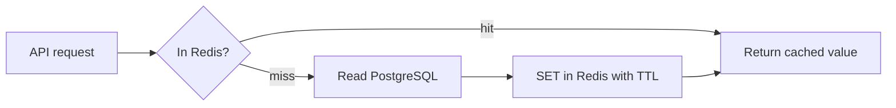

*What to notice: the database is only touched on a miss, and the app, not the cache, decides what to store.*

```java
// Spring Boot service: StringRedisTemplate for Redis, a Spring Data repository for PostgreSQL
public ClientConfig getClientConfig(String clientId) throws JsonProcessingException {
    String key = "cfg:" + clientId;
    String cached = redis.opsForValue().get(key);
    if (cached != null) {
        return json.readValue(cached, ClientConfig.class);            // cache hit
    }
    ClientConfig row = configRepository.findByClientId(clientId);     // miss: read PostgreSQL
    Duration ttl = Duration.ofSeconds(300 + ThreadLocalRandom.current().nextInt(61)); // TTL with jitter
    redis.opsForValue().set(key, json.writeValueAsString(row), ttl);
    return row;
}
```

*Illustrative names. Spring's `@Cacheable` can do the same with less code, but the hand-written version makes the steps visible.*

### TTL and jitter

**TTL (time to live)** is how long a cached value is allowed to live before it expires. It bounds how stale data can get. **Jitter** means adding a small random amount to each TTL. Without jitter, if you warm 10,000 keys at 9:00 with a 5-minute TTL, all 10,000 expire at 9:05 and the database gets hit by all of them at once. With a TTL of 300 seconds plus 0 to 60 random seconds, expiries spread over a minute.

### Cache stampede and singleflight

A **stampede** (also "thundering herd") is when one popular key expires and hundreds of requests all miss at the same moment, and all of them query the database for the same value. Two common fixes:

- **Singleflight.** Only one caller actually fetches. The others wait and share its result. Go has this built in as `golang.org/x/sync/singleflight`.
- **A short lock in Redis.** The first request sets a lock key with `SET lock:key 1 NX EX 5` (NX means "only if it doesn't exist"). It rebuilds the value. Others briefly wait or serve the slightly stale value.

```go
var g singleflight.Group

func getRoles(ctx context.Context, userID string) (Roles, error) {
    v, err, _ := g.Do("roles:"+userID, func() (any, error) {
        return loadRolesFromPostgres(ctx, userID) // only one goroutine runs this per key
    })
    if err != nil {
        return Roles{}, err
    }
    return v.(Roles), nil
}
```

### Invalidation

**Invalidation** means removing or updating a cached value when the source changes. The simple safe rule for cache-aside: write to the database first, then delete the cache key (not update it). The next read repopulates it. Deleting is safer than writing the new value into the cache, because two concurrent writers can otherwise leave the older value in the cache.

**Where it shows up in my work.**
- **Masters (MI3):** "DB read load -30% via ... a Redis cache-aside layer." HISTORICAL. Also part of the MI1 latency win ("plus Redis for reads").
- **IA (C3):** "Redis-fronted auth waterfall." Redis is checked first, before the slower identity checks (Firebase Admin, then JWT or Google OIDC) and the Postgres-backed role lookup.

Say this carefully: the resume claims cache-aside and the 30% read reduction at Masters. TTL jitter and stampede protection are the standard companions of cache-aside and I can explain them fully, but I only describe specific settings I actually remember. If asked for exact TTL values, keep it qualitative.

**Interview questions.**
- **Q: What did you cache at Masters and why cache-aside?**
  **A:** We cached read-heavy data that changed rarely compared with how often it was read, so repeated reads stopped hitting PostgreSQL. Cache-aside fit because the application could decide exactly what to cache and the database stayed the source of truth. If Redis went down, requests simply fell through to the database. That cut database read load by about 30%.
- **Q: How do you stop a cache stampede?**
  **A:** Three layers. Add jitter to TTLs so keys don't expire together. Collapse concurrent misses for the same key with singleflight or a short Redis lock so only one request rebuilds it. And for very hot keys, refresh them slightly before expiry. The goal is that one expiry causes one database read, not a thousand.
- **Q: What's the risk of caching auth decisions, like at IA?**
  **A:** Staleness. If a user's role is revoked, a cached role keeps working until the TTL runs out. So auth caches need short TTLs and explicit invalidation when roles change. The trade-off is fewer calls to the identity provider and Postgres on every request versus a small revocation delay.

**Common mistakes and what not to say.**
- Do not say "the cache is the source of truth". The database is.
- Do not claim a hit rate or TTL number that is not in your records.
- "Write to cache then database" is a common wrong answer. Write the database, then delete the key.

---

## 5. Idempotency and idempotency keys

**In plain English.** An operation is idempotent if doing it twice has the same effect as doing it once. An idempotency key is a unique ID attached to a request so the server can recognise a repeat and not do the work again.

**Analogy.** Pressing the lift button five times does not call five lifts. The building remembers "a lift is already coming to floor 3".

**How it works.** Networks lose responses. A client that never got an answer will retry. Without idempotency, the retry creates a second invoice, a second payment, or a duplicate row. With an idempotency key, the server records "I already processed key X" and returns the original result.

Worked example in the Masters shape. The key is built from things that identify the work, not from the time it was sent:

```text
client     = "ACME-STEEL"
fileHash   = SHA-256 of the uploaded file = "9f2c...e1"
batchIndex = 7
idempotency_key = "ACME-STEEL:9f2c...e1:7"
```

```sql
-- first attempt inserts; any retry of the same batch is a no-op
INSERT INTO submission_batches (idempotency_key, client_id, status)
VALUES ('ACME-STEEL:9f2c...e1:7', 'ACME-STEEL', 'PENDING')
ON CONFLICT (idempotency_key) DO NOTHING;
```

If the insert affected 0 rows, the batch was already accepted, so the worker skips it (or returns the stored result). The unique constraint in the database is what makes this safe even when two workers race, because the database guarantees only one insert wins.

In a Spring Boot consumer the same check is a few lines. `JdbcTemplate.update` returns the number of rows changed, and `@Transactional` keeps "record the key" and "do the work" in one transaction:

```java
@Transactional
public void acceptBatch(InvoiceBatch batch) {
    int inserted = jdbc.update("""
        INSERT INTO submission_batches (idempotency_key, client_id, status)
        VALUES (?, ?, 'PENDING')
        ON CONFLICT (idempotency_key) DO NOTHING
        """, batch.idempotencyKey(), batch.clientId());
    if (inserted == 0) {
        return;                              // already accepted: the retry is a no-op
    }
    batchRepository.saveInvoices(batch);     // real work, same transaction
}
```

*Illustrative names.*

**Where it shows up in my work.**
- **Masters (MI2):** "exactly-once idempotent processing for 100K+ concurrent imports", idempotency key like client + fileHash + batchIndex, so retries against the volatile IRP portal never double-register an invoice. HISTORICAL.
- **Menu (M2):** "exactly-once catalog upserts". In practice this is at-least-once delivery plus idempotent upserts keyed by vendor and menu, so replaying a message rewrites the same catalog row.
- **FRM (F2):** deterministic SHA-256 natural keys are the same idea for rows: the same question on the same page always gets the same ID, so re-running a quarterly load does not create duplicates (see [concept 22](#22-hashing-and-natural-keys)).
- **IA (A2):** ReplacingMergeTree makes re-inserting a row with the same key safe, because ClickHouse later keeps only the newest version.

**Interview questions.**
- **Q: Why did you need idempotency keys at Masters?**
  **A:** Because the government portal was flaky and we retried. If a submission timed out, we often did not know whether IRP had registered the invoice. Retrying without a key could register it twice, which is a compliance problem, not just a data problem. The key was built from client, file hash and batch index, so the same batch always produced the same key and a retry became a safe no-op.
- **Q: Why not use a random UUID per request as the key?**
  **A:** A random UUID generated at retry time is different on every attempt, so it can't detect repeats. The key has to be derived from what the work is, or generated once by the client and reused on every retry.
- **Q: Where do you store the keys, and for how long?**
  **A:** In the database with a unique constraint, ideally in the same transaction as the work, so "record the key" and "do the work" succeed or fail together. Retention should cover the longest realistic retry window. Follow-up: "Redis instead?" Redis is fine for short windows, but a database constraint is the stronger guarantee for money or compliance data.

**Common mistakes and what not to say.**
- Do not say "Kafka gives us exactly-once so we didn't need idempotency". The external government portal is outside any Kafka transaction.
- Do not use a timestamp in the key. Retries have different timestamps.

---

## 6. Retries with exponential backoff, jitter and bounds

**In plain English.** A retry is trying a failed call again. Exponential backoff means waiting longer after each failure (1 second, then 2, then 4, then 8). Jitter adds randomness to the waits so many clients do not retry at exactly the same instant. Bounded retries means there is a hard cap on attempts, after which you stop and park the work.

**Analogy.** If a friend's phone is busy, you call again in a minute, then in five, then in fifteen. You do not redial every second, and after a few tries you send a message instead.

**How it works.**

```text
delay(attempt) = random(0, min(cap, base * 2^attempt))      # "full jitter"

base = 1s, cap = 30s
attempt 0: random(0, 1s)
attempt 1: random(0, 2s)
attempt 2: random(0, 4s)
attempt 3: random(0, 8s)
attempt 4: random(0, 16s)
then stop and send to the dead-letter queue
```

```java
private static final Set<Integer> RETRYABLE = Set.of(408, 429, 500, 502, 503, 504);

IrpResponse submitWithRetries(Supplier<IrpResponse> call) throws InterruptedException {
    int maxAttempts = 5;                                   // example values
    long baseMs = 1_000, capMs = 30_000;
    for (int attempt = 0; attempt < maxAttempts; attempt++) {
        IrpResponse resp = call.get();
        if (resp.status() < 400) {
            return resp;
        }
        if (!RETRYABLE.contains(resp.status())) {
            throw new PermanentIrpException(resp);         // e.g. 400 validation error: never retry
        }
        long ceiling = Math.min(capMs, baseMs << attempt);
        Thread.sleep(ThreadLocalRandom.current().nextLong(ceiling + 1));   // full jitter
    }
    throw new RetriesExhaustedException();                 // caller parks it in the DLQ
}
```

In a Spring Kafka consumer you rarely hand-roll this loop. The listener container's error handler applies the backoff and the attempt cap for you, as the next section shows. The loop above is still the clearest way to explain what that handler does.

Three rules matter more than the formula:
1. **Only retry what can succeed later.** Timeouts, 429 (too many requests) and 5xx are retryable. A 400 validation error will fail forever.
2. **Only retry idempotent operations,** or operations protected by an idempotency key. Otherwise a retry can create duplicates.
3. **Bound the retries.** Unlimited retries turn a short outage into a self-inflicted overload, called a retry storm.

**Where it shows up in my work.**
- **Masters (MI2):** "bounded retries against volatile IRP portals", paired with idempotency keys and dead-letter queues. HISTORICAL.
- **Menu (M2):** "adaptive retries" with dynamic proxy pools hardened the Selenium scraping fleet, taking extraction success to **95%+** (from an estimated ~60 to 65%).

The exact attempt counts and wait times were configuration. If asked for them, keep it qualitative unless I remember them.

**Interview questions.**
- **Q: Why add jitter? Isn't exponential backoff enough?**
  **A:** Backoff alone still synchronises clients. If a thousand workers all failed at the same second, they all retry at 1 second, then 2, then 4, in lockstep, hitting the recovering server in waves. Jitter spreads them out so the load on the dependency is smooth. Around GST deadlines, the IRP portal was exactly the kind of struggling dependency where synchronized retries would make things worse.
- **Q: How do you decide when to stop retrying?**
  **A:** A fixed maximum attempt count plus an overall deadline. When either is hit, the message goes to a dead-letter queue with the error, so an operator can inspect and replay it. That keeps one bad batch from blocking everything behind it.
- **Q: What does "adaptive retries" mean for the Menu scrapers?**
  **A:** The retry behaviour reacted to the kind of failure. A block from anti-bot protection called for a different proxy and a slower pace, not the same request again immediately. Combined with dynamic proxy pools, that moved extraction success to 95%+.

**Common mistakes and what not to say.**
- Do not say "we retried until it worked". Always say bounded.
- Do not retry non-idempotent calls without a key.

---

## 7. Dead-letter queues

**In plain English.** A dead-letter queue (DLQ) is a separate holding area for messages that failed too many times or can never succeed. Instead of blocking the main queue or being thrown away, they are parked with their error so someone can fix and replay them.

**Analogy.** The post office's "undeliverable mail" shelf. A letter with a bad address does not hold up the whole van, and it is not burned either. It waits on a shelf until someone corrects it.

**How it works.**

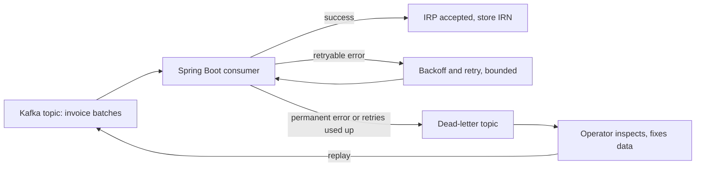

*What to notice: the replay path goes back through the same idempotent worker, so replaying cannot double-register an invoice.*

A message in the DLQ should carry enough to act on: the original payload, the idempotency key, the error code and message, the attempt count and the timestamp. A **poison message** is one that crashes or fails the consumer every time, such as an invoice with a malformed tax ID. Without a DLQ, a poison message at the head of a partition can stop all messages behind it.

**How this looks in Spring Kafka.** In a Spring Boot service, the `@KafkaListener` method only does the work and throws on failure. Bounded retries and the dead-letter step are configured once, on the listener container:

```java
@Bean
public DefaultErrorHandler kafkaErrorHandler(KafkaTemplate<String, Object> template) {
    var recoverer = new DeadLetterPublishingRecoverer(template);   // sends to "<topic>.DLT" by default
    var backoff = new ExponentialBackOffWithMaxRetries(4);          // bounded: 4 retries (example value)
    backoff.setInitialInterval(1_000L);
    backoff.setMultiplier(2.0);
    backoff.setMaxInterval(30_000L);
    var handler = new DefaultErrorHandler(recoverer, backoff);
    handler.addNotRetryableExceptions(PermanentIrpException.class); // validation errors go straight to the DLT
    return handler;
}
```

*Example values. The recoverer also adds headers with the exception class, message and original offset, which is the "error and attempt" context an operator needs.*

Two details interviewers like. First, `DefaultErrorHandler` retries by seeking back to the failed record, so it blocks that partition while it backs off. That is fine for short blips. For long portal outages, Spring Kafka's non-blocking retry topics (`@RetryableTopic`) move the record to a delay topic so the partition keeps flowing. Second, the dead-letter topic is just another Kafka topic, so replay means republishing the fixed record to the main topic, where the idempotent consumer handles it.

**Where it shows up in my work.** **Masters (MI2):** "dead-letter queues, bounded retries against volatile IRP portals." HISTORICAL. In the Spring Boot services these were Kafka dead-letter topics fed by the IRP submit consumers. This is the only place DLQs appear on my resume. The exact retry counts and backoff values were configuration, so if asked, keep them qualitative.

**Interview questions.**
- **Q: What went into your DLQ, and what did you do with it?**
  **A:** Batches that hit a permanent error, like a validation rejection from IRP, or that used up their bounded retries during a portal outage. They were parked with the error so an operator could fix the data or wait for the portal to recover, and then replay them. Because processing was keyed by an idempotency key, replay was safe even if part of the batch had already gone through.
- **Q: Isn't a DLQ just hiding failures?**
  **A:** Only if nobody watches it. A DLQ needs alerting on its size and age, and a clear replay process. Its purpose is to keep one bad message from blocking good ones, not to make failures disappear.

**Common mistakes and what not to say.**
- Do not put DLQs on IA or Uber in an answer. On the resume they belong to Masters.
- Do not describe replay without mentioning idempotency. Replay without it double-processes.

---

## 8. Circuit breakers

**In plain English.** A circuit breaker sits in front of a call to a dependency. It counts failures. If too many happen, it "trips" and stops sending calls for a while, failing fast instead. After a cooldown it lets a test call through to see if the dependency has recovered.

**Analogy.** The electrical breaker in your house. When there is a fault, it cuts power so the wiring does not burn. You do not keep pushing current into a short circuit.

**How it works: the three states.**

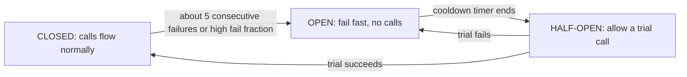

*What to notice: OPEN protects both sides. The failing dependency gets breathing room and our workers stop wasting time on calls that will time out.*

```python
class CircuitBreaker:
    def __init__(self, max_consecutive=5, cooldown_s=30):     # cooldown is an example value
        self.state, self.failures, self.opened_at = "CLOSED", 0, 0
        self.max_consecutive, self.cooldown_s = max_consecutive, cooldown_s

    def allow(self, now):
        if self.state == "OPEN" and now - self.opened_at >= self.cooldown_s:
            self.state = "HALF_OPEN"
        return self.state != "OPEN"

    def record(self, ok, now):
        if ok:
            self.state, self.failures = "CLOSED", 0
        else:
            self.failures += 1
            if self.state == "HALF_OPEN" or self.failures >= self.max_consecutive:
                self.state, self.opened_at = "OPEN", now
```

Breakers usually trip on either consecutive failures (simple) or a failure fraction over a rolling window (better for high volume, because one blip among thousands of successes should not trip it).

**Where it shows up in my work.** **IA (A3):** the shared orchestration registry for the AI decision pipelines has "hard timeouts, circuit breakers" that trip after about 5 consecutive failures or on a failure fraction. These protect the LLM calls inside the batch scoring passes. Combined with the A2 fallback (rows keep their deterministic baseline score when the LLM times out), a struggling LLM provider slows the AI part down without breaking the run.

**Interview questions.**
- **Q: Where did you use a circuit breaker and why?**
  **A:** In the shared orchestration registry for the AssortSmart AI pipelines. Each pass sends many structured LLM calls. If the provider starts failing or timing out, retrying every call just burns time and money. The breaker trips after about five consecutive failures or a high failure fraction, stops calling for a cooldown, then sends a trial call. Meanwhile the run is not lost, because rows that can't get an LLM answer keep their deterministic score.
- **Q: How is a circuit breaker different from retries?**
  **A:** Retries handle a single call's bad luck. A breaker handles a dependency that is down for everyone. They work together: retries with backoff for blips, and the breaker to stop retrying altogether when the failure is clearly systemic.
- **Q: How do you pick the threshold?**
  **A:** Low enough to stop wasting calls quickly, high enough that random blips don't trip it. Consecutive-failure counts are simple and fit lower-volume batch calls. For high-volume traffic I'd use a failure percentage over a rolling window with a minimum request count.

**Common mistakes and what not to say.**
- On my resume, circuit breakers are an **IA orchestration registry** feature. Older prep mentioned an "IRP breaker" at Masters as a narrative. Do not present it as a resume fact.
- Do not confuse a breaker with a rate limiter. A rate limiter caps volume even when everything is healthy.

---

## 9. Timeouts, nested timeouts and deadlines

**In plain English.** A timeout is the longest you will wait for something before giving up. A deadline is the same idea expressed as a fixed point in time ("finish by 10:00:05") that is passed along to every downstream call. Nested timeouts means each inner layer gets a shorter limit than the outer one, so the inner layer fails first and the outer layer still has time to respond cleanly.

**Analogy.** You give yourself 60 minutes to get to the airport. You give the taxi 40 minutes, so if it is badly late you still have 20 minutes to grab a train. If you gave the taxi 70 minutes, you would miss the flight while still "waiting politely".

**How it works.** Without timeouts, one slow dependency holds threads, connections and memory until the whole service falls over. With nested timeouts, every layer has a budget smaller than its parent.

```text
HTTP server read-header timeout:  5s    (stop slow-loris clients)       example values
Request handler deadline:         10s
  ClickHouse query:               8s    (must be shorter than handler)
  Redis lookup:                   200ms
```

```go
func pivotHandler(c *gin.Context) {
    ctx, cancel := context.WithTimeout(c.Request.Context(), 10*time.Second)
    defer cancel()

    qctx, qcancel := context.WithTimeout(ctx, 8*time.Second) // nested: inner budget is smaller
    defer qcancel()

    rows, err := ch.Query(qctx, pivotSQL, args...)
    if errors.Is(err, context.DeadlineExceeded) {
        c.JSON(http.StatusGatewayTimeout, gin.H{"error": "query took too long"})
        return
    }
    // ...
}
```

In Go, `context.Context` carries the deadline. Every function that does IO takes `ctx`, so when the outer deadline passes, all inner calls are cancelled together. That cancellation propagation is the key point: a timeout that does not cancel the inner work still leaves the work running.

**Where it shows up in my work.**
- **IA (C1):** the Go/Gin edge uses "nested timeouts" as part of being a self-protecting HTTP edge with no reverse proxy in front.
- **IA (A3):** the orchestration registry enforces "hard timeouts" on pipeline steps.
- **IA (A2):** on LLM timeouts the system falls back to the deterministic baseline score.

The example values above are illustrative. If asked for the real numbers, keep it qualitative.

**Interview questions.**
- **Q: What does "nested timeouts" mean on your resume?**
  **A:** Each layer gets a shorter time budget than the layer around it. The server has limits for reading headers and the body, each request has an overall deadline, and each downstream call like ClickHouse or Redis has a smaller budget inside that. So when something is slow, the innermost call fails first and the handler still has time to return a clean error instead of the client just hanging.
- **Q: What's the difference between a timeout and a deadline?**
  **A:** A timeout is a duration ("wait 2 seconds"). A deadline is an absolute time that gets passed down ("finish by 10:00:05"). Deadlines are better across many hops, because every hop knows how much time is actually left instead of each starting a fresh 2-second clock.

**Common mistakes and what not to say.**
- Do not set the inner timeout longer than the outer one.
- Do not forget that a timed-out call may still have succeeded on the other side. That is why timeouts and idempotency go together.

---

## 10. Graceful degradation and fallbacks

**In plain English.** Graceful degradation means that when part of the system fails, the rest keeps working at a reduced quality instead of failing completely. A fallback is the specific reduced answer you serve.

**Analogy.** When the GPS loses signal in a tunnel, the car's map keeps showing your estimated position. It is less precise, but you are not left with a blank screen.

**How it works: a Keep/Drop example.** The IA Keep/Drop engine scores each article-season (one product in one selling season). The deterministic score comes from sell-through and rate of sale. The AI score comes from LLM lenses combined by a decider. The blend is:

\[ s_{final} = 0.4 \cdot s_{det} + 0.6 \cdot s_{agent} \]

Normal case: s_det = 0.70 and s_agent = 0.50, so s_final = 0.28 + 0.30 = 0.58. That is at least 0.55, so the article is kept.

Degraded case: the LLM call times out. Instead of failing the batch, the row keeps its deterministic baseline score, and telemetry counts it as a batch fallback. The planner still gets a decision for every article, and we can see exactly how many rows fell back.

```python
try:
    s_agent = await asyncio.wait_for(score_with_lenses(payload), timeout=LLM_TIMEOUT_S)
    score = 0.4 * s_det + 0.6 * s_agent
except asyncio.TimeoutError:
    score = baseline_score(s_det)          # deterministic fallback
    telemetry.batch_fallbacks += 1
```

**Where it shows up in my work.** **IA (A2):** "Graceful fallback to deterministic baseline scores on LLM timeouts." **IA (A3):** custom JSON telemetry records batch fallbacks, so degradation is visible, not silent.

**Interview questions.**
- **Q: What happens to Keep/Drop if the LLM is down?**
  **A:** The run still finishes. Every row has a deterministic score from sell-through and rate of sale, and that score is the fallback when the LLM call times out. The circuit breaker stops us hammering a failing provider, and telemetry records how many rows fell back, so nobody mistakes a degraded run for a normal one.
- **Q: Why is that fallback safe?**
  **A:** Because the deterministic baseline is a real, auditable business rule, not a placeholder. On the gold-200 benchmark it scored 74% on its own. It's the bar the AI has to beat, so falling back to it is a known-quality answer.

**Common mistakes and what not to say.**
- A fallback must be marked. A silent fallback looks like a normal result and hides an outage.
- Do not imply the LLM writes to the database. It never does on this project.

---

## 11. Checkpoints and resumable jobs

**In plain English.** A checkpoint is a saved record of how far a long job got. A resumable job reads its checkpoint on restart and continues from there instead of starting over.

**Analogy.** A bookmark. If you fall asleep on page 212, you do not start the novel again from page 1.

**How it works.** The job writes progress after each unit of work, durably (to disk or a database), and only after that unit is fully committed. On restart, it skips everything already marked done.

```text
IA AI pipeline (A3), simplified:
  run 1: deterministic scoring  -> writes det.json
         agent scoring, batch 1..40 -> agent_progress.json says "batches 1-40 done"
         crash at batch 41
  run 2 (--resume): det.json exists -> skip deterministic scoring entirely
                    agent_progress.json -> start at batch 41

IA ClickHouse migration (C5), simplified:
  for each table:
      if migrate-checkpoints/<table>.done exists: skip
      copy partitions ... ; on success write <table>.done
  weekly loader keeps a TSV ledger (skip file) of weeks already loaded
```

The hard part is the gap between "work done" and "checkpoint written". If the job crashes in between, the restart redoes that one unit. So the unit must be idempotent, or the recovery must clean it up first. In the migration, a partially copied season is handled by **DROP PARTITION and then recopy that season**. That prevents "ghost rows" (duplicate or half-copied rows left behind by a crash).

**Where it shows up in my work.**
- **IA (A3):** "durable checkpoints (det.json, agent_progress.json, `--resume`) that skip redundant deterministic scoring." Why not Airflow or Temporal: we needed app-native resume tied to ClickHouse inserts and config hashing, and extra infrastructure was not justified.
- **IA (C5):** TSV ledgers plus `migrate-checkpoints/<table>.done` files, and partition rollback by DROP PARTITION then recopy.

Say this carefully: the partition rollback is "drop and recopy", not an atomic swap with live readers. A REPLACE PARTITION incremental design was written but not executed.

**Interview questions.**
- **Q: Why build your own checkpointing instead of using Airflow or Temporal?**
  **A:** The resume logic had to know about our data: which deterministic scores already existed, which LLM batches were already inserted into ClickHouse, and which config hash they ran under. A workflow engine would have given us retries and scheduling, but we'd still have written that data-aware logic, plus run another piece of infrastructure. For a batch pipeline with a fixed step order, simple durable files and `--resume` were enough.
- **Q: How did you avoid duplicates when a migration crashed halfway through a partition?**
  **A:** The unit of recovery was the partition. If a season's copy didn't finish, we dropped that partition on the target and recopied the whole season. The `.done` checkpoint was only written after a table finished, and the TSV ledger recorded weeks already loaded. So a restart never appended on top of half-copied data.

**Common mistakes and what not to say.**
- Do not call the partition rollback "atomic" in the database sense. It's drop and recopy.
- Do not say the 4.09B partition copy finished. It was measured in flight.

---

## 12. At-most-once, at-least-once, exactly-once

**In plain English.** These describe how many times a message gets processed when things fail.
- **At-most-once:** each message is processed zero or one time. Fast, but messages can be lost.
- **At-least-once:** each message is processed one or more times. Nothing is lost, but duplicates happen.
- **Exactly-once:** each message's effect happens exactly one time. This is what everyone wants and the hardest to get.

**Analogy.** Sending a parcel. At-most-once: you post it and never check. At-least-once: you keep sending copies until you get a receipt, so the friend might get two. Exactly-once: you keep sending copies, but your friend keeps a list of parcel numbers and throws away repeats. The effect is "one parcel received".

**How it works with Kafka offsets.** A Kafka consumer reads messages and records its position (offset).
- Commit the offset **before** processing: a crash after commit loses the message. That is at-most-once.
- Commit the offset **after** processing: a crash before commit means the message is reprocessed. That is at-least-once.
- Exactly-once **effect** = at-least-once delivery + an idempotent sink (the write ignores repeats), or a transactional system where the output and the offset commit happen together (Kafka transactions, Flink checkpoints with transactional sinks).

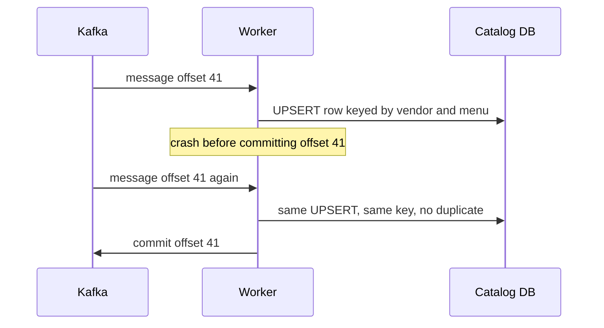

*What to notice: the message was delivered twice, but the catalog changed once. That is "exactly-once" in practice.*

The honest point: once an external system is involved, like a government portal or a third-party site, true end-to-end exactly-once needs that system inside your transaction, which it never is. So in practice you build at-least-once plus idempotency.

**Where it shows up in my work.**
- **Menu (M2):** "exactly-once catalog upserts". In practice: at-least-once delivery plus idempotent upserts. I do not claim zero message loss or two-phase commit across third parties.
- **Masters (MI2):** "exactly-once idempotent processing for 100K+ concurrent imports". Same mechanism: at-least-once through Kafka, plus idempotency keys, so the government sees each invoice registered once. In a Spring Kafka consumer, the default behaviour already commits offsets only after the listener method returns, which is at-least-once. The idempotency key turns that into a once-only effect.

**Interview questions.**
- **Q: Your resume says exactly-once. How did you achieve that?**
  **A:** Honestly, it's exactly-once effect, built on at-least-once delivery. Messages can be delivered more than once, for example after a consumer restart. But every write is idempotent: at Menu the catalog upsert is keyed by vendor and menu, and at Masters each batch has an idempotency key. So a duplicate delivery doesn't create a duplicate result. True exactly-once across a third-party system isn't possible because it's outside our transaction boundary.
- **Q: When would you accept at-most-once?**
  **A:** For data where losing a little is fine and duplicates or delays are worse, like high-volume metrics or debug logs. Never for invoices or catalog changes.

**Common mistakes and what not to say.**
- Do not say "Kafka guarantees exactly-once so we were fine". Kafka's transactions only cover Kafka-to-Kafka.
- Do not claim zero message loss or two-phase commit across third parties.

---

# Part C. Databases and data correctness

This part is where interviewers test whether I really owned data systems. The FRM, Masters and IA stories all live here.

## 13. Eventual consistency

**In plain English.** A system is eventually consistent if, after a write, readers might briefly see old data, but if no new writes happen, everyone will see the latest value soon. The opposite is strong consistency: once a write succeeds, every reader sees it immediately.

**Analogy.** Updating your address with a big company. The billing team has it the same day, the delivery team gets it overnight. For a few hours different teams have different answers, but by tomorrow they all agree.

**How it works: ReplacingMergeTree.** ReplacingMergeTree is a ClickHouse table type that keeps only the newest version of rows with the same sorting key. Think of a notebook where you never erase. You just write the new value on a new line, and a cleaner later crosses out the old lines. The "cleaner" is ClickHouse's background merge, and it runs on its own schedule.

```sql
CREATE TABLE ai_decisions
(
    tenant_id     String,
    article_id    String,
    season_code   String,
    s_final       Float64,
    decision      String,
    config_hash   String,
    version       UInt64
)
ENGINE = ReplacingMergeTree(version)
PARTITION BY season_code
ORDER BY (tenant_id, season_code, article_id);
```

*Illustrative table shape for teaching, not the production DDL.*

```text
Insert at 10:00  ('t1','A123','SS26', 0.52, 'DROP', 'abc..', 1)
Insert at 10:05  ('t1','A123','SS26', 0.58, 'KEEP', 'abc..', 2)

Before the background merge, a plain SELECT may return BOTH rows.
After the merge, only version 2 remains.
```

To read correctly before the merge, either use `SELECT ... FINAL` (forces deduplication at read time, slower) or pick the latest version yourself:

```sql
SELECT article_id, argMax(decision, version) AS decision
FROM ai_decisions
WHERE tenant_id = 't1' AND season_code = 'SS26'
GROUP BY article_id;
```

**Where it shows up in my work.** **IA (A2):** "Eventually consistent writes via ReplacingMergeTree." AI decisions are written as new row versions instead of updating rows in place. ClickHouse is built for fast inserts and bad at row-level updates, so insert-a-new-version is the natural fit, and re-running a batch is safe because the newer version wins.

**Interview questions.**
- **Q: Why eventual consistency for AI decisions? Isn't that risky?**
  **A:** For this data it's the right trade. AI decisions are produced in batches and read by planners afterwards, not by a payment flow that needs to see its own write instantly. ClickHouse handles row updates badly, so we insert a new version and let ReplacingMergeTree keep the newest. Where a reader needs the exact latest answer, the query deduplicates by version.
- **Q: When would eventual consistency be wrong?**
  **A:** For anything where acting on stale data causes harm: account balances, inventory reservations, or permissions. That's why roles and access data stay in PostgreSQL and the FRM financial data lives in MySQL with transactions.

**Common mistakes and what not to say.**
- Do not claim sub-second ClickHouse reads at IA.
- Do not say ReplacingMergeTree deduplicates immediately. Merges run in the background, at no guaranteed time.

---

## 14. Transactions and ACID

**In plain English.** A transaction is a group of database changes that succeed together or fail together. ACID is the set of four guarantees a transactional database gives:
- **Atomicity:** all or nothing.
- **Consistency:** rules like foreign keys and unique constraints still hold afterwards.
- **Isolation:** concurrent transactions don't see each other's half-finished work (how strictly depends on the isolation level, next section).
- **Durability:** once committed, it survives a crash.

**Analogy.** A bank transfer. Taking money from account A and adding it to account B must both happen, or neither. Half a transfer is a disaster.

**How it works.**

```sql
START TRANSACTION;
UPDATE scoping_items   SET status = 'REVIEW', version = version + 1
  WHERE uuid = 'b7e1...' AND version = 4;
INSERT INTO review_audit (item_uuid, from_status, to_status, changed_by)
  VALUES ('b7e1...', 'DRAFT', 'REVIEW', 'analyst@uber.com');
COMMIT;   -- if anything fails before this, ROLLBACK undoes both
```

*Illustrative tables for teaching.*

```java
// Spring Data JPA: one unit of work, committed together or rolled back together
@Service
public class ReviewStatusService {
    private final ScopingItemRepository items;
    private final ReviewAuditRepository audits;
    // constructor omitted

    @Transactional
    public void submitForReview(String uuid, String changedBy) {
        ScopingItem item = items.findById(uuid).orElseThrow(NotFoundException::new);
        ReviewStatus from = item.getStatus();
        item.setStatus(ReviewStatus.REVIEW);     // Hibernate writes this UPDATE at commit
        audits.save(new ReviewAudit(uuid, from, ReviewStatus.REVIEW, changedBy));
    }
    // a RuntimeException anywhere in the method rolls back both writes
}
```

*Illustrative names.* `@Transactional` opens a transaction when the method starts and commits when it returns. Hibernate tracks which loaded entities changed and writes only those at commit, which is called dirty checking.

**Where it shows up in my work.** **FRM (F2):** "atomic cross-table syncs", meaning related changes across the 8-table normalized MySQL schema on SOADB (Uber's service-owned MySQL standard) are made in one transaction, so a sync never leaves one table updated and another stale. In the Spring Boot service, that boundary is `@Transactional` on the service method.

**Interview questions.**
- **Q: What does "atomic cross-table syncs" mean on your FRM bullet?**
  **A:** When one user action or ETL step touched several of the eight tables, we did it in a single MySQL transaction. Either all tables reflected the change or none did. For a SOX-audited finance process, a half-applied sync would mean the audit trail disagrees with the numbers, which is exactly what auditors look for.
- **Q: Can you have ACID across two services?**
  **A:** Not with a normal local transaction. Across services you either use a distributed protocol like two-phase commit, which is slow and fragile, or design with sagas and idempotent compensating steps. I prefer keeping things that must change together inside one service's database, which is what the FRM schema did.

**Common mistakes and what not to say.**
- "Consistency" in ACID is not the same as "consistency" in the CAP theorem. ACID means constraints hold. CAP means all replicas agree.
- ClickHouse is not a transactional OLTP store. Do not describe IA ClickHouse writes as ACID transactions.
- Two Spring traps worth naming. Spring rolls back automatically only on unchecked exceptions, so a checked exception commits unless you add `rollbackFor`. And `@Transactional` works through a proxy, so calling a transactional method from another method in the same class skips the proxy and runs without the transaction.

---

## 15. Isolation levels

**In plain English.** The isolation level decides how much one running transaction can see of another's changes. Stronger isolation means fewer surprises but more waiting.

**Analogy.** Editing a shared document. At the lowest level you see people's typing live, typos included. At the highest level everyone works on their own copy and only clean, finished edits are merged in a safe order.

**How it works.** The four standard levels, from weakest to strongest, and what they prevent:

| Level | Dirty read (see uncommitted data) | Non-repeatable read (same row, different value on re-read) | Phantom (new rows appear on re-query) |
|---|---|---|---|
| Read uncommitted | possible | possible | possible |
| Read committed | prevented | possible | possible |
| Repeatable read | prevented | prevented | possible in theory (MySQL InnoDB largely prevents it) |
| Serializable | prevented | prevented | prevented |

Defaults worth knowing: PostgreSQL defaults to read committed. MySQL InnoDB defaults to repeatable read.

One anomaly that matters for my work is the **lost update**. Two people read a row (version 4), both edit it, both save. The second save silently overwrites the first. Most default isolation levels do not stop this on their own. Optimistic locking (next section) is the usual fix.

**Where it shows up in my work.** This is background knowledge, not a resume claim. It explains why FRM needed optimistic row-locking: the problem was concurrent edits during close, and the fix was a version check rather than raising the isolation level.

**Interview questions.**
- **Q: Why not just use serializable isolation everywhere?**
  **A:** Because it costs throughput. Serializable makes the database abort or block transactions that might conflict, and under heavy concurrency, like an ETL load during financial close, that means lots of retries and waiting. It's usually better to keep the default level and protect the specific rows that matter with optimistic locking or explicit constraints.

**Common mistakes and what not to say.**
- Do not claim you tuned isolation levels at FRM. The resume claim is optimistic row-locking.

---

## 16. Optimistic vs pessimistic locking

**In plain English.** Both stop two people from overwriting each other's changes.
- **Pessimistic locking** locks the row when you read it, so nobody else can change it until you finish. Safe, but others wait.
- **Optimistic locking** does not lock. Each row has a version number. When you save, you say "update only if the version is still what I read". If someone else saved first, your update changes zero rows and you know there was a conflict.

**Analogy.** Pessimistic: taking the only key to the meeting room while you prepare. Nobody else can get in, even if you are only reading. Optimistic: everyone can enter, but the whiteboard has a revision number in the corner. Before you erase anything, you check the number is the one you saw when you walked in.

**How it works.**

```sql
-- Pessimistic: hold a lock until COMMIT
SELECT * FROM scoping_items WHERE uuid = 'b7e1...' FOR UPDATE;

-- Optimistic: no lock; the version check is the guard
UPDATE scoping_items
SET status = 'CLOSED', comment = 'Reviewed by controller', version = version + 1
WHERE uuid = 'b7e1...' AND version = 4;
-- rows affected = 1  -> success, version is now 5
-- rows affected = 0  -> someone changed it first; reload and show a conflict (HTTP 409)
```

```text
Timeline:
10:00  Analyst A reads item (version 4)
10:01  ETL step updates item           -> version 5
10:02  Analyst A saves with "version = 4" -> 0 rows updated -> conflict shown, nothing lost
```

**The same thing in JPA.** You don't write the version check by hand. A `@Version` field on the entity tells Hibernate to add `AND version = ?` and `version = version + 1` to every UPDATE it generates. If zero rows match, Hibernate throws an `OptimisticLockException`, Spring wraps it as `ObjectOptimisticLockingFailureException`, and one controller advice turns it into HTTP 409 Conflict.

```java
@Entity
@Table(name = "scoping_items")
public class ScopingItem {
    @Id
    private String uuid;                    // SHA-256 natural key
    @Enumerated(EnumType.STRING)
    private ReviewStatus status;
    private String comment;
    @Version
    private long version;                   // checked and bumped on every UPDATE
    // getters and setters omitted
}

@Transactional
public ScopingItem close(String uuid, UpdateItemRequest req) {
    ScopingItem item = items.findById(uuid).orElseThrow(NotFoundException::new);
    if (item.getVersion() != req.version()) {          // the browser's copy is stale
        throw new ObjectOptimisticLockingFailureException(ScopingItem.class, uuid);
    }
    item.setStatus(ReviewStatus.CLOSED);
    item.setComment(req.comment());
    return item;                                       // Hibernate's UPDATE checks the version again
}

@RestControllerAdvice
class ApiErrors {
    @ExceptionHandler(ObjectOptimisticLockingFailureException.class)
    ResponseEntity<String> conflict() {
        return ResponseEntity.status(HttpStatus.CONFLICT).body("Changed since you loaded it. Reload and retry.");
    }
}
```

*Illustrative names.* There are two layers here. The explicit comparison catches the common case, where the analyst's screen is minutes out of date, because the version they loaded travels in the PATCH body. Hibernate's own check in the UPDATE catches the rare race where someone commits in the milliseconds between the read and the flush.

**Which to choose.** Optimistic fits when conflicts are rare and you don't want readers to block each other. Pessimistic fits when conflicts are frequent and retrying is expensive. In JPA, pessimistic is `@Lock(LockModeType.PESSIMISTIC_WRITE)` on a repository method, which issues `SELECT ... FOR UPDATE`.

**Where it shows up in my work.** **FRM (F2):** "Resolved ETL lock contention during financial close with an 8-table normalized MySQL schema on Uber's SOADB, polymorphic review-status model, optimistic row-locking (version check on update), atomic cross-table syncs." During close, ETL loads and reviewers worked on the same data at the same time. Long-held locks were causing contention. A version check lets everyone proceed and only stops the rare real conflict.

**Interview questions.**
- **Q: Why optimistic locking at FRM instead of pessimistic?**
  **A:** Because the problem was contention. During quarterly close, ETL loads and finance reviewers touched the same tables, and long-held locks meant people were waiting on each other. Real conflicts on the same row were rare. With a version column, nobody holds a lock while they think, and if two writes collide, the second gets a clear conflict instead of silently overwriting the first.
- **Q: What does the user see on a conflict?**
  **A:** The update affects zero rows, Hibernate throws an optimistic-locking exception, and our `@RestControllerAdvice` maps it to a 409 Conflict. The UI then reloads the latest version so they can reapply their change. No data is silently lost, which matters for an audited process. Follow-up they may ask: "How does `@Version` work?" Answer: "Hibernate reads the version with the row and adds `AND version = <what I read>` to every UPDATE. Zero rows matched means someone else saved first."
- **Q: When would you go pessimistic?**
  **A:** When the same row is hit constantly and redoing work is costly, like a single inventory counter for a hot item. There, waiting for a short lock is cheaper than constant retries.

**Common mistakes and what not to say.**
- Optimistic locking is not "no locking at all". The database still briefly locks the row during the UPDATE itself.
- On my resume this is **Uber FRM**. Do not move it to another project.

---

## 17. Sharding vs partitioning vs replication

**In plain English.** These three are often confused.
- **Partitioning** splits one big table into pieces inside the same database, by a key like date or season. Queries that filter on that key only touch the relevant pieces.
- **Sharding** splits data across separate database instances (or separate physical stores), each holding a subset. It spreads load and storage across machines.
- **Replication** keeps copies of the same data on several machines, for read scaling and for surviving failures.

**Analogy.** A library. Partitioning is shelving books by year on different shelves in one building. Sharding is putting different years in different buildings. Replication is keeping a photocopy of the whole collection in a second building in case the first floods.

**How it works.**

```sql
-- PostgreSQL declarative partitioning by tax quarter (illustrative)
CREATE TABLE einvoices (
    client_id     text,
    invoice_no    text,
    tax_quarter   text,      -- e.g. '2023-Q4'
    status        text,
    PRIMARY KEY (tax_quarter, client_id, invoice_no)
) PARTITION BY LIST (tax_quarter);

CREATE TABLE einvoices_2023_q4 PARTITION OF einvoices FOR VALUES IN ('2023-Q4');
CREATE TABLE einvoices_2024_q1 PARTITION OF einvoices FOR VALUES IN ('2024-Q1');
```

```sql
-- ClickHouse partitioning by season (IA rollups)
CREATE TABLE rollup_product_season ( ... )
ENGINE = MergeTree
PARTITION BY season_code
ORDER BY (tenant_id, product_id);
-- Whole seasons can be dropped and recopied: ALTER TABLE ... DROP PARTITION 'SS26'
```

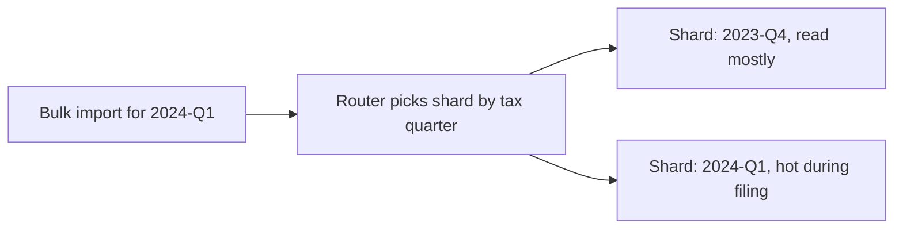

*What to notice: choosing the shard key decides where load lands. A time-based key puts all the deadline pressure on the current quarter.*

**Choosing a shard key.** A good key keeps related data together (so most queries hit one shard), spreads load evenly, and rarely needs to change. A time-based key like tax quarter is great for "everything for this filing period" queries and for archiving old periods, but it creates a **hot shard**: the current quarter gets nearly all writes. That is the main trade-off to discuss.

**Where it shows up in my work.**
- **Masters (MI2):** "PostgreSQL sharded by tax quarter." GST work is organised around filing periods. Bulk imports and reconciliation for a quarter stay together, and older quarters become read-mostly.
- **IA (C4, C5):** the six ClickHouse rollup tables are `PARTITION BY season_code`. That made each season a unit for loading, migrating and rolling back (DROP PARTITION then recopy).
- **Replication:** not a resume claim. I can explain it, but I did not own replica topology. ClickHouse Cloud manages its own replicas.

Say this carefully: if an interviewer asks about the physical layout of the Masters shards (how many nodes, how routing worked), explain the key choice and the reasons, and keep anything you don't remember qualitative. Do not invent node counts.

**Interview questions.**
- **Q: Why shard by tax quarter at Masters?**
  **A:** Because GST compliance work is organised by filing period. A bulk import, its retries and its reconciliation all belong to one quarter, so keeping a quarter together means those queries stay on one shard. Old quarters become mostly read-only and can be archived without touching current data. The downside is that the current quarter is hot around deadlines, so that's where capacity and the Kafka buffer had to absorb the spike.
- **Q: What's the difference between partitioning and sharding?**
  **A:** Partitioning splits a table inside one database, so the database can skip irrelevant pieces. Sharding spreads data across separate database instances, so load and storage spread across machines. You can do both. At IA, ClickHouse tables were partitioned by season, which made a season the unit we could drop and reload.
- **Q: How would you fix a hot shard?**
  **A:** Add a second component to the key, like quarter plus a hash of the client ID, so the current quarter is spread across several shards. The cost is that "everything for this quarter" now touches several shards.

**Common mistakes and what not to say.**
- Do not say IA ClickHouse was "sharded by season". The resume says partitioned.
- Do not claim you ran database replication or failover.

---

## 18. Indexes and N+1 queries

**In plain English.** An index is a separate, sorted data structure that lets the database find rows without scanning the whole table. An N+1 query problem is when code runs one query to get a list, then one more query per item in the list, so 100 items cause 101 queries.

**Analogy.** An index is the index at the back of a textbook. Without it, you read every page to find "photosynthesis". N+1 is like going to the shop once to get a shopping list, then making a separate trip for each item on it.

### B-tree index

The default index in PostgreSQL and MySQL is a B-tree: a balanced, sorted tree. Finding one key among millions takes only a few steps, and range queries ("dates between X and Y") are fast because the keys are in order.

### Composite index and the leftmost-prefix rule

A composite index covers several columns in a fixed order. It helps queries that filter on the leftmost columns.

```sql
CREATE INDEX idx_inv_client_date ON einvoices (client_id, created_at);

-- Uses the index: filters on the first column, then a range on the second
SELECT * FROM einvoices WHERE client_id = 'ACME' AND created_at >= '2024-01-01';

-- Cannot use it well: skips the first column
SELECT * FROM einvoices WHERE created_at >= '2024-01-01';
```

### Covering index

A covering index contains every column the query needs, so the database answers from the index alone and never visits the table.

```sql
CREATE INDEX idx_inv_cover ON einvoices (client_id, created_at) INCLUDE (status);  -- PostgreSQL
SELECT status FROM einvoices WHERE client_id = 'ACME' AND created_at >= '2024-01-01';
```

Indexes are not free. Each one slows down inserts and updates and takes storage, so you index for the queries you actually run.

### N+1 queries

```java
// N+1: 1 query for the items, then 1 query per item for its audit history
List<ScopingItem> items = itemRepository.findAll();
for (ScopingItem item : items) {
    item.getAuditHistory().size();        // lazy @OneToMany fires a SELECT each time
}

// Fix in Spring Data JPA: fetch the association in the same query
@EntityGraph(attributePaths = "auditHistory")
List<ScopingItem> findByFiscalQuarter(String fiscalQuarter);

// or the JPQL equivalent
@Query("select distinct i from ScopingItem i left join fetch i.auditHistory where i.fiscalQuarter = :q")
List<ScopingItem> findWithHistory(@Param("q") String fiscalQuarter);
```

*Illustrative names.* A third option is Hibernate's `hibernate.default_batch_fetch_size`, which loads lazy collections for many parents in one `IN (...)` query instead of one query each.

### Explicit aliases (the FRM column-aliasing bug)

The FRM ORM story is a different bug. In joined raw SQL, two tables both had a column with the same name, so the row mapper silently picked one of them and rows landed on the wrong uuid. The fix was aliased selects with explicit labels. In Spring Data JPA that means a native query (or JPQL) where every column has a unique alias, mapped by name onto a projection:

```java
// Risky: both tables have "uuid", so which one the mapper reads is ambiguous
@Query(value = "SELECT * FROM scoping_items s JOIN materiality m ON m.item_uuid = s.uuid",
       nativeQuery = true)
List<Object[]> findItemMaterialityUnsafe();

// Fixed: every column explicitly aliased, mapped by alias onto an interface projection
@Query(value = """
    SELECT s.uuid AS itemUuid, m.uuid AS materialityUuid, m.amount AS amount
    FROM scoping_items s JOIN materiality m ON m.item_uuid = s.uuid
    """, nativeQuery = true)
List<ItemMaterialityView> findItemMateriality();

interface ItemMaterialityView {
    String getItemUuid();
    String getMaterialityUuid();
    BigDecimal getAmount();
}
```

*Illustrative table and column names.*

ClickHouse is different. It has a sparse primary index built from the `ORDER BY` key: it stores one entry per block of rows (a "granule", 8,192 rows by default) and skips blocks that can't match. That's why choosing `ORDER BY (tenant_id, season_code, ...)` matters so much there.

**Where it shows up in my work.**
- **Masters (MI1):** the p95 drop from 1.2s to 300ms included "query/index fixes".
- **FRM (F3):** the Spring Data JPA / Hibernate migration is where N+1 risk lives, because lazy associations are the JPA default for collections. The resume claim for that migration is that it eliminated latent column-aliasing bugs and raised coverage to 100%. N+1 is a general watch-out I can explain, not a separate claim.
- **IA (C4):** ClickHouse ORDER BY and partition choices on the rollup tables decide how much data each pivot reads.

**Interview questions.**
- **Q: How do you find which index to add?**
  **A:** I start from the slow query log or APM traces to find the queries that cost the most in total, then run EXPLAIN (or EXPLAIN ANALYZE) on them. If I see a full table scan on a selective filter, I add an index whose leading columns match the equality filters, followed by the range column. Then I re-check the plan and watch write latency, because every index slows inserts.
- **Q: How do you spot and fix N+1?**
  **A:** It shows up as a page whose query count grows with the number of rows. You see it in traces as a staircase of identical small queries. The fix is to load related data in bulk, with a fetch join or `@EntityGraph` in JPA, or batch fetching, so it's one or two queries instead of N+1. Turning on Hibernate's SQL logging or statistics in a test makes the query count visible.

**Common mistakes and what not to say.**
- "Add an index on every column" is a wrong answer. Index for real query patterns.
- Do not claim a specific N+1 fix at FRM unless you remember one. The FRM ORM story is the column-aliasing bug.

---

## 19. OLTP vs OLAP, row vs columnar storage

**In plain English.** OLTP (online transaction processing) databases handle many small reads and writes of individual records: "update this invoice", "fetch this user". OLAP (online analytical processing) databases handle large reads that summarise many rows: "total sales by store by week for the season".

Row stores (PostgreSQL, MySQL) keep each row's columns together on disk, which is great for fetching or updating whole records. Columnar stores (ClickHouse, BigQuery) keep each column together, which is great for scanning a few columns across billions of rows.

**Analogy.** A row store is a filing cabinet with one folder per customer: perfect for pulling out one customer's file. A columnar store is a set of ledgers, one per field: perfect for adding up "every sale amount this year" without opening any customer folders.

**How it works: a worked example.** A fact table has 40 columns and 250M rows. A planner pivot needs `season_code`, `store_id` and `sales_units`.
- A row store reads whole rows, so roughly all 40 columns' worth of data, to get those 3.
- A columnar store reads only the 3 columns, and those columns compress very well because similar values sit next to each other. It also processes them in vectorised batches, applying one operation to many values at once.

So the columnar store reads a small fraction of the data before compression even starts helping.

| | OLTP / row store | OLAP / columnar store |
|---|---|---|
| Typical query | fetch or update one record | aggregate millions of rows |
| Writes | frequent small updates | large batched inserts |
| Strength | transactions, constraints | scans, compression, GROUP BY speed |
| My examples | PostgreSQL (IA metadata, roles), MySQL (FRM), PostgreSQL (Masters) | ClickHouse (IA), BigQuery (IA tech line) |

**Where it shows up in my work.**
- **IA (C3, C4, A2):** PostgreSQL keeps thin metadata, user access management (UAM) and roles. ClickHouse holds the large analytical data, including the 2.11B-row master and the rollups. Background: planner pivots were slow on PostgreSQL, proofs of concept compared Postgres and ClickHouse, and ClickHouse won the large analytical reads.
- **FRM (F2):** MySQL on SOADB, an OLTP workload with transactions and optimistic locking.

**Interview questions.**
- **Q: Why ClickHouse for planner pivots instead of PostgreSQL?**
  **A:** Planner pivots are wide GROUP BY queries over hundreds of millions of rows that only need a few columns. Postgres is a row store, so it reads whole rows and spends most of its IO on columns the pivot never uses. ClickHouse stores columns separately, compresses them well and processes them in vectorised batches. We compared them in proofs of concept, and ClickHouse won the analytical reads. Postgres still holds the metadata and roles, where transactions matter.
- **Q: What's ClickHouse bad at?**
  **A:** Frequent row-level updates and deletes, and lots of tiny inserts. It's built for big batched inserts and big reads. That's why AI decisions are written as new versions in a ReplacingMergeTree instead of updated in place, and why access control lives in Postgres.

**Common mistakes and what not to say.**
- Do not claim sub-second ClickHouse responses at IA.
- Do not say "we moved off Postgres". Postgres stayed for metadata, UAM and roles.

---

## 20. Pre-aggregation, rollups and materialized views

**In plain English.** Pre-aggregation means calculating summaries ahead of time and storing them, so a query reads the small summary instead of the huge raw data. A rollup table is one such stored summary, at a chosen grain (level of detail). A materialized view is a database feature that stores a query's result and keeps it updated, either automatically or on refresh.

**Analogy.** A shop manager doesn't add up every receipt each time the owner asks for weekly sales. At the end of each day she writes the day's total in a ledger. Weekly sales becomes adding seven numbers.

**How it works: a worked example.** Raw data: one row per article, per store, per week. A pivot asks for sales per product per season.

```sql
-- Build a season-grain rollup once (illustrative column names)
INSERT INTO rollup_product_season
SELECT tenant_id, season_code, product_id,
       sum(sales_units)    AS sales_units,
       sum(receipt_units)  AS receipt_units
FROM fact_article_store_week
WHERE season_code = 'SS26'
GROUP BY tenant_id, season_code, product_id;

-- The planner pivot now reads the small rollup
SELECT product_id, sales_units / nullIf(receipt_units, 0) AS sell_through
FROM rollup_product_season
WHERE tenant_id = 't1' AND season_code = 'SS26';
```

If thousands of store-week rows collapse into one product-season row, the pivot reads thousands of times less data. The cost is that rollups must be rebuilt or updated when the raw data changes, and every new grain is another table to maintain.

In ClickHouse specifically, a materialized view is an insert trigger: when rows are inserted into the source table, the view's query runs on that new block and writes the result into a target table. Rollups can also be built in explicit batch jobs with INSERT SELECT, which gives more control over memory and order.

**Where it shows up in my work.** **IA (C4):** "15.5× faster planner pivots (189s to 12s on a 250M-row harness) via a ClickHouse pre-aggregation layer: six MergeTree rollup tables (product, store, attr × season and weekly, PARTITION BY season_code)." MEASURED. 189 / 12.3 ≈ 15.4, which rounds to the 15.5× on the resume (12.3s rounded to 12s for speaking).

**Interview questions.**
- **Q: How did you get pivots from 189 seconds to 12?**
  **A:** We stopped computing pivots from the raw grain every time. We built six rollup tables in ClickHouse: product, store and attribute, each at season and weekly grain, partitioned by season. A planner pivot then reads a pre-summarised table instead of scanning the full fact data. On a 250-million-row test harness that took the pivot from 189 seconds to about 12.
- **Q: What's the cost of rollups?**
  **A:** Freshness and maintenance. Rollups are only as fresh as their last build, and every new grain is another table to build, store and migrate. Building them is also heavy. The weekly attribute rollup was where we hit the memory problem in the next section.
- **Q: Why six tables and not one?**
  **A:** Because pivots group at different levels: product, store or attribute, by season or by week. One rollup at the finest grain would still be big. Matching the rollup grain to the query grain is what gives the speed-up.

**Common mistakes and what not to say.**
- The 15.5× is query time. Do not connect it to the 170GB out-of-memory fix, which is about load time.
- Do not say "materialized views" for the IA rollups unless you mean it. The resume says rollup tables.

---

## 21. Memory limits and spilling to disk

**In plain English.** Big aggregations (GROUP BY, sort, join) build data structures in memory. If those grow beyond the available memory, the process crashes with OOM (out of memory). Spilling to disk means the database writes part of its working data to temporary files instead of crashing, which is slower but finishes. Memory limits are caps you set so one query cannot eat the whole machine.

**Analogy.** Sorting a huge stack of exam papers on a small desk. If the stack doesn't fit, you don't give up. You sort piles on the floor and merge them. Or better, you only bring one class's papers to the desk at a time.

**How it works: the IA weekly rollup.** Building a weekly rollup for an entire season in one INSERT SELECT meant ClickHouse had to hold the GROUP BY state for every week at once. The fix had two parts:

1. **Slice the work in time.** Run one INSERT SELECT per fiscal week instead of one per season. Each insert's memory is now bounded by one week's data.
2. **Cap memory and allow spill.** Set a per-query memory limit and tell ClickHouse to spill the GROUP BY to disk past a threshold, so a big week gets slow instead of fatal.

```sql
INSERT INTO rollup_attr_week
SELECT tenant_id, season_code, fiscal_week, attr_id, sum(sales_units) AS sales_units
FROM fact_article_store_week
WHERE season_code = 'SS26' AND fiscal_week = 202614       -- one week per insert
GROUP BY tenant_id, season_code, fiscal_week, attr_id
SETTINGS
    max_memory_usage = 55000000000,                        -- ~55 GB cap
    max_bytes_before_external_group_by = 16000000000,      -- spill GROUP BY past ~16 GB
    max_threads = 8;
```

The numbers in the settings are the verbal knobs I describe: a 55 GB memory cap, 16 GB spill threshold, 8 threads, and 4 weeks in flight at once. For scale: a product week needed about 11 GB, an attribute week more than 40 GB, and a whole-season build failed even with 80 GB and 200 GB caps.

**Where it shows up in my work.** **IA (C4):** "Separately prevented 170GB OOM on weekly rollup builds by slicing INSERT SELECTs into temporal chunks (one fiscal week per insert) and enforcing memory + disk-spill caps."

**Interview questions.**
- **Q: Tell me about the 170GB OOM.**
  **A:** Building the weekly rollups for a whole season in one INSERT SELECT made ClickHouse try to hold the full aggregation in memory, and we hit a 170 GB out-of-memory failure. Even 80 GB and 200 GB memory caps didn't save the season-sized build. So I sliced it to one fiscal week per insert, capped memory at about 55 GB, let the GROUP BY spill to disk past 16 GB, and ran four weeks in flight with 8 threads. Each insert then had bounded memory and the whole build finished predictably.
- **Q: Why not just get a bigger machine?**
  **A:** Because the memory grew with the size of the slice, not with a fixed overhead. A bigger box moves the cliff but doesn't remove it, and the next tenant or season would hit it again. Bounding the work per insert makes memory predictable no matter how big the season is.

**Common mistakes and what not to say.**
- Do not say this OOM fix caused the 15.5× faster pivots. They are separate: load time versus query time.
- The 55 GB, 16 GB, 8 threads and 4 weeks figures are verbal detail, not PDF facts. Use them when asked how.

---

## 22. Hashing and natural keys

**In plain English.** A hash function turns any input into a fixed-size fingerprint. SHA-256 is a cryptographic hash: the same input always gives the same 64-character hex output, and a tiny change in input gives a completely different output. A natural key is an ID derived from the data itself (what the thing is) rather than a random number assigned when it was inserted.

**Analogy.** A fingerprint. The same person always leaves the same fingerprint, and you can't guess the person from it. A natural key is like identifying a book by its ISBN instead of by "the 4,512th book we happened to shelve".

**How it works: deterministic IDs stop duplicates.** If each quarter's load assigns random IDs, the same audit question loaded in Q3 and Q4 gets two different IDs and looks like two questions. If the ID is a hash of the question text and the normalized page name, it is the same every quarter.

```java
import java.nio.charset.StandardCharsets;
import java.security.MessageDigest;
import java.security.NoSuchAlgorithmException;
import java.util.HexFormat;
import java.util.Locale;

static String naturalKey(String questionText, String pageName) throws NoSuchAlgorithmException {
    String normalizedPage = pageName.strip().toLowerCase(Locale.ROOT);
    byte[] digest = MessageDigest.getInstance("SHA-256")
        .digest((questionText + normalizedPage).getBytes(StandardCharsets.UTF_8));
    return HexFormat.of().formatHex(digest);                 // 64 hex characters
}

naturalKey("Is the account material?", "Materiality ");     // same hex string every run
naturalKey("Is the account material?", "materiality");      // identical, normalization worked
```

*`HexFormat` needs Java 17 or later. `Locale.ROOT` keeps lowercasing identical on every server, whatever its default locale.* The key is then the entity's `@Id`, so reloading the same question finds the existing row instead of inserting a new one.

Normalization (trim spaces, lowercase) is essential. Without it, "Materiality " and "materiality" hash to different keys and the duplicates come back. In practice, adding a separator between fields (like a `|`) also avoids accidental collisions such as "ab" + "c" versus "a" + "bc".

**Where it shows up in my work.**
- **FRM (F2):** "deterministic SHA-256 natural keys (e.g. uuid = SHA-256 of question_text + normalized page_name) to stop duplicates across quarterly audit trails."
- **IA (A3):** the frozen **config_hash**, a SHA-256 of guardrails, parameters, prompts and catalog, is stamped on every output row. Any change to the config gives a new hash, so every AI decision can be traced to the exact setup that produced it.
- **Menu (M2):** keyed deduplication by vendor and menu plus a content hash, so the same menu content arriving twice is recognised.
- **Masters (MI2):** the idempotency key includes a file hash.

**Interview questions.**
- **Q: Why SHA-256 natural keys at FRM instead of auto-increment IDs?**
  **A:** Because the same audit question comes back every quarter, and the audit trail needs to link them. With auto-increment or random IDs, reloading creates a new ID each quarter and we'd get duplicates. Hashing the question text with the normalized page name gives the same ID every time, so a reload is an upsert, not a duplicate.
- **Q: What if the question text changes slightly?**
  **A:** Then it gets a new key, which is the honest answer: it is a different question for audit purposes. Normalization handles harmless differences like spacing or case. Real wording changes should show up as a new row so reviewers see them.
- **Q: What is config_hash for?**
  **A:** Reproducibility. Every AI decision row carries the SHA-256 of the guardrails, parameters, prompts and catalog it ran with. If a planner asks why a decision changed between runs, I can check whether the config changed, and two rows with the same hash were produced under identical rules.

**Common mistakes and what not to say.**
- Hashing is not encryption. You cannot "decrypt" a SHA-256.
- Do not say SHA-256 collisions are a practical risk here. They aren't. The real risk is bad normalization.

---

## 23. SQL injection, parameterized queries and allowlists

**In plain English.** SQL injection is when user input is pasted directly into a SQL string and the database runs part of that input as code. Parameterized queries send the SQL and the values separately, so values are always treated as data. An allowlist is an explicit list of permitted things (functions, columns, report names). Anything not on the list is rejected.

**Analogy.** A form that says "Write your name here". Injection is someone writing "John, and also give me the safe keys" and the clerk obeying the whole line. Parameters mean the clerk only ever copies what is in the name box as a name. An allowlist is the clerk only accepting forms from a fixed list.

**How it works.**

```java
// Vulnerable: input becomes code
String sql = "SELECT * FROM reports WHERE quarter = '" + quarter + "'";
// quarter = "2025-Q4' OR '1'='1"  -> returns every row

// Safe: value is bound as a parameter (JdbcTemplate)
jdbc.query("SELECT * FROM reports WHERE quarter = ?", reportRowMapper, quarter);

// Safe: JPQL named parameter (Spring Data JPA)
@Query("select r from Report r where r.quarter = :quarter")
List<Report> findByQuarter(@Param("quarter") String quarter);
```

Parameters only protect values. They cannot protect identifiers (column names, table names) or function names, which can't be bound. For those you need an allowlist: map the user's choice to a known-safe identifier and reject anything else.

A reporting allowlist in Java can be as simple as a fixed map from report name to vetted SQL. Anything not in the map is a 400:

```java
private static final Map<String, String> REPORT_SQL = Map.of(
    "materiality_summary", "SELECT ... FROM ... WHERE fiscal_quarter = ?",
    "residual_risk",       "SELECT ... FROM ... WHERE fiscal_quarter = ?");

String sql = Optional.ofNullable(REPORT_SQL.get(reportName))
    .orElseThrow(() -> new ResponseStatusException(HttpStatus.BAD_REQUEST, "unknown report"));
List<ReportRow> rows = jdbc.query(sql, reportRowMapper, fiscalQuarter);
```

*Illustrative report names. The caller picks a report by name, never by sending SQL.*

**The IA formula parser (C2), worked example.** An operator writes a KPI formula in business terms:

```text
sell_through = units_sold / units_received
```

The Go tokenizer splits it into tokens. Each name is looked up in a map from logical names to physical columns. Each function must be on the allowlist. Unknown tokens fail closed, meaning the formula is rejected rather than guessed. The output is a parameterized SQL fragment, wrapped for division-by-zero safety:

```sql
ifNotFinite(toFloat64(sum(sales_qty) / sum(receipt_qty)), 0)
```

*Physical column names are illustrative.*

`ifNotFinite(x, 0)` returns 0 when x is infinity or NaN (not a number), for example when units_received is 0. Without it, one bad division would poison every aggregate above it.

```go
var allowedFuncs = map[string]bool{"sum": true, "avg": true, "min": true, "max": true}
var columnMap = map[string]string{"units_sold": "sales_qty", "units_received": "receipt_qty"}

func resolveIdent(tok string) (string, error) {
    col, ok := columnMap[tok]
    if !ok {
        return "", fmt.Errorf("unknown field %q", tok) // fail closed
    }
    return col, nil
}
```

**Where it shows up in my work.**
- **IA (C2):** "Go tokenizer and parser turn operator-authored formulas into parameterized ClickHouse SQL fragments, allowlisted functions, logical names map to physical columns, division-by-zero protection via ifNotFinite(toFloat64(expr), 0). Unknown tokens fail closed." It decouples business formulas from code releases.
- **FRM (F3):** "reporting SQL allowlists", meaning only approved report queries can run, with values bound as parameters in the Spring Boot service.

**Interview questions.**
- **Q: Isn't letting operators write formulas an injection risk?**
  **A:** It would be if we pasted their text into SQL. We don't. A Go tokenizer and parser turn the formula into tokens, every field name must map to a known physical column, every function must be on an allowlist, and literal values are bound as parameters. Any token the parser doesn't recognise fails closed, so the formula is rejected. The only SQL that reaches ClickHouse is SQL we generated from known pieces.
- **Q: Why parse formulas at all instead of hard-coding KPIs?**
  **A:** So a KPI change doesn't need a code release. Retailers define and tweak their own metrics. With the parser, an operator can add a formula safely, and engineering doesn't have to ship a build for each one.
- **Q: Why ifNotFinite?**
  **A:** Because retail data has zeros. A store that received zero units makes sell-through divide by zero, giving infinity or NaN, and one of those inside a SUM poisons the whole aggregate. Wrapping every expression returns 0 for those cases.

**Common mistakes and what not to say.**
- "We escape quotes" is not a full answer. Parameterize values and allowlist identifiers.
- Do not say the LLM writes SQL at IA. It never gets a SQL tool.

---

# Part D. Moving data and events

## 24. Batching and double-buffering

**In plain English.** Batching means grouping many small units of work into one bigger unit, so you pay fixed overhead (a network round trip, a commit, an LLM call setup) once per batch instead of once per item. Double-buffering means you prepare the next batch while the previous one is still being sent, so the reader and the writer are both busy at the same time.

**Analogy.** Washing dishes with a friend. Batching: you don't walk to the cupboard after each plate, you carry a stack. Double-buffering: while your friend dries stack 1, you are already washing stack 2.

**How it works.** Without double-buffering the pump alternates: read, wait, send, wait. With it, the read of batch N+1 overlaps the send of batch N. If reading and sending take about the same time, total time nearly halves.

```text
Single buffer:   [read 1][send 1][read 2][send 2][read 3][send 3]
Double buffer:   [read 1][read 2][read 3][read 4]
                         [send 1][send 2][send 3][send 4]
```

```go
const batchRows = 500_000

func pump(ctx context.Context, src Reader, dst Writer) error {
    batches := make(chan [][]any, 1) // capacity 1: one batch ready while another is sending
    g, ctx := errgroup.WithContext(ctx)

    g.Go(func() error {                 // reader
        defer close(batches)
        for {
            b, err := src.Next(ctx, batchRows)
            if err == io.EOF { return nil }
            if err != nil { return err }
            select {
            case batches <- b:
            case <-ctx.Done(): return ctx.Err()
            }
        }
    })
    g.Go(func() error {                 // writer
        for b := range batches {
            if err := dst.Insert(ctx, b); err != nil { return err }
        }
        return nil
    })
    return g.Wait()
}
```

The channel capacity of 1 is the important design detail. It allows overlap but also caps memory at about two batches, which is a small form of backpressure (next section).

**The same batching idea in Java (Spring Batch).** Spring Batch is the standard Java framework for chunked, restartable batch jobs. A chunk-oriented step reads N records, processes them, writes them in one transaction, and records progress in a job repository, so a failed job restarts from the last committed chunk.

```java
@Bean
Step importInvoices(JobRepository jobRepository, PlatformTransactionManager tx,
                    ItemReader<InvoiceRow> reader,
                    ItemProcessor<InvoiceRow, Invoice> validator,
                    ItemWriter<Invoice> writer) {
    return new StepBuilder("importInvoices", jobRepository)
        .<InvoiceRow, Invoice>chunk(1_000, tx)      // 1,000 rows per transaction (example value)
        .reader(reader)                             // e.g. parse the uploaded bulk file
        .processor(validator)                       // validate each invoice
        .writer(writer)                             // write the chunk, publish batch messages
        .build();
}
```

*Spring Batch 5 style, illustrative names.* Spring Batch is a skills-line item for me. This is how chunked bulk imports map onto Java, not a separate Masters bullet.

**Where it shows up in my work.**
- **IA (C5):** "500k-row double-buffered batches (read next batch while sending previous)" in the custom Go native-TLS data pump that migrated rollups at ~344k rows/s combined.
- **IA (A1):** the AI engine processes **88k items per pass** out of 348k article-seasons evaluated, which is batching applied to LLM work, so cost and progress are tracked per pass.
- **Masters (MI2):** bulk imports were split into batches (the `batchIndex` in the idempotency key), so each batch is retried, dead-lettered and replayed on its own.

**Interview questions.**
- **Q: Why 500k-row batches?**
  **A:** It was a balance. Bigger batches mean fewer round trips and better throughput into ClickHouse, which prefers large inserts. Smaller batches mean less memory per batch and less to redo if one fails. 500k rows kept the pump fast while memory stayed bounded at roughly two batches because of double-buffering.
- **Q: Why write a custom pump instead of using ClickHouse's own copy?**
  **A:** Cross-cluster IP allowlists blocked direct cluster-to-cluster copy between the ClickHouse Cloud clusters. So the copy had to go through a client we controlled, speaking the native protocol over TLS. Writing it in Go gave us double-buffering, checkpoints and partition-level rollback.

**Common mistakes and what not to say.**
- Do not call 344k rows/s "requests per second".
- Do not suggest open-sourcing the copier.

---

## 25. Backpressure and consumer lag

**In plain English.** Backpressure is how a slow downstream part tells the upstream part to slow down, so work doesn't pile up until memory runs out. Consumer lag is how far behind a consumer is in a queue or log: the number of messages produced but not yet processed.

**Analogy.** A conveyor belt into a packing station. If packers are slow, boxes pile up and fall off the end. Backpressure is the packer pressing a button that slows the belt. Consumer lag is the number of boxes waiting on the belt.

**How it works.**
- **Bounded buffers.** Every queue in the process has a maximum size. When it's full, the producer waits. The Go channel with capacity 1 above is the smallest example.
- **Pull-based consumption.** Kafka consumers pull messages at their own pace. If they slow down, messages simply wait in Kafka (on disk), and lag grows instead of memory.
- **Flink credit-based flow control.** Each Flink operator only sends data when the next operator has buffer space. If a sink slows down, buffers fill, and the slowdown travels back to the Kafka source, which reads more slowly.
- **Bounded in-flight work.** Limit how many jobs run at once (like "4 weeks in flight" on the IA rollup builds).

```text
Kafka lag per partition = latest offset - committed offset
partition 0:  latest 1,204,330   committed 1,203,900   lag 430
partition 1:  latest 1,198,010   committed 1,150,010   lag 48,000   <- this consumer is struggling
```

Lag that rises and then falls after a burst is healthy. Lag that keeps rising means consumers can't keep up, and you need more consumers (up to the partition count), faster processing, or a slower producer.

**Where it shows up in my work.**
- **Menu (M2):** the Kafka plus Flink pipeline. Scrapers are bursty. Kafka buffers the bursts, and Flink's flow control slows reading if the catalog sink slows down.
- **Masters (MI2):** Kafka in front of the government portal absorbs bulk imports (100K+ concurrent imports) so workers drain at a rate IRP can take.
- **IA (C4, C5):** bounded in-flight work, like 4 weeks in flight on rollup builds and the double-buffer limit in the pump.

**Interview questions.**
- **Q: What happens in your Menu pipeline if the catalog database slows down?**
  **A:** Flink's buffers toward the sink fill up, and its flow control pushes that back upstream until the Kafka source reads more slowly. Messages wait safely in Kafka, which shows up as growing consumer lag rather than an out-of-memory crash. When the sink recovers, lag drains. We'd alert on lag that keeps growing, not on short spikes.
- **Q: How is backpressure different from rate limiting?**
  **A:** Rate limiting is a fixed cap set in advance. Backpressure is a dynamic signal from the slow part. A good system usually has both: rate limits to protect fragile external services, and backpressure so internal stages never overrun each other.

**Common mistakes and what not to say.**
- Do not quote a Menu events-per-second number as fact. The ~200 to 500 per second figure is an ESTIMATE from prep only.
- Do not put Kafka or Flink on IA.

---

## 26. Event-driven architecture

**In plain English.** In an event-driven architecture, services communicate by publishing events ("invoice batch uploaded", "menu scraped") to a broker, and other services react to them. The publisher doesn't call the consumers directly or wait for them.

**Analogy.** A newsroom noticeboard. A reporter pins up "fire on Main Street". The photo desk, the web team and the radio team each read it and act. The reporter doesn't phone each team or wait for them.

**How it works.**

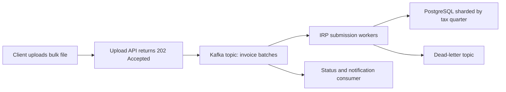

*What to notice: the API answers immediately with 202 Accepted (meaning "received, will process"), and the slow government work happens behind Kafka.*

Benefits: the producer is fast and decoupled, bursts are buffered, and new consumers can be added without changing the producer. Costs: the flow is harder to follow end to end (you need tracing and correlation IDs), data is eventually consistent, and you must design for duplicates and out-of-order events.

**Where it shows up in my work.**
- **Masters (MI2):** "Kafka event bus" for 1M+ daily government submissions.
- **Menu (M2):** Kafka plus Flink ingestion. Scrapers publish raw menus, Flink normalizes and deduplicates, and catalog upserts happen downstream.
- **GFG (G2):** asynchronous scheduled workflows (video processing, reminders, data cleanup) are the same "don't make the user wait" idea, on a simpler scale.

**Interview questions.**
- **Q: Why event-driven for e-invoicing instead of synchronous API calls to IRP?**
  **A:** Because the government portal was slow and unreliable, and filing deadlines created huge spikes. A synchronous design means every client request waits on IRP and every IRP slowdown becomes our outage. With Kafka, the upload returns quickly, the batch is durably queued, workers drain at a safe rate with bounded retries, and failures go to a dead-letter queue. That's what let 1M+ daily submissions work.

**Common mistakes and what not to say.**
- Do not say Masters Kafka and Menu Kafka are the same system. They are different products at different companies.

---

## 27. Message queues vs logs

**In plain English.** Both move messages between services, but they behave differently.
- A **message queue** (RabbitMQ, Amazon SQS) hands each message to one consumer, and the message is removed once acknowledged. It is a to-do list.
- A **log** (Kafka) is an append-only, ordered record kept for a retention period. Consumers track their own position (offset) and can re-read. Many independent consumer groups can each read the full stream.

**Analogy.** A queue is a ticket dispenser at a deli: each ticket goes to one server, then it's gone. A log is a CCTV recording: anyone can watch from any timestamp, and watching doesn't erase it.

**How it works.**

| | Queue (RabbitMQ, SQS) | Log (Kafka) |
|---|---|---|
| After consumption | message removed | message kept until retention expires |
| Replay | not natural | rewind the offset and re-read |
| Ordering | per queue, weaker with many consumers | strict per partition |
| Many consumer types | needs fan-out exchanges or topics | each consumer group reads everything |
| Scaling consumers | add consumers freely | up to the number of partitions per group |
| Good for | task distribution, per-message routing, delays | event streams, replay, multiple readers, high throughput |

Kafka ordering is per partition. If you key messages by vendor or client, all messages for one key go to the same partition and stay in order.

**Where it shows up in my work.**
- **Kafka (a log):** Masters (MI2) and Menu (M2). At Masters, background work ran as Kafka consumers inside the Spring Boot services, with scheduled jobs (`@Scheduled`) and `@Async` methods for smaller periodic or fire-and-forget tasks.
- **Celery** is on my skills line as a Python task-queue framework that needs a broker underneath. It is not part of the Masters story.
- **RabbitMQ and SQS:** not on my resume. I can compare them, but I don't claim production ownership.

**Interview questions.**
- **Q: Why Kafka for Menu ingestion instead of a simple queue?**
  **A:** Two reasons: replay and multiple readers. If a parser bug corrupts output, you can rewind consumer offsets to before the bad deploy and reprocess, which a delete-on-ack queue can't do. And the raw scraped stream can feed more than one consumer. Kafka also keeps per-key order, so updates for one menu are processed in sequence.
- **Q: When would you pick SQS or RabbitMQ?**
  **A:** For plain task distribution where each job is done once and replay doesn't matter: sending emails, resizing an image, per-message delays or priorities. They are simpler to run and fit "work queue" semantics better than a log.

**Common mistakes and what not to say.**
- Do not say you ran RabbitMQ or SQS in production.
- "Kafka is a queue" is a common imprecision. Say "a distributed log that can be used like a queue".

---

## 28. Stream processing

**In plain English.** Stream processing means handling data continuously as it arrives, event by event, instead of waiting to process a big batch later. Apache Flink is a stream processing engine. Three ideas matter most.
- **Keyed state:** the engine keeps memory per key (per vendor, per menu) across events, so it can remember "I've already seen this content".
- **Event time:** the time the event actually happened, as opposed to processing time, when the engine happened to see it.
- **Watermarks:** the engine's running estimate of "I've now probably seen all events up to time T", which tells it when to close a time window even though late events are possible.

**Analogy.** A post room sorting letters as they arrive. Keyed state is a pigeonhole per recipient that remembers what they already got. Event time is the postmark date. A watermark is the clerk saying "it's Thursday, so all Monday letters should be in by now. I'll close Monday's bundle and treat anything later as late mail".

**How it works: keyed deduplication.**

```text
Events arriving (key = vendor_id + menu_id, value = content hash):
  e1  key=V9:M1  hash=aa11   -> state empty           -> emit, store aa11
  e2  key=V9:M1  hash=aa11   -> same as stored        -> drop (duplicate)
  e3  key=V9:M1  hash=bb22   -> different             -> emit, store bb22 (menu changed)
  e4  key=V4:M7  hash=aa11   -> different key         -> emit (separate state)
```

```python
# PyFlink-style sketch of keyed dedup (simplified)
class DedupByContent(KeyedProcessFunction):
    def open(self, ctx):
        self.last_hash = ctx.get_state(ValueStateDescriptor("last_hash", Types.STRING()))

    def process_element(self, menu, ctx):
        if self.last_hash.value() != menu.content_hash:
            self.last_hash.update(menu.content_hash)
            yield menu                      # new or changed menu goes downstream
```

Flink stores keyed state in a state backend and takes periodic checkpoints (consistent snapshots of all state plus the Kafka offsets). On failure it restores the last checkpoint and re-reads Kafka from the saved offsets. That is how it avoids losing or double-counting state.

**Event time example.** A page scraped at 10:00 arrives at 10:07 because a proxy was slow. If you group by processing time, it lands in the wrong 5-minute window. With event time and a watermark that allows, for example, 5 minutes of lateness, it is still counted in the 10:00 window.

**Where it shows up in my work.** **Menu (M2):** "Kafka + Apache Flink large-scale ingestion and processing pipeline, stateful keyed deduplication (keyed by vendor/menu, content hash), schema normalization, exactly-once catalog upserts." Event time and watermarks are how Flink handles late events in general. The resume claim is keyed dedup and normalization, so I explain event time as how Flink works rather than claiming specific window settings.

**Interview questions.**
- **Q: Why Flink for menu ingestion instead of Spark batch?**
  **A:** Because catalog freshness mattered and the work was naturally per key. Flink keeps state per vendor and menu, so deduplication is a cheap lookup on each event, and results flow continuously instead of waiting for a batch window. Spark isn't on my resume for this. I'd only mention it as a possible option for large backfills.
- **Q: What's a watermark?**
  **A:** It's Flink's estimate of how far event time has progressed. A watermark of 10:05 means "I don't expect more events earlier than 10:05". It lets windows close and emit results even though some events arrive late. You choose how much lateness to tolerate, trading completeness against delay.
- **Q: How does Flink not lose state on a crash?**
  **A:** Periodic checkpoints snapshot all keyed state together with the Kafka offsets. On restart it restores the snapshot and resumes reading from those offsets. With an idempotent sink like our keyed upserts, reprocessing after a restore doesn't create duplicates.

**Common mistakes and what not to say.**
- Flink is **Uber Menu only**. Never at Masters or IA.
- Spark is not on the PDF.
- Don't claim zero message loss.

---

# Part E. Architecture, delivery and the HTTP edge

## 29. Microservices vs monolith

**In plain English.** A monolith is one application, deployed as one unit, usually with one database. Microservices split the application into small services, each owning one business capability and usually its own data, deployed independently.

**Analogy.** A monolith is one big restaurant kitchen where everyone shares the stove. Microservices are a food court: separate stalls, each with its own kitchen. A food court survives one stall's fire, but now you need signs, shared seating rules and someone coordinating deliveries.

**How it works.**

| | Monolith | Microservices |
|---|---|---|
| Deploy | one unit, all or nothing | each service on its own |
| Scaling | scale everything together | scale the hot service only |
| Failure | one bug or slow call can take down everything | failures can be isolated, if designed for |
| Complexity | in the code | in the network, deploys and observability |
| Data | one database, easy joins | per-service data, joins become API calls or events |

A monolith is often the right start. Teams move to services when deploys are blocked by each other, when one part needs very different scaling, or when one slow dependency drags everything down.

**Where it shows up in my work.**
- **Masters (MI1):** "leading migration of a legacy PHP monolith to Spring Boot microservices." In the monolith, one slow IRP call could tie up a worker and deploys were all-or-nothing. The Spring Boot services took IRP calls off the request thread, scaled separately and were released per route.
- **GFG (G1):** migrated the doubt-support backend from PHP to Django to stabilise it for 10K+ daily queries and 10x contest spikes. That's a framework migration, not a microservices claim.
- **IA:** the Go/Gin platform services and the Python FastAPI/LangGraph agent plane are separate deployables, because they scale on different things (request volume versus LLM latency and cost).

**Interview questions.**
- **Q: Why break the Masters monolith into microservices?**
  **A:** Three concrete problems. A slow government portal call blocked a PHP worker, so one dependency's slowness spread to everyone. Every deploy shipped the whole app, so filing-season releases were risky. And we couldn't scale the hot paths separately. Moving route by route to Spring Boot services with async IRP calls fixed all three, and p95 went from 1.2 seconds to 300 milliseconds.
- **Q: What did microservices cost you?**
  **A:** More moving parts: more deploys, network calls that can fail, and the need for tracing across services. That's why ELK and New Relic tracing came with the migration, and why we kept a shared database during the move instead of splitting data on day one.

**Common mistakes and what not to say.**
- Don't say "microservices are always better".
- Don't describe GFG as a microservices migration.

---

## 30. Strangler-fig migration

**In plain English.** The strangler-fig pattern replaces an old system gradually. You put a routing layer in front, then move one route or feature at a time to the new system, until the old one handles nothing and can be switched off. It's named after a fig vine that grows around a tree until it replaces it.

**Analogy.** Renovating a house while living in it, one room at a time. You never move out, and if the new kitchen leaks, you go back to cooking in the old one for a week.

**How it works.**

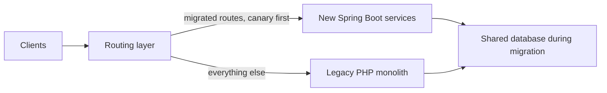

*What to notice: rollback is a routing change, not a rebuild. Both systems read the same data during the move, so there's no dual-write source-of-truth problem.*

The steps for each route:
1. Build the new endpoint with the same contract. Contract tests compare its responses with the old one.
2. Send a small percentage of that route's traffic to it (canary).
3. Watch errors and p95. If healthy, increase. If not, flip routing back.
4. At 100%, delete the old code path.

**Where it shows up in my work.** **Masters (MI1):** "strangler pattern, canary per route", PHP monolith to Spring Boot microservices across 1,500+ enterprise clients. I mentored 2 engineers through it.

**Interview questions.**
- **Q: Why strangler instead of a full rewrite?**
  **A:** Because a GST compliance platform can't go dark around filing deadlines. A big-bang rewrite means one huge risky cutover. With strangler, each route moves on its own with a canary, and rollback is just routing traffic back to PHP. It costs a period of running two stacks and a more complex routing layer, but filing day stays safe.
- **Q: How did you handle the database during migration?**
  **A:** Both old and new code used the same database during the move, so there was one source of truth and no dual-write problem. Splitting data out comes after the traffic has moved.

**Common mistakes and what not to say.**
- Do not merge "mentored 2" here with "led 3" from Uber FRM.

---

## 31. Canary releases and zero-downtime deploys

**In plain English.** A canary release sends a new version to a small slice of traffic first, watches it, and only then rolls it out further. A zero-downtime deploy replaces the running version without users seeing errors or an outage.

**Analogy.** Miners carried canaries because the birds reacted to gas first. A canary release is a small group of users who "feel" a bad release first, so you can pull back before everyone does.

**How it works.**

```text
Canary for POST /einvoice/generate:
  step 1:   5% to new service  -> watch error rate and p95 for a while
  step 2:  25%                 -> still healthy
  step 3: 100%                 -> retire the PHP route
  any step: error rate up -> route back to 0%, investigate
```

*Percentages are illustrative.*

Zero-downtime needs a few things together:
- **Rolling or blue-green replacement:** start new instances, pass health checks, shift traffic, then drain old ones.
- **Graceful shutdown:** on SIGTERM (the stop signal), stop accepting new requests and finish in-flight ones. In Spring Boot that is `server.shutdown=graceful` plus a drain timeout (`spring.lifecycle.timeout-per-shutdown-phase`).
- **Backward-compatible schema changes (expand and contract):** first add the new column or table (expand), deploy code that writes both or reads new, backfill, then remove the old (contract). Never rename a column in a single deploy.

**Where it shows up in my work.**
- **Masters (MI1, MI3):** canary per route during the strangler migration, and **98% deployment success**.
- **FRM (F3):** "zero-downtime releases via stacked Bazel PRs." The ORM migration was split into small, reviewable steps, each safe to deploy on its own (next section).

**Interview questions.**
- **Q: What does 98% deployment success mean?**
  **A:** About 98 out of 100 deploys went out without needing a rollback or hotfix. It came from coverage gates in CI (coverage went from 35% to 82%), contract tests against the old PHP behaviour, and canaries so a bad release only touched a small slice of traffic.
- **Q: How do you change a database schema with zero downtime?**
  **A:** Expand and contract. Add the new structure without removing the old, deploy code that works with both, backfill, switch reads, and only then drop the old structure in a later release. At each step the running code and the schema are compatible, so you can deploy or roll back at any point.

**Common mistakes and what not to say.**
- Don't claim Kubernetes operations as the mechanism. That is not a resume claim.

---

## 32. Stacked PRs

**In plain English.** A stacked PR is a pull request built on top of another unmerged pull request. A big change is split into a chain of small PRs (PR 2 builds on PR 1, PR 3 on PR 2). Each one is small enough to review well, and each can be merged and deployed in order.

**Analogy.** Building a staircase one step at a time, checking each step holds weight before adding the next, instead of craning in a whole staircase at once.

**How it works: an ORM migration as a stack (illustration).**

```text
PR 1  Add JPA entities and Spring Data repositories next to the old code. No behaviour change.
PR 2  Switch read paths for one screen to the new repositories. Tests compare old vs new results.
PR 3  Switch write paths, with @Version optimistic checks and @Transactional services.
PR 4  Move the remaining screens.
PR 5  Delete the old raw SQL paths.
```

Each PR passes CI and can ship on its own. If PR 3 causes trouble, you roll back PR 3 only. Reviewers look at a 200-line diff instead of a 3,000-line one, so they actually catch bugs. The cost: when an early PR changes during review, every PR above it must be rebased.

**Where it shows up in my work.** **FRM (F3):** I led 3 engineers on the core Spring Data JPA / Hibernate migration with "zero-downtime releases via stacked Bazel PRs". Bazel is Uber's build system, and each PR in the stack passed Bazel tests before merging. Leadership here means tech lead of an EPAM pod, not people manager.

**Interview questions.**
- **Q: Why stacked PRs for the ORM migration?**
  **A:** Because an ORM migration touches every query, and one giant PR is impossible to review and risky to deploy. Splitting it into a stack meant each PR changed one layer or one screen, passed the full Bazel test suite, and could ship on its own. If something misbehaved, we rolled back one small step, not the migration. That's how we migrated with zero downtime while finance kept using the system.
- **Q: What's the downside?**
  **A:** Rebase overhead. If reviewers change PR 1, everything above it must be updated. You also need discipline about order, so a later PR never depends on an unmerged change in an unexpected way.

**Common mistakes and what not to say.**
- Don't say "I managed 3 engineers". Say "led 3 engineers as tech lead of the pod".

---

## 33. CI gates and code coverage

**In plain English.** CI (continuous integration) runs automated checks on every change. A gate is a check that must pass before the change can merge or be promoted. Code coverage measures how much of the code the tests actually run.

**Analogy.** Airport security for code. Every bag (change) goes through the scanner (tests, linters, coverage check). If the scanner flags it, it doesn't board.

**Statement coverage, exactly.** Statement coverage is the percentage of executable statements that ran at least once during the tests. It does not mean every path or every input was tested.

```java
static double fee(double amount, boolean isPremium) {
    double rate = 0.02;          // statement 1
    if (isPremium) {             // statement 2
        rate = 0.01;             // statement 3
    }
    return amount * rate;        // statement 4
}
```

One test, `fee(100, true)`, runs statements 1, 2, 3 and 4. That is **100% statement coverage**. But the `is_premium = False` path was never tested. Branch coverage would say 50%, because only one of the two outcomes of the `if` was exercised. So 100% statement coverage is a strong floor, not proof of correctness.

**What the tests look like in Java.** JUnit 5 is the test framework, Mockito creates fake collaborators, and MockMvc sends fake HTTP requests to controllers without a server. A service test with mocked repositories needs no database:

```java
@ExtendWith(MockitoExtension.class)
class ReviewStatusServiceTest {
    @Mock ScopingItemRepository items;
    @Mock ReviewAuditRepository audits;
    @InjectMocks ReviewStatusService service;

    @Test
    void closeIsBlockedWhenVarianceIsAboveFiftyPercent() {
        ScopingItem item = ScopingItem.inReview("b7e1", 160.0, 100.0);   // current 160, prior 100
        when(items.findById("b7e1")).thenReturn(Optional.of(item));

        assertThrows(VarianceGateTrippedException.class,
            () -> service.transition("b7e1", ReviewStatus.CLOSED));
        verifyNoInteractions(audits);                                    // nothing written on a blocked move
    }
}
```

*Illustrative names.* One trap matters for coverage. Code behind a mock never runs, so if repository tests stub every query method, the entity and query code shows as uncovered. Coverage has to be read per layer.

**Where it shows up in my work.**
- **FRM (F3):** the Spring Data JPA / Hibernate migration "raised module statement coverage to 100%." It's for that module, measured as statement coverage, with JUnit 5, Mockito and MockMvc tests. Test count is 1,100+ (verbal).
- **Masters (MI3):** test coverage from 35% to 82%, with 98% deployment success.
- **IA (A5):** an 80% accuracy CI gate for AI configs (a different kind of gate, see [concept 57](#57-ci-gates-for-models)).
- **IA Go coverage:** 100% Go statement coverage and 1,200+ tests is LinkedIn or verbal, off PDF.

**Interview questions.**
- **Q: 100% coverage sounds like vanity. Was it useful?**
  **A:** For that module it was the right bar. It held financial math and the review-status gates for a SOX-audited process, and the migration's goal was to remove latent column-aliasing bugs. 100% statement coverage meant no line in that module was untested, which is a floor, not a proof. I'm careful to say it's statement coverage, not branch coverage.
- **Q: What gates would you put in CI for a backend service?**
  **A:** Build and unit tests, a coverage floor on critical modules, lint and static analysis, contract tests for APIs other teams depend on, and migration checks for schema changes. For AI features, an offline evaluation gate on top.

**Common mistakes and what not to say.**
- Don't say "100% coverage means no bugs".
- Don't say "100% coverage across Uber". It's one module.
- Don't merge the FRM test counts with IA's.

---

## 34. Finite state machines

**In plain English.** A finite state machine (FSM) is a model where something is always in exactly one of a fixed set of states, and it can only move between states through allowed transitions. Anything not on the transition list is rejected.

**Analogy.** A traffic light. It's red, green or amber, and it moves in a fixed order. It can't jump to "purple" or from green straight to red without amber.

**How it works: the FRM review-status model.** One status model is reused across all screens (that's what "polymorphic" means on the resume): Draft, Review, ReOpen, Closed.

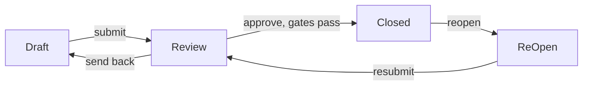

*What to notice: there's no arrow from Draft straight to Closed. The machine makes "skip review" impossible, not just discouraged. The exact transitions here are illustrative. The four states are from the resume.*

```java
public enum ReviewStatus {
    DRAFT, REVIEW, CLOSED, REOPEN;

    private static final Map<ReviewStatus, Set<ReviewStatus>> ALLOWED = Map.of(
        DRAFT,  Set.of(REVIEW),
        REVIEW, Set.of(DRAFT, CLOSED),
        CLOSED, Set.of(REOPEN),
        REOPEN, Set.of(REVIEW));

    public boolean canMoveTo(ReviewStatus next) {
        return ALLOWED.get(this).contains(next);
    }
}

public void transition(ScopingItem item, ReviewStatus to) {
    if (!item.getStatus().canMoveTo(to)) {
        throw new InvalidTransitionException(item.getStatus(), to);
    }
    double prior = item.getPriorValue();
    if (to == ReviewStatus.CLOSED && prior != 0) {
        double delta = Math.abs(item.getCurrentValue() - prior) / Math.abs(prior);
        if (delta > 0.50) {
            throw new VarianceGateTrippedException(delta);   // 50% delta-variance check
        }
    }
    item.setStatus(to);
}
```

*Simplified sketch. Real money amounts belong in `BigDecimal`. `double` keeps the example short.* Storing the enum with `@Enumerated(EnumType.STRING)` means the database holds "REVIEW", not a position number that breaks if someone reorders the enum.

**The 50% delta-variance check, worked example.** Prior quarter value 100, current quarter value 160. Delta = |160 − 100| / 100 = 60%. That's above 50%, so the gate trips and the item cannot pass that transition automatically. A value of 130 (30% change) passes.

**Where it shows up in my work.**
- **FRM (F2):** "polymorphic review-status model (one status model reused across screens: Draft, Review, ReOpen, Closed)."
- **FRM (F3):** "automated FSM gates with 50% delta-variance checks for SOX compliance."

**Interview questions.**
- **Q: Why model review status as a state machine?**
  **A:** Because in a SOX-audited process, the rules about who can move what, and when, are the controls auditors test. A state machine makes illegal moves impossible in code, like closing an item that was never reviewed. And because one model is reused across all eight screens, the controls behave the same everywhere instead of drifting per screen.
- **Q: What is the 50% delta-variance check?**
  **A:** It's a gate on a transition. If a value moves more than 50% compared with the prior period, the automated transition is blocked. Big swings are exactly what auditors want explained, so the system enforces that check instead of relying on someone remembering it.

**Common mistakes and what not to say.**
- SOX is the Sarbanes-Oxley Act, the US law on financial reporting controls. Be ready to spell it out.
- Don't claim you built the Slack notification or collaboration service. That was separate.

---

## 35. Dependency injection

**In plain English.** Dependency injection (DI) means a component receives the things it depends on (database client, cache, logger) from outside, instead of creating them itself. That makes it easy to swap a real database for a fake one in tests and keeps wiring in one place.
- **Runtime DI:** a framework builds the object graph while the program runs, often using reflection (Spring in Java, FastAPI's `Depends` in Python).
- **Compile-time DI:** a tool generates the wiring code before the program runs (Google Wire in Go). Missing or conflicting dependencies are build errors, not runtime crashes.

**Analogy.** A restaurant kitchen where the chef doesn't grow vegetables. Ingredients are delivered. Runtime DI is a delivery service that figures out each morning what to bring. Compile-time DI is a fixed delivery schedule checked the night before, so a missing ingredient is caught before service starts.

**How it works.**

```go
// wire.go (only read by the Wire generator)
func InitServer() (*Server, error) {
    wire.Build(NewConfig, NewRedis, NewClickHouse, NewPivotService, NewServer)
    return nil, nil
}

// wire_gen.go (generated): plain Go code you can read
func InitServer() (*Server, error) {
    cfg := NewConfig()
    rdb := NewRedis(cfg)
    ch, err := NewClickHouse(cfg)
    if err != nil { return nil, err }
    svc := NewPivotService(ch, rdb)
    return NewServer(cfg, svc), nil
}
```

```java
// Spring runtime DI for comparison: the container builds this graph at startup
@RestController
@RequestMapping("/scoping-items")
public class ScopingItemController {
    private final ScopingItemService service;

    public ScopingItemController(ScopingItemService service) {   // constructor injection
        this.service = service;
    }

    @GetMapping("/{uuid}")
    public ScopingItemDto get(@PathVariable String uuid) {
        return service.get(uuid);
    }
}
```

*Illustrative names.* With a single constructor, Spring injects it without `@Autowired`. Constructor injection keeps fields `final` and makes the class easy to build with Mockito mocks in a test.

**Where it shows up in my work.**
- **IA (C1):** "Google Wire compile-time dependency injection" in the multi-tenant Go/Gin platform.
- **FRM and Masters:** the Spring Boot services use Spring's runtime container. Controllers, services and repositories are beans wired by constructor injection, which is what made every layer easy to mock with Mockito. FastAPI's `Depends` is the Python equivalent.

**Interview questions.**
- **Q: Why compile-time DI with Wire instead of a runtime container?**
  **A:** Two reasons. Wiring mistakes, like a missing dependency or two providers for the same type, fail at build time instead of at startup in production. And the generated code is plain Go, with no reflection, so it's fast, easy to read and easy to step through in a debugger. The trade-off is a code generation step and less flexibility to swap things at runtime, which we didn't need.
- **Q: You've used both Spring and Wire. How do they compare?**
  **A:** Both inject dependencies through constructors, so the code style is similar. Spring builds the graph at startup with reflection and proxies, so a missing bean fails when the application context starts, not at compile time. In exchange, Spring's proxies give you features like `@Transactional` and `@Async` for free. Wire gives you no runtime magic, just generated Go code, which fits Go's style and a lean, high-RPS edge service.

**Common mistakes and what not to say.**
- Don't say Spring at IA. IA platform APIs are Go/Gin.

---

## 36. Reverse proxies

**In plain English.** A reverse proxy is a server that sits in front of your application, receives client requests and forwards them to the app. Nginx and Envoy are common ones. They often handle TLS, request size limits, timeouts, compression, rate limiting and load balancing.

**Analogy.** A hotel receptionist. Guests talk to reception, and reception passes the request to the right room, turns away people without bookings, and stops anyone from carrying a piano upstairs.

**Why one might not use one.** A proxy is another hop, another config to maintain, and another thing that can fail. It can also hide behaviour: the app can't see true client timeouts, or it can't use HTTP/2 end to end if the proxy downgrades to HTTP/1.1. If the application server is capable (as Go's `net/http` is), the app can own those protections itself. The trade-off is that you must now build what the proxy gave you for free.

```go
srv := &http.Server{
    Addr:              ":8080",
    Handler:           h2c.NewHandler(router, &http2.Server{}),
    ReadHeaderTimeout: 5 * time.Second,     // protects against slow-loris clients
    ReadTimeout:       30 * time.Second,
    WriteTimeout:      60 * time.Second,
    IdleTimeout:       120 * time.Second,
    MaxHeaderBytes:    1 << 20,
}
router.Use(func(c *gin.Context) {          // body size cap
    c.Request.Body = http.MaxBytesReader(c.Writer, c.Request.Body, 10<<20)
    c.Next()
})
// on SIGTERM: srv.Shutdown(ctx) drains in-flight requests before exit
```

*Values are illustrative.*

**Where it shows up in my work.** **IA (C1):** "self-protecting HTTP edge with no reverse proxy, native h2c, nested timeouts, Datadog distributed tracing." The Go process itself owns timeouts, body caps and graceful shutdown.

**Interview questions.**
- **Q: Why no reverse proxy in front of your Go service?**
  **A:** Because Go's HTTP server can do the important protections itself, and adding nginx would add a hop, another config and another failure point. We needed native h2c, nested timeouts and distributed tracing at the process that actually serves the traffic. So the service owns header and body timeouts, body size caps and graceful drain on shutdown. The cost is that we had to build and test those ourselves instead of inheriting them.
- **Q: When would you add one?**
  **A:** When I need things the app shouldn't own: TLS termination for many services, edge caching, a web application firewall, or routing many services behind one domain, like the per-route canary routing in a strangler migration.

**Common mistakes and what not to say.**
- Don't claim Kubernetes cluster operations or ingress ownership.
- "No reverse proxy" is about the app path. If asked what's in front at the network level, keep it to what you know.

---

## 37. HTTP/1.1 vs HTTP/2 vs h2c

**In plain English.**
- **HTTP/1.1** sends one request at a time per connection. To do several at once, clients open several connections. A slow response blocks the ones behind it on that connection, called head-of-line blocking.
- **HTTP/2** multiplexes many requests as independent streams over one connection, compresses headers and uses a binary format. Browsers only use it over TLS.
- **h2c** is HTTP/2 over cleartext, meaning no TLS. It's used for internal service-to-service traffic where TLS is handled elsewhere or not needed on that hop.

**Analogy.** HTTP/1.1 is a single-lane road where one slow truck holds up everyone. HTTP/2 is a multi-lane highway on the same road surface. h2c is that highway inside a private, gated campus, without the toll booth (TLS).

**How it works.**

```text
HTTP/1.1, 3 requests on 1 connection:
  [req A ......... slow ......... resp A][req B resp B][req C resp C]

HTTP/2, 3 streams on 1 connection:
  stream 1: [req A ......... slow ......... resp A]
  stream 3: [req B resp B]
  stream 5: [req C resp C]
```

In Go, plain `net/http` only speaks HTTP/2 over TLS by default. Wrapping the handler with `h2c.NewHandler` lets the same server accept HTTP/2 without TLS, and it still accepts HTTP/1.1. gRPC runs on HTTP/2, which is another reason internal services care about it.

**Where it shows up in my work.** **IA (C1):** "native h2c (HTTP/2 cleartext)" on the Go/Gin edge.

**Interview questions.**
- **Q: Why h2c?**
  **A:** It gives HTTP/2's multiplexing on internal hops without needing TLS on that hop. Many concurrent requests share one connection without blocking each other, so you need fewer connections and avoid head-of-line blocking from a slow response. Doing it natively in Go, without a proxy translating protocols, keeps it end to end.
- **Q: Isn't cleartext insecure?**
  **A:** It's only appropriate where the network path is trusted or TLS terminates before that hop. Over the public internet you'd use HTTP/2 over TLS. The choice is about where TLS lives, not about skipping security.

**Common mistakes and what not to say.**
- Don't say h2c is for browsers. Browsers don't use it.
- gRPC is skills-level for me. Don't claim production gRPC ownership.

---

## 38. WebSockets

**In plain English.** A WebSocket is a long-lived, two-way connection between browser and server. It starts as a normal HTTP request asking to "upgrade", and after that both sides can send messages at any time without new requests.

**Analogy.** HTTP is sending letters: one question, one answer, then done. A WebSocket is a phone call: once connected, either side can talk whenever it likes until someone hangs up.

**How it works.**

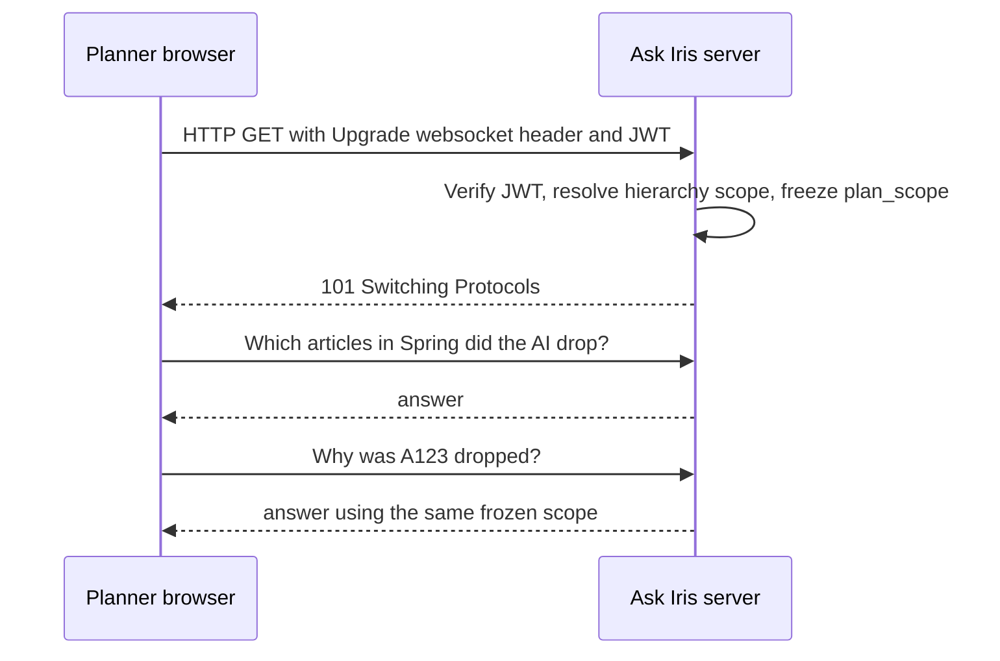

*What to notice: identity and access scope are decided once, at the handshake, and every later message on that socket uses that same scope.*

Key points for interviews:
- **Auth happens at the handshake.** After the upgrade there are no per-message HTTP headers, so the server checks identity before accepting the connection.
- **Long-lived means token expiry matters.** A socket can outlive a short JWT. Options include closing the socket at token expiry or requiring a re-authentication message.
- **Scaling is about connections, not requests.** Each open socket holds memory and a file descriptor. Load balancers must support upgrades and long idle times.
- **Server push fits LLM apps.** The server can send messages whenever it has them, such as progress updates or partial answers, without the client asking again. (This is a general property of WebSockets. Don't claim specific streaming behaviour for Ask Iris unless you remember it.)

**Where it shows up in my work.** **IA (A4):** "Shipped 'Ask Iris', a JWT-secured WebSocket copilot for planners to query KPIs and inspect AI decisions ... hierarchy access (plan_scope) frozen at the socket handshake to prevent cross-tenant leaks." It's a shipped capability. There are no SLA or usage numbers on the resume and I don't invent them.

**Interview questions.**
- **Q: Why freeze the access scope at the handshake?**
  **A:** So nothing said later in the conversation can widen what the user can see. Once the socket is accepted, the JWT has been verified and the user's hierarchy scope resolved, and that scope is fixed for the life of the connection. Even if a message tries to ask about another tenant's or another division's data, the tools only run inside the frozen scope. That's the protection against cross-tenant leaks.
- **Q: Why WebSocket and not plain HTTP?**
  **A:** A copilot is a multi-turn conversation. A WebSocket keeps one authenticated connection open across turns, lets the server push messages whenever it has them, and keeps the access scope consistent for the whole conversation. Plain request-response would mean re-authenticating and re-resolving scope on every turn.

**Common mistakes and what not to say.**
- Don't quote usage numbers or latency SLAs for Ask Iris.
- Don't say Ask Iris is "building". It shipped.

---

## 39. Observability

**In plain English.** Observability is being able to understand what a system is doing from the outside, using the data it emits. The three main signals:
- **Logs:** timestamped records of events ("batch 41 failed: timeout").
- **Metrics:** numbers over time (requests per second, p95 latency, error rate, queue lag).
- **Traces:** the path of one request through many services, as a tree of timed steps called spans.

**Distributed tracing** links spans across services by passing a trace ID with every call. A **correlation ID** is the simpler version: one ID per request, put in every log line by every service, so you can search all logs for one user's request.

**Analogy.** Logs are a diary, metrics are a fitness tracker's charts, and a trace is a parcel tracking page showing every depot the parcel passed through and how long it sat in each.

**How it works.**

```text
trace_id=7f3a  POST /pivot                          1,840 ms
  ├─ auth: redis lookup                                 2 ms
  ├─ auth: postgres role resolution                    11 ms
  ├─ build SQL from KPI formulas                        4 ms
  └─ clickhouse query                               1,790 ms   <- here is the time
```

*Illustrative trace.*

```json
{"ts":"2026-03-02T10:15:04Z","level":"info","step":"agent_batch","batch":41,
 "tokens_in":182340,"tokens_out":20411,"usd_cost":3.12,"duration_ms":48210,
 "fallbacks":3,"config_hash":"9c1e..."}
```

*Illustrative JSON telemetry line, in the shape of the IA pipeline telemetry. The values are made up.*

**Where it shows up in my work.**
- **IA (C1):** Datadog distributed tracing on the Go/Gin platform.
- **IA (A3):** custom JSON telemetry: tokens, USD cost, step duration and batch fallbacks.
- **IA (A4):** LangSmith for Ask Iris observability (LLM traces of each step in the agent graph). LangSmith is Ask Iris only, not the Keep/Drop batch.
- **Masters (MI3):** ELK (Elasticsearch, Logstash, Kibana) plus New Relic tracing. Incident triage dropped about 70% (ESTIMATED from about 30 minutes to under 10). Correlation IDs were the main win. In a Spring Boot service, the standard way to do this is a servlet filter that reads or creates the ID and puts it in the logging MDC (Mapped Diagnostic Context), so every log line on that request thread carries it automatically. The ID also goes into Kafka message headers so consumers can log it too.

**Interview questions.**
- **Q: How did observability cut triage time 70% at Masters?**
  **A:** Before, an engineer had to search logs on several services by guessing timestamps. We added a correlation ID to every request and log line, shipped logs into ELK, and used New Relic tracing to see where time went. So triage became: find the failing request's ID, see its whole path, and see which hop failed. My estimate is it went from about 30 minutes to under 10.
- **Q: What would you trace first in an AI pipeline?**
  **A:** Per-step duration, tokens and cost, and how many rows fell back to the deterministic score. That's what the IA telemetry records. A rise in fallbacks or cost per pass is often the first sign that a provider or prompt has changed.

**Common mistakes and what not to say.**
- Don't put LangSmith on the Keep/Drop batch.
- Don't claim a pager rotation or incident-commander title.

---

# Part F. Security and multi-tenancy

## 40. Multi-tenancy and tenant isolation

**In plain English.** A multi-tenant system serves many customers (tenants) from the same software. For IA, each tenant is a retailer. Tenant isolation means one tenant can never see or affect another tenant's data, even by accident.

**Analogy.** An apartment building. Everyone shares the building, the lifts and the plumbing, but each flat has its own lock, and your key must never open your neighbour's door.

**How it works: the three common models.**

| Model | What it means | Strength | Cost |
|---|---|---|---|
| Silo | separate database or cluster per tenant | strongest isolation, easy per-tenant restore | expensive, many things to operate |
| Pool | shared tables, every row has `tenant_id` | cheapest, simplest to run | one missing filter leaks data |
| Bridge | shared service, separate schemas or tables per tenant | middle ground | more moving parts |

Whatever the model, the rules that matter in interviews are:
1. **Take the tenant from the verified identity, never from the request body.** If the token says tenant `t1`, a body that says `t2` is ignored or rejected.
2. **Filter every query by tenant**, ideally enforced in one shared layer so no handler can forget.
3. **Scope every cache key by tenant**, like `t1:roles:u42`, or a cache can leak across tenants.
4. **Test it**: integration tests that try another tenant's IDs and expect 403 Forbidden.

```go
func TenantScope() gin.HandlerFunc {
    return func(c *gin.Context) {
        claims := c.MustGet("claims").(Claims)       // set by auth middleware after verification
        c.Set("tenant_id", claims.TenantID)          // the ONLY source of tenant_id
        c.Next()
    }
}
// repository layer always adds: WHERE tenant_id = ?   (bound parameter)
```

**Isolation is not encryption.** Isolation is about access rules: who can query what. Encryption is about making stored or transmitted bytes unreadable without a key. They solve different problems.

**Where it shows up in my work.**
- **IA (C1):** "Multi-tenant Go/Gin platform at 10k peak RPS."
- **IA (C3):** "Multi-tenant data isolation + UAM-scoped hierarchy access control across PostgreSQL and ClickHouse."
- **IA (A4):** Ask Iris freezes hierarchy scope (plan_scope) at the socket handshake to prevent cross-tenant leaks.

**Interview questions.**
- **Q: How do you prevent cross-tenant data leaks?**
  **A:** The tenant always comes from the verified identity, never from the request body. Access is scoped by tenant and by the user's hierarchy scope across both PostgreSQL and ClickHouse. The rules I apply on top of that are general good practice: enforce the filter in one shared layer so no handler can forget it, and include the tenant in every cache key. And on Ask Iris, the scope is frozen at the WebSocket handshake, so nothing said later in the conversation can widen it. A cross-tenant leak in retail SaaS can end a customer relationship, so this is a hard rule, not a best effort.
- **Q: Is tenant isolation the same as encrypting each tenant's data?**
  **A:** No. Isolation decides who can read what. Encryption protects bytes if someone gets the disk or the network traffic. You usually want both, but my resume claim is isolation and access control.

**Common mistakes and what not to say.**
- Don't say "data is isolated because it's encrypted".
- Don't invent per-tenant quota numbers. Describe the mechanism.

---

## 41. Authentication vs authorization

**In plain English.** Authentication (AuthN) answers "who are you?". Authorization (AuthZ) answers "what are you allowed to do?". AuthN comes first. AuthZ uses its result.

**Analogy.** At an airport, showing your passport is authentication. Your boarding pass deciding which plane and seat you get is authorization.

**How it works: the IA auth waterfall.** A waterfall tries identity checks in order until one succeeds. Redis sits in front so repeated checks are fast.

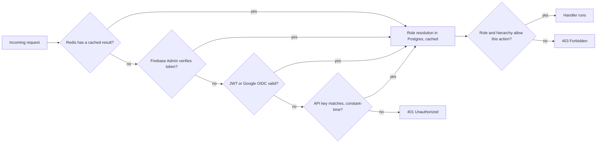

*What to notice: 401 means "we don't know who you are" (AuthN failed). 403 means "we know who you are, and you can't do this" (AuthZ failed). The exact position of the API key branch in the waterfall is simplified here.*

**Where it shows up in my work.** **IA (C3):** "Redis-fronted auth waterfall: Firebase Admin, then JWT / Google OIDC; constant-time API key comparison; Postgres-backed role resolution."

**Interview questions.**
- **Q: Walk me through your auth design at IA.**
  **A:** Authentication is a waterfall with Redis in front. We first try Firebase Admin token verification, then a JWT or Google OIDC token, and machine clients can use API keys, compared in constant time. Once we know who the caller is, authorization resolves their role from Postgres and their hierarchy scope from user access management, and every query is filtered by tenant and scope. Redis caches the expensive parts so the edge stays fast at 10k peak RPS.
- **Q: What's the difference between 401 and 403?**
  **A:** 401 means authentication failed or is missing. 403 means you're authenticated but not allowed to do this.

**Common mistakes and what not to say.**
- Don't claim you own a corporate identity provider like Okta. You built the service's auth layer.

---

## 42. JWT

**In plain English.** A JWT (JSON Web Token) is a compact, signed token that carries claims (facts) about a user, like their ID, tenant and expiry time. The server checks the signature to trust the claims without a database lookup.

**Analogy.** A festival wristband with a tamper-proof seal. Staff can see at a glance that you paid for the VIP area and that it's valid today. They don't need to phone the ticket office. If someone tampers with it, the seal breaks.

**How it works.** A JWT has three parts, base64url-encoded and joined by dots: `header.payload.signature`.

```json
// header
{"alg": "RS256", "typ": "JWT", "kid": "key-2026-03"}
// payload (claims)
{"sub": "u42", "tenant_id": "t1", "role": "planner",
 "iss": "https://issuer.example.com", "aud": "assortsmart-api",
 "iat": 1772445600, "exp": 1772449200}
```

*Illustrative claims.*

To verify, the server:
1. Checks the signature with the right key (and only accepts the algorithms it expects).
2. Checks `exp` (not expired) and `nbf` if present (not used before its start time).
3. Checks `iss` (issued by who we trust) and `aud` (meant for this service).
4. Only then trusts `sub`, `tenant_id` and roles.

**HS256 vs RS256.** HS256 uses one shared secret to sign and verify. RS256 signs with a private key and verifies with a public key, so services can verify without being able to mint tokens.

**The payload is not encrypted.** Anyone can base64-decode it and read it. Never put secrets in it.

**Revocation is the weak spot.** A valid JWT keeps working until it expires. That's why access tokens are short-lived, and why role changes are often resolved server-side (IA resolves roles from Postgres) rather than trusted only from the token.

**Where it shows up in my work.**
- **IA (C3):** JWT is one step of the auth waterfall.
- **IA (A4):** Ask Iris is a "JWT-secured WebSocket copilot", with the token verified at the handshake.

**Interview questions.**
- **Q: What do you verify on a JWT?**
  **A:** The signature with an expected algorithm and key, then expiry, issuer and audience. Only after that do I trust the user and tenant claims. And I never take the tenant from anywhere except the verified token.
- **Q: How do you revoke a JWT?**
  **A:** You can't really revoke a stateless token before it expires, so keep access tokens short-lived, and for sensitive decisions check server-side state like roles in Postgres. If you truly need instant revocation, keep a denylist of token IDs in Redis, which adds a lookup per request.

**Common mistakes and what not to say.**
- "JWTs are encrypted" is wrong for standard signed JWTs.
- Never accept `alg: none` or let the token choose the verification algorithm.

---

## 43. OIDC

**In plain English.** OIDC (OpenID Connect) is a standard way to log in with an existing identity provider, like Google. It's built on OAuth 2.0. OAuth 2.0 is about granting access ("this app may read your calendar"). OIDC adds identity ("this person is alice@example.com") through a signed ID token, which is a JWT.

**Analogy.** Using your passport, issued by a government you both trust, to check in at a hotel, instead of the hotel issuing you its own ID card.

**How it works (authorization code flow, simplified).**

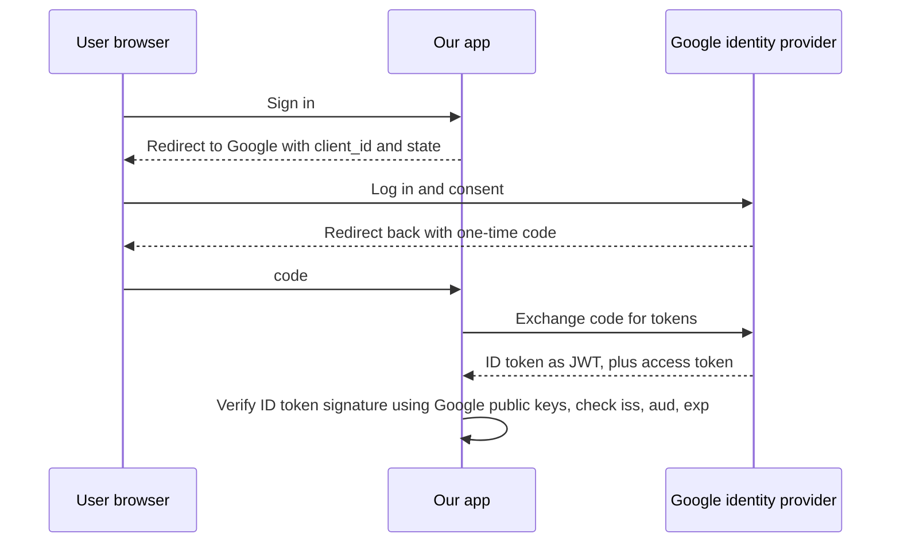

*What to notice: the app never sees the user's Google password, and it trusts the ID token only after checking Google's signature.*

The identity provider publishes its public signing keys at a well-known URL (a JWKS, JSON Web Key Set), so services can verify ID tokens offline and refresh keys when they rotate.

**Where it shows up in my work.** **IA (C3):** "JWT / Google OIDC" is a step in the auth waterfall, after Firebase Admin verification.

**Interview questions.**
- **Q: What's the difference between OAuth 2.0 and OIDC?**
  **A:** OAuth 2.0 is for delegated access: an app gets a token to call an API on a user's behalf. OIDC sits on top and adds authentication: a signed ID token that says who the user is. If you want "log in with Google", you want OIDC.

**Common mistakes and what not to say.**
- Don't use an OAuth access token as proof of identity. Use the ID token, verified.

---

## 44. API keys and constant-time comparison

**In plain English.** An API key is a long secret string a program sends to prove it's allowed to call an API, usually for machine-to-machine access. Constant-time comparison means checking whether two strings are equal in a way that always takes the same time, no matter where they first differ.

**Analogy.** A safe with a dial that clicks slightly differently when you get each digit right. A burglar listening carefully can open it one digit at a time. A constant-time check is a safe that sounds identical whether you got zero digits right or nine.

**How it works: the timing attack, with an example.** A normal string comparison stops at the first mismatching character.

```text
Real key:   K7Q2...
Guess "A...": mismatch at char 1 -> returns after ~1 step
Guess "K...": mismatch at char 2 -> returns after ~2 steps   (slightly slower!)
```

An attacker sends many requests for each possible first character and measures response times. The character that is consistently a tiny bit slower is probably correct. Then they repeat for the second character, and so on. A key with 32 characters and 62 possible values each would take about 62^32 guesses by brute force. Character by character it takes about 62 × 32 ≈ 2,000 guess groups (each repeated many times to average out network noise). The leak turns an impossible attack into a practical one, at least in theory, and over a noisy network it needs a lot of samples.

The fix is a comparison that always checks every byte:

```go
import "crypto/subtle"

func keyMatches(presented, stored []byte) bool {
    return subtle.ConstantTimeCompare(presented, stored) == 1
}
```

```python
import hmac
hmac.compare_digest(presented, stored)
```

Even better practice is to store only a hash of each API key (like a password), hash the presented key, and constant-time compare the hashes. Then a database leak doesn't expose usable keys. Note that `ConstantTimeCompare` returns immediately if the lengths differ, which can leak the length. Comparing fixed-length hashes avoids that too.

**Where it shows up in my work.** **IA (C3):** "constant-time API key comparison" as part of the auth layer.

**Interview questions.**
- **Q: Why does API key comparison need to be constant-time?**
  **A:** Because a normal equality check returns as soon as it finds a mismatched character, so a longer response time hints that more leading characters were right. With enough requests, an attacker can recover the key character by character instead of guessing the whole thing. A constant-time compare, like Go's `subtle.ConstantTimeCompare`, takes the same time regardless, so there's nothing to measure. It's a one-line fix for a whole class of attack.
- **Q: Is this attack realistic over the internet?**
  **A:** It's hard because network jitter is much bigger than the timing difference, but with many samples and statistics it has been demonstrated. Since the fix costs nothing, there's no reason to take the risk.

**Common mistakes and what not to say.**
- Don't say "we used `==` but keys are long so it's fine".
- Don't log API keys or put them in URLs.

---

## 45. RBAC and hierarchy-scoped access

**In plain English.** RBAC (role-based access control) grants permissions to roles (planner, admin, read-only), and users get roles. Hierarchy-scoped access adds a second dimension: which part of the business a user can see. In retail, that's the merchandise or location hierarchy, for example one division, or one set of departments.

**Analogy.** In a hospital, your role (nurse or doctor) decides what actions you may take. Your ward assignment decides which patients you may take them on. A nurse in cardiology can't open oncology patients' charts.

**How it works: worked example.**

```text
User u42, tenant t1
  role:  planner          -> may view KPIs and AI decisions, may not change guardrails
  scope: Division = Womens, Departments = {Dresses, Tops}

Query asked: "Show Keep/Drop decisions for Spring 2026"
Effective filter added by the platform:
  tenant_id = 't1' AND season_code = 'SS26' AND department IN ('Dresses', 'Tops')
```

```sql
SELECT article_id, decision, s_final
FROM ai_decisions
WHERE tenant_id = {tenant:String}
  AND season_code = {season:String}
  AND department IN {allowed_departments:Array(String)};
```

*Illustrative column names. Values are bound parameters, using ClickHouse's query-parameter syntax.*

The important design point: the scope is computed by the platform from the user's identity, then appended to every query. The user, and the copilot, never get to pass their own scope.

**Where it shows up in my work.**
- **IA (C3):** "UAM-scoped (User Access Management) hierarchy access control across PostgreSQL and ClickHouse ... Postgres-backed role resolution."
- **IA (A4):** "hierarchy access (plan_scope) frozen at the socket handshake" for Ask Iris.

**Interview questions.**
- **Q: How does hierarchy-scoped access work in AssortSmart?**
  **A:** Every user has a role, resolved from Postgres, and a scope in the product hierarchy from user access management, like the departments they plan. The platform turns that scope into a filter and adds it to every PostgreSQL and ClickHouse query, as bound parameters. On Ask Iris, the scope is resolved once at the WebSocket handshake and frozen, so the copilot can only ever answer within it.
- **Q: RBAC or ABAC?**
  **A:** RBAC alone gives "what actions". Adding the hierarchy scope makes it closer to attribute-based access, because the decision depends on attributes of the data (its department) as well as the role. For retail planning, that combination is what customers expect.

**Common mistakes and what not to say.**
- Don't let the client send its own scope. Always derive it server-side.

---

# Part G. Concurrency

## 46. Concurrency vs parallelism

**In plain English.** Concurrency means dealing with many tasks in overlapping time periods. They're all "in progress", but not necessarily running at the same instant. Parallelism means literally running several tasks at the same instant on multiple CPU cores.

**Analogy.** One chef with three pots on the stove is concurrent: she switches between them while each simmers. Three chefs each stirring a pot at the same moment is parallel.

**How it works.**

| | Concurrency | Parallelism |
|---|---|---|
| Goal | keep making progress while waiting (usually on IO) | finish CPU work faster |
| Needs multiple cores? | no | yes |
| Java | thread pools (`ExecutorService`), `CompletableFuture`, non-blocking clients, virtual threads (Java 21) | the same threads run on all cores, `ForkJoinPool`, parallel streams |
| Python | asyncio, threads (for IO) | multiprocessing, native extensions |
| Go | goroutines and channels | goroutines spread across cores automatically (GOMAXPROCS) |

Python's GIL (global interpreter lock) lets only one thread run Python bytecode at a time. So Python threads help with IO-bound work, but not CPU-bound work. Java and Go have no such lock, so Java threads and Go goroutines are both concurrent and parallel. The price is that shared state needs locks, atomics or concurrent collections.

**Where it shows up in my work.**
- **Masters (MI1, MI2):** async IO made IRP calls concurrent (many requests in flight while waiting on the portal), and "100K+ concurrent imports" means many imports in progress at the same time. In the Spring Boot services that concurrency came from a non-blocking IRP client and Kafka consumers, with a cap on how many IRP calls run at once.
- **IA (C5):** the Go pump overlaps reading and sending (concurrency) and runs two season streams at once (parallel).
- **IA (C4):** ClickHouse ran rollup builds with 8 threads (verbal knob), which is parallelism inside the database.

**Interview questions.**
- **Q: Concurrency vs parallelism in one sentence?**
  **A:** Concurrency is structuring a program to handle many things at once, parallelism is executing many things at once. At Masters, the win was concurrency: one service instance could have many government calls in flight while waiting, without needing more CPUs.

**Common mistakes and what not to say.**
- "Async makes code faster" is imprecise. It makes waiting cheaper. CPU work doesn't get faster.

---

## 47. Multithreading

**In plain English.** Multithreading means one process runs several threads that share the same memory. Sharing memory is fast but dangerous: two threads changing the same data at once cause race conditions.

**Analogy.** Several people editing the same paper spreadsheet with pencils. It's quick, until two people change the same cell at the same moment and one change vanishes.

**How it works.**

```go
// Race: two goroutines increment the same counter
var count int
for i := 0; i < 1000; i++ {
    go func() { count++ }()     // read, add, write: not atomic, updates get lost
}

// Fix 1: a mutex
var mu sync.Mutex
go func() { mu.Lock(); count++; mu.Unlock() }()

// Fix 2: an atomic
var n atomic.Int64
go func() { n.Add(1) }()
```

The tools to know:
- **Mutex:** only one thread enters a critical section at a time.
- **Atomics:** single operations that can't be interrupted, like an atomic increment.
- **Channels (Go), `BlockingQueue` (Java) and queues (Python):** pass data between workers instead of sharing it ("share memory by communicating").
- **Java equivalents of the Go fixes:** `synchronized` or `ReentrantLock` for a mutex, `AtomicLong` for a counter, `ConcurrentHashMap` for a shared map.
- **Race detector:** `go test -race` finds data races while tests run.
- **Deadlock:** two threads each waiting for a lock the other holds. Avoid it by always taking locks in the same order.

**Where it shows up in my work.** Multithreading and Concurrency are on my skills line. In the bullets it shows up as the Go pump's concurrent reader and writer (C5), ClickHouse's thread caps on rollup builds (C4, verbal), and concurrency control in the database (FRM optimistic locking). The IA Go race-detector CI gate belongs to the 100% Go coverage claim, which is off PDF.

**A Java note for FRM and Masters.** A Spring Boot service runs each HTTP request on its own thread from the servlet container's pool, and every Spring bean is a singleton by default. So one service object is shared by all request threads at once. That is why controllers and services keep no per-request state in fields, and why per-request data lives in local variables or the database.

**Interview questions.**
- **Q: How do you avoid race conditions?**
  **A:** First, avoid shared mutable state: give each goroutine its own data and pass results over channels. Where sharing is necessary, protect it with a mutex or use atomics for simple counters. Then run tests with the race detector in CI, because races rarely show up in normal runs.

**Common mistakes and what not to say.**
- Don't use Python threads to speed up CPU-bound work and expect a speed-up.
- Don't keep mutable per-request state in a field of a Spring singleton bean. Two requests will overwrite each other.

---

## 48. Async IO and event loops

**In plain English.** Async IO lets one thread start many IO operations (network calls, database queries) and work on other things while they're pending. An event loop is the scheduler that runs ready tasks and wakes up waiting tasks when their IO completes.

**Analogy.** A waiter with ten tables. They don't stand at the kitchen waiting for one order. They take orders, deliver dishes that are ready, and check back when the kitchen rings the bell. One waiter serves many tables because most of the time is waiting.

**How it works.**

```java
// Spring WebClient: non-blocking HTTP on a small set of event-loop threads
WebClient irp = WebClient.builder().baseUrl("https://irp.example").build();   // illustrative URL, pooled connections

Flux<IrpResult> submitBatch(List<Invoice> invoices) {
    return Flux.fromIterable(invoices)
        .flatMap(inv -> irp.post().uri("/api/generate")
                .bodyValue(inv)
                .retrieve()
                .bodyToMono(IrpResult.class)
                .timeout(Duration.ofSeconds(30)),
            50);                                   // at most 50 calls in flight (example value)
}
```

While one call waits on the portal, the event loop runs the others. The second argument to `flatMap` caps how many are in flight, so we don't overwhelm the portal or ourselves.

The same bound with ordinary blocking code is a fixed thread pool plus `CompletableFuture`. It is simpler to read, and each waiting call holds one pool thread:

```java
ExecutorService pool = Executors.newFixedThreadPool(50);          // bounded: 50 calls in flight
List<CompletableFuture<IrpResult>> futures = invoices.stream()
    .map(inv -> CompletableFuture.supplyAsync(() -> irpClient.submit(inv), pool))
    .toList();
List<IrpResult> results = futures.stream().map(CompletableFuture::join).toList();
```

Virtual threads (Java 21) are the newer middle ground. `Executors.newVirtualThreadPerTaskExecutor()` gives each call its own very cheap thread, which parks while it waits instead of holding an OS thread. You still cap calls to the portal with a `Semaphore`, because the portal's limits don't change. I know virtual threads conceptually and don't claim them on past projects.

**The classic mistake is blocking the loop.** If code on an event-loop thread calls something blocking, everything else on that thread freezes until it returns. In Python that is a sync library inside an `async def` handler. In Java it is calling `.block()` or a blocking JDBC query inside a WebClient chain on a Reactor Netty thread. Use non-blocking libraries on the loop, or hand blocking work to a bounded thread pool.

**Where it shows up in my work.** **Masters (MI1):** the latency win "came from async IO for IRP calls, connection pooling, query/index fixes, plus Redis for reads." In the Spring Boot services, IRP calls went through a non-blocking WebClient and Kafka-backed async jobs, and HikariCP pooled the database connections. A slow government call no longer pinned a request thread for the whole round trip. asyncio is also on my skills line, for Python services.

**Interview questions.**
- **Q: Why did async IO help so much at Masters?**
  **A:** Because the expensive part of a request was waiting on the government portal, not CPU. In the PHP monolith, each waiting request held a worker for the whole round trip. In the Spring Boot services, the IRP call went through a non-blocking client or a Kafka-backed job, so the request thread was free to serve other requests while the portal answered. Same hardware, far more requests in flight, which is a big part of how p95 dropped from 1.2 seconds to 300 milliseconds and throughput went from 700 to 4,000 requests per minute.
- **Q: What breaks async services?**
  **A:** Blocking calls inside async code, which freeze the loop for everyone, and unbounded concurrency, which overwhelms downstream systems. So use non-blocking clients on the loop, bound concurrency with semaphores or pools, and put a timeout on every call.
- **Q: Thread pool, WebClient or virtual threads for the IRP calls?**
  **A:** All three can work if the number of calls in flight is capped. A bounded thread pool is the simplest to read and debug. WebClient handles many more waiting calls on a few threads, at the cost of reactive code that is harder to follow. Virtual threads give the WebClient-style cheap waiting with plain blocking code, which is what I'd look at first on Java 21 today.

**Common mistakes and what not to say.**
- Don't say async made the government portal faster. It made our waiting cheaper.

---

# Part H. LLM and AI engineering

## 49. Tokens, context windows and cost per token

**In plain English.** LLMs read and write text as tokens, which are chunks of words. In English, one token is roughly 4 characters, or about three-quarters of a word. The context window is the maximum number of tokens the model can consider at once (prompt plus answer). Providers charge per token, usually with output tokens costing more than input tokens.

**Analogy.** Tokens are like words in a telegram, where you pay per word. The context window is the size of the desk: everything the model needs to look at must fit on it at once.

**How it works: a cost worked example (made-up prices).**

```text
Hypothetical prices:  input $1 per 1M tokens,  output $4 per 1M tokens
One scoring call:     3,000 input tokens (instructions + JSON payload), 300 output tokens
Cost per call:        3,000 × $1/1M + 300 × $4/1M = $0.003 + $0.0012 = $0.0042
10,000 calls:         about $42
```

*Prices are invented for the arithmetic. Real prices vary by model and change often.*

The levers on cost: send fewer tokens (compact payloads instead of raw data), choose a cheaper model when quality allows, avoid repeat calls (checkpoints and caching), and cap retries.

The levers on the context window: the model can't read a 2.11B-row table. You must pick and summarise what it needs. That's a big reason IA serves context as precomputed JSON payloads.

**Where it shows up in my work.**
- **IA (A3):** custom JSON telemetry records tokens and USD cost per step.
- **IA (A5):** "73% lower live execution cost at 100% coverage". That comes from a separate gold-200 benchmark comparing two models where both completed all 200 of 200 cases. Model names are not on the PDF.
- **IA (A2):** context is served as JSON payloads, so each call carries only the facts it needs.
- **Off PDF:** about $100 per pass in token spend. True, but only say it if asked.

**Interview questions.**
- **Q: How did you get 73% lower execution cost?**
  **A:** On a separate gold-200 benchmark, we compared two model configurations, with both completing all 200 cases, which is what "at 100% coverage" means. The cheaper one cost 73% less to run live. The point of the coverage condition is that the saving isn't from skipping hard cases. I keep this separate from the 300-case gate and the 80% threshold.
- **Q: How do you control LLM cost in a batch pipeline?**
  **A:** Measure it first: we log tokens and dollars per step. Then make payloads compact, avoid recomputing with checkpoints, use circuit breakers so we don't pay for calls into a failing provider, and benchmark cheaper models against a gold set before switching.

**Common mistakes and what not to say.**
- Don't say "73% cheaper on the 300-case harness". It's the gold-200 benchmark.
- Don't name the benchmark models unless asked. They're not on the PDF.

---

## 50. Structured output and JSON schema

**In plain English.** Structured output means asking an LLM to answer in a fixed machine-readable format, usually JSON matching a schema, instead of free text. JSON Schema is a standard way to describe which fields exist, their types and which are required. In Python, Pydantic models are a convenient way to define and validate that shape.

**Analogy.** Free text is asking someone to "tell me about the car". Structured output is handing them a form with boxes: make, model, year, mileage. Forms are easy to process, and an empty or wrong box is obvious.

**How it works.**

```python
from pydantic import BaseModel, Field
from typing import Literal

class LensVerdict(BaseModel):
    article_id: str
    lens: Literal["trend", "margin", "assortment_gap"]      # illustrative lens names
    score: float = Field(ge=0, le=1)
    rationale: str = Field(max_length=400)

raw = llm.invoke(prompt, response_format=LensVerdict)       # structured invoke
verdict = LensVerdict.model_validate_json(raw)              # rejects wrong types or ranges
```

*Lens names and the call shape are illustrative. The resume says 7 AI lenses but doesn't list them.*

Validation is the safety net. If the output doesn't match the schema, retry once with the error message, or fall back. The code downstream only ever sees valid objects.

**Where it shows up in my work.**
- **IA (A1):** "blends deterministic KPI math with structured LLM invokes across 7 AI lenses." Each lens returns a structured score the decider and blend can use as numbers.
- **Menu (M1):** "unstructured multilingual PDFs to strict catalog schema at 98% field fidelity (offline evaluation)." The output had to fit the catalog's strict schema.

**Interview questions.**
- **Q: Why structured output instead of letting the LLM write a paragraph?**
  **A:** Because the output feeds math and databases. In Keep/Drop, each lens produces a score between 0 and 1 that goes into a weighted blend. A paragraph would need parsing and could be ambiguous. A schema makes the output checkable: wrong types or out-of-range scores are rejected before they touch a decision.
- **Q: What does 98% field fidelity mean on Menu?**
  **A:** On an offline evaluation set, 98% of extracted fields matched the expected values in the strict catalog schema. It's an offline evaluation number, not a live production accuracy claim.

**Common mistakes and what not to say.**
- Don't say "the model always returns valid JSON". You validate because it sometimes won't.
- Don't present 98% as live accuracy.

---

## 51. Tool calling

**In plain English.** Tool calling (also called function calling) lets an LLM ask the application to run a specific function, like "get KPIs for article A123", by returning a structured request with the function name and arguments. The application runs it, and the result goes back to the model. The model never runs code itself.

**Analogy.** A manager who can't access the warehouse system but can fill in a request slip ("check stock of item 42") for a clerk who can. The manager only gets slips for the requests the clerk is allowed to handle.

**How it works.**

```json
{"tool": "get_article_kpis",
 "arguments": {"article_id": "A123", "season_code": "SS26"}}
```

```python
TOOLS = {"get_article_kpis": get_article_kpis}   # allowlist: only these can run

def run_tool(call, scope):
    fn = TOOLS.get(call["tool"])
    if fn is None:
        return {"error": "unknown tool"}           # fail closed
    return fn(**call["arguments"], scope=scope)    # scope injected by the server, not the model
```

The security rules: tools are an allowlist, arguments are validated, the server (not the model) injects identity and scope, and tools are read-only unless writes are deliberately designed and gated. A prompt instruction like "only read data" is not a control. The tool list is.

**Where it shows up in my work.** Say this carefully: Tool Calling and MCP (Model Context Protocol, a standard for exposing tools to models) are on my skills line at **skills level**. They are not an IA PDF bullet.
- **IA Keep/Drop (A2):** a deliberate non-use. The LLM never gets a SQL tool. Context is served to it as JSON payloads.
- **Verbal depth only:** the Cluster Recommendation Copilot design at IA, with 14 tools. That's design discussion, not a resume bullet.

**Interview questions.**
- **Q: Did your Keep/Drop engine let the LLM query the database?**
  **A:** No, and that was deliberate. The master table has 2.11 billion rows. A model with a SQL tool could write slow or wrong queries and burn cost, and any write path would be a disaster at that scale. So we computed the context deterministically and sent it as JSON payloads. The model judges, it doesn't fetch.
- **Q: How would you design tools safely for an agent?**
  **A:** A small allowlist of narrow, read-only functions with typed arguments. The server injects the user's identity and scope into every call, the model never passes them. Every call has a timeout and a budget, and every call is logged. Writes, if any, go through normal authenticated product APIs, not a model-generated query.

**Common mistakes and what not to say.**
- Don't claim production tool-calling ownership at IA from the PDF.
- Don't present the Cluster Recommendation Copilot as a resume bullet.

---

## 52. Agents and the supervisor pattern

**In plain English.** An LLM agent is a loop where the model decides the next step (answer, call a tool, hand off to another agent) based on what it has seen so far, rather than following a fixed script. The supervisor pattern has one coordinating agent that routes each request to specialised worker agents and combines their results. LangGraph is a Python library for building these as a graph of nodes and edges with shared state.

**Analogy.** A hospital front desk (the supervisor) that listens to the patient and sends them to the right specialist, then collects the notes. Each specialist (worker) is good at one thing.

**How it works.**

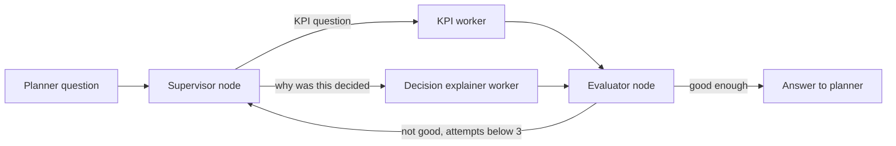

*Illustrative graph. What to notice: the evaluator can send work back to the supervisor, but only a bounded number of times (next section).*

**Agent vs pipeline.** Not everything should be an agent. If the steps are known in advance, a fixed pipeline is cheaper, faster, easier to test and reproducible. Agents earn their cost when the path depends on the question.

**Where it shows up in my work.**
- **IA (A4):** Ask Iris uses a "LangGraph supervisor + 3-attempt evaluator loop". Planners ask questions in their own words, so a supervisor decides the route.
- **IA (A1):** Keep/Drop has **no LLM orchestrator**. The batch order is fixed: peer, then decider, then lenses, then blend, then explain. It runs over 348k article-seasons, so a fixed, reproducible order matters more than flexibility.

**Interview questions.**
- **Q: Why a supervisor agent for Ask Iris but not for Keep/Drop?**
  **A:** Because the problems are different. Ask Iris answers open-ended planner questions, so something has to decide whether a question is about KPIs or about explaining a decision, and that's what the supervisor does. Keep/Drop scores hundreds of thousands of article-seasons with the same steps every time, so a fixed order is cheaper, reproducible and easy to audit. Using an agent to orchestrate a fixed batch would add cost and non-determinism for no benefit.

**Common mistakes and what not to say.**
- Don't say Keep/Drop is "agentic orchestration by an LLM". The order is fixed.
- Don't mention human-in-the-loop review queues at IA. They aren't in the repo.

---

## 53. Evaluator loops

**In plain English.** An evaluator loop checks an agent's draft answer against criteria (did it answer the question, is it grounded in the data, is it within scope) and, if it fails, sends it back to try again. A cap on attempts stops it from looping forever.

**Analogy.** An editor who sends a draft back to the writer with notes. But the publisher's rule is "three rounds maximum", or the article never ships.

**How it works.**

```python
MAX_ATTEMPTS = 3

def answer_with_evaluator(question, state):
    for attempt in range(1, MAX_ATTEMPTS + 1):
        draft = supervisor_run(question, state)
        verdict = evaluate(draft, question, state.scope)
        if verdict.ok:
            return draft
        state.feedback = verdict.reason        # next attempt sees what was wrong
    return bounded_result(state)               # never loops past the cap
```

In LangGraph this is a conditional edge from the evaluator node back to the supervisor, with the attempt counter in graph state. Without the cap, a model that keeps failing the check would loop until it hit a recursion limit or ran up a big bill.

**Where it shows up in my work.** **IA (A4):** Ask Iris has a "3-attempt evaluator loop (MAX_ATTEMPTS = 3) to stop infinite loops." In Keep/Drop, offline evaluations replaced critic or evaluator agents. So the evaluator loop is an Ask Iris feature, not a Keep/Drop feature.

If asked exactly what Ask Iris returns after the third failed attempt, describe it at the level you remember. The resume claim is the cap.

**Interview questions.**
- **Q: Why exactly 3 attempts?**
  **A:** It's a balance between quality and cost and latency. One retry with feedback fixes most failures, and a second gives one more chance. Beyond that, the extra attempts rarely help and the planner is waiting. The main point is that there's a hard cap, so the graph can't loop forever.
- **Q: Why not put an evaluator agent in Keep/Drop too?**
  **A:** Because at batch scale an extra LLM call per item roughly multiplies cost, and its judgement is itself non-deterministic. For Keep/Drop we measured quality offline instead, with a proxy harness and a gold benchmark, and gated releases on that.

**Common mistakes and what not to say.**
- Don't put the evaluator loop or LangSmith on Keep/Drop.

---

## 54. Embeddings and vector search

**In plain English.** An embedding is a list of numbers (a vector) that represents the meaning of a piece of text, so that similar meanings get nearby vectors. Vector search finds the stored vectors closest to a query vector. A vector database like Milvus stores millions of these and finds the nearest ones quickly.

**Analogy.** A map of a city where restaurants are placed by what they serve, not by address. Thai places sit near each other, pizza near pasta. To find "something like this green curry", you look at what's closest on the map.

**How it works: cosine similarity, worked example (3 dimensions instead of hundreds).**

```text
query  "paneer tikka"         q = [0.9, 0.1, 0.0]
doc A  "paneer tikka masala"  a = [0.8, 0.2, 0.1]
doc B  "chocolate brownie"    b = [0.0, 0.1, 0.9]

cosine(q, a) = (0.72 + 0.02 + 0.00) / (|q| |a|) = 0.74 / (0.906 × 0.831) ≈ 0.98
cosine(q, b) = (0.00 + 0.01 + 0.00) / (|q| |b|) = 0.01 / (0.906 × 0.906) ≈ 0.01
-> doc A is the nearest neighbour
```

At real scale you can't compare against every vector, so vector databases use approximate nearest neighbour (ANN) indexes, such as HNSW (a layered graph you walk towards the target) or IVF (cluster the vectors, then only search the nearest clusters). They trade a tiny bit of accuracy for huge speed.

**Where it shows up in my work.**
- **Menu (M1):** "Gemini 2.5 Pro + LangChain RAG over Milvus embeddings." **Milvus is Uber Menu only.**
- **pgvector** (vector search inside PostgreSQL) is skills-level only.

**Interview questions.**
- **Q: Why a vector database for menu ingestion?**
  **A:** Menus are messy and multilingual, and the same dish can be written many ways. Exact keyword search misses those matches. Embeddings capture meaning, so retrieval finds relevant context even when the wording differs. Milvus gave us fast approximate nearest-neighbour search over those embeddings.
- **Q: Milvus or pgvector?**
  **A:** pgvector is great when vectors are modest in number and you want them next to relational data in Postgres. A dedicated vector database like Milvus fits when vector search is a core workload at larger scale. I've used Milvus in production at Menu. pgvector is skills-level for me.

**Common mistakes and what not to say.**
- Don't put Milvus or RAG on IA.

---

## 55. RAG

**In plain English.** RAG (retrieval-augmented generation) means: before asking the LLM to answer, retrieve relevant information from your own data and put it in the prompt. The model then answers using that context instead of only what it memorised in training.

**Analogy.** An open-book exam. The student (model) is smart, but you hand them the right pages from the textbook (retrieved context) before they answer, so they don't guess.

**How it works.**

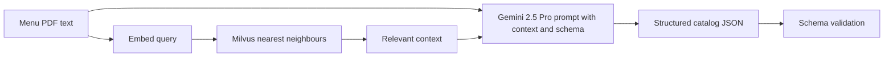

*What to notice: retrieval and schema validation sandwich the model. Retrieval feeds it the right context. Validation checks what comes out.*

Two separate quality questions in any RAG system: did retrieval find the right context (retrieval quality), and did the model use it correctly (generation quality). Evaluate both separately, or you can't tell which half is failing.

**Contrast with IA.** IA doesn't use RAG on the resume. In Keep/Drop, the context for each article is computed deterministically from ClickHouse and sent as a JSON payload (A2). There is no similarity search: we know exactly which facts each decision needs.

**Where it shows up in my work.** **Menu (M1):** onboarding from 24 hours to 2 hours, $600K a year saved, 30K+ menus a month, unstructured multilingual PDFs to a strict catalog schema at 98% field fidelity (offline evaluation), using Gemini 2.5 Pro plus LangChain RAG over Milvus embeddings.

**Interview questions.**
- **Q: Why RAG for menus instead of just prompting Gemini?**
  **A:** Because the output had to match Uber's strict catalog schema and vocabulary, and menus vary wildly by language and format. Retrieval over Milvus supplied relevant context for each menu, so the model mapped messy text into the schema more consistently instead of guessing. Schema validation then caught anything that didn't fit. On offline evaluation that reached 98% field fidelity.
- **Q: When would you not use RAG?**
  **A:** When you already know exactly which facts are needed. Then you compute them and pass them directly, which is cheaper and deterministic. That's what we did at IA with JSON payloads.

**Common mistakes and what not to say.**
- If asked exactly what was indexed in Milvus, describe it at the level you remember. Don't invent corpus sizes.
- Don't say 98% is production accuracy. It's offline evaluation.

---

## 56. Offline evaluation and gold sets

**In plain English.** Offline evaluation means measuring an AI system's quality on a fixed set of test cases before it goes live, rather than learning from production mistakes. A gold set is a set of cases with trusted correct answers (labels). A proxy set is a larger set whose labels are a reasonable stand-in for truth, useful for catching regressions cheaply.

**Analogy.** A driving test on a closed course with a strict examiner (gold set), plus many practice laps timed against a stopwatch (proxy set). You don't let someone drive the school bus until they pass.

**How it works: worked example.**

```text
Gold set: 200 article-seasons with trusted Keep/Drop labels.
  Deterministic rule alone (threshold 0.65):   correct on 74% of cases
  Blended LLM + deterministic:                 correct on about 63%
  -> the blend did NOT beat the free baseline on this set,
     so the blend weights were frozen, not retuned to chase this set.
```

Freezing instead of retuning matters. If you tweak weights until you win on the same 200 cases, you overfit: the score goes up, but you've only learned those 200 cases. A gold set is only honest if you don't train on it.

**Two different eval sets on my resume, kept separate:**

| Set | Size | Used for |
|---|---|---|
| Proxy evaluation harness | 300 cases | the 80% accuracy CI gate (promotion gate) |
| Gold benchmark | 200 cases | the 74% deterministic baseline, the ~63% blended score, and the 73% lower cost at 100% coverage model comparison |

**Where it shows up in my work.**
- **IA (A5):** "300-case proxy evaluation harness and 80% accuracy CI gate." The 73% lower cost and 74% deterministic baseline come from the separate gold-200 benchmark.
- **Menu (M1):** 98% field fidelity is an offline evaluation.

**Interview questions.**
- **Q: Your AI scored 63% and the deterministic rule scored 74%. Isn't that a failure?**
  **A:** It's an honest result, and we acted on it. On the gold-200 benchmark, the plain deterministic rule scored 74% and the blend scored about 63%. So we didn't claim the AI beats the rule on accuracy, and we didn't tune the blend weights to that set, because that would just overfit 200 cases. We froze the weights, and the deterministic rule became the bar any model must beat. The AI still adds lens explanations a planner can read.
- **Q: Why have both a 300-case proxy set and a 200-case gold set?**
  **A:** They do different jobs. The 300-case proxy harness is cheap to run on every change, so it powers the CI gate. The gold-200 set has trusted labels, so it's where we make careful judgements, like comparing models on cost at full coverage. Mixing them up would mean quoting a number from one set as if it came from the other.

**Common mistakes and what not to say.**
- Never fuse the sets: 73% and 74% are gold-200, not the 300-case file.
- Don't say the AI is 80% accurate in production.

---

## 57. CI gates for models

**In plain English.** A CI gate for models is an automated check that blocks a new prompt, model or config from being promoted unless it passes an evaluation threshold. It's the AI version of "tests must pass before merge".

**Analogy.** A factory quality check at the end of the line. A batch only ships if a sample passes inspection.

**How it works.**

```json
{
  "dataset": "proxy_300",
  "gold_min_accuracy": 0.8
}
```

```python
acc = run_eval(candidate_config, dataset="proxy_300")
if acc < EVAL["gold_min_accuracy"]:
    sys.exit(f"Blocked: accuracy {acc:.1%} is below the 80% promotion gate")
```

*Illustrative file shape. The setting name gold_min_accuracy = 0.8 is the real one.*

Good gates also check cost and completeness, not only accuracy. A model that is cheap because it skipped 20% of cases is not cheaper. That's why the 73% cost saving is stated "at 100% coverage".

**Where it shows up in my work.** **IA (A5):** an 80% accuracy CI gate (promotion gate, `gold_min_accuracy` 0.8 in eval.json) on the 300-case proxy harness.

**Interview questions.**
- **Q: What does your 80% gate actually guarantee?**
  **A:** That no new AI configuration gets promoted unless it scores at least 80% on the 300-case proxy harness in CI. It's a regression gate, a floor for releases. It doesn't mean every tenant sees 80% accuracy live, and I'm careful not to say that.
- **Q: How is this different from normal unit tests?**
  **A:** Unit tests are pass or fail on exact behaviour. Model evals are statistical: the output varies, so you measure a rate over many cases and gate on a threshold. You also need to watch for flakiness and keep the eval set fixed, so changes in score reflect the model, not the test.

**Common mistakes and what not to say.**
- "All tenants are live at 80%" is wrong. It's a CI promotion gate.

---

# Part I. Design rounds

## 58. System design: HLD vs LLD

**In plain English.** HLD (high-level design) is the big picture: which components exist, how data flows between them, what stores and queues you use, and how it scales and fails. LLD (low-level design) is the detail inside one component: classes or modules, interfaces, database tables and indexes, API contracts, state machines and error handling.

**Analogy.** HLD is the city map: neighbourhoods, highways, the power station. LLD is the floor plan of one house: where the pipes run and which way the doors open.

**How it works: the same system at both levels (Masters bulk e-invoicing).**

HLD:

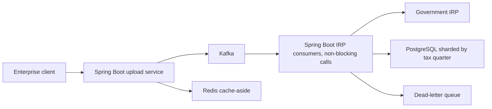

*What to notice: every box in this picture is from the resume. The HLD conversation is about why each box exists and what happens when it fails.*

LLD for the worker:
- Table `submission_batches(idempotency_key PRIMARY KEY, client_id, tax_quarter, status, attempts, last_error)`.
- Status values and allowed transitions (PENDING, SUBMITTED, REGISTERED, FAILED_RETRYABLE, DEAD).
- Retry policy: bounded attempts, exponential backoff with jitter, retryable versus permanent error codes.
- DLQ message shape: payload, key, error, attempts, timestamp.
- Idempotent "record result" step using `ON CONFLICT`.
- Request contract validated at the edge with Bean Validation, so a bad upload is a 400 before anything reaches Kafka:

```java
public record InvoiceBatchRequest(
    @NotBlank String clientId,
    @NotBlank @Size(min = 64, max = 64) String fileHash,      // SHA-256 hex of the uploaded file
    @PositiveOrZero int batchIndex,
    @NotEmpty List<@Valid InvoiceLine> invoices) {}

@PostMapping("/einvoice/batches")
public ResponseEntity<Void> accept(@Valid @RequestBody InvoiceBatchRequest req) {
    batchService.enqueue(req);                 // records the idempotency key, publishes to Kafka
    return ResponseEntity.accepted().build();  // 202: received, will process
}
```

*LLD details are illustrative. They show the level of detail, not the exact production schema.*

**A simple order for a design round:**
1. Clarify requirements and scale (users, requests per second, data size, latency goal).
2. Do back-of-envelope numbers (like 1M a day is about 12 per second, peaks maybe 10 times).
3. Draw the HLD and walk one request through it.
4. Pick one or two components and go LLD: tables, keys, APIs.
5. Discuss failures: retries, idempotency, timeouts, what happens when each box dies.
6. Discuss trade-offs and what you'd change at 10 times the scale.

**Where it shows up in my work.** "System Design (HLD/LLD)" is on my skills line. In practice, every project chapter in this handbook has both: an architecture diagram (HLD) and decoded bullets with tables, keys and state machines (LLD). For FRM, the LLD is the 8-table schema, the JPA entities with `@Version` optimistic locking, SHA-256 natural keys and the FSM. For IA, the HLD is the Go/Gin edge, Postgres plus ClickHouse, and the Python agent plane, and the LLD is the rollup tables, the formula parser and the auth waterfall.

**Interview questions.**
- **Q: What's the difference between HLD and LLD?**
  **A:** HLD decides the boxes and arrows: services, stores, queues, and how they scale and fail. LLD decides what's inside a box: modules, interfaces, tables, indexes and API contracts. In a design round I start with HLD and numbers, then go deep on the one or two components where correctness lives, like the idempotency table in an e-invoicing pipeline.

**Common mistakes and what not to say.**
- Don't jump into table design before agreeing on requirements and scale.
- Don't present illustrative LLD details as the exact production schema.

---

# Wrap-up

## Concept to project cheat sheet

Use this to answer "where have you used X?" in one sentence. If a concept is not in this table for a company, don't claim it there.

| Concept | Where on my resume |
|---|---|
| p95 latency | Masters MI1: from 1.2 seconds to 300 milliseconds |
| RPS / RPM / TPS | IA C1: 10k peak RPS. Masters MI1: 700 to 4,000 requests per minute. Masters MI2: 1M+ a day, about 12 TPS average |
| Rows per second (not RPS) | IA C5: ~344k rows/s combined migration rate |
| Cache-aside | Masters MI3: Redis, DB read load −30%. IA C3: Redis-fronted auth waterfall |
| Idempotency keys | Masters MI2: client + fileHash + batchIndex |
| Bounded retries | Masters MI2: against IRP. Menu M2: adaptive retries with proxy pools |
| Dead-letter queues | Masters MI2 only (Kafka dead-letter topics from Spring Boot consumers) |
| Circuit breakers | IA A3 orchestration registry only |
| Nested timeouts | IA C1. Hard timeouts IA A3 |
| Graceful fallback | IA A2: deterministic baseline on LLM timeouts |
| Checkpoints and resume | IA A3: det.json, agent_progress.json, --resume. IA C5: .done files and TSV ledgers |
| Exactly-once (in practice at-least-once + idempotent) | Menu M2 catalog upserts. Masters MI2 imports |
| Eventual consistency | IA A2: ReplacingMergeTree |
| Transactions | FRM F2: atomic cross-table syncs (`@Transactional` service methods) |
| Optimistic locking | FRM F2 only (JPA `@Version`, stale save returns HTTP 409) |
| Sharding by tax quarter | Masters MI2 only |
| Partitioning by season | IA C4, C5: PARTITION BY season_code |
| Index fixes | Masters MI1 |
| OLTP vs OLAP | IA: PostgreSQL for metadata, UAM and roles. ClickHouse for analytics. FRM MySQL is OLTP |
| Rollups | IA C4: six rollup tables, 189s to 12s on 250M rows, 15.5× |
| Memory caps and spill | IA C4: 170GB OOM prevented on weekly builds |
| SHA-256 natural keys | FRM F2. Also IA A3 config_hash, Menu M2 content hash |
| Parameterized SQL and allowlists | IA C2 formula parser. FRM F3 reporting SQL allowlists |
| Batching and double-buffering | IA C5: 500k-row batches. IA A1: 88k items per pass |
| Backpressure / Kafka | Menu M2 (Kafka + Flink). Masters MI2 (Kafka) |
| Stream processing, keyed state | Menu M2 only |
| Monolith to microservices, strangler, canary | Masters MI1: PHP monolith to Spring Boot microservices |
| Stacked PRs, zero-downtime | FRM F3: Spring Data JPA / Hibernate migration |
| Statement coverage | FRM F3: module 100% (JUnit 5, Mockito, MockMvc). Masters MI3: 35% to 82% |
| FSM | FRM F2 statuses, F3 gates with 50% delta-variance |
| Dependency injection | IA C1: Google Wire (compile-time). FRM and Masters: Spring (runtime) |
| No reverse proxy, h2c | IA C1 |
| WebSockets | IA A4: Ask Iris |
| Tracing and logs | IA C1 Datadog. IA A4 LangSmith. IA A3 JSON telemetry. Masters MI3 ELK + New Relic |
| Multi-tenancy, RBAC, hierarchy scope | IA C1, C3, A4 |
| JWT, OIDC, constant-time API keys | IA C3. JWT also on Ask Iris A4 |
| Async IO | Masters MI1: non-blocking WebClient and Kafka-backed jobs for IRP calls, HikariCP pooling |
| Structured LLM output | IA A1. Menu M1 strict catalog schema |
| Supervisor and evaluator loop | IA A4 Ask Iris only |
| RAG, embeddings, Milvus | Menu M1 only |
| Offline eval, gold sets, model CI gate | IA A5. Menu M1 98% offline |
| Tool calling, MCP | Skills level only |

## Say this, not that

<div class="callout warn">
<strong>Honesty box: read this before every interview</strong>
<ul>
<li><strong>344k is rows per second</strong>, a data-loading rate. Never call it RPS or TPS. The 4.09B-row copy was measured in flight. Don't say the cutover finished.</li>
<li><strong>15.5× is query time</strong> (pivots). <strong>170GB OOM is load time</strong> (weekly builds). They are separate fixes, not cause and effect.</li>
<li><strong>Partition rollback means DROP PARTITION, then recopy.</strong> It is not an atomic swap with live readers. The REPLACE PARTITION incremental design was written but not executed.</li>
<li><strong>80% is a CI promotion gate</strong> on the 300-case proxy harness, not live accuracy for all tenants. <strong>73% and 74% come from the gold-200 benchmark.</strong> Don't fuse them.</li>
<li><strong>"Exactly-once"</strong> on Menu and Masters means at-least-once delivery plus idempotent writes. No zero-loss or two-phase-commit claims across third parties.</li>
<li><strong>Circuit breakers are an IA orchestration-registry feature. DLQs are Masters.</strong> Keyed dedup is Uber Menu Flink. Optimistic locking is Uber FRM. Sharding by tax quarter is Masters. Constant-time API keys are IA C3.</li>
<li><strong>Not at IA:</strong> Kafka, Flink, CDC, Kubernetes operations, Milvus, RAG, sub-second ClickHouse claims, human-in-the-loop review queues. LangSmith is on Ask Iris only.</li>
<li><strong>Ask Iris is shipped capability.</strong> No SLA or usage numbers.</li>
<li><strong>Uber is "Uber via EPAM".</strong> "Led 3 engineers" is FRM (tech lead, not people manager). "Mentored 2" is Masters. Don't merge them.</li>
<li><strong>Skills-level only:</strong> tool calling, MCP, gRPC, pgvector, DynamoDB, Kubernetes, C and C++. RabbitMQ, SQS, Spark, Terraform and multi-region are study topics, not claims.</li>
<li><strong>Isolation is not encryption.</strong></li>
</ul>
</div>

For the derivation of every number on this page, see [Numbers explained](02_numbers_explained.md). For the project stories these concepts belong to, see [IA core platform](03_ia_core_platform.md), [IA agentic AI](04_ia_agentic_ai.md), [Uber FRM](05_uber_frm.md), [Uber Menu and ANZ](06_uber_menu_and_anz.md) and [Masters India](07_masters_india.md). Older study notes on reliability and senior-screen topics live in [Senior systems study notes](../prep/17_senior_systems_study_only.md).
