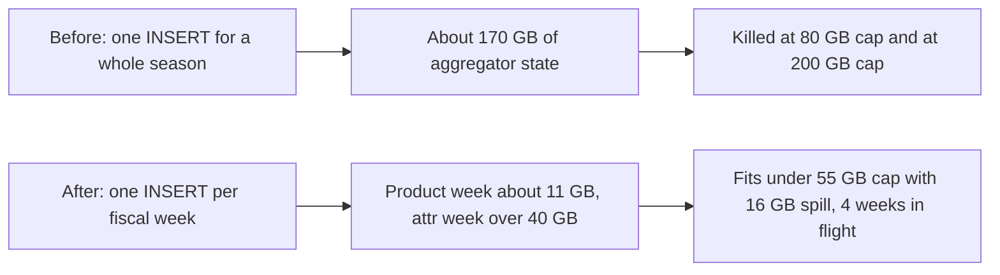
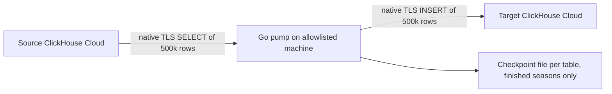
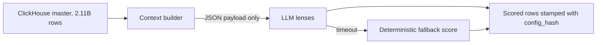
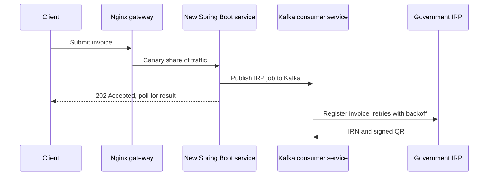
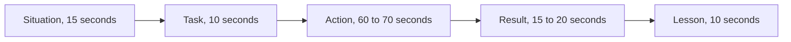

# 11. STAR stories

<div class="callout note">
<b>How to use this page</b>
<ul>
<li>It holds 15 real stories from my work, written so I can tell each one in about two minutes. Each story lists the questions it answers, the full Situation, Task, Action and Result, what I learned, the follow-ups I should expect, and an honesty note.</li>
<li>Read it before any behavioural, hiring-manager or "bar raiser" round. Before a loop, pick three stories from the <a href="#question-to-story-map">question-to-story map</a> and practise only those.</li>
<li>Memorise for each story: the one-line situation, the three key actions, the result number with its tag, and the one-sentence lesson. Paraphrase everything else.</li>
<li>Never tell the same story twice in one interview loop. This bank is big so you never have to.</li>
</ul>
</div>

**What STAR means.** STAR is the standard shape for behavioural answers: **S**ituation (where and when), **T**ask (what I had to achieve), **A**ction (what *I* did), **R**esult (what happened, ideally with a number). I add a fifth part, **L**esson, because interviewers at senior level care most about what you would do differently.

**Tags.** MEASURED means there is a log, document or code behind the number. ESTIMATED means it is arithmetic I can show, so I say "roughly". HISTORICAL means it comes from my past work records. TARGET means it was a design goal, so I say "targeting". DESIGN means it was written but not executed. Untagged numbers are resume numbers, explained in [Numbers explained](02_numbers_explained.md).

**Related chapters:** [Introductions and career story](01_introductions_and_career_story.md) · [IA core platform](03_ia_core_platform.md) · [IA agentic AI](04_ia_agentic_ai.md) · [Uber FRM](05_uber_frm.md) · [Uber Menu and ANZ](06_uber_menu_and_anz.md) · [Masters India](07_masters_india.md)

---

## The 15 stories at a glance

| # | Story | Company | Best for |
|---|---|---|---|
| 1 | The 170 GB weekly rollup crash | Impact Analytics | Biggest technical challenge, dive deep, setback |
| 2 | Copying billions of rows when the clusters could not talk | Impact Analytics | Ownership, working around constraints, failure handling |
| 3 | Settling the ClickHouse debate with evidence | Impact Analytics | Influence without authority, conflict between teams, most proud |
| 4 | When the LLM lost to simple math | Impact Analytics | Data-driven decision, high standards, results below expectations |
| 5 | Designing AI that fails safely | Impact Analytics | Anticipating problems, security, customer trust |
| 6 | The bug that pointed edits at the wrong line | Uber via EPAM (FRM) | Dive deep, hardest bug, safe migration |
| 7 | Disagreeing with the architecture rulebook | Uber via EPAM (FRM) | Disagree and commit, conflict with a standard |
| 8 | The "pure refactor" that was not | Uber via EPAM (FRM) | Mistake, failure, owning it |
| 9 | Coverage that lied | Uber via EPAM (FRM) | Critical feedback, testing, dive deep |
| 10 | Leading a pod of three on the ORM migration | Uber via EPAM (FRM) | Leadership, delegation, raising the bar |
| 11 | Turning Finance's judgement into rules | Uber via EPAM (FRM) | Stakeholders, customer obsession, explaining to non-technical people |
| 12 | The anti-bot arms race | Uber via EPAM (Menu) | Persistence, moving target, a slipped plan |
| 13 | Migrating a monolith during filing season | Masters India | Tight deadline, delivering under pressure, leading a project |
| 14 | Mentoring two engineers | Masters India | Mentoring, giving difficult feedback |
| 15 | The double-filing near-miss | Masters India | Integrity, raising a problem you could hide |

---

## Story 1. The 170 GB weekly rollup crash

**Answers:** biggest technical challenge · a time you hit a hard resource limit · dive deep · a setback or failure you recovered from · working within constraints.
**Project:** Impact Analytics, AssortSmart ClickHouse rollups. **Tags:** 170 GB, one fiscal week per insert, memory and disk-spill caps are on the resume. 55 GB, 16 GB, 8 threads, 4 weeks in flight, 11 GB and 40 GB are verbal depth from the build settings and runs.

**Words you need.**
- **Rollup table.** A table of pre-computed totals, for example sales per product per week, so planners read a small summary instead of summing billions of raw rows on every click. We have six: product, store and attribute, each at season grain and weekly grain.
- **INSERT SELECT.** One SQL statement that reads rows with a query and writes the result into another table. Here it reads daily facts and writes weekly totals.
- **Aggregator state.** The working memory a database keeps while grouping, like a running tally sheet per group. More groups and more columns mean a bigger tally sheet.
- **OOM (out of memory).** The database kills the query because it needs more memory than it is allowed.
- **Disk spill.** Letting the database write part of its tally sheet to disk when memory is full, slower but survivable.

**Situation.** Planners need weekly numbers, so we needed weekly rollup tables, not just season totals. The weekly build has to keep about 110 `any()` aggregate values plus `argMax` and `argMin` over wide text columns for every group. When I ran the build as one INSERT SELECT for a whole season, the aggregator state came to around 170 GB. It failed with `MEMORY_LIMIT_EXCEEDED` with an 80 GB cap, and failed again with a 200 GB cap. The replica had about 59 cores and about 236 GiB of memory, so "just give it more" had already run out of road.

**Task.** I had to keep weekly grain, because planners need fiscal-week numbers, without crashing the replica and without asking for bigger hardware.

**Action.**
1. After the second failure I stopped raising the memory cap. I measured the build per table grain (product, store, attribute) to find out which part was heavy.
2. I changed the unit of work from one season to one fiscal week. Each INSERT SELECT now builds a single week, so its tally sheet holds one week of groups instead of a whole season.
3. I generated the build settings per run: 8 threads, a 55 GB memory cap, 16 GB of disk spill, and at most 4 weeks in flight at once.
4. I measured real peaks. A product week peaked around 11 GB. An attribute week for the heaviest retailer peaked above 40 GB, so a 40 GB cap was too low for that table. Attribute tables are the heaviest because they "unpivot" each product into one row per attribute pair, which makes attribute weekly about 5x the size of product weekly.
5. I set one rule for the team: do not raise season parallelism and week parallelism at the same time on the same box, because the memory multiplies.



*What to notice:* the fix did not add memory. It made each piece of work small enough to fit.

**Result.** Weekly-grain rollups build reliably. Planners read partition-pruned weekly tables. This is load-time work. The 15.5x pivot speed-up (189s to 12s) is a separate query-time result measured on a 250M-row harness, and I say that unprompted.

**What I learned.** Shrink the unit of work before you buy more memory. And measure the heaviest slice first, because the average week tells you nothing about the attribute week that kills the box.

**Likely follow-ups.**
- *"Why not just use a bigger machine?"* "It already failed at a 200 GB cap on a 236 GiB box. Even a single attribute week needs over 40 GB, so a whole season would keep growing with the data. Week slicing makes memory bounded by the week, not the season, so it keeps working as data grows."
- *"Is this why pivots got 15.5x faster?"* "No. That is a common mix-up. The OOM fix is about building the tables. The 15.5x is about reading them, measured on a separate 250-million-row harness. They're two different wins."
- *"Why are attribute tables so big?"* "They unpivot. Each product row becomes one row per attribute pair using `ARRAY JOIN`, so attribute weekly is about five times product weekly."
- *"How do you know a week finished?"* "From the server, not the client. I check `system.query_log` for the query's finish event, and a ledger records finished weeks. Story 2 covers why that matters."

**Honesty note.** Say this carefully: 170 GB is how much the full-season build needed, and the resume says I "prevented 170GB OOM crashes". The exact knobs (55 GB, 16 GB, 8 threads, 4 weeks) are verbal depth, fine to say if asked, not resume numbers. Never say the OOM fix caused the 15.5x speed-up.

---

## Story 2. Copying billions of rows when the clusters could not talk

**Answers:** ownership · ambiguity and working around a constraint · bias for action · how you handle failure and idempotency · a bug in your own system.
**Project:** Impact Analytics, ClickHouse Cloud migration. **Tags:** 344k rows/s, 4.09B, 500k-row double-buffered batches, TSV ledgers and partition rollbacks are on the resume. The two season streams of 150k to 190k rows/s and the 64.1M half-loaded partition are MEASURED verbal depth. The REPLACE PARTITION incremental pipeline is DESIGN only.

**Words you need.**
- **Partition.** A slice of a table stored separately, here one slice per season (`season_code`). You can drop or rebuild one season without touching the others. Like one drawer per season in a filing cabinet.
- **IP allowlist.** A firewall list of which addresses may connect. Our cloud clusters could not reach each other, but my operator machine was allowed to reach both.
- **Native TLS protocol.** ClickHouse's own encrypted binary protocol (port 9440), faster than sending data over HTTP.
- **Double buffering.** Using two buffers so you read the next batch while the previous one is still being sent. Like one person washing dishes while another dries.
- **Ghost rows.** Rows from a load that crashed halfway. The partition "has rows", so it looks finished, but it is incomplete.

**Situation.** We needed to copy the rollup tables between two ClickHouse Cloud clusters. The normal approach, one cluster pulling directly from the other, was blocked by cross-cluster IP allowlists. The biggest object was the attribute weekly table for two seasons: 4.09 billion rows (2,779,317,472 plus 1,311,108,195). Before this, I had already been bitten by a related problem in my own weekly loader: a failed HTTP insert still committed some blocks, and a half-loaded partition of 64.1 million rows passed a "skip this season if it already has rows" check. So I knew partial loads that look complete were the real danger.

**Task.** Move billions of rows between clusters, make every run restartable, and make sure a crash could never leave ghost rows that look like a finished copy.

**Action.**
1. I wrote a Go data pump that connects to both clusters over the native TLS protocol from the allowlisted machine. It reads from the source and writes to the target, so no cluster-to-cluster connection is needed.
2. I made it fast. It works in 500,000-row columnar batches, appending whole columns at a time with no per-row reflection. Two buffer sets mean the read of the next 500k overlaps the send of the previous 500k. That overlap also fixed an "unexpected EOF" error I had seen when a read sat idle during a long insert over HTTP.
3. I made it restartable per season. Each table has a checkpoint file, `migrate-checkpoints/<table>.done`, listing finished seasons. If a season is not marked done but the target already has rows, the pump drops that partition and recopies it. On Ctrl-C it finishes the batch in flight and does not mark the season done. A per-table file lock stops two terminals copying the same table. It never retries a batch that has already been sent, because that creates duplicates.
4. I fixed the loader the same way. A TSV ledger records each finished (table kind, season) pair, and "finished" means `system.query_log` shows the query completed on the server, not that curl exited cleanly. A missing ledger entry means drop that season's partition and rebuild it.
5. I wrote down the honest limit. Dropping a partition and recopying is not an atomic swap, because readers can see a partial season during the rebuild. I wrote a safer incremental design that builds into a side table and swaps it in with `REPLACE PARTITION`. That design was written, not executed.



*What to notice:* the pump sits in the middle because the clusters could not reach each other. The checkpoint only ever records whole finished seasons.

**Result.** The pump ran at about 344,000 rows per second combined, as two season streams of roughly 150,000 to 190,000 rows per second each, measured on the 4.09-billion-row attribute weekly set while that copy was in flight. Smaller tables and seasons completed and were checkpointed. Ghost rows from crashes are handled by the ledger and checkpoint rules instead of by hope.

**What I learned.** A crash must never look like success. Define "done" by what the server says finished, and make the unit of retry something you can safely throw away and redo.

**Likely follow-ups.**
- *"344k requests per second?"* "No, rows per second of copy throughput. It's not an API."
- *"Did the 4.09-billion-row copy finish?"* "I measured the rate on that set while it was in flight. I don't claim the cutover finished."
- *"Is your partition rollback atomic?"* "No. It's drop the partition and recopy that season. A crash in between leaves a hole until the rebuild. The atomic version, build aside and REPLACE PARTITION, is designed but not run."
- *"Would you run production copies through a laptop?"* "Not by choice. It was a workaround for the allowlists. With the right network access I'd use a direct INSERT SELECT between clusters or stage through object storage."
- *"Why Go?"* "Native ClickHouse client with columnar batches, cheap concurrency for two season streams, and a single binary to run."

**Honesty note.** Say this carefully: 344k is rows per second, not requests or transactions. 4.09B was "measured on", not "migrated". The 64.1M half-loaded partition was the loader, not the copier. Never paste cluster hosts or passwords, and never offer to open-source the copier.

---

## Story 3. Settling the ClickHouse debate with evidence

**Answers:** influence without authority · disagreement between teams or senior people · making a decision with incomplete data · what you are most proud of · taking initiative.
**Project:** Impact Analytics, choosing the analytics database for planner reads. **Tags:** 189s to 12s on 250M rows and 15.5x are on the resume (MEASURED proof of concept, 12.3s rounded to 12s). The three-gate plan, the zero mutation queue at 10x scale and the July 2026 commitment are from my RFC and decision records.

**Words you need.**
- **OLAP (online analytical processing).** Workloads that read and summarise lots of rows, like dashboards. The opposite of OLTP, which is many small reads and writes like "update this one order".
- **Mutation.** ClickHouse's name for an UPDATE or DELETE. ClickHouse is built for appending data, so mutations rewrite whole chunks in the background and can pile up in a queue.
- **ReplacingMergeTree.** A ClickHouse table type that keeps only the newest version of a row with the same key. Think of a notebook where you never erase. You write the new value below, and a cleaner later crosses out the old lines.
- **RFC (request for comments).** A written design proposal that others review before anyone builds it.
- **Row-identical harness.** The same rows and the same query run on both databases, with answers compared, so the comparison is fair.

**Situation.** Planner pivots on PostgreSQL were slow, past 30 seconds and up to 189 seconds at 250 million rows. The organisation was split on ClickHouse. A live audit of the legacy backend had concluded "no ClickHouse". Senior subject-matter experts wanted "yes, ClickHouse for everything". Both sides had real evidence, and a wrong call was expensive either way.

**Task.** Produce a recommendation the organisation could commit to, without throwing away either side's evidence. I could prototype on my own, but I could not commit the organisation on my own.

**Action.**
1. I separated facts from conclusions. I accepted every measured fact in the audit. Then I showed that its "no" conclusion came from the legacy system's write model, which updated rows in place, and ClickHouse is weak at in-place updates. It was not a verdict on analytical reads, which is what planners need.
2. I designed an insert-only, versioned write model using ReplacingMergeTree, so new values are appended as new versions instead of updated in place. That sidesteps the mutation weakness the audit had found.
3. I wrote the RFC and proposed a staged path with three measurable gates: fix what we could inside the existing BigQuery stack first, tighten Postgres usage second, and run a versioned-write proof of concept third. If a gate failed, we would stop.
4. I ran a row-identical proof of concept: the same 250 million rows and the same pivot on Postgres and ClickHouse, with answers compared.
5. I kept Postgres where it belongs: thin metadata, user access management and roles.

**Result.** Both camps agreed to the staged path. The proof of concept held the mutation queue at zero at 10x scale, and the pivot went from 189 seconds to 12 seconds, which is 15.5x faster. In July 2026 the organisation committed to ClickHouse for planning analytics. No premature infrastructure spend, and no camp "lost".

**What I learned.** When competent people disagree, it is usually about a hidden assumption, not about the facts. Make the assumption explicit and the decision often resolves itself.

**Likely follow-ups.**
- *"How did you avoid looking like you were picking a side?"* "By starting with the audit's facts and agreeing with all of them in writing. I only challenged the step from the facts to the conclusion."
- *"Why not just tune Postgres?"* "That was literally gate two. Postgres is great for transactional rows. Wide analytical pivots over hundreds of millions of rows are what column stores are built for, and the harness showed it."
- *"What does Postgres still do?"* "Thin metadata, user access management and role resolution. ClickHouse handles large analytical reads."
- *"What if the proof of concept had failed?"* "We'd have stopped at that gate. The point of gates is that failing one is a cheap, early answer."

**Honesty note.** Say this carefully: 189s to 12s is a proof-of-concept harness on 250 million rows (12.3s, rounded). It is not a claim that every query is now sub-second. This was a team decision. I wrote the proposal and ran the proof, and reviewers and leadership made the commitment.

---

## Story 4. When the LLM lost to simple math

**Answers:** a data-driven decision · results that did not meet expectations · insisting on high standards · resisting the urge to ship something that looks good · ethics in AI.
**Project:** Impact Analytics, Keep/Drop merchandise decision engine. **Tags:** 300-case harness, 80% CI gate, 73% lower cost at 100% coverage, and 74% deterministic baseline are on the resume. The ~63% blended score and the model names are verbal depth.

**Words you need.**
- **Article-season.** One product (article) in one selling season. The engine scores 348k of them.
- **Deterministic score.** A score computed by fixed math from sell-through and rate of sale. Same input, same answer, every time.
- **LLM lenses.** Seven different angles the LLM is asked to judge from, combined by a "decider" step into one agent score.
- **Blend.** Final score = 0.4 x deterministic score + 0.6 x agent score. Keep the article if the final score is 0.55 or higher.
- **Gold benchmark.** A fixed set of cases with known correct answers, here 200 cases ("gold-200").
- **CI promotion gate.** An automatic check in the build pipeline. If accuracy on the evaluation set is below the bar, the change cannot be promoted.

**Situation.** The Keep/Drop engine blends deterministic KPI math with LLM judgement. On our 200-case gold benchmark, the deterministic baseline alone (at the production threshold of 0.65) scored 74%. The blended score with the LLM came in at about 63%. In other words, adding the LLM made accuracy on that benchmark worse, not better.

**Task.** Decide what to promote, protect quality for every future change, and pick a model that made sense on cost, without fooling ourselves with a number we had tuned to look good.

**Action.**
1. I did not retune the blend weights to chase the benchmark. Retuning weights on the same 200 cases until the number goes up is just fitting to the test. I froze the blend weights.
2. I built a 300-case proxy evaluation harness and wired an 80% accuracy gate into CI (`gold_min_accuracy` of 0.8 in `eval.json`). No prompt or model change gets promoted if it scores below that bar.
3. I compared models on the gold-200 benchmark for cost and completion. The cheaper model gave 73% lower live execution cost with 100% coverage, meaning all 200 cases completed with no failures or timeouts.
4. I kept the deterministic score as the safety net. If an LLM call times out, that item falls back to its deterministic baseline score.
5. Every output row is stamped with a `config_hash`, a SHA-256 fingerprint of the guardrails, parameters, prompts and catalog, so any decision can be traced to the exact configuration that produced it.

**Result.** We did not promote a change that the data said was worse. Live execution cost went down 73% at full coverage. Every future change has to clear the 80% gate. And the team has an honest baseline to beat instead of a flattering number.

**What I learned.** A good deterministic baseline is a feature, not an embarrassment. An LLM has to beat simple math before it earns more weight.

**Likely follow-ups.**
- *"Your gate is 80% but your baseline is 74%. Doesn't that mean you're failing?"* "They're on different sets. 80% is the promotion gate on the 300-case proxy harness. 74% is the deterministic baseline on the separate gold-200 benchmark. I keep them apart on purpose."
- *"So what does the LLM add?"* "The lens reasoning and the explanation step that planners can read, on top of a deterministic score that stays in the blend and acts as the fallback. The weights stay frozen until the evidence says otherwise."
- *"Why not retune?"* "Because 200 cases is small. Tuning on them would raise the benchmark number without telling us anything about real tenants."
- *"Which models?"* "If asked: we compared gpt-5.6-luna against gpt-5.4-mini. The names aren't on my resume because they change every few months. The method is the point."

**Honesty note.** Say this carefully: 80% is a CI promotion gate, not live accuracy for every tenant. 73% and 74% come from the gold-200 benchmark, not the 300-case file. Do not fuse them into one sentence like "80% accurate and 73% cheaper". There was no human review queue in Keep/Drop. Offline evaluations replaced critic or evaluator agents there.

---

## Story 5. Designing AI that fails safely

**Answers:** anticipating problems before they happen · security and data protection · customer trust · designing for failure · build versus buy (why not Airflow).
**Project:** Impact Analytics, Keep/Drop orchestration and the Ask Iris copilot. **Tags:** all mechanisms are on the resume. There are no SLA or usage numbers for Ask Iris, and none should be invented.

**This is a design story, not an incident story.** Nothing blew up. Use it when they ask how you prevent problems, not when they ask about a failure.

**Words you need.**
- **Multi-tenant.** One system serving many retailer customers, whose data must never mix.
- **Circuit breaker.** A switch that stops calling a failing service after repeated failures, so you stop wasting time and money on it. Like a fuse in your house.
- **Checkpoint.** A saved record of finished work, so a restarted run skips what is already done.
- **WebSocket.** A connection that stays open so the server and the browser can talk both ways, which is what a chat needs.
- **LangGraph supervisor.** A LangGraph pattern where one "supervisor" step decides which sub-agent or tool runs next.
- **JWT (JSON Web Token).** A signed token proving who the user is.

**Situation.** Planners use AssortSmart's AI output to make real buying decisions for retailers. The underlying ClickHouse fact table has 2.11 billion rows across many tenants. LLM providers time out and fail. A batch pass covers 88,000 items. And Ask Iris is a chat copilot that planners use to query KPIs and inspect AI decisions. The risks were clear: an LLM writing its own SQL against a 2.11-billion-row table, a run dying halfway and redoing expensive work, a chat session seeing another tenant's data, and an agent looping forever.

**Task.** Make the AI safe to run on real tenants before anything went wrong.

**Action.**
1. **The LLM never queries the database.** I decoupled inference from the master table. The system prepares the context for each item and hands it to the LLM as a JSON payload. The LLM never gets a SQL tool. Results are written back eventually consistent via ReplacingMergeTree.
2. **Failure is planned for.** I built a shared orchestration registry with hard timeouts, circuit breakers that trip after about five consecutive failures or a high failure fraction, and a graceful fallback to the deterministic baseline score when the LLM times out.
3. **Runs resume instead of restarting.** Durable checkpoints (`det.json`, `agent_progress.json`, and a `--resume` flag) let a restarted run skip deterministic scoring and LLM work that already finished.
4. **Everything is traceable.** A frozen `config_hash` is stamped on every output row, and custom JSON telemetry records tokens, cost in dollars, step duration and batch fallbacks.
5. **Ask Iris cannot leak across tenants or loop.** It runs over a JWT-secured WebSocket. The user's hierarchy access (`plan_scope`) is frozen at the socket handshake, so nothing said later in the chat can widen it. A LangGraph supervisor routes the work, and an evaluator loop is capped at three attempts (`MAX_ATTEMPTS = 3`). LangSmith traces each conversation.
6. **I chose not to add Airflow or Temporal.** We needed resume logic tied directly to ClickHouse inserts and config hashing, and a separate workflow platform was extra infrastructure we could not justify for that.



*What to notice:* there is no arrow from the LLM back to the database. That missing arrow is the whole design.

**Result.** Keep/Drop runs finish even when the model provider fails, and a restart does not redo finished work. Ask Iris shipped as a planner copilot with tenant scope fixed at connection time. I keep the result qualitative because there are no SLA or usage numbers to quote.

**What I learned.** With LLMs, put a deterministic contract around the probabilistic part. Decide what the model is *not* allowed to do before you decide what it does.

**Likely follow-ups.**
- *"Why not let the LLM write SQL? It's more flexible."* "Flexibility is the risk. A bad query on 2.11 billion rows costs money, can return wrong numbers, and in a multi-tenant system could cross a tenant boundary. Prepared JSON context is boring and safe."
- *"Why freeze scope at the handshake?"* "Because the chat is untrusted input. If scope could change mid-conversation, a cleverly worded message could widen it. Fixing it when the socket opens means the check happens once, from the token."
- *"Why three attempts?"* "It stops infinite loops and caps cost. After three tries the copilot returns its best answer instead of spinning."
- *"Is there an LLM orchestrator in Keep/Drop?"* "No. The batch order is fixed: peer, decider, lenses, blend, explain. The supervisor pattern is in Ask Iris."

**Honesty note.** Say this carefully: LangSmith is on Ask Iris only, not on the Keep/Drop batch. There is no human review queue. Ask Iris is a shipped capability with no SLA or usage numbers. Do not attach Kafka, Flink or CDC to anything at Impact Analytics.

---

## Story 6. The bug that pointed edits at the wrong line

**Answers:** dive deep · hardest bug you fixed · ownership of a migration · quality under deadline · migrating without breaking the live path.
**Project:** Uber via EPAM, FRM Scoping Platform, reconciliation v1 to v2. **Tags:** MEASURED from the migration write-up and code (18 files, 1,268 lines added). The column-aliasing fix is part of the resume's Spring Data JPA / Hibernate migration bullet.

**Words you need.**
- **Reconciliation (recon).** Checking that the numbers in Oracle HFM (Hyperion Financial Management, Uber's consolidation system) match the numbers in the filed 10-Q quarterly report, line by line.
- **FSLI (Financial Statement Line Item).** One line on the balance sheet or income statement, like Cash or Revenue. FRM uses a 4-level hierarchy, L1 to L4.
- **ORM (object-relational mapper).** A library that maps database rows to code objects. Hibernate is the standard Java one, and Spring Data JPA sits on top of it and generates repository code for you.
- **Column aliasing.** Giving a selected column an explicit name in the query, such as `AS fsli_id`, so two columns with the same name do not collide.
- **Parallel run.** Running the old and new versions side by side and comparing outputs before switching users over.

**Situation.** The v1 reconciliation endpoints were backed by Google Sheets. Recon lines had no stable ID in the database, so you could not attach a comment to a line or track it by quarter. The legacy read path also had a hidden identity problem. It turned raw SQL results into one `Map<String, Object>` per row, keyed by column name. The query joined the fact table (balance sheet or income statement) to the `level_mapping` table, and both tables had columns named `uuid`, `level_id`, `fiscal_quarter` and `fiscal_year`. The symptom: an edit to one recon line appeared to affect a different line.

**Task.** I owned migrating reconciliation from Sheets-backed v1 to MySQL-backed v2, under the quarterly close deadline, without breaking v1. And I had to kill the identity bug for good.

**Action.**
1. **Found the root cause.** When a join returns two columns both named `uuid`, both land on the same map key, and the second `put` silently overwrites the first. So each row silently carried the `level_mapping` uuid instead of the fact row's uuid. The values on screen looked right. The identity was wrong, so PATCH-by-uuid and comment mapping hit the wrong line.
2. **Fixed it structurally.** I moved the reads to Spring Data JPA repository queries on mapped entities, with an explicit alias on every projected column read through a typed projection, for example `fsli_id` for the fact identity and `level_mapping_uuid` for the mapping identity. Names can no longer collide.
3. **Built v2 alongside v1.** New endpoints `GET /v2/recon_balance_sheet` and `GET /v2/recon_income_statement`, with JPA entities, response DTOs, Spring Data repositories and a service that builds the L1 to L3 tree and sums children into parents. v1 stayed untouched.
4. **Ran them in parallel.** QA compared v1 and v2 for the same period side by side. The test plan covered happy paths, an empty period, missing parameters returning 400 Bad Request, a check that the old v1 response shape was unchanged, and the invariant that every parent equals the sum of its children.
5. **Cut over safely.** The UI moved to v2 after staging verification, and v1 stayed as a fallback.

```java
public interface ReconRow {
    String getFsliId();            // the fact row's identity
    String getLevelMappingUuid();  // the mapping's identity, separately named
    String getLevel1();
}

@Query("""
    SELECT MIN(i.uuid) AS fsliId, MAX(lm.uuid) AS levelMappingUuid, lm.level1 AS level1
    FROM BalanceSheetLine i JOIN i.levelMapping lm
    WHERE i.fiscalQuarter = :quarter AND i.fiscalYear = :year
    GROUP BY lm.level1
    """)
List<ReconRow> findRecon(@Param("quarter") String quarter, @Param("year") int year);
```

*What to notice:* every column has its own alias, and the projection reads values by those aliases, so one `uuid` can never overwrite another.

**Result.** Reconciliation now lives in MySQL with stable line IDs keyed by quarter and year, so comments map to the right line and the HFM-versus-10-Q differences are queryable. The change was 18 files and 1,268 added lines. The wrong-identity class of bug cannot recur in the migrated reads.

**What I learned.** Mapping query results by position is a silent-corruption risk. Label everything, and run old and new side by side before you trust the new one.

**Likely follow-ups.**
- *"Why didn't anyone notice earlier?"* "Because the numbers on screen were right. Only the hidden identity was wrong, and that only shows up when you write back, like an edit or a comment."
- *"Why is a wrong ID so bad here?"* "This tool feeds audit evidence. A comment or a scope decision on the wrong financial line is a silent wrong answer, which is the worst kind."
- *"What else could silently go wrong?"* "A duplicated leaf double-counts its parent, which is why we check parent equals sum of children. Rows loaded with the wrong active flag can vanish from the tree with no error."
- *"Did you build the ETL from HFM?"* "No. That was a shared pipeline responsibility. My service consumed the loaded tables."

**Honesty note.** Say this carefully: I owned the scoping APIs and the recon migration. The HFM data load and the separate collaboration and notification service were not mine.

---

## Story 7. Disagreeing with the architecture rulebook

**Answers:** disagree and commit · conflict with a senior engineer or a team standard · have backbone · healthy technical conflict · a time you pushed back.
**Project:** Uber via EPAM, FRM, Spring Data JPA / Hibernate migration. **Tags:** HISTORICAL, from my work records.

**Words you need.**
- **Repository layer.** A layer of code that owns all database access, so business logic never talks to the database directly.
- **Named query on the entity.** A JPQL query declared with `@NamedQuery` on the JPA entity class itself, sitting right next to the field mappings.

**Situation.** The team's architecture rules said all data access lives in `repository/`. During the ORM migration I wanted to put period-scoped named queries on the JPA entities instead. The migration had been motivated by latent column-aliasing bugs, including raw SQL that read income-statement rows using balance-sheet column lists.

**Task.** Either follow the rule mechanically or argue for an exception, without damaging trust in the rulebook.

**Action.**
1. I made the engineering case in writing. Named queries keep the query next to the field mappings, and Hibernate validates them when the application starts, so if someone renames a field, the test run fails immediately at the query. The repository stays a thin interface that calls them, and no business logic leaks into entities.
2. I listened to the counter-argument, which was consistency. A rulebook with exceptions is harder to follow. That was a fair point.
3. I documented the deviation explicitly, so the next engineer would know it was deliberate.
4. I committed to the rule for the cases it fits. Dynamic queries that do not naturally belong to one entity stayed as repository methods.

**Result.** The exception was accepted and documented. The class of bug that motivated the migration, queries drifting away from the columns they read, could not recur in the migrated code.

**What I learned.** Disagree with a written rationale, commit visibly to whatever is decided, and leave the decision auditable for the next person.

**Likely follow-ups.**
- *"What if they'd said no?"* "Then I'd have followed the rule and kept the written argument for a later review. The point of writing it down is that the decision doesn't depend on who argued louder."
- *"Was this a conflict with a person?"* "No, with a standard. I keep these technical. The people on the other side were right that consistency matters."
- *"How did you stop models becoming bloated?"* "Only queries scoped to that one entity's table went on the entity. Anything joining several entities stayed in the repository."

**Honesty note.** Say this carefully: frame it as a disagreement between competent people about a standard. Do not make anyone the villain.

---

## Story 8. The "pure refactor" that was not

**Answers:** tell me about a mistake · a bug you caused · a failure · owning a mistake · quality standards.
**Project:** Uber via EPAM, FRM scoping service. **Tags:** HISTORICAL.

**Words you need.**
- **Stacked PRs.** A big change split into a chain of small pull requests, each building on the one before, so reviewers see small diffs and releases stay safe. This is how we kept releases zero-downtime under Bazel.
- **Pure refactor.** A change to how code is organised that must not change what it does.

**Situation.** I was landing a three-PR stacked refactor. PR 2 was supposed to be a constants-only consolidation across 31 files. A downstream test started failing. It asserted "preserve the COMPONENT strategy when the selection is empty", but now it saw AGGREGATE.

**Task.** Find out why a refactor that should not change behaviour had changed behaviour, and fix it before it shipped.

**Action.**
1. I diffed my own PR line by line, assuming the mistake was mine until proven otherwise.
2. I found it. I had slipped in a small `resolveStrategy` helper that silently downgraded the strategy. It was a behaviour change hidden inside a refactor.
3. I removed the helper and restored the pass-through, so PR 2 was a true refactor again.
4. I added "pure refactor means zero test diff" to the team's stacked-PR checklist, so this class of mistake is caught by process, not by someone's vigilance.

**Result.** It shipped as a true refactor, and the broken behaviour never reached production. A few weeks later the checklist caught a similar issue for a teammate.

**What I learned.** Call your own fouls fast and turn them into process. Credibility compounds when people see you catch your own mistakes.

**Likely follow-ups.**
- *"Did it reach production?"* "No. The test caught it in CI. I'm explicit about that because it's not a customer-impact story."
- *"Why did you add the helper in the first place?"* "It felt like tidying while I was in there. That's exactly the trap. Tidying that changes behaviour belongs in its own PR."
- *"Do you have a bigger failure?"* "The closest with real stakes is the double-filing near-miss at Masters India, Story 15."

**Honesty note.** Say this carefully: this was caught in CI before release. Do not inflate it into a production incident to sound dramatic.

---

## Story 9. Coverage that lied

**Answers:** received tough or critical feedback · debugging something non-obvious · testing philosophy · dive deep · a metric you did not understand.
**Project:** Uber via EPAM, FRM, Spring Data JPA / Hibernate migration. **Tags:** 34.6% and 12 tests are HISTORICAL. 100% module statement coverage is on the resume.

**Words you need.**
- **Statement coverage.** The share of code lines that actually ran during tests.
- **Mock.** A fake object used in tests in place of the real one (we used Mockito with JUnit 5). Useful, but code behind a mock never runs.

**Situation.** CI failed my ORM migration PR at 34.6% coverage on new lines, even though I believed the code paths were tested. Being told by CI that your tested code is "uncovered" is a kind of critical feedback, and my first instinct was that the tool was wrong.

**Task.** Understand how code I thought was tested could be counted as untested, and fix the real gap rather than game the number.

**Action.**
1. I dug into how coverage was measured. The repository-layer tests stubbed the new entity query methods with Mockito. So the entity package's lines never executed. Mocking had moved the coverage to the wrong layer.
2. I accepted that my mental model was wrong, not the tool.
3. I wrote 12 direct JUnit tests at the entity layer, including rejection paths such as empty updates and unknown columns.
4. I wrote the pattern into the team's testing notes: test where the code lives, not where it is called.

**Result.** The changed module reached 100% statement coverage, and the tests now exercised the real code, including the failure paths.

**What I learned.** A metric you do not understand will lie to you. When a number surprises you, learn how it is computed before you argue with it.

**Likely follow-ups.**
- *"Isn't 100% coverage a vanity metric?"* "It can be. That's why the 12 tests targeted rejection paths, not just happy paths. Coverage told me where the gap was. The tests had to be real."
- *"How do you balance mocks and real tests?"* "Mock the layer below to test this layer's logic, but make sure each layer also has tests that run its own code."

**Honesty note.** Say this carefully: 100% is module statement coverage on the migrated module, not the whole service. The 1,100+ test count for FRM is verbal, not on the resume.

---

## Story 10. Leading a pod of three on the ORM migration

**Answers:** leadership · leading a team to an outcome · delegation · motivating a team · raising the bar · influence as a tech lead.
**Project:** Uber via EPAM, FRM Scoping Platform. **Tags:** led 3, 36 endpoints, 100% module statement coverage, 14 days to 3 days, 50% delta-variance checks are on the resume. 8 screens and 1,100+ tests are verbal depth.

**Words you need.**
- **Controller, service, repository, entity.** The four layers of the service. Controllers (the HTTP handlers, `@RestController` classes) do HTTP, auth and error mapping. Services do business logic and build trees. Repositories own all database access. Entities hold the field-to-column mappings.
- **SOX (Sarbanes-Oxley).** US law requiring public companies to have controls over financial reporting.
- **FSM gate (finite state machine).** A rule about which status changes are allowed (Draft, Review, ReOpen, Closed), checked automatically.
- **Delta-variance check.** Flagging a line whose value changed by more than a threshold, here 50%, between periods.

**Situation.** The FRM scoping backend needed a clean layered architecture and an ORM migration to Spring Data JPA / Hibernate, while the frontend team and Finance stakeholders kept iterating, and the quarterly close kept its fixed deadline. I was the tech lead of an EPAM pod of three engineers inside Uber Finance.

**Task.** Own the service, keep three engineers shipping in parallel without stepping on each other, and raise test quality under Bazel, with zero-downtime releases.

**Action.**
1. **Sliced work by layer.** I split features along the controller, service, repository and entity boundaries so two engineers could build the same feature without merge collisions. The recon migration (18 files) was split cleanly across those layers.
2. **Set conventions and enforced them.** Thin controllers. Services own orchestration and tree building, and their write methods are `@Transactional`, so a cross-table sync commits or rolls back as one unit. Repositories own all data access. Every write reads the authenticated email header and records `updated_by`. Request DTOs are validated at the boundary with Bean Validation (`@Valid`). No empty `catch` blocks that swallow errors. These came out of the backend team syncs.
3. **Made the review bar a gate.** Every PR had to add or update tests in the matching tests folder and pass the Bazel test targets before merge. Releases went out as stacked Bazel PRs, so each change was small and the service never needed downtime.
4. **Built the compliance checks in.** Reporting SQL went through allowlists, and automated status-transition gates with 50% delta-variance checks supported SOX compliance.
5. **Reviewed closely, then stepped back.** I reviewed every PR early and paired on the recon v2 cutover. As ownership stuck, I reviewed less and let each engineer own their area.

**Result.** The ORM migration eliminated latent column-aliasing bugs and took the module to 100% statement coverage. The platform served 8 screens through 36 endpoints with 1,100+ tests, reconciliation ran on MySQL, and Finance used the tool for the quarterly close, which went from 14 days to 3 days.

**What I learned.** As a tech lead, the leverage is in the boundaries and the conventions, not in writing the most code. If the patterns look the same across every file, the team has adopted them.

**Likely follow-ups.**
- *"Were you their manager?"* "No. I was the tech lead of an EPAM pod, not their people manager. I owned the approach, the review bar and the rollout."
- *"How did you handle someone who disagreed with a convention?"* "The same way I'd want to be handled: write the argument down. My own rulebook disagreement is Story 7."
- *"What did you personally code?"* "The recon v2 migration and the aliasing fix were mine. On the wider migration I set the design and the review bar, and I was in that code too."
- *"Where does 36 come from?"* "About 31 functional routes in the scoping service handler, plus the collaboration-service APIs for comments and notifications from the design doc, make 36."

**Honesty note.** Say this carefully: "led 3" is Uber FRM. "Mentored 2" is Masters India. Never add them together. The 70% (14 days to 3 days) is the resume outcome. If pressed, "the technical design doc framed that cut, and that's what the platform delivered for the close."

---

## Story 11. Turning Finance's judgement into rules

**Answers:** difficult stakeholder · customer obsession · working with another department · explaining technical things to non-technical people · handling ambiguity.
**Project:** Uber via EPAM, FRM Scoping Platform. **Tags:** $340M materiality and $170M residual are from the Q4 2025 close (MEASURED). 5% thresholds and the rule logic are MEASURED from the design documents and code.

**Words you need.**
- **Scoping.** Each quarter Finance decides which financial line items and legal entities are "in scope" for audit testing. Too narrow and you miss risk. Too broad and you waste audit hours.
- **Materiality.** The dollar size above which an error would matter to a reader of the financials. $340M on the Q4 2025 close.
- **Residual risk.** What is left uncovered after you remove everything already in scope.
- **PwC.** Uber's external auditor, who uses the scoping output as evidence.

**Situation.** FRM releases were seen by the external auditor. "In scope" decisions used to live in a Google Sheets workbook, with formulas, manual parent-child mapping, no history and no audit trail. Ambiguity about why a line was in scope was expensive, because Finance had to defend every decision.

**Task.** Make "in scope" reproducible and auditable, so the system could explain any decision, and keep Finance stakeholders confident while the tool replaced their spreadsheet.

**Action.**
1. **Turned judgement into explicit rules.** A line is quantitatively material if its HFM amount is greater than materiality. Qualitative materiality is a recorded yes or no answer to a scoping question. Overall significance is "significant" if either is yes.
2. **Encoded component rules.** A component is financially significant if its revenue share is above 5% or its absolute asset share is above 5%. The 5% benchmarks are configurable and recomputed through an update endpoint, not hard-coded.
3. **Made the leftover visible.** Residual balance is HFM amount minus total in scope, and residual multiple is that balance divided by materiality. Lines above 50% of materiality get flagged, against a $170M residual threshold on that close.
4. **Gave every line a reviewable status.** One status model (Draft, Review, ReOpen, Closed) reused across screens, so Finance could see where every decision stood.
5. **Kept talking in their language.** Weekly check-ins with Finance stakeholders beat arguing inside a spreadsheet. I explained materiality as "a dollar threshold that decides whether a line is in scope, with an override path that is logged".

**Result.** Scoping decisions became reproducible: given the same numbers and thresholds, the system gives the same answer and shows why. Finance used the platform for the quarterly close, and reconciliation went from 14 days to 3 days.

**What I learned.** When stakeholders argue about outcomes, encode the rule they actually use. Once the rule is explicit, the argument becomes about the rule, which is much easier to settle.

**Likely follow-ups.**
- *"Explain materiality to me like I'm not in finance."* "It's the size of mistake that would change someone's decision about the company. On this close it was $340 million, so a line bigger than that is automatically in scope."
- *"Did the tool block scoping if HFM didn't match the 10-Q?"* "No. It shows and stores every difference per line and lets a manager comment on it. Sign-off is a human control, and the tool makes every break visible."
- *"Who decided who could edit what?"* "Authentication and authorisation were enforced upstream at Uber's gateway. My service recorded who changed what for the audit trail."

**Honesty note.** Say this carefully: I did not invent the audit process. Finance and the design doc defined it. I turned it into a service. $340M and $170M are from the Q4 2025 close, not fixed constants.

---

## Story 12. The anti-bot arms race

**Answers:** persistence · working against a moving target · learn and be curious · a project that did not go to plan · a slipped plan or missed deadline.
**Project:** Uber via EPAM, Uber Eats menu ingestion. **Tags:** 95%+ is on the resume. The starting rate of roughly 60% to 65% is ESTIMATED.

**Words you need.**
- **Scraper fleet.** Many automated browsers (we used Selenium) that collect restaurant menus from source websites.
- **Bot defences.** Measures websites use to block automated traffic, such as blocking IPs or detecting browser fingerprints.
- **Proxy pool.** A rotating set of network addresses to send requests through.

**Situation.** Uber Eats menu ingestion depended on scrapers collecting menus from source platforms. Those platforms kept rotating their bot defences, and our extraction success dropped to an estimated 60% to 65%. Each time we fixed one block, a new one appeared. A planned parser improvement started slipping because of it.

**Task.** Get ingestion reliability up without an unlimited proxy budget, and keep the rest of the plan honest while the main fire was burning.

**Action.**
1. I treated it as an experiment loop, not a one-off fix. I instrumented per-source block signatures so we could see *how* each source was blocking us.
2. I iterated countermeasures: IP rotation, user-agent and browser-fingerprint management, and dynamic proxy pools.
3. I set adaptive retries with a retry budget per source, so one hostile source could not eat the whole budget.
4. I fed block-rate metrics into the same operations dashboards as parse failures, so a new defence showed up within minutes instead of being discovered days later.
5. On the slipped parser work, I flagged it early to my lead, explained the cause, and proposed protecting the critical ingestion path first and deferring the nice-to-haves.

**Result.** Extraction success reached 95%+. Because of the measurement loop, new defences were detected and countered in days, not weeks. Reliable extraction fed the Kafka and Flink pipeline, which contributed to cutting restaurant onboarding from 24 hours to 2 hours.

**What I learned.** Against an adversary that keeps moving, the asset is the feedback loop, not any single countermeasure. And surface a slip early with a revised plan, because silence is the real failure.

**Likely follow-ups.**
- *"Isn't scraping fragile by nature?"* "Yes, so we treated fragility as the normal state and built detection around it."
- *"How did you keep proxy costs bounded?"* "Retry budgets per source, and fixing the block type instead of throwing more proxies at it."
- *"What happened after extraction?"* "Kafka and Apache Flink handled ingestion with stateful keyed deduplication and idempotent catalog upserts. Then Gemini 2.5 Pro with LangChain RAG over Milvus turned PDFs into catalog fields at 98% fidelity on an offline evaluation."

**Honesty note.** Say this carefully: the ~60% to 65% baseline is an estimate. "Exactly-once" in practice means at-least-once delivery plus idempotent upserts. The 98% is offline evaluation. Spark is not part of this story.

---

## Story 13. Migrating a monolith during filing season

**Answers:** delivering under a tight deadline · working under pressure · leading a project end to end · sacrificing short-term speed for long-term safety · a time production proved you wrong.
**Project:** Masters India, PHP monolith to Spring Boot microservices. **Tags:** HISTORICAL. 1.2s to 300ms, 700 to 4,000 requests per minute, 1M+ a day and 1,500+ clients are on the resume.

**Words you need.**
- **IRP (Invoice Registration Portal).** The government portal that registers each e-invoice and returns an IRN and a signed QR code. It is slow and unreliable around deadlines.
- **Strangler pattern.** Moving one route at a time to the new system behind the same gateway, so the old system keeps serving the rest.
- **Canary.** Sending a small percentage of real traffic to the new version first and watching errors and latency before ramping up. Named after the canary miners used to detect gas.
- **202 Accepted.** An HTTP response meaning "I've accepted your request and will finish it later. Poll for the result."

**Situation.** Masters India's PHP monolith was collapsing during monthly GST deadline peaks. Each slow call to the government IRP blocked a PHP worker for the whole round trip, so worker pools ran out and requests piled up. Meanwhile 1,500+ enterprise clients kept filing, and a broken filing day is unacceptable for a compliance product.

**Task.** Lead the migration to Spring Boot microservices with zero tolerance for downtime during deadline windows.

**Action.**
1. **Strangler, not big bang.** New Spring Boot services went behind the existing gateway one domain at a time. Nginx sent a small percentage of each route to the new service first, and rollback was a config change, not a deploy.
2. **Safest paths first.** Shadow traffic on read paths first, then bulk and async Kafka paths, then interactive filing last.
3. **No risky data move during cutover.** Services shared the existing data (PostgreSQL sharded by tax quarter) during the traffic move, so there were never two sources of truth. Contract tests pinned the old PHP responses field by field.
4. **Respected the calendar.** I froze cutovers during deadline weeks and did migration work on non-peak days.
5. **Listened when the canary disagreed with me.** PHP had a 60-second timeout. I set 10 seconds in the new service. The canary showed timeouts, because some IRP calls legitimately take longer. I reverted with config, then moved those calls fully async: the service published the IRP job to Kafka, a Kafka consumer in a worker service made the call, and the API returned 202 with polling, so no request thread waits on the portal.



*What to notice:* the client never waits on the slow government portal. That is what fixed both the timeouts and the p95 tail.

**Result.** p95 latency went from 1.2 seconds to 300 milliseconds (75% lower) across 1,500+ clients. Throughput went from 700 to 4,000 requests per minute. The bulk pipeline handled 1M+ government submissions a day. There was no deadline-window outage during the migration.

**What I learned.** Sequencing is the risk-management tool. The migration plan mattered more than the target architecture. And a canary is the cheapest place for production to tell you that you are wrong.

**Likely follow-ups.**
- *"What actually drove 1.2 seconds to 300 milliseconds?"* "Mostly taking IRP calls off the request thread, with a non-blocking WebClient and Kafka-backed async jobs, plus connection pooling with HikariCP, and query and index fixes found during the rewrite. Redis helped read-heavy endpoints, but async IRP calls and pooling moved the tail."
- *"Why not rewrite it all at once?"* "Zero tolerance for a broken filing day. Per-route cutover with instant rollback was the only safe option."
- *"Did you do dual writes?"* "No. We kept a shared database during the traffic cutover so there was one source of truth. Table splits came afterwards."
- *"What does 4,000 requests per minute mean per second?"* "Roughly 67 requests per second, up from roughly 12."

**Honesty note.** Say this carefully: these are HISTORICAL numbers from my past work. Peaks around filing deadlines of 8 to 10 times average are ESTIMATED. Masters Kafka is a different system from Uber Menu's Kafka, and there was no Flink at Masters.

---

## Story 14. Mentoring two engineers

**Answers:** mentoring · developing others · giving someone difficult feedback · helping a teammate grow · encouraging collaboration.
**Project:** Masters India, monolith to Spring Boot migration. **Tags:** mentored 2 is on the resume. The coverage rise from 35% to 82% is on the resume and was a team effort.

**Situation.** Two junior engineers were new to Spring Boot and async patterns, right in the middle of the monolith-to-microservices migration. Each was going to own a service extraction, and filing-day traffic could not break.

**Task.** Get both shipping independently without risking production, and give honest feedback when the work fell short.

**Action.**
1. **Set the conventions first.** Controller, service and repository layering, DTOs with Bean Validation at the boundary, and shared retry and idempotency helpers that I wrote, so the juniors did not have to reinvent the risky parts.
2. **Paired on the first canary cutover,** so they saw the whole loop: route a small percentage, watch errors and latency, ramp or roll back by config.
3. **Reviewed every PR closely for the first months,** focused on boundary validation and observability, then stepped back as they got it right.
4. **Gave difficult feedback well.** One of them shipped working endpoints with almost no tests around the tax and deduplication rules. In a one-to-one I started with what was strong, then showed a concrete failure a missing test would let through. I paired on the first test with them. And I set a CI coverage gate on changed modules, so the standard was a team rule, not my personal taste.
5. **Then let them own full services.**

**Result.** Both engineers ended up independently shipping services. The one who got the testing feedback presented their next slice in review themselves. Across the team, test coverage rose from 35% to 82%.

**What I learned.** Make the standard a gate, not your opinion. Feedback lands better when it is about a concrete failure and a shared rule, not about the person.

**Likely follow-ups.**
- *"How did you know they were ready to own a service?"* "When their PRs stopped needing boundary and observability comments from me."
- *"Did they push back on the feedback?"* Only give a specific example if you remember a real one. Otherwise keep it qualitative: "It landed because it was tied to a concrete failure and a CI rule that applied to everyone, including me."
- *"Is this the same as leading three at Uber?"* "No. Mentoring two juniors at Masters is a different role from being tech lead of a three-person pod at Uber. I keep them separate."

**Honesty note.** Say this carefully: the coverage rise was a team result. Don't claim it was only my mentees. Never merge "mentored 2" with "led 3".

---

## Story 15. The double-filing near-miss

**Answers:** integrity · a time you raised a problem you could have hidden · earn trust · a failure with real stakes · anticipating problems.
**Project:** Masters India, bulk e-invoicing pipeline. **Tags:** HISTORICAL. The idempotent processing for 100K+ concurrent imports and the dead-letter queues are on the resume.

**Words you need.**
- **Idempotency key.** A unique key for a piece of work, so doing it twice has the same effect as doing it once. Like a cheque number: the bank will not cash the same number twice.
- **Dead-letter queue (DLQ).** A holding area for messages that keep failing, so they can be inspected and replayed instead of blocking everything else.

**Situation.** At Masters India, a retried bulk import came close to filing duplicate e-invoices with the government portal. For a client, a duplicate registration with the government is a compliance-grade error that cannot simply be undone. It had not caused customer damage yet, and nobody outside the team would have known.

**Task.** Decide between quietly patching that one retry and treating it as the systemic risk it really was.

**Action.**
1. I flagged it to leadership as a near-miss instead of quietly patching it.
2. I wrote the incident review myself.
3. I retrofitted idempotency keys across the whole bulk pipeline, not just the endpoint that almost failed. The key was client plus file hash plus batch index, so a retried batch is recognised and never registered twice.
4. I added a dead-letter replay path, so poison batches park for an operator instead of being retried blindly.

**Result.** Zero duplicate filings after the rollout. The near-miss review became the template the team used for later incidents.

**What I learned.** Trust is built in the moments where you could have stayed quiet. And fix the class of bug, not just the instance.

**Likely follow-ups.**
- *"Why not just patch the one endpoint?"* "Because every bulk path had the same retry shape. Fixing one would leave the others waiting to fail."
- *"How does the key stop duplicates?"* "Before registering, we check whether that client, file hash and batch index has already been processed. If it has, the retry is a no-op."
- *"Were you nervous raising it?"* "A little. But a hidden near-miss that later becomes a real duplicate filing is far worse for everyone."

**Honesty note.** Say this carefully: it was a near-miss, not a customer incident. Do not dramatise it.

---

## Stories deliberately left out

Older prep files contain a few more stories. Do not use these as STAR answers unless you have checked them against the resume first.

<div class="callout warn">
<ul>
<li><b>Malformed-plan validator (structural correctness 0.54 to 0.99).</b> The old story bank does not say which product this was, and it does not match any locked Impact Analytics bullet. Keep/Drop has no LLM planner. Leave it out.</li>
<li><b>BigQuery-to-ClickHouse ingestion lane with a sub-500ms target and a freshness sentinel.</b> This belongs to the Cluster Recommendation Copilot design, which is verbal only, and it depends on a REPLACE PARTITION promotion design and a sub-second target that are not production claims. If it comes up, call it a design.</li>
<li><b>Clustering workflow inversion (top 3 of about 100 candidate clusterings).</b> Verbal only. Its outcomes are TARGET numbers. Use it only if asked about AI product roadmap, and say so.</li>
<li><b>Async connection-leak OOM in a Python worker.</b> A packet story, not a resume bullet. If you use it, say "this is not on my resume" first, and do not claim Kubernetes cluster operations.</li>
<li><b>Line-plan schema lesson (about 12B flat rows versus about 25M aggregate).</b> Verbal only, for "a time you were wrong" if you want a technical one.</li>
</ul>
</div>

---

## Question-to-story map

Pick the primary story. If you already used it in this loop, use the backup. "Framework" means the answer is a short approach, not a full STAR.

| Question they ask | Primary | Backup |
|---|---|---|
| Biggest technical challenge | 1. 170 GB crash | 6. Wrong-line bug |
| Hardest bug you fixed | 6. Wrong-line bug | 9. Coverage that lied |
| Dive deep into a problem | 1. 170 GB crash | 9. Coverage that lied |
| Tell me about a failure | 8. Pure refactor | 15. Double-filing near-miss |
| Tell me about a mistake you made | 8. Pure refactor | 2. Half-loaded partition (loader bug) |
| Conflict with a teammate or senior | 7. Rulebook disagreement | 3. ClickHouse debate |
| Conflict between two teams, mediating | 3. ClickHouse debate | 7. Rulebook disagreement |
| Disagree and commit | 7. Rulebook disagreement | 4. Freezing the blend weights |
| Influence without authority | 3. ClickHouse debate | 10. Leading a pod of three |
| Ownership, end to end | 2. Go data pump | 6. Recon v1 to v2 |
| Ambiguity, incomplete information | 3. ClickHouse debate | 2. Go data pump |
| Tight deadline, pressure | 13. Filing-season migration | 6. Recon under close deadline |
| Leading a team | 10. Leading a pod of three | 13. Filing-season migration |
| Mentoring, developing others | 14. Mentoring two | 10. Leading a pod of three |
| Giving difficult feedback | 14. Mentoring two | 7. Rulebook disagreement (receiving the counter-argument) |
| Receiving critical feedback | 9. Coverage that lied | 8. Pure refactor |
| Customer obsession | 11. Finance rules | 5. AI that fails safely |
| Difficult stakeholder, another department | 11. Finance rules | 13. Filing-season migration |
| Explain something technical to a non-technical person | 11. Finance rules | 4. LLM versus simple math |
| Data-driven decision | 4. LLM versus simple math | 3. ClickHouse debate |
| Insist on high standards | 4. LLM versus simple math | 10. Leading a pod of three |
| Anticipating problems, prevention | 5. AI that fails safely | 15. Double-filing near-miss |
| Integrity, doing the right thing | 15. Double-filing near-miss | 4. LLM versus simple math |
| Persistence, moving target | 12. Anti-bot arms race | 1. 170 GB crash |
| A project that did not go to plan, missed deadline | 12. Anti-bot arms race | 13. IRP timeout canary |
| Sacrifice short term for long term | 13. Filing-season migration | 3. ClickHouse staged gates |
| Bias for action, initiative | 2. Go data pump | 3. ClickHouse proof of concept |
| Security, data protection | 5. AI that fails safely | 2. No ghost rows |
| What are you most proud of | 3. ClickHouse debate | 6. Wrong-line bug |
| Something new you learned recently | 1. 170 GB crash | 5. AI that fails safely |
| Don't know the answer, never done the task | Framework: say so, show how you'd find out, give a related story (3) | |
| Friday afternoon production deploy request | Framework: check severity, never deploy alone without review and rollback | |
| Diversity and inclusion in product design | Framework: no fabricated story, describe the approach | |

**Company flavour.** Amazon leadership principles: Ownership (2, 10), Dive Deep (1, 6, 9), Deliver Results (13), Earn Trust (8, 15), Have Backbone (3, 7), Insist on the Highest Standards (4, 10), Customer Obsession (11, 5), Learn and Be Curious (12, 9). Google "Googleyness": intellectual humility (8, 9), comfort with ambiguity (3, 2), collaboration (10, 14), doing the right thing (15, 4).

---

## How to tell a story in 2 minutes

Two minutes is about 300 spoken words. Most people spend 90 seconds on the situation and run out of time before the part that matters. Flip it: most of your time goes on what *you* did.



*What to notice:* Action is more than half the time. Situation and Task together are under 30 seconds.

**Step by step**

1. **Open with a headline (5 seconds).** One sentence that answers the question. "Yes. At Impact Analytics a weekly build needed 170 GB of memory and I made it fit without new hardware."
2. **Situation (15 seconds).** Where, what system, why it mattered. Skip company history.
3. **Task (10 seconds).** What *you* had to achieve, and the constraint that made it hard.
4. **Action (60 to 70 seconds).** Three or four concrete steps, in order, in "I" language. Name one technical detail per step so it sounds real. This is where the interviewer decides your level.
5. **Result (15 to 20 seconds).** The number, with how solid it is ("measured on a 250-million-row harness", "estimated"). If there is no number, say the honest qualitative outcome.
6. **Lesson (10 seconds).** One sentence you would act on next time.
7. **Stop.** Do not add "and also". Let them ask follow-ups. Stopping cleanly sounds senior.

**Rules that make stories land**

- **"I", not "we", for your part.** Credit others by role: "the data pipeline team", "my two mentees", "the reviewers".
- **One story, one project.** Never mix Masters Kafka with Uber Menu Kafka, or "led 3" with "mentored 2".
- **Failures end in process.** Every failure story should end with a change that stops the class of problem (Stories 8, 9, 15).
- **Conflict stories have no villain.** Frame it as competent people disagreeing about an assumption (Stories 3, 7).
- **Say the honesty caveat before they find it.** "This was caught in CI, not production." "That rate was measured while the copy was in flight." Volunteering it builds trust.
- **Take five seconds if you need them.** "Let me pick the best example" is fine.
- **If you have not lived it, say so.** "I haven't had that exact situation. The closest is..." Never invent.

**Before each loop**

- Pick 2 to 3 stories for that company from the map above.
- Check you can say each one's result number and tag without looking.
- Check that no two stories you plan to tell come from the same incident.

**Handling follow-ups**

Interviewers dig into one or two actions to see if you really did them. For each story, be ready to go one level deeper on any action: the exact setting, the alternative you rejected, and what you would do differently. The "Likely follow-ups" under each story are the ones to rehearse. If you do not remember a detail, say "I don't remember the exact figure, but the order of magnitude was..." only when you actually know the order of magnitude. Otherwise say you'd need to check.

---

**Next:** [Introductions and career story](01_introductions_and_career_story.md) · [Numbers explained](02_numbers_explained.md) · [Start here](00_START_HERE.md)
