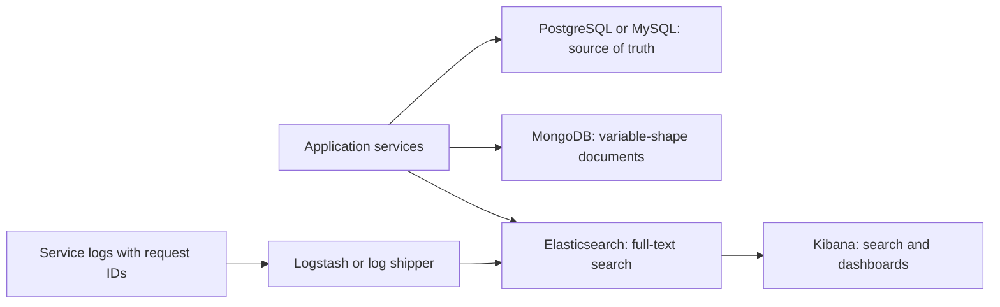

# Masters India and GeeksforGeeks: MongoDB and Elasticsearch

<div class="callout note">
<b>How to use this page</b>
<ul>
<li><b>What it covers:</b> why MongoDB and Elasticsearch appear on the Masters India and GeeksforGeeks tech lines, what each one is, how it works, where I used it, and how to defend the choice against "why not just PostgreSQL or MySQL?".</li>
<li><b>When to read it:</b> when a job asks for NoSQL or search experience, or when an interviewer points at those two words on the resume.</li>
<li><b>What to memorise:</b> the one-line split ("relational database for correctness, Mongo where the document shape varied, Elasticsearch for search and, at Masters, the log plane"), the inverted-index explanation, and the honesty rule about schemas.</li>
</ul>
</div>

**Companion docs:** full project context in [`12_masters_gfg_deep_dive.md`](12_masters_gfg_deep_dive.md) and the speakable packs in [`23c_masters_gfg_interview_packs.md`](23c_masters_gfg_interview_packs.md).

Both technologies were added to the resume's Tech line for these two roles because I worked with them there. They are supporting stores, not the system of record. PostgreSQL (Masters India) and MySQL (GeeksforGeeks) held the transactional truth.

<div class="callout warn">
<b>Honesty rule.</b> The example documents and queries below are <b>illustrative shapes</b> to teach the idea. They are not the real production schemas. If asked which collections or indexes you touched, describe the purpose (payload snapshots, flexible doubt bodies, log search) and do not invent field-level schemas you cannot draw from memory.
</div>

---

## 1. The one-line split (say this first)

"PostgreSQL or MySQL for transactional correctness, MongoDB where the document shape varied, and Elasticsearch for search and, at Masters India, the log plane in ELK."



*What to notice: the relational database is the truth. MongoDB and Elasticsearch each do one job the relational database does poorly. At Masters India, Elasticsearch also receives logs as part of ELK.*

---

## 2. MongoDB in plain English

**What it is.** MongoDB is a document database. Instead of rows in fixed-column tables, it stores **documents**: JSON-like records (stored internally as BSON, a binary form of JSON) grouped into **collections**. Two documents in the same collection can have different fields. Think of a relational table as a spreadsheet where every row must fill the same columns, and a MongoDB collection as a folder of forms where each form can have extra pages.

**The ideas that matter in interviews.**

1. **Flexible schema.** You can store nested objects and arrays directly, and new fields need no migration. That is great for payloads whose shape you do not control, and risky if you need strict consistency across records.
2. **Indexes still matter.** MongoDB scans the whole collection without an index, just like SQL. You create indexes on the fields you query, including compound indexes such as `{client_id: 1, created_at: -1}`.
3. **One document is the unit of atomicity.** An update to a single document is atomic. Multi-document transactions exist in modern MongoDB but cost more. So you model data to keep things that change together in one document.
4. **Replica sets and write concern.** Production MongoDB runs as a replica set (one primary and copies). Write concern (for example `w: "majority"`) controls how many copies must confirm a write before it counts.
5. **Sharding.** MongoDB can split a collection across servers by a shard key. That is a capability, not something I claim to have operated.

### Where I used MongoDB

**Masters India.** MongoDB held **snapshots of flexible, semi-structured payloads** alongside PostgreSQL as the system of record for invoices and returns. The main use was the raw invoice payload as received and the IRP's signed response, whose shapes varied by document type and changed over time. Older notes also mention client config blobs, import job metadata and other non-relational side collections. In the Kafka pipeline, one stage persisted the signed IRP response to a MongoDB snapshot.

An illustrative snapshot document:

```json
{
  "_id": "42:INV-2024-000917",
  "client_id": 42,
  "seller_gstin": "29ABCDE1234F1Z5",
  "request_id": "7f3c9a1e",
  "received_payload": { "doc_type": "INV", "doc_no": "INV-2024-000917", "items": [ "..." ] },
  "irp_response": { "irn": "<64-char hash>", "ack_no": "...", "signed_qr": "..." },
  "created_at": "2024-01-18T10:42:09Z"
}
```

```javascript
// Illustrative index for "show me this client's recent snapshots"
db.irp_snapshots.createIndex({ client_id: 1, created_at: -1 })
```

**GeeksforGeeks.** MongoDB held **flexible documents for community and content shapes** that did not fit cleanly in MySQL, such as doubt bodies and attachments that varied in structure. Older notes also mention dual-write or dual-read paths during the PHP to Django migration. MySQL remained the primary relational store for threads, permissions and votes.

### Why MongoDB there, and the alternatives

**Why.** The payloads were documents by nature. An invoice payload or IRP response is a nested JSON object whose fields differ by document type and change when the government updates its schema. Storing it whole, as received, is simple and preserves an exact audit copy.

**Alternatives and when I'd pick them.**
- **PostgreSQL JSONB.** A JSON column inside PostgreSQL, with indexing. Today I would seriously consider this for Masters India, because it keeps one database to operate and lets you join snapshots to invoice rows. MongoDB wins when document volume is large, the documents are the main access pattern, and you want to scale that store independently.
- **Object storage (S3).** Cheapest for raw blobs you rarely query. The trade-off is that you cannot query inside them easily.
- **Columns in MySQL or PostgreSQL.** Correct and strict, but every shape change needs a migration.

**Trade-off.** Two databases mean two things to back up, monitor and keep consistent. MongoDB is not the place for anything that needs a cross-record transaction or a unique business constraint. That stayed in the relational database.

---

## 3. Elasticsearch in plain English

**What it is.** Elasticsearch is a distributed search engine built on Apache Lucene. You send it JSON documents, and it indexes every word so you can search text fast, rank results by relevance and run aggregations (counts, histograms). Think of it as the index at the back of a book, built automatically for millions of documents at once.

**The ideas that matter in interviews.**

1. **Inverted index.** The core structure. It maps each term to the list of documents that contain it. Searching "kafka timeout" looks up two short lists and intersects them, instead of reading every document.
2. **Analyzers.** Before indexing, text passes through an analyzer that splits it into tokens, lowercases it, and can remove stop words or reduce words to their stem. "Timeouts" and "timeout" can then match. The same analyzer runs on the search query.
3. **Mappings.** The schema of an index. `text` fields are analyzed for full-text search. `keyword` fields are stored exactly, for filters and aggregations such as `request_id` or `client_id`.
4. **Shards and replicas.** An index is split into shards spread across nodes, and each shard can have replicas for availability and read throughput.
5. **Near real time.** New documents become searchable after a short refresh interval (about one second by default), not instantly. It is not a transactional database.
6. **Relevance scoring.** Results are ranked by a scoring formula (BM25 by default) that rewards rare terms and term frequency.

A tiny inverted-index example:

```text
doc 1: "IRP timeout on bulk import"
doc 2: "bulk import finished"
doc 3: "IRP returned duplicate IRN"

term       -> documents
"irp"      -> 1, 3
"timeout"  -> 1
"bulk"     -> 1, 2
"import"   -> 1, 2
"duplicate"-> 3

query "irp bulk" -> docs containing both: 1
```

### What ELK is

**ELK** is Elasticsearch, Logstash and Kibana used together for logs. Services write structured JSON log lines. Logstash (or a lightweight shipper) collects and parses them. Elasticsearch stores and indexes them. Kibana is the screen where you search and build dashboards. It is a searchable library of every log line from every service.

### Where I used Elasticsearch

**Masters India: the log plane, plus invoice search.** Elasticsearch was the "E" in ELK. Every log line was structured JSON with a request ID (a correlation ID), so a single Kibana search showed a request's whole journey through the API, the Kafka consumer and the IRP worker. That is the core of the "incident triage down 70%" bullet, together with New Relic tracing. Older notes also say Elasticsearch powered invoice search.

An illustrative Kibana query (KQL, Kibana Query Language) during an incident:

```text
request_id:"7f3c9a1e"
```

and a broader one:

```text
service:"irp-worker" and level:"ERROR" and event:"irp_timeout" and client_id:42
```

An illustrative log index mapping:

```json
{
  "mappings": {
    "properties": {
      "ts":         { "type": "date" },
      "service":    { "type": "keyword" },
      "level":      { "type": "keyword" },
      "request_id": { "type": "keyword" },
      "client_id":  { "type": "long" },
      "message":    { "type": "text" }
    }
  }
}
```

`request_id` is a `keyword` because you want an exact match, not word splitting.

**GeeksforGeeks: product search.** Elasticsearch powered full-text search and feed retrieval over doubts, posts and content. This is a different use from Masters India's logging, so distinguish them if asked.

An illustrative doubt search:

```json
GET doubts/_search
{
  "query": {
    "bool": {
      "must":   [{ "match": { "body": "segmentation fault in recursion" } }],
      "filter": [{ "term": { "course_id": 118 } }, { "term": { "is_locked": false } }]
    }
  },
  "size": 10
}
```

`match` is analyzed full-text search and is scored for relevance. `term` filters are exact and unscored, which makes them cheap and cacheable.

### Why Elasticsearch there, and the alternatives

**Why at Masters India.** Logs from many services needed one searchable place with fast filtering by request ID, client and error type. ELK is the standard self-managed answer for that, and it pairs with New Relic for traces.

**Why at GeeksforGeeks.** Learners search doubts and content in free text with typos, plurals and partial matches. Relevance ranking and analyzers are what a search engine does well and what `LIKE '%...%'` in MySQL does badly.

**Alternatives and when I'd pick them.**
- **PostgreSQL or MySQL full-text search** (`tsvector` in PostgreSQL, `FULLTEXT` in MySQL). Good enough for small, simple search without another cluster. I'd pick it for a small catalogue.
- **OpenSearch.** The open-source fork of Elasticsearch, offered as a managed service on AWS. It has the same model and is a reasonable choice on AWS.
- **CloudWatch Logs** (for the logging use case on AWS). Less to run, but weaker search and dashboards for heavy incident work.

**Trade-off.** Elasticsearch is not a source of truth. It is near real time, and data in it can be rebuilt from the primary store. It also costs memory and disk, and log retention needs a policy or storage grows forever.

---

## 4. MongoDB vs Elasticsearch vs the relational database

| Question | Relational (PostgreSQL, MySQL) | MongoDB | Elasticsearch |
|---|---|---|---|
| Best at | Transactions, constraints, joins | Variable-shape documents | Full-text search, log search, aggregations |
| Source of truth? | Yes | Sometimes, for its own documents | No, rebuildable |
| Schema | Strict, migrations | Flexible | Mapping per index |
| Where I used it | Masters invoices and job state, GFG threads and votes | Masters payload snapshots, GFG flexible doubt bodies | Masters ELK logs and invoice search, GFG doubt search |

The rule behind the table: keep anything that needs a unique constraint or a transaction in the relational database. That is why idempotency keys at Masters India and the one-vote-per-user rule at GeeksforGeeks lived in PostgreSQL and MySQL, not in MongoDB.

---

## 5. Interview questions with speakable answers

**"Why did you need MongoDB if you had PostgreSQL?"**
PostgreSQL was the system of record for invoices and job state, and MongoDB held the documents whose shape we did not control. The raw invoice payloads and the government's signed responses are nested JSON that varies by document type and changes when the schema changes. Storing them whole in MongoDB gave us an exact audit copy without a migration for every change. Anything that needed a constraint, like the idempotency key, stayed in PostgreSQL. If I built it again today, I would also consider PostgreSQL JSONB to run one fewer database.

**"How does Elasticsearch search so fast?"**
It builds an inverted index, a map from every term to the documents that contain it, much like the index at the back of a book. A query looks up a few short lists and intersects them instead of scanning every document. Analyzers normalise text first, lowercasing it and splitting tokens, so "Timeouts" can match "timeout". Results are then ranked by relevance.

**"Is the Elasticsearch on your Masters line the same as on your GeeksforGeeks line?"**
No, they were different uses. At Masters India it was mainly the log plane in ELK: structured logs with request IDs, searched in Kibana during incidents, which drove the triage improvement. Older notes also say it powered invoice search there. At GeeksforGeeks it was product search over doubts and content for learners.

**"Can Elasticsearch be your primary database?"**
I would not use it that way. It is near real time rather than transactional, it lacks the constraints and transactions you need for business truth, and you should be able to rebuild it from the primary store. We treated it as a derived index in both jobs.

**"How do you index MongoDB?"**
The same way you think about SQL indexes: index the fields you filter and sort on, in query order. For "this client's latest snapshots", a compound index on client ID ascending and created-at descending serves both the filter and the sort. Without an index, MongoDB scans the whole collection.

*Follow-up they may ask:* "Which collections did you design?" Say what they were for (payload and response snapshots at Masters, flexible doubt bodies at GeeksforGeeks), and do not invent field-level schemas.

---

## 6. Say this / don't say this

<div class="callout warn">
<b>Say this</b>
<ul>
<li>"Relational database for correctness, Mongo where the document shape varied, Elasticsearch for search and, at Masters, the log plane."</li>
<li>"At Masters, ELK plus request IDs is what made triage fast."</li>
<li>"At GeeksforGeeks, Elasticsearch was product search, a different use from Masters logging."</li>
</ul>
<b>Don't say this</b>
<ul>
<li>That MongoDB or Elasticsearch was the system of record for invoices or votes.</li>
<li>Detailed collection schemas or cluster sizes you cannot draw from memory.</li>
<li>That you operated MongoDB sharding or large Elasticsearch clusters. Keep it to how you used them.</li>
</ul>
</div>
