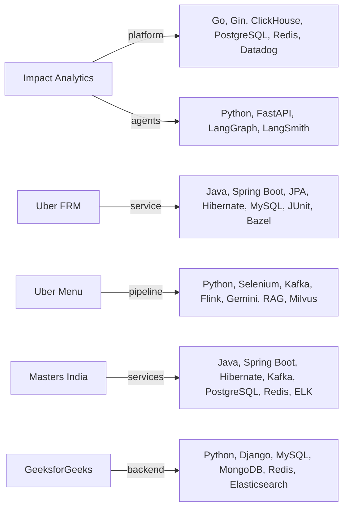

# Tech deep dives: every skill on the Java + Python resume

**PDF:** `Tarun_Mittal_SSE_5yr_Java_AI.pdf` · Summary line: "Expertise in Java and Python microservices"

<div class="callout note">

**How to use this page**

- **What it covers:** every technology on this track's Skills line, in plain English: what it is, where I used it, why it was chosen there, what the alternatives were, and one interview question with a short answer.
- **When to read it:** the night before a technical screen, or when a job description lists a tool and you want to know how honestly you can claim it.
- **What to memorise:** the "where I used it" line for each tech, especially which ones are **skills-level** (literacy, no production claim), and the "what not to say" list at the end.

</div>

**Labels on this page.** **Production** means a resume bullet or tech line backs it. **Skills-level** means I understand it and can discuss it, but I do not claim production ownership. Number tags: MEASURED means a log, document or code. ESTIMATED means arithmetic I can show. HISTORICAL means from my past work records.

For longer entries see the [tech glossary](../handbook/09_tech_glossary.md). For project context see [IA core platform](../handbook/03_ia_core_platform.md), [IA agentic AI](../handbook/04_ia_agentic_ai.md), [Uber FRM](projects/02_uber_frm_scoping.md), [Uber Menu](projects/03_uber_menu_ingestion.md), [Masters India](projects/04_masters_india_gst.md) and [GeeksforGeeks](projects/05_geeksforgeeks_platform.md).

---

## 1. Where each technology lives



*What to notice: Java lives at Uber FRM and Masters India. Go and the Python agent plane live at Impact Analytics, which is never Spring Boot. Kafka appears twice, at Masters and at Menu, and never at Impact Analytics. Flink and Milvus are Menu only.*

---

## 2. Java and the Spring family

### Java

**What it is.** A statically typed language that compiles to bytecode and runs on the JVM (Java Virtual Machine), with automatic garbage collection. Think of it as a strict, well-tooled language where the compiler catches many mistakes before production.

**Ideas that matter in interviews.** The heap and garbage collectors (G1 by default, ZGC for very low pauses). Thread pools through `ExecutorService` with a bounded queue and a rejection policy. `CompletableFuture` for fan-out. Virtual threads (Java 21) for cheap blocking concurrency. `ConcurrentHashMap` instead of `HashMap` across threads. The `equals` and `hashCode` contract.

**Where I used it.** Production: Uber FRM (36 Spring Boot endpoints) and Masters India (Spring Boot microservices). **Why there:** typed services with a mature ecosystem for web, data, security and Kafka. **Alternative:** Python web stacks, which I use at Impact Analytics for agents and used at GeeksforGeeks.

**Q: Why should a thread pool have a bounded queue?** *A:* An unbounded queue hides overload. Requests pile up in memory until latency explodes or the process runs out of memory. A bounded queue with a rejection policy fails fast, so the caller can retry or shed load.

### Spring Boot

**What it is.** A framework on top of Spring that gives you sensible defaults: auto-configuration, "starter" dependency bundles, an embedded web server and health endpoints (Actuator). Like a furnished flat for Java services.

**Ideas that matter.** Dependency injection through constructors. Configuration in `application.yml` with profiles and `@ConfigurationProperties`. `@Transactional` works through a proxy, so calling a transactional method from the same class skips the transaction (the self-invocation trap).

**Where I used it.** Production: Uber FRM and Masters India (PHP monolith to Spring Boot microservices). **Why there:** fast, standard path to REST microservices with JPA, validation and Kafka support built in. **Alternative:** FastAPI or Django in Python, Gin in Go.

**Q: Why might `@Transactional` silently not apply?** *A:* Spring wraps the bean in a proxy. If a method in the same class calls the annotated method directly, the call bypasses the proxy and no transaction starts. Move the method to another bean or call it through the proxy.

### Spring MVC

**What it is.** Spring's web layer for the servlet model, where each request gets a thread. A request flows through filters, then the `DispatcherServlet`, which finds the right `@RestController` method, and Jackson converts JSON to Java objects and back. `@ControllerAdvice` maps exceptions to status codes in one place.

**Where I used it.** Skills-line item. It is the web layer under the FRM controllers (`@GetMapping`, `@PatchMapping`, a 409 for stale versions) and the Masters services. **Why there:** thread-per-request is simple and fits short database calls. **Alternative:** Spring WebFlux (reactive), which pays off when requests wait on slow I/O at very high concurrency.

**Q: MVC or WebFlux for a service that calls a slow government API?** *A:* First move the slow call off the request path, for example into a Kafka consumer, and return 202. Then MVC is fine. That is what we did at Masters. WebFlux is worth its complexity only if requests must wait on slow I/O at high concurrency.

### Spring Security

**What it is.** A chain of servlet filters that authenticates the caller and authorizes the request before your controller runs. For APIs it usually validates a JWT (a signed token carrying who the caller is) and runs statelessly.

```java
@Bean
SecurityFilterChain api(HttpSecurity http) throws Exception {
    http.csrf(csrf -> csrf.disable())
        .sessionManagement(s -> s.sessionCreationPolicy(SessionCreationPolicy.STATELESS))
        .authorizeHttpRequests(a -> a.requestMatchers("/health").permitAll()
                                     .anyRequest().authenticated())
        .oauth2ResourceServer(o -> o.jwt(Customizer.withDefaults()));
    return http.build();
}
```

**Where I used it.** Skills-level. It is where identity handling fits in Java services: at FRM the gateway injects the caller's email header and the service records it on every write, and at Masters there was an auth service among the extracted services. I do not claim a Spring Security outcome. **Alternative:** custom filters, or a gateway that does all auth.

**Q: What do you validate on a JWT?** *A:* The signature, expiry, issuer (`iss`) and audience (`aud`). Then map claims to roles and check them per method with `@PreAuthorize`.

### Spring Data JPA and Hibernate

**What they are.** JPA is Java's standard for mapping rows to objects. Hibernate is the engine that implements it, with a **persistence context** (a per-transaction cache of loaded entities) and **dirty checking** (it writes changed fields at commit). Spring Data JPA generates repositories from interfaces like `JpaRepository<Line, String>`.

**Ideas that matter.** `@Version` for optimistic locking. N+1 queries from lazy loading, fixed with `JOIN FETCH` or `@EntityGraph`. Typed projections into records. Keep "open session in view" off in APIs.

**Where I used it.** Production: Uber FRM (led 3 engineers on the Spring Data JPA and Hibernate migration that removed column-aliasing bugs and reached 100% module statement coverage) and Masters India (Hibernate on the tech line, where N+1 fixes helped the p95 drop). **Why there:** `@Version`, `@Transactional` and typed projections gave correctness by default. **Alternative:** jOOQ or MyBatis for SQL-first teams, or plain JDBC.

**Q: How do you find and fix N+1?** *A:* Turn on SQL logging or watch query counts in APM. If a list of 50 invoices fires 51 queries, fetch the children in one go with `JOIN FETCH`, `@EntityGraph` or a batch size.

### Spring Batch

**What it is.** A framework for chunked batch jobs. A **Job** has **Steps**, and a chunk step reads N items, processes them, writes them, and commits, with a job repository that remembers progress so a failed job restarts from the last committed chunk.

```java
@Bean
Step validateInvoices(JobRepository repo, PlatformTransactionManager tx,
                      ItemReader<InvoiceRow> reader,
                      ItemProcessor<InvoiceRow, Invoice> validator,
                      ItemWriter<Invoice> writer) {
    return new StepBuilder("validateInvoices", repo)
            .<InvoiceRow, Invoice>chunk(500, tx)
            .reader(reader).processor(validator).writer(writer)
            .faultTolerant().skip(ValidationException.class).skipLimit(100)
            .build();
}
```

*Chunk size and skip limit are illustrative.* **Where I used it.** Skills-level. It fits the chunked bulk-import validation at Masters India. I do not claim a Spring Batch outcome. **Alternative:** Kafka consumers for stage-to-stage events, which is what the Masters pipeline is built on.

**Q: Spring Batch or Kafka?** *A:* Spring Batch for a bounded file with restart-from-chunk semantics. Kafka when several consumers need a durable, replayable stream.

### Maven

**What it is.** Java's standard build tool. A `pom.xml` declares dependencies and plugins, and the Spring Boot parent pins compatible versions.

**Where I used it.** Skills-level. The FRM build was Bazel because Uber uses a monorepo, so I do not claim Maven on FRM. **Alternative:** Gradle (faster incremental builds), Bazel (monorepos).

**Q: Why use the Spring Boot parent or BOM?** *A:* It pins versions of dozens of libraries that are tested together, so you avoid dependency conflicts.

### JUnit (with Mockito and MockMvc)

**What it is.** JUnit 5 is Java's test framework. Mockito creates fake collaborators. MockMvc calls controllers without a real server. Slice tests (`@WebMvcTest`, `@DataJpaTest`) load only part of the app.

**Where I used it.** Production: Uber FRM (JUnit on the tech line, 100% module statement coverage, 1,100+ tests is verbal depth) and Masters India (coverage from 35% to 82%, 98% deployment success). **Why there:** layer-by-layer tests with mocks need no database and run fast in CI. **Alternative:** integration tests only, with Testcontainers for real databases, which are slower but closer to production.

**Q: What does 100% statement coverage not prove?** *A:* That the assertions are meaningful or that every branch combination was tested. It proves every line ran at least once.

---

## 3. Python, Go and API styles

| Tech | What it is | Where I used it | Alternative |
|---|---|---|---|
| Python | General-purpose language with strong AI and web libraries | Production: IA agent plane, Uber Menu, GeeksforGeeks | Java, Go |
| Go | Compiled language with cheap goroutines and simple deployment | Production: IA platform APIs, formula parser, the ClickHouse data pump | Java |
| Gin | Fast, minimal Go HTTP framework | Production: IA multi-tenant platform at 10k peak RPS with Google Wire, h2c, nested timeouts | Echo, net/http only |
| FastAPI | Async Python web framework built on Pydantic | Production: IA agent plane | Flask, Django |
| Pydantic | Data validation from Python type hints | Comes with FastAPI on the IA agent plane. No bullet is about it | dataclasses plus hand checks |
| asyncio | Python's event loop for concurrent I/O | How IA LLM batches run concurrently | Threads |
| Celery | Python background task queue | Skills-level on this track. No bullet relies on it | Kafka consumers, cron |
| Django | Batteries-included Python framework | Production: GeeksforGeeks PHP to Django migration | Flask, FastAPI |
| REST | Resource URLs plus HTTP verbs | Every project | gRPC, GraphQL |
| gRPC | Binary RPC over HTTP/2 with generated clients | Skills-level | REST |
| SQL | The language of relational and analytical databases | Every project. IA's parser emits parameterized ClickHouse SQL | ORMs only |
| C, C++ | Low-level systems languages | Skills-level, competitive programming (Code Jam 2021 qualifier) | None |

**Go: why Go for the IA platform?** Goroutines handle thousands of concurrent requests cheaply, a single static binary deploys easily, and **Google Wire** wires dependencies at compile time, so a missing dependency fails the build instead of production. **h2c** is HTTP/2 without TLS, used because the edge runs with no reverse proxy in front.

**One question each.**

- **Python. Q:** What is the GIL and when does it matter? **A:** A lock that lets one thread run Python bytecode at a time. It hurts CPU-bound threads, not I/O-bound work, so for LLM calls async I/O works well.
- **Go. Q:** How do you stop a goroutine leak? **A:** Pass a `context.Context` with a deadline and have every goroutine return when it is cancelled.
- **Gin. Q:** What are nested timeouts? **A:** An outer request deadline with tighter deadlines for each downstream call inside it, so one slow dependency cannot use the whole budget.
- **FastAPI. Q:** What happens if you call blocking code in an async endpoint? **A:** It blocks the event loop for every request. Use async libraries or run it in a thread pool.
- **Pydantic. Q:** Why validate LLM output with a schema? **A:** Models sometimes return malformed or extra fields. A schema rejects them before they reach storage.
- **asyncio. Q:** How do you cap concurrent LLM calls? **A:** An `asyncio.Semaphore` around each call, plus a timeout.
- **Celery. Q:** Celery or Kafka? **A:** Celery for fire-and-forget tasks. Kafka when you need ordering, replay and many independent readers.
- **Django. Q:** Why Django at GFG? **A:** Admin, auth, ORM and migrations out of the box for a content product.
- **REST. Q:** Is PATCH idempotent? **A:** Not by definition, but you can make it so with a version check or by setting absolute values.
- **gRPC. Q:** When pick gRPC over REST? **A:** Internal service-to-service calls that need strict contracts, streaming or low overhead.
- **SQL. Q:** How do you stop SQL injection? **A:** Bound parameters and allowlists, never string concatenation.
- **C, C++. Q:** Stack vs heap? **A:** Stack is automatic, fast and scoped to a function. Heap is manual or garbage-collected and lives until freed.

---

## 4. Generative AI

| Tech | What it is | Where I used it |
|---|---|---|
| LangGraph | Framework for LLM workflows as graphs with state and loops | Production: IA "Ask Iris", a LangGraph supervisor with a 3-attempt evaluator loop |
| LangChain | Library for chaining loaders, retrievers, prompts and parsers | Production: Uber Menu RAG. LangChain Academy certificate |
| RAG | Retrieve examples or facts, then generate | Production: Uber Menu, 98% field fidelity in offline evaluation |
| Milvus | Open-source vector database | Production: Uber Menu only |
| pgvector | Vector search inside PostgreSQL | Skills-level |
| LLM agents (OpenAI, Gemini, Claude) | Programs where an LLM decides or scores within guardrails | Production: IA 7 AI lenses and Ask Iris, Menu Gemini 2.5 Pro |
| Tool calling | The model asks the app to run a named function with JSON arguments | Skills-level. IA tool design is verbal depth only |
| MCP | Model Context Protocol, a standard way to expose tools to models | Skills-level |
| Prompt engineering | Designing instructions, examples and output formats | IA lenses, Menu few-shot examples |
| LangSmith | Tracing and debugging for LangChain and LangGraph runs | Production: Ask Iris only |
| Offline evaluation | Scoring a system on a fixed labelled set before release | Production: IA 300-case harness and 80% CI gate, Menu 98% |

**Key facts to keep straight.** Keep/Drop scores **348k article-seasons**, 88k items per pass, blending deterministic KPI math with structured LLM calls across 7 lenses. The LLM never queries the database. Context arrives as JSON from a 2.11B-row ClickHouse master. Keep/Drop has no LLM orchestrator, its order is fixed in code. The **80%** is a CI promotion gate on the 300-case harness. The **73%** lower live cost at 100% coverage and the **74%** deterministic baseline come from a separate gold-200 benchmark. Do not fuse them.

**One question each.**

- **LangGraph. Q:** How do you stop an agent looping forever? **A:** A hard cap. Ask Iris has a 3-attempt evaluator loop, then it returns the best answer or a clear failure.
- **LangChain. Q:** What does it add over raw API calls? **A:** Reusable pieces for loading, splitting, retrieving and parsing, so the pipeline is easy to rearrange.
- **RAG. Q:** RAG or fine-tuning for menus? **A:** RAG. A newly labelled menu helps the next extraction immediately, with no retraining when the schema changes.
- **Milvus. Q:** What does a vector index trade off? **A:** Approximate nearest-neighbour search gives speed in exchange for occasionally missing the exact best match.
- **pgvector. Q:** When is pgvector enough? **A:** When vectors fit comfortably in one PostgreSQL instance and you want them next to relational data.
- **LLM agents. Q:** What if the model times out? **A:** Fall back to the deterministic baseline score, which is what Keep/Drop does.
- **Tool calling. Q:** Why does Keep/Drop give the LLM no SQL tool? **A:** Safety and cost. Context is prepared as JSON, so the model cannot run arbitrary queries on a 2.11B-row table.
- **MCP. Q:** How does MCP relate to tool calling? **A:** Tool calling is the model asking for a function. MCP standardises how tools are described and served so any client can use them.
- **Prompt engineering. Q:** How do you get reliable JSON? **A:** Give the schema, show examples, ask for JSON only, then validate and reject failures.
- **LangSmith. Q:** What do you look at in a trace? **A:** Each node's inputs and outputs, tokens, latency and where retries happened.
- **Offline evaluation. Q:** What did you do when the LLM lost to the baseline? **A:** The blended score was about 63% against a 74% deterministic baseline, so we froze the blend weights instead of retuning to chase the benchmark.

---

## 5. Data and streaming

| Tech | What it is | Where I used it | Alternative |
|---|---|---|---|
| Apache Kafka | Durable, partitioned, replayable message log | Production: Masters India (Spring Kafka consumers), Uber Menu (Python pipeline). Not IA | RabbitMQ, SQS |
| Apache Flink | Stateful stream processor with event time | Production: Uber Menu only | Kafka Streams |
| ClickHouse | Columnar analytics database | Production: IA 2.11B-row master, six rollup tables, cross-cluster copy | BigQuery, Druid, Pinot |
| BigQuery | Google's serverless data warehouse | On the IA tech line as the upstream warehouse. Keep claims qualitative | ClickHouse |
| ETL pipelines | Extract, transform, load jobs | IA rollup builds, Masters bulk imports, Menu ingestion. FRM consumes a shared ETL | Ad hoc scripts |

**ClickHouse facts to keep straight.** Planner pivots went from 189 seconds to 12 seconds (15.5×) on a 250M-row harness through six pre-aggregated MergeTree rollups. Separately, weekly rollup builds hit a 170GB out-of-memory failure, fixed by inserting one fiscal week at a time with memory and disk-spill caps. 15.5× is query time and 170GB is load time. They are not cause and effect. The cross-cluster migration ran at about **344k rows per second** (ingest rate, not requests per second) with a custom Go native-TLS pump, partitions up to 4.09B rows (measured in flight, not a finished cutover). Rollback meant `DROP PARTITION` then recopy, not an atomic swap. **ReplacingMergeTree** keeps only the newest version of rows with the same key, eventually, like a notebook where you write new values below and a cleaner later crosses out old lines.

**One question each.**

- **Kafka. Q:** How do you keep one customer's events in order? **A:** Use the customer ID as the message key, so all their events land on one partition. Masters used the GSTIN, Menu used `vendor_id`.
- **Spring Kafka (Masters). Q:** When do you commit offsets? **A:** After processing succeeds. Committing first can lose work on a crash. Committing after can duplicate it, so processing must be idempotent.
- **Flink. Q:** What is a watermark? **A:** Flink's estimate that all events up to time T have arrived, so it can finish a window while tolerating bounded lateness.
- **ClickHouse. Q:** Why not just add indexes in PostgreSQL? **A:** Pivots scan and aggregate hundreds of millions of rows. Columnar storage reads only the needed columns, compressed, and rollups pre-compute the common shapes.
- **BigQuery. Q:** Why not serve pivots from BigQuery? **A:** Interactive, repeated pivots need predictable latency and no per-scan cost, which pre-aggregated ClickHouse rollups gave us.
- **ETL. Q:** How do you make a load safe to re-run? **A:** Deterministic keys, checkpoint or ledger files, and partition-level replace or drop-and-recopy.

---

## 6. Databases and storage

| Tech | What it is | Where I used it |
|---|---|---|
| PostgreSQL | Relational database with strong transactions | Production: IA metadata, UAM and roles, Masters India sharded by tax quarter |
| MySQL | Popular relational database | Production: Uber FRM on SOADB (8-table schema), GeeksforGeeks |
| Redis | In-memory key-value store | Production: IA auth front, Masters cache-aside (30% fewer reads), GFG counters |
| MongoDB | Document database for varying JSON shapes | Production: Masters signed IRP responses, GFG doubt bodies |
| Elasticsearch | Search engine over an inverted index | Production: Masters (ELK logs), GFG search |
| DynamoDB | AWS managed key-value and document store | Skills-level |
| Amazon S3 | AWS object storage | Masters ran on AWS and my design notes put bulk upload files in S3. No bullet names it |

**One question each.**

- **PostgreSQL. Q:** App-routed quarter shards or native partitioning? **A:** Today I would start with native range partitioning. It gives pruning and clean detach with less custom code.
- **MySQL. Q:** How does optimistic locking work? **A:** A version column in the WHERE clause. Zero rows updated means someone else saved first.
- **Redis. Q:** How do you prevent a cache stampede? **A:** TTL jitter so keys do not expire together, plus a short `SET NX` lock so only one worker rebuilds a hot key.
- **MongoDB. Q:** Why not put signed responses in PostgreSQL? **A:** Their shape varies and they are stored for audits, so a document store avoids constant schema changes.
- **Elasticsearch. Q:** Why is it fast for text search? **A:** An inverted index maps each word to the documents containing it, like a textbook's back index.
- **DynamoDB. Q:** What drives DynamoDB design? **A:** Access patterns first. You choose partition and sort keys for the queries you will run.
- **Amazon S3. Q:** Why land uploads in object storage first? **A:** The upload returns fast, and the file stays available for retries and replays.

---

## 7. Cloud and DevOps

| Tech | Where I used it |
|---|---|
| GCP | Production: Impact Analytics, Uber Menu |
| AWS | Production: Masters India. Only name services you actually touched |
| Docker | Production: IA, FRM, Menu, Masters |
| Kubernetes | Skills-level. No cluster operations claim |
| Maven | Skills-level. See section 2 |
| Bazel | Production: Uber FRM stacked PRs with per-layer test targets |
| CI/CD | Masters coverage gate and 98% deploys, IA 80% eval gate, FRM Bazel merge gates |
| Datadog | Production: IA Go/Gin distributed tracing |
| ELK | Production: Masters, structured JSON logs with request IDs |
| New Relic | Production: Masters, per-request timing. Triage about 70% faster with ELK |

**One question each.**

- **GCP. Q:** Which services did you use? **A:** I name only what I touched, and keep the rest general.
- **AWS. Q:** Same question. **A:** Same rule. Masters ran on AWS, and I do not invent a service list.
- **Docker. Q:** Why containers? **A:** The same image runs on a laptop, in CI and in production.
- **Kubernetes. Q:** Have you run clusters? **A:** No. I understand deployments, services and autoscaling, but I do not claim operating clusters.
- **Bazel. Q:** Why stacked PRs? **A:** Small additive changes are reviewable and each can deploy alone, which gave zero-downtime releases.
- **CI/CD. Q:** What should block a merge? **A:** Failing tests, a coverage drop, and for AI changes an evaluation score under the gate.
- **Datadog, ELK, New Relic. Q:** How does tracing cut triage time? **A:** One request ID joins logs and spans across services, so finding the cause is one search instead of grepping several boxes.

---

## 8. Architecture and core concepts

| Concept | Where it shows on the resume |
|---|---|
| Distributed systems, microservices | Masters PHP to Spring Boot migration, IA platform plus agent plane |
| System design (HLD and LLD) | Every project. FRM layering is a clean LLD example |
| Data structures and algorithms | Code Jam 2021 qualifier, HackerRank certificate, IA formula tokenizer and parser |
| Caching | Masters Redis cache-aside, GFG counters, IA Redis-fronted auth |
| Reliability | Masters DLQ and bounded retries, IA circuit breakers, timeouts and fallbacks |
| Multithreading, concurrency | FRM optimistic locking, Masters bounded consumers, Go goroutines at IA |
| Database sharding | Masters PostgreSQL by tax quarter |
| Idempotency | Masters `client + fileHash + batchIndex`, FRM SHA-256 natural keys, Menu upserts, GFG unique votes |

---

## 9. Cross-cutting interview questions

**"Why do you use three languages?"**  
Each fits its job. Java with Spring Boot for transactional business services at Uber FRM and Masters India, Go for the high-concurrency platform edge at Impact Analytics, and Python wherever AI and data libraries matter, the IA agent plane and the Uber Menu pipeline. I pick by the problem and the team's standard, not by habit.

**"Kafka at Masters and Kafka at Menu. Same thing?"**  
Same technology, different products. At Masters, Spring Boot consumers carried e-invoice stages keyed by GSTIN with dead-letter topics. At Menu, Kafka fed an Apache Flink job keyed by vendor. Flink was only at Menu.

**"What does exactly-once mean in your systems?"**  
At-least-once delivery plus idempotent writes, which gives an exactly-once effect. At Masters the key was client plus file hash plus batch index. At Menu the upsert was keyed by vendor, menu version and item key. I never claim zero message loss.

**"Hibernate or plain SQL?"**  
Hibernate with typed projections for transactional services, because `@Version` and `@Transactional` give correctness by default. Explicit SQL for heavy reporting or analytics. At FRM, moving untyped native queries to typed projections is what removed the column-aliasing bug.

**"How do you decide between PostgreSQL and ClickHouse?"**  
PostgreSQL for many small transactional reads and writes, ClickHouse for large scans and aggregations. At Impact Analytics, POCs showed ClickHouse winning large analytical reads, so planning facts moved there and PostgreSQL kept thin metadata, access control and roles.

**"Which items on your Skills line are not production claims?"**  
C and C++, pgvector, DynamoDB, Kubernetes, gRPC, MCP, tool calling, Celery on this track, Maven, Spring Security and Spring Batch. I can discuss each one and I am clear that they are skills-level.

---

## 10. What not to say

<div class="callout warn">

- Spring Boot or Hibernate at Impact Analytics. IA platform APIs are **Go/Gin** and agents are **Python**.
- Kafka, Flink, CDC, Milvus or Kubernetes operations at Impact Analytics.
- LangSmith on the Keep/Drop batch. LangSmith is Ask Iris only.
- "80% accuracy live for all tenants". It is a CI gate on the 300-case harness.
- 344k as requests per second. It is rows per second.
- 15.5× as caused by the 170GB OOM fix. One is query time, the other is load time.
- Spark or Pinot as resume claims. Neither is on the PDF. Older versions of this page listed Spark backfill and Pinot numbers, and those are study-only.
- Spring Boot at GeeksforGeeks. It is Django.
- Celery at Masters on this track. Background work is Kafka consumers, `@Async` and scheduled jobs.
- Maven on Uber FRM. The FRM build is Bazel.
- Production claims for any skills-level item listed in section 9.

</div>
