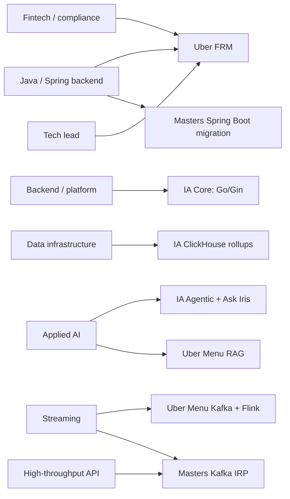

# Role targeting + rapid-fire (Java + Python track)

<b>How to use this page</b>
<ul>
<li>Part 1 tells you which project story to lead with for each kind of job, and why. Read it while you tailor an application or before a recruiter call.</li>
<li>Part 2 is rapid-fire: the tricky one-line questions where a careless answer over-claims. Read it the night before any screen.</li>
<li>Memorise the 15-second lead for your target role and the first sentence of every rapid-fire answer.</li>
</ul>

Use this page when applying with this track's PDF, `final_java_ai/artifacts/Tarun_Mittal_SSE_5yr_Java_AI.pdf` (summary line: "Expertise in Java and Python microservices"). On this track, Uber FRM is Java and Spring Boot with Spring Data JPA and Hibernate, Masters India is Spring Boot microservices, and Impact Analytics platform APIs are Go/Gin with a Python agent plane.

**Which roles this track suits.** Send this PDF to JVM and Spring-heavy backend roles, where the Uber FRM and Masters India work in Java is the direct match. It also works for AI and data roles, because the Impact Analytics Go platform, ClickHouse work and Python agents are the same on every track.

**Tags used here.** MEASURED means there is a log, document or code behind the number. TARGET means a design goal, so say "targeting". ESTIMATED means arithmetic I can show. HISTORICAL means from my past work records.

---

## Part 1. Which story fits which role

### The idea in plain English

Recruiters skim. In the first 15 seconds of a call they decide whether you "are" the role they are hiring for. You have six projects, and each one proves something different. So the trick is not to tell all six. Lead with the one project whose problem looks most like their problem, back it with one more, and keep the rest for follow-ups.

A good fit has three parts. The **problem shape** matches (for example, "make analytics queries fast" or "make a pipeline never double-process"). The **stack** overlaps with their job post. And the **seniority signal** matches, such as leading people, owning design, or setting quality gates.

### Role families at a glance

| Role family | Lead story | Back-up story | Keywords to mirror from the job post |
|---|---|---|---|
| Java / Spring backend engineer (JVM-heavy) | Uber FRM: 36 Spring Boot endpoints, Spring Data JPA / Hibernate migration | Masters India PHP to Spring Boot migration | Java, Spring Boot, Spring Data JPA, Hibernate, JUnit, microservices, REST |
| Backend / platform engineer (Go or Python) | IA Core: Go/Gin platform at 10k peak RPS | Masters India PHP to Spring Boot migration | microservices, Go, Gin, REST, reliability, tracing |
| Data infrastructure / analytics engineer | IA ClickHouse rollups (189s to 12s), 170GB OOM fix, Go copy pump | Uber Menu Kafka + Flink | ClickHouse, OLAP, ETL, BigQuery, partitioning, pre-aggregation |
| Applied AI / GenAI / LLM engineer | IA Agentic: Keep/Drop engine, Ask Iris, 80% CI gate | Uber Menu RAG (Gemini, LangChain, Milvus) | LangGraph, RAG, agents, evaluation, guardrails, LangSmith |
| Streaming / event pipeline engineer | Uber Menu Kafka + Flink, keyed dedupe, exactly-once upserts | Masters India Kafka IRP pipeline, 1M+/day | Kafka, Flink, idempotency, dead-letter queues, backpressure |
| Fintech / compliance / correctness-heavy backend | Uber FRM: 14 days to 3 days, $340M materiality, SOX gates | Masters India GST e-invoicing; ANZ compliance | audit trail, SOX, reconciliation, optimistic locking, data integrity |
| High-throughput API / distributed systems | Masters India: 1M+/day, p95 from 1.2s to 300ms | IA Go/Gin 10k peak RPS | latency, throughput, sharding, caching, idempotency |
| Senior / tech-lead track | Uber FRM: led 3 engineers on the Spring Data JPA / Hibernate migration | Masters India: mentored 2 engineers | ownership, design reviews, mentoring, quality gates |
| Product-minded / consumer platform | GeeksforGeeks Django migration and influencer dashboard | Uber Menu onboarding time | user-facing features, growth, dashboards, traffic spikes |

### Why each pairing works

**Java and Spring backend roles lead with Uber FRM.** It is the clearest proof that I own a Spring Boot service end to end. The scoping backend has 36 Spring Boot endpoints, an 8-table MySQL schema mapped with Spring Data JPA and Hibernate, optimistic locking through a `@Version` field, and atomic cross-table syncs in one `@Transactional` method. I led 3 engineers on the Spring Data JPA / Hibernate migration that removed latent column-aliasing bugs and raised module coverage to 100% with JUnit. Masters India backs it up with a second Java story: a PHP monolith moved to Spring Boot microservices, with p95 latency from 1.2 seconds to 300 milliseconds.

**Backend / platform roles lead with Impact Analytics Core.** It is my current work and the most direct proof of platform ownership. The Go/Gin service handles 10k peak RPS, uses Google Wire (a tool that wires up dependencies at compile time, so a missing dependency is a build error rather than a crash at startup), and protects itself without a reverse proxy, using nested timeouts and Datadog tracing. Masters India backs it up with a classic migration story, from a PHP monolith to Spring Boot microservices, with a measurable latency win.

**Data infrastructure roles lead with ClickHouse.** ClickHouse is a column-oriented analytics database. It stores each column separately, so a query that sums one column over millions of rows reads only that column. My story has a query-time win (planner pivots from 189 seconds to 12 seconds through six rollup tables), a load-time fix (the 170GB out-of-memory failure solved by inserting one fiscal week at a time with memory and spill caps) and a data-movement tool (a Go pump copying about 344k rows per second between clusters). Uber Menu's Kafka and Flink pipeline adds the streaming side.

**Applied AI roles lead with Impact Analytics Agentic.** Most AI candidates can describe a demo. My story shows production discipline: the LLM never touches the database, every output row carries a config_hash (a fingerprint of the exact prompts and settings that produced it), a timeout falls back to a deterministic score, and nothing is promoted without passing an 80% CI gate. Uber Menu then shows RAG on real documents with a measured 98% offline field fidelity.

**Streaming roles lead with Uber Menu.** Kafka is a durable message log that many services can read at their own pace. Flink is a stream processor that keeps state per key, for example "the last content hash I saw for this vendor". Together they gave keyed deduplication and idempotent catalog upserts. Masters India is the second Kafka story, in a different product, with dead-letter queues and retries against a flaky government portal.

**Fintech and compliance roles lead with Uber FRM.** The problem is correctness under audit, not speed. The story covers moving 19M general ledger rows off Google Sheets, an 8-table normalized MySQL schema, optimistic locking (each row carries a version number, and an update succeeds only if the version has not changed since you read it), SHA-256 natural keys to stop duplicates, and finite-state-machine gates with 50% delta-variance checks for SOX (the US Sarbanes-Oxley law on financial controls). Masters India's GST work and the ANZ compliance automation reinforce it.

**High-throughput roles lead with Masters India.** It has the cleanest traffic numbers: 1M+ government submissions a day, 1,500+ clients, p95 latency from 1.2 seconds to 300 milliseconds, and throughput from 700 to 4,000 requests per minute. p95 latency is the response time that 95% of requests beat, so it reflects what slow users actually feel.

**Senior and tech-lead roles lead with leadership facts, kept separate.** I led 3 engineers on the Uber FRM Spring Data JPA / Hibernate migration as tech lead of an EPAM pod, not as a people manager. At Masters India I mentored 2 engineers. Never merge these into "led 5".

**Product-minded roles can open with GeeksforGeeks.** It shows user-facing features (voting, pinning and locking doubt threads), handling 10x traffic spikes during live contests, and an influencer earnings dashboard tied to a 30% course sales lift that the business team attributed.

### Role-to-story map

The diagram is a quick visual of the table. Notice that Impact Analytics serves three role families, which is why it is usually your opener, and that Uber FRM is the opener for Java and Spring roles.

### 15-second leads by role

Say these as written. Each is built only from PDF facts.

- **Java / Spring backend.** "I'm a senior backend engineer with five years in Java, Python and Go. At Uber via EPAM I owned a Spring Boot finance scoping backend with 36 endpoints that cut quarterly reconciliation from 14 days to 3 days, and I led 3 engineers on its Spring Data JPA / Hibernate migration. At Masters India I moved a PHP monolith to Spring Boot microservices and took p95 latency from 1.2 seconds to 300 milliseconds."
- **Platform / backend.** "I'm a senior backend engineer with five years in Java, Python and Go. Right now I own a multi-tenant Go/Gin platform at Impact Analytics that peaks at 10k requests per second, and I cut planner pivots from 189 seconds to 12 seconds with ClickHouse rollups."
- **Applied AI.** "I build production AI systems with guardrails. At Impact Analytics I built an AI decision engine that scores 348k article-seasons and shipped Ask Iris, a LangGraph copilot, behind a 300-case evaluation harness and an 80% CI gate. Before that I built RAG-based menu extraction at Uber Eats."
- **Data infrastructure.** "I make large analytical data fast and safe to move. I built ClickHouse rollups that took pivots from 189 seconds to 12 seconds, fixed a 170GB out-of-memory failure in weekly builds, and wrote a Go pump that copied about 344k rows per second between clusters."
- **Streaming.** "I've built two Kafka pipelines: Uber Eats menu ingestion with Flink, keyed dedupe and exactly-once upserts, and a GST e-invoicing pipeline at Masters India handling over a million government submissions a day."
- **Fintech / compliance.** "At Uber via EPAM I owned the Finance risk scoping backend that cut quarterly reconciliation from 14 days to 3 days against a $340M materiality threshold, with SOX gates and an audit-safe MySQL schema."

<b>Older prep had a different Impact Analytics lead. Do not use it.</b>
It quoted "20-100 configs vs 1", "under 1 hour", "63/8" tables, "12B store-week (100-450x)" and PostHog / OpenTelemetry. Those are verbal Cluster Copilot depth or not part of the current resume at all. The leads above use only PDF numbers.

---

## Part 2. Rapid-fire: tricky questions and safe answers

Each answer starts with the direct answer. Keep it to two or three sentences unless they push.

### Numbers that are easy to over-claim

**"So your agent is 80% accurate in production?"**
No. 80% is the CI promotion gate: a change to the agent is blocked unless it scores at least 80% on our 300-case evaluation harness. It is how we refuse a bad agent, not a claim that every tenant runs at 80% live.
*Follow-up they may ask:* "Then what is the 73%?" That is a cost cut. On a separate 200-case benchmark, switching models cut live execution cost by 73% while still completing all 200 cases. The deterministic baseline scored 74% on that same benchmark.

**"Did the LLM beat the deterministic baseline?"**
Not on the blend. On the 200-case benchmark the blended LLM score came in around 63%, below the 74% deterministic baseline. So we froze the blend weights instead of retuning them until the numbers looked good. I think that is the honest way to run an AI system.

**"Did the ClickHouse rollups also fix the out-of-memory problem?"**
No, those are two separate wins. The 15.5x speedup, from 189 seconds to 12 seconds, is query time for planner pivots. The 170GB out-of-memory failure was load time, when building weekly rollups, and I fixed it by inserting one fiscal week at a time with memory and disk-spill caps.

**"344k requests per second?"**
No, 344k is rows per second, a data copy rate. It was the combined rate of two season streams when my Go pump copied rollups between ClickHouse Cloud clusters. API traffic is a separate number: 10k peak RPS on the Go/Gin platform.

**"Did the 4.09B-row migration finish?"**
Say this carefully. The 4.09B-row partition set was measured while the copy was in flight. I do not claim the cutover finished. What I can describe is how restarts were made safe: checkpoint files, a ledger of completed weeks, and rollback by dropping a partition and recopying that season.

**"Is the partition rollback an atomic swap?"**
No. It is DROP PARTITION followed by a recopy of that season. It is not a live swap that readers never notice. I also wrote an incremental design using REPLACE PARTITION, which would allow a swap, but that design was written, not executed.

**"Is the 70% reconciliation cut real?"**
Yes. The platform cut quarterly reconciliation from 14 days to 3 days for the close. If they press on how it was measured, say the technical design doc framed that cut and that is what the platform delivered. Do not walk it back unprompted.

**"Thirty-six endpoints? What are they?"**
About 31 functional routes in the scoping service controllers, plus the collaboration-service APIs for comments and notifications described in the technical design doc. Together that makes 36. I did not build the collaboration service itself.

**"Nineteen million rows sounds big. Was this big data?"**
No, and I don't pitch it that way. 19M is the count of raw general ledger rows migrated off Sheets. Individual quarterly extracts were smaller, roughly 38K to 95K rows. The value was correctness, the four-level hierarchy and auditability, not raw throughput.

**"A million submissions a day. What's that per second?"**
About 12 per second on average, because 1,000,000 divided by 86,400 seconds is roughly 11.6. Peaks around tax filing deadlines were roughly 8 to 10 times higher, which is an estimate. That is why the pipeline had queues, idempotency and dead-letter handling.

**"700 to 4,000 requests per minute. In RPS?"**
Roughly 12 to 67 requests per second. The latency win, p95 from 1.2 seconds to 300 milliseconds, came from non-blocking calls to the government portal (Spring WebClient and bounded thread pools), HikariCP connection pooling, query and index fixes, and a Redis read cache.

**"How did you get $600K?"**
About $2 per menu of manual and third-party cost, times 30K menus a month, times 12 months, is $720K. I round down to $600K to be conservative. The 98% is field fidelity on an offline evaluation set, not live production accuracy.

### Wording traps

**"Your resume says lock contention. What locks?"**
That is Uber FRM. During financial close, the ETL loads were running into lock contention on the old data model. I fixed it with an 8-table normalized MySQL schema on SOADB (Uber's standard for service-owned MySQL), optimistic row-locking with a version check on update, and one-transaction cross-table syncs. On Impact Analytics the related idea is different: ReplacingMergeTree writes are insert-only, so there are no row locks or ClickHouse mutations to contend on, and reads resolve the newest version.

**"BigQuery is on your skills. What did you do with it?"**
BigQuery is on the Impact Analytics tech line as an upstream historical data source that feeds ClickHouse. I don't claim BigQuery warehouse optimisation as my work. If they want depth, steer to ClickHouse, where my measured work is.

**"Is Kafka part of Impact Analytics?"**
No. Kafka on my resume is Uber Eats Menu (with Flink) and Masters India (the IRP pipeline). Impact Analytics uses Go/Gin, ClickHouse, PostgreSQL, Redis and Python for the AI layer. The Postgres-to-ClickHouse CDC pipeline there was a colleague's work.

**"Did you run the Kubernetes cluster?"**
No. Kubernetes is on my skills line as working literacy. I don't claim cluster operations. The same goes for Terraform, Spark and multi-region setups: study-level only.

**"Are you an Uber employee?"**
I worked on Uber projects through EPAM Systems, from July 2024 to May 2026. Always say "Uber via EPAM".

**"How many people did you lead?"**
Two separate facts. I led 3 engineers on the Uber FRM Spring Data JPA / Hibernate migration as tech lead of an EPAM pod, not as their manager. At Masters India I mentored 2 engineers during the Spring Boot migration.

**"What's your FRM stack on this resume?"**
Java, Spring Boot, Spring Data JPA, Hibernate, MySQL, JUnit, Bazel and Docker. The ORM migration was to Spring Data JPA / Hibernate, and it removed latent column-aliasing bugs, where duplicate column names in joined SQL silently mapped rows to the wrong ID.

**"Is Ask Iris used by every customer? What's its SLA?"**
Ask Iris is a shipped capability: a JWT-secured WebSocket copilot planners use to query KPIs and inspect AI decisions. I don't quote usage numbers or an SLA, because I don't have ones I can defend.

**"Do you use human review queues in the AI pipeline?"**
Not on Impact Analytics. In Keep/Drop, offline evaluations replaced critic and evaluator agents, and the batch runs a fixed step order with no LLM orchestrator. The evaluator loop I talk about is in Ask Iris, capped at 3 attempts.

**"Have you used MCP or Milvus at Impact Analytics?"**
No. MCP and tool calling are skills-level for me. I can talk through a tool design for a clustering copilot, but that is verbal design depth, not a resume bullet. Milvus was Uber Eats Menu only.

**"Why are MongoDB and Elasticsearch on your skills?"**
They come from Masters India and GeeksforGeeks, where both are on the tech lines. gRPC, pgvector, DynamoDB, C and C++ are literacy-level. Cassandra, DuckDB and Rust are not on this resume because I can't point to a bullet that uses them in production.

**"Under one hour?" (only if they ask about clustering)**
That is the Cluster Recommendation Copilot, which is verbal design work, not a resume bullet. Under one hour is a TARGET from the design. The measured baseline was about 8.5% run failures (37 of 437 runs), and I don't claim production results for it yet.

For the full arithmetic behind every number, see [`09_metrics_derivations.md`](09_metrics_derivations.md) and [`18_resume_number_catalog.md`](18_resume_number_catalog.md). For the locked facts, see [`GROUND_TRUTH.md`](GROUND_TRUTH.md).
