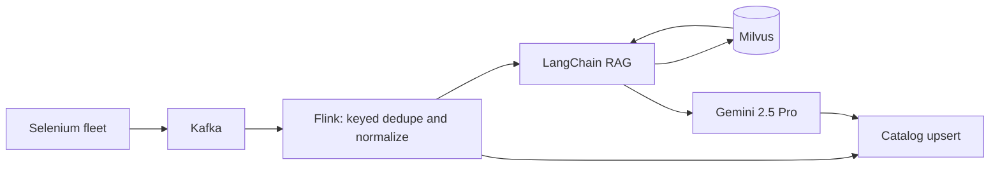

# Multi-agent Resume Panel: Menu, ANZ and Masters Checks (28 Jul 2026, refreshed for the current PDF)

<b>How to use this page</b>
<ul>
<li><b>What it covers:</b> the result of a mock review panel that read the Uber Menu, Uber Mobility ANZ and related Masters India lines on the resume, plus what each check means in plain English and how to defend it.</li>
<li><b>When to read it:</b> when you want confidence that the Menu and ANZ wording is safe, or before an interviewer who is likely to probe honesty ("Is 98% live?", "Is ANZ part of Eats?", "Why Milvus?").</li>
<li><b>What to memorise:</b> ANZ is Uber Mobility, not Eats. 98% is offline evaluation. Milvus is the Menu vector database and appears nowhere else on the resume. Menu Kafka and Masters Kafka are different products.</li>
</ul>

Related: [Uber interview packs](23b_uber_interview_packs.md) · [Menu deep dive](14_uber_menu_deep_dive.md) · [Menu streaming numbers](03_uber_menu_streaming_numbers.md) · [Masters and GfG interview packs](23c_masters_gfg_interview_packs.md) · [Ground truth](GROUND_TRUTH.md)

## What this panel is

A "panel" here is a structured self-review. The resume lines were read from four points of view, each asking a different question:

- **Recruiter:** is it clear and keyword-complete in a six-second skim?
- **Engineering manager (EM):** does it show ownership and business impact?
- **Technical interviewer:** can every technical claim be explained under questioning?
- **Honesty auditor:** does every number and technology trace to a source, with the right caveats?

Sources used: the track's resume `.tex` sections and [`GROUND_TRUTH.md`](GROUND_TRUTH.md).

| Persona | Verdict |
|---|---|
| Recruiter | PASS |
| Engineering manager | PASS |
| Technical interviewer | PASS |
| Honesty auditor | PASS |

**Consensus:** publishable. The checks below were re-confirmed against the current PDF wording.

## What was checked, and what it means

### 1. ANZ is Uber Mobility, with historical numbers

**The check.** ANZ is described as Uber Mobility driver and vehicle document verification in Australia and New Zealand. 99.9% compliance and 20 hours a week are tagged HISTORICAL. The old "main-app" wording is gone.

**In plain English.** This project helped Uber's ride-hailing side make sure drivers and their vehicles had valid documents under each local authority's rules. It is not part of Uber Eats and has nothing to do with menus. A deterministic validation backend replaced manual review queues. "Deterministic" means explicit rules that give the same answer every time, like a checklist.

**How to defend it.** "It's Uber Mobility, separate from Eats. We replaced manual review queues with a rule-based validation backend, which reached 99.9% compliance and removed about 20 hours a week of manual review. Those numbers are from my records at the time."

**Don't.** Don't invent Selenium, RAG or LLMs for ANZ. Don't say the numbers were re-measured from logs.

### 2. Menu architecture matches the PDF

**The check.** The Menu story is: a Selenium fleet feeds a Kafka and Flink pipeline, and unstructured PDFs go through a LangChain RAG pipeline with Gemini 2.5 Pro over Milvus embeddings.

**In plain English.** Selenium fetches menus. Kafka is a durable log that buffers the events in order per restaurant and allows replay. Flink is a stream processor that remembers the last version of each menu, drops duplicates, normalizes fields and writes them to the catalog. For messy PDFs, the system finds similar already-labelled menus and shows them to the LLM as examples (that is RAG, retrieval-augmented generation), then checks the output against the catalog schema.

*What to notice:* Milvus only appears on the RAG branch. Kafka and Flink are the backbone for everything.

**Don't.** Don't attach ClickHouse to Menu. Don't claim Spark or Pinot. Spark is a study-only backfill option and is not on the PDF.

### 3. 98% is offline evaluation, and SFT is gone

**The check.** Fine-tuning (SFT, supervised fine-tuning) was removed from the PDF. 98% field fidelity is an offline evaluation result.

**In plain English.** Field fidelity is the share of extracted fields (name, price, category) that match a hand-labelled answer key. Offline evaluation means it was measured on a fixed labelled test set, not on live traffic. That makes it repeatable, but it is not a live production guarantee.

**How to defend it.** "98% field fidelity in offline evaluation, measured against a labelled set. I say offline because it isn't a live SLA."

**Older wording note.** An earlier version of this panel also checked "100% schema consistency". That phrase is not on the current PDF. If asked, the schema validation gate rejects anything malformed before it reaches the catalog, so everything that lands is schema-valid by construction. SFT can be discussed verbally as an option, not as something shipped.

### 4. Milvus is named from real records

**The check.** Milvus is named because it appears in Tarun's earlier resume (the Databases line of the four-year resume). It was not swapped in for Pinecone or another vendor.

**In plain English.** An **embedding** is a list of numbers that captures what a piece of text means, so similar menus get similar numbers. A **vector database** stores embeddings and finds the nearest ones fast. **Milvus** is an open-source vector database. On Menu, it held embeddings of already-labelled menus so the RAG step could pull the most similar examples for each new PDF.

**Why Milvus (how to explain the choice).** The job needs fast similarity search over many labelled menus. A dedicated vector database is built for exactly that. Alternatives exist (pgvector inside Postgres, managed services like Pinecone), but the Menu vector store was Milvus, and that is the only one to name for this project.

**Scope rule.** Milvus is Uber Menu only. It does not belong in the Impact Analytics story. pgvector is on the skills line at literacy level, not as a production claim.

### 5. Masters India cross-checks

**The check.** The panel also confirmed that Menu and Masters India stay separate.

- Masters India has Kafka for bulk GST e-invoicing. That is a different product from Menu Kafka. Never describe them as one pipeline.
- There is no Flink at Masters India.
- "Mentored 2 engineers" belongs to Masters India. "Led 3 engineers" belongs to Uber FRM. Never merge them.

Full Masters talking points are in the [Masters and GfG interview packs](23c_masters_gfg_interview_packs.md).

## Current PDF wording (memorise)

**Menu Ingestion and Automation (Uber Eats).** Tech: Python, Selenium, Kafka, Flink, LangChain, Gemini, RAG, Milvus, GCP, Docker.

- Accelerated restaurant onboarding from 24 hours to 2 hours and saved $600K annually by architecting an automated ingestion pipeline processing 30K+ menus monthly. Converted unstructured, multilingual PDFs into a strict catalog schema at 98% field fidelity utilizing a Gemini 2.5 Pro and LangChain RAG pipeline over Milvus vector embeddings.
- Scaled menu extraction success to 95%+ by hardening a Selenium fleet with dynamic proxy pools and adaptive retries. Designed a large-scale data ingestion and processing pipeline using Kafka and Apache Flink, with stateful keyed deduplication and schema normalization to guarantee exactly-once catalog upserts.

**Document Compliance (Uber Mobility).**

- Achieved 99.9% regulatory compliance for Uber Mobility ANZ by automating driver and vehicle document verification workflows against local authority requirements. Eliminated 20 hours of manual operational overhead per week by replacing manual review queues with a deterministic validation backend.

*Older wording note:* the August 2026 panel quoted the ANZ line as "Automated Uber Mobility driver and vehicle document checks for ANZ against local authority requirements, reaching 99.9% compliance and removing ~20 hours/week of manual verification." The meaning is the same. The current PDF wording above replaces it.

## Quick honesty checklist

<ul>
<li>ANZ is Uber Mobility. 99.9% and 20 hours a week are HISTORICAL.</li>
<li>Menu 98% is offline evaluation. Say "offline" every time.</li>
<li>Exactly-once catalog upserts means at-least-once delivery plus idempotent upserts. Never say zero message loss.</li>
<li>Milvus is Menu only. No Pinecone or Weaviate.</li>
<li>No Spark, Pinot or SFT as Menu claims. No ClickHouse on Menu.</li>
<li>Menu Kafka is not Masters Kafka. "Led 3" (FRM) is not "mentored 2" (Masters).</li>
<li>Always say "Uber via EPAM".</li>
</ul>

