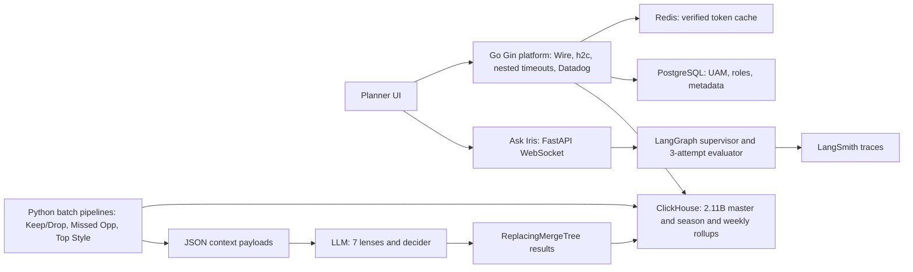
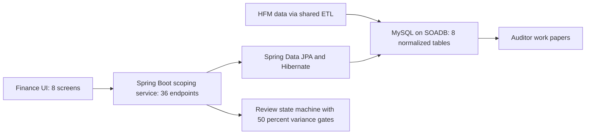
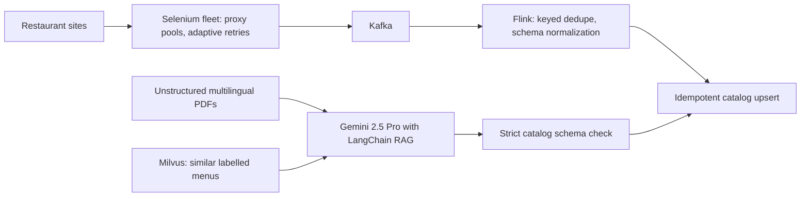
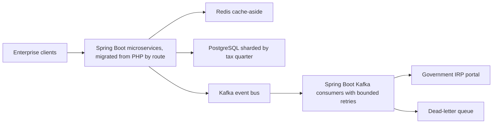

# Resume deep-explain map (study this before loops)

<b>How to use this page</b>
<ul>
<li>It explains every project on <code>Tarun_Mittal_SSE_5yr_Java_AI.pdf</code> in plain English: who uses it, how a request flows, which tech sits where and why.</li>
<li>Read it before any technical loop. It is the "explain it to a smart friend" layer. The bullet-by-bullet Q&A lives in the linked packs.</li>
<li>Memorise the warning box, the five-step answer method, and one diagram per project.</li>
</ul>

Canonical claims: [ASSORTSMART_TAB_RESUME](../../docs/ASSORTSMART_TAB_RESUME.md). Interview packs: [Impact Analytics](23a_ia_interview_pack.md), [Uber](23b_uber_interview_packs.md), [Masters India and GeeksforGeeks](23c_masters_gfg_interview_packs.md). Every number's arithmetic: [Metrics Derivations](09_metrics_derivations.md).

**Tags.** MEASURED means there is a log, benchmark, config or doc. STATED means it is printed on the PDF from the project source, with no extra arithmetic in prep. HISTORICAL means from my past work records. TARGET means a design goal.

<b>Never break these.</b>
<ul>
<li>The 300-case set with its 80% threshold is a <b>CI promotion gate</b>. It is not "all tenants live at 80%".</li>
<li>Ask Iris is <b>shipped</b> as a capability. Do not invent SLAs or usage numbers.</li>
<li>On the PDF: 10k peak RPS, 2.11B-row master, 170 GB weekly OOM, ~344k rows/s copy, 4.09B attr weekly (two seasons), 348k article-seasons, 88k per pass.</li>
<li>Off the PDF but true: 1.6M catalog article-seasons, about $100 per pass, 100% Go coverage with 1,200+ tests, six rollup tables, 55 GB / 16 GB caps.</li>
<li>Cluster Recommendation Copilot and Hindsight are <b>verbal only</b>.</li>
<li>Menu 98% is <b>offline evaluation</b>. Uber work was <b>via EPAM</b>. ANZ 99.9% is <b>historical, Uber Mobility</b>.</li>
<li>Do not claim Spark, Pinot, Kubernetes operations or CDC ownership. Kafka and Flink belong to <b>Uber Menu</b> (and Kafka also to Masters India), never to Impact Analytics.</li>
</ul>

---

## How to answer any "tell me about this tech" question

Use the same five steps every time. It keeps answers short, concrete and senior.

1. **Where.** Name the product and the exact place in the request path. "In AssortSmart, ClickHouse serves the planner grid."
2. **Why.** Name the failure it prevents, not "industry standard". "Postgres took 189 seconds on that grid."
3. **Rejected.** Name one alternative and why it lost. "We kept Postgres for small edits because it is better at single-row writes."
4. **Number.** Give the number with its tag. On Impact Analytics, never invent throughput beyond 10k peak RPS.
5. **Failure.** Say what breaks if this piece dies, and what we do then. "If the LLM times out, we fall back to the rule score."

Example, spoken: "In AssortSmart, ClickHouse serves the planner pivot grid. On Postgres that grid took 189 seconds on 250 million rows, which is unusable. We considered tuning Postgres, but it is a row store and the grid aggregates whole columns. On ClickHouse it dropped to about 12 seconds. If ClickHouse is down, the grid is down, so Postgres keeps the small metadata and access tables that login depends on."

---

## Impact Analytics: AssortSmart (Platform and AI)

### The business in plain English

AssortSmart is a SaaS product for retail merchandise planners. Every season a planner decides which products (articles) to keep in the range, which to drop, and which they are missing. Planner pivots used to run on PostgreSQL and were too slow to use interactively. AssortSmart gives them fast grids over billions of rows of sales and inventory data, plus AI recommendations they can question in a chat.

### Words you need

- **Article-season**: one product in one selling season, for example "Blue linen shirt, Spring-Summer 2026".
- **Go / Gin**: Go is a compiled language that is good at many concurrent requests. Gin is a small web framework for it.
- **Google Wire**: a tool that writes the code connecting your components (database, cache, handlers) at build time. If something is missing, the build fails instead of a live request. Think of it as a checklist checked before the plane takes off.
- **h2c**: HTTP/2 without TLS. HTTP/2 lets many requests share one connection. It is used inside a trusted network where TLS is handled elsewhere.
- **Reverse proxy**: a server like Nginx that sits in front of your app and handles timeouts, TLS and routing. We chose not to have one, so the Go process does that work itself.
- **ClickHouse**: a column-oriented analytics database. It stores each column separately, so "sum sales for all rows" reads only the sales column. Great for big aggregates, poor for single-row edits.
- **MergeTree / ReplacingMergeTree**: ClickHouse table types. MergeTree stores sorted data in parts and merges them in the background. ReplacingMergeTree also keeps only the newest version of rows with the same key. Think of a notebook where you never erase: you write the new value below, and a cleaner later crosses out the old lines.
- **LangGraph**: a Python library for building LLM workflows as a graph of steps with shared state, loops and limits.
- **LangSmith**: a tracing tool for LLM apps. It shows each step, prompt, tool call and token count.
- **OIDC and JWT**: OIDC (OpenID Connect) is a standard way to log in with Google or similar. A JWT (JSON Web Token) is a signed token that proves who you are on each request.
- **UAM**: User Access Management, the rules for which parts of the product hierarchy each user may see.

### User flow, one planner session

1. A planner signs in. The Go/Gin platform checks the token: first a Redis cache of verified tokens, then Firebase Admin, then JWT or Google OIDC. Their roles come from Postgres.
2. They open a pivot grid. Gin builds the query, including any operator-authored KPI formulas compiled by the formula parser, and ClickHouse answers from pre-aggregated rollup tables.
3. In batch runs, the Keep/Drop, Missed Opportunities and Top Style pipelines score each article. Rule math runs first. The LLM gets a JSON summary, never database access.
4. The planner opens Ask Iris, a chat over WebSocket, and asks "why did we drop this shirt?" Their data scope was frozen when the socket opened, so the answer can only use data they are allowed to see.

### Architecture

What to notice: the LLM boxes never connect directly to ClickHouse. Python code reads the data, packs JSON, and writes results. Go serves the planner. Python runs the AI.

Walking the boxes: the **Go/Gin platform** is the front door for every planner request and handles about 10k requests per second at peak. **Redis** keeps recently verified tokens so login checks do not hit Firebase on every call. **PostgreSQL** holds the small, frequently edited tables: users, roles, access scopes, metadata. **ClickHouse** holds the big analytical data and the rollup tables that make grids fast. The **batch pipelines** read features from ClickHouse, compute rule scores, hand JSON to the LLM, blend, and write results. **Ask Iris** is a separate Python service for chat.

### Key design decisions

**1. Serve the LLM JSON, never a SQL tool.**
- What: deterministic Python code reads ClickHouse, computes KPIs and packs a JSON payload per batch. The model scores from that payload.
- Why: an LLM writing SQL against a 2.11B-row table can launch runaway scans, exhaust the connection pool, or be steered by prompt injection.
- Alternative: give the model a read-only SQL tool. Rejected for the risks above and because math accuracy would then depend on the model.
- Trade-off: the payload must contain everything the model needs, so adding a new signal means a code change.
- Differently next time: version the payload schema explicitly from day one, so lens prompts and payload fields cannot drift.

**2. ClickHouse for planner reads, Postgres for thin metadata.**
- What: pivots read ClickHouse rollups. Postgres keeps UAM, roles and metadata.
- Why: the benchmark showed Postgres at 189 seconds and ClickHouse at about 12 seconds on 250M rows. Postgres won single-cell edits.
- Alternative: one database for everything. Rejected because each engine is bad at the other's job.
- Trade-off: two engines to run, and data must be kept consistent across them.
- Differently next time: build weekly rollups at one-week grain from the start, which would have avoided the 170 GB OOM.

**3. Partition rollback for the cluster copy.**
- What: if a season's copy fails midway, drop that season's partition on the target and recopy it.
- Why: a failed insert in ClickHouse can still commit some blocks, leaving "ghost rows". A partial count looks fine but is wrong.
- Alternative: an atomic swap with REPLACE PARTITION. I wrote that incremental design, but we did not execute it.
- Trade-off: during recopy, that season's partition is briefly incomplete on the target. It is not an atomic swap with live readers.
- Differently next time: run the REPLACE PARTITION design I wrote, so readers never see a dropped partition.

### Tech on the PDF and why it is there

| Tech | Where it sits | Why it is here | Rejected alternative | Number |
|---|---|---|---|---|
| Go, Gin, Wire | The HTTP edge for planners | Many concurrent requests, compile-time wiring, timeouts in-process | A Python public edge | 10k peak RPS |
| ClickHouse | Planner grids, master fact table, rollups | Columnar engine for big aggregates | Postgres for analytics. Snowflake for this UI | 189s to 12s on 250M. 2.11B master |
| KPI formula parser | Compiles operator formulas into SQL fragments | New KPIs without a code release, divide-by-zero safe via `ifNotFinite` | Hard-coded SQL per KPI | none |
| Firebase, OIDC, Redis, Postgres roles | Login and access control | Stop one tenant seeing another's data | Treating encryption as isolation | none |
| LangGraph | Ask Iris supervisor and evaluator | Explicit loops with a hard cap | A single prompt chain | 3 attempts |
| Offline eval gate | CI before promotion | A change must beat the bar before it ships | Shipping on demo feel | 300 cases, 80% gate, 74% baseline |
| Datadog and LangSmith | Go edge tracing and LLM tracing | Different questions: "which service was slow" versus "which prompt step failed" | One tool for both | none |

Verbal only: the Cluster Recommendation Copilot (14 tools, 3 gates), Hindsight, 63/8 DDL. See the verbal section of the [IA pack](23a_ia_interview_pack.md).

---

## Uber via EPAM: FRM Scoping Platform

### The business in plain English

Every quarter, Uber Finance must decide which financial line items and which entities are big or risky enough to need audit testing. This is "scoping". Analysts used to do it in Google Sheets, copying general ledger data, applying thresholds by hand and emailing status. It took about 14 days. The platform moved it into a proper backend with a database, automated math and a review workflow, and cut it to about 3 days.

### Words you need

- **FSLI**: Financial Statement Line Item, one line on the balance sheet or income statement, such as Cash or Revenue. Ours were a four-level tree, L1 to L4.
- **Materiality**: the dollar amount above which a misstatement would change a reader's decision. Q4 2025 used $340M.
- **GL**: General Ledger, the master record of accounting entries.
- **HFM and 10-Q**: HFM (Oracle Hyperion Financial Management) is the consolidation system. The 10-Q is the quarterly filing. Reconciliation checks they agree.
- **SOADB**: Uber's standard for a MySQL database owned by one service.
- **ORM**: Object-Relational Mapper, a library that maps classes to tables. Here it is Hibernate, used through Spring Data JPA: each table is a Java class marked `@Entity`, and a repository interface gives you queries without hand-written SQL.
- **Optimistic locking**: each row has a version number. An update only succeeds if the version has not changed since you read it. Like editing a shared doc and being told "someone changed this, reload". In JPA this is a `@Version` field on the entity.
- **Natural key**: an ID derived from the data itself. We used SHA-256 of fields like question text plus page name, so the same question always gets the same ID.
- **SOX**: Sarbanes-Oxley, the US law that requires auditable controls over financial reporting.

### User flow

1. HFM data lands in MySQL through a shared ETL pipeline.
2. An analyst runs Reconciliation to tie HFM to the 10-Q.
3. They set Materiality and thresholds, then work through EMI, Group, Component and Residual Risk scoping screens. The backend computes significance automatically.
4. Each screen's rows move through Draft, Review, ReOpen and Closed. Big swings are flagged at gates.
5. The output feeds the auditor (PwC) work papers.

### Architecture

What to notice: the ETL from HFM was a shared pipeline, and the collaboration and Slack notification service was separate. I owned the scoping service and its schema.

### Key design decision: one polymorphic review-status model

- What: a single status model (Draft, Review, ReOpen, Closed) reused by every screen, instead of one status table per screen.
- Why: eight screens with eight status implementations would drift, and auditors need one consistent trail.
- Alternative: per-screen status columns. Rejected for duplication and inconsistent audit history.
- Trade-off: the shared model must be general enough for every screen, so screen-specific rules live in the service code.
- Differently next time: use JPA entities and queries with explicit column aliases from day one. The column-aliasing bug (duplicate column names in joined raw SQL silently mapped rows to the wrong uuid) came from raw SQL joins.

### Tech and numbers

| Tech | Why here | Number on PDF |
|---|---|---|
| Java and Spring Boot, with Bean Validation DTOs | REST controllers with typed request validation for financial inputs | 36 Spring Boot endpoints |
| Spring Data JPA and Hibernate | Entity mappings and aliased queries that removed the aliasing bug class | 100% module statement coverage, led 3 engineers |
| JUnit 5, Mockito and MockMvc | Unit and controller tests that proved the migration | 100% module statement coverage |
| MySQL on SOADB | Uber's paved road for service-owned data | 8-table schema, 19M raw GL rows |
| Bazel | Uber's build system. Stacked PRs shipped small changes with zero downtime | none |
| Outcome | Scoping moved off Sheets | 70%, from 14 days to 3 days, against $340M materiality |

Verbal depth if asked: 8 screens, 11 ORM models, about 55 line items across 14 entities in a sample close, the 18-file reconciliation v2 change.

---

## Uber via EPAM: Menu Ingestion (Uber Eats) and Document Compliance (Mobility ANZ)

### The business in plain English

New restaurants on Uber Eats send their menus as PDFs, images or web pages, in many languages. Someone had to turn each into Uber's strict catalog format: items, prices, options. That took about a day per restaurant and cost about $2 per menu with a third-party or manual step. This pipeline automated it, so menus go live in about two hours.

### Words you need

- **Selenium**: a tool that drives a real browser, used here to scrape restaurant sites.
- **Kafka**: a durable log of events that many consumers can read at their own pace. Like a conveyor belt that remembers every box.
- **Apache Flink**: a stream processor that keeps state per key. Here it remembers the last content hash per menu, so duplicates are dropped.
- **RAG**: Retrieval-Augmented Generation. Before asking the LLM to extract a menu, we look up similar, already-labelled menus and include them as examples.
- **Milvus**: a vector database that finds "similar" items by comparing embeddings (numeric fingerprints of text).
- **Upsert**: insert a row, or update it if the key already exists.

### Architecture

What to notice: there are two paths into one catalog. Scraped menus stream through Kafka and Flink. Unstructured PDFs go through the RAG extraction path and a schema check. "Exactly-once" on the PDF means each menu lands in the catalog once. Under the hood that is at-least-once delivery from Kafka plus idempotent upserts keyed by vendor, menu and content hash.

### Key design decision: Flink keyed dedupe before the catalog

- What: Flink keeps per-menu state and drops events whose content hash it has already seen.
- Why: scrapers retry and overlap, so the same menu arrives many times. Writing each copy would churn the catalog.
- Alternative: dedupe in the database at write time. Rejected because every duplicate would still travel the whole pipeline and hit the catalog with a write.
- Trade-off: Flink state must be checkpointed and sized.
- Differently next time: measure the extraction success baseline properly before hardening, so "about 60 to 65%" would be a measured number, not an estimate.

### Numbers

From 24 hours to 2 hours. $600K a year (about $2 × 30K × 12 = $720K, floored). 30K+ menus a month. 98% field fidelity in offline evaluation. 95%+ extraction success. Spark is not on the PDF.

### Document Compliance, Uber Mobility ANZ

A deterministic validation backend checks driver and vehicle documents against local authority rules in Australia and New Zealand, replacing a manual review queue. 99.9% regulatory compliance and 20 hours a week saved. This is historical, and it is Mobility, not Eats. Do not add Selenium or RAG to it.

---

## Masters India: GST E-Invoicing

### The business in plain English

Indian businesses above a size threshold must register every invoice with the government's IRP (Invoice Registration Portal), which returns an IRN (Invoice Reference Number) and a signed QR code. Masters India does this for 1,500+ enterprise clients. Clients upload invoices in bulk, often near filing deadlines, and the government portal is slow and flaky.

### Words you need

- **Strangler pattern**: replace an old system one route at a time. New routes go to the new service and the old one shrinks until it can be removed.
- **Canary release**: send a small share of traffic to the new version first, and widen only if it is healthy.
- **Idempotent**: doing an operation twice has the same effect as once. Our key looked like client + fileHash + batchIndex.
- **Dead-letter queue (DLQ)**: where messages go after they fail too many times, so they stop blocking the rest.
- **Sharding**: splitting one big table across several databases by a key. Ours was the tax quarter.
- **Cache-aside**: the app checks Redis first. On a miss it reads Postgres and fills the cache.
- **ELK and New Relic**: ELK (Elasticsearch, Logstash, Kibana) for searchable logs, New Relic for request tracing.

### Architecture

What to notice: the client never waits on the government portal. Kafka absorbs bursts, workers retry within limits, and repeat failures go to the DLQ.

### Key design decision: Kafka between the API and the government portal

- What: the API accepts the upload and writes events. Workers submit to the IRP.
- Why: the IRP is slow and unreliable near deadlines. Calling it inline made p95 latency terrible and caused client timeouts.
- Alternative: synchronous calls with longer timeouts. Rejected because it ties up connections and still fails under load.
- Trade-off: as with any queue-based design, the result arrives asynchronously, so each invoice needs a tracked status rather than an instant answer.
- Differently next time: put tracing in before the migration, so the triage baseline would be measured instead of estimated.

### Numbers

p95 down 75%, from 1.2 seconds to 300 milliseconds. 700 to 4,000 requests per minute (about 12 to 67 per second). 1M+ submissions a day (about 12 per second on average). 100K+ concurrent imports. Triage down 70%. DB read load down 30%. Coverage 35% to 82%. 98% deployment success. Mentored two engineers. No Flink here, and this Kafka is a different product from Uber Menu's.

---

## GeeksforGeeks: Courses Platform and Influencer Dashboard

### The business in plain English

GeeksforGeeks sells programming courses. Students post doubts (questions) that mentors answer, and traffic spikes about ten times during live coding contests. Influencers promote courses with coupon codes and want to see their earnings.

### What I built

- I moved the doubt-support backend from PHP to **Django** (a Python web framework with a built-in ORM and admin), with REST APIs for voting, pinning and locking threads on MySQL, MongoDB, Redis and Elasticsearch. It handled 10K+ daily queries and 10x contest spikes. The growth team attributed a 20% lift in premium subscriptions.
- I built the influencer analytics and earnings dashboard (transactions, coupon conversions), credited with 30% higher course sales, and asynchronous scheduled workflows for video processing, reminders and data cleanup, which made engineering operations about 70% more efficient.

Say it this way: "I owned the engineering. The business team attributed the lift."
