# Architecture · flow · ER diagrams (Final Java + AI)

<div class="callout highlight">
<b>How to use this page</b>
<ul>
<li><b>What it covers:</b> whiteboard-ready architecture diagrams for every project on the current PDF: Impact Analytics (AssortSmart), Uber FRM, Uber Menu and ANZ, Masters India and GeeksforGeeks. Each diagram has a box-by-box walkthrough, what flows on each arrow, failure modes, and a "how to draw this in 3 minutes" script.</li>
<li><b>When to read it:</b> before any system design or "walk me through your project" round. Practise the 3-minute scripts out loud with a pen.</li>
<li><b>What to memorise:</b> the shape of each diagram (left to right), one "why this box" line per box, and the honesty notes in the warn boxes.</li>
</ul>
</div>

This is the Java + Python track. Uber FRM uses Spring Boot with Spring Data JPA and Hibernate. Masters India uses Spring Boot microservices with Kafka consumers for background work. **Impact Analytics is a Go/Gin platform with a Python (FastAPI, LangGraph) agent plane.** Facts match [`GROUND_TRUTH.md`](GROUND_TRUTH.md), not older resume narratives.

**What the tags mean on this page.** MEASURED means there is a log, doc or code behind it. ESTIMATED means arithmetic I can show, so I say "roughly, derived from...". HISTORICAL means it comes from my past work records. TARGET means a design goal. "Verbal only" means I can talk about it if asked, but it is not a PDF bullet, so I never lead with it.

**How to read the diagrams.** The ASCII versions are what I sketch in an interview. The mermaid versions render on the site. Solid arrows are the main path. Dotted arrows are fallback, optional or "not mine" paths.

---

## 1. Impact Analytics — AssortSmart (Platform & AI)

### The business in plain English

Impact Analytics sells AssortSmart, a merchandise planning SaaS for retailers. Planners use it to decide, for each selling season, which articles (products) to keep, which to drop and which to add. An "article-season" is one product in one selling season. The data is huge, so the platform has two halves: a Go/Gin platform that serves fast analytical pivots and enforces who can see what, and an AI layer that scores Keep/Drop decisions in batches and lets planners ask questions through a chat copilot called Ask Iris.

### Words you need

- **Go/Gin:** Go is a compiled language that is good at many concurrent requests. Gin is a lightweight Go web framework.
- **Google Wire:** a compile-time dependency injection tool. It generates the wiring code, so a missing dependency breaks the build rather than a live request.
- **h2c (HTTP/2 cleartext):** HTTP/2 without TLS inside a trusted network, letting one connection carry many requests at once.
- **ClickHouse:** a column-oriented analytical database. It reads only the columns a query needs, which makes big aggregations fast. Think of a spreadsheet where you can grab one whole column without touching the rest.
- **MergeTree / ReplacingMergeTree:** ClickHouse table types. ReplacingMergeTree keeps only the newest version of a row with the same key, eventually. It is like a notebook where you never erase, you just write the new value below, and a cleaner later crosses out the old lines.
- **Rollup table:** a pre-aggregated summary table, like keeping weekly totals so you never re-add daily receipts.
- **LangGraph:** a Python framework for building LLM agents as graphs of steps. A **supervisor** is the node that decides which worker step runs next.
- **LangSmith:** a tracing tool for LLM apps. It shows every prompt, tool call and response in a run.
- **UAM (User Access Management):** the rules for which user can see which part of the product hierarchy.
- **config_hash:** a SHA-256 fingerprint of the guardrails, parameters, prompts and catalog used for a run, stamped on every output row so any decision can be traced to the exact setup that produced it.

### 1a. Platform architecture (what the PDF describes)

```text
 Planner (web UI)                               Planner (chat)
       |                                              |  JWT WebSocket
       v                                              v
 +-------------------------------+        +-----------------------------+
 | Go/Gin API edge               |        | Ask Iris (Python FastAPI)   |
 | Wire DI . native h2c          |        | LangGraph supervisor        |
 | nested timeouts . no proxy    |        | evaluator, MAX_ATTEMPTS = 3 |
 | 10k peak RPS . Datadog traces |        | plan_scope frozen at        |
 +---+-----------+---------------+        | handshake . LangSmith       |
     |           |                        +--------------+--------------+
     | auth      | KPI formulas                          | scoped KPI and
     v           v                                       | decision reads
 +-----------+  +--------------------+                   |
 | Redis     |  | Formula tokenizer  |                   |
 | auth cache|  | and parser to      |                   |
 | Firebase  |  | parameterized SQL  |                   |
 | then JWT /|  | ifNotFinite guard  |                   |
 | Google    |  +---------+----------+                   |
 | OIDC      |            |                              |
 +-----+-----+            v                              v
       |      +------------------------------------------------------+
       v      | ClickHouse (per tenant)                              |
 +----------+ | 2.11B-row master . six MergeTree rollups             |
 | Postgres | | PARTITION BY season_code . ReplacingMergeTree writes |
 | UAM,     | +-----------^--------------------------+---------------+
 | roles,   |             | ingest                   | context rows
 | metadata | +-----------+---+                      v
 +----------+ | BigQuery      |       +-------------------------------+
              | (historical)  |       | Keep/Drop batch engine (Py)   |
              +---------------+       | orchestration registry:       |
                                      | timeouts . breakers .         |
                                      | checkpoints . config_hash     |
                                      | JSON payloads to LLM, 7 lenses|
                                      +-------------------------------+
```

*What to notice:* the LLM never touches ClickHouse directly. The batch engine reads rows, turns them into JSON, and only that JSON goes to the model.

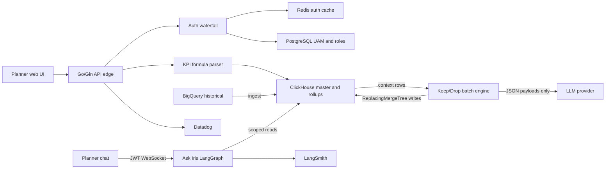

*What to notice:* three entry paths (web UI, chat, batch) all land on the same ClickHouse store, and each path has its own guard: UAM on the Go edge, frozen plan_scope on Ask Iris, JSON-only context on the batch.

#### Box-by-box walkthrough

1. **Go/Gin API edge.** This is the multi-tenant platform that every web request hits, scaling to 10k peak RPS. It exists because planners need fast pivots and strict tenant isolation in one place. It runs as a self-protecting HTTP edge with no reverse proxy in front: it speaks native h2c, wraps every call in nested timeouts (the request deadline contains the database deadline), and sends Datadog distributed traces. Wire builds the dependency graph at compile time. *Why not a reverse proxy?* The process already owns timeouts, h2c and tracing, so a proxy would add one more hop and one more thing to operate.
2. **Auth waterfall.** Each request is authenticated by trying a Redis cache first, then Firebase Admin, then JWT or Google OIDC. API keys are compared in constant time, so an attacker cannot guess a key by timing responses. Roles come from PostgreSQL. *Arrow content:* a token or API key in, a user identity plus role and hierarchy scope out.
3. **PostgreSQL.** It keeps thin metadata, UAM and roles. Background worth knowing: planner pivots were slow on PostgreSQL, POCs compared PostgreSQL with ClickHouse, and ClickHouse won the large analytical reads. PostgreSQL kept the small, relational, frequently updated data.
4. **KPI formula parser.** Operators type formulas like `sell_through = units_sold / units_received`. A Go tokenizer and parser turns that into a parameterized ClickHouse SQL fragment. Only allowlisted functions are accepted, logical names map to physical columns, and unknown tokens fail closed. Division is wrapped so a zero denominator returns 0 instead of infinity. This decouples business formulas from code releases.

    ```sql
    -- illustrative output for sell_through
    ifNotFinite(toFloat64(sum(units_sold) / sum(units_received)), 0)
    ```

5. **ClickHouse.** The analytical store, per tenant. It holds a 2.11B-row master and six MergeTree rollup tables (product, store and attribute, each at season and weekly grain, partitioned by `season_code`). The rollups are why planner pivots went from 189 seconds to 12 seconds on a 250M-row harness (12.3 seconds, rounded), which is 15.5 times faster.
6. **BigQuery.** The historical source that is ingested into ClickHouse. *Arrow content:* historical rows, loaded in batches.
7. **Keep/Drop batch engine.** Python batch pipelines (Keep/Drop, Missed Opportunities, Top Style) that evaluate 348k article-seasons, about 88k items per pass, using deterministic KPI math blended with structured LLM calls across 7 AI lenses. It reads context from ClickHouse, sends only JSON payloads to the LLM, and writes results back with ReplacingMergeTree, so writes are eventually consistent. It runs through the shared orchestration registry (section 1b).
8. **Ask Iris.** A JWT-secured WebSocket copilot that lets planners query KPIs and inspect AI decisions. It is Python FastAPI with a LangGraph supervisor and a 3-attempt evaluator loop, traced in LangSmith (section 1c).

#### Failure modes and what handles them

| What fails | What happens | Where it is handled |
|---|---|---|
| LLM call times out | The item uses its deterministic baseline score | Batch engine fallback |
| LLM provider keeps failing | Circuit breaker trips after about 5 consecutive failures or a high failure fraction | Orchestration registry |
| Batch process crashes mid-run | Restart with `--resume`, skipping finished deterministic scoring | `det.json`, `agent_progress.json` |
| Slow database call | Inner timeout fires before the request deadline | Go/Gin nested timeouts |
| Bad operator formula | Unknown token is rejected | Parser fails closed |
| Divide by zero in a KPI | Returns 0 instead of infinity | `ifNotFinite(toFloat64(expr), 0)` |
| Chat tries to read another tenant | Scope was frozen at the handshake, so the request stays in scope | Ask Iris `plan_scope` |
| Agent keeps retrying forever | Stops after 3 attempts and replies gracefully | Ask Iris `MAX_ATTEMPTS = 3` |

<div class="callout warn">
<b>Say this carefully on Impact Analytics.</b> No Kafka, Flink, CDC, Kubernetes operations or Milvus here. The CDC pg2ch tool was authored by a colleague (Ashvin Sharma), so I do not claim it. No "sub-second" ClickHouse claims. No HITL or human review queues: offline evals replaced the critic and evaluator agents in Keep/Drop. LangSmith is on Ask Iris, not on the Keep/Drop batch. Isolation is not encryption. No invented SLA for the Go platform or for Ask Iris.
</div>

### 1b. One Keep/Drop pass, step by step

The batch order is fixed: peer, decider, lenses, blend, explain. There is no LLM orchestrator choosing the next step.

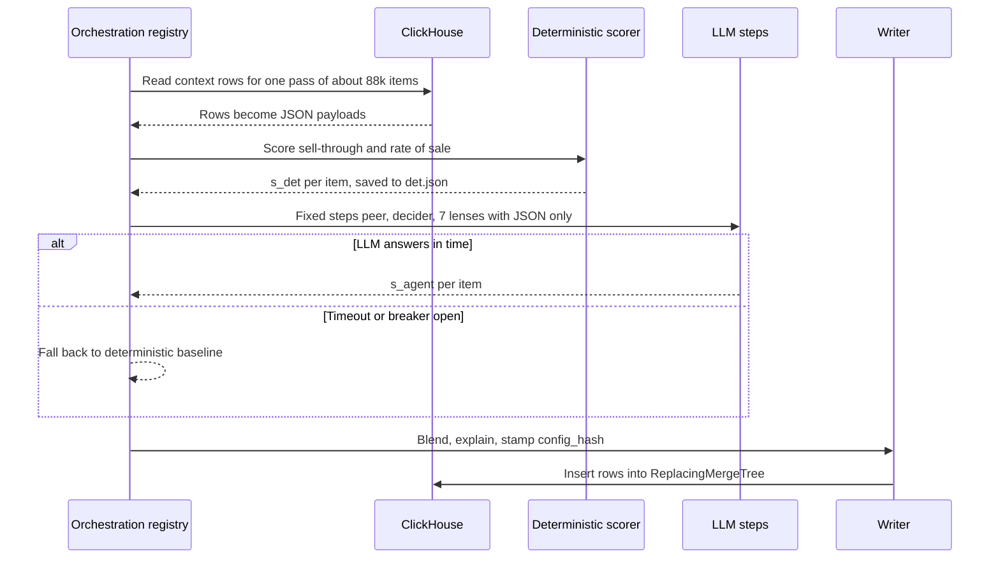

*What to notice:* progress is checkpointed (`det.json`, `agent_progress.json`), so a crash after the deterministic step does not redo it.

**Worked example of the blend.** The final score is `s_final = 0.4 × s_det + 0.6 × s_agent`, and an article-season is kept if `s_final` is at least 0.55. Suppose an article has `s_det = 0.50` and `s_agent = 0.70`.

```text
s_final = 0.4 x 0.50 + 0.6 x 0.70 = 0.20 + 0.42 = 0.62
0.62 >= 0.55, so the decision is KEEP
```

If the LLM had timed out, the item would fall back to its deterministic baseline instead of waiting.

**Why this design.** *What:* LLM context is served as JSON, writes are eventually consistent, LLM failure falls back to deterministic scores. *Why:* letting an LLM query a 2.11B-row table is slow, expensive and unsafe. *Alternatives:* give the LLM a SQL tool (rejected: unbounded queries and leakage risk), or use Airflow or Temporal for orchestration (rejected: we needed app-native resume coupled to ClickHouse inserts and config hashing, and the extra infrastructure was not justified). *Trade-off:* the registry is custom code we maintain. *What I'd do differently:* revisit a managed workflow engine if the number of pipelines grew a lot.

**Evaluation numbers (keep them apart).** The 300-case proxy evaluation harness backs an 80% accuracy CI promotion gate. That is a gate, not "every tenant is live at 80%". Separately, a gold-200 benchmark showed 73% lower live execution cost at 100% coverage, against a 74% deterministic baseline. Because the blended score was below the deterministic baseline on that set, the blend weights were frozen, not retuned.

### 1c. One Ask Iris question, step by step

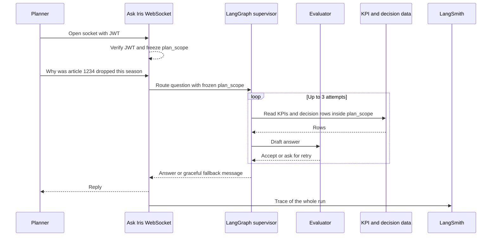

*What to notice:* the scope is decided once, at the handshake. A later message cannot widen it.

**Box by box.** The WebSocket keeps one live connection per planner. The JWT is checked once, and the hierarchy access (`plan_scope`) is frozen for the life of the socket, which prevents cross-tenant leaks. The supervisor routes the question to worker steps. The evaluator checks the draft answer, and the loop stops after 3 attempts (`MAX_ATTEMPTS = 3`) so the agent cannot loop forever. LangSmith records every step for debugging. **Ask Iris is a shipped capability. There are no SLA or usage numbers to quote.**

### 1d. Rollups, the 170GB OOM fix, and the cluster migration pump

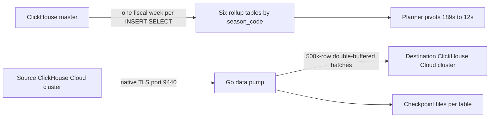

*What to notice:* the top row is about **query time** and **load time**. The bottom row is the **migration**. They are three separate stories.

**Rollups and the OOM.** The six rollups made pivots 15.5 times faster, which is query time. Building the weekly rollups for a whole season in one statement ran out of memory, needing around 170GB, which is load time. These are not cause and effect. The fix was to slice each INSERT SELECT into temporal chunks (one fiscal week per insert) and enforce memory and disk-spill caps. If asked for the knobs (verbal): a 55 GB memory cap, 16 GB spill, 8 threads, 4 weeks in flight. A product week was about 11 GB and an attribute week was over 40 GB. A whole season failed even at 80 GB and 200 GB caps.

**The migration pump.** The rollups had to move between ClickHouse Cloud clusters. Cross-cluster IP allowlists blocked a direct cluster-to-cluster copy, so I wrote a Go data pump that speaks the ClickHouse native protocol over TLS (port 9440). It moves 500k-row batches and is double-buffered, meaning it reads the next batch while sending the previous one. Combined throughput was about 344k rows per second across two season streams of roughly 150k to 190k rows per second each. **That is an ingest rate, not requests per second.** The largest partitions reached 4.09B rows (attribute weekly, two seasons: 2,779,317,472 plus 1,311,108,195). The 4.09B copy was measured in flight. Do not say the cutover finished.

**Ghost rows and rollback.** "Ghost rows" are duplicate rows left by a half-finished retry. Two guards stop them: TSV ledgers (the weekly loader's skip file, which records finished weeks) and copier checkpoint files `migrate-checkpoints/<table>.done`. A "partition rollback" means DROP PARTITION, then recopy that season. **It is not an atomic swap with live readers.** A REPLACE PARTITION incremental design was written but not executed.

### 1e. Older design kept for reference: Cluster Recommendation Copilot (verbal only)

<div class="callout warn">
<b>Verbal only, not a PDF bullet.</b> The original version of this page drew the Cluster Recommendation Copilot as the main AssortSmart diagram. It is a design I can talk about in depth (14 tools), but it is not on the resume, and neither is Hindsight. MCP is skills-level for me. Lead with sections 1a to 1d. Use this only if they ask "what else did you design?". The planner approval step below is part of the product UI design. It is not a human review queue, so never call it HITL on Impact Analytics.
</div>

```text
 Planner (Chat UI)          Planner (Manual / Hindsight UI)
        |                              |
        v                              v
 +----------------------+     +-------------------------+
 | FastAPI + LangGraph  |     | Go Gin write APIs       |
 | + MCP (agent plane)  |     | (shared doing layer)    |
 | 14 read-only tools   |---->| Clustering / Hindsight  |
 | planner confirms in  |     | / Strategy              |
 | UI before any write  |     +-----------+-------------+
 +----------+-----------+                 |
            | read-only                   | INSERT / approve path
            v                             v
 +------------------------------------------------------+
 | Per-tenant ClickHouse  (63 tables / 8 layers)        |
 | insert-only . REPLACE PARTITION refresh designed,    |
 | not executed . agent profile: SELECT only            |
 +----------^-------------------------------+-----------+
            | BQ -> CH ingest               |
     +------+------+                 +------v------+
     |  BigQuery   |                 | GCS / snaps |
     | (historical)|                 +-------------+
     +-------------+
 Obs: LangSmith (agent) . Datadog (platform) . PostHog (product)
      -- shared OTEL trace_id (design doc) --
```

*What to notice:* the agent can only read. Every write goes through the same Go APIs the manual UI uses, so there is one write path and one auth surface.

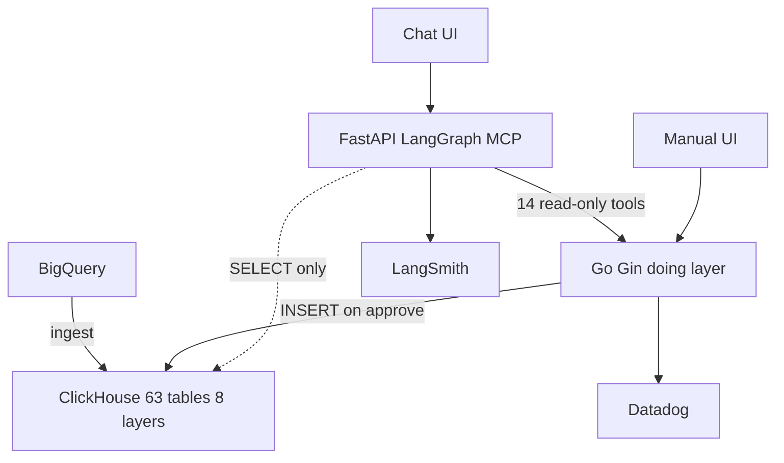

**Designed user flow, in order.** (1) The planner states an intent. (2) The agent grounds the scope with read-only tools. (3) The planner confirms the search plan. (4) The agent batch-explores clustering configs. (5) It presents 3 to 5 scenarios. (6) The planner approves one in the UI. (7) The write happens through the Go APIs. (8) The grid refreshes.

| Box | Problem it solves |
|---|---|
| LangGraph with read-only tools | Sequences audited tools, so the LLM never writes free-form SQL |
| Go doing layer | Same write path as the manual UI, so one auth surface |
| ClickHouse insert-only | Avoids ClickHouse's slow mutation queue for updates. (The pivot speed-up itself came from the rollups in 1d, not from insert-only.) |
| Planner approval in the UI | The agent never silently finalizes a plan |

The table counts (63 tables, 8 layers), PostHog and the shared OTEL trace_id come from internal design docs. They are not on the PDF, so only mention them if asked about the copilot design.

### 1f. How to draw AssortSmart in 3 minutes

- **Minute 1.** Draw ClickHouse as a wide box in the middle and write "2.11B-row master, six rollups". Draw PostgreSQL small on the left and say "thin metadata, UAM and roles". Draw BigQuery feeding ClickHouse from below.
- **Minute 2.** Draw the Go/Gin edge above, with Redis and the auth waterfall beside it. Say "10k peak RPS, Wire, h2c, nested timeouts, Datadog, no reverse proxy". Add the formula parser arrow into ClickHouse and say "operator formulas become parameterized SQL with ifNotFinite". Mention pivots from 189 seconds to 12 seconds.
- **Minute 3.** Draw the Keep/Drop batch engine on the right with an arrow to the LLM labelled "JSON only". Say "348k article-seasons, 7 lenses, 0.4 deterministic plus 0.6 agent, fallback on timeout, checkpoints and config_hash". Draw Ask Iris at the top right with "JWT WebSocket, plan_scope frozen, 3 attempts, LangSmith". If time remains, sketch the migration pump at the bottom.

---

## 2. Uber FRM — Risk Scoping (Uber via EPAM)

### The business in plain English

FRM (Financial Risk Management) is a team inside Uber Finance. Every quarter, during the financial close, they decide which financial line items and which legal entities are "in scope" for risk assessment and audit testing. The output is evidence that PwC, the external auditor, uses in its audit work papers. Before this platform, the work ran on Google Sheets: no stable line IDs, no concurrency control, versions drifting. I owned the scoping backend, which cut quarterly reconciliation from 14 days to 3 days, a 70% cut, against a $340M materiality threshold.

### Words you need

- **GL (General Ledger):** the master record of every financial transaction. 19M raw GL rows were migrated off Sheets into MySQL.
- **FSLI (Financial Statement Line Item):** a line on the balance sheet or income statement, like "Cash" or "Revenue". They form a nested 4-level hierarchy, L1 to L4.
- **Materiality:** the size of error that would matter to a reader of the financial statements. On the Q4 2025 close it was $340M, and the residual threshold was $170M.
- **HFM (Oracle Hyperion Financial Management):** Uber's consolidation system. Its numbers are reconciled against the filed 10-Q (the quarterly report filed with the SEC).
- **SOADB:** Uber's service-owned MySQL standard.
- **Spring Boot:** a Java framework for building web services. You write `@RestController` classes and it handles HTTP, JSON and configuration for you.
- **Spring Data JPA / Hibernate:** the database layer. Hibernate maps Java classes (`@Entity`) to tables. Spring Data JPA generates repository classes so you write a method signature instead of boilerplate SQL code.
- **Optimistic locking:** each row has a version number. An update succeeds only if the version has not changed since you read it. It is like editing a shared doc that refuses your save if someone else saved first.
- **FSM (finite state machine):** a fixed set of statuses and allowed moves between them.
- **SOX (Sarbanes-Oxley):** US law requiring controls over financial reporting.

### Architecture

```text
 React (8 screens)
   Reconciliation . Materiality . EMI Scoping . Group Scoping .
   Threshold Setup . Component Scoping . Residual Risk . Summary
        |  36 Spring Boot endpoints
        v
 +-----------------------------------------+
 | Spring Boot                             |
 |  @RestController (Bean Validation)      |
 |       v                                 |
 |  service  (materiality rules, L1-L4     |
 |            FSLI tree, FSM gates)        |
 |       v                                 |
 |  repository  (Spring Data JPA /         |
 |               Hibernate)                |
 +------------------+----------------------+
                    v
            +-------------------------+
            | MySQL on SOADB          |  8-table normalized schema (PDF)
            | facts . EMI             |  11 ORM models in code (verbal)
            | recon leaves            |  ~55 FSLIs / 14 entities (Q4 2025 sample)
            | review status           |  $340M / $170M on the Q4 2025 close
            +-----------^-------------+
                        |  shared ETL pipeline
     Oracle HFM --------+-------- filed 10-Q (validate)
                        |
                        v
                 PwC audit work papers
```

*What to notice:* the business rules live in exactly one layer, the service. Controllers stay thin and repositories own all SQL.

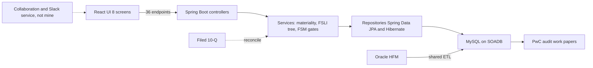

*What to notice:* the dotted collaboration box is a separate service I did not build.

#### Box-by-box walkthrough

1. **React UI, 8 screens.** Reconciliation, Materiality, EMI Scoping, Group Scoping, Threshold Setup, Component Scoping, Residual Risk and Summary. These are the steps of the quarterly close. *Arrow content:* REST calls for a quarter, an entity and an FSLI level.
2. **36 Spring Boot endpoints.** If asked for the breakdown: about 31 functional routes in the scoping service controller, plus the collaboration-service APIs (comments and notifications) from the technical design doc, make 36. I did not build the real-time collaboration and Slack notification service itself.
3. **Controllers.** `@RestController` classes validate the request DTO with Bean Validation (`@Valid`, `@NotNull`) and call one service method. No business logic here.
4. **Services.** Own the financial math: materiality, the 5% significance thresholds, residual risk, the nested L1 to L4 FSLI hierarchy, and dynamic quarter-annualization (turning year-to-date figures into an annual run-rate for the quarter). They also run the review-status FSM.
5. **Repositories (Spring Data JPA / Hibernate).** All SQL lives here, as JPA entities, repository methods and JPQL or native queries with explicit aliases. I led 3 engineers on the Spring Data JPA / Hibernate migration, which eliminated latent column-aliasing bugs and raised module statement coverage to 100%.
6. **MySQL on SOADB.** An 8-table normalized schema. Moving off Sheets into this schema is what resolved ETL lock contention during the close. The code has 11 ORM models (JPA entities, verbal detail), so say "8-table normalized schema" for the PDF and "11 models in the service code" only if asked.
7. **Oracle HFM and the shared ETL.** HFM extracts feed MySQL through a shared pipeline. ETL from HFM was a shared responsibility, not mine alone.
8. **Filed 10-Q.** The reconciliation screen compares HFM numbers against the public filing.
9. **PwC work papers.** The audited output. This is why correctness and audit trails matter more than throughput.

#### Quarterly user flow

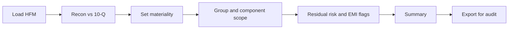

*What to notice:* each box is one screen, and each move between screens is gated by the review status.

#### Logical ER (say this, do not invent extra tables)

```text
fiscal_period 1--* fslib_fact (BS/IS lines)
entity 1--* component_assessment
fslib_fact *--* scoping_decision (material / qualitative)
emi_investee 1--* emi_assessment
recon_leaf (HFM amt, filed amt, difference, line_id)
metrics_table (materiality, residual threshold)
```

*What to notice:* this is a speaking sketch of the main entities, not the exact table list. The PDF number is the 8-table normalized schema. For full table catalogs see [`34_er_tables_tech_why.md`](34_er_tables_tech_why.md).

#### Three mechanisms with tiny examples

**Optimistic row-locking.**

```sql
UPDATE scoping_decision
SET status = 'Review', version = version + 1
WHERE id = :id AND version = :version_read;
-- 0 rows updated means someone else saved first: reload and retry
```

In JPA this is a `@Version` field on the entity. Hibernate adds the `AND version = ?` check to every UPDATE for you, and throws an `OptimisticLockException` when 0 rows match.

**Deterministic SHA-256 natural keys.** The same question on the same page always gets the same ID, so quarterly audit trails never duplicate it.

```java
byte[] digest = MessageDigest.getInstance("SHA-256")
        .digest((questionText + normalize(pageName)).getBytes(StandardCharsets.UTF_8));
String uuid = HexFormat.of().formatHex(digest);
```

**Polymorphic review status with FSM gates.** One status model is reused across screens: Draft, Review, ReOpen, Closed. Moves between states are automated gates, including 50% delta-variance checks for SOX compliance. Cross-table syncs happen in one transaction (a `@Transactional` service method), so a status change and its related rows commit together or not at all.

#### Failure modes

| What broke or could break | How it was handled |
|---|---|
| ETL lock contention during the close | Normalized 8-table schema on SOADB instead of Sheets |
| Two managers edit the same row | Optimistic locking with a version check |
| Duplicate rows across quarters | SHA-256 natural keys |
| Joined raw SQL with duplicate column names silently mapped rows to the wrong uuid | JPA queries with explicit column aliases mapped into projections |
| A release breaks the close | Zero-downtime releases via stacked Bazel PRs, reporting SQL allowlists |
| Moving recon from Sheets to MySQL | Recon v1 (Sheets) and v2 (MySQL) ran in parallel: 18 files, +1,268 lines of code |

#### The numbers

- **From 14 days to 3 days (70%).** Quarterly reconciliation time. Stated as the outcome on the PDF. If pressed: "the technical design doc framed that cut and that's what the platform delivered for the close."
- **19M raw GL rows.** Migrated off Sheets. Individual quarterly GL extracts were about 38K to 95K rows, so the value is correctness, hierarchy and auditability, not big-data throughput.
- **36 endpoints, 3 engineers led, 100% module statement coverage.** Tests are 1,100+ (verbal).

#### How to draw FRM in 3 minutes

- **Minute 1.** Draw the 8 screens as a strip at the top. Say "the quarterly close as a workflow, replacing Google Sheets".
- **Minute 2.** Draw three stacked boxes: controller, service, repository. Say "thin Spring Boot controllers, rules in services, SQL in repositories, Spring Data JPA and Hibernate". Then MySQL on SOADB below with "8-table normalized schema".
- **Minute 3.** Add HFM and the 10-Q on the left, PwC work papers on the right. Say "from 14 days to 3 days, $340M materiality, optimistic locking and SHA-256 natural keys stop overwrites and duplicates". Draw the collaboration service dotted and say it was separate.

---

## 3. Uber Eats Menu + ANZ Mobility (separate projects, Uber via EPAM)

### The business in plain English

Uber Eats needs every restaurant's menu in its catalog. Many menus arrive as messy websites, PDFs or photos, often in several languages. Typing them in by hand was slow and costly. The Menu Ingestion pipeline scrapes, cleans and converts them into Uber's strict catalog schema. It cut restaurant onboarding from 24 hours to 2 hours, handles 30K+ menus a month, and saves about $600K a year.

ANZ (Uber Mobility in Australia and New Zealand) is a **different project**, about rides, not food. It is shown at the end of this section.

### Words you need

- **Selenium:** a tool that drives a real browser from code, used to scrape sites that need JavaScript.
- **Proxy pool:** a set of IP addresses to rotate through, so a site does not block the scraper.
- **Kafka:** a durable event log. Producers append events and consumers read them at their own pace. Think of a conveyor belt that remembers every parcel.
- **Flink:** a stream processor that reads events continuously and keeps state per key.
- **RAG (Retrieval-Augmented Generation):** before asking the LLM, fetch similar examples and give them as context.
- **Milvus:** a vector database that stores embeddings (number lists that capture meaning) and finds the most similar ones quickly. Milvus is a Uber Menu technology only.
- **Field fidelity:** the share of extracted fields that match the correct value.

### Architecture

```text
 Third-party menu sites (HTML / PDF / image)
        |  Selenium fleet + dynamic proxy pools + adaptive retries
        v
 +-----------------+
 | Kafka ingest bus|  ordered per vendor key . replayable
 +--------+--------+
          v
 +--------------------------+
 | Flink                    |  stateful keyed dedupe (vendor/menu,
 | normalize . dedupe .     |  content hash) . schema normalization
 | route                    |
 +----+--------------+------+
      |              | unstructured
      |              v
      |   +------------------------------+
      |   | LangChain RAG + Gemini 2.5   |
      |   | Pro over Milvus embeddings   |
      |   | schema gate, low confidence  |
      |   | goes to human review         |
      |   +--------------+---------------+
      | structured       |
      v                  v
 +--------------------------------------+
 | Uber Eats catalog idempotent upsert  |
 +--------------------------------------+
```

*What to notice:* two branches. Structured menus skip the LLM entirely. Only unstructured ones pay for RAG and Gemini.

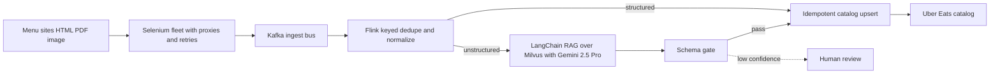

#### Box-by-box walkthrough

1. **Selenium fleet.** Scrapes third-party menu pages. Hardening it with dynamic proxy pools and adaptive retries raised extraction success to 95%+, from an estimated 60 to 65%. *Arrow content:* raw HTML, PDF or image plus vendor metadata.
2. **Kafka ingest bus.** Decouples scraping from processing. Events are keyed by vendor, so one vendor's events stay in order, and the log can be replayed after a bug fix.
3. **Flink.** Reads from Kafka and does stateful keyed deduplication (keyed by vendor and menu, using a content hash), then normalizes to the schema and routes each menu to the structured or unstructured branch. Peak load of roughly 200 to 500 events per second is an ESTIMATE for prep only.
4. **RAG branch.** For unstructured multilingual PDFs, LangChain retrieves similar labeled menus from Milvus, and Gemini 2.5 Pro generates the structured output. A schema gate validates it. Low-confidence output goes to human review. Field fidelity is 98%, measured in offline evaluation.
5. **Catalog upsert.** Writes into the Uber Eats catalog. The PDF says "exactly-once catalog upserts". In practice that is at-least-once delivery plus idempotent upserts. Not ClickHouse.

#### One menu, step by step

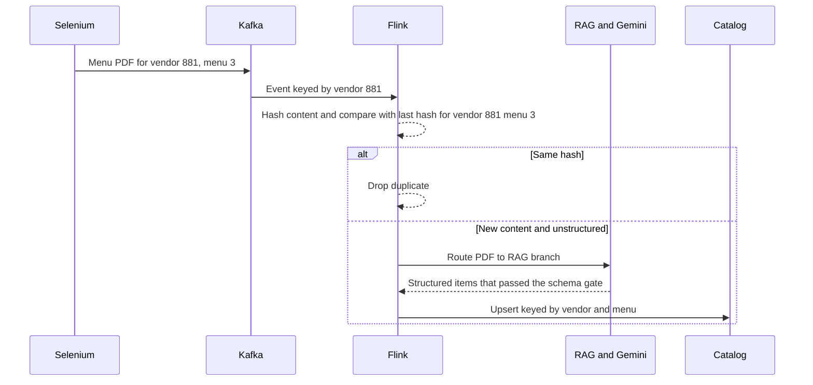

*What to notice:* a replay after a crash writes the same row again, which is harmless because the upsert key is stable.

#### Failure modes

| What fails | What happens |
|---|---|
| Site blocks the scraper | Proxy pool rotates IPs, adaptive retries back off |
| Same menu scraped twice | Flink drops it on matching content hash |
| Flink restarts mid-stream | Resumes from checkpoint, replays events, idempotent upserts absorb duplicates |
| LLM output breaks the schema | Schema gate rejects it, low confidence goes to human review |
| Need to reprocess history | Kafka replay. Spark is a verbal backfill option only, not on the PDF |

#### The numbers

- **From 24 hours to 2 hours** for restaurant onboarding.
- **$600K a year saved.** Derived from about $2 per menu in third-party or manual cost × 30K menus × 12 months = $720K, floored to $600K to be conservative. Say "$600K a year", not "$600K-plus".
- **98% field fidelity** is offline evaluation. Always say "offline".
- **95%+ extraction success**, from an estimated 60 to 65%.

### ANZ Document Compliance (Uber Mobility, not Eats)

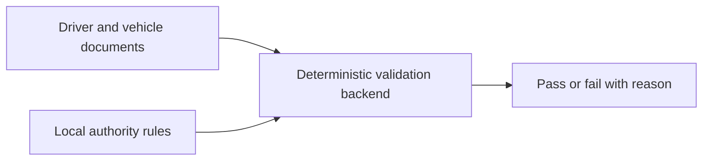

*What to notice:* no LLM, no Selenium, no RAG. It is rules applied deterministically.

The backend checks driver and vehicle documents against local authority rules. It reached 99.9% regulatory compliance and eliminated about 20 hours a week of manual effort. Both numbers are HISTORICAL. This is Mobility, not Eats, so never mix it into the Menu story.

### How to draw Menu in 3 minutes

- **Minute 1.** Draw sites on the left, then Selenium, then Kafka. Say "95%+ extraction success with proxy pools and adaptive retries, Kafka keyed by vendor and replayable".
- **Minute 2.** Draw Flink and split into two branches. Say "keyed dedupe by vendor and menu with a content hash, structured goes straight through, unstructured goes to RAG over Milvus with Gemini 2.5 Pro".
- **Minute 3.** Draw the schema gate and the catalog. Say "exactly-once upserts means at-least-once plus idempotent writes, 98% field fidelity offline, from 24 hours to 2 hours, $600K a year". Draw ANZ as a separate small box and say "different project, Mobility".

---

## 4. Masters India — GST / E-Invoicing

### The business in plain English

Masters India sells GST compliance and e-invoicing SaaS to Indian enterprises. Clients send invoices, and the platform validates them and registers them with the government IRP (Invoice Registration Portal), which returns an IRN (Invoice Reference Number) and a signed QR code. I led the migration of a legacy PHP monolith to Spring Boot microservices, mentored 2 engineers, and owned the bulk pipeline that handles over 1 million government submissions a day.

### Words you need

- **Strangler pattern:** replace an old system one route at a time, like a vine slowly replacing a tree, so you never do a risky big-bang cutover.
- **Canary:** send a small share of traffic to the new version first and watch it.
- **Sharding:** splitting one big database into pieces by a key. Here the key is the tax quarter.
- **Idempotency key:** a unique label for an operation so retrying it does not repeat its effect.
- **Spring Kafka consumer:** a method in a Spring Boot service (annotated `@KafkaListener`) that reads messages from a Kafka topic and processes them off the request path.
- **`@Async` / scheduled jobs:** Spring annotations that run a method on a background thread pool, or on a timer, instead of on the request thread.
- **Spring Batch:** a Java framework for chunked bulk jobs. It reads, processes and writes N records at a time and remembers which chunk it reached, so a failed job restarts from that chunk.
- **HikariCP:** the default database connection pool in Spring Boot. It keeps a set of open connections ready so each request does not pay to open one.
- **DLQ (dead-letter queue):** a side queue where repeatedly failing work is parked for an operator.
- **ELK (Elasticsearch, Logstash, Kibana):** a stack for collecting and searching logs. **New Relic:** an APM (application performance monitoring) tool that traces requests.

### Architecture

```text
 Client ERP / Dashboard
        |
 +------v----------------------------------+
 | API Gateway  (canary % -> Spring Boot)  |
 |              (fallback -> PHP)          |
 +------+----------------------------------+
        v
 Spring Boot microservices (auth . submit . bulk . recon)
        |
   +----+------------+--------------+--------------+
   v    v            v              v              v
  PG   Redis      Kafka topics    MongoDB         S3
  (by  (cache-    (chunks . IRP   (IRN/QR         (bulk file
  tax  aside,      jobs . hooks)   snapshots)      landing)
  qtr) hot config)
        |
        v
  IRP workers (Spring Kafka consumers)
     --idempotency + retries + DLQ--> Government IRP
        |
   ELK + New Relic (request-id correlation)
```

*What to notice:* the gateway is what makes the migration safe. Every route can be sent back to PHP on its own.

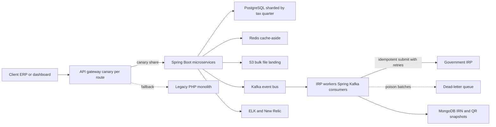

#### Box-by-box walkthrough

1. **API gateway with per-route canary.** Sends a percentage of each route's traffic to the Spring Boot services and falls back to PHP. The rule was shared database first, no dual-write source of truth.
2. **Spring Boot microservices.** Auth, submit, bulk and recon services. p95 latency fell 75%, from 1.2 seconds to 300 ms, across 1,500+ enterprise clients. The latency win came from non-blocking IRP calls (Spring WebClient) and bounded thread pools, HikariCP connection pooling, query and index fixes, plus Redis for reads.
3. **PostgreSQL sharded by tax quarter.** Filing work clusters around quarters, so sharding by quarter keeps each shard's working set small.
4. **Redis cache-aside.** Holds hot config and master data. Together with ELK and New Relic work, database read load fell 30%.
5. **S3.** Bulk files land here before validation (from the Masters deep dive).
6. **Kafka.** The event bus carrying chunks, IRP jobs and webhook events between services. This is a different product from the Uber Menu Kafka, and there is no Flink at Masters.
7. **IRP workers.** IRP calls, PDF generation, webhooks and email ran off the request path, in Kafka consumers inside the Spring Boot services, with retries and idempotency keys, so request threads never blocked on the government portal. Smaller background work used `@Async` and scheduled jobs, and chunked bulk imports fit Spring Batch. Keep the exact split between these qualitative if asked.
8. **MongoDB.** Stores flexible IRN and QR snapshots and vendor responses. Elasticsearch powered invoice search and the ELK stack.
9. **ELK and New Relic.** One request ID across API, Kafka consumer and IRP worker. Incident triage fell about 70% (HISTORICAL, from roughly 30 minutes to under 10, ESTIMATED).

#### One bulk import, step by step

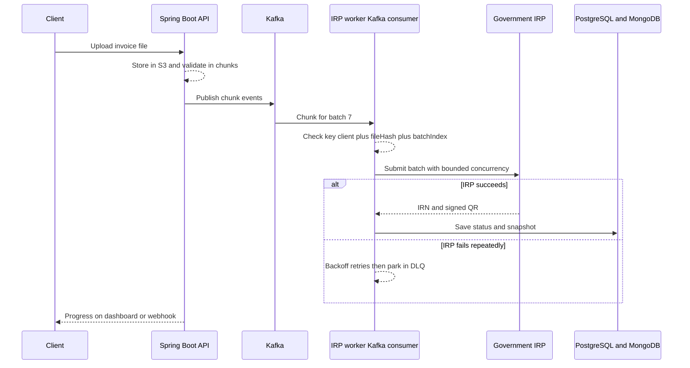

*What to notice:* the idempotency check happens before the government call, so a retried message never double-registers an invoice.

#### Failure modes

| What fails | What happens |
|---|---|
| IRP portal is slow or down | Exponential backoff with bounded retries, then DLQ for operator replay |
| Same chunk processed twice | Idempotency key `client + fileHash + batchIndex` returns the earlier result |
| Filing-deadline spike | Roughly 8 to 10 times the average (ESTIMATED), absorbed by Kafka buffering and bounded worker concurrency |
| New Spring Boot route misbehaves | Gateway sends that route back to PHP |
| Cache stampede on hot keys | TTL jitter and SETNX lock (prep pattern) |

#### The numbers

- **1M+ daily submissions** is about 12 per second on average (1,000,000 / 86,400 = 11.6).
- **Throughput from 700 to 4,000 requests per minute**, which is about 12 to about 67 requests per second.
- **100K+ concurrent imports** handled with exactly-once idempotent processing.
- **Coverage from 35% to 82%, 98% deployment success.**

### How to draw Masters in 3 minutes

- **Minute 1.** Draw the client, then the gateway, with Spring Boot on one side and PHP dotted on the other. Say "strangler with canary per route, p95 from 1.2 seconds to 300 ms across 1,500+ clients, mentored 2 engineers".
- **Minute 2.** Draw PostgreSQL by tax quarter, Redis, MongoDB and S3 under the Spring Boot services. Then Kafka to the IRP workers (Kafka consumers) to the government IRP.
- **Minute 3.** Write the idempotency key on the worker arrow and draw the DLQ dotted. Say "1M+ a day, about 12 per second average, 700 to 4,000 requests per minute". Finish with ELK and New Relic and "triage about 70% faster".

---

## 5. GeeksforGeeks

### The business in plain English

GeeksforGeeks runs a learning platform with courses and live coding contests. Learners post doubts (questions) during courses and contests, and influencers sell courses with affiliate coupons. I migrated the doubt-support backend from PHP to Django so it could handle 10K+ daily queries and 10x traffic spikes during live contests, and built the influencer analytics and earnings dashboard.

### Words you need

- **Django:** a Python web framework with an ORM, admin and auth built in.
- **Elasticsearch:** a search engine that indexes text for fast full-text search.
- **Asynchronous scheduled workflows:** background jobs that run on a schedule, separate from user requests.

### Architecture

```text
 Learners / influencers
        |
        v
 +------------------+
 | Django REST APIs |  (PHP -> Django migration)
 +--------+---------+
     +----+----+--------+
     v    v    v        v
   MySQL Mongo Redis  Elasticsearch
     |
     v
 Async scheduled workflows - video . reminders . cleanup   (+70% ops efficiency)
 Influencer dashboard - earnings / coupons                  (+30% course sales)
 Votes / pins / locks on doubts                             (20% premium lift)
```

*What to notice:* each store has one job, and the three outcomes come from three different parts of the system.

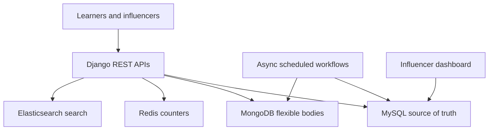

#### Box-by-box walkthrough

1. **Django REST APIs.** The voting, pinning and locking APIs for doubt threads, rebuilt from PHP.
2. **MySQL.** Source of truth for threads and permissions. The vote table has a unique (user_id, content_id) constraint, so a double-submit is harmless.
3. **Redis.** Holds display counters, reconciled asynchronously to MySQL to avoid hot-row contention on popular doubts.
4. **MongoDB.** Holds flexible payloads such as doubt bodies or attachments that vary in shape.
5. **Elasticsearch.** Powers search across doubts and content.
6. **Async scheduled workflows.** Video processing, reminders and data cleanup. These lifted engineering ops efficiency 70%.
7. **Influencer dashboard.** Transactions and affiliate coupon conversions. Course sales rose 30%.

#### Failure modes

| What fails | What happens |
|---|---|
| Contest spike, 10x traffic | Counters in Redis absorb hot writes, MySQL reconciled asynchronously |
| User double-clicks vote | Unique constraint makes it idempotent |
| Slow background job | Runs outside request path, so users are unaffected |

#### The numbers and how to say them

- **10K+ daily queries, 10x traffic spikes** during live contests.
- **20% lift in premium subscriptions**, relative, attributed by the growth team. Older prep said "15 to 20%". The current resume says 20%.
- **+30% course sales** and **+70% ops efficiency**. Say: "I owned the engineering, the business team attributed the lift."

### How to draw GeeksforGeeks in 3 minutes

- **Minute 1.** Draw Django in the middle and say "PHP to Django, 10K+ daily queries, 10x contest spikes".
- **Minute 2.** Draw the four stores below and give each one job: MySQL truth, Redis counters, MongoDB flexible bodies, Elasticsearch search.
- **Minute 3.** Draw the scheduled workflows and the influencer dashboard on the side, and attach the three outcomes: 20% premium lift, 30% course sales, 70% ops efficiency.

---

## Whiteboard checklist

- [ ] Draw AssortSmart: Go/Gin edge, ClickHouse with rollups, Keep/Drop batch with "JSON only" to the LLM, Ask Iris with frozen plan_scope. Say where SQL is forbidden.
- [ ] Draw FRM: Spring Boot controller, service, repository, MySQL on SOADB, with HFM and 10-Q inputs and PwC output.
- [ ] Draw Menu: Selenium, Kafka, Flink, with the RAG branch. Say ANZ is not Eats.
- [ ] Draw Masters: gateway canary, Kafka to IRP workers, PostgreSQL by tax quarter.
- [ ] Name one rejected alternative per critical box.

**Deeper reading:** ER, full table catalogs and why each technology: [`34_er_tables_tech_why.md`](34_er_tables_tech_why.md). Project deep dives: [`10_impact_analytics_deep_dive.md`](10_impact_analytics_deep_dive.md), [`43_ia_bullet_defense.md`](43_ia_bullet_defense.md), [`42_clickhouse_rollup_migration.md`](42_clickhouse_rollup_migration.md), [`11_uber_frm_deep_dive.md`](11_uber_frm_deep_dive.md), [`14_uber_menu_deep_dive.md`](14_uber_menu_deep_dive.md), [`12_masters_gfg_deep_dive.md`](12_masters_gfg_deep_dive.md).
