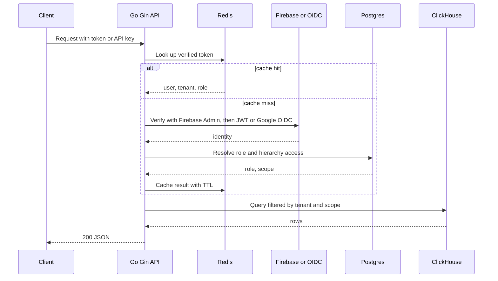

# Table schemas, database design and API contracts (all resume projects)

<div class="callout highlight">
<b>How to use this page</b>
<ul>
<li><b>What it covers:</b> column-level table designs and API contracts for every project on the Java + Python resume. For each table: what it stores in plain words, a sample row, why each key or index exists, and which query it serves. For each API: purpose, a JSON request and response, status codes, idempotency, auth and pagination.</li>
<li><b>When to read it:</b> before a low-level design round, a "design the schema" exercise, or any "walk me through one endpoint" question.</li>
<li><b>What to memorise:</b> 2-3 tables per project with their keys, and 3-5 endpoints per project. The rest is reference.</li>
<li><b>Companion page:</b> ER diagrams and "why this tech" reasoning live in <a href="34_er_tables_tech_why.md">34_er_tables_tech_why.md</a>.</li>
</ul>
</div>

## What is real and what is a teaching example

| Project | Schema truth | API truth |
|---|---|---|
| **IA AssortSmart, resume level** | MEASURED table names for the six rollups. Column lists are ILLUSTRATIVE. | Ask Iris WebSocket and auth waterfall are MEASURED behaviour. Exact payload JSON and route names are ILLUSTRATIVE. |
| **IA Agentic Cluster Module** | MEASURED design: ClickHouse DDL Phase-1, validated, no runtime evidence | DESIGN: tool categories plus a Go write API sketch. Verbal depth only, not a resume bullet. |
| **Uber FRM** | MEASURED code: 11 ORM models (JPA entities) in the scoping service (the PDF calls the normalized core an 8-table schema) | MEASURED code: the scoping controller's routes under `/frm-scoping`. The PDF's 36 endpoints adds the collaboration APIs (breakdown below). |
| **Uber Menu** | LOGICAL / HISTORICAL shapes. No production DDL in this repo. | LOGICAL event and upsert contracts |
| **Masters India** | LOGICAL / HISTORICAL | LOGICAL REST plus async IRP |
| **GFG** | LOGICAL / HISTORICAL | LOGICAL REST |

**Tags used on this page.** MEASURED means there is code, a log or a validated document. MEASURED design means a validated design document that has not run under production load. TARGET is a design goal ("targeting"). ESTIMATED is arithmetic I can show ("roughly, derived from"). HISTORICAL is from my past work records. LOGICAL is the whiteboard shape, not literal production names. ILLUSTRATIVE is a teaching example with made-up columns or values. Never present an ILLUSTRATIVE block as the production schema.

<div class="callout warn">
<b>Honesty rules that apply to this page.</b> Omit the old IA "624 columns" figure. Do not invent IA TPS or latency SLAs. FRM: lead with the PDF (36 endpoints, 8-table SOADB), keep "11 ORM models" and "32 controller route mappings" as verbal depth. Menu uses Milvus, not Pinecone. The Cluster Copilot design is verbal only. Ask Iris is shipped, with no SLA or usage numbers. No human-review queue (HITL) on IA.
</div>

---

## Words you need on this page

- **REST endpoint.** A URL plus an HTTP method (GET reads, POST creates, PUT replaces, PATCH changes part of a record, DELETE removes).
- **Status code.** The three-digit number on every HTTP response. 2xx means it worked, 4xx means the caller did something wrong, 5xx means the server failed.
- **Idempotent request.** Sending it twice leaves the system in the same state as sending it once. GET, PUT and DELETE are idempotent by definition. POST is not, unless you add an idempotency key.
- **Idempotency key.** A unique token the client sends with a write. The server remembers it, and if the same key arrives again it returns the original result instead of doing the work twice. Like a cloakroom ticket: showing the same ticket twice gets you the same coat, not two coats.
- **202 Accepted.** "I have your request and will finish it later." Used when the real work (for example a government portal call) happens asynchronously.
- **Pagination.** Returning a large list in pages. Offset pagination says "skip 100, give me 50". Cursor pagination says "give me 50 after this marker", which stays correct when rows are being inserted.
- **JWT (JSON Web Token).** A signed token that says who the caller is. The server can verify the signature without a database lookup.
- **WebSocket.** A long-lived two-way connection, opened by an HTTP "upgrade" handshake. Good for chat, where both sides send messages at any time.
- **Composite index.** An index on several columns in order, for example `(client_id, invoice_date)`. It serves queries that filter on the first column, or the first and second together.
- **Unique constraint.** The database refuses a second row with the same value. This is the simplest way to make a write idempotent.

---

## How to answer a "design the schema / API" question

1. Name the **store** (MySQL, ClickHouse, Kafka plus catalog, PostgreSQL plus MongoDB).
2. Draw **2-3 tables** with the primary key, the natural key and 5-8 critical columns.
3. Sketch **3-5 endpoints** with method, path, body and response shape.
4. Say the **idempotency story** and the **auth story** for each write.
5. Tag MEASURED, DESIGN, HISTORICAL, LOGICAL or ILLUSTRATIVE as you go.

### Status code conventions used in the examples (ILLUSTRATIVE)

These are standard HTTP meanings, used consistently in the sample contracts below. They explain the design. They are not a claim about every production error mapping.

| Code | Meaning in these examples |
|---|---|
| 200 OK | Read succeeded, or a synchronous write finished |
| 201 Created | A new resource was created |
| 202 Accepted | Work queued, poll or wait for a callback |
| 400 Bad Request | Malformed input, or input that breaks a business rule. In the Spring Boot services (FRM, Masters), a Bean Validation failure on the request DTO also returns 400 with a validation error body listing the bad fields. |
| 401 Unauthorized | No valid identity |
| 403 Forbidden | Valid identity, but not allowed to see or change this tenant, hierarchy or record |
| 404 Not Found | Unknown id |
| 409 Conflict | Same idempotency key with a different body, or a version conflict |
| 422 Unprocessable Entity | Used in the Menu and GFG examples: the body is well-formed but fails schema or value validation |
| 429 Too Many Requests | Rate limited |
| 503 / 504 | Downstream unavailable or a timeout fired |

---

# 1. Impact Analytics: ClickHouse schemas and API surface

**In plain English.** AssortSmart helps retail planners decide which articles to keep, drop or add each season. The heavy data (sales, inventory, forecasts, rollups, AI decisions) lives in ClickHouse, a columnar database built for scanning billions of rows. The small, transactional data (users, roles, which part of the product hierarchy a user may see) lives in PostgreSQL. The Go / Gin platform serves the APIs at 10k peak RPS, and the Python agent plane (FastAPI, LangGraph) runs the AI batch and the Ask Iris copilot.

This section has two halves. **1A** is the resume-level design that the PDF bullets rest on. **1B** is the Agentic Cluster Module Phase-1 DDL, a validated design that is verbal depth only.

## 1A. Resume-level tables

### 1A.1 Rollup tables: `product_weekly` and its five siblings

**What it stores, in plain words.** Pre-computed sales and inventory totals at a coarser grain than the raw daily data, so a planner's pivot reads thousands of summary rows instead of hundreds of millions of raw ones. There are six: product, store and attr, each at season and weekly grain. The table names and `PARTITION BY season_code` are MEASURED. The column list below is ILLUSTRATIVE (the real load SQL is generated and has roughly 110 aggregate states on the weekly path).

```sql
-- ILLUSTRATIVE columns. Real: MergeTree, PARTITION BY season_code, six tables.
CREATE TABLE product_weekly
(
    season_code       UInt16,
    fiscal_year_week  UInt32,
    product_code      String,
    style             String,
    color             LowCardinality(String),
    size              LowCardinality(String),
    l1_name           LowCardinality(String),
    l2_name           LowCardinality(String),
    l3_name           LowCardinality(String),
    revenue           Float64,
    units             Float64,
    on_hand_units     Float64
)
ENGINE = MergeTree
PARTITION BY season_code
ORDER BY (l1_name, l2_name, l3_name, product_code, fiscal_year_week);
-- bloom filter skip indexes on product / store / attr columns (MEASURED idea)
```

**Sample row (made-up values).**

| season_code | fiscal_year_week | product_code | l1_name | l2_name | revenue | units |
|---|---|---|---|---|---|---|
| 7 | 202614 | P-10234 | Womens | Tops | 18,420.50 | 612 |

**Why each key or index exists.**
- `PARTITION BY season_code` (MEASURED): planners filter by season, so ClickHouse skips every other season on disk. It is also the unit of rebuild and copy. A failed season is fixed by `DROP PARTITION` and recopy.
- `ORDER BY` with the hierarchy first (ILLUSTRATIVE): ClickHouse stores rows sorted by this key and keeps a sparse index on it, so a filter on `l1_name` and `l2_name` reads only the matching ranges. Low-cardinality columns go first because they prune best.
- Bloom filter skip indexes (MEASURED idea): a bloom filter is a compact "definitely not here / maybe here" check per block, which lets a point lookup on a product or store code skip most blocks.

**Query it serves (ILLUSTRATIVE).**

```sql
SELECT l2_name, fiscal_year_week, sum(revenue) AS revenue, sum(units) AS units
FROM product_weekly
WHERE season_code = 7 AND l1_name = 'Womens'
GROUP BY l2_name, fiscal_year_week
ORDER BY l2_name, fiscal_year_week;
```

This is the planner pivot shape. On a 250M-row harness, reading pre-aggregated rollups took the pivot from 189 seconds to 12 seconds (12.3s rounded, 15.5x, MEASURED query time).

**How it is built.** Weekly tables are loaded one fiscal week per `INSERT SELECT`, with memory and disk-spill caps (verbal knobs: 55 GB memory cap, 16 GB spill, 8 threads, 4 weeks in flight). A whole-season weekly aggregate needed about 170GB and failed at 80GB and 200GB caps. That fix is load time and is separate from the 15.5x.

### 1A.2 AI decision outputs (ReplacingMergeTree, ILLUSTRATIVE columns)

**What it stores.** One row per article-season per run: the deterministic score, the LLM score, the blended score, the decision, whether the LLM timed out and the run fell back to the deterministic score, and the `config_hash` of the run. The mechanism (ReplacingMergeTree, version column, `config_hash` on every row, deterministic fallback) is MEASURED. The table and column names are ILLUSTRATIVE.

```sql
-- ILLUSTRATIVE names. Real mechanism: ReplacingMergeTree with a version column.
CREATE TABLE decision_output_example
(
    season_code   UInt16,
    article_id    String,
    pipeline      LowCardinality(String),   -- keep_drop / missed_opportunity / top_style
    s_det         Float64,
    s_agent       Nullable(Float64),
    s_final       Float64,
    decision      LowCardinality(String),   -- KEEP / DROP
    fallback      UInt8,                    -- 1 = LLM timed out, deterministic score used
    config_hash   FixedString(64),          -- SHA-256 of guardrails + params + prompts + catalog
    run_id        UUID,
    version       UInt64
)
ENGINE = ReplacingMergeTree(version)
PARTITION BY season_code
ORDER BY (pipeline, season_code, article_id);
```

**Sample row and worked math (made-up scores, real formula).** The blend is s_final = 0.4 times s_det plus 0.6 times s_agent, and the rule is keep if s_final is at least 0.55. With s_det = 0.70 and s_agent = 0.50, s_final = 0.28 + 0.30 = 0.58, so the article is kept.

| season_code | article_id | pipeline | s_det | s_agent | s_final | decision | fallback | config_hash |
|---|---|---|---|---|---|---|---|---|
| 7 | A-55120 | keep_drop | 0.70 | 0.50 | 0.58 | KEEP | 0 | 9f2c...e1 (64 hex) |

If the LLM had timed out, `s_agent` would be null, `fallback` would be 1, and the row would carry the precomputed deterministic baseline so the 88k-item pass keeps moving.

**Why each key exists.**
- `ORDER BY (pipeline, season_code, article_id)`: in ReplacingMergeTree the sort key is also the dedupe key. Two rows with the same key collapse to the one with the highest `version`. A retried batch that lands twice becomes one row.
- `version`: decides which duplicate wins.
- `config_hash`: lets anyone trace a decision back to the exact frozen configuration, and lets you compare two runs fairly.

**Query it serves.** "Show the latest decision for every article in this season."

```sql
SELECT article_id,
       argMax(decision, version) AS decision,
       argMax(s_final, version)  AS s_final,
       argMax(config_hash, version) AS config_hash
FROM decision_output_example
WHERE pipeline = 'keep_drop' AND season_code = 7
GROUP BY article_id;
```

Say this carefully: Keep/Drop defaults to CSV output first, and publishing to ClickHouse is a separate operations step. The model never gets a SQL tool. "Async" describes how batches run, not the model querying the database.

### 1A.3 Thin PostgreSQL: identity, UAM, roles (ILLUSTRATIVE columns)

**What it stores.** Who the users are, which tenant they belong to, their role, and which part of the product hierarchy (UAM scope) they may see. The split (PostgreSQL holds UAM and roles, ClickHouse holds facts) is MEASURED. The columns are ILLUSTRATIVE.

```sql
-- ILLUSTRATIVE
users(id UUID PRIMARY KEY, email TEXT UNIQUE NOT NULL, created_at TIMESTAMPTZ)
tenant_membership(
  user_id UUID REFERENCES users(id),
  tenant_id TEXT NOT NULL,
  role TEXT NOT NULL,                 -- for example planner / admin
  PRIMARY KEY (user_id, tenant_id)
)
hierarchy_access(
  user_id UUID, tenant_id TEXT,
  hierarchy_path TEXT,                -- for example 'Womens/Tops'
  PRIMARY KEY (user_id, tenant_id, hierarchy_path)
)
workflow_state / feature_flags        -- small metadata tables
```

**Sample row.** `tenant_membership`: `user_id = 3b1e...`, `tenant_id = 'retailer_a'`, `role = 'planner'`. `hierarchy_access`: the same user may see `Womens/Tops` only.

**Why the keys exist.** The composite primary key `(user_id, tenant_id)` makes "is this user in this tenant, and with what role" a single index lookup, and it stops duplicate memberships. `hierarchy_access` keyed by user, tenant and path answers "which slices may this user query", and that list becomes a filter on every ClickHouse read.

**Query it serves.** Role resolution on each request (after the Redis cache misses), and building the hierarchy filter for ClickHouse queries.

### 1A.4 Redis auth cache (ILLUSTRATIVE key shape)

```text
auth:token:<sha256 of token>  ->  {"user_id": "3b1e...", "tenant_id": "retailer_a", "role": "planner"}   TTL shorter than the token lifetime
```

**Why.** Verifying a token with Firebase Admin or Google OIDC on every call is slow. Redis caches the verified result. A cache miss falls through to the real verification and to PostgreSQL role resolution. It never fails open.

## 1B. Resume-level APIs

### 1B.1 Ask Iris: JWT-secured WebSocket copilot (A4)

**Purpose.** Planners ask questions in chat ("why was this article dropped?", "what is sell-through for Womens Tops this season?") and inspect AI decisions. It is a FastAPI WebSocket in front of a LangGraph supervisor with a 3-attempt evaluator loop (`MAX_ATTEMPTS = 3`), traced in LangSmith. Shipped capability. No SLA or usage numbers.

**Handshake and auth (MEASURED behaviour, ILLUSTRATIVE path).** The JWT is checked on the handshake, either from `Authorization: Bearer <jwt>` or a `?token=` query parameter (browsers cannot set headers on WebSocket upgrades). The user's tenant and hierarchy scope (`plan_scope`) are resolved once and frozen for the whole socket. A later message cannot change it, which is how cross-tenant leaks are prevented.

```text
GET /ws/iris?token=<jwt>        (ILLUSTRATIVE path)
Upgrade: websocket
```

**Messages (ILLUSTRATIVE JSON).**

```json
{ "type": "question", "id": "q-001", "text": "Why was article A-55120 kept in season 7?" }
```

```json
{
  "type": "answer",
  "id": "q-001",
  "text": "It was kept. The deterministic score was 0.70 and the blended score 0.58, above the 0.55 keep threshold.",
  "evidence": { "s_det": 0.70, "s_final": 0.58, "config_hash": "9f2c...e1" },
  "attempts": 2
}
```

**Failure behaviour.**
- Bad or expired token: the server refuses the upgrade or closes the socket with a policy-violation close code (1008 is the standard code for this, ILLUSTRATIVE).
- Evaluator still unhappy after 3 attempts: the graph stops and returns a graceful "could not answer confidently" message rather than looping. A recursion limit on the supervisor graph is the second guard.
- A question outside the frozen `plan_scope`: tools inherit the frozen scope, so the data simply is not reachable.

**Idempotency.** Chat questions are reads. Each carries a client `id` so the UI can match an answer to a question after a reconnect. **Pagination:** not applicable (streamed messages).

### 1B.2 KPI configurator and formula compiler (C2, ILLUSTRATIVE contract)

**Purpose.** Operators author KPI formulas in business terms. A Go tokenizer and parser compile them into parameterized ClickHouse SQL fragments, so business formulas change without a code release. The mechanism (tokenizer, allowlisted functions, logical-to-physical column mapping, `ifNotFinite(toFloat64(expr), 0)` wrapper, unknown tokens fail closed) is MEASURED. The route and JSON below are ILLUSTRATIVE.

```http
POST /v1/kpis/compile          (ILLUSTRATIVE)
Authorization: Bearer <jwt>
Content-Type: application/json
```

```json
{ "name": "sell_through", "formula": "units_sold / (units_sold + on_hand)" }
```

```json
{
  "name": "sell_through",
  "sql_fragment": "ifNotFinite(toFloat64(sum(units) / (sum(units) + sum(on_hand_units))), 0)",
  "columns": ["units", "on_hand_units"]
}
```

What to notice: `units_sold` and `on_hand` are logical names the operator sees. The compiler maps them to physical columns through the catalog. The whole expression is wrapped in `ifNotFinite(..., 0)`, so dividing by zero yields 0 instead of Infinity or NaN poisoning planner JSON.

**Status codes.** 200 on success. 400 with the offending token when the formula has an unknown identifier or a function outside the allowlist (fail closed). 401 / 403 as usual.

**Idempotency.** Compiling the same formula always yields the same fragment, so it is naturally idempotent. **Security:** raw operator SQL is never concatenated. Tokens must parse, functions must be on the allowlist and identifiers must resolve through the catalog.

### 1B.3 Auth waterfall and tenant isolation (C3)

**Purpose.** Every API request is authenticated and scoped to one tenant and the user's UAM hierarchy, across PostgreSQL and ClickHouse.



*What to notice:* identity checks go through Redis first. A miss walks the waterfall (Firebase Admin, then JWT / Google OIDC) and resolves roles in PostgreSQL. The tenant and scope filter is applied before ClickHouse is touched.

**API keys.** Machine clients can use an API key, compared in constant time. A normal `==` returns early at the first wrong character, so response timing leaks how much of the key was right. A constant-time compare takes the same time on every mismatch.

**Status codes.** 401 when no identity resolves. 403 when the identity is valid but the requested tenant or hierarchy slice is outside the user's UAM scope. Isolation is access control, not encryption.

### 1B.4 Platform conventions (C1)

The Go / Gin platform runs at 10k peak RPS, uses Google Wire for compile-time dependency injection, and serves native h2c (HTTP/2 cleartext, meaning HTTP/2 without TLS inside the trusted network) with no reverse proxy in front. Nested timeouts mean every request gets an overall deadline, and every downstream call (Redis, PostgreSQL, ClickHouse) gets a shorter deadline inside it, so a slow dependency fails that request fast (a 504-style error) instead of tying up the server. Datadog traces each request across those hops. No invented SLA.

## 1C. Agentic Cluster Module: Phase-1 ClickHouse DDL (MEASURED design, verbal only)

<div class="callout warn">
<b>Say this carefully.</b> This is the validated Phase-1 design for the Cluster Recommendation Copilot, which is verbal depth, not a resume bullet. It was syntax-validated on ClickHouse 25.12 with four adversarial review passes, but has <b>zero runtime evidence</b> (load test planned at bring-up). The approval and write-back tables are part of that design. They are not a shipped human-review queue, and the IA resume makes no HITL claim. The <code>REPLACE PARTITION</code> pattern here is design, as is the incremental <code>REPLACE PARTITION</code> rollup design. What actually ran on the rollups was <code>DROP PARTITION</code> then recopy.
</div>

**Tenant database example:** `cluster_briscoes` (one ClickHouse database per retailer). **Inventory:** 63 tables (including 7 stage twins), 8 layers, 5 dictionaries, 19 views. **Writers:** SYNC jobs (facts, cubes, mirrors), API / JR / NIGHT jobs (decision plane). The agent database user is `readonly=1` only.

### 1C.1 Facts (P1: MergeTree plus stage twin plus `REPLACE PARTITION`)

**`fact_sales`: what it stores.** One row per product, store and date with sales measures, with the product hierarchy copied onto every row (denormalized) so pivots never need a join.

```sql
-- fact_sales  ENGINE = MergeTree
-- PARTITION BY toYYYYMM(date)
-- ORDER BY (l1_name, l2_name, l3_name, store_code, date)
date Date
fy_fw UInt32
channel / sub_channel LowCardinality(String)
store_code LowCardinality(String)
product_code / article / style String
color / size / season LowCardinality(String)
l0_name ... l6_name LowCardinality(String)   -- hierarchy denormalized on fact
product_bucket_code, brand, product_type, ...
is_clearance UInt8
revenue / qty / qty_returns / cost / margin / discount_amount / msrp / price / lost_units Float64
-- bloom indexes: style, article, product_code
-- twin: fact_sales_stage AS fact_sales
```

**Sample row (made-up values).** `date = 2026-04-03`, `fy_fw = 202614`, `channel = 'Store'`, `store_code = 'S042'`, `product_code = 'P-10234'`, `l1_name = 'Womens'`, `l2_name = 'Tops'`, `revenue = 129.90`, `qty = 3`, `is_clearance = 0`.

**Why each key exists.**
- `PARTITION BY toYYYYMM(date)`: one partition per month. A restatement of March rebuilds only March in the stage twin, then swaps it in.
- `ORDER BY (l1, l2, l3, store_code, date)`: pivots filter by hierarchy then store, so this order prunes the most.
- `LowCardinality(String)`: dictionary-encodes columns with few distinct values (channel, color), which shrinks storage and speeds filters.
- Bloom indexes on `style`, `article`, `product_code`: fast "find this product" lookups that the sort key does not cover.
- `fact_sales_stage AS fact_sales`: the stage twin has an identical structure, which `REPLACE PARTITION` requires.

**Queries it serves.** Hierarchy-by-store-by-period pivots, and the source for cubes.

**How a restatement works (design).**

```sql
INSERT INTO fact_sales_stage SELECT ... WHERE toYYYYMM(date) = 202603;  -- build offline
ALTER TABLE fact_sales REPLACE PARTITION 202603 FROM fact_sales_stage;  -- swap in one step
```

Readers see either the old month or the new month, never half of each. "No row UPDATE on the hot path."

**`fact_inventory_wk`.** Weekly on-hand, receipts and stockouts per product and store.

```sql
-- fact_inventory_wk  PARTITION BY toYYYYMM(week_start)
-- ORDER BY (l1_name, l2_name, l3_name, store_code, week_start)
week_start Date
fy_fw UInt32
channel, store_code, l1_name, l2_name, l3_name
product_code String
oh_units / oh_cost / receipts_qty / receipts_cost / receipts_msrp / lost_units Float64
stockout_flag UInt8
```

Serves inventory pivots and stockout analysis. Same partition and sort reasoning as `fact_sales`, at weekly grain.

**`fact_forecast_wk`.** Forecast measures for future weeks, so future windows can use forecast KPIs exactly like actuals.

```sql
week_start, fy_fw, channel, store_code, l1/l2/l3
forecast_ver LowCardinality(String)
fc_revenue / fc_qty / fc_margin Float64
```

`forecast_ver` keeps several forecast versions side by side, so a plan can say which forecast it used.

**`ingest_watermark`: the sync ledger (P4).** What it stores: one append-only row per partition landed from upstream, with row counts, bytes and status. It is the reproducibility anchor: "this decision was made on data as of this watermark."

```sql
source_table LowCardinality(String)
partition_id String
last_modified DateTime64(3)
row_count UInt64
bytes_landed UInt64
load_id UUID
status Enum8('landed','verified','failed')
detail String
synced_at DateTime64(3)
-- views: v_watermark_latest (argMax), v_data_as_of
```

**Sample rows.** `('fact_sales', '202603', ..., row_count = 41,200,000, status = 'landed')` followed later by the same partition with `status = 'verified'`. The view `v_watermark_latest` uses `argMax` to show only the latest status per partition. `v_data_as_of` answers "how fresh is the data I am looking at", which the agent discloses to the planner.

### 1C.2 Dimensions (P2: ReplacingMergeTree)

**`dim_store`: what it stores.** One current row per store (name, channel, region, open and close dates). Updates are new versions, not UPDATEs.

```sql
-- dim_store  RMT(synced_at, is_deleted)  ORDER BY store_code
store_code, store_name, channel, sub_channel, region, store_type
active UInt8, open_date Date, close_date Nullable(Date)
is_deleted UInt8, synced_at DateTime
```

**Sample.** `('S042', 'Auckland Central', 'Store', ..., active = 1, is_deleted = 0, synced_at = 2026-07-01 02:00)`. If the store closes, a new row arrives with `close_date` set and a newer `synced_at`, and it wins.

**Why the keys exist.** `ORDER BY store_code` is the dedupe key. `synced_at` is the version (newest wins). `is_deleted` lets a delete be expressed as an insert (a "tombstone"), which ReplacingMergeTree can drop during merges.

**`dim_hierarchy`.**

```sql
-- dim_hierarchy  RMT(synced_at, is_deleted)
hierarchy_code, level UInt8
l0_name ... l6_name, path, is_leaf, is_custom, active
attribute_list String, search_text (+ ngram / aliases)
-- dim_fiscal, dim_sister_store, dim_channel  (same RMT pattern)
```

Serves "grounding": when a planner types "womens tops", `search_text` with n-gram and alias matching resolves it to a real hierarchy node. An n-gram index breaks text into short overlapping chunks so fuzzy matches are fast.

**Dictionaries.** Five (store, hierarchy, fiscal, channel, sister-store) plus `dict_user` at bring-up. A ClickHouse dictionary is an in-memory key-value lookup loaded from a table. `dictGet('dict_store', 'region', 'S042')` returns a region instantly without a join, which keeps agent grounding queries cheap.

### 1C.3 Cubes and caches (planner rollups inside the design)

```sql
-- cube_store_attr_week / cube_store_kpi_week  (+ stage twins, P1 swap)
-- significance_cache / precomputed_candidates  RMT(computed_at)
-- feature_matrix_cache  MergeTree
```

Say the purpose in an interview and do not recite columns. Cubes are pre-aggregated store-by-attribute and store-by-KPI weekly views (rebuilt by partition swap). Caches hold expensive computed inputs (significance tests, candidate lists, feature matrices) with `computed_at` as the version.

### 1C.4 PostgreSQL mirrors (transitional read models)

**`mirror_plan`: what it stores.** A ClickHouse copy of each plan defined in the incumbent product, so the agent can reason about plans without calling the incumbent database.

```sql
-- mirror_plan  ORDER BY plan_code
plan_code UInt32
plan_name, description String
step_x10 UInt8          -- NEVER Float32 (1.3 is not binary-safe); 13 = step 1.3
is_deleted UInt8
selling_sdate / selling_edate Date
selling_periods JSON
channels Array(String)
hierarchy_level LowCardinality(String)
scope_filters JSON
scope_l1s / scope_l2s / scope_l3s Array(String)
scope_fingerprint FixedString(64)
scope_recoverable UInt8
member_cnt UInt32, cluster_cnt UInt16, adoption_cnt UInt32
created_via, created_at, updated_at, synced_at

-- mirror_plan_membership  ORDER BY (plan_code, channel, store_code)
plan_code, channel, store_code, cluster_code, display_name, synced_at

-- mirror_strategy_consumer  ORDER BY (cluster_plan_code, strategy_plan_id)
-- mirror_plan_line  (+ stage) planned_* / bought_* by week (outcome loop)
```

**Sample row.** `plan_code = 1182`, `plan_name = 'SS26 Womens'`, `step_x10 = 13`, `member_cnt = 240`, `scope_recoverable = 1`, `is_deleted = 0`.

**A design detail worth saying.** `step_x10` stores the workflow step multiplied by 10 as an integer. Step 1.3 cannot be represented exactly in binary floating point (it becomes 1.2999999...), so a comparison like `step >= 1.3` could silently fail. Storing 13 avoids that. `scope_fingerprint` is a hash of the plan's scope, so two plans with the same scope can be matched without comparing JSON.

**Query it serves.** The view `v_doorway_eligible` lists plans the copilot may work on:

```sql
SELECT plan_code FROM mirror_plan
WHERE step_x10 >= 13 AND is_deleted = 0 AND member_cnt > 0 AND scope_recoverable = 1;
```

### 1C.5 Decision plane: content-addressed config plus event status

**`cluster_config`: what it stores.** A clustering configuration document, keyed by its own SHA-256 hash ("content addressing"). The same config always has the same key, so inserting it twice is harmless.

```sql
-- cluster_config  RMT(created_at)  ORDER BY config_hash
config_hash FixedString(64)     -- content address; insert dedup token
doc JSON
scope_fingerprint FixedString(64)
entry_mode, created_by, created_at
```

**`cluster_run`: an immutable header.** One row per run: which config, on which data watermark, with which scorer version and seed. Status is **never** stored here.

```sql
-- cluster_run  (immutable HEADER, status NEVER here)
config_hash, data_watermark, run_id UUID, batch_id UUID, session_id UUID
plan_code UInt32 DEFAULT 0
scope_fingerprint, entry_mode, scorer_version, weights_version, seed
created_by, created_at, created_date
ORDER BY (config_hash, data_watermark, run_id)
```

Why that sort key: "have we already run this config on this data?" becomes a prefix lookup on `(config_hash, data_watermark)`, which is how duplicate runs are avoided.

**`cluster_run_event`: status as an append-only stream (P3).**

```sql
-- cluster_run_event  (P3 append-only status)
run_id, event_seq UInt16, event_time DateTime64(6)
status Enum8('queued','claimed','running','scored','failed','timeout','superseded')
claim_token, error, actor, event_date
-- latest: v_run_status / v_run_status_recent via argMax(event_seq, event_time, claim_token)
```

**Sample history for one run (made-up).**

| run_id | event_seq | status | claim_token |
|---|---|---|---|
| r-77 | 1 | queued | |
| r-77 | 2 | claimed | tok-A |
| r-77 | 3 | running | tok-A |
| r-77 | 4 | scored | tok-A |

The view `v_run_status` returns `scored` for `r-77`, because that row has the highest `event_seq`.

**Lock-free claim (design).** ClickHouse has no row locks, so workers claim a run by racing: each worker inserts a `claimed` event with its own `claim_token`, then reads `v_run_status`. Only the worker whose token won the `argMax` proceeds. The loser backs off. If a worker crashes, a `superseded` event is appended and the retry gets a **new** `run_id`, so the history stays clean.

**`cluster_run_membership`.** Typed store-to-cluster labels produced by a run.

```sql
run_id, config_hash, batch_id
axis Enum8('product','performance','store')
k UInt8, channel, store_code, label, label_ord, margin_to_next
pinned UInt8, shortlisted UInt8
```

`margin_to_next` records how close a store was to the next cluster, which helps explain borderline assignments. `pinned` marks stores a planner fixed in place.

### 1C.6 Approval, immutable snapshot and write-back (design)

```sql
-- approval_event
run_id, event_seq, event_time
status Enum8('pending','approved','rejected')
approver, comment
snapshot_id FixedString(64)
writeback_plan_code UInt32
-- view: v_approval_state

-- Ordering contract: write plan_snapshot + snapshot_* FIRST, 'approved' event LAST

-- plan_snapshot  ORDER BY (plan_code, approved_at)  kept forever
plan_code, approved_at, snapshot_id, run_id, config_hash
config_doc JSON, metric_vector JSON, pins_applied JSON
data_watermark, scorer_version, weights_version, approved_by

-- snapshot_cluster  ORDER BY (snapshot_id, channel, cluster_code)
-- cluster_code = trim(concat(channel, ' ', product_label, performance_label, ' ', store_label))

-- snapshot_membership  frozen store-to-cluster (+ per-axis labels)

-- writeback_staging / writeback_plan_shell / writeback_event  (transitional PG wire)
-- pending_intent + intent_event  (strategy_create, recluster_proposal, ...)
```

**Why the ordering contract matters.** The snapshot rows are written first and the `approved` event last. If the process crashes in between, there is no `approved` event, so nothing downstream treats a half-written snapshot as final. The event acts as the commit marker, which is how you get atomic-looking behaviour in a database without multi-statement transactions.

**Gotcha to say.** `is_optimal` (the engine's verdict on run metrics) is not the same as `is_final` (the human decision, via approval and snapshot). The agent never writes these tables.

### 1C.7 Thin PostgreSQL in the design

```text
users(id, email, ...)
tenant_membership(user_id, tenant_id, role)
workflow_state / feature_flags
-- ClickHouse dict_user syncs identity for audit labels; Postgres remains the auth source of truth
```

### 1C.8 Cluster Module API and tool design (DESIGN, verbal only)

**Plane split.**

| Layer | Role | Mutates? |
|---|---|---|
| FastAPI plus LangGraph plus MCP | Chat, tool sequencing, evidence packs | No planning facts |
| **14 audited tools** (MCP) | Templated reads: grounding, significance, candidates, score, compare, pins and impact | SELECT / `dictGet` only |
| Go Gin "doing layer" | Clustering (and, in the design, Hindsight and Strategy) writes after gates | INSERT-only on owned ClickHouse tables plus PostgreSQL write-back procedures |
| Sync / NIGHT jobs | BigQuery to ClickHouse facts, cube rebuild, mirror refresh | Stage plus partition swap, RMT inserts |

**Design gates:** grounding, then search plan, then approval, then write-back. These are design steps of a verbal-only module, not a shipped HITL queue.

**Tool categories** (say these, do not invent 14 product names):

1. Scope and hierarchy grounding
2. Eligibility / doorway FitScore inputs
3. Significance and candidate generation
4. Feature matrix and k-search support reads
5. Score, rank and compare configs
6. Pin and edit-impact preview (read only)
7. Run and batch progress (`v_batch_progress`)
8. Watermark and data-as-of disclosure

**Go write API sketch (DESIGN shape).**

```text
POST /v1/runs                    {config_hash|config_doc, plan_code?, session_id}
                                 -> {run_id, batch_id, status: queued}
GET  /v1/runs/{run_id}           -> header + v_run_status
POST /v1/batches/{id}/claim      -> claim_token dance (worker)
POST /v1/approvals               {run_id, decision, comment}
                                 -> snapshot_id (snapshot rows then approved event)
POST /v1/writeback               {snapshot_id, plan_code}  // after the gate
GET  /v1/plans/{plan_code}       -> mirror + doorway eligibility
```

**One contract in full: `POST /v1/runs` (DESIGN).**

```json
{ "config_hash": "4ab1...7c", "plan_code": 1182, "session_id": "s-901" }
```

```json
{ "run_id": "r-77", "batch_id": "b-12", "status": "queued" }
```

- **Status codes:** 202 Accepted (the run is queued, not finished). 404 if `config_hash` is unknown. 403 if the plan is outside the caller's scope.
- **Idempotency:** the config is content-addressed, and `cluster_run` is ordered by `(config_hash, data_watermark, run_id)`, so the service can detect "same config on the same data" and return the existing run instead of creating a duplicate.
- **Auth and tenancy:** tenant maps to a ClickHouse database. The agent database user is `readonly=1`. Service roles are INSERT-only. An OpenTelemetry `trace_id` links traces across tools.
- **Pagination:** `GET /v1/runs/{run_id}` is a single resource. A run list would page by `created_at` cursor (design suggestion).

---

# 2. Uber FRM: MySQL schemas (MEASURED ORM) and REST

**In plain English.** Each quarter, Uber Finance decides which financial statement lines and entities are material enough to be in scope for audit testing. I owned the FRM scoping backend (via EPAM): Spring Boot, Spring Data JPA, Hibernate and Bean Validation on MySQL, on Uber's SOADB service-owned MySQL standard, built with Bazel and tested with JUnit. It replaced a Google Sheets workflow, migrated 19M raw GL rows off Sheets, exposes 36 endpoints, and cut quarterly reconciliation from 14 days to 3 days (70%) against a $340M materiality threshold.

**Source:** the scoping service's entity models and its scoping controller. **Route prefix:** `/frm-scoping`. **Auth:** the edge authenticates and passes `x-auth-params-email`. A Spring filter / interceptor reads it, and the service writes it to `updated_by`. **Period key on almost every row:** `fiscal_quarter` String(4) and `fiscal_year` String(8). **No database foreign keys:** joins are logical, on `level_id` plus period plus active flags.

<div class="callout note">
<b>Counting tables.</b> The PDF says an 8-table normalized MySQL schema on SOADB. The scoping service code below has 11 ORM models. Lead with 8. If someone counts models, say the code has 11 once you include the recon v2 leaves and configuration tables. There is no recorded 8-of-11 mapping in the notes, so do not improvise one.
</div>

### 2.1 Shared audit columns

```text
created_at TIMESTAMP
created_by String(36)   -- default "Scoping APP" on some tables
updated_at TIMESTAMP
updated_by String(36)   -- from x-auth-params-email
```

**Why.** PwC-facing work papers need to know who changed what and when. Every table carries these four columns, so "who changed the scope conclusion on this line?" is always one query.

### 2.2 `level_mapping`: the hierarchy spine

**What it stores.** One row per FSLI (Financial Statement Line Item) path per quarter. FSLI is a line on the financial statements, such as "Current assets / Cash and equivalents". The hierarchy has four levels, L1 to L4. ETL flattens the recursive tree into these rows.

```text
uuid PK String(36)          -- THIS is level_id on facts
level1 ... level4 String(256)
fiscal_quarter, fiscal_year
is_active String(16)
+ audit columns
```

**Sample row (made-up labels).** `uuid = 'a41f...'`, `level1 = 'Assets'`, `level2 = 'Current assets'`, `level3 = 'Cash'`, `level4 = 'Cash and equivalents'`, `fiscal_quarter = 'Q4'`, `fiscal_year = '2025'`, `is_active = 'Y'`.

**Why the key exists.** `uuid` is the stable id every fact row stores as `level_id`. Lookups are always by `uuid` plus period.

**Query it serves.** Building the nested L1-L4 tree for any screen: join facts to this table on `level_id` and period, then group in the Java service layer into nested JSON.

### 2.3 `balance_sheet` and `income_statement`: FSLI facts

**What it stores.** One row per FSLI line per quarter: the HFM amount (HFM is Oracle Hyperion Financial Management, Uber's consolidation system), its share of the total, materiality flags, the significance conclusion, scope, residual risk and the review statuses. `income_statement` has the same shape.

```text
uuid PK String(36)
level_id String(36)         -- = level_mapping.uuid
hfm_amount DECIMAL(18,2)
percentage_of_total DECIMAL(5,2)
group_multiple DECIMAL(18,2)
hfm_amount_in_millions DECIMAL(18,2)
hfm_amount_previous_year DECIMAL(18,2)
quantitative_material / qualitative_material String(16)
conclusion_overall_significance / conclusion_scope String(64)
testing_strategy Text
component_selection String(256)
total_inscope DECIMAL(18,2)
total_inscope_percentage DECIMAL(5,2)
residual_balances / residual_multiples DECIMAL(18,2)
residual_percentage DECIMAL(5,2)
residual_balance_prev_year, residual_dollar_change, residual_percentage_change
group_dollar_change, group_percentage_change
greater_than_materiality / greater_than_threshold_change / investigate String(16)
level_1 ... level_4 String(256)   -- denormalized labels for the UI tree
is_level_active String(16)
group_status / component_status / residual_status String(36)
  -- group_status allowlist: Draft | Review | ReOpen | Closed
fiscal_quarter, fiscal_year + audit
```

The repository and service layers carry the common operations: fetch every line for a period, and update the scope and status of one line.

**Sample row and worked math (made-up amounts, real rules and real $340M materiality).**

| Column | Value | Why |
|---|---|---|
| `hfm_amount_in_millions` | 1,250.00 | From HFM |
| `quantitative_material` | YES | Rule: YES if HFM amount is greater than materiality. 1,250 is greater than 340. |
| `conclusion_overall_significance` | Significant | Rule in code: Significant if quantitative OR qualitative is YES |
| `total_inscope` (millions) | 1,100.00 | Covered by in-scope components |
| `residual_balances` (millions) | 150.00 | HFM amount minus total in scope: 1,250 minus 1,100 |
| `residual_multiples` | 0.44 | Residual divided by materiality: 150 / 340 |
| `group_status` | Review | From the allowlist |

The residual flag "greater than 50% of materiality" would not fire here, because 0.44 is below 0.5.

**Why each key or column exists.**
- `uuid` PK: the stable line id that assessments, comments and audit history attach to. Sheets never had this.
- `level_id`: the logical join to `level_mapping`.
- `(fiscal_quarter, fiscal_year)`: every screen reads one period, so composite indexes on the period are what make reads fast.
- Denormalized `level_1` to `level_4`: the UI tree renders without a second join.
- Change columns (`group_dollar_change`, `group_percentage_change`, `residual_percentage_change`) and flags (`greater_than_threshold_change`, `investigate`): these hold the quarter-over-quarter deltas. The PDF's automated FSM gates with 50% delta-variance checks for SOX work on this kind of delta: a large swing must be investigated before a line's status can move forward. The exact gate code is not quoted in these notes, so explain the mechanism rather than reciting code.
- Three status columns: the polymorphic review-status model. One vocabulary (Draft, Review, ReOpen, Closed), reused for group, component and residual review.

**Queries it serves.** `GET /group_balance_sheet` (nested tree for a period), `PATCH /group_balance_sheet/{uuid}` (scope or status change), `GET /residual_risk`.

### 2.4 Recon v2 leaves: `recon_balance_sheet` and `recon_income_statement`

**What it stores.** The HFM amount next to the amount in the filed 10-Q (the quarterly report filed with the SEC), per leaf line, with the difference. This is the finance "tie-out": scoping must be built on numbers that match what was filed.

```text
uuid PK, level_id
hfm_amount, hfm_amount_in_millions
financial_statement_amount_in_millions
difference                    -- HFM minus filed (10-Q)
level_1 ... level_3
is_level_active
fiscal_quarter, fiscal_year + audit
```

**Sample row (made-up).** `hfm_amount_in_millions = 812.40`, `financial_statement_amount_in_millions = 812.40`, `difference = 0.00`. A nonzero difference is a "break" a manager must explain before scoping proceeds. The system displays and persists it, and the control is procedural (a manager must clear it), not a hard block in code.

**Why it exists.** Recon v1 read from Sheets. I owned the v2 migration to MySQL (a parallel run, 18 files, +1,268 lines of code). Persisting leaves with stable `uuid`s means each break can be commented on and audited.

### 2.5 Component, EMI, metrics, thresholds, questions and answers

```text
-- component_entity
uuid PK, level_id, scoping_component, amount DECIMAL(18,2)
is_active, fiscal_quarter, fiscal_year + audit

-- emi_data  (one row is roughly one UI column / one investee)
uuid PK
investee, investee_entity, uber_investor_entity
period_acquired, security
uber_ownership_equity_interest_percentage
uber_ownership_interest_as_of_date
asset_balance, preliminary_income_loss_on_investments
asset_as_a_perc_of_total, income_loss_as_a_perc_of_total_emi_components
financial_reporting_framework, fiscal_year_end
audited_financial_statements_available, report_issuance_date
auditor, additional_considerations Text
significant_emi, auditboard_link_to_risk_assessment
is_active, fiscal_quarter, fiscal_year + audit
-- @PrePersist / @PreUpdate hook trims whitespace on string columns

-- frm_metrics_table  (class ScopingMetrics)
uuid PK, metric_key String(128), metric_value String(512)
unit String(32), is_active
-- materiality key, for example $340M (MEASURED product number)

-- threshold_table_v2  (class ThresholdSetup)
uuid PK, legal_entity
total_assets / total_revenue DECIMAL(18,2)
total_assets_percentage / total_revenue_percentage DECIMAL(5,2)
financially_significant_component / significant_due_to_risk / inscope_due_to_coverage
conclusion / updated_conclusion / review_status
is_active, fiscal_quarter, fiscal_year + audit

-- scoping_questions
uuid PK   -- SHA-256(question_text + normalized page_name), 32 hex
question_text Text, page_name String(36), is_active

-- scoping_assessments
uuid PK, question_id, line_id   -- line_id = fact uuid
answer_text Text
fiscal_quarter, fiscal_year + audit
```

**In plain words, table by table.**

- **`component_entity`:** how much of each FSLI line is covered by each scoping component. Sample: `level_id = 'a41f...'`, `scoping_component = 'US Rides'` (made-up), `amount = 420,000,000.00`. Serves the component scoping screens (`/bs_components`, `/is_components`).
- **`emi_data`:** equity-method investees, meaning minority stakes Uber accounts for under the equity method rather than consolidating. One row per investee, shown as one grid column. A JPA `@PrePersist` / `@PreUpdate` hook trims whitespace so " Acme " and "Acme" do not become two investees. Serves `/emi_data` and `/emi_scoping`.
- **`frm_metrics_table`:** key-value configuration. Sample: `metric_key = 'materiality'`, `metric_value = '340000000'`, `unit = 'USD'`, `is_active = 'Y'`. Versioned by `is_active`: a new value is a new row, and the old one is deactivated, so history is kept. Serves `/materiality` and `/scoping_metrics`.
- **`threshold_table_v2`:** per legal entity, total assets and revenue, their percentages of the group, and whether the entity is significant. Sample: `legal_entity = 'Entity 0412'`, `total_revenue_percentage = 6.10`, `financially_significant_component = 'YES'` (above the 5% significance threshold). Serves `/threshold-setup`.
- **`scoping_questions`:** the qualitative questions on each screen. Natural key from text plus page.
- **`scoping_assessments`:** the answer to one question for one line. Sample: `question_id = '5d0e...'`, `line_id = '7f3c...'` (a balance sheet uuid), `answer_text = 'Yes, new revenue stream this quarter'`.

**The SHA-256 natural key, in code (ILLUSTRATIVE helper names, real rule).**

```java
import java.nio.charset.StandardCharsets;
import java.security.MessageDigest;
import java.security.NoSuchAlgorithmException;
import java.util.HexFormat;

static String questionUuid(String questionText, String pageName) throws NoSuchAlgorithmException {
    String normalizedPage = normalizePageName(pageName);   // e.g. trim and lowercase
    byte[] digest = MessageDigest.getInstance("SHA-256")
            .digest((questionText + normalizedPage).getBytes(StandardCharsets.UTF_8));
    return HexFormat.of().formatHex(digest).substring(0, 32);
}
```

Same question on the same page always gives the same `uuid`, so re-seeding questions every quarter updates rows instead of duplicating them.

### 2.6 API catalog

**Breakdown of 36.** The PDF says 36 Spring Boot endpoints. The scoping service controller has 32 route mappings: about 31 functional routes plus `/health`. The collaboration-service APIs from the TDD (comments and notifications) make up the rest of the 36. If asked, give that breakdown. The real-time collaboration and Slack notification service itself was separate, so do not claim building it. Older prep said "say 30+, do not say 36". That guidance is obsolete.

**Query parameters on most GETs:** `fiscal_quarter=Q1|Q2|Q3|Q4` and `fiscal_year=YYYY`.

| Method | Path | Body or notes | Response idea |
|---|---|---|---|
| GET | `/health` | none | `{status, service}` |
| POST | `/scoping` | welcome echo | `DataResponse` |
| GET | `/recon_balance_sheet` | v1, reads Sheets | recon response |
| GET | `/v2/recon_balance_sheet` | **MySQL nested tree** (the migration I owned) | `ReconFetchResponse` |
| GET | `/v2/recon_income_statement` | same for income statement | `ReconFetchResponse` |
| GET | `/recon_income_statement` | v1 | recon response |
| GET | `/group_balance_sheet` | nested tree from `balance_sheet` | tree |
| PATCH | `/group_balance_sheet/{uuid}` | `{conclusion_scope?, group_status?}` | dict |
| GET | `/group_income_statement` | nested tree | tree |
| PATCH | `/group_income_statement/{uuid}` | same patch shape | dict |
| GET | `/bs_components` | optional `level_1` to `level_4` filters | `ComponentScopingResponse` |
| GET | `/is_components` | YTD annualization rules | same |
| GET | `/bs_component_filters` | cascading distinct labels | filter options |
| GET | `/is_component_filters` | same | filter options |
| GET | `/residual_risk` | `fsli_type=bs\|is`, optional `threshold_percentage` | residual analytics |
| GET | `/emi_scoping` | comparison view | view |
| GET | `/emi_data` | grid, active flag | `header_row` plus `columns_data` |
| PATCH | `/emi_data/{uuid}` | partial column update, not `investee` | patch response |
| POST | `/add_scoping_metrics` | metrics payload | created |
| GET | `/scoping_metrics` | optional period | list |
| PUT | `/update_benchmark_thresholds` | assets / revenue benchmarks, recomputes significance | dict |
| GET / PUT | `/materiality` | `metric_key=materiality` | value plus doc link |
| GET / PUT | `/active-page-number` | UI page state | dict |
| GET | `/threshold-setup` | active rows for period | list |
| PATCH | `/threshold-setup/{uuid}` | partial | dict |
| POST | `/scoping_questions/bulk` | `[{question_text, page_name, is_active}]` upsert | uuids in order |
| GET | `/scoping_questions` | `page_name` allowlisted | list |
| POST | `/scoping_assessments` | create | created |
| GET | `/scoping_assessments` | by `line_id` | joined with questions |
| PATCH | `/scoping_assessments/{uuid}` | `{answer_text}`, may sync balance-sheet qualitative fields in the same transaction | dict |

**Dynamic quarter-annualization.** `/is_components` applies YTD (year-to-date) annualization: income-statement amounts are cumulative through the quarter, so to compare a Q2 YTD number against an annual threshold it is scaled to a full year. As a general illustration, a Q2 YTD amount covers two quarters, so it is multiplied by 4 / 2. Balance-sheet amounts are point-in-time and are not annualized.

### 2.7 Five contracts in full

Request and response bodies below are ILLUSTRATIVE (shaped from the response DTO names and columns above, with made-up values). Request DTOs carry Bean Validation annotations (`@Valid` on the controller parameter, `@NotNull` and allowlist checks on fields), so a bad body is rejected with 400 and a validation error body before any service code runs.

**A. `GET /frm-scoping/v2/recon_balance_sheet?fiscal_quarter=Q4&fiscal_year=2025`**

Purpose: return the HFM vs 10-Q tie-out as a nested L1-L3 tree from MySQL.

```json
{
  "fiscal_quarter": "Q4",
  "fiscal_year": "2025",
  "data": [
    {
      "level_1": "Assets",
      "children": [
        {
          "level_2": "Current assets",
          "children": [
            { "uuid": "c9e2...", "level_3": "Cash",
              "hfm_amount_in_millions": 812.40,
              "financial_statement_amount_in_millions": 812.40,
              "difference": 0.00 }
          ]
        }
      ]
    }
  ]
}
```

Status codes: 200, and 400 with a validation error body if the quarter or year fails validation. Idempotent (read). Auth: edge header. Pagination: none in the notes. The period filter bounds the response (per-quarter extracts were about 38K-95K raw GL rows across about 1.7K-1.8K accounts), so if asked, say the period is the natural page and a cursor would be the next step if it grew.

**B. `PATCH /frm-scoping/group_balance_sheet/{uuid}`**

Purpose: change the scope conclusion or review status on one balance-sheet line.

```json
{ "conclusion_scope": "In scope", "group_status": "Review" }
```

```json
{ "uuid": "7f3c...", "conclusion_scope": "In scope", "group_status": "Review", "updated_by": "analyst@uber.com" }
```

Status codes: 200. 400 with a validation error body if `group_status` is not in the allowlist (Draft, Review, ReOpen, Closed). 404 for an unknown `uuid` (ILLUSTRATIVE mapping). Idempotent: it sets explicit values by primary key, so replaying it gives the same state. Auth: `x-auth-params-email` becomes `updated_by`.

**C. `POST /frm-scoping/scoping_questions/bulk`**

Purpose: seed or refresh the qualitative questions for a screen.

```json
[
  { "question_text": "Is there a new revenue stream this quarter?", "page_name": "Group Scoping", "is_active": "Y" },
  { "question_text": "Any restatement in the prior year?", "page_name": "Group Scoping", "is_active": "Y" }
]
```

```json
{ "uuids": ["5d0e...", "b871..."] }
```

Status codes: 200 (upsert), 400 with a validation error body on validation failure. Idempotent by design: the `uuid` is the SHA-256 natural key, so sending the same list twice updates in place.

**D. `PATCH /frm-scoping/scoping_assessments/{uuid}`**

Purpose: save an answer. If the answer changes the line's qualitative materiality, the balance-sheet row is updated in the same database transaction (an atomic cross-table sync, one `@Transactional` service method), so the answer and the conclusion can never disagree.

```json
{ "answer_text": "Yes, new revenue stream this quarter" }
```

```json
{ "uuid": "e204...", "line_id": "7f3c...", "answer_text": "Yes, new revenue stream this quarter", "synced_balance_sheet": true }
```

Status codes: 200, 400 (validation error body), 404. Idempotent (set semantics). If the second write fails, both roll back.

**E. `GET /frm-scoping/residual_risk?fsli_type=bs&fiscal_quarter=Q4&fiscal_year=2025`**

Purpose: show, per leaf line, how much uncovered balance is left after in-scope components and whether it still matters.

```json
{
  "fsli_type": "bs",
  "materiality": 340000000,
  "lines": [
    { "uuid": "7f3c...", "level_4": "Cash and equivalents",
      "residual_balances": 150000000.00, "residual_multiples": 0.44,
      "greater_than_50pct_materiality": false }
  ]
}
```

Status codes: 200, and 400 with a validation error body if `fsli_type` is not `bs` or `is`. Read only.

### 2.8 Idempotency, auth and pagination summary

- **GET, PATCH and PUT by `uuid`** set explicit values, so they are idempotent.
- **Questions bulk:** deterministic `uuid`, so it upserts.
- **`POST /add_scoping_metrics`** appends a new version (old rows deactivated via `is_active`). It is not strictly idempotent, which is acceptable because the history is the point.
- **Auth:** the edge authenticates. The service trusts `x-auth-params-email` and writes it to the audit columns. `page_name` and status values are allowlisted. Reporting SQL uses allowlists (PDF).
- **Concurrency:** each write is one committed `@Transactional` unit keyed by `uuid`, with rollback on failure. The PDF's optimistic row-locking means "update only if the version you read is still current". In JPA the standard mechanism is a `@Version` field, which Hibernate checks on every UPDATE and reports as an `OptimisticLockException` when it is stale. Say this carefully if pressed: the TDD places the version-number check in the separate collaboration service and the frontend, and the scoping service relies on transactional per-uuid writes.
- **Pagination:** responses are bounded by the fiscal period. No pagination is recorded in the notes.

### 2.9 The column-aliasing bug (schema-linked story)

**What broke.** A raw SQL join of `balance_sheet` and `level_mapping` returned two columns both named `uuid`. The code mapped each result row into a map keyed by column name, and the second `uuid` silently overwrote the first. A PATCH then targeted the `level_mapping` id instead of the balance-sheet line id. No error, wrong row.

**The fix.** Spring Data JPA queries with explicit column aliases, mapped into a typed projection, so the two ids can never collide. This was part of the Spring Data JPA / Hibernate migration I led with 3 engineers, which raised module statement coverage to 100%.

```java
// ILLUSTRATIVE, shaped like the fix
public interface FsliRow {
    String getFsliId();
    String getLevelMappingUuid();
    BigDecimal getHfmAmountInMillions();
    String getLevel1();
    String getLevel2();
}

@Query(value = """
        SELECT b.uuid AS fsliId, l.uuid AS levelMappingUuid,
               b.hfm_amount_in_millions AS hfmAmountInMillions,
               l.level1 AS level1, l.level2 AS level2
        FROM balance_sheet b
        JOIN level_mapping l ON b.level_id = l.uuid
        WHERE b.fiscal_quarter = :quarter AND b.fiscal_year = :year
        """, nativeQuery = true)
List<FsliRow> findFsliRows(@Param("quarter") String quarter, @Param("year") String year);
// each id has its own alias and getter, so neither can overwrite the other
```

---

# 3. Uber Eats Menu: event, catalog and RAG schemas (LOGICAL)

**In plain English.** Restaurant menus arrive as websites, PDFs and images in many languages, and must become a strict catalog of items, prices and modifiers. A Selenium fleet scrapes, Kafka buffers events, Apache Flink deduplicates and normalizes, and Gemini 2.5 Pro with LangChain RAG over Milvus extracts structured menus from unstructured files. Onboarding went from 24 hours to 2 hours, $600K per year saved, 30K+ menus per month, 98% field fidelity on offline evaluation, and extraction success of 95%+.

There is no production DDL in this repo. Defend the **shapes**. Do not present these field names as Uber's real table names.

### 3.1 Kafka scrape event (producer: Selenium)

**What it is.** One message per scrape attempt. Partitioned by `vendor_id`, so all events for one restaurant stay in order on one partition.

```json
{
  "event_id": "uuid",
  "event_time": "2024-...Z",
  "vendor_id": "string",
  "menu_id": "string or null",
  "source_url": "https://...",
  "content_type": "html | pdf | image",
  "content_hash": "sha256",
  "object_uri": "gs://.../raw/...",
  "locale": "en | ...",
  "scrape_attempt": 1,
  "proxy_pool": "string",
  "status": "ok | blocked | timeout",
  "http_status": 200
}
```

**Why each field exists.**
- `vendor_id`: the partition key, which gives per-vendor ordering.
- `content_hash`: SHA-256 of the raw bytes. Same bytes, same hash, so Flink can drop exact duplicates.
- `object_uri`: the raw file lives in object storage. The event carries a pointer, not the file, which keeps messages small and lets us replay extraction from the raw input when a parser breaks.
- `scrape_attempt`, `proxy_pool`, `status`: feed the adaptive retry logic and proxy-pool health (how success rose to 95%+).

### 3.2 Flink dedupe state and catalog upsert contract

**Dedupe state (Flink keyed state).** Key `(vendor_id, content_hash)`. If the key was seen recently, drop the event. Late events are handled by event time. Keyed state is per-key memory Flink keeps for you and checkpoints, like a per-restaurant notebook of "menus I have already processed".

**Catalog upsert contract.**

```json
{
  "vendor_id": "...",
  "menu_version": "content_hash or version",
  "items": [
    {
      "item_key": "vendor_id+normalized_name+size",
      "name": "...",
      "description": "...",
      "price_amount": 12.99,
      "currency": "USD",
      "modifiers": [{ "name": "...", "price_delta": 1.5 }],
      "availability": true,
      "raw_refs": ["object_uri#chunk"]
    }
  ],
  "idempotency_key": "vendor_id+menu_version"
}
```

**Why the keys exist.** `item_key` is a natural key from vendor, normalized name and size, so the same dish maps to the same catalog row on every run. `idempotency_key` (vendor plus menu version) makes a redelivered message rewrite the same state. That is how the PDF's "exactly-once catalog upserts" works in practice: at-least-once delivery plus idempotent upserts. Do not claim zero message loss or two-phase commit across third parties.

### 3.3 RAG, Milvus metadata and the schema gate

```text
milvus collection fields (logical):
  embedding vector
  menu_id / vendor_id
  locale
  chunk_text
  label_tags
  source_uri

Gemini output -> JSON Schema validate -> catalog upsert
low confidence -> human review queue (LOGICAL)
```

**What each piece does.** An embedding is a list of numbers that captures meaning, so similar menu text sits close together. Milvus is a vector database that finds the nearest embeddings fast. For a new menu, we retrieve similar labeled menu chunks (filtered by `locale` where useful), give them to Gemini as examples, and ask for JSON in the catalog schema. A JSON Schema check rejects anything malformed before it reaches the catalog.

**Offline HISTORICAL numbers:** 98% field fidelity and 100% schema consistency on the offline evaluation set. Say "offline evaluation", not a live SLA.

### 3.4 Processing APIs (LOGICAL operations surface)

```text
POST /internal/scrape/jobs          {vendor_ids[], priority}
GET  /internal/scrape/jobs/{id}     lag / success
POST /internal/catalog/upsert       (from the Flink sink, idempotent)
POST /internal/rag/extract          {object_uri} -> validated menu JSON
GET  /internal/menus/{vendor_id}    latest normalized menu and its onboarding status
```

Older prep labelled the last endpoint a "freshness SLO (24h to 2h)". The 24 hours to 2 hours number is restaurant onboarding time on the PDF, not a freshness SLO, so it is described that way here.

**One contract in full: `POST /internal/rag/extract` (LOGICAL).**

```json
{ "object_uri": "gs://bucket/raw/vendor-881/menu.pdf", "vendor_id": "vendor-881", "locale": "ja" }
```

```json
{
  "vendor_id": "vendor-881",
  "menu_version": "sha256:4be1...",
  "schema_valid": true,
  "items": [ { "item_key": "vendor-881+tonkotsu ramen+regular", "name": "Tonkotsu Ramen", "price_amount": 1200, "currency": "JPY" } ]
}
```

- **Status codes (ILLUSTRATIVE):** 200 with validated JSON. 422 when the model output fails the schema gate (not written to the catalog). 503 when the model provider is unavailable, so the job is retried with backoff.
- **Idempotency:** keyed by `content_hash`. Re-extracting the same file produces the same `menu_version`, and the upsert is idempotent.
- **Auth:** internal service-to-service only.
- **Pagination:** `GET /internal/scrape/jobs` would page by cursor on job creation time (design suggestion).

**Load.** 30K+ menus per month on the PDF. Peak around 200-500 events per second is an ESTIMATE, prep-only.

**ANZ Mobility (separate product):** `driver`, `vehicle`, `document`, `compliance_check`, `authority_rule`. A deterministic validation backend, 99.9% regulatory compliance and about 20 hours per week saved (HISTORICAL). Not Eats Kafka topics.

---

# 4. Masters India: GST e-invoice schemas and APIs (LOGICAL / HISTORICAL)

**In plain English.** Indian businesses must register B2B invoices with the government IRP (Invoice Registration Portal), which returns an IRN (Invoice Reference Number) and a signed QR code. Masters India does that for 1,500+ enterprise clients. I led the move from a PHP monolith to Spring Boot microservices (p95 latency from 1.2 seconds to 300 milliseconds, throughput from 700 to 4,000 requests per minute) and built the bulk pipeline: 1M+ daily government submissions, Kafka, PostgreSQL sharded by tax quarter, idempotent processing for 100K+ concurrent imports, dead-letter queues and bounded retries.

### 4.1 PostgreSQL tables (sharded by tax quarter)

```sql
-- clients
client_id PK, gstin UNIQUE, name, config JSONB, created_at

-- invoice_header_YYYY_QN   (or one schema per quarter)
invoice_id PK
client_id, gstin
invoice_number, invoice_date
supply_type, place_of_supply
taxable_value, cgst, sgst, igst, total_value
status Enum('accepted','irp_pending','registered','failed','cancelled')
idempotency_key UNIQUE   -- client + document reference
period_quarter           -- derived at the API; reject mismatch
INDEX (client_id, invoice_date)

-- invoice_line
line_id PK, invoice_id, hsn, qty, rate, tax_breakup...

-- irp_registration
invoice_id PK/FK
irn, signed_qr, ack_no, ack_date
irp_status, raw_response_ref  -- points to the Mongo snapshot
```

**`clients`: what it stores.** One row per business. `gstin` (the 15-character GST tax id) is UNIQUE, because one business must never exist twice. `config JSONB` holds per-client settings, which Redis caches. Sample: `client_id = 1042`, `gstin = '27ABCDE1234F1Z5'` (made-up), `name = 'Acme Traders'`.

**`invoice_header_YYYY_QN`: what it stores.** One row per invoice, in the table for its tax quarter. CGST, SGST and IGST are the central, state and integrated GST components. Sample (made-up): `invoice_id = 88812`, `client_id = 1042`, `invoice_number = 'INV-2024-00931'`, `invoice_date = 2024-02-14`, `period_quarter = '2023-24 Q4'`, `taxable_value = 10000.00`, `igst = 1800.00`, `total_value = 11800.00`, `status = 'registered'`.

**Why each key or index exists.**
- **Quarter table:** "PostgreSQL sharded by tax quarter" on the PDF. The current quarter is the hot shard. The API derives `period_quarter` from `invoice_date` and rejects a mismatch, so an invoice can never land in the wrong shard.
- **`idempotency_key UNIQUE`:** the database itself refuses a second copy of the same client document, which is the last line of defence against double registration.
- **`INDEX (client_id, invoice_date)`:** serves the most common read, "this client's invoices in a date range", and the composite order means a filter on `client_id` alone can use it too.

**`invoice_line`.** The items on an invoice. `hsn` is the HSN code (the product classification used for GST rates). Serves invoice detail and tax breakup.

**`irp_registration`.** At most one row per invoice (primary key equals the invoice id), holding the IRN, signed QR and acknowledgement. The one-to-one key enforces "registered at most once". `raw_response_ref` points to the full response in MongoDB.

### 4.2 MongoDB, Redis and Kafka

```text
mongo.invoice_payload_snapshot:
  { invoice_id, request_doc, irp_response, irn, qr, ts }

redis keys:
  irp:token:{env}           TTL shorter than the IRP token lifetime
  client:config:{client_id}
  gstin:master:{gstin}

kafka topics (logical):
  invoice.accepted      key=gstin
  irp.submit            key=gstin
  irp.completed         key=gstin
  client.webhook        key=client_id
  *.dlq
```

- **MongoDB snapshot:** the IRP response shape varies, and we must keep exactly what the government signed. A document store keeps it as-is.
- **Redis:** the same GSTIN master data and client config are needed for every row of a bulk file. Cache-aside means: read Redis, on a miss read PostgreSQL and fill Redis. That cut DB read load by 30% (MI3). The IRP auth token is cached with a TTL shorter than its real lifetime, so we never send an expired token.
- **Kafka topics keyed by GSTIN:** all events for one business stay in order on one partition. Failed messages go to `*.dlq` (dead-letter queue) after bounded retries, so one bad invoice never blocks the rest.

### 4.3 REST and async API contracts

```text
POST /v1/einvoice/submit
  Headers: Authorization, Idempotency-Key
  Body: { gstin, invoice_number, invoice_date, lines[], ... }
  -> 200 { invoice_id, status, irn? }  or  202 { invoice_id, status: irp_pending }

GET  /v1/einvoice/{invoice_id}
POST /v1/bulk/imports          multipart -> S3; returns import_id
GET  /v1/bulk/imports/{id}     progress {chunks_done, failed, irp_ok}
POST /v1/webhooks/irp/callback (if used) / internal consumer from Kafka
GET  /v1/invoices?client_id&from&to   // Elasticsearch-backed search optional
```

**A. `POST /v1/einvoice/submit`.** Purpose: register one invoice.

```http
POST /v1/einvoice/submit
Authorization: <client credential>
Idempotency-Key: 1042-INV-2024-00931
```

```json
{
  "gstin": "27ABCDE1234F1Z5",
  "invoice_number": "INV-2024-00931",
  "invoice_date": "2024-02-14",
  "lines": [ { "hsn": "8471", "qty": 1, "rate": 10000.00, "igst_rate": 18 } ]
}
```

```json
{ "invoice_id": 88812, "status": "irp_pending" }
```

- **Status codes:** 200 with the IRN if the IRP answered quickly. 202 Accepted with `irp_pending` if the IRP call is still in flight (the client polls `GET /v1/einvoice/{invoice_id}`). 409 if the same `Idempotency-Key` arrives with a different body. 400 with a validation error body on validation failure (Bean Validation on the request DTO), including an `invoice_date` that does not match the quarter. 429 when rate limited (ILLUSTRATIVE mapping).
- **Idempotency:** a repeat with the same key returns the original `invoice_id` and status. The IRP is never called twice for one invoice.
- **Auth:** per-client credential in `Authorization`.
- **Why async:** the latency win (1.2 seconds to 300 milliseconds at p95) came from non-blocking IRP calls (Spring WebClient) and bounded thread pools, HikariCP connection pooling, query and index fixes, and Redis for reads.

**B. `POST /v1/bulk/imports`.** Purpose: upload a file of thousands of invoices. The file goes to S3, the server splits it into chunks (the shape a Spring Batch chunked job handles), and each chunk becomes Kafka work for the IRP consumers.

```json
{ "import_id": "imp-5521", "status": "queued", "chunks_total": 40 }
```

- **Status codes:** 202 Accepted (processing is asynchronous). 400 with a validation error body for an unreadable file.
- **Idempotency:** each chunk has the key `client + fileHash + batchIndex`. Re-uploading the same file, or a worker retrying a chunk, finds the existing record and does not resubmit to the IRP. This is what made 100K+ concurrent imports safe.

**C. `GET /v1/bulk/imports/{id}`.**

```json
{ "import_id": "imp-5521", "chunks_done": 38, "failed": 1, "irp_ok": 37950 }
```

Idempotent read. Failed chunks are visible here and sit in the DLQ for replay.

**D. `GET /v1/invoices?client_id=1042&from=2024-01-01&to=2024-03-31`.** Purpose: list a client's invoices. Served by the `(client_id, invoice_date)` index or by Elasticsearch for text search. **Pagination (ILLUSTRATIVE):** cursor-based, `?limit=100&after=<last invoice_id>`, because new invoices arrive constantly and offset pages would shift.

**Numbers:** p95 from 1.2 seconds to 300 milliseconds, from 700 to 4,000 requests per minute (about 12 to about 67 requests per second), 1M+ submissions per day (about 12 TPS on average, 1,000,000 / 86,400, with peaks ESTIMATED at 8-10x around filing deadlines), Redis cut DB read load by 30%.

---

# 5. GeeksforGeeks: content, votes and subscriptions (LOGICAL / HISTORICAL)

**In plain English.** GeeksforGeeks has a doubt-support forum used heavily during live coding contests. I migrated the PHP backend to Django and built REST APIs for voting, pinning and locking threads on MySQL, MongoDB, Redis and Elasticsearch. It was stabilised for 10K+ daily queries and 10x contest spikes, and the growth team attributed a 20% lift in premium subscriptions. I also built the influencer analytics and earnings dashboard (course sales +30%) and asynchronous scheduled workflows (engineering ops efficiency +70%).

### 5.1 MySQL core

```sql
users(id, email, ...)
content(id, type, author_id, title, status, created_at)
votes(
  id PK,
  user_id, content_id,
  value TINYINT,              -- +1 / -1
  UNIQUE(user_id, content_id) -- idempotent cast
)
pins(user_id, content_id, created_at) UNIQUE(user_id, content_id)
locks(content_id, locked_by, reason, expires_at)
subscriptions(user_id, plan, status, started_at, renewed_at)
unread_counters(user_id, thread_id, count)  -- durable; Redis serves the badge hot path
```

**Table by table.**
- **`votes`:** one row per user per piece of content. Sample: `(id = 901, user_id = 55, content_id = 3120, value = 1)`. `UNIQUE(user_id, content_id)` means a second vote from the same user is an update, not a new row. Serves "score for this doubt" and "has this user voted".
- **`pins`:** a user pinning a thread. Same unique-pair reasoning.
- **`locks`:** a moderator locking a thread during a contest. `expires_at` lets a lock lapse on its own, so a forgotten lock does not block a thread forever.
- **`subscriptions`:** premium plans. Serves entitlement checks.
- **`unread_counters`:** the durable count of unread replies. Redis serves the badge number on the hot path. MySQL is the record.

### 5.2 MongoDB, Elasticsearch and Redis

```text
mongo: flexible article / doubt payloads
elasticsearch: content_id, title, body, tags  (search)
redis: vote_buffer:{content_id}, unread:{user_id}, contest hot keys
```

**Why Redis vote buffers.** During a contest spike, thousands of votes land on the same few doubts. Incrementing one MySQL row per vote makes that row a lock hotspot. Instead, Redis increments `vote_buffer:{content_id}` in memory, and a job reconciles the totals to MySQL asynchronously. The `votes` table still records each user's vote for correctness.

### 5.3 REST contracts

```text
POST   /api/v1/votes              {content_id, value}  -> idempotent upsert
DELETE /api/v1/votes/{content_id}
POST   /api/v1/pins               {content_id}
POST   /api/v1/content/{id}/lock
GET    /api/v1/unread/count
POST   /api/v1/subscriptions      ...
GET    /api/v1/search?q=
```

**One contract in full: `POST /api/v1/votes` (LOGICAL).**

```json
{ "content_id": 3120, "value": 1 }
```

```json
{ "content_id": 3120, "value": 1, "score": 47 }
```

- **Status codes (ILLUSTRATIVE):** 200 (created or updated, since it is an upsert). 401 if not logged in. 403 if the thread is locked. 422 if `value` is not +1 or -1.
- **Idempotency:** the unique `(user_id, content_id)` pair. Sending the same vote twice leaves one row with the same value.
- **Auth:** Django session or token auth for the logged-in user.
- **Pagination:** `GET /api/v1/search` pages results (Elasticsearch `size` and `search_after`, general practice).

**Numbers (HISTORICAL):** 10K+ daily queries, 10x contest spikes, premium subscriptions +20% (relative, attributed by the growth team), course sales +30% (influencer dashboard), engineering ops efficiency +70% (scheduled workflows, a separate bullet). Older prep said "premium +15-20%" and "10K+ daily interactions". The resume says 20% and 10K+ daily queries.

---

# 6. One-page whiteboard cheat sheet

| Project | Draw first | API first |
|---|---|---|
| IA (resume) | ClickHouse master, six rollups by season, decision outputs on ReplacingMergeTree with `config_hash`, PostgreSQL UAM | Ask Iris WebSocket (JWT handshake, frozen `plan_scope`), KPI compile with `ifNotFinite`, auth waterfall |
| IA (verbal design) | `fact_*`, `cluster_run` plus `cluster_run_event`, `plan_snapshot` | Read-only tools, then Go `POST /v1/runs` and approvals |
| FRM | `level_mapping`, then `balance_sheet`, then `scoping_assessments` | `GET / PATCH /group_balance_sheet` and `/v2/recon_*` |
| Menu | scrape event, Flink keyed state, catalog plus Milvus | Idempotent upsert and schema-gated extract |
| Masters | `invoice_header` by quarter, `irp_registration`, Kafka by GSTIN | Submit with `Idempotency-Key`, bulk import, progress |
| GFG | `content` and `votes` with unique user plus content | Vote and pin APIs plus Redis counters |

---

## Practice drill

1. **How does a retried AI batch avoid duplicate rows at IA?** Outputs go into a ReplacingMergeTree whose sort key is the article identity, with a version column. A duplicate collapses to the newest version, and readers use `argMax` so they never see both.
2. **What is `config_hash` and why stamp it on every row?** It is the SHA-256 of the frozen guardrails, parameters, prompts and catalog for a run. Stamping it makes every decision reproducible and lets me compare runs fairly.
3. **How does Ask Iris prevent cross-tenant leaks?** The JWT is verified on the socket handshake and the hierarchy scope is frozen for the whole connection. Every tool inherits that scope, so a later message cannot reach another tenant's data.
4. **How does the KPI compiler stop divide-by-zero?** It wraps every compiled expression in `ifNotFinite(toFloat64(expr), 0)`, so Infinity and NaN become 0 before they reach planner JSON. Unknown tokens fail closed.
5. **In the Cluster design, how do you claim a job without locks?** Each worker appends a `claimed` event with its own token, then reads the latest-status view. Only the token that wins the `argMax` proceeds.
6. **FRM: why is `uuid` on `scoping_questions` a hash?** So re-seeding the same question each quarter upserts instead of duplicating. Same text and page, same key.
7. **FRM: how many endpoints, really?** 36 Spring Boot endpoints on the PDF. The scoping controller maps 32 routes (about 31 functional plus health), and the collaboration-service APIs from the TDD make up the rest.
8. **FRM: what is an atomic cross-table sync?** Saving an assessment answer updates the balance-sheet line's qualitative fields in the same transaction. Both commit or both roll back.
9. **FRM: what was the aliasing bug?** Two joined columns were both named `uuid`, so the name-keyed row map kept the wrong one and a PATCH hit the wrong row. JPA queries with explicit column aliases mapped into a typed projection removed that class of bug.
10. **Masters: what stops a double IRP registration?** The idempotency key on every write (`client + fileHash + batchIndex` for bulk), a UNIQUE constraint on the invoice table, and a one-to-one `irp_registration` row per invoice.
11. **Masters: why return 202?** The IRP is slow and volatile. Returning 202 with `irp_pending` frees the client immediately, and the status is polled or pushed later.
12. **Menu: what makes the upsert idempotent?** The catalog key is vendor plus normalized item name plus size, and the message key is vendor plus menu version. A redelivered message rewrites the same rows.
13. **GFG: how do votes survive a 10x spike?** Redis buffers the counts so no single MySQL row becomes a hotspot. The unique `(user_id, content_id)` row keeps each user's vote correct.

---

# Sources

- IA: ClickHouse DDL Model (Phase-1) notes, [`29_ia_ch_ddl_phase1_source.md`](29_ia_ch_ddl_phase1_source.md). Rollups and copier: [`42_clickhouse_rollup_migration.md`](42_clickhouse_rollup_migration.md). Bullet defense: [`43_ia_bullet_defense.md`](43_ia_bullet_defense.md). Pivot benchmark: [`21_ia_pivot_benchmark_source.md`](21_ia_pivot_benchmark_source.md).
- FRM: the scoping service entity models and [`11_uber_frm_deep_dive.md`](11_uber_frm_deep_dive.md).
- Menu, Masters, GFG: [`14_uber_menu_deep_dive.md`](14_uber_menu_deep_dive.md), [`12_masters_gfg_deep_dive.md`](12_masters_gfg_deep_dive.md) and the interview packs. These are logical unless code is present.

Full ER and why-tech reasoning: [`34_er_tables_tech_why.md`](34_er_tables_tech_why.md). Architecture diagrams: [`33_architecture_diagrams.md`](33_architecture_diagrams.md).
