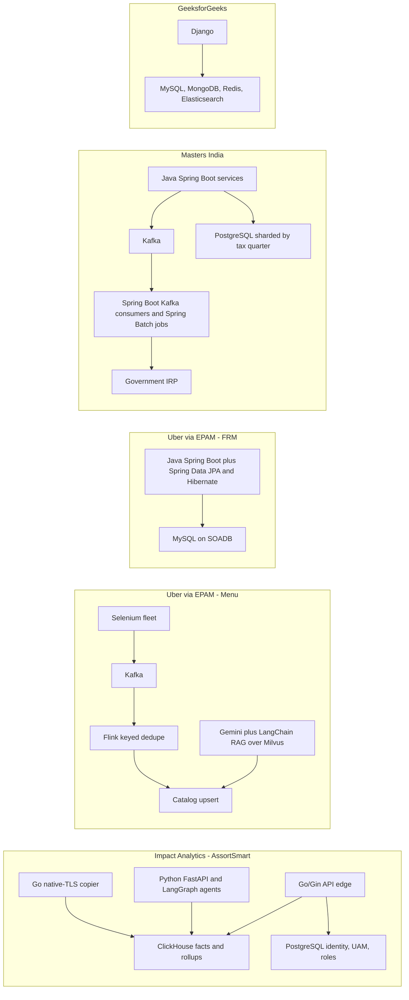
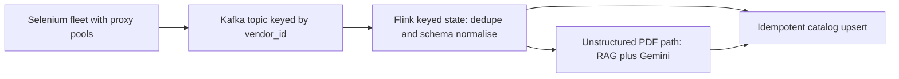
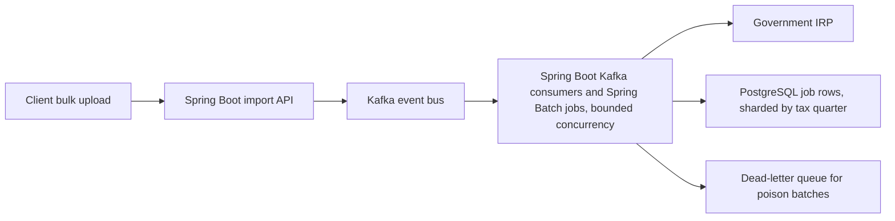
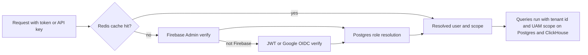

# PDF bullet + tech defense (study this)

<div class="callout highlight">
<b>How to use this page</b>
<ul>
<li><b>What it covers:</b> every line on the current PDF (<code>Tarun_Mittal_SSE_5yr_Java_AI.pdf</code>, the Java + Python track). For each line you get the claim in plain words, the technology behind it, why that technology, what was rejected, the numbers, and what you must not say.</li>
<li><b>When to read it:</b> the night before any screen, and again right before a "walk me through your resume" round. It is the "defend every word" page.</li>
<li><b>What to memorise:</b> the answer formula in section 1, the company-to-tech map in section 2, the "Do not say" lines under each bullet, and the 30-second traps at the end.</li>
<li><b>Go deeper:</b> the ClickHouse bullets (C4, C5) have their own page, <a href="42_clickhouse_rollup_migration.md">42 ClickHouse rollups and cluster copy</a>. The IA bullets have <a href="43_ia_bullet_defense.md">43 IA bullet defense</a>.</li>
</ul>
</div>

**Source of truth for numbers:** [`docs/ASSORTSMART_TAB_RESUME.md`](../../docs/ASSORTSMART_TAB_RESUME.md). Project packs: [`23a` IA](23a_ia_interview_pack.md) · [`23b` Uber](23b_uber_interview_packs.md) · [`23c` Masters and GFG](23c_masters_gfg_interview_packs.md). Tables and "why this tech": [`34_er_tables_tech_why.md`](34_er_tables_tech_why.md).

**Tags used on this page.** MEASURED means there is a log, document, benchmark or code behind the number. ESTIMATED means it is arithmetic I can show on a whiteboard. Say "roughly, derived from..." TARGET means a design goal. Say "targeting". HISTORICAL means it comes from my past work records and I cannot re-run it today.

<div class="callout note">
<b>What this PDF says about the stack.</b> The summary says <b>"Java and Python"</b>, and the Impact Analytics bullets add Go. Uber FRM is <b>36 Spring Boot endpoints</b> and a <b>Spring Data JPA / Hibernate</b> migration (tech line: Java, Spring Boot, Spring Data JPA, Hibernate, MySQL, JUnit, Bazel, Docker). Masters India is <b>PHP monolith to Spring Boot microservices</b> (tech line: Java, Spring Boot, Hibernate, Kafka, PostgreSQL, MongoDB, Redis, Elasticsearch, Docker, ELK, New Relic, AWS). The Impact Analytics platform APIs are <b>Go/Gin</b>, and the Impact Analytics agent plane is <b>Python</b> (FastAPI, LangGraph). Uber Menu and GeeksforGeeks are Python.
</div>

<div class="callout warn">
<b>Hard no. Read these before every interview.</b>
<ul>
<li>Kafka and Flink belong to Uber Menu. ClickHouse belongs to Impact Analytics. Never describe them as one pipeline.</li>
<li>None of this is payments or money movement. FRM is financial reconciliation, and Masters is tax-invoice registration.</li>
<li>Nothing here is an encryption product or a privacy program. The IA work is access control and tenant isolation.</li>
<li>Do not say "sub-second ClickHouse pivots". The PDF says from 189 seconds to 12 seconds.</li>
<li>Do not say "zero message loss". On Menu, exactly-once means idempotent catalog upserts plus Flink keyed state, not a two-phase commit with Gemini. On Masters, exactly-once means idempotency keys against the government portal (at-least-once delivery plus a unique key). The government portal is outside our transaction.</li>
<li>The 300-case set with the 80% bar is a <b>CI promotion gate</b>, not "all tenants are live at 80%". Menu's 98% is <b>offline evaluation</b>. Uber was <b>via EPAM</b>. ANZ is <b>historical</b> and is Uber Mobility, not Eats.</li>
<li>Cluster Recommendation Copilot, Hindsight, Spark, Pinot, Kubernetes operations and authorship of the CDC pipeline are <b>not</b> PDF claims.</li>
</ul>
</div>

---

## 1. The answer formula for any "why this tech?" question

When an interviewer points at a word on the resume and asks "why that?", answer in five beats. This keeps you concrete and stops you sounding like you are reciting buzzwords.

1. **Where** it sits in the system (one sentence, name the box).
2. **Failure mode** it protects against (what goes wrong without it).
3. **Rejected alternative** and the one reason it lost.
4. **The PDF number** it supports.
5. **What dies if it fails** (blast radius).

**Worked example, Kafka at Masters India.** "Kafka sat between our import API and the workers that call the government invoice portal. Without it, a slow portal would back up straight into the API and clients would time out. The obvious alternative is calling the portal straight from the request, or from in-process background jobs alone. Kafka won because we needed durable replay for GST disputes and per-GSTIN ordering. It supports the 1M+ daily submissions line. If Kafka is unavailable, imports cannot reach the workers, so registrations stop until it recovers."

---

## 2. Map: which technology lives at which company

Read this diagram before anything else. Most interview traps come from mixing two companies' stacks into one story.



*What to notice:* ClickHouse appears only inside Impact Analytics. Flink appears only inside Uber Menu. Kafka appears twice, at Menu and at Masters, and those are two unrelated products. Go appears only at Impact Analytics. Java and Spring Boot appear only at Uber FRM and Masters India.

---

## 3. Words you need (defined once, used everywhere below)

These terms show up across many bullets. Each gets one plain sentence and, where it helps, an everyday analogy.

**Service and API words**

- **Microservice.** A small, separately deployed program that owns one job and talks to others over the network. Think of a restaurant where the grill, the bar and the bakery each run their own station instead of one cook doing everything.
- **RPS (requests per second) and RPM (requests per minute).** How many API calls a system handles per unit of time. 4,000 RPM is about 67 RPS.
- **p95 latency.** The response time that 95% of requests beat. If p95 is 300 ms, only 1 in 20 requests is slower than 300 ms. It is a better health signal than the average because averages hide slow outliers.
- **Java.** A statically typed, compiled language that runs on the JVM (Java Virtual Machine). It is the default language for large backend services in many enterprises.
- **Spring Boot.** The most common Java framework for building backend services. It starts a web server inside your app, wires your classes together automatically and gives sensible defaults for database, logging and configuration. Think of a furnished apartment: you move in and start living, instead of buying every piece of furniture first.
- **Spring MVC.** The web layer inside Spring Boot. You write a class marked `@RestController`, and methods marked `@GetMapping` or `@PatchMapping` become HTTP endpoints. Spring turns the JSON body into a Java object and the return value back into JSON.
- **Spring Security.** Spring's module for authentication and authorization. It runs a chain of filters before your controller, like a row of security desks in a lobby, each checking one thing (token, role, header) before you reach the office.
- **ORM (Object-Relational Mapper).** A library that maps database rows to objects in code, so you write `new Review(ReviewStatus.DRAFT)` instead of raw SQL. **Hibernate** is the main Java ORM. **JPA (Jakarta Persistence API)** is the standard set of annotations, such as `@Entity` and `@Version`, that Hibernate implements. **Spring Data JPA** sits on top and generates repository classes for you: you declare an interface like `ReviewRepository` and get `save`, `findById` and custom queries without writing the plumbing.
- **`@Transactional`.** A Spring annotation that wraps a method in one database transaction. Either every write in the method commits, or a runtime error rolls them all back.
- **`@Version`.** A JPA annotation on a numeric column. Hibernate adds `AND version = ?` to every update and bumps the number, which is optimistic locking for free.
- **Bean Validation.** Java's standard way to validate input with annotations such as `@NotNull` and `@Size` on a DTO (data transfer object, a plain class that only carries request or response data). Putting `@Valid` on a controller parameter makes Spring reject a bad body with a 400 before your code runs. Think of a customs officer who checks every field of an incoming form before it enters the country.
- **Spring Batch.** Spring's framework for large batch jobs. It reads records in chunks, processes them, writes them, commits after each chunk and remembers where it stopped, so a crashed job restarts from the last good chunk instead of the beginning.
- **JUnit and Mockito.** JUnit 5 is the standard Java test framework. Mockito creates fake versions of dependencies so you can test one class alone. **MockMvc** sends fake HTTP requests to a controller without starting a real server.
- **Maven.** The standard Java build and dependency tool. A `pom.xml` file lists libraries and build steps.
- **HikariCP.** The default database connection pool in Spring Boot. It keeps a set of open database connections ready, so each request borrows one instead of opening a new one.
- **Spring WebClient.** Spring's non-blocking HTTP client. It can wait on a slow external call without tying up a thread.
- **FastAPI.** A Python web framework for building APIs, built on async IO and type hints. It validates requests automatically using Pydantic.
- **Pydantic.** A Python library that turns type hints into runtime validation, the Python counterpart of Bean Validation.
- **asyncio.** Python's built-in library for async code, where one thread juggles many waiting network calls.
- **Gin.** A lightweight Go web framework for HTTP APIs.
- **Celery.** A Python task queue. The API drops a job on a queue and a pool of worker processes picks it up, so the API can answer immediately. Think of a dry cleaner's ticket: you get a receipt now and the work happens in the back.
- **Django.** A "batteries included" Python web framework with an ORM, admin panel and auth built in.
- **Dependency injection (DI).** Handing a component the things it needs (database client, cache, logger) from outside instead of letting it build them itself. **Spring** does this at application startup: it sees that a controller's constructor needs a `ScopingService` and passes one in. **Google Wire** does this for Go at compile time, so a missing dependency is a build error, not a crash in production.
- **Reverse proxy.** A server like nginx that sits in front of your app, accepts connections and forwards them. Many teams rely on it for timeouts and connection limits.
- **h2c (HTTP/2 cleartext).** HTTP/2 without TLS on the hop into the process. HTTP/2 lets many requests share one connection. h2c is typically used when encryption is handled before traffic reaches the app.

**Data words**

- **ClickHouse.** A columnar analytics database. It stores each column separately, so a query that sums one column out of 100 reads only that column. Think of a library that shelves all the page-7s together: great for "sum every page 7", terrible for "change one word on one page".
- **MergeTree / ReplacingMergeTree.** ClickHouse's main table engines. **ReplacingMergeTree** keeps only the newest version of rows that share a key. Think of a notebook where you never erase. You write the new value below, and a cleaner later crosses out the old lines.
- **PostgreSQL / MySQL.** Row-store relational databases with transactions. They are good at "update this one row safely", weaker at "scan a billion rows and group them".
- **Redis.** An in-memory key-value store used as a cache. It is fast, but it is not the source of truth.
- **Cache-aside.** The app checks the cache first. On a miss it reads the database, then writes the answer into the cache for next time.
- **Sharding.** Splitting one big table across several databases or partitions by a key, so each piece stays small. At Masters the key was the tax quarter.
- **Kafka.** A durable, ordered log of events that many consumers can read at their own pace. Think of a conveyor belt with a recorded history: you can rewind and replay.
- **Flink.** A stream-processing engine that keeps per-key state (for example "last content hash seen for vendor 123") and can recover that state after a crash.
- **Idempotency.** Doing the same operation twice has the same effect as doing it once. Pressing the elevator button five times still calls one elevator.
- **At-least-once vs exactly-once.** At-least-once means a message may be delivered more than once. "Exactly-once" in practice usually means at-least-once delivery plus idempotent writes, so duplicates have no effect.
- **DLQ (dead-letter queue).** A side queue where messages that keep failing are parked for inspection instead of blocking the main queue.
- **OOM (out of memory).** A query or process dies because it asked for more RAM than allowed.

**AI words**

- **LLM (large language model).** A model like Gemini or GPT that generates text from a prompt.
- **Structured LLM invoke.** Calling the model and forcing the answer into a fixed JSON schema, so code can read it reliably.
- **RAG (Retrieval-Augmented Generation).** First fetch relevant reference material, then give it to the LLM with the question. It is an open-book exam instead of answering from memory.
- **Vector embedding / Milvus.** An embedding turns text into a list of numbers so that similar texts have nearby numbers. **Milvus** is a database that finds the nearest vectors quickly.
- **LangChain / LangGraph.** Python libraries for building LLM applications. LangGraph models an agent as a graph of steps with explicit state, so loops and branches are visible and bounded.
- **LangSmith.** A tracing and evaluation tool for LLM apps. It shows each prompt, tool call, token count and latency.
- **Circuit breaker.** A guard that stops calling a failing dependency after repeated failures, then tries again later. It works like a fuse box.

**Security and finance words**

- **Multi-tenant.** One deployment serves many customer companies (tenants). Tenant A must never see tenant B's data.
- **JWT (JSON Web Token).** A signed token that says who the user is. The server checks the signature instead of a session table.
- **OIDC (OpenID Connect).** A standard login protocol, for example "Sign in with Google".
- **UAM (User Access Management).** Which slice of the product and store hierarchy each user is allowed to see.
- **GL (general ledger).** The company's master record of every accounting entry.
- **FSLI (Financial Statement Line Item).** A line on the financial statements, like "Cash and cash equivalents".
- **Materiality threshold.** The size above which a misstatement would matter to an investor, so that line must be in audit scope.
- **SOX (Sarbanes-Oxley).** US law requiring public companies to have controlled, auditable financial processes.

---

## Part A. Three bullets rewritten with "big-tech vocabulary" (Sep 2026)

In September 2026 three bullets were reworded so they match words that large companies' job listings use. The facts did not change. These are the three most likely to be probed, so each gets a full defense.

### A.1 Uber Menu: "large-scale data ingestion and processing pipeline"

**PDF claim:** a Selenium fleet at 95%+ success, feeding Kafka plus Apache Flink with stateful keyed deduplication and schema normalization, ending in exactly-once catalog upserts.

**In plain English.** Uber Eats needed restaurant menus in its catalog. Menus arrive from restaurant websites and partner portals. A fleet of automated browsers (Selenium) fetched them. Each fetched menu became an event on Kafka. Flink read those events, threw away duplicates, normalised field names and shapes, and wrote clean records into the catalog. Messy PDFs took a side path through Gemini with RAG.



*What to notice:* both paths end in the same idempotent upsert, which is where "exactly-once" really lives.

**Tiny example.** Vendor 4471 is scraped twice in ten minutes because a retry fired. Both events land on Kafka with key `vendor_id=4471`. Flink's state for that key remembers the content hash `a91f...` from the first event. The second event has the same hash, so Flink drops it. If the menu had really changed, the hash would differ, and the upsert would overwrite the catalog row by its key. Running that upsert twice leaves the same row.

| Interviewer probe | What to say |
|---|---|
| What is the pipeline? | "Acquire with Selenium, publish to Kafka keyed by vendor, dedupe and normalise in Flink keyed state, then upsert into the catalog. Unstructured PDFs go through RAG and Gemini before the same upsert." |
| Why Kafka? | "Scrapers must not block on the catalog. Kafka let us replay after a bad parser release, and it allowed more than one consumer." |
| Why Flink, not Spark, on the hot path? | "Scrapes come in bursts. We needed per-vendor keyed state and event-time handling for late pages. Spark was only ever a verbal idea for backfills and it is not on the PDF." |
| Why not ClickHouse here? | "ClickHouse is my Impact Analytics analytics store. Menu landed in the catalog, plus Milvus for RAG retrieval." |
| Exactly-once? | "Idempotent upserts on catalog keys plus Flink checkpoints. There is no two-phase commit with Gemini or partner sites." |
| Scale words | "30K+ menus a month is the PDF volume." Never say "hundreds of millions of transactions". |

**Q: Your resume says exactly-once. Did you guarantee no duplicates end to end?**
A: "Exactly-once here means the catalog ends up correct even if a message is delivered twice. Kafka and Flink give at-least-once delivery with checkpoints, and the catalog write is an upsert by a stable key, so a replay overwrites the same row. I would not claim zero message loss or a distributed transaction across third-party sites. That is not possible when the source is someone else's website."

### A.2 Masters India: "high-concurrency", "idempotent", "fault-tolerant state management"

**PDF claim:** Kafka plus PostgreSQL sharded by tax quarter, 1M+ daily government submissions, 100K+ concurrent imports, idempotency, dead-letter queues and bounded retries.

**In plain English.** Masters India sells GST (Goods and Services Tax) compliance software. Large companies upload thousands of invoices at once. Each invoice must be registered with the government's IRP (Invoice Registration Portal), which returns an IRN (Invoice Reference Number) and a signed QR code. The portal is slow and flaky near filing deadlines. The system had to accept huge bulk uploads, register every invoice exactly once, and survive portal failures.



*What to notice:* the API never waits on the government portal. Workers do, with limits.

**Tiny example of the idempotency key.** Client `ACME`, file hash `7c2e...`, batch index `14`. The key is `ACME:7c2e...:14`. A unique constraint on that key means that if the worker crashes after the portal accepted the batch and Kafka redelivers the message, the second insert hits the constraint and the worker skips re-registering.

In the Spring Boot consumer, that check is a few lines. The unique constraint does the real work, and Spring turns a violation into a `DataIntegrityViolationException`. This is illustrative of the pattern, not a paste of production code:

```java
String key = clientId + ":" + fileHash + ":" + batchIndex;
try {
    jobRepository.saveAndFlush(new SubmissionJob(key, payloadRef)); // unique index on idempotency_key
} catch (DataIntegrityViolationException alreadySeen) {
    return reconcileExisting(key); // same batch redelivered: do not call the portal again
}
irpClient.register(payloadRef);
```

| Interviewer probe | What to say |
|---|---|
| High-concurrency of what? | "Bulk import workers hitting the government portal in parallel. It is not consumer payments." |
| Idempotency key? | "`client + fileHash + batchIndex`, plus invoice references, with a unique constraint so a replay cannot double-register." |
| Fault-tolerant state? | "Kafka consumer offsets, PostgreSQL job rows and a DLQ for poison batches. Not a custom consensus store." |
| Why Kafka? | "Per-GSTIN ordering, durable replay for GST disputes, and independent consumer groups." GSTIN is the GST registration number of a business. |
| Why shard PostgreSQL by tax quarter? | "GST returns are quarter-scoped, so hot writes stay in the current quarter's shard and old quarters stay quiet." |
| Stack on this PDF | "Java Spring Boot services with Hibernate, Kafka consumers, and Spring Batch for chunked bulk imports." Never say Go for Masters. |

**Q: What does "exactly-once" mean when the government portal is outside your transaction?**
A: "It means we never register the same invoice twice, even though delivery is at-least-once. Every batch carries an idempotency key built from client, file hash and batch index, with a unique constraint in PostgreSQL. If a worker dies after the portal accepted but before we committed, the redelivered message hits the constraint and we reconcile instead of resubmitting. Retries are bounded, and anything that keeps failing goes to a dead-letter queue."

### A.3 Impact Analytics: "multi-tenant data isolation" and "access control" across PostgreSQL and ClickHouse

**PDF claim:** isolation plus UAM-scoped access across PostgreSQL and ClickHouse, a Redis-fronted Firebase Admin to JWT / Google OIDC verification waterfall, constant-time API keys and Postgres-backed role resolution.

**In plain English.** AssortSmart serves many retailers from one platform. A planner at retailer A must only see retailer A, and only the departments and stores they are assigned. Identity and roles live in PostgreSQL. The big planning facts live in ClickHouse. Every query carries the same tenant id and the user's frozen scope.



*What to notice:* a cache miss falls through to Postgres. It never "fails open" and lets the request through unchecked.

**Constant-time API key comparison, in one line.** A normal string compare stops at the first wrong character. An attacker can time many guesses and learn the key one character at a time. Go's `subtle.ConstantTimeCompare(a, b)` always takes the same time, which closes that leak.

| Interviewer probe | What to say |
|---|---|
| Isolation vs encryption? | "Access control and tenant scope. Not an encryption product. I did not implement encryption at rest." |
| Why both Postgres and ClickHouse? | "Postgres holds identity, UAM and roles, where transactions matter. ClickHouse holds planner facts and pivots, where columnar scans matter. The same tenant id is on both, and ClickHouse queries run under the frozen tenant scope." |
| Why not Milvus here? | "Milvus was Uber Menu's RAG store. It has nothing to do with IA governance." |
| Cache miss? | "Redis miss falls through to Postgres. It does not degrade open." |
| UAM? | "The user's hierarchy assignment is intersected with store and product scope on every query. I did not build a generic RBAC product." RBAC means role-based access control. |

---

## Part B. Every PDF bullet on this track

Each bullet below follows the same shape: the exact PDF wording, what it means in plain words, the tech behind it and why, what was rejected, the numbers, the honesty line, and one or two speakable answers.

### B.1 Summary (top of the PDF)

> Senior Software Engineer with 5 years of experience designing and owning cloud-native, high-throughput distributed systems.
> Expertise in Java and Python microservices, with applied experience in AI-assisted and RAG systems.
> Proven track record shipping production systems, leading backend migrations, and improving reliability, performance, and scalability.

| # | Claim | How to defend it | Do not say |
|---|---|---|---|
| S1 | 5 years. Cloud-native, high-throughput distributed systems | Tenure from Aug 2021. IA Go platform at 10k peak RPS. Masters 1M+ daily submissions. Uber FRM and Menu services | "Staff" or "principal" level |
| S2 | Java and Python microservices. AI-assisted and RAG | Java: Uber FRM (Spring Boot, Spring Data JPA, Hibernate) and Masters India (Spring Boot, Hibernate). Python: IA agents (FastAPI, LangGraph), Menu RAG, GFG (Django). Go: IA API edge, KPI parser, ClickHouse copier | That all three languages were used on every project |
| S3 | Shipping, migrations, reliability | Masters PHP to Spring Boot strangler. FRM Sheets to MySQL. Menu from 24 hours to 2 hours | "I ran Uber production." Say "Uber via EPAM" |

**Q: The summary says Java and Python, but your Impact Analytics bullets are Go. Where exactly is each one?**
A: "The summary leads with the two languages most of my career sits in, and the bullets show Go where I used it. Java is at Uber FRM and Masters India. Both are Spring Boot services, with Spring Data JPA and Hibernate over MySQL at Uber and Hibernate over PostgreSQL at Masters. Go is at Impact Analytics: the multi-tenant platform API is Go with Gin, and I also wrote the KPI formula parser and the ClickHouse cluster copier in Go. Python is the AI and data side: the LangGraph agent plane at Impact Analytics, the menu RAG pipeline at Uber Eats, and Django at GeeksforGeeks."

### B.2 Skills (why each row exists)

The skills section is the part most likely to get "rate yourself" questions. Know which rows are production ownership and which are literacy. Literacy means you understand it and can discuss it, but you did not own it in production.

| Row on PDF | Why it is there | Trap to avoid |
|---|---|---|
| **Languages:** Java, Python, Go (Golang), SQL, C, C++ | Java (Uber FRM, Masters India). Python (IA agents, Menu, GFG). Go (IA edge, parser, copier). SQL everywhere | C and C++ are competitive-programming and college literacy. Do not claim production ownership |
| **Backend & APIs:** Spring Boot, Spring MVC, Spring Security, Spring Data JPA, Hibernate, FastAPI, Gin, Django, REST, gRPC, Pydantic, Celery, asyncio, Spring Batch | Spring Boot (FRM, Masters). Spring MVC is the controller layer inside those Spring Boot services. Spring Data JPA (FRM). Hibernate (FRM, Masters). Spring Batch fits Masters' chunked bulk imports. FastAPI, Pydantic and asyncio (IA agent plane). Pydantic also backs the Menu schema gate. Gin (IA). Django (GFG) | gRPC, Celery and Spring Security are skills-level. Spring Security is where request authentication lives in a Spring service, but do not invent a Spring Security project or outcome. Do not invent a gRPC service you owned |
| **Generative AI:** LangGraph, LangChain, RAG, Milvus, pgvector, LLM Agents, Tool Calling, MCP, Prompt Engineering, LangSmith, Offline Evaluation | LangGraph and LangSmith (Ask Iris). LangChain, RAG and Milvus (Menu). Offline evaluation (IA eval harness, Menu 98%) | MCP and Tool Calling are skills-level, not an IA PDF bullet. pgvector is literacy. Milvus is Menu only |
| **Data & Streaming:** Apache Kafka, Apache Flink, ClickHouse, BigQuery, ETL Pipelines | Kafka and Flink are Menu. Kafka is also Masters. ClickHouse and BigQuery are IA. ETL is Masters and FRM | No Flink at IA. No Spark claims |
| **Databases & Storage:** PostgreSQL, MySQL, Redis, MongoDB, Elasticsearch, DynamoDB, Amazon S3 | Postgres (IA, Masters). MySQL (FRM, GFG). Redis (IA, Masters, GFG). MongoDB and Elasticsearch (Masters, GFG). Amazon S3 (Masters bulk files) | DynamoDB is literacy, not an IA system of record |
| **Cloud & DevOps:** GCP, AWS, Docker, Kubernetes, Maven, Bazel, CI/CD, Datadog, ELK, New Relic | GCP (IA, Menu). AWS (Masters). Bazel (FRM builds and stacked PRs). Maven is the standard build tool for Spring Boot services outside a monorepo. Datadog (IA). ELK and New Relic (Masters) | Kubernetes is literacy. Never say "I operated clusters". Do not say Maven built the FRM service, because FRM built through Bazel |
| **Architecture & Core Concepts** | HLD and LLD (high- and low-level design), DSA, caching, reliability, multithreading, sharding, concurrency, idempotency | The idempotency story is Masters, plus Menu upserts |

**Q: You list Kubernetes. Tell me about a cluster you ran.**
A: "I want to be precise. Kubernetes is on my skills line as literacy. I understand deployments, services, probes and autoscaling, and my services ran in containers, but I did not operate clusters. My production depth is in the services themselves: the Go platform at Impact Analytics, and the Spring Boot services at Uber FRM and Masters."

**Q: You list Spring Security and Spring Batch. What did you do with them?**
A: "I'll separate the two. Spring Batch is the natural fit for what Masters India needed: bulk invoice files read in chunks, validated, written, with a restart point if a job dies. Spring Security is the filter chain where authentication sits in front of controllers in a Spring service. Both are on my skills line because I know how they work and where they fit. My resume outcomes come from the services themselves, the FRM and Masters Spring Boot work, so I don't attach a separate number to either module."

---

### B.3 Impact Analytics: Agentic Flows & Orchestration

**The business in two sentences.** AssortSmart is retail merchandise-planning software. Planners at retailers decide which articles (products) to keep, drop or add each season, and the AI layer gives them a recommendation for each article in each season.

**One term first.** An **article-season** is one product in one selling season. "Blue linen shirt, Spring 2026" is one article-season.

#### A1. Multi-pipeline AI merchandise decision engine

> Architected a multi-pipeline AI merchandise decision engine (Keep/Drop, Missed Opportunities, Top Style) evaluating 348k article-seasons. Optimized inference at scale, processing 88k items per pass, by blending deterministic KPI math with structured LLM invokes across 7 AI lenses.

**In plain words.** Three named pipelines answer three planner questions: "should I keep or drop this article?", "what did we miss?", and "which styles are the top performers?". Each article gets a math score and an AI score, and the two are blended.

**How it works, with numbers.**

- The deterministic score `s_det` comes from KPIs such as sell-through (units sold divided by units available) and rate of sale.
- The AI score `s_agent` comes from 7 "lenses". A lens is one structured LLM call that looks at the article from one angle. A decider combines the lenses.
- The blend is `s_final = 0.4 × s_det + 0.6 × s_agent`. Keep if `s_final ≥ 0.55`.
- Worked example: `s_det = 0.70`, `s_agent = 0.45`. Then `0.4 × 0.70 + 0.6 × 0.45 = 0.28 + 0.27 = 0.55`. That is exactly on the line, so the article is kept.
- The batch order is fixed: peer comparison, then decider, then lenses, then blend, then explanation. There is no LLM orchestrator choosing the order.

**Why this tech.** Mixing deterministic KPI math with structured LLM output gives an explainable floor (the math) plus judgement the math cannot capture (the lenses). Named pipelines are testable. A chatbot is not.

**Rejected.** One giant prompt per article. It is expensive, hard to evaluate, and has no fallback.

**The numbers.** 348k is article-seasons scored (MEASURED). 88k is items per pass. 1.6M is the full catalog of article-seasons. It is true but off the PDF, and it is a different number. About $100 of token spend per pass is also true and off the PDF.

**Do not say.** That 348k equals the 1.6M catalog. That an LLM decides the pipeline order.

**Q: Why not just let the LLM score everything?**
A: "Because a free deterministic score already gets you most of the way, and the LLM has to earn its place. Each article gets a KPI score from sell-through and rate of sale, and an agent score from seven structured lenses. We blend them 0.4 to 0.6 and keep at 0.55 or above. If the LLM times out, the deterministic score is still there, so every article gets a decision."

#### A2. Decoupled AI inference from a 2.11B-row ClickHouse master

> Decoupled AI inference from a 2.11B-row ClickHouse master by asynchronously serving context via JSON payloads rather than direct database querying. Engineered an eventually consistent write pattern via ReplacingMergeTree that guaranteed system availability by gracefully falling back to deterministic baselines during LLM timeouts.

**In plain words.** The LLM never touches the database. Code pulls exactly the facts it needs, packs them into a JSON payload, and hands that to the model. Results are written back as new versions, and if the model is slow, the math score is used instead.

**How it works.**

- Context payload example: `{"article":"A-10293","season":"SS26","sell_through":0.62,"ros":3.1,"peer_rank":14}`.
- "Async" describes how batches run. The LLM never gets a SQL tool.
- **Eventually consistent** means a reader may briefly see the old answer, but it settles on the newest one shortly after.
- Writes go to a ReplacingMergeTree. Retries and overlapping waves can land the same key twice. The table keeps the latest version in the background, and reads use `argMax` or `LIMIT 1 BY` to pick the newest row. Running `OPTIMIZE ... FINAL` is not a runtime requirement.
- On LLM timeout, the row is written with the deterministic baseline score and flagged as a fallback.

**Why.** A hallucinated SQL statement must never hit 2.11 billion rows.

**Rejected.** Letting the LLM issue ClickHouse queries or writes.

**Do not say.** That you authored the CDC pipeline that feeds ClickHouse. A colleague built it.

**Q: Why not give the agent a SQL tool? It is more flexible.**
A: "Flexibility is the risk. The master table has 2.11 billion rows, and one bad generated query can be slow, wrong, or cross a tenant boundary. So code builds a JSON payload with exactly the facts the lens needs, and the model only reasons over that. Writes are versioned in a ReplacingMergeTree, so a retry is harmless, and a timeout falls back to the deterministic score."

#### A3. Shared orchestration registry

> Engineered a shared orchestration registry to guarantee 88k-article batch runs survive provider failures by implementing hard timeouts, circuit breakers, and durable checkpoints that bypass redundant deterministic scoring. Ensured full observability by stamping every output row with a frozen config hash and custom JSON telemetry tracking tokens, USD cost, step duration, and batch fallbacks.

**In plain words.** One shared module runs all the AI batch jobs safely. It stops calls that hang, stops hammering a provider that is down, saves progress so a crash can resume, and tags every output row with a fingerprint of the exact configuration that produced it.

**How it works.**

- **Hard timeouts** on every LLM call.
- **Circuit breaker** trips after about 5 consecutive failures, or when the failure fraction gets too high.
- **Durable checkpoints:** `det.json` holds the deterministic scores and `agent_progress.json` holds agent progress. `--resume` restarts from them and skips recomputing the deterministic scoring.
- **config_hash** is a SHA-256 of guardrails, parameters, prompts and catalog. SHA-256 is a fingerprint function: change one character of a prompt and the hash changes completely. Every output row carries it, so you can always answer "which prompt version made this decision?"
- **JSON telemetry** per step: tokens, USD cost, step duration, batch fallbacks.

**Why not Airflow or Temporal?** Both are workflow engines. We needed resume logic tied directly to ClickHouse inserts and to the config hash, inside the app. Running extra infrastructure was not justified for that.

**Rejected.** Ad-hoc scripts. Human review queues (HITL, human-in-the-loop) are not in the repo. Offline evaluations replaced critic and evaluator agents in Keep/Drop.

**Q: A provider goes down at article 60,000 of 88,000. What happens?**
A: "The circuit breaker trips after about five consecutive failures, so we stop burning time on a dead provider. Articles in flight fall back to the deterministic score, and the telemetry records each fallback. When we rerun with `--resume`, the checkpoint files mean we skip the deterministic scoring we already did and continue the agent work. Every row carries the same config hash, so the resumed output is provably from the same configuration."

#### A4. Shipped "Ask Iris"

> Shipped "Ask Iris," a JWT-secured WebSocket copilot enabling planners to interactively query KPIs and inspect AI decisions on a multi-billion-row database. Prevented infinite LLM loops and multi-tenant data leaks by orchestrating a LangGraph supervisor with a 3-attempt evaluator loop, utilizing LangSmith for observability, and strictly freezing hierarchy access on the initial socket handshake.

**In plain words.** Ask Iris is a chat assistant inside the product. A planner can ask "why was this article dropped?" or "what is sell-through for menswear this season?" It runs over a WebSocket, which is a long-lived two-way connection, like a phone call instead of sending letters.

**How it works.**

- The JWT is checked when the socket opens. The user's hierarchy access (`plan_scope`) is frozen at that moment and cannot change mid-conversation. That is what prevents cross-tenant leaks.
- A **LangGraph supervisor** routes each question to the right sub-step.
- An **evaluator loop** checks the answer and retries at most 3 times (`MAX_ATTEMPTS = 3`). That cap is what stops infinite loops.
- **LangSmith** traces each turn: prompts, tool calls, tokens, latency.

**Why.** Planners needed to inspect AI decisions interactively without opening a hole across tenants.

**Do not say.** Any SLA, usage figure or "questions per week". It is a shipped capability, with no invented numbers. LangSmith is used on Ask Iris, not on the Keep/Drop batch.

**Q: How do you stop the agent looping forever?**
A: "There is a hard cap. The evaluator can send an answer back for another attempt at most three times, so the graph has a guaranteed exit. Separately, the user's access scope is frozen at the socket handshake. Even a confused agent cannot widen what it is allowed to read. LangSmith traces let us see exactly where an attempt went wrong."

#### A5. 300-case evaluation harness and 80% CI gate

> Built a 300-case proxy evaluation harness and an 80% accuracy CI gate to enforce strict deployment guardrails. Reduced live execution costs by 73% at 100% coverage by benchmarking models against a 74% deterministic baseline, strategically freezing final decision weights when the LLM underperformed the baseline.

**In plain words.** Before any model or prompt change is promoted, it must pass an automatic test on 300 labelled cases with at least 80% accuracy. Separately, a 200-case benchmark showed a cheaper model completed every case at 73% lower cost. When the blended LLM scored below the plain math baseline, we did not tune weights to flatter it. We froze them.

**The numbers. Keep the two benchmarks separate.**

| Number | Comes from | Meaning |
|---|---|---|
| 300 cases, 80% | Proxy gold set in CI (`eval.json`, `gold_min_accuracy 0.8`) | A promotion gate. A change that scores under 80% cannot ship |
| 73% lower cost at 100% coverage | Gold-200 benchmark, 200 of 200 cases completed | The cheaper model finished all 200 cases at 73% lower cost. Model names (gpt-5.6-luna vs gpt-5.4-mini) are not on the PDF |
| 74% | Deterministic baseline on that same 200-case set, production threshold 0.65 | The free baseline the LLM had to beat |
| About 63% | Blended LLM on the same set | It did not beat 74%, so blend weights were frozen, not retuned |

**Do not say.** "All tenants are live at 80% accuracy." "The 73% came from the 300-case file."

**Q: Your LLM was worse than your baseline. Why ship it at all?**
A: "Because we were honest about it instead of tuning weights until the number looked good. On the 200-case benchmark the deterministic baseline scored 74% and the blend about 63%. So we froze the blend weights and kept the deterministic score as the floor. The LLM still adds explanations and catches cases the math misses. Separately, the 300-case CI gate at 80% stops any regression from being promoted."

**Tech line (IA):** Go, Gin, Python, FastAPI, LangGraph, ClickHouse, BigQuery, Redis, PostgreSQL, Datadog, LangSmith, GCP, Docker. The split to remember: Go is the API edge, Python is the agent graph, ClickHouse holds the facts. Never put Kafka or Flink on this line.

---

### B.4 Impact Analytics: Core Infrastructure & Pipeline

#### C1. Multi-tenant Go/Gin platform at 10k peak RPS

> Architected a multi-tenant Go/Gin platform scaling to 10k peak RPS, utilizing Google Wire for compile-time DI. Deployed as a self-protecting HTTP edge without a reverse proxy, guaranteeing high availability through native h2c, nested timeouts, and Datadog distributed tracing.

**In plain words.** The public API is a Go service that protects itself. It owns its own timeouts, connection handling and HTTP/2 support instead of leaning on nginx.

**Nested timeouts, illustrated.** The outer server timeout is longer than the per-request deadline, which is longer than each downstream call's deadline. A slow ClickHouse query is cut off before the request deadline, so the handler still has time to return a clean error.

```go
srv := &http.Server{
    Handler:      h2c.NewHandler(router, &http2.Server{}),
    ReadTimeout:  10 * time.Second,
    WriteTimeout: 30 * time.Second,
}
// inside a handler: each downstream call gets a shorter deadline than the request
ctx, cancel := context.WithTimeout(r.Context(), 20*time.Second)
defer cancel()
```

*Illustrative values, not the production config.*

**Why this tech.** Wire gives compile-time dependency injection, so wiring mistakes fail the build. The process owns timeouts and h2c. Datadog traces start at the edge, so one trace follows a request into ClickHouse and Postgres.

**Rejected.** A Python public edge. nginx as the only timeout story.

**The number.** 10k peak RPS is the peak request rate. No SLA is claimed.

**Do not say.** That you operated Kubernetes clusters. Do not invent an uptime SLA.

**Q: Why no reverse proxy? Isn't that risky?**
A: "The risk a reverse proxy usually covers is slow clients and runaway requests. We covered that in the process itself with nested timeouts, so every layer has a shorter deadline than the one above it. Native h2c gives HTTP/2 multiplexing without an extra hop. That is one less component to configure and trace, and Datadog sees the whole request from the edge inward."

#### C2. Dynamic KPI configurator and formula parser

> Eliminated deployment bottlenecks by architecting a dynamic KPI configurator and custom formula parser. Engineered a real-time compilation layer that tokenizes operator-authored math into parameterized ClickHouse SQL fragments with native division-by-zero protection, decoupling business logic from code releases.

**In plain words.** Operators can define a new KPI formula in the product, and the system turns it into safe SQL immediately. No engineer, no release.

**Worked example.**

- An operator types `sell_through = units_sold / (units_sold + on_hand)`.
- The Go tokenizer splits it into names, operators and parentheses. The parser checks each function against an allowlist and maps logical names like `units_sold` to physical columns.
- Output fragment: `ifNotFinite(toFloat64(sum(units_sold_col) / (sum(units_sold_col) + sum(on_hand_col))), 0)`.
- `ifNotFinite(..., 0)` turns infinity or NaN from a divide-by-zero into 0, so one empty store does not poison a whole rollup.
- An unknown token such as `DROP` fails closed: the formula is rejected, not passed through.

**Rejected.** Hard-coded SQL per KPI, which needs a release. Raw string concatenation, which invites SQL injection.

**Q: How do you stop an operator injecting SQL through a formula?**
A: "The formula is never pasted into SQL. It is tokenized and parsed, every function must be on an allowlist, and every name must map to a known column. Anything unknown fails closed. Values are parameterized, so the output is a SQL fragment we generated ourselves, not text the operator wrote."

#### C3. Multi-tenant isolation and access control

> Guaranteed strict multi-tenant data isolation and UAM-scoped hierarchy access control across PostgreSQL and ClickHouse. Secured system entry by implementing a Redis-fronted Firebase Admin to JWT/Google OIDC verification waterfall, constant-time API keys, and Postgres-backed role resolution.

See Part A.3 above for the full defense and diagram.

**Why.** Leaking one tenant's data to another is the most damaging bug a multi-tenant SaaS can have.

**Rejected.** Treating it as an encryption product. Milvus. Calling it a "privacy program".

**Q: Isolation is a big word. What actually enforces it?**
A: "Three things. Authentication through the waterfall: Firebase Admin, then JWT or Google OIDC, with Redis in front and Postgres as the fallback. Then role and UAM resolution from Postgres. Then every Postgres and ClickHouse query carries the tenant id and the user's hierarchy scope. It is access control, not encryption."

#### C4. 15.5× faster pivots and the 170 GB OOM

> Reduced planner pivot latency by 15.5× (189s to 12s on 250M-row operations) by building a ClickHouse pre-aggregation layer for season and weekly rollups. Prevented 170GB OOM crashes by slicing batch inserts into temporal chunks and enforcing strict distributed memory and disk-spill caps.

**In plain words.** Planners' pivot grids went from about three minutes to about twelve seconds by moving them onto pre-computed ClickHouse rollup tables. Building the weekly rollups crashed for lack of memory until each build was cut into one-week slices with memory and spill caps.

**Why this tech.** ClickHouse is columnar, so planner pivots that scan a few columns over hundreds of millions of rows are cheap. Slicing the weekly INSERT by week makes the weekly grain fit in memory.

**Rejected.** PostgreSQL for analytics (OLAP). Claiming sub-second pivots. Claiming the OOM fix caused the 15.5×.

**The numbers in one breath.** 15.5× is query time: 189,408 ms divided by 12,256 ms is about 15.45, rounded to 15.5, and 12.3 s is rounded to 12 s on the PDF. 170 GB is load time: the estimated memory for one whole-season weekly aggregate. They are two different problems.

Full detail, sample SQL and the honesty split are in [42 ClickHouse rollups and cluster copy](42_clickhouse_rollup_migration.md).

**Q: Did fixing the OOM make the pivots 15.5× faster?**
A: "No, and I keep those separate. The 15.5× is query time on a 250M-row pivot harness, from 189 seconds to about 12. The 170 GB OOM was load time, when building weekly rollups for a whole season at once. The fix there was one fiscal week per insert with memory and spill caps. The rollups are what planners read. The OOM fix is what made the weekly rollups buildable."

#### C5. Cross-cluster migration at about 344k rows/s

> Migrated ClickHouse rollups across Cloud clusters at ~344k rows/s by writing a custom Go native-TLS data pump to bypass strict cross-cluster IP allowlist restrictions. Processed partitions up to 4.09B rows using 500k-row double-buffered batches, and eliminated partial-commit ghost rows using TSV ledgers and atomic partition rollbacks.

**In plain words.** The two ClickHouse Cloud clusters could not talk to each other because of IP allowlists, which are lists of addresses a server will accept. My machine's address was allowed on both. So I wrote a Go program that reads from one cluster and writes to the other over ClickHouse's native protocol with TLS, in 500k-row batches.

**The numbers.** About 344k rows per second combined, from two season streams of roughly 150k to 190k rows/s each. This is an ingest rate, not requests per second. 4.09B is one table, attr weekly, two seasons (2,779,317,472 plus 1,311,108,195). That copy was measured in flight.

**Honesty split.** "TSV ledgers" is the weekly loader's skip file. The copier's own ledger is `migrate-checkpoints/<table>.done`. "Atomic partition rollbacks" means DROP PARTITION, then recopy that season. It is not an atomic swap that live readers never notice.

**Rejected.** Saying 344k TPS. Saying the 4.09B cutover finished. Saying the TSV file is the copier. Saying it was a live-reader atomic swap.

Full design, Go snippet and checkpoint status are in [42](42_clickhouse_rollup_migration.md).

**Q: 344k a second, is that an API?**
A: "No, it is rows per second of data copy, not requests. Two workers each streamed one season at roughly 150 to 190 thousand rows a second, about 344 thousand combined at a live snapshot. Each batch is 500 thousand rows, and while one batch is being sent, the next is already being read. That overlap is the double buffering."

---

### B.5 Uber (via EPAM): Financial Risk Management (FRM) Scoping Platform

**The business in plain English.** Every quarter, Uber's finance team must decide which accounts and entities are big enough to be in audit scope, and reconcile internal numbers against what was filed publicly. Before this platform, that ran on Google Sheets and took about two weeks per quarter. The platform moved it into a proper service with a database, rules and an audit trail.

**Words for this section.**

- **Reconciliation:** proving two sets of numbers agree, here HFM (Oracle Hyperion, the consolidation system) against the filed 10-Q quarterly report.
- **Scoping:** deciding which lines and entities are in audit scope based on materiality.
- **SOADB:** Uber's service-owned MySQL standard. Each service owns its own MySQL database.

#### F1. Owned the FRM scoping backend

> Owned the Financial Risk Management scoping backend, reducing quarterly reconciliation time by 70% (from 14 days to 3 days) against a $340M materiality threshold. Engineered the Sheets-to-MySQL migration across 19M raw GL rows, shipping 36 Spring Boot endpoints to automate custom financial math and a nested 4-level FSLI (L1-L4) hierarchy with dynamic quarter-annualization.

**In plain words.** I owned the backend that turned a spreadsheet process into a service. It cut the quarterly reconciliation from 14 days to 3. It has 36 Spring Boot endpoints that do the financial math and manage a 4-level hierarchy of financial statement lines.

**How it works.**

- **4-level FSLI hierarchy (illustrative):** L1 "Assets", L2 "Current assets", L3 "Cash and cash equivalents", L4 a specific cash account group. Totals roll up level by level.
- **Quarter-annualization (the idea):** a year-to-date figure is scaled to a full-year equivalent so it can be compared with an annual threshold. For example, a Q1 figure is multiplied by 4. "Dynamic" means the factor depends on which quarter is being closed.
- **Spring Boot REST controllers** expose the endpoints. Each request body is a DTO with **Bean Validation** annotations, and `@Valid` makes Spring reject a bad body with a 400 before any finance code runs.
- **Spring Data JPA with Hibernate** is the ORM over MySQL. Entities are Java classes marked `@Entity`, and repositories are interfaces Spring implements for you.
- The automated output fed the auditors' work papers (older prep mentions PwC work papers).

A trimmed endpoint, illustrative of the shape rather than a paste of Uber code:

```java
@RestController
@RequestMapping("/frm-scoping")
class MaterialityController {
    private final MaterialityService service;
    MaterialityController(MaterialityService service) { this.service = service; }

    @GetMapping("/materiality")
    MaterialityView get(@RequestParam int fiscalYear, @RequestParam int fiscalQuarter) {
        return service.compute(fiscalYear, fiscalQuarter); // L1-L4 roll-up, annualized, vs threshold
    }
}
```

**Why this tech.** The team needed to automate Sheets math into MySQL with a typed, validated API. Spring Boot gives the web layer, validation, transactions and dependency injection out of the box, so the code is almost all finance rules.

**Rejected.** Pretending you were an Uber full-time employee. You were Uber via EPAM.

**The numbers.**

- **70%, from 14 days to 3 days.** It measures the quarterly reconciliation cycle. The 70% is the figure the technical design doc framed for the cut, so that is the one to quote. If an interviewer does the arithmetic, the raw days (14 down to 3) are a slightly bigger cut, about 79%, so 70% is the conservative statement. Defend it as stated. If pressed: "the technical design doc framed that cut, and that is what the platform delivered for the close." Do not walk it back unprompted.
- **$340M** is the materiality threshold on the Q4 2025 close. The residual threshold was $170M (verbal).
- **19M raw GL rows** were migrated off Sheets. Individual quarterly GL extracts were about 38K to 95K rows, about 1.7K to 1.8K accounts and about 400 entities. If asked about data volume, say the value was correctness, hierarchy and auditability, not big-data throughput. Do not invent where 19M comes from beyond "raw GL rows migrated off Sheets".
- **36 endpoints.** If asked for the breakdown: about 31 functional routes in the scoping service, plus the collaboration-service APIs (comments and notifications) specified in the technical design doc. The real-time Slack notification service itself was a separate service, and I do not claim building it.

<div class="callout note">
<b>Older prep said</b> "30+ endpoints, do not say 36, do not say 19M." That guidance is obsolete. The current PDF says 36 and 19M, so say them.
</div>

**Q: How did you get from 14 days to 3?**
A: "By moving the math out of spreadsheets and into a service with rules. Before, analysts copied GL extracts into Sheets, rebuilt the hierarchy by hand and recomputed thresholds every quarter. I built 36 Spring Boot endpoints that do the hierarchy roll-ups, annualization and materiality checks against $340 million directly in MySQL. The technical design doc framed a 70% cut, from 14 days to 3, and that is what the platform delivered for the close."

**Follow-up they may ask:** "19 million rows is not that big." Answer: "Agreed. The value was not throughput. It was a correct hierarchy, repeatable math and an audit trail instead of copy-paste."

#### F2. 8-table normalized MySQL schema on SOADB

> Resolved ETL pipeline lock contention during financial close by designing an 8-table normalized MySQL schema on Uber's SOADB featuring a polymorphic review-status model. Guaranteed real-time, multi-user collaboration integrity by implementing optimistic row-locking, atomic cross-table syncs, and deterministic SHA-256 natural-key hashing to eliminate data duplication across quarterly audit trails.

**In plain words.** During close week, data loads and many analysts were fighting over the same rows. A cleaner schema, optimistic locking and stable keys stopped the fights and the duplicates.

**How it works.**

- **Lock contention** is when two writers wait on each other's locks, like two people trying to edit the same cell.
- **Polymorphic review-status model:** one status model (Draft, Review, ReOpen, Closed) reused across all screens instead of one per screen. There are 8 screens: Reconciliation, Materiality, EMI Scoping, Group Scoping, Threshold Setup, Component Scoping, Residual Risk, Summary.
- **Optimistic row-locking** is a version check on update. Nobody holds a lock while reading. You only check at write time that nobody changed the row since you read it.

```sql
UPDATE review_status
SET status = 'Review', version = version + 1
WHERE id = :id AND version = :version_read;
-- 0 rows affected means someone else saved first: reload and retry
```

In JPA you do not write that SQL by hand. You put `@Version` on a field, and Hibernate generates exactly that `WHERE ... AND version = ?` on every update. If zero rows match, Spring throws `ObjectOptimisticLockingFailureException`, which the controller turns into a 409 Conflict.

```java
@Entity
@Table(name = "review_status")
class ReviewStatusRow {
    @Id String id;
    @Enumerated(EnumType.STRING) ReviewStatus status; // DRAFT, REVIEW, REOPEN, CLOSED
    @Version Long version;                             // Hibernate checks and bumps this
}
```

- **Atomic cross-table syncs:** related updates across tables happen in one transaction, so either all apply or none do. In Spring that is a service method marked `@Transactional`. If anything inside throws a runtime exception, every write in the method rolls back.
- **SHA-256 natural keys:** a key computed from the content itself, for example `uuid = SHA-256(question_text + normalized page_name)`. The same question on the same page always gets the same key, every quarter, so re-running a load cannot create a duplicate.

```java
static String questionUuid(String questionText, String pageName) throws NoSuchAlgorithmException {
    String key = questionText.strip() + pageName.strip().toLowerCase(Locale.ROOT);
    byte[] digest = MessageDigest.getInstance("SHA-256").digest(key.getBytes(StandardCharsets.UTF_8));
    return HexFormat.of().formatHex(digest); // same text and page, same 64-character id
}
```

**Rejected.** Pessimistic locking everywhere. It would serialize analysts and slow close week further.

**Verbal depth if they dig.** 11 ORM entity classes in the scoping service. 5% significance thresholds. Recon v1 (Sheets) to v2 (MySQL) parallel run, 18 files, +1,268 lines of code.

**Q: Why optimistic and not pessimistic locking?**
A: "Because conflicts were rare but reads were constant. With pessimistic locks, every analyst who opens a screen blocks others. With optimistic locking, each row has a version number. The update only succeeds if the version is unchanged, and a zero-row update tells the user someone else saved first. Combined with one transaction per cross-table sync, that removed the contention during close."

#### F3. Led 3 engineers on the Spring Data JPA / Hibernate migration

> Led 3 engineers in a core Spring Data JPA / Hibernate migration that eliminated latent column-aliasing bugs and raised module statement coverage to 100%. Orchestrated zero-downtime releases via stacked Bazel PRs, embedding reporting SQL allowlists and automated FSM gates with 50% delta-variance checks to enforce SOX compliance.

**In plain words.** I was tech lead for a three-person pod that moved the data layer onto Spring Data JPA and Hibernate. That killed a class of silent bugs and brought test coverage of the module to 100%, while shipping in small safe steps.

**The column-aliasing bug, as a story.** Raw SQL joined two tables that both had a column called `uuid`. The result was read into a map keyed by column name, so the second `uuid` silently overwrote the first, and rows were attached to the wrong record. No error was raised. The fix was explicit aliases on every selected column, read into a typed projection. In Spring Data JPA, a projection is an interface whose getter names must match the aliases, so two columns can no longer collide.

```java
interface QuestionPageRow {
    String getQuestionUuid();
    String getPageUuid();
}

@Query("SELECT q.uuid AS questionUuid, p.uuid AS pageUuid FROM Question q JOIN q.page p")
List<QuestionPageRow> findQuestionPages();
```

**Tests.** The 100% statement coverage came from JUnit 5 tests. Service tests use Mockito to fake the repositories, so finance rules are tested without a database. Controller tests use MockMvc to send fake HTTP requests and check status codes, for example that a stale version returns 409.

**Other pieces.**

- **Stacked Bazel PRs:** a chain of small dependent pull requests, each built and tested by Bazel (Uber's build system) and each backward compatible, so every merge is deployable with zero downtime.
- **Reporting SQL allowlists:** only pre-approved report queries can run.
- **FSM gates:** an FSM (finite state machine) is a fixed set of states and allowed transitions, here Draft, Review, ReOpen, Closed. The gate is a check on a transition. The 50% delta-variance check flags a line whose value moved more than 50% versus the comparison period, so it cannot pass the gate automatically.
- **SOX** requires explainable SQL and test coverage, which is why these controls exist.

**The numbers.** 3 engineers led. 100% module statement coverage. 1,100+ tests (verbal). 50% delta-variance threshold.

**Do not say.** "Managed 3 people." You were tech lead of an EPAM pod, not a people manager. Do not merge this "led 3" with Masters' "mentored 2". Do not claim the HFM ETL alone (it was a shared pipeline responsibility).

**Q: What does leading three engineers mean here?**
A: "I was the tech lead of an EPAM pod, not their manager. I split the migration into stacked Bazel PRs, reviewed every one, and owned the design for the JPA entity and query conventions and the test plan. The headline result was killing the column-aliasing bug class and getting the module to 100% statement coverage, with no downtime during the move."

**Tech line (FRM):** Java, Spring Boot, Spring Data JPA, Hibernate, MySQL, JUnit, Bazel, Docker. The split to remember: Spring Boot is the web layer, Spring Data JPA and Hibernate are the data layer, JUnit is the test layer, and Bazel builds and ships it.

---

### B.6 Uber (via EPAM): Menu Ingestion & Automation (Uber Eats)

**The business in plain English.** New restaurants joining Uber Eats need their menu in the catalog before they can sell. Menus arrive as messy, multilingual PDFs and web pages. Typing them in by hand or paying a vendor was slow and costly.

#### M1. From 24 hours to 2 hours, $600K a year

> Accelerated restaurant onboarding from 24 hours to 2 hours and saved $600K annually by architecting an automated ingestion pipeline processing 30K+ menus monthly. Converted unstructured, multilingual PDFs into a strict catalog schema at 98% field fidelity utilizing a Gemini 2.5 Pro and LangChain RAG pipeline over Milvus vector embeddings.

**How it works.**

1. A PDF menu arrives. Text is extracted and chunked.
2. LangChain embeds the chunks and retrieves similar, already-correct menus and schema examples from Milvus.
3. Gemini 2.5 Pro gets the menu text plus those examples and outputs JSON in the catalog schema.
4. A schema gate validates the JSON. Anything invalid is rejected or routed for correction.

**Tiny example.** Input line `"Paneer Tikka (6 pcs) ...... ₹320"`. Output `{"item_name":"Paneer Tikka","portion":"6 pcs","price":320,"currency":"INR"}`.

**The numbers.**

- **From 24 hours to 2 hours** is restaurant onboarding time.
- **$600K a year** is ESTIMATED: about $2 per menu in third-party or manual cost, × 30K menus × 12 months = $720K, floored to $600K to be conservative.
- **98% field fidelity** is from offline evaluation: the share of fields correct on a labelled set. It is not a live production SLA.

**Rejected.** Presenting 98% as an online production SLA.

**Q: How do you know it is 98%?**
A: "It is an offline evaluation. We had a labelled set of menus, ran the pipeline, and compared each extracted field to the truth. 98% of fields matched. I say 'offline' deliberately, because live accuracy depends on the mix of menus that arrive."

#### M2. Selenium fleet at 95%+, Kafka plus Flink

> Scaled menu extraction success to 95%+ by hardening a Selenium fleet with dynamic proxy pools and adaptive retries. Designed a large-scale data ingestion and processing pipeline using Kafka and Apache Flink, with stateful keyed deduplication and schema normalization to guarantee exactly-once catalog upserts.

See Part A.1 above for the pipeline defense.

**Selenium hardening, in plain words.** Selenium drives real browsers. Sites block repeated requests from one address, so the fleet rotated through **dynamic proxy pools** (many exit addresses) and used **adaptive retries** (back off longer after each failure, change proxy on certain errors).

**The numbers.** 95%+ extraction success, up from an ESTIMATED 60% to 65%. Peak of about 200 to 500 events per second is an ESTIMATE for prep only and is not on the PDF.

**Do not say.** ClickHouse on Menu. Spark on the PDF. Zero message loss.

**Tech line (Menu):** Python, Selenium, Kafka, Flink, LangChain, Gemini, RAG, Milvus, GCP, Docker. The split: Selenium acquires, Kafka is the bus, RAG handles unstructured menus, the catalog is the destination. Do not mix Masters' Kafka into this story.

### B.7 Uber (via EPAM): Document Compliance (Uber Mobility ANZ)

> Achieved 99.9% regulatory compliance for Uber Mobility ANZ by automating driver and vehicle document verification workflows against local authority requirements. Eliminated 20 hours of manual operational overhead per week by replacing manual review queues with a deterministic validation backend.

**In plain words.** Drivers in Australia and New Zealand must hold valid documents (licences, vehicle registrations and so on) that meet each local authority's rules. I helped replace manual review queues with a rules-based backend that checks them automatically.

**Deterministic validation** means fixed rules with the same answer every time, for example "document present, not expired, and the right type for this region". No ML. This is an illustrative kind of rule.

**The numbers.** 99.9% compliance and 20 hours a week saved. Both are HISTORICAL.

**Do not say.** That it was Uber Eats (it is Mobility). Do not invent Selenium or RAG here.

**Q: Was there any AI in the ANZ work?**
A: "No, and that was deliberate. Regulatory checks need to be explainable and repeatable, so it was a deterministic validation backend: fixed rules per authority. The result was 99.9% compliance and about 20 hours a week of manual review removed. It is from my earlier records, so I keep it high level."

---

### B.8 Masters India: GST Compliance & E-Invoicing Platform

**The business in plain English.** Indian businesses must register B2B invoices with the government's Invoice Registration Portal before sending them. Masters India's SaaS does that for 1,500+ enterprise clients. A client uploads invoices, we validate them, call the portal, and return the IRN (Invoice Reference Number) and signed QR code.

#### MI1. p95 from 1.2 s to 300 ms, PHP to Spring Boot

> Reduced p95 API latency by 75% (from 1.2s to 300ms) across 1,500+ enterprise clients by spearheading the migration of a legacy PHP monolith to a Spring Boot microservices architecture. Mentored two engineers through the transition, optimizing backend design to drive overall system throughput from 700 to 4,000 requests per minute.

**How it works.**

- **Strangler pattern:** build the new service beside the old one and move routes over one at a time, like replacing a bridge lane by lane while traffic keeps flowing.
- **Canary per route:** send a small share of one route's traffic to the new service first, and widen only if errors and latency look good.
- Where the latency win came from: portal calls stopped blocking the request (a non-blocking Spring WebClient call or a bounded thread pool, so a request thread does not sit idle while the portal is slow), connection pooling with HikariCP, query and index fixes through Hibernate, and Redis for reads.

**The numbers.**

- **75%:** (1.2 − 0.3) / 1.2 = 0.75. Say "p95 from 1.2 seconds to 300 milliseconds".
- **From 700 to 4,000 requests per minute:** 700 / 60 ≈ 12 RPS, and 4,000 / 60 ≈ 67 RPS.
- **Mentored 2 engineers.** Do not merge with "led 3" at Uber FRM.

**Rejected.** A big-bang rewrite.

**Q: Where did the 75% come from?**
A: "Mostly from not blocking. The PHP code called the government portal synchronously, so a slow portal held a worker. In the Spring Boot services those calls went through a non-blocking client or a bounded thread pool, database connections came from a HikariCP pool, and we fixed the worst queries and indexes and put hot reads behind Redis. We moved route by route with canaries, so p95 went from 1.2 seconds to 300 milliseconds without a risky cutover."

#### MI2. High-concurrency bulk e-invoicing pipeline

> Architected a high-concurrency bulk e-invoicing pipeline processing 1M+ daily government submissions by orchestrating a Kafka event bus and a PostgreSQL database horizontally sharded by tax quarter. Enforced exactly-once, idempotent processing for 100K+ concurrent imports with fault-tolerant state management via dead-letter queues and bounded retries against volatile state IRP portals.

See Part A.2 above for the full defense.

**Where the background work runs.** Portal calls, PDF generation, webhooks and email ran in Spring Boot services as Kafka consumers and `@Async` or scheduled jobs, with retries and idempotency keys. Bulk imports landed in Amazon S3. A Spring Batch job then validated them in chunks (schema, GSTIN checks, duplicate detection via idempotency keys) and batch-registered them with bounded concurrency and exponential backoff. **Exponential backoff** means waiting 1 s, then 2 s, then 4 s and so on between retries, so a struggling portal is not hammered.

A Spring Batch step is "read a chunk, process it, write it, commit". If the job dies halfway, it restarts from the last committed chunk. Illustrative shape, with sizes left as named constants:

```java
@Bean
Step validateAndRegister(JobRepository jobs, PlatformTransactionManager tx) {
    return new StepBuilder("validateAndRegister", jobs)
        .<InvoiceRow, ValidInvoice>chunk(CHUNK_SIZE, tx)
        .reader(s3InvoiceReader())          // rows from the uploaded file in Amazon S3
        .processor(gstinAndDuplicateCheck()) // schema, GSTIN, idempotency key
        .writer(submissionJobWriter())       // job rows in the quarter's PostgreSQL shard
        .faultTolerant().retry(TransientPortalException.class).retryLimit(MAX_RETRIES)
        .build();
}
```

**The numbers.**

- **1M+ daily submissions** is about 12 per second on average (1,000,000 / 86,400 ≈ 11.6).
- Peaks around filing deadlines were ESTIMATED at 8 to 10 times the average, so roughly 100 to 120 per second.
- **100K+ concurrent imports** refers to imports in progress at once, each protected by its idempotency key.

**Do not say.** Payments, Go or Flink.

#### MI3. Observability, caching and release quality

> Decreased incident triage time by 70% and lowered database read load by 30% by instrumenting ELK and New Relic distributed tracing alongside a Redis caching layer. Hardened the CI/CD release cycle by driving test coverage from 35% to 82%, achieving a 98% deployment success rate across the microservices ecosystem.

**How it works.**

- **ELK** is Elasticsearch, Logstash and Kibana: collect, index and search logs. **New Relic** is application performance monitoring with distributed traces.
- A request id is carried from the API through to the Kafka consumer, so one search shows a request's whole path.
- A Redis cache-aside layer holds hot lookups such as GSTIN details, which cut database reads.

**The numbers.**

- **Triage −70%:** ESTIMATED, from about 30 minutes to under 10 minutes.
- **DB reads −30%** from the cache.
- **Coverage from 35% to 82%**, and **98% deployment success**.

**Do not say.** An invented title like "SEV commander".

**Q: How did you measure a 70% drop in triage time?**
A: "It is an estimate, and I say so. Before tracing, finding which service failed meant grepping logs across machines, typically around 30 minutes. With one request id flowing through ELK and New Relic traces, we usually found it in under 10. That is roughly a 70% cut."

**Tech line (Masters):** Java, Spring Boot, Hibernate, Kafka, PostgreSQL, MongoDB, Redis, Elasticsearch, Docker, ELK, New Relic, AWS. Spring Boot is the service framework and Hibernate the ORM over PostgreSQL. Kafka here is unrelated to Menu's Kafka, and Flink was never at Masters.

---

### B.9 GeeksforGeeks: Courses Platform and Influencer Dashboard

The role title covers two products: the courses platform (including doubt support) and the influencer dashboard. Do not invent a third product.

#### G1. Doubt-support platform on Django

> Stabilized the doubt-support platform to handle 10K+ daily queries and 10x traffic spikes during live coding contests by migrating the backend to Django. Engineered high-throughput REST APIs for voting, pinning, and locking threads utilizing MySQL, MongoDB, Redis, and Elasticsearch, driving a 20% lift in premium subscriptions.

**In plain words.** Students post doubts (questions) on course content. During live contests traffic jumped tenfold. I migrated the PHP backend to Django and built the APIs for voting, pinning and locking threads.

**Why these stores.** MySQL for core records, MongoDB for flexible thread documents, Redis for hot counters and caching under spikes, Elasticsearch for searching doubts.

**The numbers.** 10K+ daily queries. 10× spikes. 20% lift in premium subscriptions is relative and was attributed by the growth team.

**Do not say.** Kafka at GFG.

#### G2. Influencer analytics dashboard and async workflows

> Accelerated platform course sales by 30% by launching an influencer analytics and earnings dashboard to dynamically track transactions and affiliate coupon conversions. Increased engineering operational efficiency by 70% by designing asynchronous scheduled workflows for automated video processing, user reminders, and data cleanup.

**In plain words.** Influencers who promote GFG courses got a dashboard of their sales and affiliate coupon conversions, which encouraged them to promote more. Repetitive manual work became scheduled background jobs.

**The numbers.** +30% course sales and +70% engineering ops efficiency. Say: "I owned the engineering. The business team attributed the lift."

**Do not say.** Flink or ClickHouse at GFG.

**Tech line (GFG):** Python, Django, MySQL, MongoDB, Redis, Elasticsearch. These are the same stores as the two bullets. No Kafka, Flink or ClickHouse at GFG.

### B.10 Education and achievements

B.Tech in Information Technology, IET Lucknow (2017 to 2021). Google Code Jam Qualifier 2021, rank 2260 out of 37,000+. Smart India Hackathon 2020 (MHRD) finalist, top 3 nationally. Global AI Hackathon at EPAM Systems. HackerRank Problem Solving and LangChain Academy certificates (links on the PDF). CGPA is not on the PDF. Do not inflate ranks.

---

## Part C. "Why this tech?" cheat card

Each row says where the tech lives, the real reason it was there, and the weak reason you should not give. A "slogan" answer like "Go is faster" sounds junior. A failure-mode answer sounds senior.

| Tech | Where it lives | Because | Not because |
|---|---|---|---|
| **Go / Gin** | IA API edge, parser, copier | 10k peak RPS, Wire, h2c and timeouts in-process | "Go is faster" as a slogan |
| **Python / FastAPI / LangGraph** | IA agents and Ask Iris | Graph with typed steps, WebSocket copilot | Replacing the Go edge |
| **Java / Spring Boot + Spring Data JPA / Hibernate + Bean Validation** | Uber FRM | Typed, validated API over MySQL. `@Version` optimistic locking and `@Transactional` syncs. Explicit query aliases killed aliasing bugs | "Java is the enterprise default" as a slogan |
| **Java / Spring Boot + Hibernate + Kafka consumers + Spring Batch** | Masters India | Portal calls off the request thread. Chunked bulk imports that restart from the last good chunk, with retries and idempotency keys | Doing portal calls inside the request |
| **JUnit 5 + Mockito + MockMvc** | Uber FRM and Masters tests | Fast isolated tests of rules and controllers. Behind 100% FRM module coverage and Masters 35% to 82% | Coverage for its own sake |
| **ClickHouse** | IA facts and pivots | Columnar scans over 250M-row grids | Per-row updates. Menu ingestion |
| **PostgreSQL** | IA roles and UAM. Masters quarter shards | Transactions for identity and quarter-scoped GST tables | Planner cube store |
| **Redis** | IA auth cache. Masters hot lookups. GFG counters | Absorb stampedes with TTLs. Never the source of truth | "We used Redis so we scaled" |
| **Kafka** | Menu ingestion. Masters portal pipeline | Replay, ordering, fan-out | One bus across all companies |
| **Flink** | Menu only | Keyed dedupe, event time | IA, Masters, Spark-on-PDF |
| **Milvus + Gemini + LangChain** | Menu unstructured PDFs | Retrieve similar menus, generate, schema gate | IA anything |
| **MySQL** | FRM on SOADB. GFG | Existing service-owned store. Optimistic locks | ClickHouse for the GL |
| **Bazel** | FRM | Uber's build and release graph, stacked PRs | Claiming Bazel at IA |
| **Firebase / OIDC / JWT** | IA | Tenant identity-provider waterfall | Homegrown auth |
| **Datadog vs LangSmith** | IA HTTP vs IA agent | Different questions: "where is this request slow?" vs "why did this prompt answer that?" | One tool for both |
| **ELK + New Relic** | Masters | Searchable logs plus traces with one request id | Confusing it with IA's Datadog |
| **Docker** | Everywhere | Reproducible builds and deploys | "I ran production Kubernetes" |
| **GCP vs AWS** | GCP for IA and Menu. AWS for Masters | Where the workload lived | A multi-cloud hero story |
| **Django** | GFG | Fast product APIs in Python, replacing PHP | Any framework at GFG other than Django |

---

## Part D. 30-second traps

Each trap is something an interviewer may say, sometimes on purpose. Correct it calmly, then give the true version.

1. **"So you built a data platform with Kafka, Flink and ClickHouse."**
   "Those are two different jobs at two different companies. Kafka and Flink were the Uber Menu ingestion stream. ClickHouse is the Impact Analytics analytics store. They never touched."

2. **"So you did payments."**
   "No. At Masters it was GST invoice registration with the government portal. At Uber FRM it was financial reconciliation and audit scoping. Neither moves money."

3. **"Tell me about the encryption and privacy work."**
   "There is no encryption bullet. The relevant work is tenant isolation and access control at Impact Analytics, SOX controls at Uber FRM, and document compliance at Uber Mobility ANZ."

4. **"Sub-second analytics, then?"**
   "No. The pivot went from 189 seconds to about 12. The 300 milliseconds on my resume is the Masters API p95, which is a different system and a different kind of number."

5. **"Is Ask Iris live for every tenant at 80% accuracy?"**
   "Ask Iris is a shipped capability, and I don't quote usage numbers. The 80% is a CI promotion gate on 300 cases. It is a bar a change must pass, not a live accuracy figure for every tenant."

6. **"You led three engineers and mentored two, so a team of five?"**
   "Two different jobs. I led a three-engineer EPAM pod on the Uber FRM migration as tech lead. At Masters India I mentored two engineers through the Spring Boot migration."

7. **"344k transactions per second?"**
   "Rows per second of data copy between two ClickHouse clusters, not transactions or requests. And the 4.09 billion figure is the largest table I measured that rate on, while the copy was in flight."
