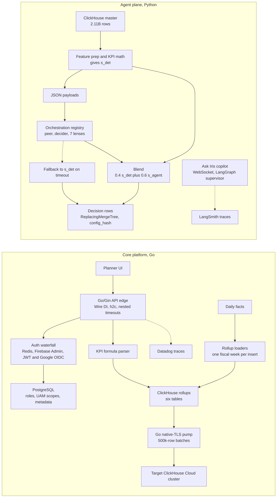

# Impact Analytics — AssortSmart (Platform & AI)

**Role:** Senior Software Engineer, Impact Analytics, Bangalore, May 2026 to Present
**PDF project title:** AssortSmart — Senior Software Engineer (Platform & AI)
**PDF tech line:** Go, Gin, Python, FastAPI, LangGraph, ClickHouse, BigQuery, Redis, PostgreSQL, Datadog, LangSmith, GCP, Docker

<b>How to use this page</b> 
• This is the one-page brief for the whole Impact Analytics job: both PDF sub-sections, Agentic Flows & Orchestration (bullets A1 to A5) and Core Infrastructure & Pipeline (bullets C1 to C5). 
• Read it the night before an interview, or as a warm-up before you open the full chapters: <a href="../../handbook/03_ia_core_platform.md">Chapter 3, IA core platform</a> and <a href="../../handbook/04_ia_agentic_ai.md">Chapter 4, IA agentic AI</a>. 
• Memorise three things: the one-minute version, the bullet table's number column, and the honesty box. 
• Anything in the "off-PDF but true" list is safe to say if asked, but never lead with it as a resume claim.

**Tags used on this page.** MEASURED means we have a log, benchmark output, doc or code behind the number. ESTIMATED means arithmetic I can show. TARGET means a design goal, so say "targeting". HISTORICAL means it comes from my past work records. A number with no tag is simply the PDF figure.

Source docs if you need to check a fact: [GROUND_TRUTH.md](../GROUND_TRUTH.md), the canonical [AssortSmart resume tab](../../../docs/ASSORTSMART_TAB_RESUME.md), and the [Keep/Drop pipeline notes](../../docs/assort_kd_flow/PIPELINE.md).

---

## 1. The one-minute version (say this out loud)

> "At Impact Analytics I work on AssortSmart, a merchandise planning product that retailers use to decide which products to keep, drop or add each season. My work has two halves. On the AI side, I built a decision engine with three pipelines, Keep/Drop, Missed Opportunities and Top Style. It evaluates 348,000 article-seasons, about 88,000 items per pass, by blending deterministic KPI math with structured LLM calls across seven AI lenses. The LLM never touches our 2.11-billion-row ClickHouse table. It gets prepared JSON, and if it times out the item falls back to its deterministic score. I also shipped Ask Iris, a secure chat copilot for planners, and every model change has to pass an 80% accuracy gate on a 300-case evaluation set. On the platform side, I own the multi-tenant Go and Gin API layer, which peaks at 10,000 requests per second. I made planner pivots 15.5 times faster, from 189 seconds to 12 seconds, with ClickHouse rollups, fixed a 170 GB out-of-memory crash in how those rollups are built, and wrote a Go data pump that copies them between ClickHouse Cloud clusters at about 344,000 rows per second."

If they want only 20 seconds, say: "I own the Go platform and the AI decision engine for a retail planning product. The AI scores 348,000 article-seasons with deterministic math plus seven LLM lenses, behind an 80% CI gate. The platform serves 10,000 peak requests per second, and I cut pivot time from 189 seconds to 12 seconds with ClickHouse rollups."

---

## 2. The business in plain English

**Who the users are.** Merchandise planners at retail companies. A planner decides things like "next autumn we will sell these 400 women's tops in these 120 stores, and we will stop selling these 60." AssortSmart is the SaaS (software as a service) product they do this in. Many retailers share one platform, and each retailer is called a tenant.

**What they do in the product.** They open large pivot grids of sales, stock, margin, sell-through and rate of sale, sliced by product, store, product attribute and week or season. They define their own KPIs (key performance indicators, the business metrics they track). And every season they decide, product by product, what stays in the range.

**What hurt before.**
1. **Slow screens.** Pivots were computed live from raw data on PostgreSQL. On a 250-million-row test, a typical pivot took 189 seconds.
2. **Too many decisions to review by hand.** A large retailer has hundreds of thousands of article-seasons. Simple rules like "drop if sell-through is below 40%" miss context, for example a product that sells slowly because it launched late or only sells on discount.
3. **Every new KPI needed a code release.**
4. **Strict data separation.** Each retailer must see only its own data, and each planner only the part of the product hierarchy they are allowed to see.

**Why the company paid for this.** Fast screens mean planners actually use the tool in planning season. Good keep and drop decisions reduce unsold stock and markdowns. Explanations make planners trust the AI. Cost and reliability controls make it affordable to run the AI for every client every season.

### Words you need

| Term | Plain meaning |
|---|---|
| **Article-season** | One product in one selling season. "Blue linen shirt, Summer 2026" is one article-season. |
| **Sell-through / rate of sale** | Sell-through is the share of stock that sold (80 of 100 units is 80%). Rate of sale is units sold per store per week. |
| **LLM lens** | One focused question the LLM (large language model) answers about an article, such as "Do other colours of this style steal its sales?" It returns a score, a confidence and reason codes. |
| **Deterministic** | Same input always gives the same output. Normal code is deterministic. LLM calls are not. |
| **ClickHouse** | A columnar analytics database. It stores each column separately and compresses it, so summing a column over billions of rows is fast. |
| **Rollup** | A table of totals computed ahead of time, so screens read totals instead of raw rows. Like a monthly bank summary instead of re-adding every transaction. |
| **ReplacingMergeTree** | A ClickHouse table type that keeps only the newest version of a row with the same key. Think of a notebook where you never erase: you write the new value below, and a cleaner later crosses out the old lines. |
| **Circuit breaker** | After too many failures in a row, stop calling a failing service for a while. Like a home fuse that trips to protect the wiring. |
| **Checkpoint** | Saved progress so a job can resume where it stopped. Like a video game save point. |
| **Google Wire** | A Go tool that generates the code that wires components together at build time, so a missing dependency fails the build instead of production. This is called compile-time dependency injection (DI). |
| **h2c** | HTTP/2 over plain TCP without TLS on that hop. HTTP/2 lets many requests share one connection. |
| **UAM** | User Access Management: which user may see which part of the data. |
| **OOM** | Out of memory. A query used more RAM than allowed and was killed. |
| **CI gate** | An automated check in the build pipeline that blocks a change if a score is below a threshold. |

---

## 3. Architecture

*What to notice: screens read rollups, never raw facts. The LLM only ever sees JSON, and our code does every database read and write. Every failure path in the AI batch still produces a row.*

**Walking through it, left to right.**

The **core platform** is the Go side. A planner's browser calls the **Go/Gin API edge**, a single Go process that handles routing, JSON, auth, timeouts and tracing. There is no reverse proxy (such as Nginx) in front of it, so the edge protects itself with nested timeouts. The **auth waterfall** answers "who is this?" cheaply: Redis first (a cache of recently verified identities), then the slower verifiers. **PostgreSQL** answers "what may they see?" through roles and hierarchy scopes. When a screen needs a KPI, the **formula parser** turns the user's formula into a safe SQL fragment, and the query runs against one of six **ClickHouse rollup tables**. Separately, on the write side, **loaders** build those rollups from raw daily facts one fiscal week at a time, and the **Go pump** copies rollup partitions to another ClickHouse Cloud cluster. **Datadog** records a trace for every request.

The **agent plane** is the Python side (FastAPI and LangGraph). Our Python code reads the **2.11-billion-row ClickHouse master**, computes KPIs, and produces the deterministic score **s_det**. It packs only the fields the LLM needs into **JSON payloads**. The **orchestration registry** runs the fixed batch order: peer benchmark context, then a decider that picks which lenses matter and how to weight them, then the seven lenses. Their combined score is **s_agent**. The **blend** gives the final score, and the result is written as **decision rows** through ReplacingMergeTree, each stamped with a **config_hash**. If the LLM times out, the item falls back to s_det and still gets a row. **Ask Iris** is the chat copilot where planners query KPIs and inspect these decisions, traced in **LangSmith**.

**A tiny worked example of the blend** (illustrative numbers, real formula and threshold). A blue linen shirt gets s_det = 0.62 and s_agent = 0.50. The final score is 0.4 × 0.62 + 0.6 × 0.50 = 0.248 + 0.300 = 0.548. The rule is keep if the final score is at least 0.55, so this article is a **Drop**, with an explanation like "Sell-through is acceptable, but demand is slowing and most units sold on discount." If the LLM had timed out, the shirt would get its deterministic outcome (0.62, so Keep) and the other items in the pass would carry on.

---

## 4. Each PDF bullet, decoded

The exact PDF wording comes first, so you can quote it. The table after it explains each bullet.

**Agentic Flows & Orchestration**
- **A1.** Architected a multi-pipeline AI merchandise decision engine (Keep/Drop, Missed Opportunities, Top Style) evaluating 348k article-seasons. Optimized inference at scale, processing 88k items per pass, by blending deterministic KPI math with structured LLM invokes across 7 AI lenses.
- **A2.** Decoupled AI inference from a 2.11B-row ClickHouse master by asynchronously serving context via JSON payloads rather than direct database querying. Engineered an eventually consistent write pattern via ReplacingMergeTree that guaranteed system availability by gracefully falling back to deterministic baselines during LLM timeouts.
- **A3.** Engineered a shared orchestration registry to guarantee 88k-article batch runs survive provider failures by implementing hard timeouts, circuit breakers, and durable checkpoints that bypass redundant deterministic scoring. Ensured full observability by stamping every output row with a frozen config hash and custom JSON telemetry tracking tokens, USD cost, step duration, and batch fallbacks.
- **A4.** Shipped "Ask Iris," a JWT-secured WebSocket copilot enabling planners to interactively query KPIs and inspect AI decisions on a multi-billion-row database. Prevented infinite LLM loops and multi-tenant data leaks by orchestrating a LangGraph supervisor with a 3-attempt evaluator loop, utilizing LangSmith for observability, and strictly freezing hierarchy access on the initial socket handshake.
- **A5.** Built a 300-case proxy evaluation harness and an 80% accuracy CI gate to enforce strict deployment guardrails. Reduced live execution costs by 73% at 100% coverage by benchmarking models against a 74% deterministic baseline, strategically freezing final decision weights when the LLM underperformed the baseline.

**Core Infrastructure & Pipeline**
- **C1.** Architected a multi-tenant Go/Gin platform scaling to 10k peak RPS, utilizing Google Wire for compile-time DI. Deployed as a self-protecting HTTP edge without a reverse proxy, guaranteeing high availability through native h2c, nested timeouts, and Datadog distributed tracing.
- **C2.** Eliminated deployment bottlenecks by architecting a dynamic KPI configurator and custom formula parser. Engineered a real-time compilation layer that tokenizes operator-authored math into parameterized ClickHouse SQL fragments with native division-by-zero protection, decoupling business logic from code releases.
- **C3.** Guaranteed strict multi-tenant data isolation and UAM-scoped hierarchy access control across PostgreSQL and ClickHouse. Secured system entry by implementing a Redis-fronted Firebase Admin to JWT/Google OIDC verification waterfall, constant-time API keys, and Postgres-backed role resolution.
- **C4.** Reduced planner pivot latency by 15.5× (189s to 12s on 250M-row operations) by building a ClickHouse pre-aggregation layer for season and weekly rollups. Prevented 170GB OOM crashes by slicing batch inserts into temporal chunks and enforcing strict distributed memory and disk-spill caps.
- **C5.** Migrated ClickHouse rollups across Cloud clusters at ~344k rows/s by writing a custom Go native-TLS data pump to bypass strict cross-cluster IP allowlist restrictions. Processed partitions up to 4.09B rows using 500k-row double-buffered batches, and eliminated partial-commit ghost rows using TSV ledgers and atomic partition rollbacks.

| Bullet | In plain words | How it works | Number and what it means |
|---|---|---|---|
| **A1** Decision engine | The AI tells planners which products to keep or drop each season, plus two sister pipelines for missed opportunities and top styles. | Python computes s_det from sell-through and rate of sale. Seven LLM lenses score qualitative evidence, a decider weights them into s_agent, and the blend is 0.4 × s_det + 0.6 × s_agent. Keep if the final score is at least 0.55. | **348k** article-seasons are the ones evaluated. **88k** is how many items one pass processes. **7** is the number of lenses. Say "348,000 article-seasons, about 88,000 per pass". |
| **A2** LLM never queries the database | The model gets a prepared JSON summary, not database access, and a timeout never blocks a run. | Python reads ClickHouse and builds trimmed JSON per batch. "Asynchronously" describes how batches run. The LLM has no SQL tool. Results are written through ReplacingMergeTree, so a retry simply writes a newer version of the row. On timeout, the item keeps its deterministic score. | **2.11B** rows is the size of the ClickHouse master. It shows why we never let a model write queries against it. |
| **A3** Orchestration registry | One shared harness that keeps long AI runs alive when the LLM provider fails, and records exactly what each run used. | Hard timeouts per call. A circuit breaker trips after about 5 consecutive failures or a high failure fraction. Checkpoint files (det.json, agent_progress.json) let `--resume` skip work already done. config_hash is a SHA-256 of guardrails, parameters, prompts and catalog, stamped on every row. JSON telemetry logs tokens, USD cost, step time and fallbacks. | **88k** articles per batch run, the same pass size as A1. |
| **A4** Ask Iris | A chat assistant where planners ask about KPIs and why the AI decided something. | JWT (a signed login token) is checked when the WebSocket opens. The user's hierarchy scope (plan_scope) is frozen at that handshake, so it cannot change mid-chat. A LangGraph supervisor routes each step, and an evaluator loop retries a weak answer at most 3 times (MAX_ATTEMPTS = 3). LangSmith traces every step. | **3** attempts is the hard loop cap. No usage or SLA (service level agreement) numbers exist, so do not give any. |
| **A5** Evaluation and cost | Nothing ships unless it passes a test set, and we picked a cheaper model without losing coverage. | A 300-case evaluation file runs in CI. Promotion is blocked below 80% (gold_min_accuracy 0.8 in eval.json). Separately, a 200-case gold benchmark compared models and the deterministic baseline. The blended LLM scored about 63%, below the 74% deterministic baseline, so we froze the blend weights instead of retuning them to look better. | **300** cases and **80%** gate: the CI promotion bar. **73%** lower cost at **100%** coverage (200 of 200 complete) and **74%** baseline: both from the separate 200-case benchmark. MEASURED. |
| **C1** Go/Gin platform | The main API that every planner screen talks to, shared by many retailers. | Gin handles routing and middleware. Wire generates the dependency wiring at build time. Go serves h2c directly with no reverse proxy, so the server sets its own nested timeouts (whole request, then each downstream call inside it). Datadog traces each request. | **10k peak RPS**: requests per second at peak. No SLA number exists, so keep reliability qualitative. |
| **C2** KPI formula parser | Business users type a KPI formula and it works on the next request, with no code release. | A Go tokenizer and parser read the formula, map logical names to physical columns, allow only approved functions, and emit parameterized SQL. Unknown tokens fail closed. Every expression is wrapped as `ifNotFinite(toFloat64(expr), 0)` so dividing by zero returns 0 instead of infinity. | No number on this bullet. The value is speed of change and safety. |
| **C3** Tenancy and access | Each retailer sees only its own data, and each planner only their part of the hierarchy. | Redis caches verified identities. On a miss, the waterfall tries Firebase Admin, then JWT or Google OIDC. API keys are compared in constant time. PostgreSQL holds roles and UAM scopes, and those scopes filter every PostgreSQL and ClickHouse query. | No number. Note: isolation is access control, not encryption. |
| **C4** Faster pivots, and the OOM fix | Two separate stories. Pivots got 15.5 times faster through rollups. Separately, the rollup build stopped crashing on memory. | Six MergeTree rollup tables (product, store and attribute, each by season and by week), partitioned by season_code. The weekly builds now insert one fiscal week per INSERT SELECT, with memory and disk-spill caps. | **15.5×** = **189s to 12s** on a **250M-row** harness (12.3s, rounded). MEASURED. This is query time. **170GB** is the out-of-memory crash on weekly builds. This is load time. One did not cause the other. |
| **C5** Cross-cluster copy | Copying rollups to another ClickHouse Cloud cluster when the normal cluster-to-cluster copy was blocked by network allowlists. | A Go pump speaks ClickHouse's native protocol over TLS (port 9440). It reads the next 500k-row batch while sending the previous one (double buffering). TSV ledgers and checkpoint files record finished work. If a season's copy fails, we DROP that partition and recopy it. | **~344k rows/s** = combined ingest rate of two season streams, not requests per second. MEASURED in flight. **4.09B** = largest partition set copied (attribute weekly, two seasons). **500k** rows per batch. |

---

## 5. Key design decisions (short form)

Each decision has the what, why, alternative and trade-off. The full version is in the handbook chapters.

**The LLM never queries the database (A2).**
What: the model gets JSON prepared by our code. Why: a model writing SQL against 2.11 billion rows could run unbounded scans, break tenant scoping, or invent numbers. Our code computes the math once and the same way every time. Alternative: give the agent a SQL tool. Why not: cost, safety, and tests could no longer check the numbers. Trade-off: the payload must be designed carefully, and the LLM can only reason about what we chose to send. If asked what I'd change, I would keep this boundary.

**Deterministic score plus LLM lenses, with fallback (A1, A2).**
What: money math stays in Python, the LLM only adds qualitative judgement. Why: LLMs are good at weighing evidence and explaining, and bad at arithmetic. Alternative: let the LLM decide alone. Why not: no stable baseline and no safe fallback. Trade-off: two scores to maintain and a blend to justify. The evaluation in A5 is exactly how we kept that honest.

**App-native orchestration registry instead of Airflow or Temporal (A3).**
What: one Python registry shared by all three pipelines. Why: we needed resume logic tied to our own checkpoints, ClickHouse inserts, config hashing and per-run cost JSON. Alternative: Airflow or Temporal, which are strong general workflow engines. Why not: more infrastructure than a batch job with a resume flag needed. Trade-off: we own the retry and resume code ourselves. If the number of pipelines grew a lot, I would revisit a workflow engine.

**Rollups, and building them one fiscal week at a time (C4).**
What: six pre-aggregated tables, loaded week by week. Why: screens read totals instead of raw rows, and one week fits in memory where a whole season did not. Alternative: bigger memory caps. Why not: a whole season failed even at 80 GB and 200 GB caps. Trade-off: many more insert statements to run and track, in exchange for a build that finishes.

**A custom Go pump with drop-and-recopy rollback (C5).**
What: our own native-TLS copier instead of ClickHouse's built-in cross-cluster copy. Why: IP allowlists blocked cluster-to-cluster copy. Trade-off: during a recopy, readers of the target can see a partial season. A swap-based design using REPLACE PARTITION from scratch tables was written but not executed. That is what I would do next.

---

<b>Honesty box: say this carefully</b> 
• <b>80% is a CI promotion gate</b>, not "every tenant is live at 80% accuracy". 
• <b>73% and 74% come from the separate 200-case gold benchmark</b>, not from the 300-case file. Never fuse the two sets. 
• <b>15.5× is query time and 170 GB is load time.</b> They are two stories. One did not cause the other. 
• <b>344k is rows per second</b> of ingest, not requests per second. 
• <b>The 4.09B copy was measured in flight.</b> Say "measured on a 4.09-billion-row copy", not "the cutover finished". 
• <b>"Atomic partition rollback" means DROP PARTITION, then recopy that season.</b> It is not an atomic swap that live readers never notice. 
• <b>Ask Iris is a shipped capability.</b> There are no SLA or usage numbers. Do not invent any. 
• <b>LangSmith is on Ask Iris only</b>, not on the Keep/Drop batch. The batch uses custom JSON telemetry. 
• <b>Keep/Drop has no LLM orchestrator.</b> The batch order is fixed: peer, decider, lenses, blend, explain. 
• <b>No human review queue.</b> Offline evaluation replaced critic and evaluator agents in Keep/Drop. 
• <b>Not at Impact Analytics:</b> Kafka, Flink, CDC (change data capture), Kubernetes operations, Milvus, sub-second ClickHouse claims. Kafka and Flink are Uber Menu. Milvus is Uber Menu. The CDC pipeline from PostgreSQL to ClickHouse was built by a colleague, so do not claim it. 
• <b>The platform APIs are Go/Gin.</b> The agent plane is Python (FastAPI, LangGraph). Never say Spring Boot for Impact Analytics. 
• <b>Verbal only, not resume bullets:</b> the Cluster Recommendation Copilot design (14 tools) and Hindsight.

### Off-PDF but true

These are real and you can say them if an interviewer asks. They are not on the current PDF, so never present them as resume claims.

- **1.6M article-seasons** is the full catalog. It is a different number from the 348k that were scored. Do not mix them.
- **About $100 per pass** in LLM token spend.
- **100% Go statement coverage with 1,200+ Go tests.** This is on LinkedIn and in verbal answers.
- **Model names on the 200-case benchmark:** gpt-5.6-luna compared against gpt-5.4-mini, 200 of 200 complete.
- **Production deterministic threshold of 0.65** on that 200-case set, and the **blended LLM at about 63%**.
- **Circuit breaker trips after about 5 consecutive failures**, or on a failure fraction.
- **OOM fix knobs:** 55 GB memory cap, 16 GB spill, 8 threads, 4 weeks in flight. A product week is about 11 GB and an attribute week is over 40 GB. A whole season failed even at 80 GB and 200 GB caps.
- **4.09B breakdown:** 2,779,317,472 plus 1,311,108,195 rows, attribute weekly, two seasons. Each season stream ran at about 150k to 190k rows per second, about 344k combined.
- **Copy safety files:** the weekly loader's TSV skip file and the copier's `migrate-checkpoints/<table>.done` files.
- **Why ClickHouse:** planner pivots were slow on PostgreSQL. Proof-of-concept tests compared PostgreSQL and ClickHouse, ClickHouse won the large analytical reads, and PostgreSQL kept the thin metadata, UAM and roles.

### What changed from older prep

Older versions of this page said things the current PDF does not. Use the current wording.

- Older prep said "335 thousand products". The PDF says **348k article-seasons**.
- Older prep put "1.6M article-seasons" and "2.4 billion weekly rollups" on the PDF. **1.6M is off-PDF** (the catalog). **2.4B is not on the PDF or in the current facts**, so drop it.
- Older prep said "88k per pass under $100" as a PDF claim. **$100 is off-PDF.**
- Older prep said "physical air-gap" and "two-phase" writes. The PDF says the LLM is **decoupled through JSON payloads**, with **eventually consistent ReplacingMergeTree writes**. Don't say "air-gapped".
- Older prep listed "100% coverage, 1,200+ Go tests, golangci-lint, SAST/SBOM" as a Core bullet. The fifth Core bullet on the PDF is now the **cross-cluster migration (C5)**. Coverage and test count are off-PDF. golangci-lint and SAST/SBOM are not in the current facts, so only mention them if you can describe them from your own work.
- Older prep put LangSmith in the orchestration registry. **LangSmith is Ask Iris only.**

---

## 6. Practice questions

**1. "Walk me through the Keep/Drop decision for one product."**
I start with deterministic math. Python computes sell-through and rate of sale and turns them into a score called s_det. Then up to seven LLM lenses each answer one focused question, like whether other colours are cannibalising the product, and a decider weights them into s_agent. The final score is 0.4 times s_det plus 0.6 times s_agent, and we keep the product if it is at least 0.55. For example, 0.62 and 0.50 blend to 0.548, so that shirt is a drop, with a written reason the planner can read.
*Follow-up they may ask: "Why 0.4 and 0.6?" Those weights are frozen configuration. When the LLM underperformed the baseline, we froze them rather than retune them to look good.*

**2. "Why not let the LLM query ClickHouse directly?"**
Because the master table has 2.11 billion rows, and a model writing SQL can run unbounded scans, ignore tenant scope, or get the math wrong. Our code reads ClickHouse, computes the KPIs once, and sends the model a trimmed JSON payload. That keeps cost bounded, keeps numbers testable, and means the model can only reason about data we chose to give it. The model never gets a SQL tool.

**3. "What happens when the LLM provider goes down mid-run?"**
The run still finishes. Every call has a hard timeout, and if a call times out the item falls back to its deterministic score and is marked as a fallback. If failures keep coming, about five in a row, the circuit breaker trips and stops hammering the provider. Checkpoint files mean that when we restart with `--resume`, we skip the deterministic scoring and the batches that already completed.

**4. "How do you know which settings produced a given decision?"**
Every output row carries a config_hash. It is a SHA-256 fingerprint of the guardrails, parameters, prompts and catalog used in that run. If a planner questions a decision, I can match it to the exact configuration. We also write JSON telemetry per run with tokens, USD cost, step duration and how many batches fell back.

**5. "Your CI gate is 80%. Is the product 80% accurate in production?"**
No, and I'm careful about that. 80% is the promotion bar on a 300-case evaluation set in CI. A change that scores below it cannot ship. It is a guardrail, not a claim that every tenant sees 80% live.
*Follow-up they may ask: "Where do 73% and 74% come from?" From a separate 200-case gold benchmark, not the 300-case file.*

**6. "Tell me about the 73% cost reduction."**
On a separate 200-case gold benchmark, we compared models and found a cheaper one that completed all 200 cases, so 100% coverage, at 73% lower live execution cost. The same benchmark showed the deterministic baseline at 74%. The blended LLM came in around 63%, below that baseline. So instead of retuning the blend weights until the numbers looked better, we froze them. I'd rather ship an honest system than an overfit one.

**7. "How does Ask Iris stop one retailer seeing another's data?"**
The planner's JWT is verified once when the WebSocket opens, and their hierarchy scope is frozen at that handshake. Later messages in the conversation can't change it. A LangGraph supervisor routes each step, and an evaluator loop retries a weak answer at most three times, so the model can't loop forever. LangSmith gives us a trace of every step.
*Follow-up they may ask: "What's its latency or usage?" It's a shipped capability. I don't quote usage or SLA numbers.*

**8. "How did you make pivots 15.5 times faster?"**
Pivots were adding up raw rows live. I built a pre-aggregation layer in ClickHouse: six rollup tables for product, store and attribute, each by season and by week, partitioned by season. On a 250-million-row test harness, a pivot went from 189 seconds to 12 seconds, 12.3 rounded. That is 15.5 times faster.
*Follow-up they may ask: "Was the 170 GB crash part of that?" No. That was a separate problem in building the rollups, which is load time, not query time.*

**9. "Tell me about the 170 GB out-of-memory crash."**
Building the weekly rollups for a whole season in one INSERT SELECT ran out of memory. It failed even with 80 GB and 200 GB caps. I sliced the build into temporal chunks, one fiscal week per insert, and set explicit memory and disk-spill caps so ClickHouse writes partial results to disk instead of dying. Each statement now handles a slice that fits in memory, so the build completes.

**10. "Why write your own data pump instead of using ClickHouse's copy?"**
The normal cluster-to-cluster copy was blocked by IP allowlists between the ClickHouse Cloud clusters. So I wrote a Go pump that reads from one cluster and writes to the other over ClickHouse's native protocol with TLS. It uses 500,000-row double-buffered batches, reading the next batch while sending the previous one, and reached about 344,000 rows per second combined across two season streams. TSV ledgers and checkpoint files record finished work, and if a season's copy fails we drop that partition and copy it again, so we never keep a half season that looks complete.
*Follow-up they may ask: "Is that rollback atomic for readers?" No. During a recopy readers can see a partial season. A REPLACE PARTITION swap design was written but not executed.*

---

## 7. Go deeper

- [Chapter 3: IA core platform](../../handbook/03_ia_core_platform.md) covers C1 to C5 in full, with a request walk-through, the formula parser example, the auth waterfall and the migration design.
- [Chapter 4: IA agentic AI](../../handbook/04_ia_agentic_ai.md) covers A1 to A5 in full, with all seven lenses, a worked score example, the registry and the evaluation split.
