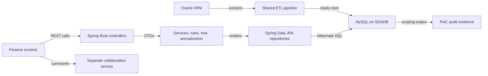

# Uber (via EPAM): FRM Scoping Platform (Java + Python track)

**Role:** Software Development Engineer 2 · July 2024 to May 2026 · Bangalore · always say "Uber via EPAM"  
**Resume tech line:** Java, Spring Boot, Spring Data JPA, Hibernate, MySQL, JUnit, Bazel, Docker

<div class="callout note">

**How to use this page**

- **What it covers:** the Financial Risk Management (FRM) Scoping Platform for Uber Finance, explained from the finance basics up to the Spring Boot and Hibernate design, with every resume number and its source.
- **When to read it:** before any round that may touch Uber, fintech, Java backends, MySQL data modelling, migrations, concurrency or "tell me about a hard bug".
- **What to memorise:** the one-minute version, the five numbers (70%, $340M, 19M, 36, 100%) with how each was derived, the column-aliasing bug story, and the "what not to say" list.

</div>

**Tags on this page.** MEASURED means there is a log, document or code behind it. TARGET means a design goal, so you say "targeting". ESTIMATED means arithmetic I can show. HISTORICAL means it comes from my past work records. Numbers printed on the resume are the resume's claims, and you defend them as written.

Longer version of this story: [Handbook chapter 5, Uber FRM](../../handbook/05_uber_frm.md). Older dense notes: [FRM deep dive](../11_uber_frm_deep_dive.md) and [Uber interview packs](../23b_uber_interview_packs.md). Older prep said "30+ endpoints, do not say 36" and "do not say 19M" and "70% is only a target". That guidance is obsolete. The current resume prints 36, 19M and 70% as the outcome, and this page follows the resume.

---

## 1. The one-minute version

> "At Uber, through EPAM, I owned the backend of the FRM Scoping Platform for Uber Finance. Every quarter Finance decides which financial line items and legal entities are important enough for the auditors to test. That used to live in a Google Sheets workbook, and reconciliation alone took about 14 days. I moved it onto a Spring Boot and MySQL service. I migrated 19 million raw general-ledger rows off Sheets into an 8-table normalized schema on Uber's service-owned MySQL standard, and shipped 36 Spring Boot endpoints for the financial math, a four-level line-item hierarchy and quarter-annualization. Reconciliation came down from 14 days to 3 days, a 70% cut, against a $340M materiality threshold. Because several managers edit the same close at once, I used optimistic row-locking, atomic cross-table writes and SHA-256 natural keys. I also led 3 engineers on a Spring Data JPA and Hibernate migration that removed a column-aliasing bug and took the module to 100% statement coverage."

## 2. The business in plain English

A public company like Uber publishes results every quarter. Before it can, Finance runs the **quarterly close**, a few intense weeks of finalising and cross-checking numbers. Inside the close, the FRM team runs **scoping**: deciding which lines and which entities are "in scope" for audit testing. Uber's external auditor, PwC, uses that output as evidence in its work papers.

Before this platform, scoping lived in spreadsheets. A spreadsheet row has no permanent identity, two people can overwrite each other, copies drift apart, and checking internal numbers against the filed numbers was manual. Scoping is a **SOX** control (Sarbanes-Oxley Act, the US law that makes public companies prove their financial-reporting process is reliable). So Uber needed something faster, repeatable, auditable and safe for many editors at once.

## 3. Words you need

- **GL (general ledger).** The master record of every account balance. Think of it as one giant bank statement for every account at once. A "raw GL row" is one balance for one account, entity and period.
- **Oracle HFM (Hyperion Financial Management).** Uber's consolidation system. It combines every entity's books into group numbers. The platform checks HFM amounts against the filed **10-Q** (the quarterly SEC report).
- **FSLI (Financial Statement Line Item).** One line on the balance sheet or income statement, such as Cash or Accounts Receivable. They nest four levels deep, **L1 to L4**, like folders. A parent equals the sum of its children.
- **Materiality.** The size of mistake that would change a reasonable reader's decision. On the Q4 2025 close it was **$340M**. Any line above it is quantitatively material.
- **Quarter-annualization.** Scaling a part-year income figure to a full-year estimate so it can be compared fairly. Generic form: year-to-date × 4 / number of quarters so far.
- **SOADB.** Uber's standard for service-owned MySQL. Each service owns its database on a shared operating model, like every team getting its own locker in one maintained building.
- **JPA, Spring Data JPA and Hibernate.** JPA (Jakarta Persistence API) is Java's standard for mapping rows to objects. Hibernate is the engine that implements it. Spring Data JPA sits on top and writes the repetitive repository code for you.
- **Optimistic locking.** Each row has a version number. A save only succeeds if the version is still the one you read. Like a shared document that says "someone edited this since you opened it, please reload".
- **Natural key.** An ID computed from the data itself, so the same content always gets the same ID. Like identifying a book by its ISBN instead of a sticker number.
- **FSM (finite state machine).** An item is always in exactly one named state (here Draft, Review, ReOpen, Closed), and only some moves are allowed. A **gate** is a check that can block a move.

## 4. Architecture



*What to notice: requests only flow controller, then service, then repository, then MySQL. The ETL and the collaboration service are neighbours I integrate with, not systems I claim to have built.*

Box by box. **HFM and the shared ETL** load quarterly balances into MySQL. That ETL was a shared pipeline responsibility, so I say "the service consumes HFM-loaded tables". **Controllers** (`@RestController`) are thin. They read the caller's identity from the `x-auth-params-email` header that Uber's gateway injects, validate the body with Bean Validation (`@Valid`, `@NotNull`), and an `@ControllerAdvice` maps errors to status codes. **Services** own the finance rules: materiality, the 5% component rule, residual risk, building the L1 to L4 tree and quarter-annualization. **Repositories** own every query. The **collaboration service** for comments and notifications was a separate service that I did not build.

Why layering matters: each layer can be tested with the layer below mocked, and three engineers could work on one feature without merge collisions.

## 5. Each resume bullet decoded

### Bullet 1: ownership, 70%, $340M, 19M rows, 36 endpoints, L1 to L4

**In plain words.** I owned the backend Finance uses to scope the quarterly audit. I moved the data from Sheets into MySQL and built the API that does the finance math and the four-level tree.

**How it works.** The ETL gives every line a permanent `uuid` and stores the L1 to L4 labels once in a `level_mapping` table. Fact rows only hold a `level_id` that points at it. I personally owned the **reconciliation v1 to v2 migration**: the old Sheets-backed endpoints stayed live while new MySQL-backed `/v2/` endpoints were added next to them (18 files, about +1,268 lines, MEASURED from the migration write-up). QA compared both for the same period, and the screens switched only after staging matched. v1 stayed as the fallback.

The core rule is two tests joined by OR: a line is Significant if its amount is above materiality **or** a manager answered a qualitative risk question with yes. Example: Accounts Receivable at $1,200M is above $340M, so it is material. Prepaid expenses at $90M is not, unless flagged.

**Why this design, and alternatives.** MySQL over Sheets because SOX needs stable IDs, concurrency control and an audit trail. A parallel run instead of a big-bang switch because the close has a hard deadline. PostgreSQL would have worked, but SOADB MySQL is Uber's service standard, and the ETL already flattens the hierarchy so we did not need recursive SQL. A columnar warehouse was rejected because this workload is many small transactional edits. *Trade-off:* two code paths for a while. *What I'd do differently:* an automated nightly diff between v1 and v2 instead of relying on QA side-by-side checks.

**The numbers.**

| Number | What it measures | Where it comes from | How to say it |
|---|---|---|---|
| 70%, from 14 days to 3 days | Quarterly reconciliation time | (14 − 3) / 14 is about 79%, stated conservatively as 70%. The technical design doc framed this cut, and the platform delivered it | "Reconciliation went from 14 days to 3 days, about a 70% cut." |
| $340M | Group materiality on the Q4 2025 close | A metric row set by Finance and the auditors (MEASURED). Residual threshold was $170M, half of it | "Against a $340M materiality threshold." |
| 19M | Raw GL rows migrated off Sheets | Resume figure. Each quarterly extract was about 38K to 95K rows, about 1.7K to 1.8K accounts, about 400 entities | "19 million raw GL rows moved into MySQL." |
| 36 | Spring Boot endpoints | About 31 functional routes in the scoping service plus the collaboration-service comment and notification APIs from the design doc | "36 endpoints automating the math and the hierarchy." |

Why it mattered: reconciliation sits at the front of scoping, so every day saved there gives managers and PwC more review time before the filing deadline.

### Bullet 2: 8-table schema, optimistic locking, atomic syncs, SHA-256 keys

**In plain words.** During close, data loads and managers' edits were fighting over the same data (**lock contention**: writers queuing on the same database locks). I designed a normalized schema where each fact lives once, gave every reviewable item one shared status model, and added three safety mechanisms.

**Optimistic locking in Hibernate.** A `@Version` field makes Hibernate add `AND version = ?` to every UPDATE and throw an exception when zero rows match.

```java
@Entity
@Table(name = "balance_sheet")
public class BalanceSheetLine {
    @Id private String uuid;
    private String levelId;
    private BigDecimal hfmAmount;
    private BigDecimal priorAmount;
    @Enumerated(EnumType.STRING) private ReviewStatus groupStatus;
    private String conclusionScope;
    private String updatedBy;
    @Version private long version;
    // getters and setters omitted
}

public enum ReviewStatus { DRAFT, REVIEW, REOPEN, CLOSED }
```

Worked example: two managers open the same line at version 7. Manager A saves first and the row becomes version 8. Manager B saves with version 7, Hibernate's UPDATE matches zero rows, and Spring raises `ObjectOptimisticLockingFailureException`. The controller advice turns that into HTTP 409 Conflict, and B's screen asks them to reload. Nobody held a lock while thinking, and nobody's work was silently lost.

**Polymorphic review-status** means one status model reused by different kinds of rows: group lines, component lines, residual lines and threshold rows all move through Draft, Review, ReOpen and Closed. One validator and one state machine serve all eight screens.

**Atomic cross-table syncs.** Saving a qualitative answer and updating the mapped line's flag happen in one transaction. A runtime exception rolls both back.

```java
@Transactional
public void saveAnswerAndSync(String assessmentId, String answer, String lineId, String user) {
    assessmentRepo.updateAnswer(assessmentId, answer, user);
    int rows = lineRepo.updateQualitative(lineId, "Yes".equals(answer) ? "YES" : "NO", user);
    if (rows == 0) {
        throw new NotFoundException("mapped line not found");   // rolls back both writes
    }
}
```

**SHA-256 natural keys.** Scoping questions are reloaded each quarter. The ID is a hash of the question text plus the normalized page name, so a reload updates rows in place instead of duplicating them.

```java
static String questionUuid(String questionText, String pageName) throws NoSuchAlgorithmException {
    String page = pageName.strip().toLowerCase(Locale.ROOT);
    byte[] digest = MessageDigest.getInstance("SHA-256")
            .digest((questionText + page).getBytes(StandardCharsets.UTF_8));
    return HexFormat.of().formatHex(digest).substring(0, 32);
}
```

*The normalization shown is illustrative.* The insert then uses MySQL's `ON DUPLICATE KEY UPDATE`.

**Alternatives.** Pessimistic locks (`SELECT ... FOR UPDATE`) serialise everyone during the busiest weeks. Last-write-wins silently loses work, which is unacceptable for audit evidence. Auto-increment IDs plus "check if exists" is racy and differs between environments. **8 tables vs 11 entities:** 8 is the normalized core on the PDF. The service code ends up with 11 mapped entities (verbal depth) because supporting tables arrived as screens landed.

### Bullet 3: led 3 engineers, JPA/Hibernate migration, 100% coverage, Bazel, allowlists, 50% gate

**The column-aliasing bug.** Legacy native SQL joined a fact table to `level_mapping`, and both have a `uuid` column. Results were turned into a map keyed by column name, so the two `uuid` values collapsed into one key and the mapping table's value replaced the fact row's.

```java
String[] keys = {"uuid", "amount", "uuid"};
Object[] row  = {"fact-111", 1200, "map-999"};
Map<String, Object> m = new HashMap<>();
for (int i = 0; i < keys.length; i++) m.put(keys[i], row[i]);
// m is {uuid=map-999, amount=1200}. The fact uuid is gone.
```

*Symptom:* rows looked right on screen but carried the wrong ID, so an edit to one recon line appeared to change another. *Fix:* typed JPQL projections into a record, where every column has its own name.

```java
@Query("""
    select new com.uber.frm.ComponentRow(i.uuid, i.levelId, lm.uuid, lm.level1, i.amount)
    from ComponentEntity i
    join LevelMapping lm on lm.uuid = i.levelId
      and lm.fiscalQuarter = i.fiscalQuarter and lm.fiscalYear = i.fiscalYear
    where i.fiscalQuarter = :q and i.fiscalYear = :y
    """)
List<ComponentRow> findComponents(@Param("q") String q, @Param("y") int y);

public record ComponentRow(String fsliId, String levelId, String levelMappingUuid,
                           String level1, BigDecimal amount) {}
```

*Package and entity names are illustrative.* `fsliId` and `levelMappingUuid` can never collide.

**100% module statement coverage** means every statement in the migrated module runs in at least one test. Controller tests use `@WebMvcTest` and MockMvc with a mocked service, so no database is needed.

```java
@WebMvcTest(GroupScopingController.class)
class GroupScopingControllerTest {
    @Autowired MockMvc mvc;
    @MockBean GroupScopingService service;

    @Test
    void staleVersionReturns409() throws Exception {
        when(service.updateLine(eq("a1f3"), any(), eq("priya@uber.com")))
            .thenThrow(new ObjectOptimisticLockingFailureException(BalanceSheetLine.class, "a1f3"));
        mvc.perform(patch("/frm-scoping/group_balance_sheet/a1f3")
                .header("x-auth-params-email", "priya@uber.com")
                .contentType(MediaType.APPLICATION_JSON)
                .content("{\"groupStatus\":\"CLOSED\",\"version\":7}"))
           .andExpect(status().isConflict());
    }
}
```

**Stacked Bazel PRs** are a chain of small, additive pull requests (entities, then repository, then service, then controller), each passing its Bazel test target and safe to deploy alone. That is how releases stayed zero-downtime. **Reporting SQL allowlists** mean only approved page names, statuses and statement types are accepted, and queries use bound parameters. **The FSM gate** blocks moving a line to Closed if it moved more than 50% quarter over quarter without review.

```java
static void checkCanClose(BigDecimal current, BigDecimal prior, boolean reviewed) {
    if (reviewed) return;
    if (prior.signum() == 0) throw new IllegalStateException("no prior amount, review needed");
    BigDecimal change = current.subtract(prior).abs().divide(prior.abs(), 4, RoundingMode.HALF_UP);
    if (change.compareTo(new BigDecimal("0.50")) > 0) {
        throw new IllegalStateException("variance above 50 percent needs review before Closed");
    }
}
```

Example: $400M to $650M is 250 / 400 = 62.5%, so closing is blocked. $1,000M to $1,200M is 20%, so it passes. Do not confuse this with the residual-risk flag ($170M, half of materiality).

**Leading 3 engineers** means tech lead of an EPAM pod, not people manager. I split work by layer, set conventions (thin controllers, services own logic, repositories own queries, every write records `updated_by`), and held the review gate that every PR adds tests and passes Bazel. Across the service there are 1,100+ tests (verbal depth).

## 6. Tech used and why

| Tech | One line | Why here | Alternative |
|---|---|---|---|
| Java + Spring Boot | JVM language plus opinionated framework with embedded server | Typed REST services, mature ecosystem, thread-per-request model fits short MySQL calls | Python web stack |
| Spring Data JPA + Hibernate | Repository layer plus ORM engine | `@Version` locking, `@Transactional`, typed projections that killed the aliasing bug | Raw JDBC strings, which caused the bug |
| MySQL on SOADB | Relational database under Uber's standard | ACID transactions for concurrent edits | PostgreSQL, a warehouse |
| JUnit 5 + Mockito | Test framework plus mocking | Layer-by-layer tests without a database | Integration-only tests |
| Bazel | Monorepo build and test | Per-layer test targets gate every merge | Not a choice, it is Uber's monorepo |
| Docker | Container packaging | Reproducible local and CI runs | Bare machines |

## 7. Questions they will ask

**"What exactly did you own?"**  
I owned the scoping service backend: the Spring Boot controllers, the services holding the finance rules, the repositories and the JPA entities. I personally drove the reconciliation migration from Sheets to MySQL. The HFM ETL was a shared pipeline and the comments service belonged to another team. The screens were built by front-end engineers on my APIs.

**"19 million rows is not much for MySQL. Why is this hard?"**  
Agreed, it is not a scale problem. The hard part is correctness. One duplicated leaf silently inflates every parent in a four-level tree, several managers edit at once, and the output becomes audit evidence for an SEC filing. The slow part of the old process was manual mapping and chasing differences, and the platform automated that, which is where the 14 days to 3 days came from.

**"Why optimistic locking and not row locks?"**  
Conflicts are rare and humans are slow. Managers mostly own different lines, so holding a lock for the minutes someone takes to type a conclusion would block everyone and make lock contention worse. With `@Version`, the second writer gets a clear 409 and reloads.  
*Follow-up they may ask:* "How does Hibernate implement it?" It adds the version to the WHERE clause, increments it on success, and throws when zero rows match.

**"Tell me the column-aliasing bug in 30 seconds."**  
A native query joined two tables that both had `uuid`. Rows were mapped into a map keyed by column name, so one `uuid` overwrote the other and edits landed on the wrong line. I moved those reads to typed JPQL projections with a distinct name for every column, and made that the standard in the migration.

**"Why SHA-256 for a key?"**  
I needed a deterministic ID, the same question on the same page giving the same ID in every environment and every quarter. A content hash makes the bulk load idempotent, and the cost is trivial at this volume.

**"How did stacked PRs give zero downtime?"**  
Each PR was small, additive and deployable on its own. New code lived beside old code until verified, like the v2 recon endpoints beside v1.

**"Is the 70% measured?"**  
It is the outcome on the resume, 14 days to 3 days. If pressed: "The technical design doc framed that cut, and that's what the platform delivered for the close."

## 8. What not to say

<div class="callout warn">

- "I was an Uber employee." Say **Uber via EPAM**.
- "I built the HFM ETL" or "I built the comments and notifications service." Both belong to others.
- "30+ endpoints" or "do not mention 19M". Obsolete. The resume says 36 and 19M.
- Walking back the 70% unprompted, or claiming a precise time study.
- "Big-data system" or any latency number for this platform. None was measured.
- "Redis caching on FRM." There was no server-side response cache.
- "100% coverage of the whole service." It is the migrated module only.
- Merging "led 3 engineers" (FRM) with "mentored 2 engineers" (Masters India).
- Extra FSM rules beyond the 50% delta-variance gate, or a specific annualization formula per line.
- "55 line items and 14 entities" from an older resume. It is not on the current PDF.

</div>
