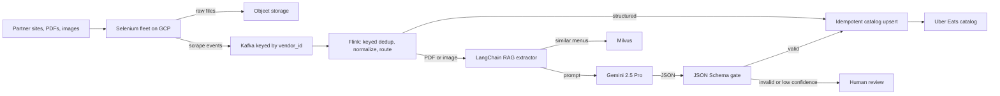

# Uber (via EPAM): Menu Ingestion & Automation, Uber Eats

**Role:** Software Development Engineer 2 · July 2024 to May 2026 · Bangalore · always say "Uber via EPAM"  
**Resume tech line (exact):** Python, Selenium, Kafka, Flink, LangChain, Gemini, RAG, Milvus, GCP, Docker

This project stays Python on every resume track. There is no Spring or Java claim here.

<div class="callout note">

**How to use this page**

- **What it covers:** how restaurant menus get from messy websites and PDFs into the Uber Eats catalog, through a hardened Selenium fleet, Kafka, Apache Flink and a Gemini RAG extractor over Milvus. A short box at the end covers the separate ANZ document-compliance project.
- **When to read it:** before questions on streaming, scraping, RAG or LLM systems, deduplication, idempotency or "an AI system you shipped".
- **What to memorise:** from 24 hours to 2 hours, $600K a year and its derivation, 30K+ menus a month, 98% field fidelity in offline evaluation, 95%+ extraction success, and the honest meaning of "exactly-once".

</div>

**Tags on this page.** HISTORICAL means it comes from my past work records. ESTIMATED means arithmetic I can show. MEASURED means a log or document. The menu outcomes are HISTORICAL, and 98% is an **offline evaluation** number.

Longer version: [Handbook chapter 6, Menu and ANZ](../../handbook/06_uber_menu_and_anz.md). Older notes: [Menu deep dive](../14_uber_menu_deep_dive.md), [Menu streaming numbers](../03_uber_menu_streaming_numbers.md) and [Menu, ANZ and Milvus panel](../30_panel_menu_anz_milvus.md). Older notes also mention Spark, Pinot and fine-tuning. None of those is on the current resume, so treat them as study-only.

---

## 1. The one-minute version

> "At Uber Eats, through EPAM, I worked on menu ingestion, which gets a new restaurant's menu into the catalog so it can take orders. Menus arrive as JavaScript-heavy sites, PDFs and images in many languages. I architected an automated pipeline. A Selenium fleet, which I hardened with dynamic proxy pools and adaptive retries, took extraction success to 95% plus from an estimated 60 to 65%. Scrapes flow through Kafka into a Flink job that deduplicates per vendor by content hash, normalizes to one schema and does idempotent catalog upserts. For messy PDFs we used RAG: retrieve similar labelled menus from Milvus and give them to Gemini 2.5 Pro, which returns JSON that must pass schema validation. That reached 98% field fidelity in offline evaluation. Onboarding went from 24 hours to 2 hours at 30,000+ menus a month, and replacing a roughly $2 per menu manual and third-party cost saved about $600K a year."

## 2. The business in plain English

A restaurant on Uber Eats earns nothing until its menu is in the **catalog**, Uber's strict structured store of dishes, prices, sizes and add-ons. Getting it there is **onboarding**. Menus are hard because many pages only show items after JavaScript runs, many menus are scanned PDFs or photos, prices look like "8,50 €" or "¥1,200", sites block bots, and the same menu gets scraped repeatedly. Before this work onboarding took about 24 hours and cost about $2 per menu in manual and third-party processing. At 30K+ menus a month, that was slow and expensive.

## 3. Words you need

- **Selenium.** Drives a real browser from code, so you see the page as a person does. **Headless** means no visible window.
- **Proxy pool.** A set of middleman servers you rotate through, so the site sees their IP, not yours. A **dynamic** pool evicts banned or slow proxies automatically. Like a team of couriers: if one is turned away, send another.
- **Adaptive retries.** Retry differently by failure type. A ban means switch proxy, a timeout means wait longer (backoff plus random jitter), a broken page means stop. A **retry budget** caps how much one hostile site can consume.
- **Kafka.** A durable message log. We keyed messages by `vendor_id`, so each restaurant's events stay in order on one partition and can be replayed.
- **Apache Flink.** A stream processor that keeps memory per key (**keyed state**). A **watermark** is Flink saying "I believe I have seen everything up to time T". A **checkpoint** is a consistent snapshot of state plus Kafka offsets, used to recover after a crash.
- **Content hash.** A fingerprint (for example SHA-256) of the normalized menu. Same content, same hash.
- **RAG (Retrieval-Augmented Generation).** Retrieve relevant examples first and put them in the prompt. Like an open-book exam.
- **Embedding and Milvus.** An embedding is a list of numbers that captures meaning, so similar text lands close together. Milvus is an open-source vector database that finds the nearest embeddings fast.
- **Field fidelity.** The share of extracted fields (name, price, description, modifiers) that exactly match the human label.
- **Idempotent upsert.** Insert if missing, update if present, keyed by a stable ID, so doing it twice changes nothing.

## 4. Architecture



*What to notice: acquisition, transport, processing and AI extraction are separate stages. Nothing reaches the catalog without passing Flink's normalization or the schema gate.*

Box by box. The **Selenium fleet**, packaged with Docker on GCP, loads each source through the proxy pool and stores the raw file, so the event only carries a pointer. **Kafka** lets scrapers write and move on without waiting for the catalog. **Flink** drops duplicate menu versions per vendor, normalizes fields, and routes structured content straight to the catalog and unstructured content to RAG. The **RAG extractor** chunks the document, finds similar labelled menus in **Milvus**, and asks **Gemini 2.5 Pro** for JSON. The **schema gate** blocks anything malformed.

## 5. One job, step by step

Illustrative data: café `v_48213` in Lisbon has a scanned Portuguese PDF menu.

1. A Selenium worker downloads the PDF, stores it, and publishes `{"vendor_id": "v_48213", "content_type": "pdf", "content_hash": "9f2c...", "locale": "pt"}`.
2. Flink sees a hash it has not stored for this vendor, saves `9f2c`, and routes the PDF to RAG.
3. The extractor retrieves three already-labelled Portuguese café menus from Milvus.
4. Gemini receives the chunk ("Tosta mista ..... 4,50 €"), the examples and the schema, and returns `{"name": "Tosta mista", "price_amount": 4.50, "currency": "EUR"}`.
5. The JSON passes schema validation and is upserted keyed by vendor, menu version and item key.
6. Ten minutes later the same PDF is scraped again. Same hash, so Flink drops it. No LLM cost and no catalog write.

## 6. Each resume bullet decoded

### Bullet 1: 24 hours to 2 hours, $600K, 30K+ menus, 98% fidelity

**In plain words.** I architected the automated pipeline that gets menus into Uber Eats. For the hardest inputs, messy multilingual PDFs, we used an LLM grounded on similar labelled menus.

**How it works.**

```python
def extract_menu(chunk_text: str, locale: str) -> dict:
    examples = milvus_search(embed(chunk_text), top_k=3, filter={"locale": locale})
    prompt = build_prompt(chunk=chunk_text, examples=examples, schema=CATALOG_SCHEMA)
    raw = gemini_generate(prompt)                 # Gemini 2.5 Pro, JSON only
    menu = json.loads(raw)
    jsonschema.validate(menu, CATALOG_SCHEMA)     # raises if the shape is wrong
    return menu
```

*Simplified sketch. Function names and `top_k` are illustrative.* Without examples, an LLM guesses at layout, may invent a dish, or drifts from the schema. Two or three labelled examples of similar menus show it which number is the price and how sizes become modifiers.

**Why this design, and alternatives.** Regex or template parsers break on every new layout and language. OCR plus rules gets the text but not the structure. A bare prompt is less consistent across cuisines. Training a custom model needs a big labelled set and retraining whenever the schema changes, while with retrieval a newly labelled menu helps the very next extraction. pgvector or a managed vector service would also work, and Milvus is what we used. *Trade-off:* LLM calls cost money, and offline evaluation is not live monitoring. *What I'd do differently:* sample live extractions for human spot checks to track fidelity in production.

**The numbers.**

| Number | What it measures | How derived | How to say it |
|---|---|---|---|
| 24 hours to 2 hours | Onboarding cycle time (HISTORICAL) | (24 − 2) / 24 is about 92% | "Onboarding went from 24 hours to 2 hours." |
| $600K a year | Cost removed | About $2 per menu × 30,000 × 12 = $720K list, floored to $600K to be conservative | "About $2 a menu at 30K a month is $720K. I quote $600K conservatively." |
| 30K+ a month | Menus processed (HISTORICAL) | 30,000 / 30 is about 1,000 a day | "More than 30,000 menus a month." |
| 98% | Field fidelity on an offline labelled set | Example: 196 of 200 fields match labels | "98% field fidelity in offline evaluation." |

Why it mattered: restaurants go live the same day instead of the next, and the per-menu saving grows with volume.

### Bullet 2: 95%+ success, Selenium hardening, Kafka and Flink, exactly-once upserts

**Hardening the fleet.**

```python
def scrape_with_retries(url, source, max_attempts=4):
    for attempt in range(1, max_attempts + 1):
        proxy = proxy_pool.get_healthy(source)
        try:
            page = selenium_fetch(url, proxy=proxy)
            if looks_blocked(page):              # CAPTCHA wall or soft 403
                proxy_pool.mark_banned(proxy)
                continue
            if item_count(page) == 0:
                raise EmptyMenuError(url)        # never green-light an empty menu
            return page
        except TimeoutError:
            if not retry_budget.allow(source):
                break
            time.sleep(min(2 ** attempt, 30) + random.uniform(0, 1))
    raise ScrapeFailed(url)
```

*Simplified sketch with illustrative thresholds.*

**Flink keyed dedup.** The stream is keyed by `vendor_id`, and state holds the last content hash.

| Event time | Hash | State before | Result |
|---|---|---|---|
| 10:15 | 9f2c | empty | keep, state becomes 9f2c |
| 10:25 | 9f2c | 9f2c | drop, duplicate scrape |
| next day | a71d | 9f2c | keep, the menu changed |

A time-to-live on state stops it growing forever. Event-time watermarks with bounded lateness stop a late page from an older version overwriting a newer one.

**Exactly-once, the honest version.** Delivery through Selenium, Kafka and Flink is **at-least-once**. After a crash, Flink restores the last checkpoint and reprocesses some events. The catalog write is an **idempotent upsert** keyed by vendor, menu version and item key, so a replay writes the same row again. The catalog sees exactly-once **effects**. It is not a two-phase commit across Gemini, partner sites and the catalog.

**Why Kafka and Flink at about 1,000 menus a day?** Not for average volume. For the shape of the load: bursts and retries, repeated scrapes needing per-vendor state, late pages needing event time, and replay after a parser bug. A simple worker queue would mean rebuilding those by hand. Kafka Streams could work at this rate, and Flink gave richer event-time support. Spark is not on the resume. If asked, it is a reasonable batch backfill option, as study-level talk only.

**The number.** 95%+ extraction success is HISTORICAL. The 60 to 65% starting point is ESTIMATED. Say: "Success went to 95% plus, from roughly 60 to 65% before hardening."

## 7. Tech used and why

| Tech | Why here | Alternative |
|---|---|---|
| Python | Scrapers, workers, LLM glue | Go, less natural for browser automation and LLM tooling |
| Selenium | JavaScript-rendered pages | Plain HTTP, which misses rendered items |
| Kafka | Buffer bursts, per-vendor order, replay | Scrapers calling the catalog directly |
| Flink | Keyed dedup state, event time | Kafka Streams |
| LangChain + Gemini 2.5 Pro + RAG | Chunk, retrieve, prompt, parse multilingual menus | Templates and regex |
| Milvus | Similarity search over labelled menus | pgvector, managed services |
| GCP + Docker | Where the fleet ran, packaged repeatably | Bare VMs |

## 8. Questions they will ask

**"Is 98% a production number?"**  
No. It is offline evaluation on a labelled set, measuring the share of fields that exactly match the human label. In production the protection is the schema gate plus human review for low-confidence output.  
*Follow-up they may ask:* "How would you monitor it live?" Sample a small share of live extractions for spot checks and alert on spikes in gate rejections.

**"Do you really have exactly-once?"**  
Exactly-once effects, not exactly-once delivery. Delivery is at-least-once, and the upsert keyed by vendor, menu version and item key makes reprocessing harmless. I would not claim zero message loss.

**"What stops the LLM inventing a dish?"**  
Three layers. Retrieval grounds it on real labelled examples, the schema gate rejects malformed output, and low-confidence output goes to a person instead of the catalog.

**"How do you know a scraper broke silently?"**  
The dangerous case is a page that loads fine with no menu, after a layout change or CAPTCHA. We count an empty or suspiciously small menu as a failure and watch per-vendor item counts.

**"What happens when a Flink job crashes?"**  
It restores the last checkpoint, Kafka offsets rewind to match, events since then are reprocessed, and idempotent upserts prevent duplicates. Consumer lag rises and alerts until it catches up.

**"How did you get to $600K?"**  
About $2 per menu, times 30,000 menus a month, times 12, is $720K. I quote $600K as a conservative floor.

## 9. Related project: ANZ Document Compliance (Uber Mobility)

<div class="callout highlight">

**Keep this separate from Menu.** ANZ is Uber Mobility (rides), not Eats, and it is HISTORICAL. I automated driver and vehicle document verification in Australia and New Zealand against local authority rules with a **deterministic validation backend**, a rules engine where the same document always gets the same verdict with the failing reason (for example "expired" or "does not match the vehicle record"). That reached **99.9% regulatory compliance** and removed **20 hours a week** of manual review queues. Rules beat ML here because regulators need explainable, repeatable decisions. Do not attach Selenium, Kafka, Flink or RAG to it, and do not invent driver or document counts.

</div>

## 10. What not to say

<div class="callout warn">

- "98% accuracy in production" or "98% SLA". It is offline evaluation.
- "Zero message loss" or "two-phase commit end to end".
- The 60 to 65% baseline as measured. It is ESTIMATED.
- $720K as the saving. The resume says $600K.
- Spark, Pinot or fine-tuning as resume claims. None is on the PDF.
- ClickHouse on Menu. ClickHouse belongs to Impact Analytics.
- Milvus anywhere except Menu.
- "I owned all of Uber Eats' catalog platform."
- Peak 200 to 500 events per second unless asked, and then only as an ESTIMATED order of magnitude.
- Merging the Menu Kafka story with the Masters India Kafka story. They are different products.

</div>
