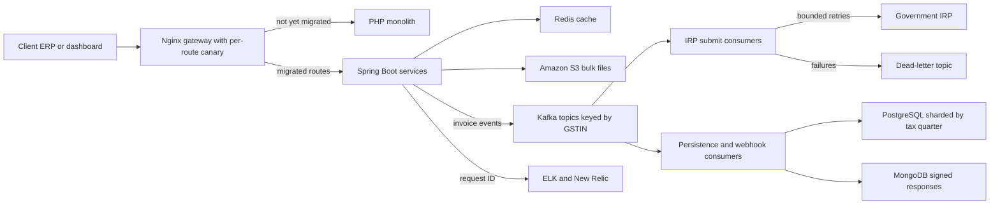

# Masters India: GST Compliance & E-Invoicing Platform (Java + Python track)

**Role:** Software Development Engineer 2 · December 2022 to June 2024 · Noida  
**Resume tech line:** Java, Spring Boot, Hibernate, Kafka, PostgreSQL, MongoDB, Redis, Elasticsearch, Docker, ELK, New Relic, AWS

<div class="callout note">

**How to use this page**

- **What it covers:** the PHP-to-Spring Boot migration, the Kafka bulk e-invoicing pipeline, PostgreSQL sharded by tax quarter, idempotency and dead-letter queues, Redis caching, ELK and New Relic, and test coverage.
- **When to read it:** before any question on "a migration you led", "a high-throughput pipeline", "idempotency", "Kafka vs a queue" or "how you made an API faster".
- **What to memorise:** p95 from 1.2 seconds to 300 milliseconds (75%), 1,500+ clients, 700 to 4,000 requests per minute, 1M+ submissions a day, 100K+ concurrent imports, triage 70% faster, reads 30% lower, coverage 35% to 82%, 98% deploy success, mentored 2 engineers.

</div>

**Tags on this page.** HISTORICAL means it comes from my past work records and the resume. ESTIMATED means arithmetic I can show. MEASURED means a log or document. "Illustrative" marks made-up sample data used to explain a mechanism.

Longer version: [Handbook chapter 7, Masters India](../../handbook/07_masters_india.md). Older notes: [Masters and GFG deep dive](../12_masters_gfg_deep_dive.md) and [Masters and GFG interview packs](../23c_masters_gfg_interview_packs.md).

---

## 1. The one-minute version

> "At Masters India I worked on a GST e-invoicing platform used by more than 1,500 enterprise clients. Indian businesses must register every B2B invoice with a government portal, which returns an official invoice number and a signed QR code. We validated their invoices and registered them safely at volume. I led the migration of a legacy PHP monolith to Spring Boot microservices, one route at a time behind the gateway with canaries. That cut p95 latency by 75%, from 1.2 seconds to 300 milliseconds, and throughput went from 700 to 4,000 requests per minute. I mentored two engineers through it. I designed the bulk pipeline on a Kafka event bus with PostgreSQL sharded by tax quarter, with idempotency keys so a retry can never register an invoice twice. It handled 1M+ submissions a day, with dead-letter queues and bounded retries because the government portal is unreliable near deadlines. ELK and New Relic with one request ID cut triage time by about 70%, a Redis cache cut database reads by 30%, and coverage went from 35% to 82%, which got us to 98% deployment success."

## 2. The business in plain English

**GST (Goods and Services Tax)** is India's main indirect tax. Every registered business has a **GSTIN**, a 15-character tax ID. For B2B sales above a turnover threshold, an invoice is only legally valid once it is registered with the government's **IRP (Invoice Registration Portal)**. The IRP validates the invoice JSON and returns an **IRN (Invoice Reference Number)** plus a digitally signed QR code. Think of the IRP as a notary that stamps a unique serial number on each document.

Masters India sat between enterprises and the IRP. Clients sent invoices one at a time from their ERP (accounting software) or as bulk files with thousands of rows. We validated them, registered them, stored the IRN and QR, and returned them by API or webhook.

**The one constraint that shaped everything:** once an IRN is issued, the invoice is a legal record. Cancellation is narrow and time-limited. A retry bug that registered the same sale twice would leave the client with two legal invoices and a compliance mismatch. So every step that talks to the IRP had to be safe to run twice.

**What hurt before.** The PHP (Laravel) monolith was synchronous. A request that called the IRP held a worker for the whole round trip. When the IRP was slow, workers ran out and unrelated requests queued. Deploys were all-or-nothing, and debugging meant logging into boxes and searching text logs. Load spikes many times above average in the days before filing deadlines, and the IRP is slowest exactly then.

## 3. Words you need

- **Strangler fig pattern.** Replacing an old system gradually by routing traffic, route by route, to new code until the old system has nothing left. Named after a vine that slowly grows around a tree.
- **Canary release.** Sending a small slice of traffic to new code first and watching errors and latency before sending more.
- **p95 latency.** Sort 100 requests by time and take the 95th. 95% of requests were that fast or faster.
- **Kafka.** A durable, ordered log of messages. A **topic** is a named stream, split into **partitions** for parallelism. Order holds only within a partition. Messages with the same **key** go to the same partition. A **consumer group** shares a topic's partitions, and different groups each read the full stream.
- **Idempotency.** Doing something twice has the same effect as once, like pressing a lift button five times. An **idempotency key** is the ID that lets the system recognise "already done".
- **DLQ (dead-letter queue).** A side queue for messages that keep failing, so they stop blocking the main flow. Like a "problem parcels" shelf in a post office.
- **Exponential backoff with jitter.** Waiting longer after each failure (1s, 2s, 4s), plus a random amount so thousands of workers do not retry at the same instant.
- **HikariCP.** The default database connection pool in Spring Boot. It keeps connections open and reuses them, like keeping a phone line open instead of redialling.
- **Cache-aside.** Check Redis first. On a miss, read the database, store the result with an expiry (TTL), then return it.

## 4. Architecture



*What to notice: PHP and Spring Boot sit side by side behind one gateway during the migration. Everything that talks to the IRP sits behind Kafka consumers and retries, never inside a user's request thread.*

Box by box. The **gateway** decides per route whether traffic goes to PHP or a Spring Boot service, and in what percentage. **Spring Boot services** were split by domain (auth, single submit, bulk import, reconciliation), with Bean Validation on every request. **Amazon S3** holds uploaded bulk files so the upload can return fast. **Kafka** carries stage events. **IRP submit consumers** call the government with capped concurrency and retries. **Persistence consumers** write the IRN and status into the right quarter table in **PostgreSQL**, and keep the variable-shaped signed responses in **MongoDB** for audits. Background work that did not need a replayable log ran as `@Async` and `@Scheduled` jobs, and chunked bulk-import validation fits Spring Batch (a skills-line item, so describe it at that level).

## 5. One job, step by step

Illustrative data: Acme Steel uploads 12,000 October invoices two days before its deadline. Say batches of 500, so 24 batches.

1. The bulk service stores the file in S3, computes a SHA-256 `fileHash`, and returns `202 Accepted` with an `import_id`. The browser does not wait.
2. Validation runs batch by batch (schema, GSTIN format, duplicates). Each batch gets the key `client + fileHash + batchIndex`, for example `acme:9f2c...e1:7`.
3. Valid invoices go to topic `invoice.accepted` keyed by GSTIN, so Acme's messages stay in order.
4. A submit consumer checks the key in PostgreSQL. If already registered, it skips. Otherwise it marks `irp_pending` and calls the IRP.
5. The IRN and QR come back. A persistence consumer writes them to the quarter table. An invoice dated 14 October 2023 lands in `fy2023_q3`.
6. If one batch keeps failing, it goes to the dead-letter topic after bounded retries. The other 23 carry on.

## 6. Each resume bullet decoded

### Bullet 1: migration, p95 and throughput

**In plain words.** I led the move from one PHP application to small Spring Boot services, gradually, so clients never saw a switch-over day.

**How it works.** For each route: record the PHP responses and write contract tests so the new service returns the same fields. Send a small canary percentage through Nginx. Watch error and latency dashboards. Ramp to 100% or roll back with a config reload, not a redeploy. Old and new code shared one database during cutover, on purpose, so there was one source of truth and no dual writes.

**Where 1.2 seconds to 300 milliseconds came from.** Caching alone cannot do 75%. Four changes added up:

1. **IRP calls left the request thread.** The API returned `202 Accepted` and Kafka consumers did the slow call. Where a call stayed synchronous, a non-blocking client (Spring WebClient) with a timeout, or a bounded thread pool, stopped it pinning a worker. This fixed the **tail**.
2. **Connection pooling** with HikariCP instead of a new connection per request.
3. **Query and index fixes.** Composite indexes like `(client_id, invoice_date)`, pagination, and removing N+1 queries (1 query for a list plus 1 per item) with `JOIN FETCH` or `@EntityGraph` in Hibernate.
4. **Redis** for repeated reads, which sped up the typical request, the **body**.

Short version: "Async IRP calls, pooling and query fixes moved the tail. Redis moved the body."

**Alternatives.** A big-bang rewrite risks every route on one day. Tuning PHP worker counts only moves the cliff. Dual writes create two sources of truth in a tax product. A fully reactive WebFlux rewrite was not needed because moving IRP calls to consumers already removed the blocking wait. *Trade-off:* two stacks to monitor for a while. *What I'd do differently:* put request-ID logging in place before the first canary.

**Mentoring two engineers.** Each owned a service extraction. I set the conventions (controller, service, repository layers, validation at the boundary, shared retry and idempotency helpers), reviewed their PRs closely early on, and paired on the first canary. This is mentoring, not people management.

### Bullet 2: Kafka pipeline, quarter sharding, idempotency, DLQ

**Why shard by tax quarter.** Almost all writes land in the current quarter. Older quarters are mostly read for reconciliation and audits. Quarter shards keep the hot table and its indexes small and let a cold quarter be archived as one unit. Routing lived in application code, derived from the invoice date. India's financial year starts on 1 April.

```java
static String taxQuarter(LocalDate d) {
    int fyStart = d.getMonthValue() >= 4 ? d.getYear() : d.getYear() - 1;
    int q = ((d.getMonthValue() - 4 + 12) % 12) / 3 + 1;
    return "fy" + fyStart + "_q" + q;
}
// 2023-10-14 gives fy2023_q3. 2024-02-10 gives fy2023_q4.
```

A wrong-quarter write is the main risk of this design, so the API rejected requests whose declared filing period did not match the derived quarter. *Say this carefully:* the PDF says "horizontally sharded by tax quarter". Describe the routing and reasons, and do not claim separate database clusters unless you clearly remember that. Today I would start with native PostgreSQL range partitioning.

**Idempotent consumer with bounded retries and a dead-letter topic.**

```java
@KafkaListener(topics = "invoice.accepted", groupId = "irp-submit")
public void onBatch(InvoiceBatch batch) {
    String key = batch.idempotencyKey();              // client:fileHash:batchIndex
    if (jobs.isRegistered(key)) return;               // redelivery after success
    jobs.markPending(key, batch.clientId());          // INSERT ... ON CONFLICT DO NOTHING
    IrpResult result = irpClient.register(batch);     // throws Transient or Permanent IrpException
    jobs.markRegistered(key, result.irn());
}

@Bean
DefaultErrorHandler irpErrorHandler(KafkaTemplate<Object, Object> template) {
    var toDlq = new DeadLetterPublishingRecoverer(template,
            (rec, ex) -> new TopicPartition("irp.submit.dlq", rec.partition()));
    var backOff = new ExponentialBackOffWithMaxRetries(4);
    backOff.setInitialInterval(500);
    backOff.setMultiplier(2.0);
    backOff.setMaxInterval(30_000);
    var handler = new DefaultErrorHandler(toDlq, backOff);
    handler.addNotRetryableExceptions(PermanentIrpException.class);
    return handler;
}
```

*Retry counts and delays are illustrative, not remembered production values.* Spring Kafka's default backoff has no jitter, so add jitter with a custom `BackOff`. Because the partition key is the GSTIN, one taxpayer's messages are handled by one consumer at a time. If a worker crashes after the IRP succeeded but before marking it, the redelivery reaches the IRP again, and the IRP's own duplicate-document check is the backstop. A permanent error such as an invalid GSTIN goes straight to the dead-letter topic with no retries.

**Exactly-once, the honest version.** Kafka and retries give at-least-once delivery. Idempotent processing makes the second arrival a no-op. Together that is an exactly-once **effect**. The IRP is outside our transaction, so true exactly-once delivery across systems is not possible.

**Why Kafka and not SQS or RabbitMQ.** We needed per-taxpayer ordering, replay after a bug (move a group's offset back and reprocess), and several independent consumer groups on one stream (persistence, webhooks, audit). SQS deletes on acknowledgement and FIFO caps throughput per group. RabbitMQ could honestly have dispatched tasks at our scale. Replay and multi-reader audit tipped it to Kafka, at the price of more operational work.

**The numbers.** 1M+ a day is 1,000,000 / 86,400, about 12 per second on average (ESTIMATED). Deadline peaks were roughly 8 to 10 times that, so around 100 per second (ESTIMATED). 100K+ means invoices in flight across concurrent bulk imports, not 100,000 separate files uploaded at one instant.

### Bullet 3: observability, caching, coverage

**Request ID.** A servlet filter stamps one ID on every request and puts it into the logging context (MDC), so every JSON log line, outgoing header and Kafka message header carries it.

```java
@Component
public class RequestIdFilter extends OncePerRequestFilter {
    @Override
    protected void doFilterInternal(HttpServletRequest req, HttpServletResponse res, FilterChain chain)
            throws ServletException, IOException {
        String rid = Optional.ofNullable(req.getHeader("X-Request-ID"))
                .orElse(UUID.randomUUID().toString());
        MDC.put("request_id", rid);
        res.setHeader("X-Request-ID", rid);
        try { chain.doFilter(req, res); } finally { MDC.remove("request_id"); }
    }
}
```

One Kibana search for that ID showed the whole path: accepted, sent to the IRP, timed out three times, parked in the DLQ. New Relic showed where the time went.

**Redis cache-aside.** In a 100K-row import every row needs the same client config and many repeated GSTIN lookups. Caching them is why total read load fell about 30%.

```java
public ClientConfig clientConfig(String clientId) {
    String key = "client:config:" + clientId;
    String hit = redis.opsForValue().get(key);
    if (hit != null) return json.read(hit, ClientConfig.class);
    ClientConfig cfg = configRepo.load(clientId);
    long ttl = 600 + ThreadLocalRandom.current().nextLong(121);    // TTL jitter
    redis.opsForValue().set(key, json.write(cfg), Duration.ofSeconds(ttl));
    return cfg;
}
```

Config keys were deleted on every write. Slow-changing tax-rate masters were TTL-only. A short Redis lock (`SET NX` with expiry) lets only one worker rebuild a hot key after it expires, which stops a **cache stampede**.

**Coverage and deploys.** JUnit and Mockito suites, money paths first (registration, reconciliation, imports), including the contract tests against PHP responses. Coverage was a CI gate. 35% to 82% is a rise of 47 percentage points.

| Number | Tag | How to say it |
|---|---|---|
| 75% p95 cut | HISTORICAL. (1.2 − 0.3) / 1.2 = 0.75 | "From 1.2 seconds to 300 milliseconds." |
| 700 to 4,000 rpm | HISTORICAL. About 12 to 67 per second, about 5.7 times | "Roughly 12 to 67 requests a second." |
| 70% triage | HISTORICAL. Baseline about 30 minutes to under 10 is ESTIMATED | "Roughly half an hour to under ten minutes." |
| 30% fewer reads | HISTORICAL. Total database read load | "For the same traffic, 100 reads became about 70." |
| 98% deploys | HISTORICAL. About 98 of 100 deploys with no failure or rollback | "98% deployment success." |

## 7. Questions they will ask

**"What actually drove p95 down? Caching can't do 75%."**  
Agreed. The tail came down because IRP calls stopped pinning request threads. They moved to Kafka consumers and the API returned 202. HikariCP pooling, composite indexes and N+1 fixes did the rest of the tail. Redis cut repeated reads, which helped the typical request.

**"How do you guarantee exactly-once?"**  
Strictly, we did not get exactly-once delivery, because the IRP is outside our transaction. We had at-least-once delivery plus idempotent processing keyed by client, fileHash and batchIndex. A redelivered message finds the key already registered and skips the IRP call.

**"How do 700 to 4,000 per minute and 1M a day fit together?"**  
They measure different things. 700 to 4,000 per minute is API requests at the gateway, about 12 to 67 a second. 1M+ a day is government submissions, about 12 a second on average. One bulk request carries many invoices.

**"Why shard by quarter and not hash by client?"**  
Access was time-scoped. Writes go to the current quarter and old quarters are read for audits. Quarter shards keep the hot table small and archive cleanly. The cost was routing in our code, so we validated the quarter at the API.

**"What goes into the DLQ and what happens next?"**  
Batches with a permanent error, or that ran out of retries. They are parked with the reason so the rest of the import continues. An operator fixes the cause and replays through the same idempotency keys, so a replay cannot double-register.

**"Why Spring Boot MVC and not WebFlux?"**  
Once IRP calls moved to consumers, request threads only did short database and cache work, which the servlet model handles well. A reactive rewrite would have added complexity across the whole team for little gain.

## 8. What not to say

<div class="callout warn">

- "2,500+ clients" or "support tickets down 35%". Older resume figures. Use 1,500+.
- "I led a team" at Masters India. It is **mentored 2**. "Led 3" is Uber FRM.
- Flink at Masters India. Flink is the Uber Menu pipeline, which is a different Kafka system.
- Celery on this track's Masters story. It is not on this PDF's Masters tech line.
- Spring Batch as a resume bullet claim. It is a skills-line item that fits chunked imports.
- "Zero message loss" or "true exactly-once delivery to the government".
- "Payments" or "money movement". This is tax compliance and invoice registration.
- A circuit breaker as a measured result. It is a design idea to discuss.
- Exact partition counts, chunk sizes, retry counts or TTLs as remembered facts.
- TPS or RPS as if printed on the PDF. They are arithmetic you can show.

</div>
