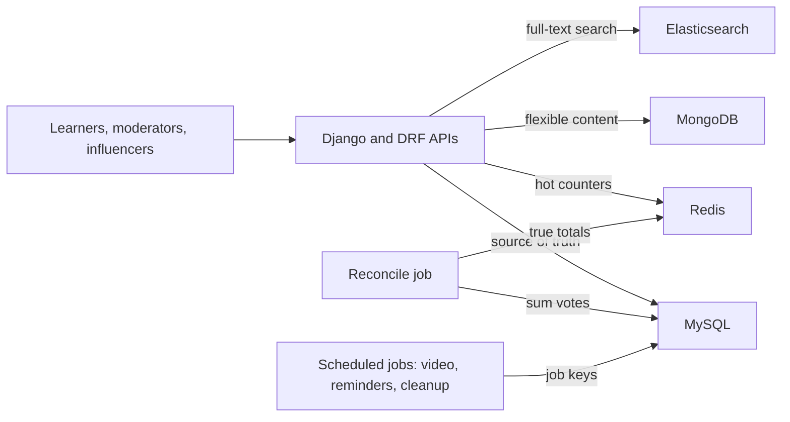

# GeeksforGeeks: Courses Platform and Influencer Dashboard

**Role:** Software Development Engineer · August 2021 to November 2022 · Noida · first job after college  
**Resume tech line (exact):** Python, Django, MySQL, MongoDB, Redis, Elasticsearch

This project is Django on every resume track. Older Java-track notes described it as Spring Boot. That was wrong and has been fixed here.

<div class="callout note">

**How to use this page**

- **What it covers:** the doubt-support platform migration from PHP to Django, the voting, pinning and locking APIs, why each of the four data stores was used, the influencer earnings dashboard, and the scheduled background jobs.
- **When to read it:** before questions on early-career ownership, "design a voting system", hot rows, safe cron jobs, or "Django vs FastAPI vs Spring Boot".
- **What to memorise:** 10K+ daily queries, 10x contest spikes, 20% relative lift in premium subscriptions (attributed by the growth team), 30% course sales lift (business attribution), 70% operational efficiency gain.

</div>

**Tags on this page.** HISTORICAL means it comes from my past work records and the resume. ESTIMATED means arithmetic I can show. "Illustrative" marks made-up sample data used to explain a mechanism.

Longer version: [Handbook chapter 8, GeeksforGeeks](../../handbook/08_geeksforgeeks.md). Older notes: [Masters and GFG deep dive](../12_masters_gfg_deep_dive.md) and [MongoDB and Elasticsearch](../02_mongodb_elasticsearch.md).

---

## 1. The one-minute version

> "My first job was at GeeksforGeeks, the computer-science learning platform. Learners post doubts, meaning questions, on courses and articles, and that system ran on a fragile PHP backend. It struggled with 10K+ daily queries and with traffic that jumped about ten times during live coding contests. I migrated it to Django and built the REST APIs for voting, pinning and locking threads, with MySQL as the source of truth, Redis for hot counters, MongoDB for flexible content and Elasticsearch for search. The growth team tied those features to a 20% lift in premium subscriptions. I also built an influencer analytics and earnings dashboard, which the business team credited with 30% more course sales, and scheduled jobs for video processing, reminders and cleanup that cut manual ops work by about 70%. It is where I learned unique constraints for idempotency, keeping hot counters off the database, and making jobs safe to re-run."

## 2. The business in plain English

GeeksforGeeks (GFG) has free articles, practice problems, live contests and paid courses. Premium subscriptions and course sales are a big part of revenue. On the doubt-support platform a learner asks "Why does my DFS overflow the stack?", others reply, good answers are **upvoted**, and a moderator can **pin** the best thread to the top or **lock** it to stop new replies.

What hurt before: the PHP backend lacked clean transactions and request validation, doubt pages got slow during contest spikes, popular doubts caused database lock queues, influencers could not see how their coupon codes converted, and ops staff did video handoffs, reminders and cleanup by hand. A reliable doubt system is part of what premium users pay for, so breaking during a contest costs money.

## 3. Words you need

- **Django.** A "batteries included" Python web framework with an ORM, admin panel, auth and migrations. Like renting a furnished flat. **DRF (Django REST Framework)** adds serializers (validate input, shape output) and permissions.
- **Unique constraint.** A database rule that a combination of columns can appear only once.
- **Idempotent.** Doing it twice has the same effect as once. Clicking upvote twice should count one vote.
- **Hot row.** One row that many requests update at once. Each update locks it, so they queue, like a hundred people at one checkout counter.
- **Reconcile.** Periodically recompute the true value from the source of truth and fix drift in the fast copy.
- **Cron.** A scheduler that runs a job at fixed times.
- **Lease lock.** A short-lived "I'm running this" marker that expires on its own if the holder crashes.
- **Affiliate coupon and attribution.** A discount code tied to one influencer. Attribution is deciding which cause gets credit for a business result. Here the business and growth teams did it, not me.

## 4. Architecture



*What to notice: MySQL is the single source of truth. Redis holds fast copies that the reconcile job corrects. Scheduled jobs never run inside a user request.*

Box by box. **Django and DRF** replaced PHP, with serializers validating every request and writes inside `transaction.atomic()`. **MySQL** holds data that must be correct: users, threads, votes, pins, locks, subscriptions and influencer transactions. **Redis** holds vote totals, unread badges and contest hot keys. **MongoDB** holds doubt bodies whose shape varies (code blocks, attachments). **Elasticsearch** gives full-text search with relevance ranking, which SQL `LIKE '%stack overflow%'` cannot do well.

## 5. One request, step by step: an upvote during a contest

Illustrative data: learner 42 upvotes doubt 123 while hundreds of others vote on it.

1. Django validates `POST /api/v1/votes {content_id: 123, value: +1}` with a serializer.
2. It upserts the vote row. A unique constraint on `(user_id, content_id)` means one row per user per doubt.
3. If the value changed, Redis is adjusted by the difference: +1 for a new upvote, −2 when an upvote becomes a downvote.
4. A double click sends the same request. The row already holds +1, so nothing changes.
5. Every few minutes the reconcile job sums the vote rows in MySQL and overwrites Redis. If Redis lost the key, it is rebuilt.

## 6. Each resume bullet decoded

### Bullet 1: Django migration, 10K+ queries, 10x spikes, voting, pinning, locking, 20%

**What the load really means.** 10K a day is 10,000 / 86,400, about 0.12 requests per second on average (ESTIMATED). Even ten times that is around 1 per second if spread evenly. Contest traffic bunches into short windows, and each doubt brings many reads. So the honest story is **correctness and burst safety**, not raw scale.

**How the vote API works.**

```sql
CREATE TABLE votes (
  id         BIGINT PRIMARY KEY AUTO_INCREMENT,
  user_id    BIGINT NOT NULL,
  content_id BIGINT NOT NULL,
  value      TINYINT NOT NULL,            -- +1 or -1
  UNIQUE KEY uq_vote (user_id, content_id)
);
```

```python
from django.db import transaction

def cast_vote(user_id: int, content_id: int, value: int) -> int:
    with transaction.atomic():
        vote = (Vote.objects.select_for_update()
                .filter(user_id=user_id, content_id=content_id).first())
        old = vote.value if vote else 0
        if old == value:
            return int(redis.get(f"votes:{content_id}") or 0)   # repeat click: no-op
        Vote.objects.update_or_create(
            user_id=user_id, content_id=content_id, defaults={"value": value})
    return redis.incrby(f"votes:{content_id}", value - old)
```

*Illustrative. The schema is logical, from my notes.* The lock is only on this user's own row, so votes do not queue behind each other.

**Why this avoids the hot row.** The naive design runs `UPDATE content SET vote_count = vote_count + 1 WHERE id = 123` on every vote, so 300 votes in a few minutes means 300 transactions waiting on one lock. Here each vote touches its own row, and the shared total is an atomic Redis `INCRBY`.

**Pinning and locking.** A pin row marks a thread as pinned within its course or article, with an ordering column and a unique constraint so pinning twice is a no-op. A lock row holds `content_id`, `locked_by`, `reason` and an optional expiry, and the "post reply" API refuses replies on a locked thread. Both are moderator-only behind permission checks.

**Alternatives.** A counter column updated on every vote causes the hot row. Counters only in Redis are fast but cannot stop double votes or rebuild after a flush. An app-level "has this user voted?" check races, and only a database constraint is race-proof. Putting everything in MongoDB loses the constraints and transactions that votes and subscriptions need. *Trade-off:* displayed counts can be a few minutes stale until reconcile, which is fine for a vote badge and would not be fine for money.

**The 20%.** A relative lift in premium subscriptions after these features shipped, attributed by the growth team (HISTORICAL). Illustratively, 1,000 new premium subscriptions a month becoming 1,200, not 20% of all users becoming premium. Say: "The growth team attributed about a 20% relative lift to these features. I owned the engineering."

### Bullet 2: influencer dashboard (30%) and scheduled workflows (70%)

**The dashboard.** Every coupon purchase was recorded in MySQL linked to the influencer. The dashboard showed transactions, coupon conversions and earnings. Redis counters gave a fresh "today so far" view, and a nightly job built daily rollups for the history charts, so page loads never scanned raw transactions. Illustrative tables: `influencer_account(id, coupon_code)`, `earning_txn(influencer_id, order_id, amount, earning, created_at)`, `daily_rollup(influencer_id, day, orders, revenue, earning)`. The 30% course sales lift was attributed by the business team. The likely mechanism is that influencers who can see what converts promote more.

**Scheduled jobs.** Video processing handoffs, user reminders and data cleanup. Two reliability rules made them safe:

```python
def run_once(job_name: str, run_key: str, work) -> None:
    lock = f"cron:lock:{job_name}"
    if not redis.set(lock, HOST, nx=True, ex=3600):    # another host has it
        return
    try:
        if JobRun.objects.filter(job_key=run_key, status="done").exists():
            return                                      # safe re-run
        work()
        JobRun.objects.update_or_create(job_key=run_key, defaults={"status": "done"})
    finally:
        redis.delete(lock)
```

*Illustrative.* The lock stops two hosts both sending 5,000 reminder emails at 2 AM. A per-unit key like `reminder:{user_id}:{class_id}:1h_before` means a job that crashed after 1,200 of 2,000 emails sends only the remaining 800 on re-run. The 70% is the drop in manual effort on those workflows (HISTORICAL). Illustratively, 10 hours of someone's week becoming about 3. Celery is not on this role's tech line, so describe these as scheduled jobs, not Celery tasks.

## 7. Tech used and why

| Tech | Why here | Alternative |
|---|---|---|
| Python + Django + DRF | ORM, admin, auth, migrations, serializers. Fast delivery for a content product | Staying on PHP, Flask |
| MySQL | Unique constraints and transactions for votes, subscriptions, earnings | MongoDB for everything |
| MongoDB | Doubt bodies with varying shape | MySQL JSON columns |
| Redis | Vote counters, badges, "today" dashboard counters, job locks | Updating MySQL counters per event |
| Elasticsearch | Search over doubts with relevance | SQL `LIKE` |

**Why Django here, but Spring Boot at Masters India?** In 2021 this was a content and community product, where Django's admin, auth and ORM saved time. At Masters India the problem was slow calls to a government API at high volume, and Spring Boot services with Kafka consumers fit that. Different job, different tool.

## 8. Questions they will ask

**"How do you make a vote API idempotent?"**  
A unique constraint on user ID and content ID means one vote row per user per doubt, and the API upserts it. A double click or client retry can never count twice, and the database enforces that even when two requests race.

**"How did you avoid hot rows on popular doubts?"**  
We stopped updating a shared counter on every vote. Each vote writes its own row, the display total lives in Redis with atomic increments, and a reconcile job sums the real votes every few minutes so MySQL stays the truth.  
*Follow-up they may ask:* "What if Redis loses the key?" The next reconcile rebuilds it, and until then the API can fall back to the stored count.

**"10K queries a day isn't much. What was hard?"**  
You're right, the average is well under one request per second. The hard part was bursts and fragility: about tenfold spikes in short contest windows, no clean transactions or validation in PHP, and hot rows on popular doubts.

**"Why four data stores?"**  
Each did a job the others do badly. MySQL for relational truth, Redis for very frequent tiny counters, MongoDB for content whose shape varied, Elasticsearch for search. If I had to cut one today, I would check whether MongoDB's role could move into MySQL JSON columns.

**"How did you stop a cron job running twice?"**  
A lock with expiry so only one host runs it, and an idempotent key per unit of work so a re-run skips finished work.

**"Did your dashboard really raise sales 30%?"**  
The business team attributed it. I built the dashboard: transaction and coupon tracking, Redis counters for today and rollups for history. The causal analysis is theirs.

**"What would you do differently?"**  
Write votes as events to a queue and build counters from that stream, so totals rebuild by replay. Make idempotent job keys the default through a shared helper. Set explicit latency targets for contest days.

## 9. What not to say

<div class="callout warn">

- "Spring Boot", "Hibernate" or "Java" at GeeksforGeeks. The PDF says **Django**.
- "100K daily queries" or "1K daily queries". Older figures. Use **10K+**.
- "15 to 20% premium lift". Older prep. Use **20%**, relative, attributed by the growth team.
- "I increased sales by 30%" as if engineering alone caused it.
- Celery, Kafka, FastAPI or AWS at GeeksforGeeks. None is on this role's tech line.
- Comparing GFG load to Uber or Impact Analytics scale.
- "SMTP sends 50% faster" or unread-count badges as resume bullets. They are older or prep-only details.

</div>
