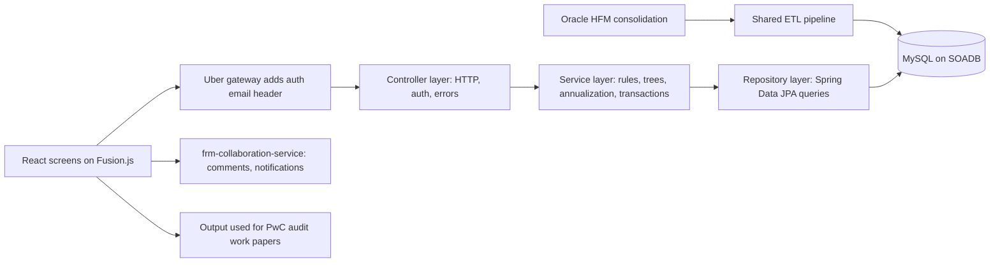
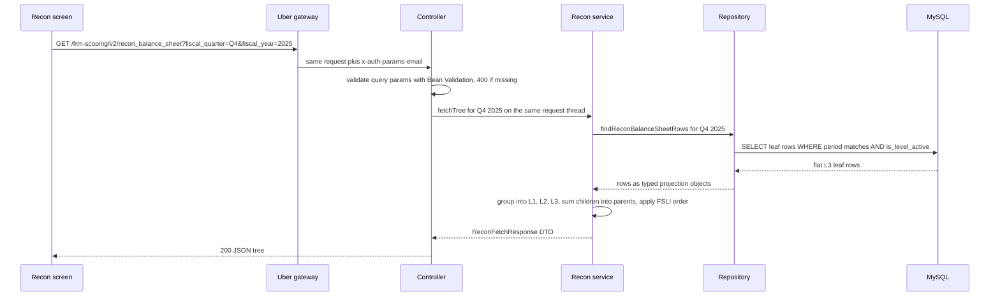
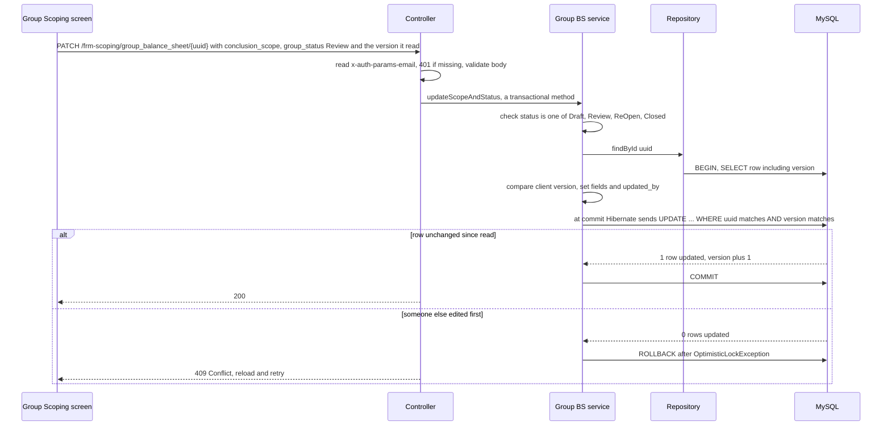
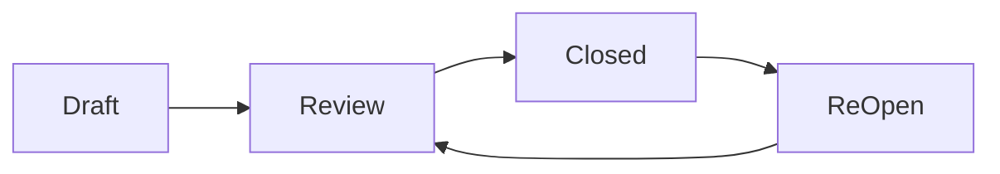
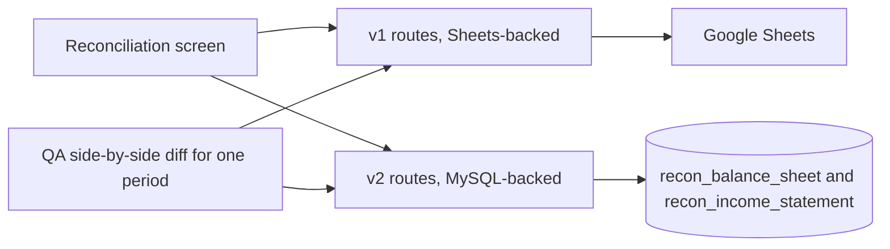

# Uber FRM Risk Scoping Platform: Deep Dive

<div class="callout note">

**How to use this page**

- **What it covers:** everything you need to explain the Uber FRM (Financial Risk Management) Scoping Platform from zero. The finance ideas first, then the architecture, then each resume bullet decoded, then the hard problems and a large bank of interview answers.
- **When to read it:** the week before any interview where Uber via EPAM will come up, and again the night before. Read sections 1 to 5 once slowly. After that, the Q&A and the practice drill are what you re-read.
- **What to memorise:** the one-minute version (section 1), the five finance words (close, materiality, FSLI, scoping, residual risk), the numbers table (section 9), and the column-aliasing bug story (section 13).
- **Shorter version:** the combined FRM + Menu pack is [02_03_uber_frm_menu.md](02_03_uber_frm_menu.md). The canonical prep file is [prep/11_uber_frm_deep_dive.md](../../../prep/11_uber_frm_deep_dive.md) and the interview pack is [23b_uber_interview_packs.md](../../../prep/23b_uber_interview_packs.md). Locked numbers live in [GROUND_TRUTH.md](../../../prep/GROUND_TRUTH.md).

</div>

**What the tags on this page mean.** Some facts carry a tag so you know how hard you can lean on them.

- **PDF** means the fact is printed on the current resume (`Tarun_Mittal_SSE_5yr_Java_PyGo_AI.pdf`). Defend it as written.
- **MEASURED** means there is a log, a document or code behind it (for example the route count in the controller class, or the Q4 2025 CSVs).
- **TARGET** means a design goal. Say "targeting".
- **ESTIMATED** means arithmetic you can show on a whiteboard. Say "roughly, derived from...".
- **VERBAL** means true and useful depth, but not printed on the resume. Use it when asked, do not lead with it.

**Role framing.** Software Development Engineer 2 at Uber Finance **via EPAM Systems**, Bangalore, July 2024 to May 2026. Always say "Uber via EPAM". The work lived in Uber's internal monorepo: Bazel builds, a Fusion.js frontend, SOADB MySQL, and a Spring Boot backend service. The stack line is **Java, Spring Boot, Spring Data JPA, Hibernate, MySQL, JUnit, Bazel, Docker**.

---

## 1. The one-minute version (say this out loud)

"At Uber, via EPAM, I owned the backend of the FRM Scoping Platform for Uber Finance. Every quarter, during the financial close, the Financial Risk Management team has to decide which lines of the financial statements and which legal entities are important enough for the external auditor, PwC, to test. They used to do that in a big Google Sheets workbook. I replaced it with a Spring Boot and MySQL service: 36 endpoints that automate the financial math, a nested four-level line-item hierarchy, and dynamic quarter-annualization, on top of 19 million raw general-ledger rows migrated off Sheets. Quarterly reconciliation went from 14 days to 3 days, which is the 70% cut on my resume, against a $340M materiality threshold. I designed an 8-table normalized schema on Uber's SOADB MySQL with optimistic row-locking, atomic cross-table syncs and SHA-256 natural keys so several managers could edit during close without clobbering each other or creating duplicate audit rows. And I led 3 engineers through a Spring Data JPA / Hibernate migration that killed a class of column-aliasing bugs and took module statement coverage to 100%, shipped with stacked Bazel PRs and SOX gates."

**Shorter, 20-second version:** "At Uber via EPAM I owned the FRM scoping backend for Uber Finance, a Spring Boot and MySQL platform that replaced a Google Sheets quarterly close. It cut reconciliation from 14 days to 3, migrated 19M raw ledger rows off Sheets, and I led 3 engineers on the ORM migration that got coverage to 100%."

---

## 2. The business in plain English

**Who the users are.** The FRM team inside Uber Finance. They are accountants and risk managers, not engineers. Once a quarter they run the **Scoping Process**.

**What they do.** Uber is a public company. Its financial statements are audited by PwC (PricewaterhouseCoopers, the external auditor). An auditor cannot test every number, so the company and the auditor agree on which parts matter. "Scoping" is that decision: which financial line items and which legal entities are "in scope" for risk assessment and audit testing. The output of scoping becomes the evidence PwC uses to build its **audit work papers** (the auditor's own file proving what it checked and why).

**What hurt before.** The legacy process was a manual Google Sheets workbook (internally called the "DSW version"). It had formulas, manual parent-child mapping of line items, no stable ID per line, no history, no audit trail, and no safe way for two people to edit at once. The technical design doc (TDD) put it this way: "flat-file storage prevents the system from handling complex recursive financial hierarchies, leading to manual mapping errors and lack of real-time data visibility." (TDD: "FRM Scoping Tool - Technical Design Doc", authored by Priyadharshini Govindan, reviewed by Ramesh Raju, started 02-02-2026.)

**Why the company paid for this.** Scoping is a SOX compliance activity. If you scope too narrowly, you miss real risk and that can become an audit finding. If you scope too broadly, you waste expensive audit hours. A spreadsheet that silently maps a line to the wrong parent is a compliance risk, and a two-week manual close is a cost. The platform made the numbers traceable, made each decision attributable to a person, and made the close much faster.

---

## 3. Finance concepts from zero

You do not need a finance degree. You need these ten ideas, each with a tiny example. All dollar examples marked "illustrative" are made-up round numbers for teaching. The real numbers ($340M, $170M) are marked as such.

### 3.1 The financial close

The **close** is the period-end routine where accounting finalises the books for a quarter. Every transaction is posted, balances are checked, entities are consolidated, and the numbers are frozen so they can be reported. Think of it as "closing the shop's till at the end of the day", but for a company with hundreds of legal entities and a three-month day. Scoping happens inside the close, so it runs against a hard deadline.

### 3.2 The general ledger (GL)

The **general ledger** is the master record of every account and its balance. Each row says, roughly, "this entity, this account, this period, this amount". Think of it as the company's master bank statement, split into thousands of labelled pots.

Illustrative GL rows:

```text
entity        account                     period    amount_usd
UBER-US-01    1000 Cash and equivalents   Q4-2025   1,250,000,000
UBER-NL-02    1000 Cash and equivalents   Q4-2025     310,000,000
UBER-US-01    4000 Revenue                Q4-2025   2,900,000,000
```

On the real project, individual quarterly GL extracts were about 38K to 95K rows each, covering roughly 1.7K to 1.8K accounts and about 400 entities (MEASURED from the Q4 2025 CSVs). The resume's **19M** is the total of raw GL rows migrated off Sheets (PDF). Section 9 explains how to talk about both.

### 3.3 HFM and the 10-Q

**HFM (Oracle Hyperion Financial Management)** is the consolidation system. Entity trial balances are loaded into it, translated into one currency, and run through intercompany eliminations and minority-interest and equity adjustments. The output is the consolidated group number. Think of HFM as the kitchen where each branch's ingredients are combined into one meal.

The **10-Q** is the quarterly report Uber files with the SEC (US Securities and Exchange Commission). Its numbers are public and attested. If HFM is the kitchen, the 10-Q is the plate that was served to the public.

**Reconciliation (recon)** means checking the two agree, line by line. In the system:

```text
difference = hfm_amount_in_millions - financial_statement_amount_in_millions
```

Illustrative: HFM says Cash = $6,120M, the 10-Q says $6,120M, difference 0, fine. HFM says Accrued liabilities = $1,503M, the 10-Q says $1,500M, difference $3M, and someone must explain the break before scoping proceeds.

### 3.4 FSLI and the L1 to L4 tree

An **FSLI (Financial Statement Line Item)** is one line on the balance sheet or income statement, for example Cash, Accounts Receivable, or Revenue. FSLIs nest. A parent line is the sum of its children, which makes a tree. On this project the tree has four levels, **L1 to L4** (PDF).

Illustrative tree:

```text
L1  Assets
 └─ L2  Current assets
     ├─ L3  Cash and cash equivalents
     │    ├─ L4  Cash in bank
     │    └─ L4  Money market funds
     └─ L3  Accounts receivable, net
L1  Revenue
 └─ L2  Mobility revenue
     └─ L3  ...
```

The rule that matters in interviews: **a parent must equal the sum of its children.** If one leaf is duplicated or mapped to the wrong parent, the parent is silently wrong. In the database, the scoping fact tables carry `level_1` to `level_4` columns. The recon v2 tree is built to L3.

### 3.5 Materiality, with the $340M example

**Materiality** is the dollar threshold above which a misstatement would change the decision of someone reading the financials. Auditors usually set it top-down as a percentage of a key figure such as pre-tax income, total assets or revenue. Think of it as "the smallest mistake anyone would care about".

On the Q4 2025 close, group materiality was **$340M** and the residual threshold was **$170M** (MEASURED, from the metrics table and CSVs). Present them as "on the Q4 2025 close", not as permanent constants. Materiality is stored as data, not code: a row in `frm_metrics_table` with `metric_key = "materiality"`.

Worked example with the real threshold and illustrative balances:

```text
FSLI                     HFM amount   > $340M?   Quantitative material
Cash and equivalents     $6,120M      yes        YES
Prepaid expenses         $   95M      no         NO
Goodwill                 $8,000M      yes        YES
```

### 3.6 Quantitative vs qualitative, and Overall Significance

Each line gets two independent tests.

- **Quantitative Material** = "YES if HFM Amount > Materiality". Pure arithmetic.
- **Qualitative Material** = a manual yes/no answer to a scoping question, for example "Is this account subject to significant judgment or estimates?". A small line can still matter because it is risky.
- **Overall Significance = Significant if quantitative OR qualitative is YES.** This exact rule is in the code as `conclusion_overall_significance_from_balance_sheet_materials`.

Example: Prepaid expenses is $95M, so quantitative is NO. A manager answers the risk question YES. Overall Significance becomes Significant, so the line is in scope.

### 3.7 Scoping: group vs component

**Scoping** is deciding what gets tested. It happens at two levels.

- **Group scoping** looks at the consolidated balance sheet and income statement, line by line, and asks "is this FSLI significant to the group?"
- **Component scoping** drills under each FSLI to the individual entity or component and decides which components get tested.

Group is the top of the tree, component is the leaves. On the Q4 2025 sample that meant about 55 line items (about 26 balance-sheet and 29 income-statement FSLIs) across 14 entities (MEASURED sample, VERBAL depth).

### 3.8 The 5% rule (financially significant components)

From the Scoping Features doc: a component is a **Financially Significant Component** if `Total Revenue % > 5%` OR `|Total Assets %| > 5%`. The absolute value on assets matters because a component can carry a large negative balance. The 5% benchmarks are configurable metrics (`assets_benchmark`, `revenue_benchmark`) and are recomputed through `PUT /update_benchmark_thresholds`.

Illustrative: group revenue is $40B. Entity NL-02 has $2.4B revenue, which is 6%, so it is significant. Entity SG-07 has $0.8B revenue (2%) and 1% of assets, so it is not significant on size. It could still be pulled in "due to risk" or "due to coverage", which are separate columns in the threshold table.

### 3.9 Residual risk

**Residual risk** answers: after everything we already put in scope, how much uncovered balance is left, and does it still matter? It proves the leftover is small enough to ignore. Computed per leaf, from the Scoping Features calculation matrix:

```text
Residual Balances  = HFM Amount - Total in Scope
Residual Multiples = Residual Balances / Materiality
```

Illustrative with the real $340M: a line has HFM $900M and in-scope components cover $700M. Residual balance is $200M. Residual multiple is 200 / 340 = 0.59. That is more than 50% of materiality, so the screen flags it. The flags are "> 50% Materiality" and "> % threshold change". The residual threshold on the Q4 2025 close was $170M.

### 3.10 Quarter-annualization

Materiality is an annual idea, but in Q1 to Q3 you only have part of a year of income-statement activity. **Quarter-annualization** scales a part-year figure up to a full-year equivalent so it can be compared fairly with annual thresholds. The resume says the platform does this dynamically (PDF), meaning the factor depends on which quarter you are in.

The general textbook method, illustrative: year-to-date revenue at the end of Q2 is $20B. Annualized = 20 × (4 / 2) = $40B. At the end of Q3 with $31B YTD, annualized = 31 × (4 / 3) ≈ $41.3B. Balance-sheet amounts are point-in-time balances, so they are not annualized the same way. If asked for the exact formula in the code, keep it at this level unless you have re-checked it.

### 3.11 EMI entities

**EMI (Equity Method Investments)** are minority stakes Uber accounts for under the equity method: Uber owns a percentage of another company but does not consolidate it. They have their own screen, one grid column per investee, with fields like ownership %, asset balance, preliminary income or loss, auditor and reporting framework.

### 3.12 SOX and PwC

**SOX (the Sarbanes-Oxley Act)** is a US law that makes management of a public company responsible for internal controls over financial reporting, and makes the external auditor test those controls. In engineering terms, SOX means: every number must be traceable, every change must be attributable to a person, and every control must be repeatable and evidenced. **PwC** is Uber's external auditor and the consumer of the scoping output. This is why the platform cares so much about audit trails, stable IDs and automated gates.

---

## 4. Words you need (glossary)

| Term | One-line meaning |
|---|---|
| FRM | Financial Risk Management, the team inside Uber Finance that runs scoping. |
| Close | The period-end routine that finalises a quarter's books. |
| GL | General ledger, the master record of accounts and balances. |
| HFM | Oracle Hyperion Financial Management, the consolidation system and source of truth. |
| 10-Q | The quarterly report filed with the SEC. |
| FSLI | Financial Statement Line Item, one line on the balance sheet or income statement. |
| L1 to L4 | The four levels of the FSLI tree. |
| Materiality | The dollar size of a mistake that would matter ($340M on Q4 2025). |
| Scoping | Deciding which lines and entities the auditor tests. |
| Residual risk | Uncovered balance left after scoping, measured against materiality. |
| EMI | Equity Method Investment, a minority stake that is not consolidated. |
| SOX | Sarbanes-Oxley, the US law about internal financial controls. |
| SOADB | Uber's "service-owned" MySQL standard. Each service owns its own MySQL database on a managed platform. |
| ORM | Object-Relational Mapper. Lets Java classes stand in for database tables, like a translator between objects and rows. |
| Spring Boot | The standard Java framework for building web services. It wires your classes together at startup and gives you a ready web server, so you write the business code and not the plumbing. |
| Bean | Any object Spring creates and manages for you (a controller, a service, a repository). Spring hands each bean the other beans it needs, which is called dependency injection. |
| `@RestController` | A Java annotation (a tag on a class or method that frameworks read) marking a class whose methods answer HTTP requests and return JSON. `@GetMapping` and `@PatchMapping` tie a method to a URL and verb. |
| `@Service` | Marks the class that holds business rules. It sits between the controller and the repository. |
| JPA | Jakarta Persistence API, the Java standard for ORMs. It defines annotations like `@Entity`, `@Id` and `@Version`. |
| Hibernate | The most common JPA implementation. It turns entity changes into SQL, tracks what changed, and runs the version check for optimistic locking. |
| Spring Data JPA | A layer on top of JPA where you declare a repository interface and Spring writes the implementation. `findById`, `save` and custom `@Query` methods come for free. |
| `@Entity` | Marks a Java class as a mapped table. Each field is a column, and one object is one row. |
| `@Version` | A JPA annotation on a numeric field. Hibernate adds `AND version = ?` to every update and increments it, which is optimistic locking for free. |
| `@Transactional` | Marks a method whose database work must succeed or fail as one unit. Spring opens a transaction before the method and commits after, or rolls back if a runtime exception escapes. |
| Bean Validation | The Java standard for declaring input rules with annotations such as `@NotNull` and `@Pattern`. `@Valid` on a request body makes Spring check them before your code runs. |
| DTO | Data Transfer Object, a small class or Java `record` that defines the exact shape of a request or response, separate from the database entity. |
| HikariCP | The connection pool Spring Boot uses by default. It keeps a set of open MySQL connections ready to reuse, like a taxi rank instead of calling a new cab each time. |
| JUnit 5 | The standard Java test framework. Each `@Test` method is one test. |
| Mockito | A Java library for fake objects ("mocks"), so a controller can be tested with a fake service and no database. |
| MockMvc | Spring's tool for sending fake HTTP requests to controllers inside a test and checking status codes and JSON, without starting a real server. |
| Bazel | Google-style build system used by Uber's monorepo. It builds and tests only what changed. |
| Stacked PRs | A chain of small pull requests where each builds on the previous one, reviewed and merged in order. |
| Natural key | An ID derived from the data itself (for example a hash of the question text) instead of a random number. Same data, same ID. |
| SHA-256 | A cryptographic hash. Same input always gives the same 64-character output, and different inputs practically never collide. |
| Optimistic locking | Let everyone read freely, and at write time check that nobody changed the row since you read it. Like a shared doc that warns "this cell changed since you opened it". |
| FSM | Finite State Machine. A fixed set of states (Draft, Review, ReOpen, Closed) and the allowed moves between them. |
| Delta variance | How much a number moved compared with its comparison value, as a percentage. |
| Allowlist | A list of the only things permitted. Anything not on it is rejected. |
| Statement coverage | The percentage of code lines (statements) executed by the test suite. |

---

## 5. Architecture

The platform is a classic layered web service. Data comes from HFM through a shared ETL pipeline into MySQL. My service reads and writes that MySQL and serves the screens.



*What to notice: the ETL and the collaboration service are drawn outside my service on purpose. I owned the controller, service and repository boxes and the schema.*

Walking through it box by box:

1. **Oracle HFM** is the source of truth for consolidated numbers.
2. **Shared ETL pipeline.** Scheduled jobs extract raw balances and entity data from HFM, cleanse them, resolve the recursive parent-child hierarchy into `level_mapping`, and load normalized rows into the fact tables keyed by fiscal quarter and year. This was a shared pipeline responsibility. My service consumes those tables.
3. **MySQL on SOADB.** The relational store. All scoping facts, metrics, thresholds, questions and answers live here.
4. **Gateway.** Uber's gateway authenticates the user and injects an `x-auth-params-email` header. The service trusts the edge and records the email for the audit trail.
5. **Controller layer.** One thin Spring Boot `@RestController` mapped under `/frm-scoping`. A controller is the class whose methods answer HTTP requests. It reads the auth header, validates parameters and bodies with Bean Validation, calls a service, and leaves error-to-status mapping to one shared `@RestControllerAdvice` class (a global exception handler).
6. **Service layer.** `@Service` classes with the business rules: significance, 5% thresholds, residual risk, quarter-annualization, building the L1 to L4 trees and summing children into parents. Service methods that write are marked `@Transactional`, so each one is a single all-or-nothing database transaction.
7. **Repository layer.** Spring Data JPA repository interfaces own every query. You declare `interface BalanceSheetRepository extends JpaRepository<BalanceSheet, String>` and Spring generates the implementation. Custom reads use `@Query` with explicit aliases. Hibernate, underneath, turns entity changes into SQL.
8. **Collaboration service.** Comments and notifications live in a separate `frm-collaboration-service`. I did not build its real-time or Slack notification parts.

An ASCII view of the same layering, useful on a whiteboard:

```text
Oracle HFM (consolidation)
        |  ETL (shared pipeline; my service consumes it)
        v
+-----------------------------------------------------------+
|  MySQL (SOADB): 8-table normalized core schema            |
|  (11 JPA entity classes in the scoping service)           |
|  level_mapping <-- balance_sheet / income_statement       |
|                <-- component_entity                       |
|  recon_* (v2), frm_metrics_table, threshold_table_v2      |
|  emi_data, scoping_questions / scoping_assessments        |
+-----------------------------------------------------------+
        ^
        |  repository (Spring Data JPA) -> service (rules,
        |  trees, @Transactional) -> controller (HTTP, auth,
        |  errors)   /frm-scoping/*
+-------+---------------------------------------------------+
|  Spring Boot, Hibernate, Bean Validation, HikariCP pool   |
|  x-auth-params-email -> created_by / updated_by           |
+-----------------------------------------------------------+
        ^
        |  36 endpoints across the FRM backend surface
+-------+--------------+     +-----------------------------+
|  React (Fusion.js)   |     |  frm-collaboration-service  |
|  8 screens           |     |  comments / notifications   |
|  -> PwC work papers  |     |  (separate, not my build)   |
+----------------------+     +-----------------------------+
```

The **8 screens** (MEASURED from the TDD and Scoping Features doc, VERBAL depth): Reconciliation, Materiality, EMI Scoping, Group Scoping, Threshold Setup, Component Scoping, Residual Risk, Summary. I owned the backend that powers them, not the React UI.

---

## 6. One request, step by step

Two flows cover almost every interview question: a read that builds a tree, and a write that changes a decision.

### 6.1 A read: "show me the reconciliation tree for Q4 2025"



*What to notice: the database returns flat leaves. The tree and the parent sums are built in Java, in the service layer. Spring MVC runs each request on its own thread from the web server's pool, so a blocking database call simply waits on that thread and nothing else needs offloading.*

A simplified response (field names inside the nodes are shortened for illustration, amounts are illustrative):

```json
{
  "level_1_fslis": [
    {
      "level_1": "Assets",
      "hfm_amount_in_millions": 6215,
      "children": [
        {
          "level_2": "Current assets",
          "children": [
            {"level_3": "Cash and cash equivalents",
             "hfm_amount_in_millions": 6120,
             "financial_statement_amount_in_millions": 6120,
             "difference": 0},
            {"level_3": "Prepaid expenses",
             "hfm_amount_in_millions": 95,
             "financial_statement_amount_in_millions": 92,
             "difference": 3}
          ]
        }
      ]
    }
  ]
}
```

An empty period returns `"level_1_fslis": []`, not an error. Negative amounts render with parentheses, for example `($8)`.

### 6.2 A write: "mark this line in scope and send it to Review"



*What to notice: no lock is held while the manager is thinking. The conflict check happens only at the instant of the write, and the editor's email is stored as `updated_by`. The version check is the optimistic row-locking from bullet F2. The 409 is the standard Spring mapping for a failed version check. Defend the mechanism ("a version check on update") and do not recite exact column names beyond that.*

---

## 7. Each resume bullet decoded

These are the exact three bullets on the current PDF, followed by the stack line.

### 7.1 Bullet F1: ownership, the 70% cut, 19M rows, 36 endpoints

> Owned the Financial Risk Management scoping backend, reducing quarterly reconciliation time by **70%** (from **14 days to 3 days**) against a **$340M** materiality threshold. Engineered the Sheets-to-MySQL migration across **19M** raw GL rows, shipping **36 Spring Boot** endpoints to automate custom financial math and a nested 4-level FSLI (L1–L4) hierarchy with dynamic quarter-annualization.

**In plain words.** I owned the server side of the scoping tool. The close used to take about two weeks of manual spreadsheet work. With the platform it took three days. The data moved out of Google Sheets into MySQL, and 36 API endpoints now do the math that used to live in spreadsheet formulas: significance tests, 5% thresholds, residual risk, annualizing part-year numbers, and rolling leaf lines up a four-level tree.

**How it works.**

- **Data in.** HFM-loaded GL data lands in MySQL tables keyed by `fiscal_quarter` and `fiscal_year`. Every fact row carries a `level_id` that points to `level_mapping`, which holds the L1 to L4 path text.
- **Math in the service layer.** The rules from section 3 are plain Java methods on `@Service` classes, deterministic and testable. Money is `BigDecimal` (exact decimal arithmetic), never `double`. Quantitative = HFM > materiality. Overall = quantitative OR qualitative. Component significant = revenue % > 5% OR |assets %| > 5%. Residual = HFM minus total in scope, divided by materiality. Annualization scales part-year income-statement figures.
- **Tree building.** The repository returns flat leaves. The service groups them by L1, L2, L3 (and L4 in the scoping tables), sums children into parents, and orders lines in financial-statement order.
- **Endpoints.** 36 across the FRM backend surface (section 10 has the breakdown).

A tiny version of the tree roll-up, to show the idea (simplified, not a paste of the repo):

```java
record Leaf(String level1, String level2, String level3, BigDecimal hfmAmount) {}
record Node(String name, BigDecimal hfmAmount, List<?> children) {}

static List<Node> buildTree(List<Leaf> leaves) {
    Map<String, Map<String, List<Leaf>>> tree = leaves.stream().collect(
        groupingBy(Leaf::level1, LinkedHashMap::new,
            groupingBy(Leaf::level2, LinkedHashMap::new, toList())));
    List<Node> out = new ArrayList<>();
    tree.forEach((l1, l2s) -> {
        List<Node> l2Nodes = new ArrayList<>();
        l2s.forEach((l2, rows) -> l2Nodes.add(new Node(l2, sum(rows, Leaf::hfmAmount), rows)));
        out.add(new Node(l1, sum(l2Nodes, Node::hfmAmount), l2Nodes));
    });
    return out;
}

static <T> BigDecimal sum(List<T> xs, Function<T, BigDecimal> f) {
    return xs.stream().map(f).reduce(BigDecimal.ZERO, BigDecimal::add);
}
```

A `record` is a compact Java class that just holds data, which is ideal for DTOs. `LinkedHashMap` keeps insertion order, so lines stay in the order they arrived until the FSLI ordering step sorts them.

**Why this design.** Finance needed one source of truth with stable IDs per line, so comments and audit history can attach to a line. A relational store with period keys gives that. Encoding the rules as code makes them repeatable and testable, which is what SOX wants.

**Alternatives and why not.** Keep Sheets and add scripts: still no stable IDs, no concurrency control, no audit trail. A data warehouse: overkill for this size and it does not give transactional edit semantics. A low-code tool: could not model the recursive hierarchy and the custom rules cleanly.

**The numbers.** Section 9 has every number in detail. Short version: 70% and 14 to 3 days is the close outcome, $340M is the Q4 2025 materiality, 19M is raw GL rows migrated off Sheets, 36 is the endpoint count.

**Questions they will ask.**

- *"Is 70% measured?"* "It's the outcome of the platform for the close: reconciliation went from 14 days to 3. The technical design doc framed that cut, and that's what the platform delivered for the close."
- *"How do you get 36?"* "About 31 functional routes in the scoping service controller, plus the collaboration-service APIs for comments and notifications defined in the design doc. Together that's the 36-endpoint backend surface."
- *"19M rows sounds big for a finance tool. Where's the scale challenge?"* "The 19M is the raw GL rows we migrated off Sheets. A single quarter's extract is much smaller, tens of thousands of rows. The hard part was never throughput. It was correctness, the hierarchy, and auditability."

### 7.2 Bullet F2: schema, locking, atomic syncs, natural keys

> Resolved ETL pipeline lock contention during financial close by designing an 8-table normalized MySQL schema on Uber's SOADB featuring a polymorphic review-status model. Guaranteed real-time, multi-user collaboration integrity by implementing optimistic row-locking, atomic cross-table syncs, and deterministic SHA-256 natural-key hashing to eliminate data duplication across quarterly audit trails.

**In plain words.** During close, two things hit the data at the same time: the ETL loading fresh numbers, and several managers editing scoping decisions. If they block each other, the close slows down. I designed a normalized schema where each edit touches a small, specific row, used optimistic locks so nobody holds a lock while thinking, made multi-table updates all-or-nothing, and gave rows IDs derived from their content so re-running a load cannot create duplicates.

**ETL lock contention, explained.** A database lock is like a "do not disturb" sign on a row. A pessimistic design puts the sign up when a user opens a record and takes it down when they save, which can be minutes. Meanwhile the ETL wants to refresh those rows and waits. With a wide, denormalized table, one edit can block a large chunk of the data. A normalized schema splits facts, mappings, metrics, thresholds, questions and answers into their own tables, so an answer edit in `scoping_assessments` does not touch the rows the ETL is loading into `balance_sheet`. Short transactions plus optimistic locking keep the remaining overlap tiny.

**8 tables vs 11 entities.** The PDF says an 8-table normalized schema. The scoping service code has 11 JPA entity classes (section 8). If an interviewer notices, say: "The 8 is the core normalized scoping schema. The service code also carries supporting tables such as the recon v2 leaf tables and the metrics key-value store, which is why you see 11 entity classes." Do not recite an exact eight-table list unless you have re-checked it.

**Polymorphic review-status model.** One status vocabulary, **Draft, Review, ReOpen, Closed**, reused across different screens and tables instead of a custom status per screen. The fact tables carry `group_status`, `component_status` and `residual_status`. The threshold table carries `review_status`. The same validation code accepts only the allowed values, so every screen behaves the same way and the audit story is uniform. "Polymorphic" here means one status model that applies to many kinds of record.



*What to notice: this is the typical lifecycle the names describe. The same four states apply on Group Scoping, Component Scoping, Residual Risk and Threshold Setup.*

**Optimistic row-locking.** Every editor reads freely. When they save, the update only succeeds if the row still has the version they read. If someone else saved first, zero rows match and the second editor must reload. JPA supports this natively with one annotation, `@Version`. The general shape (illustrative, not a paste of the repo):

```java
@Entity
@Table(name = "balance_sheet")
public class BalanceSheet {
    @Id
    @Column(length = 64)
    private String uuid;

    @Column(name = "group_status", length = 16)
    private String groupStatus;

    @Version
    private long version;      // Hibernate checks and bumps this on every update
    // getters, setters, other columns
}
```

This is what Hibernate sends at commit time:

```sql
UPDATE balance_sheet
SET group_status = 'Review', version = 8, updated_by = 'manager@uber.com'
WHERE uuid = ? AND version = 7;
-- 1 row updated: success. 0 rows updated: someone else saved first.
```

If zero rows match, Hibernate throws `OptimisticLockException` (Spring wraps it as `ObjectOptimisticLockingFailureException`), the transaction rolls back, and the global exception handler turns it into HTTP 409 Conflict.

One subtlety worth knowing. `@Version` on its own only guards the short gap between loading the row and committing inside one request. To guard the manager's think time (the minutes between opening the screen and clicking save), the client sends back the version it originally read, and the service compares it first:

```java
@Transactional
public BalanceSheet updateScopeAndStatus(String uuid, GroupPatchRequest req, String email) {
    BalanceSheet row = repo.findById(uuid)
        .orElseThrow(() -> new NotFoundException("balance_sheet row not found"));
    if (row.getVersion() != req.version()) {
        throw new ObjectOptimisticLockingFailureException(BalanceSheet.class, uuid);
    }
    row.setConclusionScope(req.conclusionScope());
    row.setGroupStatus(req.groupStatus());
    row.setUpdatedBy(email);
    return row;   // no save() call needed: Hibernate flushes the change at commit
}
```

Hibernate's "dirty checking" is why there is no explicit `save()`. Inside a transaction, Hibernate remembers what every loaded entity looked like and writes only the fields that changed when the transaction commits.

**Atomic cross-table syncs.** Some edits must land in two tables or none. Real examples from the code:

- The EMI "Total" column patch mirrors the amount into `balance_sheet` or `income_statement` in the **same** transaction before commit.
- A `scoping_assessments` write with `sync_required` updates the mapped line table and the assessment together, and rolls back everything if the line sync affects zero rows.
- Updating benchmarks updates both `assets_benchmark` and `revenue_benchmark` and commits once, throwing a not-found exception if either row is missing.

The Spring pattern that makes this safe is one `@Transactional` service method. Spring wraps the method in a proxy (a stand-in object that runs code before and after yours). The proxy begins a transaction, calls your method, and commits. If a runtime exception escapes, it rolls back every write made inside the method.

```java
@Service
public class EmiService {
    private final EmiDataRepository emiRepo;
    private final BalanceSheetRepository factRepo;

    EmiService(EmiDataRepository emiRepo, BalanceSheetRepository factRepo) {
        this.emiRepo = emiRepo;
        this.factRepo = factRepo;
    }

    @Transactional
    public void patchEmiTotal(String emiUuid, String levelId, BigDecimal amount, String email) {
        emiRepo.updateTotal(emiUuid, amount, email);
        int rows = factRepo.mirrorTotal(levelId, amount);
        if (rows == 0) {
            throw new NotFoundException("mapped line not found");   // rolls back both writes
        }
    }
}
```

```java
public interface BalanceSheetRepository extends JpaRepository<BalanceSheet, String> {
    @Modifying
    @Query("UPDATE BalanceSheet b SET b.hfmAmount = :amount WHERE b.levelId = :levelId")
    int mirrorTotal(@Param("levelId") String levelId, @Param("amount") BigDecimal amount);
}
```

Three Spring facts interviewers like to probe. First, rollback happens by default only for unchecked (runtime) exceptions, which is why `NotFoundException` extends `RuntimeException`. Second, calling a `@Transactional` method from another method in the same class skips the proxy, so no transaction starts. Keep transactional entry points public and call them from outside the class. Third, `@Modifying` bulk updates go straight to SQL, so they skip the `@Version` check and the in-memory entity state. That is why edits that need the version check go through loaded entities, as in the optimistic-locking example above, while bulk updates suit derived mirrors like this one.

**SHA-256 natural keys.** Default qualitative questions are seeded per page. If the seed runs twice with random IDs, you get duplicate questions, and duplicate answers across quarterly audit trails. Instead the `scoping_questions.uuid` is SHA-256 of `question_text` plus the normalized `page_name`, and the bulk endpoint upserts. Same question, same ID, every time.

```java
static String questionUuid(String questionText, String pageName) {
    String normalizedPage = pageName.strip().toLowerCase(Locale.ROOT);  // normalization shown for illustration
    try {
        MessageDigest sha = MessageDigest.getInstance("SHA-256");
        byte[] hash = sha.digest((questionText + normalizedPage).getBytes(StandardCharsets.UTF_8));
        return HexFormat.of().formatHex(hash);   // 64 hex characters
    } catch (NoSuchAlgorithmException e) {
        throw new IllegalStateException("SHA-256 is always available on the JVM", e);
    }
}
```

`MessageDigest` is the JDK's built-in hashing class. Fixing the charset to UTF-8 matters: hashing with the machine's default charset could give a different ID on a different server, which would break the "same input, same ID" promise.

Re-posting the same payload to `POST /scoping_questions/bulk` updates in place instead of inserting a second copy.

**Why this design.** Close week is exactly when contention and duplicates hurt most. Optimistic locking fits because conflicts are rare (managers mostly edit different lines) but must be caught when they happen. Natural keys make loads replay-safe.

**Alternatives and why not.** Pessimistic locks everywhere (`SELECT ... FOR UPDATE`, which JPA exposes as `@Lock(LockModeType.PESSIMISTIC_WRITE)`, held during editing): blocks the ETL and other editors for the whole think time. Last-write-wins with no check: silently loses a manager's decision, which is unacceptable for audit. Random UUIDs or auto-increment IDs: re-running a seed or load duplicates rows.

**Trade-off.** Optimistic locking pushes conflict handling to the client (reload and retry). Natural keys mean that if the hashed fields change (a question is reworded), it becomes a new ID by design.

**Say this carefully.** The bullet says "real-time, multi-user collaboration integrity". The integrity part is the scoping service's writes: optimistic locks, atomic syncs, natural keys, `updated_by`. The real-time push to other users' screens and the Slack notifications belonged to the separate collaboration service and the frontend (TanStack Query polling or a WebSocket-lite model in the design doc). Do not claim you built those. Older prep placed version-check concurrency only in the collaboration service. The current resume claims optimistic row-locking on the scoping writes, so defend it as the version check on update and keep the detail at the pattern level shown above.

**Questions they will ask.**

- *"Why optimistic and not pessimistic locking?"* "Because conflicts are rare but costly. Managers usually work different lines, so holding locks while someone thinks would mostly block the ETL and other users for nothing. With a version check, nobody waits, and the rare real conflict is caught at save time instead of silently overwriting someone."
  *Follow-up they may ask:* "What actually happens in Spring on a conflict?" "The entity has a `@Version` field. Hibernate adds `AND version = ?` to the update, sees zero rows changed, and throws `OptimisticLockException`. Spring rolls the transaction back, and our controller advice returns 409 so the screen reloads the row."
- *"What does SHA-256 buy you over an auto-increment ID?"* "Determinism. The same question on the same page always gets the same ID, so re-running a seed or a quarterly load upserts in place instead of duplicating rows in the audit trail."

### 7.3 Bullet F3: leading 3, ORM migration, 100% coverage, SOX gates

> Led **3 engineers** in a core Spring Data JPA / Hibernate migration that eliminated latent column-aliasing bugs and raised module statement coverage to **100%**. Orchestrated zero-downtime releases via stacked Bazel PRs, embedding reporting SQL allowlists and automated FSM gates with **50%** delta-variance checks to enforce SOX compliance.

**In plain words.** Parts of the code built results from hand-written native SQL and mapped columns into maps by name, which broke silently when two joined tables had the same column names. I led a pod of 3 engineers moving that code to JPA entities and Spring Data JPA repository queries with explicit aliases and typed projections, and we tested the migrated modules until every statement was covered. We shipped in small stacked PRs so nothing went down. Reporting queries were restricted to an approved list, and status changes were gated by an automated check that flags big swings in numbers.

**How it works.**

- **The ORM migration.** Native SQL whose rows were copied into a `Map` keyed by column label was replaced with `@Entity` classes and Spring Data JPA repository methods. Joined reads use `@Query` with an explicit `AS` alias on every projected column, returned as typed interface projections. Section 13 tells the bug story in full.
- **100% module statement coverage.** Statement coverage is the share of code lines the tests execute (in Java it is usually measured with JaCoCo, which reports line and branch coverage). "Module" matters: it is the coverage of the modules the migration touched, not a claim about the whole service. The suite grew past 1,100 tests (VERBAL. A count of `@Test` methods across about 65 test classes finds roughly 1,288).
- **Stacked Bazel PRs.** A big change is split into a chain of small PRs, each building on the previous one and each passing its Bazel `java_test` targets before merge. Illustrative shape of a stack: entities first, then DTOs, then repositories, then services, then controller routes added alongside the old ones, then the UI switch. Because new paths are added next to old ones (like `/v2/recon_*` next to v1), each merge is safe to deploy with zero downtime.
- **Reporting SQL allowlists.** Reporting reads can only run approved, parameterized queries over approved columns. Anything not on the list is rejected. For SOX, that means every number on a report comes from a reviewed query, not ad hoc SQL.
- **FSM gates with 50% delta-variance checks.** The review-status state machine (Draft, Review, ReOpen, Closed) is the FSM. A gate is an automated check that runs when a record tries to move state. The delta-variance check compares a number with its comparison value (for example current amount against `hfm_amount_previous_year`) and flags any movement over 50%, so a big unexplained swing cannot quietly advance. If asked for the exact formula, keep it at this level unless you have re-checked the code. The Residual Risk screen also has a "> 50% of materiality" flag. That is a related but different check, so do not mix them up.

Illustrative gate:

```java
private static final Set<String> STATUSES = Set.of("Draft", "Review", "ReOpen", "Closed");
private static final BigDecimal MAX_DELTA = new BigDecimal("0.50");

boolean canAdvance(BalanceSheet row, String toStatus) {
    if (!STATUSES.contains(toStatus)) {
        throw new IllegalArgumentException("invalid status: " + toStatus);
    }
    BigDecimal prev = row.getHfmAmountPreviousYear();
    if (prev != null && prev.signum() != 0) {
        BigDecimal delta = row.getHfmAmount().subtract(prev).abs()
            .divide(prev.abs(), 4, RoundingMode.HALF_UP);
        if (delta.compareTo(MAX_DELTA) > 0) {
            return row.hasReviewerExplanation();
        }
    }
    return true;
}
```

`BigDecimal.divide` needs a scale and rounding mode, otherwise a repeating decimal such as 1/3 throws an exception. `compareTo` is used instead of `equals` because `equals` on `BigDecimal` also compares scale, so `0.5` and `0.50` would not be equal.

**Why this design.** SOX needs controls that are automatic, repeatable and evidenced. A state machine with gates is a control you can show an auditor. Allowlisted SQL is a control on what reports can say. Full statement coverage on the migrated modules was the proof that the migration did not change behaviour.

**Alternatives and why not.** Fix the aliasing bugs one by one in raw SQL: whack-a-mole, the pattern stays dangerous. A big-bang rewrite in one PR: impossible to review, risky to deploy during close. Manual review of every status change: slow and not evidenced.

**Leadership framing.** Tech lead of an EPAM pod inside Uber, not a people manager. Do not merge this with "mentored 2" from Masters India. Section 15 has the details.

**Questions they will ask.**

- *"100% coverage sounds like vanity."* "It's statement coverage on the modules the ORM migration touched, not the whole service. The point was proof: when you change how every query maps its columns, you want every line exercised so you know behaviour didn't change."
- *"What's a delta-variance gate?"* "A check on a status transition. If a line's amount moved more than 50% against its comparison value, it can't silently move forward. It needs a reviewer's attention first. That's the kind of automated, evidenced control SOX auditors want to see."

**Stack line:** Java, Spring Boot, Spring Data JPA, Hibernate, MySQL, JUnit, Bazel, Docker.

---

## 8. The schema in depth (11 JPA entities)

All entities are `@Entity` classes that extend one shared `@MappedSuperclass` base. A mapped superclass is a parent class whose fields are copied into every child table without being a table itself. The base carries `fiscal_quarter` (`VARCHAR(4)`) and `fiscal_year` (`VARCHAR(8)`) as the period key, plus audit columns (`created_at`, `created_by`, `updated_at`, `updated_by`). There are **no database-level foreign keys** and no JPA `@ManyToOne` relationships between these entities. Relationships are logical, joined on `level_id` and the fiscal period in explicit queries. This matters for the bug story in section 13.

```java
@MappedSuperclass
public abstract class PeriodAuditedEntity {
    @Column(name = "fiscal_quarter", length = 4)  protected String fiscalQuarter;
    @Column(name = "fiscal_year", length = 8)     protected String fiscalYear;
    @Column(name = "created_at")                  protected Instant createdAt;
    @Column(name = "created_by")                  protected String createdBy;
    @Column(name = "updated_at")                  protected Instant updatedAt;
    @Column(name = "updated_by")                  protected String updatedBy;
}
```

| # | JPA entity class | Table name | Purpose | Key columns |
|---|---|---|---|---|
| 1 | `BalanceSheet` | `balance_sheet` | Group and component balance-sheet scoping facts | `uuid` (PK), `level_id`, `level_1..level_4`, `hfm_amount`, `hfm_amount_previous_year`, `percentage_of_total`, `group_multiple`, `quantitative_material`, `qualitative_material`, `conclusion_overall_significance`, `conclusion_scope`, `total_inscope`, `residual_balances`, `residual_multiples`, `group_status`, `component_status`, `residual_status`, `is_level_active` |
| 2 | `IncomeStatement` | `income_statement` | Group and component income-statement facts | Same shape as `balance_sheet`. Its repository adds period-scoped query methods such as `findByFiscalQuarterAndFiscalYear`, `existsById`, a qualitative-and-conclusion projection, and the scope-and-status update |
| 3 | `EmiData` | `emi_data` | EMI grid, one row per investee column | `uuid` (PK), `investee`, `investee_entity`, `uber_investor_entity`, `uber_ownership_equity_interest_percentage`, `asset_balance`, `preliminary_income_loss_on_investments`, `auditor`, `financial_reporting_framework`, `significant_emi`, `is_active`. A `@PrePersist` / `@PreUpdate` callback (a method JPA runs just before insert or update) strips whitespace on all string columns |
| 4 | `ScopingMetrics` | `frm_metrics_table` | Key-value metrics (materiality, benchmarks) | `uuid` (PK), `metric_key`, `metric_value` (String(512)), `unit`, `is_active` |
| 5 | `ScopingQuestion` | `scoping_questions` | Default qualitative questions per page | `uuid` (PK, SHA-256 of `question_text` + normalized `page_name`), `question_text` (Text), `page_name`, `is_active` |
| 6 | `ScopingAssessment` | `scoping_assessments` | Per-line answers to questions | `uuid` (PK), `question_id`, `line_id`, `answer_text` (Text) |
| 7 | `ThresholdSetup` | `threshold_table_v2` | Legal-entity threshold significance | `uuid` (PK), `legal_entity`, `total_assets`, `total_assets_percentage`, `total_revenue`, `total_revenue_percentage`, `financially_significant_component`, `significant_due_to_risk`, `inscope_due_to_coverage`, `conclusion`, `review_status` |
| 8 | `LevelMapping` | `level_mapping` | Maps FSLI text hierarchy to a stable `level_id` | `uuid` (PK, the join target), `level1..level4`, `is_active` |
| 9 | `ComponentEntityRow` | `component_entity` | Per-component HFM amounts by `level_id` | `uuid` (PK), `level_id`, `scoping_component`, `amount` |
| 10 | `ReconBalanceSheet` | `recon_balance_sheet` | Recon v2 balance-sheet leaf rows | `uuid` (PK), `level_id`, `level_1..level_3`, `hfm_amount`, `hfm_amount_in_millions`, `financial_statement_amount_in_millions`, `difference`, `is_level_active` |
| 11 | `ReconIncomeStatement` | `recon_income_statement` | Recon v2 income-statement leaf rows | Same shape as `recon_balance_sheet` |

**Name traps to say correctly.** The threshold table is physically `threshold_table_v2` (entity class `ThresholdSetup`). The metrics and materiality store is `frm_metrics_table` (class `ScopingMetrics`). The full physical schema file (`schema.uql`) has 16+ tables because the collaboration service, comments and notifications live there too. The scoping service itself owns these 11 entity classes. So say "11 JPA entities in the scoping service", never "the whole database is 11 tables". The PDF's "8-table normalized schema" is the core scoping schema (see section 7.2).

**How the tables connect.** Logical joins, not foreign-key constraints:

```text
                         level_mapping (level_id = uuid)
                         level1 / level2 / level3 / level4
                                    ^        ^
             join on level_id +     |        |     join on level_id +
             fiscal_quarter/year    |        |     fiscal_quarter/year
                                    |        |
        +---------------------------+        +--------------------------+
        |                                                               |
   balance_sheet (uuid PK, level_id)                        component_entity (uuid PK, level_id,
   income_statement (uuid PK, level_id)                        scoping_component, amount)
        |   level_1..level_4, hfm_amount,
        |   quantitative/qualitative_material,
        |   conclusion_*, residual_*, *_status
        |
        | line_id = balance_sheet.uuid / income_statement.uuid
        v
   scoping_assessments (uuid PK, question_id, line_id, answer_text)
        |
        | question_id = scoping_questions.uuid
        v
   scoping_questions (uuid PK, question_text, page_name)

   frm_metrics_table        threshold_table_v2         emi_data
   (materiality,            (legal_entity,             (one row per
    assets/revenue           5% significance,           investee column)
    benchmarks)              conclusion)

   recon_balance_sheet / recon_income_statement  (v2 recon leaves,
      level_1..level_3, hfm vs financial_statement amount, difference)
```

*What to notice: `level_mapping` is the spine. Everything hangs off `level_id` plus the fiscal period.*

The fact tables (`balance_sheet`, `income_statement`) and `component_entity` all carry a `level_id` equal to `level_mapping.uuid`. Joins are always ANDed with `fiscal_quarter`, `fiscal_year` and the active flags (`lm.is_active = 'true'`, `is_level_active = 'true'`). `scoping_assessments.line_id` points at a fact row's `uuid`, and `scoping_assessments.question_id` points at `scoping_questions.uuid`.

A sample join, to make it concrete:

```sql
SELECT i.uuid AS fsli_id, lm.level1 AS level_1, lm.level2 AS level_2, i.hfm_amount
FROM balance_sheet i
JOIN level_mapping lm
  ON i.level_id = lm.uuid
 AND i.fiscal_quarter = lm.fiscal_quarter
 AND i.fiscal_year = lm.fiscal_year
WHERE i.fiscal_quarter = 'Q4' AND i.fiscal_year = '2025'
  AND lm.is_active = 'true' AND i.is_level_active = 'true';
```

Money is stored as `DECIMAL(18,2)` and percentages as `DECIMAL(5,2)`. In the entities those columns are `BigDecimal` fields, for example `@Column(name = "hfm_amount", precision = 18, scale = 2) private BigDecimal hfmAmount;`.

---

## 9. The numbers, explained

| Number | What it measures | Source / tag |
|---|---|---|
| **70%**, from **14 days to 3 days** | Quarterly reconciliation time, before vs after the platform | PDF. Framed in the TDD (section 3.1) |
| **$340M** | Group materiality on the Q4 2025 close | PDF, MEASURED |
| **$170M** | Residual threshold on the Q4 2025 close | MEASURED, VERBAL |
| **19M** | Raw GL rows migrated off Sheets into MySQL | PDF |
| **36** | Spring Boot endpoints across the FRM backend surface | PDF |
| **L1 to L4** | Depth of the FSLI hierarchy | PDF |
| **8** | Tables in the core normalized schema | PDF |
| **11** | JPA entity classes in the scoping service code | MEASURED, VERBAL |
| **3** | Engineers I led (EPAM pod, tech lead) | PDF |
| **100%** | Statement coverage of the modules touched by the ORM migration | PDF |
| **50%** | Delta-variance threshold in the FSM gates | PDF |
| **5%** | Revenue and assets benchmarks for significant components | MEASURED, VERBAL |
| **8 screens** | Product surface the backend powers | MEASURED, VERBAL |
| **~55 FSLIs × 14 entities** | Q4 2025 scoping sample (about 26 balance sheet + 29 income statement) | MEASURED, VERBAL |
| **38K to 95K rows** | Size of individual quarterly GL extracts (~1.7K to 1.8K accounts, ~400 entities) | MEASURED, VERBAL |
| **18 files, +1,268 / -4 lines** | The recon v1 to v2 migration branch | MEASURED, VERBAL |
| **1,100+ tests** | JUnit `@Test` methods in the service (a count finds about 1,288) | VERBAL |
| **32 route mappings** | Request-mapping methods in the scoping controller, one of which is `/health` | MEASURED, VERBAL |

**70%, from 14 days to 3 days.**
- *What it measures:* the time Finance spent on quarterly reconciliation during close, before and after the platform.
- *How it was derived:* the TDD's goal, section 3.1, reads "Achieve a 70% reduction in time spent on manual data ingestion and reconciliation through automated ETL pipelines". The 14 to 3 days is the close timeline before and after.
- *Why it mattered:* close runs against a hard deadline and PwC is waiting. Eleven fewer days of manual work per quarter is the business case.
- *How to say it:* "Quarterly reconciliation went from 14 days to 3 days, a 70% cut."
- *If an interviewer does the arithmetic:* (14 − 3) / 14 is about 79%, so 70% is the more conservative figure. Say: "The 70% is the figure the design doc framed for manual ingestion and reconciliation effort. On the calendar it was 14 days down to 3, so if anything 70% under-states it."
- *What not to say:* do not walk it back unprompted ("it was only a target"). Older prep tagged it as a TARGET with an estimated "~2 weeks to ~3–4 days" baseline. That guidance is obsolete. The current resume states the outcome. If pressed: "The technical design doc framed that cut and that's what the platform delivered for the close."

**$340M materiality.**
- *What it measures:* the dollar size of a misstatement that would matter to a reader of Uber's group financials, on the Q4 2025 close.
- *How derived:* set by Finance and auditors, stored in `frm_metrics_table` as `metric_key = "materiality"`. Read from the metrics table and CSVs.
- *Why it mattered:* it is the threshold every quantitative significance test compares against. Residual risk is measured in multiples of it.
- *How to say it:* "against a $340 million materiality threshold on the Q4 2025 close".
- *What not to say:* that it is a fixed constant. It is data, editable per close.

**19M raw GL rows.**
- *What it measures:* the raw general-ledger rows migrated off Google Sheets into MySQL.
- *How to say it:* "a Sheets-to-MySQL migration across 19 million raw GL rows".
- *If asked how that squares with per-quarter size:* individual quarterly extracts were about 38K to 95K rows, around 1.7K to 1.8K accounts and about 400 entities. Say: "Per quarter it's tens of thousands of rows, so the value was correctness, hierarchy and auditability, not big-data throughput."
- *What not to say:* do not invent a breakdown of where 19M comes from beyond "raw GL rows migrated off Sheets". Do not repeat older prep's "do not claim 19M" or its "19M rows to 300K" line. Both are obsolete.

**36 endpoints.**
- *What it measures:* the API surface of the FRM backend.
- *How derived:* the scoping controller has 32 request-mapping methods (`@GetMapping`, `@PatchMapping`, `@PutMapping`, `@PostMapping`), one of which is `/health`, so about 31 functional routes. The collaboration-service APIs for comments and notifications from the TDD bring the backend surface to 36.
- *How to say it:* "36 Spring Boot endpoints".
- *What not to say:* do not say "30+" as if correcting the resume. Older prep said "30+, do not say 36". That is obsolete. Also do not claim you built the real-time or Slack notification service.

**100% module statement coverage.**
- *What it measures:* the share of statements executed by tests in the modules touched by the ORM migration.
- *How to say it:* "raised module statement coverage to 100%".
- *What not to say:* "the whole service is at 100%". Older prep said "do not quote a coverage % for FRM". That was written before the PDF claim and is obsolete for the migrated modules. The 35% to 82% coverage story belongs to Masters India, not FRM.

**50% delta-variance.** An automated gate threshold: movements over 50% against the comparison value get flagged at status transitions. Keep the exact formula qualitative.

**Led 3.** A three-engineer EPAM pod. Never merge with "mentored 2" at Masters India.

---

## 10. API surface (36 endpoints)

One `@RestController` class, `ScopingController`, annotated `@RequestMapping("/frm-scoping")` so every method's path starts with that prefix. Counting its request-mapping methods gives 32, one of which is `/health`. That is about 31 functional scoping routes. Adding the collaboration-service APIs (comments and notifications) listed in the TDD gives the 36-endpoint backend surface on the resume.

Route groups in the scoping service, all under `/frm-scoping`:

| Group | Routes |
|---|---|
| Health and smoke | `GET /health`, `POST /scoping` (welcome echo) |
| Reconciliation v1 (Sheets-backed) | `GET /recon_balance_sheet`, `GET /recon_income_statement` (served by `RiskScopingService`) |
| Reconciliation v2 (MySQL-backed, my migration) | `GET /v2/recon_balance_sheet`, `GET /v2/recon_income_statement` (served by `NewReconBalanceSheetService`, `NewReconIncomeStatementService`) |
| Group scoping | `GET /group_balance_sheet`, `PATCH /group_balance_sheet/{balance_sheet_uuid}`, `GET /group_income_statement`, `PATCH /group_income_statement/{income_statement_uuid}` (update `conclusion_scope` and/or `group_status`. Allowed statuses Draft, Review, ReOpen, Closed) |
| Component scoping | `GET /bs_components`, `GET /is_components`, cascading filter options `GET /bs_component_filters`, `GET /is_component_filters` (distinct `level_1..level_4` options) |
| Residual risk | `GET /residual_risk?fsli_type=bs` or `fsli_type=is` |
| EMI | `GET /emi_scoping` (v1 comparison view), `GET /emi_data` (MySQL grid), `PATCH /emi_data/{uuid}` |
| Metrics, materiality, thresholds | `POST /add_scoping_metrics`, `GET /scoping_metrics`, `PUT /update_benchmark_thresholds`, `GET` and `PUT /materiality`, `GET` and `PUT /active-page-number`, `GET /threshold-setup`, `PATCH /threshold-setup/{uuid}` |
| Questions and assessments | `POST /scoping_questions/bulk`, `GET /scoping_questions`, `POST /scoping_assessments`, `GET /scoping_assessments`, `PATCH /scoping_assessments/{assessment_uuid}` |

**Cross-cutting details worth mentioning.**

- **Auth.** Every write path calls a small `requireAuthEmail(...)` helper, which reads the `x-auth-params-email` header and throws an unauthorized exception (401) if it is missing. That email is stored as `updated_by` or `created_by`.
- **Thread-per-request.** Spring MVC on an embedded Tomcat server gives each HTTP request its own thread from a pool. JDBC and Hibernate calls block that thread while MySQL answers, which is normal and fine here. Nothing needs to be pushed to a background thread. The practical ceilings are the Tomcat thread pool and the HikariCP connection pool, and both are far above this tool's request rate.
- **Constructor injection.** `ScopingController` receives its services through its constructor. Spring supplies the real beans at runtime, and tests simply pass Mockito mocks into the same constructor. Heavy services can be marked `@Lazy` so Spring builds them on first use, which keeps startup fast.
- **Error contract.** One `@RestControllerAdvice` class maps exceptions to status codes in a single place. A not-found exception maps to 404. Bean Validation failures (`MethodArgumentNotValidException` for bodies, `ConstraintViolationException` for query parameters) map to 400 with the list of field errors. A bad argument also maps to 400. A failed `@Version` check maps to 409. A Sheets-unavailable exception (v1 recon) maps to 503. Anything else is 500.

A tiny controller and request DTO in the house style (simplified):

```java
@RestController
@RequestMapping("/frm-scoping")
public class ScopingController {
    private final GroupBalanceSheetService groupBsService;

    ScopingController(GroupBalanceSheetService groupBsService) {
        this.groupBsService = groupBsService;
    }

    @PatchMapping("/group_balance_sheet/{uuid}")
    public GroupLineDto patchGroupBalanceSheet(
            @PathVariable String uuid,
            @Valid @RequestBody GroupPatchRequest body,
            @RequestHeader(name = "x-auth-params-email", required = false) String email) {
        String editor = requireAuthEmail(email);                 // 401 if header missing
        return GroupLineDto.from(groupBsService.updateScopeAndStatus(uuid, body, editor));
    }
}

public record GroupPatchRequest(
        String conclusionScope,
        @Pattern(regexp = "Draft|Review|ReOpen|Closed") String groupStatus,
        @NotNull Long version) {}
```

`@PathVariable` pulls `{uuid}` out of the URL. `@RequestBody` turns the JSON body into the record. `@Valid` makes Spring run the Bean Validation rules on it first, so a bad status never reaches the service.

And the one place errors become status codes:

```java
@RestControllerAdvice
class ApiErrorHandler {
    @ExceptionHandler(NotFoundException.class)
    ResponseEntity<ApiError> notFound(NotFoundException e) {
        return ResponseEntity.status(HttpStatus.NOT_FOUND).body(new ApiError(e.getMessage()));
    }

    @ExceptionHandler(ObjectOptimisticLockingFailureException.class)
    ResponseEntity<ApiError> conflict(ObjectOptimisticLockingFailureException e) {
        return ResponseEntity.status(HttpStatus.CONFLICT).body(new ApiError("row changed, reload and retry"));
    }

    @ExceptionHandler(MethodArgumentNotValidException.class)
    ResponseEntity<ApiError> invalid(MethodArgumentNotValidException e) {
        return ResponseEntity.status(HttpStatus.UNPROCESSABLE_ENTITY).body(new ApiError("invalid request"));
    }
}
```

---

## 11. Design decisions

Each decision answers: what, why, how, alternatives, trade-off, and what I would do differently.

**MySQL on SOADB.**
- *What:* MySQL with InnoDB, on Uber's service-owned database standard.
- *Why:* it was the platform standard for service-owned relational data, and it gives ACID transactions for multi-user edits during close. The data is highly relational (hierarchies, period keys).
- *How:* period-keyed tables, logical joins on `level_id`, short transactions.
- *Alternatives:* PostgreSQL has recursive CTEs and better JSON, but choosing it meant fighting the platform for no product gain. A columnar warehouse is wrong for transactional edits.
- *Trade-off:* no recursive SQL, so the hierarchy is flattened in the ETL.
- *Differently:* add composite indexes on `(fiscal_quarter, fiscal_year, level_id)` from day one.

**Controller / service / repository layering.**
- *What:* three layers with dependencies pointing one way: `@RestController`, then `@Service`, then Spring Data JPA repository.
- *Why:* testability and parallel work. A controller can be tested with MockMvc and a mocked service, a service with a mocked repository, with zero database. Three engineers can work one feature across layers without merge collisions.
- *Alternatives:* fat controller methods with SQL inline. Faster to start, much harder to test and review.
- *Trade-off:* more files per change.
- *Differently:* add a typed domain layer earlier so rules never touch raw rows or untyped maps.

**Hierarchy via `level_mapping` and `level_id`.**
- *What:* facts store a stable `level_id`, not the hierarchy text.
- *Why:* a rename of a parent node does not rewrite thousands of fact rows.
- *Alternatives:* recursive SQL at read time, or storing text paths on every fact.
- *Trade-off:* logical joins only, no foreign keys, so the app must enforce consistency.
- *Differently:* add database foreign keys where the platform allows, or at least nightly integrity checks.

**Deterministic rule engine for materiality.**
- *What:* quantitative OR qualitative, 5% component benchmarks, residual multiples, all in Java service code with `BigDecimal` math.
- *Why:* auditable and matches the finance process exactly. Thresholds are data, not code.
- *Trade-off:* the qualitative part stays a human judgment by design.

**Parallel v1 and v2 recon cutover.**
- *What:* new `/v2` endpoints alongside v1.
- *Why:* zero downtime and side-by-side QA on the same period.
- *Trade-off:* two paths to maintain until the UI cutover.

**Explicit aliases on every joined column.**
- *What:* an explicit `AS` alias on every projected column in JPQL and native queries, read through typed interface projections instead of label-keyed maps.
- *Why:* kills silent last-write-wins collisions on joined column names.
- *Trade-off:* strict select discipline on every join.

**Trust the gateway, record the email.**
- *What:* the service reads `x-auth-params-email` and stores it.
- *Why:* audit trail for a SOX tool without duplicating Uber's auth.
- *Trade-off:* fine-grained authorization lives upstream, not in the service.
- *Differently:* verify a signed token with Spring Security (a JWT resource-server filter) and add role checks with `@PreAuthorize` on service methods.

**Blocking JDBC on a thread-per-request stack.**
- *What:* classic Spring MVC with Hibernate over JDBC, one server thread per request.
- *Why:* JPA and Hibernate are blocking APIs by design. The workload is low-volume, transactional reads and writes. A reactive stack (Spring WebFlux) would need a different, non-JPA data layer for no real gain.
- *Alternatives:* WebFlux with R2DBC, or `@Async` to push work to a background executor. Neither fits request-response edits that must finish inside one transaction.
- *Trade-off:* the Tomcat thread pool and the HikariCP pool size are the ceiling under load, acceptable at this request rate.

**Optimistic over pessimistic locking, natural keys over random IDs.** Covered in section 7.2.

---

## 12. The recon v1 to v2 migration (the story I own end to end)

Source: the migration writeup (branch `tmitta1/recon-income-api-migration`, dated 2026-05-06, 2 commits, **18 files changed, 1,268 insertions, 4 deletions**) plus the recon service class and its repository.

**Why.** The v1 reconciliation endpoints were Google Sheets backed. The L3 line data lived only in a sheet and "lacks direct storage in the database" (Scoping Features doc). So you could not attach comments to a specific recon line (no stable line ID), could not track it by quarter and year, and the numbers were not part of the relational source of truth. The fix, following the TDD's single-source-of-truth goal, was to persist recon L3 data in MySQL (`recon_balance_sheet`, `recon_income_statement`) keyed by quarter and year.

**How (the safe migration pattern).**

1. **Add v2 next to v1, do not replace.** New `GET /v2/recon_balance_sheet` and `GET /v2/recon_income_statement`. The v1 routes stayed untouched. Both run at the same time.
2. **New layers top to bottom.** Two JPA entities (`ReconBalanceSheet`, `ReconIncomeStatement`). Response DTOs as Java records (`ReconLevel3Item`, `ReconLevel2Node`, `ReconLevel1Node`, `ReconFetchResponse`). Spring Data JPA repository readers (`findReconBalanceSheetRows`, `findReconIncomeStatementRows`). A service that builds the L1, L2, L3 tree and sums children into parents. New controller methods for the `/v2` paths.
3. **Comparison and validation.** v2 returns HFM amount, filed statement amount and the difference per line, with a null fallback that recomputes the difference. QA compared v1 and v2 responses for the same period side by side. The test plan covered happy paths, empty period returning `level_1_fslis: []`, missing params returning a 400 validation error, and a v1 regression check that the old shape (`headers`, `data`, `analytics`) was unchanged.
4. **FSLI display order.** Financial-statement order is hardcoded in the `BS_FSLI_ORDER` and `IS_FSLI_ORDER` constants, keyed by parent-path lists. Unknown FSLIs are appended at the end rather than dropped, so new source data cannot break the API. Negative amounts render with parentheses, for example `($8)`.
5. **Cutover.** The reconciliation screen was pointed at v2 once verified on staging. v1 stayed as a fallback and for regression safety.



*What to notice: both paths are live at once. The UI switches only after QA sees matching numbers, and v1 stays as a fallback.*

---

## 13. Hard problem: the column-aliasing bug (tell this precisely)

**What broke.** The legacy read path ran a native SQL query (plain SQL passed straight to MySQL, bypassing the entity mapping) and copied each result row into a `Map` keyed by column label. That was the pattern in the fiscal-period reader (`fetchFiscalPeriodRows`) and the component readers:

```java
List<Tuple> result = em.createNativeQuery(sql, Tuple.class)
        .setParameter("q", quarter).setParameter("y", year)
        .getResultList();
List<Map<String, Object>> rows = new ArrayList<>();
for (Tuple t : result) {
    Map<String, Object> row = new HashMap<>();
    for (TupleElement<?> col : t.getElements()) {
        row.put(col.getAlias(), t.get(col));     // last column with the same label wins
    }
    rows.add(row);
}
```

`em` is the JPA `EntityManager`, the low-level object Spring Data JPA uses underneath. A `Tuple` is one result row whose columns you can read by position or by label. Spring's `JdbcTemplate.queryForList` behaves the same way, because its default row mapper also builds a map keyed by column label.

Copying into a map by label is only safe if every label is unique. The component and scoping aggregates join the fact table (`balance_sheet` or `income_statement`, aliased `i`) to `level_mapping` (aliased `lm`). Both sides carry `uuid`, `level_id`, `fiscal_quarter`, `fiscal_year` and level columns. When a join projected `i.uuid` and `lm.uuid` without distinct aliases, the driver returned two columns literally labelled `uuid`. The loop writes them in order and `put` keeps the **last** write, so the row silently took the `level_mapping` uuid instead of the fact uuid. The period columns could collide the same way.

A tiny reproduction anyone can follow:

```java
List<String> labels = List.of("uuid", "level_1", "uuid");   // fact uuid, then mapping uuid
Object[] values = {"fact-123", "Assets", "map-999"};
Map<String, Object> row = new HashMap<>();
for (int i = 0; i < labels.size(); i++) row.put(labels.get(i), values[i]);
// {uuid=map-999, level_1=Assets}   <- fact identity lost, no exception thrown
```

**How it was found.** Rows looked correct on screen but were keyed off the wrong identifier, so PATCH-by-uuid and comment mapping pointed at the wrong line. It surfaced when an edit to one recon line appeared to affect a different line.

**How it was fixed.** Move the reads onto Spring Data JPA repository methods and give **every projected column an explicit, unique alias**, read through a typed interface projection instead of a label-keyed map. An interface projection is a Java interface with one getter per alias. Spring fills it in by matching each alias to a getter name, so there is no map to collide. This is the component scoping query (`findComponentScopingRows`), and I carried the same pattern into recon:

```java
public interface ComponentScopingRow {
    String getFsliId();             // fact identity, uniquely named
    String getLevelId();
    String getLevelMappingUuid();   // mapping identity, separately named
    String getLevel1();
    String getLevelMappingFiscalQuarter();
}

@Query("""
    SELECT MIN(i.uuid)           AS fsliId,
           MIN(i.levelId)        AS levelId,
           MAX(lm.uuid)          AS levelMappingUuid,
           lm.level1             AS level1,
           MAX(lm.fiscalQuarter) AS levelMappingFiscalQuarter
    FROM BalanceSheet i
    JOIN LevelMapping lm
      ON i.levelId = lm.uuid
     AND i.fiscalQuarter = lm.fiscalQuarter
     AND i.fiscalYear = lm.fiscalYear
    WHERE i.fiscalQuarter = :q AND i.fiscalYear = :y
    GROUP BY lm.level1
    """)
List<ComponentScopingRow> findComponentScopingRows(@Param("q") String q, @Param("y") String y);
```

This is JPQL (Java Persistence Query Language), SQL-like text written against entity and field names instead of table and column names. Hibernate translates it to MySQL SQL. Where a read has to stay as native SQL, the same rule applies: `i.uuid AS fsli_id, lm.uuid AS level_mapping_uuid`, never two bare `uuid` columns.

Now nothing can collide, and `finalizeComponentScopingRow` deterministically maps `fsliId` back onto the response's `uuid`.

**What I learned.** With name-based row mapping, duplicate column names across joined tables cause silent last-write-wins overwrites. Aliasing every column, and mapping to typed projections or entities instead of label-keyed maps, removes the ambiguity. The bigger lesson: bugs that raise no error are the dangerous ones in finance software, so you need invariants (parent equals sum of children) that catch them.

**How it connects to the resume.** This is the "latent column-aliasing bugs" in bullet F3. Moving the whole read layer to Spring Data JPA repositories with aliased, typed projections removed the pattern, not just the one instance.

---

## 14. Other hard problems and what could still go wrong

Say these proactively. It signals that you understand the system's weak spots.

- **Aggregation vs identity.** L1 and L2 amounts are sums of children, so one duplicated or mis-mapped leaf double-counts and quietly inflates a parent. The test plan checks that a parent equals the sum of its children.
- **Active-flag drift.** Joins require `is_active = 'true'` and `is_level_active = 'true'`. If the ETL loads rows with the wrong flag, the line vanishes from the tree with no error.
- **Currency parsing.** Some amounts arrive as display strings (`parseCurrencyDisplayToDouble`). A malformed string silently becomes 0.0.
- **Hardcoded FSLI order.** Brittle if Finance renames a line. Unknown lines fall to the bottom rather than erroring, which is safe but can look "out of order".
- **ETL ownership boundary.** Many of these risks start upstream in the shared pipeline. I would harden them with validation and reconciliation alerts instead of trusting the load.

---

## 15. Leadership: leading a pod of 3 engineers

I was the **tech lead of a 3-engineer EPAM pod** inside Uber Finance, not a people manager. EPAM is the contracting firm, so formal management sat with EPAM.

What "led" concretely meant:

- **Task breakdown by layer.** Work was sliced along the controller, service, repository and entity boundary so two engineers could build the same feature without colliding (one on the DTOs and controller, one on the repository and entities). The recon migration is a clean example: 18 files split cleanly across the five layers.
- **Layered conventions.** I set and enforced conventions that show up uniformly in the code. Controllers stay thin and only do HTTP, auth and validation. Error-to-status mapping lives only in the `@RestControllerAdvice`. Services own orchestration, tree building and the `@Transactional` boundaries. Repositories own all queries, with an explicit alias on every joined column. Entities hold columns and the `@Version` field, nothing else. These came out of the backend team syncs.
- **Review gates.** Every PR had to add or update tests in the matching test package and pass the Bazel `java_test` targets before merge. That is why the suite grew past 1,100 tests.
- **Consistency reviews.** Every write path reads `x-auth-params-email` and records `updated_by`. No empty `catch` blocks that swallow errors: always log with the stack trace and let the exception reach the controller advice. No `@Transactional` on controllers, and no self-calls into transactional methods. The uniformity across many files is the evidence these were enforced standards.
- **The ORM migration.** I led the pod through the Spring Data JPA / Hibernate migration in bullet F3, sequencing it as stacked PRs.

**Behavioural answer shape (STAR).** Situation: a manual Sheets close under PwC deadline pressure. Task: stand up the platform and keep 3 engineers unblocked. Action: layered decomposition, review discipline, test gates, stacked PRs for the ORM migration. Result: 8 screens powered, recon migrated, reconciliation from 14 days to 3, module coverage to 100%.

---

## 16. Tech used in this project and why

| Tech | What it is | Why here | Alternative considered |
|---|---|---|---|
| Java | Statically typed JVM language | Strong types for a finance domain model, `BigDecimal` for exact money math | Go (thinner ORM and transaction tooling for this shape) |
| Spring Boot | Java web service framework | REST controllers, dependency injection, declarative transactions and validation out of the box | Plain servlets or a micro-framework (more hand-written plumbing) |
| Bean Validation + DTOs | Annotation-based input rules on request records | Bad input rejected before service code runs, one error shape | Hand-written `if` checks in every controller |
| Spring Data JPA | Repository interfaces generated by Spring | Less boilerplate, `@Query` with explicit aliases killed the aliasing bug | `JdbcTemplate` with label-keyed maps (the source of the bug) |
| Hibernate | JPA implementation | Dirty checking, `@Version` optimistic locking, SQL generation | MyBatis or jOOQ (more SQL control, no built-in version check) |
| HikariCP | JDBC connection pool, Spring Boot default | Reused, validated MySQL connections | Opening a connection per request (slow, exhausts MySQL) |
| MySQL on SOADB | Relational database standard | Platform standard, ACID edits | PostgreSQL, a warehouse |
| JUnit 5 + Mockito + MockMvc | Test framework, mocks, controller test harness | Layer-by-layer tests with no database | Only end-to-end tests (slow, hard to pinpoint failures) |
| Bazel | Monorepo build and test | Uber monorepo, per-package test targets gate merges | Not a choice, it is the environment |
| Docker | Container packaging | Standard deployment unit | n/a |

**Why Spring Boot, in more depth.** The workload is request-response API serving with heavy input validation and multi-table transactional writes. Spring Boot covers exactly that: `@RestController` for the HTTP surface, Bean Validation for request checks, `@Transactional` for all-or-nothing writes, Spring Data JPA for the repository layer, and generated OpenAPI (Swagger) docs that Finance users and QA used directly. Its constructor injection also makes every layer easy to test with mocks.

**Bazel test setup.** Each package has a `BUILD.bazel` declaring `java_test` targets that run its JUnit 5 tests, with dependencies on the package library plus JUnit, Mockito and Spring's test support. CI runs five layer targets (entity, DTO, repository, service, controller) and all must pass to merge. The app itself is a `java_binary` (`frm_scoping_service`) over a `java_library`, packaged into a Docker image.

---

## 17. Interview questions with speakable answers

### Stack and design

**Q. Why Spring Boot?**
Because the workload is request-response API serving with heavy validation and multi-table transactional writes, and Spring Boot gives all of that out of the box. `@RestController` defines the HTTP surface, Bean Validation rejects bad input before my code runs, `@Transactional` makes multi-table writes all-or-nothing, and Spring Data JPA gives the repository layer. The generated OpenAPI docs were something Finance users and QA actually used. It runs one thread per request, so blocking JDBC calls are simply normal code with no async plumbing.
*Follow-up they may ask:* "Why not WebFlux?" "JPA and Hibernate are blocking by design, and the request rate is low. A reactive stack would have meant a different data layer for no gain."

**Q. Why MySQL and not PostgreSQL? Postgres has recursive CTEs and better JSON.**
Both things are true: it was the right tool and it was the platform standard, and I won't pretend I picked it in a vacuum. Uber's SOADB standard for service-owned data is MySQL on InnoDB, so anything else meant fighting the platform for no product gain. On the merits it fits too. Per quarter the working set is tens of thousands of rows, and I don't need recursive SQL because the ETL flattens the hierarchy into a stable `level_id`. InnoDB gives the ACID multi-user edit semantics the close needs, and that's what matters here.
*Follow-up they may ask:* "Then why the 19M?" "That's the total raw GL migrated off Sheets. The per-quarter working set is much smaller, so the challenge is correctness, not throughput."

**Q. Why the controller / service / repository layering?**
Separation of concerns and testability. Controllers only do HTTP: auth header, Bean Validation, calling the service. Services own business logic, tree building and the `@Transactional` boundaries, and repositories own every query. Because dependencies point one way and are injected through constructors, I can test a controller with MockMvc and a mocked service, and a service with a mocked repository, with no database. It also let 3 engineers work one feature across layers without merge collisions.

**Q. "Spring Data JPA / Hibernate migration" sounds like a buzzword. What actually changed?**
Three concrete things. First, every table became an `@Entity` with typed fields and a `@Version` column, so optimistic locking is enforced by Hibernate instead of by hand-written `WHERE` clauses. Second, the joined reads moved from native SQL copied into label-keyed maps to repository `@Query` methods with an explicit alias on every column, returned as typed interface projections. That is exactly what killed the column-aliasing bug. Third, transactions became declarative: `@Transactional` on service methods replaced hand-rolled begin, commit and rollback code. So it isn't decoration. Typed entities plus aliased projections are the mechanism behind the correctness fix I'm proudest of.

**Q. What does `@Transactional` actually do, and where does it bite?**
Spring wraps the bean in a proxy. When an outside caller calls the method, the proxy opens a transaction, runs the method, and commits, or rolls back if a runtime exception escapes. It bites in three places. Checked exceptions don't roll back unless you say `rollbackFor`. A call from another method in the same class bypasses the proxy, so no transaction starts. And bulk `@Modifying` queries skip `@Version` and the in-memory entity state. That's why our rule was: transactional entry points are public service methods called from the controller, and manager edits go through loaded entities.

**Q. How do you model a recursive hierarchy in a database with no recursive queries? That sounds contradictory.**
I resolve recursion once, in the ETL, not on every read. `level_mapping` holds the flattened path columns `level1` to `level4` and a stable `uuid` used as `level_id`. Every fact row stores that `level_id` instead of the text, so renaming a parent doesn't rewrite thousands of rows. At read time the service builds the tree in Java and sums children into parents. So the hierarchy is recursive in shape but materialised into stable IDs, which is faster and safer than recursive SQL at this size.

**Q. What is `level_id`, and why join on it plus the period?**
`level_id` on a fact row equals `level_mapping.uuid`. Joins always AND `level_id` with `fiscal_quarter`, `fiscal_year` and the active flags, because the same logical line exists once per period. Joining on the ID alone would fan out across quarters and multiply amounts.

**Q. Why DECIMAL(18,2) for money and DECIMAL(5,2) for percentages?**
Money must be exact, so it's `DECIMAL` in the database and `BigDecimal` in Java, with conversion to display strings only at the edge. Percentages fit in `(5,2)`, up to 999.99%. A `double` would accumulate rounding errors in parent sums, and in finance a one-cent drift is a reconciliation break. The two `BigDecimal` traps I watch for are `equals` comparing scale (so I use `compareTo`) and `divide` needing an explicit rounding mode.

### Finance logic

**Q. Explain materiality and FSLI like I don't have a finance degree, then tell me where they live in your system.**
An FSLI is one line on the balance sheet or income statement, like Cash or Revenue. Materiality is the dollar size of a mistake that would change a reader's decision, usually set as a percentage of a key figure like pre-tax income or revenue. In my system it isn't hard-coded. It's a row in `frm_metrics_table` with `metric_key = "materiality"`, and on the Q4 2025 close it was $340 million with a $170 million residual threshold. The FSLIs are rows in `balance_sheet` and `income_statement`, about 26 and 29 on that close, each with its HFM amount and computed significance.

**Q. Walk me through the rule engine. What's the boolean logic that flags an item?**
Two independent tests and an OR. Quantitative Material is YES if the HFM amount is above materiality. Qualitative Material is a manager's yes or no answer to a scoping question. Overall Significance is Significant if either is YES, and that exact rule is the function `conclusion_overall_significance_from_balance_sheet_materials`. At component level a second rule applies: Financially Significant if revenue share is over 5% or absolute assets share is over 5%, and those benchmarks are configurable through `PUT /update_benchmark_thresholds`. It's deterministic and auditable, not a black box.

**Q. Residual risk sounds made up. What does it compute?**
It answers "after everything already in scope, how much uncovered balance is left, and does it still matter?". Per leaf, residual balance is HFM amount minus total in scope, and residual multiple is that divided by materiality. Both are stored on the fact rows. The screen flags lines over 50% of materiality or over a percentage-change threshold, served by `GET /residual_risk?fsli_type=bs|is`. Scoping isn't just "flag the big lines", it also proves the leftover is small enough to ignore.

**Q. What is quarter-annualization and why does it matter?**
Materiality is an annual concept, but in Q1 to Q3 you only have part of a year of income-statement activity. Annualization scales the part-year figure to a full-year equivalent so comparisons against annual thresholds are fair. For example, half a year of revenue is scaled by four over two. The platform picks the factor dynamically from the fiscal quarter, so the same code works in every close.

**Q. Walk me through how HFM numbers get checked against the 10-Q.**
HFM is the consolidation system: entity balances go in, get currency-translated, intercompany-eliminated and adjusted, and the consolidated group number comes out. The 10-Q is what was filed with the SEC, so it's the publicly attested truth. The recon screen puts them side by side per line, `difference = hfm_amount_in_millions - financial_statement_amount_in_millions`, and a nonzero difference must be explained before scoping proceeds. In v2 those rows are persisted by quarter and year with stable IDs, so every break is queryable and commentable, which Sheets couldn't do.

**Q. If HFM doesn't tie to the 10-Q, does your system block or just display?**
It surfaces and persists the per-line difference, so a break is explicit, never hidden. Because recon lines have stable IDs, a manager can attach a comment explaining or resolving each break. It doesn't hard-block scoping in that code path. The control is procedural: a manager reviews and clears differences before finalising. The tool enforces visibility and auditability, humans enforce sign-off, and the FSM gates enforce that big swings get attention before a record advances.

**Q. What are the 8 screens, and which carry real logic?**
Reconciliation, Materiality, EMI Scoping, Group Scoping, Threshold Setup, Component Scoping, Residual Risk and Summary. Reconciliation runs the HFM-versus-10-Q tie-out. Group Scoping applies the quantitative-or-qualitative rule with the Draft, Review, ReOpen, Closed status flow. Component Scoping applies the 5% rule, Threshold Setup manages legal-entity significance, Residual Risk computes residual balances and multiples, and EMI handles equity-method stakes. Materiality and Summary are lighter but still write through. I owned the backend for all of them, not the React UI.

### Data integrity and concurrency

**Q. Multiple managers edit the same close. How do you stop them clobbering each other?**
Writes are keyed by `uuid` with explicit column sets, run in a single transaction with rollback on failure, and use optimistic row-locking: the update only succeeds if the row still has the version the editor read. If someone saved first, zero rows match and the second editor reloads instead of silently overwriting. Every mutation records `updated_by` from the auth header, so it's attributable. What I didn't build is the real-time push to other screens and the notifications. Those were the collaboration service and the frontend.

**Q. How do you handle transactions?**
Declaratively, with `@Transactional` on the service methods that write. Spring opens the transaction before the method, commits after it, and rolls back if a runtime exception escapes. The connection comes from the HikariCP pool and goes back to it at the end. Multi-step writes happen inside one transactional method so they're atomic. For example, the EMI Total patch mirrors the amount into `balance_sheet` or `income_statement` in the same transaction, and an assessment write with `sync_required` rolls back entirely if the line sync touches zero rows. Updating benchmarks writes both rows and commits once, or throws and rolls back if either is missing.

**Q. Idempotency?**
GETs are naturally idempotent. PATCH and PUT set explicit values by primary key, so replaying the same request gives the same state. Scoping questions use a deterministic SHA-256 ID from question text plus normalized page name and are upserted, so re-posting the same payload updates in place. Assessments are "create once, then update" per line. `POST /add_scoping_metrics` appends, which is acceptable because metrics are versioned by `is_active` and timestamp.

**Q. What resolved the ETL lock contention?**
A normalized schema so edits and loads touch different, narrow rows, short transactions, and optimistic locking so no lock is held while a manager is thinking. With pessimistic locks held during an edit, the ETL refresh would wait on every open record. With version checks, nobody waits, and the rare real conflict is caught at save time.

### Auth, scale, caching

**Q. Your auth is one header. Elegant or a gaping hole?**
The service reads `x-auth-params-email`, returns 401 if it's missing, and stores the email as `created_by` and `updated_by`. It works because Uber's gateway authenticates the user and only injects the header after that, so the service trusts the edge and captures identity for the audit trail, which a SOX tool needs. The honest limitation is that this is authentication trust plus audit, not fine-grained authorization. That was enforced upstream. Standalone, I'd verify a signed token with Spring Security and add role checks with `@PreAuthorize`.

**Q. How would you scale it?**
It barely needs scaling, but here's the plan. There's already one HikariCP connection pool, created once at startup and shared by every request, with connection validation so a connection MySQL has silently dropped is discarded before use instead of failing a request. I'd add read-replica routing, since the internal MySQL setup already exposes a read/write split (in Spring that's a routing data source, with `@Transactional(readOnly = true)` reads sent to the replica), then cache per-period GET responses because a closed period's tree is immutable and expensive to build. And composite indexes on `(fiscal_quarter, fiscal_year, level_id)`. Writes are low volume, so the bottleneck is read fan-out of nested trees, and caching solves that.

**Q. Where's your caching and what are your latency numbers?**
Server-side, the only thing reused across requests in the shipped service is the HikariCP connection pool, and that's connection reuse, not a data cache. There's no Redis, no response cache and no Hibernate second-level cache, so I won't claim one. The design doc has the frontend using TanStack Query for client caching and virtual scrolling, with a sub-second grid target. That's a target, not a latency I measured. If I added caching, it would be a per-period response cache plus composite indexes, and I'd label that as what I would do, not what shipped.

**Q. Is this even a hard engineering problem, or a spreadsheet with extra steps?**
It's deliberately not a throughput problem, and pretending otherwise is how people get caught. We migrated 19 million raw GL rows off Sheets, but a single quarter's extract is tens of thousands of rows. The hard part is correctness, hierarchy and auditability under a close deadline: parent equal to sum of children, running v1 and v2 in parallel, and fixing an identity bug that silently mapped rows to the wrong line. A wrong number here becomes audit evidence for an SEC filing, so trustworthiness is the whole product.

### Testing and delivery

**Q. How did you test controllers?**
The scoping controller test class alone has about 112 JUnit 5 tests. They use `@WebMvcTest`, which starts only the web layer of Spring, plus MockMvc to send fake HTTP requests, with every service replaced by a Mockito mock, so no database is touched. Tests assert status codes, JSON shapes, the 401-on-missing-header path in a dedicated auth test class, the 409 on a version conflict, and the error-to-status mapping in the controller advice. Services are tested the same way one layer down, with mocked repositories.

A representative test:

```java
@WebMvcTest(ScopingController.class)
class ScopingControllerAuthTest {
    @Autowired MockMvc mvc;
    @MockitoBean GroupBalanceSheetService groupBsService;   // @MockBean before Spring Boot 3.4

    @Test
    void patchWithoutAuthHeaderReturns401() throws Exception {
        mvc.perform(patch("/frm-scoping/group_balance_sheet/abc")
                .contentType(MediaType.APPLICATION_JSON)
                .content("{\"groupStatus\":\"Review\",\"version\":7}"))
           .andExpect(status().isUnauthorized());
        verifyNoInteractions(groupBsService);
    }

    @Test
    void staleVersionReturns409() throws Exception {
        when(groupBsService.updateScopeAndStatus(eq("abc"), any(), eq("m@uber.com")))
            .thenThrow(new ObjectOptimisticLockingFailureException(BalanceSheet.class, "abc"));
        mvc.perform(patch("/frm-scoping/group_balance_sheet/abc")
                .header("x-auth-params-email", "m@uber.com")
                .contentType(MediaType.APPLICATION_JSON)
                .content("{\"groupStatus\":\"Review\",\"version\":7}"))
           .andExpect(status().isConflict());
    }
}
```

For repository queries such as the aliased projections, a test against a real MySQL in a throwaway container (Testcontainers) is the general best practice, because an in-memory database can hide MySQL-specific SQL behaviour.

**Q. You claim 1,100+ tests and 100% coverage. Sounds inflated.**
The resume number is 100% statement coverage on the modules the ORM migration touched, not the whole service. The 1,100+ test count is conservative: a count of `@Test` methods across about 65 test classes finds roughly 1,288. They're not trivial. The layered design means controllers are tested against mocked services and services against mocked repositories, covering status codes, shapes, auth failures and error mapping.

**Q. Bazel for a Java service? Why does CI actually gate anything?**
Bazel is the Uber monorepo build system, so it's the environment, not a choice. Each package has a `BUILD.bazel` with `java_test` targets that run its JUnit 5 tests. CI runs five layer targets, entity, DTO, repository, service and controller, and all must pass to merge. The gate is real because my review rule was that every PR adds or updates tests in the matching folder, and stacked PRs meant each small step was tested on its own.

**Q. What are reporting SQL allowlists and why do they matter for SOX?**
An allowlist means reporting reads can only run approved, parameterized queries. Anything not on the list is rejected. For SOX, that turns "where did this number come from?" into a reviewed, repeatable answer instead of someone's ad hoc SQL. It also shuts the door on injection through report parameters.

### Ownership and leadership

**Q. Did you build the HFM ETL?**
No. The service consumes HFM-loaded MySQL tables. I owned the scoping backend, the schema and the recon v2 migration, and the ETL pipeline was a shared responsibility. I can explain how it works: extract balances from HFM, resolve the hierarchy into `level_mapping`, load period-keyed rows.

**Q. "Led 3 engineers" is easy to inflate. What did leading look like?**
I was tech lead of a 3-engineer EPAM pod, not a people manager. I sliced work along the controller, service, repository and entity boundary so two people could build the same feature without collisions. I set conventions that appear uniformly in the code, like thin controllers, transactions only on service methods, and the `updated_by` pattern on every write. And I ran the review gate and led the Spring Data JPA / Hibernate migration as stacked PRs to 100% module coverage.

**Q. What was the hardest part?**
Getting the tree correct and consistent between v1 and v2 while the underlying identity was ambiguous because of the column-aliasing bug, under a hard close deadline, without breaking the live v1 path. The parallel run, explicit column labels and the parent-equals-sum-of-children checks are what made the cutover safe.

**Q. What's the single thing most likely to silently produce a wrong scoping result?**
Aggregation identity errors. Parents are sums of children, so one duplicated or mis-mapped leaf quietly inflates a parent, which is exactly what the aliasing bug could cause. My defences are the parent-equals-sum invariant, labels on every joined column, and active-flag discipline in joins. The remaining risk is upstream data issues, like a malformed currency string parsing to 0.0, which I'd harden with validation and reconciliation alerts.

---

## 18. Say this / don't say this

<div class="callout warn">

**Say this**

- "Uber via EPAM." Tech lead of a 3-engineer pod, not a people manager.
- "Reconciliation went from 14 days to 3 days, a 70% cut, against a $340M materiality threshold." If pressed: "the technical design doc framed that cut and that's what the platform delivered for the close."
- "36 Spring Boot endpoints." If asked for the breakdown: about 31 functional scoping routes plus the collaboration-service comment and notification APIs from the design doc.
- "19M raw GL rows migrated off Sheets." If asked about per-quarter size: tens of thousands of rows per extract, so the value is correctness and auditability.
- "8-table normalized core schema." If asked about the code: 11 JPA entity classes in the scoping service.
- "100% statement coverage on the modules the ORM migration touched."
- "$340M and $170M were the Q4 2025 close values."

**Don't say this**

- "I built the HFM ETL." It was a shared pipeline. Say the service consumes HFM-loaded tables.
- "I built the real-time collaboration / WebSockets / Slack notifications." Those were the separate collaboration service and the frontend.
- "The whole service is at 100% coverage." It is module statement coverage.
- Any FRM p95 latency, Redis, response cache or Hibernate second-level cache. Only the HikariCP connection pool is reused across requests.
- "I built the React screens." You owned the backend that powers them.
- Materiality as a fixed constant. Qualify it as the Q4 2025 close.
- "30+ endpoints", "70% was only a target", "don't count 19M". That was older prep. The current resume states 36, 70% and 19M, so defend them.
- Merging "led 3" (FRM) with "mentored 2" (Masters India). The 35% to 82% coverage figure is Masters India too.
- Internal hosts or staging URLs.

</div>

---

## 19. Confidence audit

**SOLID** means it traces to code, a design doc, or the PDF and you can defend it directly. **NEEDS CARE** means it needs a qualifier or sits partly outside your direct authorship.

- **F1 backend ownership:** SOLID. The screens are product surface powered by your APIs. Do not claim UI ownership.
- **F1 70%, 14 to 3 days, $340M:** SOLID as PDF outcome and Q4 2025 materiality. Defend as written, explain the TDD framing only if pressed.
- **F1 36 endpoints:** SOLID with the breakdown (about 31 scoping routes plus collaboration APIs). NEEDS CARE only in that you did not build the collaboration service's real-time or Slack parts.
- **F1 19M:** SOLID as "raw GL rows migrated off Sheets". NEEDS CARE: do not invent a breakdown.
- **F1 L1 to L4 and quarter-annualization:** SOLID. Keep the annualization formula at the general level.
- **F2 8-table schema, polymorphic status, atomic syncs, SHA-256 keys:** SOLID. The atomic syncs and natural keys are directly in the code.
- **F2 optimistic row-locking:** NEEDS CARE. Defend as the version check on update. Do not extend it into real-time push or WebSocket conflict resolution.
- **F3 led 3, ORM migration, aliasing bugs:** SOLID.
- **F3 100%:** SOLID as module statement coverage. NEEDS CARE if someone hears "whole service".
- **F3 stacked Bazel PRs, SQL allowlists, 50% delta-variance FSM gates:** SOLID as PDF. NEEDS CARE on exact formulas. Explain the mechanism and keep the formula qualitative.
- **Verbal depth (8 screens, ~55 × 14, 11 models, 18-file recon writeup, $170M residual, 1,100+ tests):** SOLID as supporting depth, not printed bullets.
- **Caching and latency:** NEEDS CARE. Server-side, only the HikariCP connection pool is reused. There is no data cache. Frontend caching and the sub-second grid are design-doc targets.

---

## 20. Practice drill

Answer each out loud in 2 to 4 sentences, then check against the sections above.

1. **What is scoping, in one breath?** Deciding which financial lines and legal entities are important enough for PwC to test each quarter. Too narrow misses risk, too broad wastes audit hours.
2. **What was materiality on Q4 2025, and where is it stored?** $340M, with a $170M residual threshold. It's a row in `frm_metrics_table`, not a constant.
3. **State the significance rule.** Quantitative is HFM amount above materiality. Qualitative is a manager's answer. Significant if either is YES.
4. **State the 5% rule.** A component is financially significant if its revenue share is over 5% or its absolute assets share is over 5%. Benchmarks are configurable.
5. **Compute a residual multiple.** HFM $900M, in scope $700M, residual $200M, multiple 200 / 340 ≈ 0.59, which is over 50% of materiality, so it's flagged.
6. **What is quarter-annualization?** Scaling part-year income-statement figures to a full-year equivalent (for example × 4/2 at Q2) so they compare fairly with annual thresholds.
7. **Why 36 endpoints?** About 31 functional scoping routes plus the collaboration-service comment and notification APIs from the design doc.
8. **How does 19M square with tens of thousands per quarter?** 19M is the raw GL migrated off Sheets. Per-quarter extracts are 38K to 95K rows. The value was correctness, not throughput.
9. **14 to 3 days is 79%. Why does the resume say 70%?** 70% is the figure the design doc framed for manual reconciliation effort, so it's the conservative number.
10. **Explain optimistic row-locking.** Read freely, and at save time update only if the version still matches. Zero rows updated means someone saved first, so reload. No locks held while thinking.
11. **Why SHA-256 natural keys?** Same question text and page always give the same ID, so re-running a seed or load upserts instead of duplicating audit rows.
12. **Tell the column-aliasing bug in 30 seconds.** A join returned two columns named `uuid`. Copying the row into a map by column label kept the last one, so rows took the mapping's ID and edits hit the wrong line. Fixed with Spring Data JPA `@Query` methods that give every column a unique alias and return typed projections.
13. **What does 100% mean exactly?** Statement coverage on the modules the ORM migration touched.
14. **What is an FSM gate with a 50% delta-variance check?** At a status transition, a line that moved more than 50% against its comparison value can't silently advance. It needs a reviewer's attention.
15. **What did you not build?** The HFM ETL (shared), the collaboration service's real-time and Slack parts, and the React UI.

---

## 21. Three-minute whiteboard script

**First, draw the business (30 seconds).** Write "Quarterly close" and three boxes: HFM, the 10-Q, PwC. Say: "Every quarter Finance decides which lines and entities PwC tests. That's scoping. It lived in Google Sheets and took about two weeks."

**Second, draw the architecture (60 seconds).** Draw HFM → ETL → MySQL on the left. Draw the service as three stacked boxes: controller, service, repository. Draw the screens and the gateway on the right, and the collaboration service off to the side. Say: "I owned the backend: 36 Spring Boot endpoints in a controller, service, repository layering over an 8-table normalized MySQL schema on SOADB. The gateway injects the user's email, and every write records it for audit. 19 million raw GL rows moved off Sheets."

**Third, draw the tree and the rules (45 seconds).** Draw a small L1 to L4 tree with numbers, and write "HFM > $340M OR qualitative = significant" and "residual = HFM − in scope". Say: "The service builds this tree in Java, sums children into parents, applies materiality, the 5% component rule, residual risk and quarter-annualization. Parent must equal sum of children. That invariant is my main safety net."

**Fourth, draw the integrity mechanisms (30 seconds).** Draw two managers pointing at one row with "version = 7". Say: "Optimistic row-locking, atomic multi-table writes, SHA-256 natural keys. No locks while people think, no lost edits, no duplicate audit rows. That's what resolved the lock contention with the ETL during close."

**Finally, the story and the result (15 seconds).** Write "label-keyed map, then explicit aliases". Say: "I led 3 engineers on a Spring Data JPA / Hibernate migration that removed a silent column-aliasing bug and took module coverage to 100%, shipped as stacked Bazel PRs with SOX gates. Reconciliation went from 14 days to 3."
