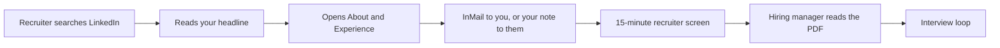
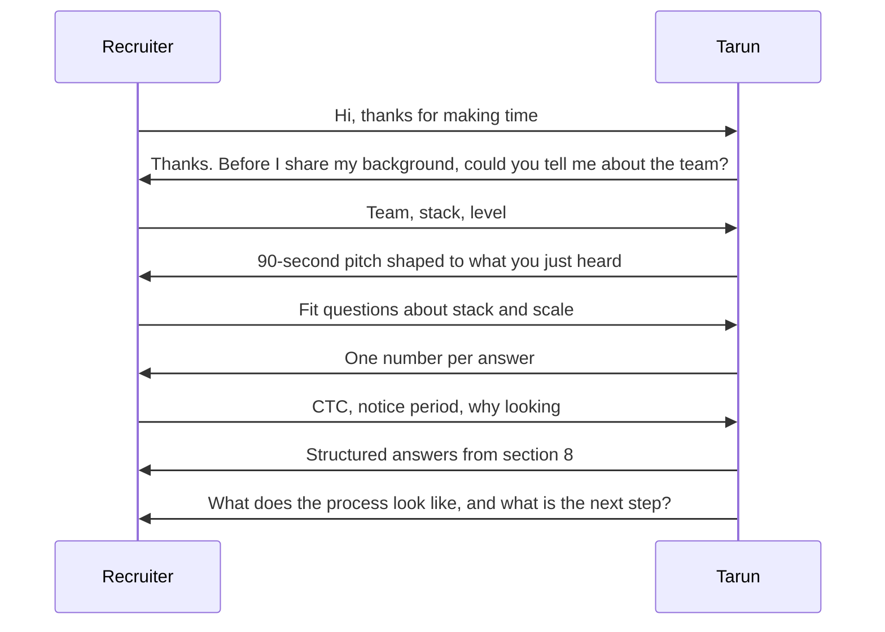
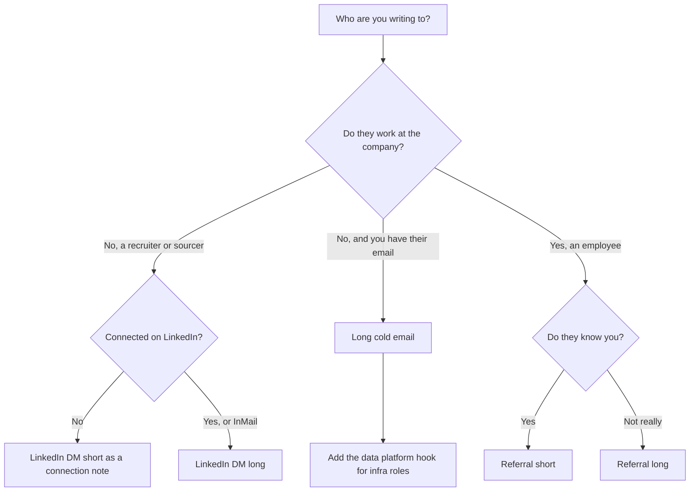
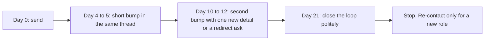

# 12. LinkedIn and Outreach Explained

**How to use this chapter**

- **What it covers:** every line of your LinkedIn headline, About section and experience entries, in plain English, with how to back each one up if a recruiter asks. Then the recruiter call script, the money and notice-period questions, which outreach template to send when, and a follow-up schedule.
- **When to read it:** before you update the live profile, before every recruiter screen, and before you send a batch of cold emails or referral asks.
- **What to memorise:** the off-PDF facts table (section 5), the "LinkedIn vs PDF" rule (section 6), the first-five-minutes script (section 7) and the three logistics answers (section 8).
- **Paste-ready sources:** the copy you actually paste lives in the [LinkedIn profile pack](../linkedin/headline_about_experience.md), [Cold mail recruiter / sourcer](../outreach/recruiter_cold_email.md), [Referral asks](../outreach/referrals_short_long.md), the [Application Kit](../ApplicationKit.md) and [Application questions](../application_questions.md). If this chapter and those pages ever disagree, those pages win for wording, and the [numbers chapter](02_numbers_explained.md) wins for numbers.

**Tags used in this chapter.** MEASURED means there is a log, doc or benchmark behind the number. ESTIMATED means arithmetic you can show. HISTORICAL means it comes from past work records. **Off-PDF** means a true fact that appears on LinkedIn or in conversation but is not printed on the resume PDF.

---

## 1. The one-minute version

Recruiters usually meet you on LinkedIn before they open your PDF. A sourcer searches for keywords like "Go", "ClickHouse" or "Kafka", reads your headline in the search results, and only then clicks through to the About section and experience entries. So LinkedIn has to do two jobs. It must match searches, and it must survive a recruiter reading any line back to you on a call.

Your LinkedIn says the same things as the PDF in a more conversational voice. It also carries a few true facts the PDF had no room for, such as 100% Go statement coverage across 1,200+ tests, the 1.6M article-season catalog and the $100-per-pass token cost. That is fine as long as every number on LinkedIn means exactly what the same number means on the PDF, and nothing contradicts it.

Outreach is the other half. You have three kinds of message: cold notes to recruiters, referral asks to people inside the company, and application-form answers. Each has a template, and each has a rhythm of follow-ups. The goal is to sound like an engineer who knows his numbers, not like a keyword list.

*What to notice:* the recruiter reads LinkedIn twice, once before the screen and again before passing you on, so every LinkedIn line must be defensible on the call.

---

## 2. Words you need

- **Recruiter vs sourcer.** A sourcer finds candidates and starts conversations. A recruiter runs the process after that (screens, scheduling, offers). In a small company one person does both. Treat both as non-engineers who will repeat your words to an engineer.
- **InMail and connection note.** InMail is a paid LinkedIn message you can send without being connected. A connection note is the short message attached to a connection request. It has a tight character limit, so it needs the short DM template.
- **Headline.** The one line under your name. It shows in search results, so it carries the most keywords. LinkedIn caps it at roughly 220 characters.
- **About.** The free-text summary. LinkedIn caps it at roughly 2,600 characters, and only the first two or three lines show before "see more".
- **Featured.** A row of pinned links or files near the top of the profile (resume PDF, certificates).
- **ATS (Applicant Tracking System).** The software companies use to store and filter applications. It matters for the PDF, and much less for LinkedIn.
- **Referral.** An employee submits you through the company's internal system. It usually gets your resume read by a human faster. Think of it as someone vouching that you are worth a look, not that you are hired.
- **Req ID (requisition ID).** The internal job number on a posting. Putting it in the subject line saves the recruiter a lookup.
- **CTC (cost to company).** The Indian term for your total annual package: fixed salary, variable bonus, and employer-paid benefits.
- **Notice period.** How long your current employer's contract requires you to keep working after you resign.
- **Off-PDF fact.** True, said on LinkedIn or verbally, not printed on the PDF. You may say it. You must know it is not on the PDF.

For the technical words in the profile (Go/Gin, ClickHouse, ReplacingMergeTree, LangGraph and so on), see the [tech glossary](09_tech_glossary.md) and [core concepts](10_core_concepts_explained.md). Section 3 below defines the ones a recruiter is most likely to ask about.

---

## 3. The headline and About section, line by line

### 3.1 Headline options

The three options, quoted from the [LinkedIn profile pack](../linkedin/headline_about_experience.md):

> 1. Senior Software Engineer | Java · Python · Go | High throughput backends and data platforms | Go · ClickHouse · Kafka · Agentic AI

> 2. Senior Software Engineer | Go · ClickHouse · Kafka · LangGraph | 4B-row weekly rollups · 10k RPS

> 3. Backend SSE (Java, Python and Go) | Uber (via EPAM) FRM · Kafka 1M+/day · Go/Gin 10k RPS · LangGraph

**What each piece means.**

| Piece | Plain meaning | Where it comes from |
|---|---|---|
| Java · Python · Go | The three languages you shipped production services in | Java at Uber FRM and Masters India, Go and Python at Impact Analytics, Python at Uber Eats Menu and GeeksforGeeks |
| High throughput backends and data platforms | Services that handle a lot of traffic, and systems that store and move a lot of data | Go/Gin at 10k RPS, ClickHouse rollups, Kafka pipelines |
| ClickHouse | A fast analytics database that stores data by column | Impact Analytics |
| Kafka | A durable message log that services publish to and read from | Uber Eats Menu and Masters India only |
| Agentic AI / LangGraph | LLM systems that take steps (call tools, check their own output) rather than answering once | AssortSmart decision engine and Ask Iris |
| 4B-row weekly rollups | The attr weekly rollup table, 4.09B rows across two seasons | Impact Analytics migration |
| 10k RPS | Peak requests per second on the Go/Gin platform | Impact Analytics |
| Uber (via EPAM) FRM | Financial Risk Management scoping platform, built while employed by EPAM on the Uber account | Uber via EPAM |
| Kafka 1M+/day | More than 1 million government e-invoice submissions per day | Masters India |

**Which to use.** Option 1 is the safe default for Staff and data platform searches. Option 2 is for recruiters hunting scale numbers. Option 3 is for backend roles where the Uber name opens the door.

**If a recruiter asks...**

- *"Your headline says Kafka. How do you use Kafka at Impact Analytics?"* "I don't use Kafka at Impact Analytics. My Kafka work was at Uber Eats, with Flink, for menu ingestion, and at Masters India for the e-invoicing pipeline that handled over a million submissions a day. At Impact Analytics the data layer is ClickHouse, PostgreSQL and BigQuery."
- *"4 billion rows, is that your whole database?"* "No. That is one table, the attribute-level weekly rollup, which holds 4.09 billion rows across two seasons. I measured my Go copier on it while moving it between ClickHouse clusters. Other tables are smaller."
- *"10k RPS, is that average traffic?"* "It is peak requests per second on the multi-tenant Go/Gin platform. I don't quote an uptime SLA for it."

### 3.2 About (short)

> Senior Software Engineer with 5 years of experience designing and owning cloud-native, high-throughput distributed systems. Expertise in Java, Python and Go microservices, with applied experience in AI-assisted and RAG systems. Proven track record shipping production systems, leading backend migrations, and improving reliability, performance, and scalability.

This is the PDF summary word for word. That makes it the safest line on the profile, because nothing in it can contradict the resume.

| Line | What it means | How to back it up |
|---|---|---|
| 5 years, cloud-native, high-throughput distributed systems | You build services that run on cloud infrastructure (GCP, AWS) and handle heavy load | GeeksforGeeks from Aug 2021 to today. Go/Gin at 10k peak RPS. Masters India at 1M+ submissions a day |
| Java, Python and Go microservices | Small services, each owning one job, written in Java, Python or Go | Spring Boot at Uber FRM and Masters India, Go/Gin plus Python agents at Impact Analytics |
| AI-assisted and RAG systems | LLM features in production. RAG (retrieval-augmented generation) means fetching relevant documents first and giving them to the model as context | AssortSmart decision engine and Ask Iris. Gemini plus LangChain RAG over Milvus at Uber Eats |
| Leading backend migrations | Moving a live system to a new design without stopping it | PHP to Spring Boot at Masters India. Spring Data JPA / Hibernate migration at Uber FRM (led 3 engineers) |
| Reliability, performance, scalability | Fewer failures, faster responses, more load | p95 from 1.2 seconds to 300 milliseconds. Pivots from 189 seconds to 12 seconds. Circuit breakers and checkpoints on the AI batch runs |

### 3.3 About (long), paragraph by paragraph

The current text, quoted from the [LinkedIn profile pack](../linkedin/headline_about_experience.md):

> I am a Senior Software Engineer focused on backend, data, and production AI platforms in Java, Python and Go.
>
> What I am known for:
>
> - Platform: At Impact Analytics I architected AssortSmart's multi-tenant Go/Gin edge (Wire, h2c, Datadog) to 10k peak RPS. I cut planner pivots from 189s to 12s on 250M rows with six ClickHouse rollup tables (product, store, and attr at season and weekly grains). I keep a 100% statement-coverage CI gate across 1,200+ Go tests.
> - Scale and infrastructure: Weekly grain is built one fiscal week at a time, after a full-season weekly aggregate hit about 170 GB and ran out of memory. I wrote a Go native-TLS pump that copies season partitions between ClickHouse Cloud clusters at about 150-190k rows/s per stream, 344k combined. It uses 500k-row columnar batches with double buffering, so the SELECT of the next batch overlaps the INSERT of the last. The largest object I timed is attr weekly at 4.09B rows across two seasons, measured in flight, not a finished cutover. The Kafka and Flink on my profile are Uber Menu, not AssortSmart.
> - Agentic: I built Keep/Drop, Missed Opportunities, and Top Style over 348k article-seasons (88k items per pass, 7 lenses), reading JSON payloads instead of querying the 2.11B-row ClickHouse master. I shipped Ask Iris, a JWT-secured WebSocket copilot with a LangGraph supervisor, a 3-attempt evaluator, and hierarchy access frozen at the handshake. Promotions are gated on a 300-case proxy harness and an 80% CI gate (a gate, not live accuracy for all tenants). On a separate benchmark we cut live scoring cost 73% at 100% coverage against a 74% deterministic baseline, and froze blend weights when the LLM lost.
> - Uber via EPAM: FRM scoping with 36 Spring Boot endpoints, 19M GL rows, an L1–L4 FSLI hierarchy, an 8-table SOADB schema, and SHA-256 keys. I led 3 engineers to 100% coverage with SOX 50% delta-variance checks. Reconciliation dropped 70%, from 14 days to 3, against $340M materiality. Menu ingestion went from 24 hours to 2 hours, saving $600K/yr on 30K+ menus/month, with 98% offline field fidelity (RAG over Milvus) and Kafka + Flink exactly-once upserts.
> - Masters India: A Spring Boot strangler migration cut p95 75%, from 1.2s to 300ms. A Kafka + PostgreSQL pipeline sharded by tax quarter handles 1M+ submissions/day. Coverage went from 35% to 82% at 98% deploy success. I mentored 2 engineers.
>
> I care about honest metrics (measured vs promotion gate vs historical) and mentoring people to ship safely.
>
> Open to Senior Software Engineer / SDE2+ roles in backend, platform, data infrastructure, and applied-AI systems.

#### Opening line and "What I am known for"

The opening line tells a search algorithm and a human the same three things: backend, data, AI. "What I am known for" introduces five proof bullets, one per area. Recruiters skim these, so each bullet leads with the area name.

#### Platform bullet

**In plain words.** At Impact Analytics you designed the main web service of AssortSmart, a retail planning product. Many retailer customers (tenants) share it. It is written in Go using the Gin web framework and handles up to 10,000 requests per second at peak. You made the slowest screen, the planner pivot table, about 15 times faster by pre-computing summaries in ClickHouse. The Go code base must keep 100% statement coverage to merge.

| Phrase | Plain meaning |
|---|---|
| Multi-tenant | One running system serves many customer companies, each seeing only its own data. Like an apartment building with separate locked flats |
| Go/Gin edge | The Go service that receives HTTP requests first. Gin is a lightweight Go web framework |
| Wire | Google Wire generates the code that connects Go components at compile time, so a missing dependency fails the build instead of crashing at startup |
| h2c | HTTP/2 without TLS encryption, served directly by Go. You ran it with no reverse proxy (like Nginx) in front |
| Datadog | A monitoring service. Distributed tracing follows one request across every service it touches |
| Planner pivot | The grid screen where merchandise planners slice sales by product, store and week |
| Rollup table | A table of pre-computed totals, so a query reads a few thousand summary rows instead of millions of raw ones. Like keeping monthly bank statements instead of re-adding every receipt |
| Grain | The level of detail of a table, such as per season or per week |
| Statement coverage | The share of code lines that run at least once during tests |

**If a recruiter asks...**

- *"How did you get from 189 seconds to 12?"* "Planners were waiting over three minutes for a pivot because every query aggregated raw rows. I built a pre-aggregation layer in ClickHouse: six rollup tables covering product, store and attribute, each at season and weekly grain. On a 250-million-row benchmark the pivot went from 189 seconds to about 12 seconds, which is roughly 15 and a half times faster."
- *"Why no reverse proxy?"* "Fewer moving parts. The Go server handles HTTP/2 directly with h2c and enforces its own nested timeouts, so a slow downstream call cannot hold a connection forever. Datadog tracing shows where time goes."
- *"1,200 tests, really?"* "Yes. That is off the PDF, but it is true: 100% statement coverage on the Go code, over 1,200 tests, enforced in CI. Statement coverage proves every line ran under some test. It does not prove every edge case is right, so I treat it as a floor."

**Say this carefully.** 10k RPS has no SLA attached. Do not claim you operated Kubernetes clusters for this platform.

#### Scale and infrastructure bullet

**In plain words.** Two stories. First, building the weekly summary table for a whole season in one go needed about 170 GB of memory and crashed. You fixed it by building one fiscal week at a time with memory limits. Second, you had to copy huge tables between two ClickHouse Cloud clusters that were not allowed to talk to each other directly. So you wrote a Go program that reads from one and writes to the other, at about 344,000 rows per second combined.

| Phrase | Plain meaning |
|---|---|
| OOM (out of memory) | The database process ran out of RAM and the query was killed |
| Fiscal week | The retailer's accounting week, which may not match the calendar week |
| Native-TLS pump | A Go program that speaks ClickHouse's own binary protocol over an encrypted connection (port 9440), instead of HTTP |
| Season partition | ClickHouse tables are split into partitions by season code, so one season can be copied, dropped or replaced on its own |
| Columnar batch | A block of 500,000 rows sent column by column, which is how ClickHouse stores data |
| Double buffering | While batch N is being written to the target, batch N+1 is already being read from the source. Like one person washing dishes while another dries, instead of one person doing both in turn |
| Measured in flight | The rate was timed while the copy was still running. It is not a report of a finished migration |

**If a recruiter asks...**

- *"Why write your own copier?"* "The two ClickHouse Cloud clusters had IP allowlists that blocked a direct cluster-to-cluster copy. So I wrote a Go pump that pulls from one over the native TLS protocol and pushes into the other, in 500,000-row batches with double buffering. Two season streams ran in parallel at about 150 to 190 thousand rows a second each, around 344 thousand combined."
- *"Did the 4-billion-row migration finish?"* "I'd say it carefully. I measured the rate on the 4.09-billion-row attribute weekly set while that copy was in flight. I don't claim the full cutover finished. The safety mechanism was checkpoint files per table plus a ledger, and if a partition failed halfway I dropped that partition on the target and recopied the season."
- *"How did you fix the 170 GB problem?"* "I sliced the build into one fiscal week per insert and set memory and disk-spill caps. The whole-season build had failed even with 80 GB and 200 GB caps. A single week fit comfortably."

**Say this carefully.** 344k is rows per second during a copy, never requests per second. The 170 GB fix (load time) did not cause the 189-to-12 win (query time). "Atomic partition rollback" means drop the partition and recopy, not a live atomic swap. Never offer to share the copier code.

#### Agentic bullet

**In plain words.** AssortSmart helps retailers decide which products to keep, drop or add each season. You built the AI decision engine that scores 348,000 product-season combinations, 88,000 per batch run. It mixes plain math (sales metrics) with LLM judgements from seven different angles ("lenses"). The LLM never queries the big database. It only sees JSON you prepared. You also shipped Ask Iris, a chat copilot planners use to ask about KPIs and AI decisions. Before any model or prompt ships, it must score at least 80% on a 300-case test set.

| Phrase | Plain meaning |
|---|---|
| Article-season | One product (article) in one selling season. A t-shirt in Spring 2026 and the same t-shirt in Fall 2026 are two article-seasons |
| 7 lenses | Seven separate LLM prompts, each judging the item from one angle. A decider combines them |
| JSON payloads instead of querying | You fetch the facts, package them as JSON and hand them to the model. The model gets no SQL tool |
| JWT-secured WebSocket | A long-lived two-way connection, opened only with a valid signed login token |
| LangGraph supervisor | A LangGraph node that routes each question to the right helper step |
| 3-attempt evaluator | A checker that reviews the draft answer and allows at most 3 retries, so the loop cannot run forever |
| Hierarchy frozen at the handshake | The user's allowed scope is read once when the socket opens and cannot change mid-session, which prevents cross-tenant leaks |
| Proxy harness / CI gate | A 300-case test set that runs in CI. A release that scores under 80% is blocked |
| Deterministic baseline | The score from plain math alone, with no LLM |
| Blend weights | The formula final = 0.4 × math score + 0.6 × LLM score. "Frozen" means you stopped tuning it |

**If a recruiter asks...**

- *"Is your model 80% accurate?"* "80% is a promotion gate, not a live accuracy claim. A new model or prompt must score at least 80% on our 300-case evaluation harness before it can ship. I don't claim every tenant runs at 80% live."
- *"What does 73% cheaper mean?"* "On a separate 200-case gold benchmark we compared models. The one we picked completed all 200 cases at about 73% lower execution cost. On that same benchmark the deterministic baseline scored 74%, and our blended LLM scored lower, so we froze the blend weights instead of tuning them to look better."
- *"Why not let the LLM query the database?"* "The master table has 2.11 billion rows. Letting a model write SQL against it risks slow queries, wrong joins and data leaks across tenants. Serving prepared JSON keeps the model's input small and checkable. If the LLM times out, the system falls back to the deterministic score."

**Say this carefully.** Keep/Drop runs its steps in a fixed order (peer, decider, lenses, blend, explain). No LLM decides what runs next. The supervisor pattern is Ask Iris. LangSmith tracing is on Ask Iris only. There is no human review queue in this system. Ask Iris is a shipped capability with no SLA or usage numbers.

#### Uber via EPAM bullet

**In plain words.** You were employed by EPAM Systems and worked on Uber projects. For Uber Finance you owned the backend of the FRM (Financial Risk Management) scoping tool, which replaced spreadsheets for the quarterly close and cut reconciliation from 14 days to 3. For Uber Eats you worked on a pipeline that reads restaurant menu PDFs and turns them into catalog data, cutting onboarding from 24 hours to 2.

| Phrase | Plain meaning |
|---|---|
| GL rows | General ledger entries, the company's master accounting records. 19M raw rows were migrated off Google Sheets into MySQL |
| L1–L4 FSLI | Financial Statement Line Items grouped four levels deep, from a broad heading down to a specific account group |
| SOADB | Uber's standard service-owned MySQL |
| SHA-256 keys | A stable ID computed from the content itself (for example question text plus page name), so the same item always gets the same ID and duplicates cannot appear |
| SOX 50% delta-variance | SOX (Sarbanes-Oxley) is the US law on financial controls. The tool flags any line whose value moved more than 50% between periods |
| $340M materiality | The threshold above which a misstatement would matter to investors |
| 98% offline field fidelity | In offline evaluation (scored against known-correct menus, not live traffic), 98% of extracted menu fields matched the correct value |
| Exactly-once upserts | In practice, at-least-once delivery plus idempotent writes, so a replayed message cannot create a duplicate |

**If a recruiter asks...**

- *"Were you an Uber employee?"* "I was employed by EPAM Systems and worked on the Uber account, so I say 'Uber via EPAM'. On FRM I was tech lead of an EPAM pod of three engineers."
- *"How did you measure the 70%?"* "Quarterly reconciliation went from 14 days to 3 days. That was the outcome the platform delivered for the close." If pressed: "The technical design doc framed that cut, and that's what the platform delivered."
- *"How does $600K a year add up?"* "Manual or third-party menu entry cost roughly $2 a menu. At 30,000 menus a month over 12 months that is about $720K, and I round it down to $600K to stay conservative."

**Say this carefully.** 98% is offline evaluation. Milvus is Uber Menu only. Do not claim you built the Slack collaboration and notification service. It was separate.

#### Masters India bullet

**In plain words.** Masters India sells GST (Goods and Services Tax) compliance software to Indian companies. Clients send invoices, and the platform validates and registers them with the government IRP (Invoice Registration Portal), which returns an invoice reference number and a signed QR code. You led the move from an old PHP monolith to Spring Boot microservices, which made the slowest 5% of requests four times faster, and built the high-volume e-invoicing pipeline.

| Phrase | Plain meaning |
|---|---|
| Strangler migration | Replace a legacy system one route at a time, with a canary per route, until the old one can be switched off. Like replacing a bridge one lane at a time while traffic keeps flowing |
| p95 latency | 95% of requests finish faster than this number |
| Sharded by tax quarter | The PostgreSQL data is split across databases by tax quarter, so each one stays a manageable size |
| 98% deploy success | 98% of deployments went out without a rollback |

**If a recruiter asks...**

- *"What drove the latency win?"* "Taking the government portal calls off the request thread with async calls, connection pooling, query and index fixes, and Redis for reads. p95 went from 1.2 seconds to 300 milliseconds across more than 1,500 enterprise clients."
- *"1 million a day, how much is that per second?"* "About 12 per second on average, since a day has 86,400 seconds. Peaks around filing deadlines are much higher. My estimate is 8 to 10 times the average."

**Say this carefully.** "Mentored 2" is Masters India. "Led 3" is Uber FRM. Never merge them into "led a team of 5". Flink was never at Masters India.

#### The closing lines

"I care about honest metrics (measured vs promotion gate vs historical)" is a promise, and interviewers test it. If you say it, you must be the first to say "that was measured in flight" or "that is a CI gate, not live accuracy". "Open to Senior Software Engineer / SDE2+ roles" tells recruiters your target level. Use the same words on the call.

---

## 4. Experience entries decoded

The paste-ready blurbs live in the [LinkedIn profile pack](../linkedin/headline_about_experience.md). This section explains what is in each one and where it differs from the PDF.

### 4.1 Impact Analytics, Senior Software Engineer (May 2026 to Present)

The entry follows the PDF's two chapters in the PDF's order: Agentic Flows & Orchestration first, then Core Infrastructure & Pipeline. The two Core paragraphs about pivots and the ClickHouse migration are the PDF bullets almost word for word. The Agentic paragraph and the first Core paragraph are shortened summaries of the other PDF bullets.

The entry ends with one paragraph of **off-PDF context**:

> The full catalog holds 1.6M article-seasons. A full scoring pass costs about $100 in LLM tokens. The Go codebase holds a 100% statement-coverage gate across 1,200+ tests, with golangci-lint and SAST/SBOM checks.

Each of those is decoded in the off-PDF table in section 5. The deep technical chapters are [IA core platform](03_ia_core_platform.md) and [IA agentic AI](04_ia_agentic_ai.md).

**Not on LinkedIn and not on the PDF:** the Cluster Recommendation Copilot and Hindsight. They are still being built. Use them only if an interviewer asks what you are working on next.

### 4.2 Uber via EPAM, SDE2 (Jul 2024 to May 2026)

Three sub-entries: FRM, Menu (Uber Eats) and ANZ (Uber Mobility). The FRM line names the Java stack (Java, Spring Boot, Spring Data JPA, Hibernate) to match this track's PDF. The ANZ line is HISTORICAL and is Uber Mobility, not Uber Eats. It was a deterministic rules backend, so do not add Selenium or RAG to it. Deep chapters: [Uber FRM](05_uber_frm.md) and [Uber Menu and ANZ](06_uber_menu_and_anz.md).

### 4.3 Masters India, SDE2 (Dec 2022 to Jun 2024)

Same facts as the PDF in a shorter form, including the PHP monolith to Spring Boot microservices migration. "700 to 4,000 requests per minute" is roughly 12 to 67 requests per second. "Redis cut database reads 30%" is the cache-aside layer. Deep chapter: [Masters India](07_masters_india.md).

### 4.4 GeeksforGeeks, SDE (Aug 2021 to Nov 2022)

Same facts as the PDF. The 20% premium lift and the 30% course-sales lift are business numbers. Say "I owned the engineering, and the business team attributed the lift." Deep chapter: [GeeksforGeeks](08_geeksforgeeks.md).

---

## 5. Off-PDF facts: what they are and how to say them

These are true and appear on LinkedIn or in your spoken answers, but not on the PDF. A sharp recruiter may notice the difference. The safe move is to own it: "That one isn't on the PDF for space, but yes, it's true."

| Fact | What it measures | Where it appears |
|---|---|---|
| 100% Go statement coverage, 1,200+ tests | Every line of the AssortSmart Go code runs under at least one of 1,200+ tests, enforced in CI | About long, IA blurb, cover letter, Application Kit |
| 1.6M article-seasons | The size of the full product catalog, counted as product × season | IA blurb |
| $100 per pass | LLM token spend for one full scoring pass of about 88k items | IA blurb |
| 150k to 190k rows/s per stream | Copy rate of each of the two parallel season streams that add up to about 344k | About long |
| golangci-lint, SAST/SBOM | Go linting, static security scanning and a software bill of materials in CI | IA blurb only |
| 55 GB memory cap, 16 GB spill | The limits that made the weekly build fit | Application answers |

**How to talk about each one.**

**100% Go coverage across 1,200+ tests.** Say: "On the Go platform we hold a 100% statement-coverage gate across more than 1,200 tests. It's on LinkedIn rather than the PDF." Do not mix it up with Uber FRM. At Uber the PDF says module statement coverage reached 100% after the ORM migration, and the FRM test count you say out loud is 1,100+. Two different codebases, two different counts.

**1.6M article-seasons.** This is the catalog. 348k is what the engine actually scores. Say: "The catalog has about 1.6 million article-seasons. The decision engine evaluates 348 thousand of them, 88 thousand per pass." Never say "we score 1.6 million".

**$100 per pass.** Say: "A full pass of about 88 thousand items costs roughly $100 in tokens. We know because every step logs tokens and USD cost in our JSON telemetry." Do not work backwards from the 73% cost cut to invent a "before" price. Those numbers come from different measurements.

**150k to 190k rows/s per stream.** Say: "Two season streams ran in parallel at about 150 to 190 thousand rows a second each, around 344 thousand combined." It is a copy rate, not traffic.

**golangci-lint and SAST/SBOM.** These are on the LinkedIn draft but are not in your locked resume facts. Keep them on the live profile only if you can explain what you configured. Otherwise delete that clause before pasting.

**55 GB and 16 GB caps.** Verbal depth for the 170 GB story. Use them when the interviewer asks "how did you make it fit?"

---

## 6. LinkedIn vs the PDF, and why the differences are fine

| Area | PDF | LinkedIn |
|---|---|---|
| Length | Two pages, every word fought for | About up to roughly 2,600 characters, plus longer experience entries |
| Voice | Achievement bullets tuned for ATS keywords | First person, conversational |
| Off-PDF facts | None | 100% Go coverage and 1,200+ tests, 1.6M catalog, $100 per pass, per-stream copy rate |
| Honesty notes | Implicit | Spelled out ("measured in flight", "a gate, not live accuracy", "Kafka and Flink are Uber Menu") |
| Stack wording | One track per PDF | One profile for all tracks. This pack uses the Java + Python + Go wording |

**The rule.** LinkedIn may add true detail. It may never give a different number for the same thing, a different stack for the same project, or a stronger claim than the PDF. "Cut planner pivots from 189s to 12s" on both is fine. "15.5×" on the PDF and "20×" on LinkedIn would not be.

**Why this is fine.** The PDF is a two-page filter document. LinkedIn is a longer, browsable profile. Recruiters expect LinkedIn to carry more detail. What they punish is inconsistency, not extra truth.

**The one real risk: one profile, three PDFs.** The live LinkedIn can show only one FRM stack. This pack uses Spring Boot and Spring Data JPA / Hibernate, which matches the Java + Python + Go PDF. Whichever version you put live, keep it consistent with the PDF you send most often. If you send a different track's PDF, expect a recruiter to notice the difference and answer truthfully.

---

## 7. Recruiter call script: the first five minutes

The first five minutes decide whether the recruiter sends you on. Your goals are to learn what the role really needs, give a pitch shaped to it, handle logistics cleanly, and leave with a clear next step.

*What to notice:* you ask about the role before you pitch, so your pitch can lead with whatever they care about.

**Minute 0 to 0:30. Open and ask first.**

> "Thanks for reaching out. Before I walk through my background, could you tell me a bit about the team and what this role will own? That way I can focus on what's relevant."

**Minute 0:30 to 2:00. The 90-second pitch.** Lead with whatever matches what they just said. The default order:

> "I'm a Senior Software Engineer with five years in Java, Python and Go backends. Right now at Impact Analytics I work on AssortSmart, a retail planning product. I architected the multi-tenant Go platform that peaks at 10 thousand requests per second, built ClickHouse rollups that took planner pivots from 189 seconds to 12 seconds, and built an AI decision engine that scores 348 thousand article-seasons, plus a copilot called Ask Iris. Before that I spent almost two years at Uber via EPAM. I owned the Financial Risk Management scoping backend, which cut quarterly reconciliation from 14 days to 3 days, and I led three engineers. I also worked on Uber Eats menu ingestion, which cut restaurant onboarding from 24 hours to 2 hours. Before that, at Masters India, I led a PHP to Spring Boot migration that cut p95 latency from 1.2 seconds to 300 milliseconds. I'm looking for a senior backend, platform or applied-AI role where I can own a system end to end."

How to shape it:

- **Data platform or infrastructure role:** lead with ClickHouse (189 seconds to 12 seconds, six rollup tables, the Go copier at about 344 thousand rows a second).
- **Applied-AI role:** lead with the decision engine, Ask Iris and the 80% CI promotion gate.
- **Backend or fintech role:** lead with Uber FRM (14 days to 3 days, 36 endpoints, SOX checks) and Masters India (1.2 seconds to 300 milliseconds).

The 30-second and 3-minute versions are in [Introductions and career story](01_introductions_and_career_story.md).

**Minute 2:00 to 3:30. Fit questions.** Recruiters usually ask "Have you worked with X?" and "What scale?" Answer each with yes or no, then one project, then one number. Keep each answer under 20 seconds.

> "Yes, Kafka at two places. At Uber Eats with Flink for menu ingestion, and at Masters India for an e-invoicing pipeline at over a million submissions a day."

If they name something you only know at skills level (Kubernetes, gRPC, DynamoDB, pgvector, C or C++), say so plainly: "I know it at a working level, but I haven't owned it in production. My production depth is in X."

**Minute 3:30 to 4:30. Logistics.** Use the structures in section 8.

**Minute 4:30 to 5:00. Close with questions.**

> "What level is this role scoped at? What does the interview process look like, and what's the timeline? What's the best next step from here?"

Write down the recruiter's name, the role, the level, the next step and the date they promised. You need them for the follow-up email.

---

## 8. Current CTC, notice period and "why are you looking"

These three questions are where candidates most often hurt themselves. Never invent or round a number. The structures below have blanks, and you fill them from your own payslip, offer letter and contract.

### 8.1 Current CTC

Background checks often verify past pay through payslips or tax documents. An inflated figure can cost you an offer after you have already resigned.

**Structure: break it down, state the truth, then move to expectations.**

> "My current CTC is [fixed amount] fixed plus [variable amount] variable, so [total] in all. [Only if true: There's also [joining bonus / stock] that I can share details on.] For this role I'm looking at [your range], based on the level and the market for this kind of work."

If they push for an expected number before you know the level:

> "I'd rather make sure we're aligned on level first. Could you share the band for this role? If it's in the right range, I'm happy to keep moving."

**Do not:** round up, quote your expected number as your current one, or say "it's confidential" when the form requires it. If the form makes CTC mandatory, enter the true figure.

### 8.2 Notice period

**Structure: contractual number, then what is actually possible.**

> "My notice period is [N days] as per my contract. [Pick only what is true: I can ask for early release / buyout is possible / I've already resigned and my last day is [date].] Realistically I could join around [date]."

**Do not** promise an early joining date you cannot get. If you do not know whether early release is possible, say "I'd need to check with my manager, and I'll confirm by [day]."

### 8.3 "Why are you looking?" (and "why after five months?")

You joined Impact Analytics in May 2026, so a recruiter will notice the short tenure. Answer calmly, positively and briefly. You are not running from the work. You want a bigger stage for it.

**Structure: what you built, what you want next, why this company.**

1. **What you built (one sentence, positive).** "At Impact Analytics I've shipped a lot quickly: the Go platform at 10k peak RPS, the ClickHouse rollups, the AI decision engine and Ask Iris."
2. **What you want next (one sentence, forward-looking).** "I want a larger production surface and a harder design-review bar. I'm not running from the work."
3. **Why this company (one sentence, specific).** "Your [team or system] is exactly that kind of problem."

If they ask about four companies in five years:

> "Each move added a layer. Product features at GeeksforGeeks, a SaaS migration and mentoring at Masters India, Uber-scale platform work via EPAM, and data plus agentic systems at Impact Analytics. I was at Uber via EPAM for almost two years, which shows I stay when the scope compounds. I'm optimising for that again."

**Do not:** criticise any employer or manager, lead with money, apologise as if you failed, or call the current role "not real". For the full career story, see [Introductions and career story](01_introductions_and_career_story.md).

### 8.4 Other logistics questions

- **"Are you interviewing elsewhere?"** Answer truthfully and briefly: "Yes, a few processes. I'm being selective." Mention an offer only if you actually have one.
- **"Which level are you targeting?"** "Senior Software Engineer, or SDE2+ at companies that level differently." These are the same words as your About section.
- **"Were you an Uber employee?"** "I was employed by EPAM Systems and worked on the Uber account."

---

## 9. Outreach templates and when to use each

The paste-ready versions live in the outreach pages. They are reproduced here so this chapter stands alone. If you edit one, edit the source page.

*What to notice:* the first question is always whether the person works at the company. Employees get referral asks. Recruiters get pitches.

| Template | Use it when | Source |
|---|---|---|
| Subject lines | Any cold email | [Cold mail](../outreach/recruiter_cold_email.md) |
| Long cold email | You have a recruiter's email address | [Cold mail](../outreach/recruiter_cold_email.md) |
| LinkedIn DM short | Connection note, or first message to a sourcer | [Cold mail](../outreach/recruiter_cold_email.md) |
| LinkedIn DM long | After they accept, or as an InMail | [Cold mail](../outreach/recruiter_cold_email.md) |
| Data platform hook | Data infrastructure, core platform or data engineering roles | [Cold mail](../outreach/recruiter_cold_email.md) |
| Referral short | An employee who knows you a little | [Referrals](../outreach/referrals_short_long.md) |
| Referral long | An alumnus or second-degree connection | [Referrals](../outreach/referrals_short_long.md) |
| Cover letter | Only when a form explicitly asks | [Referrals](../outreach/referrals_short_long.md) |
| Application answers | Free-text fields on application forms | [Application Kit](../ApplicationKit.md) and [Application questions](../application_questions.md) |

### 9.1 Subject lines

> Senior Software Engineer (Java · Python · Go) | Uber FRM + AssortSmart platform/AI

> 5y backend · Go/Gin 10k RPS · ClickHouse 4B-row rollups · Kafka 1M+/day · LangGraph

> Referral-ready Senior SWE (Java · Python · Go) [Company] [Req ID]

Use the first for generalist recruiters, because the Uber name gets opened. Use the second for data platform sourcers who scan for scale. Use the third when you already have a referral or a specific req ID.

### 9.2 Long cold email

> Hi [Name],
>
> I am Tarun Mittal, a Senior Software Engineer (Java, Python and Go) with 5 years owning production backends and applied-AI systems. Quick proof points from my resume:
>
> - **Impact Analytics, AssortSmart:** Multi-tenant Go/Gin platform at 10k peak RPS (Wire, h2c, Datadog). ClickHouse pivots from 189s to 12s on 250M-row operations across six rollup tables. Weekly rollups built one fiscal week at a time after a roughly 170 GB OOM. A Go native-TLS pump at about 344k rows/s combined, measured on a 4.09B-row attr weekly set. Keep/Drop on 348k article-seasons, plus the shipped Ask Iris copilot. Releases gated by a 300-case eval and an 80% CI promotion gate.
> - **Uber via EPAM, FRM:** 36 Spring Boot endpoints, 19M GL rows, L1–L4 FSLI hierarchy, 8-table SOADB schema, SHA-256 keys. Reconciliation cut 70%, from 14 days to 3, against $340M materiality. Led 3 engineers, 100% coverage, SOX 50% delta-variance checks.
> - **Uber Eats menu ingestion:** 24 hours to 2 hours, $600K/yr, 30K+ menus/month, 98% offline field fidelity with RAG over Milvus, Kafka + Flink exactly-once.
> - **Masters India:** Spring Boot strangler migration, p95 from 1.2s to 300ms, Kafka e-invoicing at 1M+/day. Mentored 2 engineers.
>
> I am targeting [Senior SWE / SDE2 / MTS] roles on [Team]. My resume is attached. Happy to do a 15-minute screen this week.
>
> Thanks, 
> Tarun Mittal 
> (+91) 9079727197 · tmittaliet@gmail.com 
> linkedin.com/in/t-mittal · github.com/TM-DEV-PRO

**Notes.** Before sending, delete the bullet least relevant to the role. Three sharp bullets beat four crowded ones. Always attach the PDF for this track.

### 9.3 LinkedIn DM short

> Hi [Name], I'm a Senior SWE (Java, Python and Go, 5y). I owned Uber FRM scoping (36 endpoints, led 3), built a Kafka pipeline at 1M+/day at Masters India, and now work on AssortSmart: Go/Gin at 10k RPS plus LangGraph Keep/Drop. Open to [Role]? Happy to send my resume.

**Notes.** It fits a connection note. Do not paste the long version into a connection request, because it will be cut off.

### 9.4 LinkedIn DM long

> Hi [Name], here is my fit in one glance. At Uber (via EPAM) I owned FRM (36 Spring Boot endpoints, reconciliation from 14 days to 3, a 70% cut, led 3) and built Menu ingestion end to end ($600K/yr, 24 hours to 2 hours, Kafka/Flink). At Masters India I ran Kafka at 1M+/day. Today at AssortSmart I work on a Go/Gin platform at 10k RPS, six ClickHouse rollup tables, a Go pump at about 344k rows/s combined on a 4.09B-row attr weekly set, and the shipped Ask Iris copilot. I'm looking at [Company] senior backend / data platform / applied-AI roles. If you are sourcing for [Team], I would love a quick screen. Resume here: [link].

**Notes.** Use it after a connection is accepted or as an InMail. Replace `[Team]` with a real team name from the job post.

### 9.5 Data platform hook

> I built six ClickHouse rollup tables for planner reads and a Go pump that copies season partitions at about 344k rows/s combined, measured on a 4.09B-row attr weekly set. Weekly grain is one fiscal week per INSERT after a roughly 170 GB OOM.

**Notes.** Add it to the cold email for infrastructure roles. Never send the overclaim version, "I stream 4.09 billion rows at 344,000 rows/second". It implies a finished, continuous stream, and the truth is a partition copy timed while running.

### 9.6 Referral short

> Hi [Name], I am Tarun, a Senior Software Engineer (Java, Python and Go, 5y). I owned Uber FRM scoping (36 Spring Boot endpoints, led 3) and now scale AssortSmart: Go/Gin at 10k RPS, ClickHouse pivots from 189s to 12s on 250M rows, six rollup tables, a Go pump at about 344k rows/s combined on a 4.09B-row attr weekly set, LangGraph Keep/Drop, and the shipped Ask Iris copilot. Could you refer me for [Role link]? Happy to send a 5-bullet fit summary.

**Notes.** Always include the exact job link. The "5-bullet fit summary" is in section 10.2. Have it ready before you send this.

### 9.7 Referral long

> Hi [Name],
>
> Hope you are having a good week. I have been following [Company]'s work on [specific team problem: high-throughput services / real-time data / applied AI].
>
> I am Tarun Mittal, a Senior Software Engineer in Bangalore with about 5 years in Java, Python and Go backends. At Impact Analytics I architected AssortSmart's Go/Gin platform (10k peak RPS) and its ClickHouse rollups. Pivots went from 189s to 12s on 250M rows across six tables. Weekly grain is built one fiscal week at a time after a 170 GB OOM. A Go pump runs at about 344k rows/s combined, measured on a 4.09B-row attr weekly set. I also built Keep/Drop and Ask Iris behind a 300-case eval and an 80% promotion gate. Before that, at Uber via EPAM, I owned FRM (36 Spring Boot endpoints, 19M GL rows, reconciliation from 14 days to 3, a 70% cut, led 3) and Uber Eats menu ingestion (24 hours to 2 hours, $600K/yr, Kafka + Flink exactly-once). At Masters India I led a Spring Boot strangler migration and a Kafka e-invoice path at 1M+ submissions/day.
>
> I am applying to [Role title link]. If you are open to a referral, I can send a short fit note and my resume today. No worries if you are swamped. Either way, thank you for reading.
>
> Best, 
> Tarun 
> (+91) 9079727197 · tmittaliet@gmail.com · linkedin.com/in/t-mittal

**Notes.** The first line must name something real about their team, such as a blog post, a talk or a line from the job post. A generic compliment reads as a mass message. The last line ("No worries if you are swamped") gives them an easy no, which makes a yes more likely.

### 9.8 Cover letter

The full text is in [Referral asks](../outreach/referrals_short_long.md). Send it only when a form asks. Most engineering recruiters skip cover letters. It names 100% Go coverage across 1,200+ tests, which is off-PDF, so be ready to say so.

---

## 10. Follow-up cadence

Most replies come after a follow-up, not the first message. Following up is polite as long as each message is short, adds something, and stops after the third try.

*What to notice:* three touches at most, spaced further apart each time.

### 10.1 Schedules by situation

| Situation | When to follow up |
|---|---|
| Cold email or DM to a recruiter | Day 4 to 5, day 10 to 12, close the loop on day 21 |
| Referral ask, no reply | One gentle nudge on day 5 to 7, then let it go |
| Referral ask, they said yes | Within 24 hours send the job link, resume and 5-bullet fit summary. Thank them. Update them after each round |
| Recruiter screen done | Same day: thank-you email with a recap of the next steps |
| Interview round done | Within 24 hours: short thank-you to the recruiter |
| Promised decision date passes | One business day later: polite status check |
| InMail from a recruiter | Reply within 24 hours, even if the answer is "not right now" |

### 10.2 Follow-up templates

**First bump (same thread):**

> Hi [Name], bumping this in case it got buried. I'm still keen on [Role] and happy to share anything that helps. Thanks, Tarun

**Second bump (add something or redirect):**

> Hi [Name], one last note on [Role]. If you're not the right person for this, could you point me to who is? Thanks either way.

**Close the loop:**

> Hi [Name], I'll assume the timing isn't right for [Role]. I'd love to stay in touch for future openings on [Team]. Thanks for your time.

**Referral said yes: the 5-bullet fit summary.** Every line is a PDF fact. Reorder for the role.

> Thank you so much! Here is the job link: [link]. My resume is attached. A quick fit summary:
>
> - Multi-tenant Go/Gin platform at 10k peak RPS at Impact Analytics (AssortSmart).
> - ClickHouse planner pivots from 189s to 12s on 250M-row operations, through six rollup tables.
> - AI decision engine scoring 348k article-seasons, plus the shipped Ask Iris copilot, behind an 80% CI promotion gate.
> - Uber via EPAM, FRM: reconciliation from 14 days to 3 days, 36 Spring Boot endpoints, led 3 engineers.
> - Masters India: p95 latency from 1.2s to 300ms, and a Kafka e-invoicing pipeline at 1M+ submissions/day.

**After a recruiter screen:**

> Hi [Name], thanks for the time today. To recap: [Role], [level], and the next step is [step] by [date]. I've attached my resume again for convenience. Looking forward to it.

**Status check after a missed date:**

> Hi [Name], just checking in on [Role]. I know these things take time. Is there any update on next steps? Thanks, Tarun

---

## 11. Say this / don't say this

| Say this | Not this |
|---|---|
| "Uber via EPAM" | "I worked at Uber" with no qualifier |
| "344 thousand rows a second during the copy" | "344k RPS" or "344k TPS" |
| "Measured on a 4.09-billion-row set while the copy was in flight" | "I migrated 4 billion rows" |
| "80% is our CI promotion gate" | "Our model is 80% accurate in production" |
| "73% cheaper and the 74% baseline come from a separate 200-case benchmark" | "80% vs a 74% baseline" as one comparison |
| "Kafka and Flink were Uber Eats. Kafka was also Masters India" | Any Kafka, Flink, CDC or Kubernetes operations at Impact Analytics |
| "Led 3 at Uber FRM. Mentored 2 at Masters India" | "Led a team of 5" |
| "98% field fidelity in offline evaluation" | "98% accurate in production" |
| "The catalog is 1.6M. We score 348k" | "We score 1.6 million article-seasons" |
| "100% Go coverage across 1,200+ tests, it's on LinkedIn" | Mixing it with the Uber FRM count of 1,100+ |
| "15.5× was query time. The 170 GB fix was load time" | "Fixing the OOM made pivots 15× faster" |
| A structured CTC answer with real numbers | Rounded-up or invented CTC figures |
| "I'm looking for a bigger stage for this kind of work" | Criticising your current employer |

Also keep these honest: Ask Iris has no SLA or usage numbers. There is no human review queue in the AssortSmart system. LangSmith is on Ask Iris only. The Cluster Recommendation Copilot and Hindsight are verbal only. Never offer to share or open-source the ClickHouse copier.

---

## 12. Practice drill

1. **"Your LinkedIn says 1,200+ tests but your resume doesn't. Why?"** "The PDF is two pages, so it didn't fit. It's true: the AssortSmart Go code holds a 100% statement-coverage gate across more than 1,200 tests, enforced in CI."
2. **"What does '4B-row weekly rollups' mean?"** "One table, the attribute-level weekly rollup, holds 4.09 billion rows across two seasons. I timed my Go copier on it while moving it between ClickHouse clusters. Not every table is that big."
3. **"So your system handles 344 thousand requests a second?"** "No, that's a copy rate in rows per second, across two parallel season streams. The request number is 10 thousand peak requests per second on the Go/Gin platform."
4. **"How do you use Kafka at Impact Analytics?"** "I don't. My Kafka work was at Uber Eats, with Flink, and at Masters India. At Impact Analytics the data layer is ClickHouse, PostgreSQL and BigQuery."
5. **"What's an article-season, and why do you have two numbers, 348k and 1.6M?"** "An article-season is one product in one selling season. The catalog has about 1.6 million. The decision engine evaluates 348 thousand of them, 88 thousand per pass."
6. **"What's $100 per pass?"** "One full scoring pass of about 88 thousand items costs roughly $100 in LLM tokens. Every step logs tokens and dollar cost in our telemetry, so we know."
7. **"Is your model 80% accurate?"** "80% is the CI gate a release must pass on our 300-case harness. It isn't a live accuracy claim for every tenant."
8. **"You worked at Uber?"** "Via EPAM. I was employed by EPAM Systems on the Uber account, and I was tech lead of an EPAM pod of three on the FRM platform."
9. **"Why are you looking after only five months?"** "I've shipped a lot quickly at Impact Analytics, including the Go platform, the ClickHouse rollups and the AI decision engine. I want a larger production surface and a harder design-review bar. I'm not running from the work, and your [team] is that kind of problem."
10. **"What's your current CTC?"** "[Fixed] fixed plus [variable] variable, so [total]. For this role I'm looking at [range], depending on level. Could you share the band?"
11. **"What's your notice period?"** "[N days] per my contract. [Only what is true about early release.] Realistically I could join around [date]."
12. **"You led 3 and mentored 2, so a team of 5?"** "No, those are two different jobs. I led three engineers at Uber FRM via EPAM, and I mentored two at Masters India."
13. **"How was the 70% reconciliation cut measured?"** "Quarterly reconciliation went from 14 days to 3 days. That's the outcome the platform delivered for the close." If pressed: "The technical design doc framed that cut, and that's what we delivered."
14. **"Is 98% fidelity in production?"** "No, it's an offline evaluation number. We scored the extracted fields against known-correct menus, not live traffic. I don't quote a live production accuracy figure."
15. **"Which roles are you targeting?"** "Senior Software Engineer, or SDE2+ where levels differ, in backend, platform, data infrastructure or applied-AI systems."

---

## 13. Before every recruiter call: a two-minute checklist

1. Re-read the job post and pick which pitch order fits (data platform, applied AI, or backend and fintech).
2. Open your live LinkedIn and check that it matches the PDF you sent.
3. Have your CTC breakdown, notice period and earliest joining date written down (real numbers, from your own documents).
4. Pick the two numbers you most want them to remember for this role.
5. Prepare one question about the team and one about the process.
6. After the call, send the recap email the same day.
