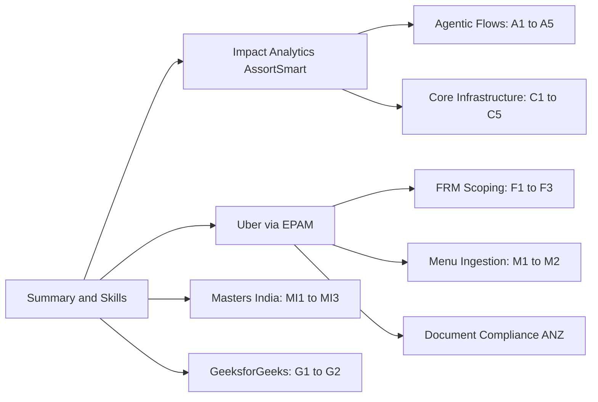

# Final Java + AI (IA = Py/Go): every PDF point mapped to its deep defense

<b>How to use this page</b>
<ul>
<li>It lists every line on <code>Tarun_Mittal_SSE_5yr_Java_PyGo_AI.pdf</code>, says in one plain sentence what that line means, and points to the doc that defends it in depth.</li>
<li>Use it as the table of contents for interview prep. When a recruiter quotes a bullet back to you, find the row here and open the linked pack.</li>
<li>Memorise the "Tag" column. It tells you how carefully to phrase each claim.</li>
</ul>

**Tags.** MEASURED means there is a log, benchmark, config or doc. STATED means it is printed on the PDF from the project source, with no extra arithmetic in prep. HISTORICAL means from my past work records. TARGET means a design goal. DESIGN means a written design that is not a resume outcome. Full number arithmetic is in [Metrics Derivations](09_metrics_derivations.md) and the short list is in the [Number Catalog](18_resume_number_catalog.md).

Canonical claims: [ASSORTSMART_TAB_RESUME](../../docs/ASSORTSMART_TAB_RESUME.md). Keep/Drop pipeline reference: [track copy](../docs/assort_kd_flow/PIPELINE.md) and [shared copy](../../docs/assort_kd_flow/PIPELINE.md).

## The resume at a glance

The PDF tells one story: five years of backend ownership, ending in a role that mixes platform engineering with production AI. Page one is all Impact Analytics. Page two is Uber via EPAM, Masters India and GeeksforGeeks.

What to notice: Impact Analytics has two sub-sections and ten bullets, so it gets the most interview time. Uber has three separate projects.

---

## Summary and skills

| # | PDF line | In plain English | Defend in | Tag |
|---|---|---|---|---|
| S1 | 5 years designing and owning cloud-native, high-throughput distributed systems | I have about five years building backend systems that run across many machines and handle heavy traffic, and I owned them in production. | [Deep explain map](31_resume_deep_explain_map.md), [PDF bullet tech defense](41_pdf_bullet_tech_defense.md) | HISTORICAL |
| S2 | Expertise in Java, Python and Go microservices, applied experience in AI-assisted and RAG systems | My main languages are Java, Python and Go. I have shipped LLM features and a retrieval-augmented generation (RAG) pipeline. | [Skills and AI defense](36_skills_ai_agents_defense.md), 41 | framing |
| S3 | Shipping production systems, leading backend migrations, improving reliability, performance, scalability | I have led migrations (PHP to Spring Boot, Sheets to MySQL, Postgres to ClickHouse) and made systems faster and more reliable. | 41 | framing |
| SK | Skills line (seven categories, including Tool Calling and MCP under Generative AI) | Each skill is either something I used in production or literacy. The skills doc says which is which. | [36](36_skills_ai_agents_defense.md) | mixed |

---

## Impact Analytics: AssortSmart, Senior Software Engineer (Platform and AI)

AssortSmart is a retail merchandise planning product. Planners use it to decide which products to keep, drop or add each season. IA platform APIs are Go/Gin. The agent plane is Python (FastAPI, LangGraph).

### Agentic Flows and Orchestration

| # | PDF claim | In plain English | Defend in | Tag |
|---|---|---|---|---|
| A1 | Multi-pipeline AI decision engine (Keep/Drop, Missed Opportunities, Top Style), 348k article-seasons, 88k items per pass, 7 AI lenses | Three pipelines score each product for each season. Rule-based KPI math gives one score, the LLM gives another through seven focused lenses, and the two are blended. | [43](43_ia_bullet_defense.md) A1, [23a](23a_ia_interview_pack.md) A1, [PIPELINE](../docs/assort_kd_flow/PIPELINE.md) | MEASURED. $100 per pass is off PDF |
| A2 | Decoupled inference from a 2.11B-row ClickHouse master via JSON payloads, ReplacingMergeTree writes, fallback to deterministic baseline on LLM timeouts | The model never queries the big database. We hand it a JSON summary. Results are written in a way that tolerates retries, and if the model times out we use the rule score. | 43 A2, 23a A2 | MEASURED |
| A3 | Shared orchestration registry: timeouts, circuit breakers, durable checkpoints, frozen config hash, JSON telemetry | One shared harness keeps long batch runs alive through provider failures, resumes without redoing rule math, and stamps every output with the exact config that produced it. | 43 A3, 23a A3 | MEASURED |
| A4 | Shipped "Ask Iris": JWT-secured WebSocket copilot, LangGraph supervisor with 3-attempt evaluator, LangSmith, hierarchy frozen at socket handshake | A chat assistant for planners. A supervisor routes the question, an evaluator checks the answer up to three times, and the user's data scope is locked when the connection opens. | 43 A4, 23a A4 | Shipped capability. No SLA or usage numbers |
| A5 | 300-case proxy harness, 80% CI gate, 73% lower cost at 100% coverage, 74% deterministic baseline, frozen decision weights | Changes must pass 80% on a 300-case test set. A separate 200-case benchmark picked a model that is 73% cheaper and answers everything, and showed the rules alone score 74%. | 43 A5, 23a A5 | MEASURED. Two separate benchmarks |

### Core Infrastructure and Pipeline

| # | PDF claim | In plain English | Defend in | Tag |
|---|---|---|---|---|
| C1 | Multi-tenant Go/Gin platform, 10k peak RPS, Google Wire, no reverse proxy, h2c, nested timeouts, Datadog | The main API server is written in Go. It handles about 10k requests per second at peak, wires its dependencies at compile time, and protects itself with timeouts and tracing instead of relying on a proxy. | 43 C1, 23a, [10](10_impact_analytics_deep_dive.md) | STATED |
| C2 | Dynamic KPI configurator and formula parser, parameterized ClickHouse SQL, division-by-zero protection | Operators type business formulas. A Go parser turns them into safe SQL pieces, so new KPIs ship without a code release and a divide-by-zero returns 0 instead of breaking the grid. | 43 C2, 23a | MEASURED (code) |
| C3 | Multi-tenant data isolation, UAM-scoped access control on PostgreSQL and ClickHouse, Redis-fronted Firebase then JWT / Google OIDC waterfall, constant-time API keys, Postgres roles | Each retailer only sees its own data, and each user only sees the part of the hierarchy they are allowed. Login checks are cached in Redis and API keys are compared in a way that leaks no timing hints. | 43 C3, 41 | MEASURED (code). Isolation is not encryption |
| C4 | 15.5× faster pivots, 189s to 12s on 250M rows, season and weekly rollups, 170GB OOM prevented with temporal chunks and caps | Pre-computed summary tables in ClickHouse made the planner grid usable. Separately, the weekly summary build crashed at 170 GB until we built it one week at a time. | [21](21_ia_pivot_benchmark_source.md), 43 C4, [42](42_clickhouse_rollup_migration.md) | MEASURED. Query time and load time are separate |
| C5 | ~344k rows/s Go native-TLS pump, allowlist workaround, partitions up to 4.09B, 500k-row double-buffered batches, TSV ledgers and partition rollbacks | I wrote a Go program to copy billions of rows between ClickHouse clusters because network rules blocked the built-in copy. It tracks finished pieces and redoes any half-copied season. | 43 C5, 42 | MEASURED. 4.09B copy in flight. Rollback is drop then recopy |
| T | Tech: Go, Gin, Python, FastAPI, LangGraph, ClickHouse, BigQuery, Redis, PostgreSQL, Datadog, LangSmith, GCP, Docker | The stack for this job. No Kafka, Flink, CDC, Kubernetes operations or Milvus at Impact Analytics. | [GROUND_TRUTH](GROUND_TRUTH.md) | fact |

---

## Uber via EPAM: FRM Scoping Platform

Uber Finance uses FRM (Financial Risk Management) scoping each quarter to decide which financial line items need audit testing. Tech: Java, Spring Boot, Spring Data JPA, Hibernate, MySQL, JUnit, Bazel, Docker.

| # | PDF claim | In plain English | Defend in | Tag |
|---|---|---|---|---|
| F1 | Owned the FRM scoping backend, 70% faster reconciliation (from 14 days to 3 days), $340M materiality, Sheets to MySQL across 19M raw GL rows, 36 Spring Boot endpoints, 4-level FSLI hierarchy, quarter-annualization | I owned the backend that moved quarterly scoping off spreadsheets. It cut the cycle from 14 days to 3 and automates the financial math over a four-level line-item tree. | [11](11_uber_frm_deep_dive.md), [23b](23b_uber_interview_packs.md) | STATED |
| F2 | 8-table normalized MySQL schema on SOADB, polymorphic review status, optimistic row-locking, atomic cross-table syncs, SHA-256 natural keys | A clean schema stopped ETL jobs and users from blocking each other at close. One status model serves every screen, concurrent edits are detected with a version check, and hashed keys stop duplicate rows. | 11, 23b | MEASURED |
| F3 | Led 3 engineers on the Spring Data JPA / Hibernate migration, 100% module statement coverage, zero-downtime stacked Bazel PRs, reporting SQL allowlists, FSM gates with 50% delta-variance for SOX | I was tech lead of a three-person pod that moved the data layer to Spring Data JPA and Hibernate, which killed a class of wrong-column bugs. Releases shipped in small stacked PRs, and the review workflow flags big swings for audit controls. | 11, 23b | STATED. Tech lead, not people manager |

---

## Uber via EPAM: Menu Ingestion and Automation (Uber Eats)

Restaurants send menus as messy PDFs. This pipeline scraped, parsed and loaded them into Uber Eats' strict catalog. Tech: Python, Selenium, Kafka, Flink, LangChain, Gemini, RAG, Milvus, GCP, Docker.

| # | PDF claim | In plain English | Defend in | Tag |
|---|---|---|---|---|
| M1 | Onboarding from 24 hours to 2 hours, $600K a year saved, 30K+ menus a month, 98% field fidelity with Gemini 2.5 Pro and LangChain RAG over Milvus | An LLM reads the menu, looks up similar labelled menus for guidance, and fills the catalog schema. Onboarding dropped from a day to two hours. | [14](14_uber_menu_deep_dive.md), 23b, 41 | HISTORICAL. 98% is offline evaluation |
| M2 | 95%+ extraction success via Selenium with proxy pools and adaptive retries, Kafka and Apache Flink pipeline, stateful keyed deduplication, schema normalization, exactly-once catalog upserts | The scraper fleet got far more reliable. Events flow through Kafka into Flink, which removes duplicates per menu and normalizes the format before one clean write to the catalog. | 14, 23b, 41 | HISTORICAL. Spark not on PDF |

## Uber via EPAM: Document Compliance (Uber Mobility ANZ)

| # | PDF claim | In plain English | Defend in | Tag |
|---|---|---|---|---|
| D1 | 99.9% regulatory compliance, 20 hours a week of manual effort removed, deterministic validation backend | Driver and vehicle documents in Australia and New Zealand are checked automatically against local rules instead of by people in a queue. | 23b | HISTORICAL. Mobility, not Eats |

---

## Masters India: GST Compliance and E-Invoicing Platform

Indian companies use Masters India to register invoices with the government portal (IRP). Tech: Java, Spring Boot, Hibernate, Kafka, PostgreSQL, MongoDB, Redis, Elasticsearch, Docker, ELK, New Relic, AWS.

| # | PDF claim | In plain English | Defend in | Tag |
|---|---|---|---|---|
| MI1 | p95 latency down 75% (from 1.2s to 300ms) across 1,500+ clients, PHP monolith to Spring Boot microservices, mentored two engineers, 700 to 4,000 requests per minute | I led the move off an old PHP app onto Spring Boot services, route by route. The slowest requests got four times faster and the system handles almost six times the traffic. | [12](12_masters_gfg_deep_dive.md), [23c](23c_masters_gfg_interview_packs.md), 41 | HISTORICAL |
| MI2 | High-concurrency bulk e-invoicing, 1M+ daily submissions, Kafka event bus, PostgreSQL sharded by tax quarter, idempotent processing for 100K+ concurrent imports, dead-letter queues, bounded retries | A queue-based pipeline sends over a million invoices a day to a flaky government portal. Retries never create duplicates, and messages that keep failing are parked for review instead of blocking others. | 12, 23c, 41 | HISTORICAL |
| MI3 | Incident triage down 70%, DB read load down 30%, ELK and New Relic tracing, Redis cache, coverage 35% to 82%, 98% deployment success | Better logs and tracing made outages faster to diagnose, a cache took load off the database, and more tests made releases safer. | 12, 23c | HISTORICAL. Triage baseline ESTIMATED |

---

## GeeksforGeeks: Courses Platform and Influencer Dashboard

| # | PDF claim | In plain English | Defend in | Tag |
|---|---|---|---|---|
| G1 | Doubt-support platform for 10K+ daily queries and 10x contest spikes, migrated to Django, REST APIs on MySQL, MongoDB, Redis, Elasticsearch, 20% premium lift | I moved the student Q&A backend to Django so it stopped falling over during coding contests. | 12, 23c | HISTORICAL |
| G2 | Course sales up 30% via influencer analytics dashboard, ops efficiency up 70% via asynchronous scheduled workflows | I built the dashboard influencers use to track earnings and coupon conversions, plus background jobs for video processing, reminders and cleanup. | 12, 23c | HISTORICAL. Business attributed the lift |

---

## Education and achievements

| # | PDF line | In plain English | Tag |
|---|---|---|---|
| E1 | B.Tech IT, IET Lucknow, 2017 to 2021 | My degree. CGPA is not on the PDF. | HISTORICAL |
| E2 | Google Code Jam Qualifier 2021, rank 2260 of 37,000+, Smart India Hackathon 2020 finalist (top 3 nationally) | Competitive programming and a national hackathon result. | HISTORICAL |
| E3 | Global AI Hackathon at EPAM, HackerRank Problem Solving and LangChain Academy certificates | AI hackathon participation and two verified certificates. | HISTORICAL |

---

## Supporting docs: schemas, diagrams, Q&A

| Topic | File |
|---|---|
| Impact Analytics bullet defense (current PDF Q&A) | [43_ia_bullet_defense.md](43_ia_bullet_defense.md) |
| Architecture diagrams | [33_architecture_diagrams.md](33_architecture_diagrams.md) and [architecture index](../campaign_extras/interview_prep/architecture/00_index.md) |
| ER diagrams, tables and why each tech | [34_er_tables_tech_why.md](34_er_tables_tech_why.md) |
| Column schemas and API design | [35_table_schemas_api_design.md](35_table_schemas_api_design.md) |
| ClickHouse DDL Phase-1 (63/8, interview depth, not a PDF bullet) | [29_ia_ch_ddl_phase1_source.md](29_ia_ch_ddl_phase1_source.md) |
| Numbers | [18_resume_number_catalog.md](18_resume_number_catalog.md) and [09_metrics_derivations.md](09_metrics_derivations.md) |
| Design decisions and trade-offs | [design_decisions_tradeoffs.md](../campaign_extras/interview_prep/design_decisions_tradeoffs.md) and [23a](23a_ia_interview_pack.md) |
| AI skills (LangGraph, RAG, Tool Calling, MCP, offline evaluation, LangSmith) | [36_skills_ai_agents_defense.md](36_skills_ai_agents_defense.md) |
| Common Q&A | [32_common_interview_qa.md](32_common_interview_qa.md) |
| Senior screen Q&A | [37_senior_screen_deep_qa.md](37_senior_screen_deep_qa.md) |
| Application forms | [22_application_questions.md](22_application_questions.md) and [ApplicationKit](../ApplicationKit.md) |
| Keep/Drop pipeline | [PIPELINE.md](../docs/assort_kd_flow/PIPELINE.md) |

---

## Verbal only (not on the PDF)

These are real pieces of work you can talk about when an interviewer goes deeper. Never present them as resume bullets.

| Item | In plain English | Tag |
|---|---|---|
| Cluster Recommendation Copilot | An assistant that helps planners build store clusters, designed with 14 audited read-only tools and 3 gates. Clustering failures were measured at 8.5% (37 of 437), targeting under 2%. Say "building", not "shipped". | MEASURED baseline, TARGET, DESIGN |
| Hindsight | A prior-season decision layer that looks back at what was kept or dropped. | DESIGN, verbal |
| Under 1 hour turnaround, at least 20 configs per plan | Copilot design targets. | TARGET |
| 63/8 DDL, line-plan ~12B to ~25M | ClickHouse schema design and a schema lesson: the right grain shrank a projected 12B-row table to about 25M rows. | DESIGN |
