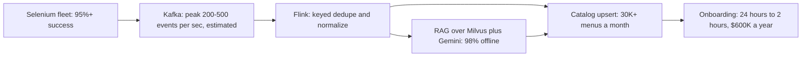

# Uber Menu: Streaming Numbers Explained

<div class="callout note">
<b>How to use this page</b>
<ul>
<li><b>What it covers:</b> every number connected to the Uber Eats Menu pipeline (Kafka, Flink, the RAG path and the scraping fleet), what each one measures, how it is derived, and how to say it out loud.</li>
<li><b>When to read it:</b> right before an interview, as a five-minute numbers drill. For the full architecture, read the Menu deep dive.</li>
<li><b>What to memorise:</b> from 24 hours to 2 hours, $600K a year (from $720K list), 30K+ menus a month (about 1,000 a day), 98% field fidelity in offline evaluation, 95%+ extraction success from an estimated 60 to 65%. Know that 200 to 500 events a second is an estimate for prep only.</li>
</ul>
</div>

This page is a numbers companion. It does not repeat the full design. For that, go to:

1. [Menu deep dive](14_uber_menu_deep_dive.md): architecture, Kafka and Flink explained from scratch, RAG over Milvus, mock questions.
2. [Uber interview packs, Menu section](23b_uber_interview_packs.md): one-minute versions and speakable answers.
3. [Metrics derivations](09_metrics_derivations.md), section 3: the source table for these numbers.
4. Optional older cross-track material, which also discusses Spark and Pinot (not on this PDF): [Menu ingestion project notes](../../final_java_pygo_ia/prep/projects/03_uber_menu_ingestion.md) and [Tech deep dives](../../final_java_pygo_ia/prep/06_tech_deep_dives.md).

## Tags on this page

- **MEASURED**: there is a log, a document or code behind it.
- **TARGET**: a design goal. Say "targeting".
- **ESTIMATED**: arithmetic I can show. Say "roughly, derived from...".
- **HISTORICAL**: from my past work records and resume, not re-measured from logs in this repo.

## A thirty-second refresher on the pipeline

Restaurant menus come in as websites, PDFs and photos. A Selenium fleet fetches them through dynamic proxy pools with adaptive retries. Each fetched menu becomes an event on **Kafka**, a durable log that keeps messages in order per key and lets you replay them. The key is vendor and menu, so one restaurant's events stay in order. **Flink**, a stream processor, reads the events, remembers the last content hash per key (keyed state) to drop duplicates, normalizes fields to the catalog schema, and upserts to the catalog. The upsert is idempotent, meaning running it twice leaves the same result. Unstructured PDFs go through a LangChain RAG path: retrieve similar labelled menus from **Milvus** (a vector database), prompt **Gemini 2.5 Pro**, and validate the output against the schema before writing.



*What to notice:* each box carries the number that belongs to it. The throughput number on Kafka is the only one that is an estimate and not on the PDF.

## The resume numbers, one by one

### From 24 hours to 2 hours (onboarding time)

- **What it measures:** how long a restaurant's menu takes to go from submitted to ready in the catalog.
- **How it is derived:** before and after cycle time, from records (HISTORICAL). 22 of 24 hours saved is about a 92% cut, or twelve times faster.
- **Why it mattered:** a restaurant can go live and start taking orders the same day instead of the next day.
- **Say it like this:** "Onboarding went from 24 hours to 2 hours."
- **Don't say:** a precise percentage like "91.7%". Keep it to the hours.

### $600K a year (savings)

- **What it measures:** annual cost removed by replacing a third-party or manual menu conversion step.
- **How it is derived:** about $2 per menu, times 30,000 menus a month, is $60,000 a month. Times 12 months is $720,000 a year list. I floor it to $600K so I am not quoting the best case.

```text
$2 per menu x 30,000 menus/month = $60,000/month
$60,000/month x 12 months        = $720,000/year (list)
Resume figure (conservative)     = $600,000/year
```

- **Why it mattered:** it is a direct, recurring saving at Uber Eats volume.
- **Say it like this:** "About $600K a year. The vendor tool was roughly $2 a menu, at 30K menus a month that's $720K list, and I quote the conservative $600K."
- **Don't say:** "$720K saved". The list figure is the ceiling, not the claim.

### 30K+ menus a month (volume)

- **What it measures:** menus processed by the pipeline each month (HISTORICAL).
- **How to picture it:** 30,000 divided by 30 days is about 1,000 menus a day. That is a steady daily workload with bursts during fleet runs, not a firehose.
- **Why it mattered:** at this volume, a per-menu vendor cost adds up fast, and manual work does not scale.
- **Say it like this:** "30K-plus menus a month, roughly a thousand a day."
- **Don't say:** "millions of events a day" or "hundreds of millions of transactions".

### 98% field fidelity (offline evaluation)

- **What it measures:** on a hand-labelled test set of menus, the share of extracted fields (item name, price, category and so on) that match the correct answer.
- **A toy example to explain the metric:** a test menu with 10 items and 4 fields per item has 40 fields. If 39 match the labels, that menu scores 97.5%. The 98% is the result across the evaluation set.
- **Why offline matters:** offline evaluation runs on a fixed set, so it is repeatable and lets you compare versions. It is not the same as a live production quality measurement.
- **Say it like this:** "98% field fidelity in offline evaluation."
- **Don't say:** "98% accuracy in production" or present it as an SLA. Older prep also quoted "100% schema consistency". That is not on the current PDF. If asked, say the schema gate rejects anything malformed, so everything that lands is schema-valid by construction.

### 95%+ extraction success (from an estimated 60 to 65%)

- **What it measures:** the share of scrape or extraction attempts that produce a usable menu.
- **How it is derived:** 95%+ is the end point after hardening (HISTORICAL). The 60 to 65% starting point is ESTIMATED.
- **What moved it:** dynamic proxy pools (swap out blocked IP addresses), IP rotation, and adaptive retries with per-source budgets.
- **Why it mattered:** every failed scrape is a restaurant waiting or a manual fallback.
- **Say it like this:** "To 95%-plus, from roughly 60 to 65% before hardening. That starting point is an estimate."
- **Don't say:** "from 60% to 95%" as if the baseline were measured.

## The prep-only throughput estimate

### About 200 to 500 events a second at peak (ESTIMATED, not on the PDF)

- **What it measures:** messages per second flowing through Kafka during a fleet run.
- **How it is derived:** about 1,000 menus a day. Each menu produces many events, not one: item-level events, plus retry and scrape-health events. Fleet runs bunch work into windows instead of spreading it evenly over 24 hours. Put those together and the peak lands in the hundreds per second. Steady state is much lower.
- **Why it matters in an interview:** it shows you can size a system from business volume. It also shows why Kafka helps. Bursts are absorbed by the log, and Flink catches up.
- **Say it like this (only if asked):** "Order of magnitude, a few hundred events a second at peak during fleet runs, much lower at steady state. That's an estimate from the menu volume, not a dashboard number."
- **Don't say:** it as a measured fact, or put it next to 30K menus a month on a resume. The two look inconsistent without the explanation.

## Component table

The table maps each component to the reason it exists and the number tied to it. Rows marked "study only" are not resume claims.

| Component | What it is | Why it is here | Number |
|---|---|---|---|
| Kafka | Durable, partitioned log | Absorbs scrape bursts, replay after a bad deploy, keeps per-vendor order | About 200 to 500 peak events a second (ESTIMATED, prep only) |
| Flink | Stateful stream processor | Keyed dedupe by content hash, event-time ordering, checkpointed recovery | Same peak. Healthy state means consumer lag near zero at steady state. |
| Selenium fleet with proxy pools | Browser automation plus rotating IP addresses | JavaScript-heavy sites, anti-bot defenses | 95%+ success (from an estimated 60 to 65%) |
| RAG over Milvus with Gemini 2.5 Pro | Retrieval-grounded LLM extraction | Multilingual PDFs with no stable structure | 98% field fidelity, offline evaluation |
| Spark (study only, NOT on PDF) | Distributed batch engine | Would be an option for large historical backfills | About 1 to 2 million item rows per typical 90-day window (ESTIMATED, study only) |
| Pinot (study only, NOT on PDF) | Real-time analytics database | Older prep used it for an operational health dashboard idea | Older prep said sub-second queries and detection from hours to minutes. Not a claim. Do not raise it. |

**Words in the table, in one line each.**

- **Consumer lag:** how far behind the newest Kafka message the consumer is. It is the main health signal. Rising lag means processing cannot keep up.
- **Keyed dedupe:** Flink keeps a memory per vendor and menu of the last content hash, and drops exact repeats.
- **Event time:** ordering by when the scrape happened, not when the event arrived, so a late old page cannot overwrite a newer one.
- **Checkpoint:** a periodic snapshot of Flink's state plus Kafka positions, used to recover after a crash.
- **Exactly-once catalog upserts:** in practice, at-least-once delivery plus idempotent writes. Replays are harmless. Never say zero message loss.

## Quick drill

1. *"What does 30K menus a month mean per day?"* About 1,000 a day.
2. *"Walk me through the $600K."* $2 times 30,000 is $60K a month, times 12 is $720K list, floored to $600K.
3. *"Is 98% live?"* No, offline evaluation on a labelled set.
4. *"What was extraction success before?"* Roughly 60 to 65%, and that is an estimate.
5. *"What's your peak throughput?"* A few hundred events a second at peak, estimated, not measured.
6. *"Did you use Spark?"* Not on my resume. I'd consider it for a large historical backfill, but the live pipeline is Kafka and Flink.
