# Project Interview Packs (canonical)

<b>How to use this page</b>
<ul>
<li>This is the front door to the per-project interview packs. Each pack plays a tough interviewer against you, project by project.</li>
<li>Read this page first to pick the right pack for the role, then open the pack.</li>
<li>Memorise the one-line pitch and the "current PDF bullets" for each project below. They are the version to trust if a pack's older headings disagree.</li>
</ul>

Every project on the current PDF (`Tarun_Mittal_SSE_5yr_Java_PyGo_AI.pdf`, Java + Python + Go track) has a pack. A pack is a coaching file with a 30-second and 2-minute explanation, an architecture sketch, the design decisions, a bullet-by-bullet defence, a mock interview, and a "do not say" list. The packs were first generated in July 2026 by pairing an interviewer agent with a candidate agent for each project, and they have been partly re-synced since.

**Tags used here.** MEASURED means there is a log, document or code behind the number. ESTIMATED means arithmetic I can show. HISTORICAL means from my past work records. TARGET means a design goal, so say "targeting".

## Which pack to open

| Project | Pack file | Current PDF bullets it must cover |
|---|---|---|
| Impact Analytics, AssortSmart | [`23a_ia_interview_pack.md`](23a_ia_interview_pack.md) | Agentic: 348k article-seasons, 7 lenses, JSON payloads over 2.11B rows, registry, Ask Iris, 300-case harness and 80% CI gate. Core: Go/Gin 10k peak RPS, KPI formula parser, tenant isolation, 189s to 12s pivots, 170GB OOM fix, ~344k rows/s pump |
| Uber FRM (via EPAM) | [`23b_uber_interview_packs.md`](23b_uber_interview_packs.md), FRM section | 70% faster reconciliation (from 14 days to 3 days), $340M materiality, 19M GL rows, 36 Spring Boot endpoints, 8-table SOADB schema, SHA-256 keys, led 3 engineers on the Spring Data JPA / Hibernate migration, 100% module coverage, 50% delta-variance gates |
| Uber Eats Menu (via EPAM) | [`23b_uber_interview_packs.md`](23b_uber_interview_packs.md), Menu section | From 24 hours to 2 hours, $600K/yr, 30K+ menus/month, 98% field fidelity (offline), Gemini 2.5 Pro + LangChain RAG + Milvus, 95%+ extraction, Kafka + Flink exactly-once upserts |
| Uber Mobility ANZ document compliance | same file, Menu / ANZ section | 99.9% regulatory compliance, 20 hours/week saved, HISTORICAL. This is Uber Mobility (drivers and vehicles), not Uber Eats |
| Masters India (GST e-invoicing) | [`23c_masters_gfg_interview_packs.md`](23c_masters_gfg_interview_packs.md), Masters section | PHP to Spring Boot migration, p95 from 1.2s to 300ms, 1,500+ clients, 700 to 4,000 requests/min, mentored 2, 1M+ submissions/day on Kafka, PostgreSQL sharded by tax quarter, 100K+ idempotent imports, triage -70%, DB reads -30%, coverage 35% to 82%, 98% deploy success |
| GeeksforGeeks | [`23c_masters_gfg_interview_packs.md`](23c_masters_gfg_interview_packs.md), GFG section | PHP to Django migration, 10K+ daily queries, 10x contest spikes, voting / pinning / locking APIs, 20% premium lift, 30% course sales, 70% ops efficiency |

<b>Some pack headings are older than the PDF. Trust the table above.</b>
The FRM pack headings still say "30+ APIs", "11-table" and "targeting 70% (~2 weeks to ~3-4 days)". The current PDF says <b>36 endpoints</b>, an <b>8-table</b> schema (11 is the count of ORM models in code, which is verbal depth), and states <b>70%, from 14 days to 3 days</b> as the outcome. Defend the PDF. If pressed on 70%, say the technical design doc framed that cut and that is what the platform delivered for the close.
The Masters pack mentions "support tickets -35%". That is not on the current PDF. Use triage -70% and DB read load -30%.
The GFG pack says "premium +15-20%". The PDF says <b>20%</b>.
The IA pack's older summary line mentioned 8.5% and one ClickHouse POC. Those are verbal depth (Cluster Copilot and background), not PDF bullets.

## How the projects fit together

Each project is a separate story. The diagram shows which company each story belongs to, so you never mix technologies between them. Notice that Kafka appears twice, at two different companies, for two different products.

```mermaid
flowchart LR
  T["Tarun, 5 years"] --> IA["Impact Analytics: AssortSmart"]
  T --> UB["Uber via EPAM"]
  T --> MI["Masters India"]
  T --> GF["GeeksforGeeks"]
  IA --> IA1["Go/Gin platform + ClickHouse"]
  IA --> IA2["Python AI: LangGraph, Ask Iris"]
  UB --> FRM["FRM: Spring Boot + JPA + MySQL"]
  UB --> MENU["Eats Menu: Kafka + Flink + RAG"]
  UB --> ANZ["ANZ Mobility compliance"]
  MI --> MI1["Spring Boot + Kafka + PostgreSQL"]
  GF --> GF1["Django + MySQL + Redis"]
```

## One-line pitch per project

Say these out loud until they feel natural. Each is the opener you use before diving into a pack.

- **Impact Analytics (AssortSmart).** "I own the Go/Gin platform and the AI decision layer of a retail planning product. The platform handles 10k peak RPS, I cut planner pivots from 189 seconds to 12 seconds with ClickHouse rollups, and I shipped the Ask Iris copilot behind an 80% CI gate."
- **Uber FRM.** "At Uber via EPAM I owned the backend that moved Finance's quarterly risk scoping off Google Sheets into MySQL, cutting reconciliation from 14 days to 3 days against a $340M materiality threshold, and I led 3 engineers on the Spring Data JPA / Hibernate migration."
- **Uber Eats Menu.** "I worked on menu ingestion that turns multilingual PDF menus into catalog data with Gemini and RAG, at 98% field fidelity in offline evaluation, cutting restaurant onboarding from 24 hours to 2 hours."
- **Uber Mobility ANZ.** "I automated driver and vehicle document checks against local authority rules with a deterministic validation backend, reaching 99.9% compliance and removing about 20 hours a week of manual work." (HISTORICAL.)
- **Masters India.** "I led the move from a PHP monolith to Spring Boot microservices for a GST e-invoicing product, cutting p95 latency from 1.2 seconds to 300 milliseconds, and worked on a Kafka pipeline handling over a million government submissions a day."
- **GeeksforGeeks.** "I migrated the doubt-support backend from PHP to Django so it handled 10K+ daily queries and 10x spikes during live contests, and built the influencer earnings dashboard."

## The two questions every pack will throw at you

**"What exactly did you own versus the team?"**
Start with the direct answer: name the bullets you owned. Then name what you did not own. At Uber FRM, the HFM extract pipeline was shared and the real-time collaboration and Slack notification service was built by others. At Impact Analytics, the Postgres-to-ClickHouse CDC pipeline was a colleague's work. Saying what you did not own makes everything else you say more believable.

**"How do you know that number is real?"**
Give the measurement source in one sentence, then the arithmetic. For example: "The 15.5x is 189 seconds divided by about 12.3 seconds on a 250-million-row benchmark harness." Or: "The $600K is about $2 per menu times 30K menus times 12 months, which is $720K, and I round down to $600K to be conservative." The full derivations live in [`09_metrics_derivations.md`](09_metrics_derivations.md) and [`18_resume_number_catalog.md`](18_resume_number_catalog.md).

## Study order

1. [`GROUND_TRUTH.md`](GROUND_TRUTH.md): the locked facts for this track.
2. [`31_resume_deep_explain_map.md`](31_resume_deep_explain_map.md): every bullet explained.
3. The pack for the role you are interviewing for (table above).
4. The deep dive for that project: [`10_impact_analytics_deep_dive.md`](10_impact_analytics_deep_dive.md), [`11_uber_frm_deep_dive.md`](11_uber_frm_deep_dive.md), [`12_masters_gfg_deep_dive.md`](12_masters_gfg_deep_dive.md) or [`14_uber_menu_deep_dive.md`](14_uber_menu_deep_dive.md).
5. STAR stories: [`07_behavioral_star_stories.md`](07_behavioral_star_stories.md).

## Stack note for this track

On this track (Java, Python and Go), Uber FRM is Java and Spring Boot with Spring Data JPA and Hibernate on MySQL, and Masters India is Spring Boot microservices with Hibernate. Impact Analytics platform APIs are Go/Gin, the IA agent plane is Python (FastAPI, LangGraph), Uber Menu is Python, and GeeksforGeeks is Django. Always say Spring Boot and Spring Data JPA / Hibernate for FRM, and Spring Boot for Masters India.
