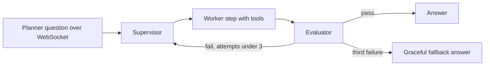
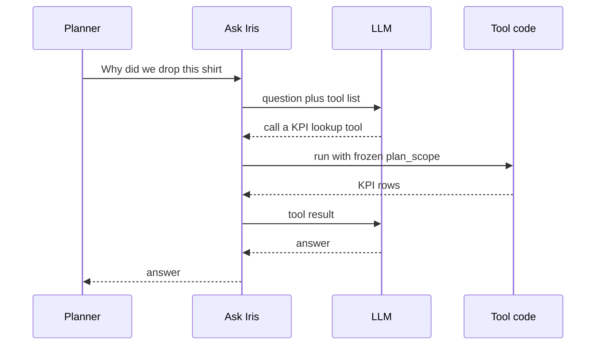

# Final resume: Generative AI skills defense

<div class="callout highlight">
<b>How to use this page</b>
<ul>
<li>It explains every item in the <b>Generative AI</b> line of the skills section on <code>Tarun_Mittal_SSE_5yr_Java_PyGo_AI.pdf</code>, in plain English, and says exactly where I used it.</li>
<li>Read it before any AI, LLM or agents interview, or when a recruiter asks "have you used X?".</li>
<li>Memorise the summary table and the "Do not say" list. The level column tells you whether to say "I shipped this" or "I know how this works".</li>
</ul>
</div>

**The PDF skills line, Generative AI:** LangGraph, LangChain, RAG, Milvus, pgvector, LLM Agents (OpenAI/Gemini/Claude), Tool Calling, MCP, Prompt Engineering, LangSmith, Offline Evaluation.

The other skills categories are Languages, Backend and APIs, Data and Streaming, Databases and Storage, Cloud and DevOps, and Architecture and Core Concepts. A short honesty table for those is at the end. For a plain-English entry on every technology, see the [tech glossary](../handbook/09_tech_glossary.md). Canonical claims: [ASSORTSMART_TAB_RESUME](../../docs/ASSORTSMART_TAB_RESUME.md).

<div class="callout note">
<b>Update from older prep.</b> Older versions of this page said "MCP is not on this PDF". It is now. The current skills line lists both <b>Tool Calling</b> and <b>MCP</b>. They are skills-level claims. Neither is an Impact Analytics PDF bullet. The deepest tool-design story (the Cluster Recommendation Copilot's 14 audited tools) is verbal depth only.
</div>

## Levels, explained once

| Level | What it means | How to phrase it |
|---|---|---|
| **PDF BULLET** | The skill appears inside an experience bullet on the PDF. I shipped it. | "I built..." |
| **SHIPPED, NOT A BULLET** | It is in shipped code I worked on, but no PDF bullet names it. | "In that system, the way it works is..." |
| **DESIGN** | It is in a design I wrote for a project that is not shipped. | "In the design I'm building..." |
| **LITERACY** | Skills-level. I understand it and can reason about it, but I do not claim production ownership. | "I know how it works and when I would pick it." |

## Summary table

| Skill | In plain English | Where I used it | Level |
|---|---|---|---|
| **LangGraph** | A library for building LLM workflows as a graph of steps, with loops and hard limits. | Ask Iris supervisor and 3-attempt evaluator (Impact Analytics). Also a small bounded tool loop in the Keep/Drop peer step. | PDF BULLET (Ask Iris) |
| **LangChain** | A toolkit of building blocks for LLM apps: loaders, retrievers, prompt templates. | Uber Menu RAG pipeline. LangChain Academy certificate. | PDF BULLET (Menu) |
| **RAG** | Look up relevant examples first, then ask the LLM with those examples in the prompt. | Uber Menu extraction, 98% field fidelity in offline evaluation. | PDF BULLET (Menu) |
| **Milvus** | A database that finds "similar" items by comparing embeddings. | Uber Menu only. | PDF BULLET (Menu) |
| **pgvector** | A Postgres extension that adds vector similarity search. | Not used in production. | LITERACY |
| **LLM Agents (OpenAI/Gemini/Claude)** | An LLM that runs multi-step work: decide, act, check. The brackets list provider APIs. | Keep/Drop lenses and Ask Iris (OpenAI models at Impact Analytics, names off PDF). Gemini 2.5 Pro at Uber Menu. Claude is provider familiarity. | PDF BULLET (IA, Menu) |
| **Tool Calling** | The LLM asks to run a named function with typed arguments. Our code runs it and returns the result. | Ask Iris tools inherit the frozen user scope. Keep/Drop peer step has a 2-call batch tool budget. Copilot design has 14 audited read-only tools. | SHIPPED, NOT A BULLET. Copilot is DESIGN |
| **MCP** | Model Context Protocol, an open standard for exposing tools to any LLM client the same way. | Skills-level. The Copilot design hosts its read-only tools over MCP. | LITERACY, plus DESIGN |
| **Prompt Engineering** | Designing prompts and output schemas so the model returns exactly the structure you need. | Lens, decider and explanation prompts at Impact Analytics. Schema-shaped extraction at Uber Menu. | PDF BULLET (structured LLM invokes) |
| **LangSmith** | A tracing tool that records every LLM step, prompt, tool call and token count. | Ask Iris only. | PDF BULLET (Ask Iris) |
| **Offline Evaluation** | Test the model on a labelled set before it ships, like unit tests for AI behaviour. | 300-case set with an 80% CI gate, the gold-200 benchmark, Menu 98% fidelity. | PDF BULLET (IA A5, Menu) |

---

## LLM Agents (OpenAI / Gemini / Claude)

**What it is.** An "agent" is an LLM used in a loop: it reads the situation, decides what to do, maybe calls a tool, checks the result, and continues until done. Think of a junior analyst with a checklist and a phone, who can call specific people but has to report back after each call. The brackets on the PDF are the provider APIs I am comfortable with.

**How it works (what matters in interviews).**
1. Each step is one model call with a prompt, some context and, often, a required output schema.
2. Control flow is either fixed in code ("always do A then B") or chosen by the model ("decide which tool next"). Fixed is safer and cheaper. Model-chosen is more flexible.
3. Every loop needs a hard stop: a maximum number of attempts or a recursion limit.
4. Cost and latency grow with the number of calls, so batch work should minimise model-chosen hops.

**Where I used it.**
- **Keep/Drop, Missed Opportunities, Top Style (Impact Analytics).** The batch order is fixed in code: peer, then decider, then lenses, then blend, then explain. There is no LLM orchestrator. Each step is a structured LLM call over a batch of articles. The final score blends rules and the LLM: s_final = 0.4 × s_det + 0.6 × s_agent, keep if s_final ≥ 0.55.
- **Ask Iris (Impact Analytics).** A LangGraph supervisor routes the planner's question to workers, and an evaluator checks the answer, up to 3 attempts.
- **Uber Menu.** Gemini 2.5 Pro extracts menus into the catalog schema.
- **Providers.** OpenAI models at Impact Analytics (the benchmark compared two of them, names not on the PDF). Gemini at Uber. Claude is provider familiarity: I know its API style, but no PDF bullet names it.

**Why there.** Keep/Drop needs qualitative judgement (is this trend real, is this item a niche hit?) that pure KPI math misses. But math must stay exact, so rules compute KPIs and the LLM only judges.

**Interview question.** *"Why not let one agent decide everything?"*
"Because a batch of 88 thousand items cannot afford model-chosen control flow. Every extra hop is cost, latency and another chance to fail. So the order is fixed in code, the rules do the arithmetic, and the model only scores structured lenses. In the chat product, Ask Iris, the model does route, but under a supervisor with a three-attempt cap."

**Do not say.** "Autonomous agents that write to production." "Seven agents debating." Claude as a production provider on a bullet.

---

## LangGraph

**What it is.** LangGraph is a Python library for building LLM workflows as a graph. Nodes are steps (call the model, run a tool, check a result). Edges decide what runs next. A shared state object travels through the graph. It is like a flowchart that actually runs, with loop counters built in.

**How it works.**
1. You define a state (for example: question, scope, draft answer, attempt count).
2. You add nodes and conditional edges ("if the evaluator says fail and attempts < 3, go back to the supervisor").
3. A recursion limit stops runaway graphs.
4. A `ToolNode` runs whatever tool the model asked for and feeds the result back.

A tiny example of the Ask Iris shape:

```python
MAX_ATTEMPTS = 3

def route_after_eval(state):
    if state["verdict"] == "pass":
        return "respond"
    if state["attempts"] >= MAX_ATTEMPTS:
        return "graceful_fallback"
    return "supervisor"

graph.add_node("supervisor", supervisor)
graph.add_node("evaluator", evaluator)
graph.add_conditional_edges("evaluator", route_after_eval)
```



What to notice: there is no path that loops forever. The third failure exits.

**Where I used it.** Ask Iris (PDF bullet A4). In Keep/Drop, a small bounded LangGraph tool loop runs the peer step's tool calls. The Keep/Drop batch itself is plain Python in a fixed order.

**Why LangGraph and not a plain chain.** Ask Iris needs a loop (evaluate, retry) with a hard cap and shared state. A linear chain cannot express "go back up to twice". Hand-written loops work too, but LangGraph gives the cap, the state and LangSmith tracing for free.

**Alternatives.** Plain Python control flow (best when the order is fixed, which is why Keep/Drop uses it). Temporal or Airflow for long-running durable workflows (heavier infrastructure).

**Interview question.** *"How do you stop infinite agent loops?"*
"Two caps. The evaluator gets at most three attempts, and the supervisor graph has a recursion limit. On the third failure we return a graceful answer instead of another tool hop."

**Do not say.** LangGraph runs the Keep/Drop batch order. It does not.

---

## LangChain

**What it is.** LangChain is a toolkit of building blocks for LLM apps: document loaders, text splitters, embedding wrappers, retrievers, prompt templates. Think of it as a box of Lego pieces for wiring a RAG pipeline quickly.

**How it works.** You load documents, split them into chunks, embed the chunks, store them in a vector database, and at query time retrieve the closest chunks and put them into a prompt template.

**Where I used it.** Uber Menu: LangChain glued the RAG pipeline that fed Gemini 2.5 Pro with similar labelled menus from Milvus (PDF bullet M1). I also hold the LangChain Academy certificate.

**Why there.** It provides ready-made loaders, retrievers and prompt templates, which keeps the custom work focused on the schema and evaluation.

**Alternatives.** LlamaIndex (strong for document indexing), or plain SDK calls (fewer abstractions, more code).

**Interview question.** *"LangChain or LangGraph?"*
"LangChain gives you the pieces: retrievers, templates, loaders. LangGraph gives you control flow with state and loops. At Uber I used LangChain for a retrieval pipeline. At Impact Analytics I used LangGraph where I needed a supervisor and a capped evaluator loop."

---

## RAG (Retrieval-Augmented Generation)

**What it is.** Before asking the LLM a question, you look up relevant reference material and put it in the prompt. It is an open-book exam instead of a closed-book one.

**How it works.**
1. **Index:** split reference documents into chunks and turn each chunk into an embedding (a list of numbers that captures meaning).
2. **Retrieve:** embed the new input and find the nearest chunks.
3. **Generate:** send the input plus retrieved examples to the LLM with clear instructions and an output schema.
4. **Validate:** check the output against the schema before using it.

An illustrative walk-through:

```text
New multilingual menu PDF
  -> embed the text
  -> Milvus: find the most similar menus we already labelled
  -> prompt Gemini 2.5 Pro: "Here are labelled examples. Extract this menu into the catalog schema."
  -> validate against strict catalog schema
  -> catalog upsert
```

**Where I used it.** Uber Menu, PDF bullet M1. It reached 98% field fidelity in offline evaluation.

**Why there.** Menus are messy and multilingual. Showing the model similar, correctly labelled menus helps it map odd layouts to our schema.

**Alternatives.** Fine-tuning a model on labelled menus (more cost and upkeep, and not a PDF claim). Rule-based parsers per template (break on every new layout).

**Interview question.** *"How did you evaluate the RAG pipeline?"*
"Offline, against labelled menus. We measured field fidelity: did each field, like name, price or modifier, come out right. It was 98% on that set. I always say offline evaluation, because that is what it is."

**Do not say.** RAG at Impact Analytics. Keep/Drop is not document RAG. It is structured JSON scoring.

---

## Milvus

**What it is.** Milvus is a vector database. It stores embeddings and quickly finds the nearest ones to a query embedding. Like a librarian who finds books "about the same thing" even when the titles differ.

**How it works.** It builds an approximate nearest-neighbour index (for example HNSW, a graph of neighbours, or IVF, clustered buckets), so a search does not compare against every vector.

**Where I used it.** Uber Menu only, as the store for labelled menu embeddings in the RAG pipeline.

**Why there.** It held the embeddings of labelled menus, so the retriever could find similar examples quickly for each new menu.

**Alternatives.** pgvector (simpler if you already run Postgres and the set is modest), managed vector services.

**Do not say.** Milvus at Impact Analytics, or Milvus as a privacy or isolation store.

---

## pgvector

**What it is.** A Postgres extension that adds a vector column type and similarity search. It lets you keep embeddings next to normal rows in the same database.

**Where I used it.** Not in production. It is on the skills line as literacy.

**When I would pick it.** When the vector set is small to moderate, the team already runs Postgres, and you want joins between vectors and normal tables. I would pick Milvus or a managed service at large scale or high query rates.

**Interview question.** *"pgvector or Milvus?"*
"pgvector if the data is modest and already in Postgres, because you avoid another system. Milvus when the vector set is large or search load is high. At Uber Menu we used Milvus. I have not run pgvector in production."

---

## Tool Calling

**What it is.** Tool calling (also called function calling) lets an LLM ask your code to run a named function with typed arguments. The model never runs anything itself. It says "please call `get_scope_benchmarks` with these arguments", your code checks and runs it, and the result goes back to the model. Think of a pilot asking the tower for permission. The tower decides.

**How it works.**
1. You describe each tool to the model: name, purpose, and a JSON schema for the arguments.
2. The model replies with a tool call instead of text.
3. Your code validates the arguments, runs the function, and returns the result.
4. You cap how many tool calls are allowed per request.

A generic example of a tool contract (teaching example, not copied from the repo):

```python
tools = [{
    "name": "get_article_kpis",
    "description": "Return KPIs for one article within the planner's current scope.",
    "parameters": {
        "type": "object",
        "properties": {"article_id": {"type": "string"}, "season_code": {"type": "string"}},
        "required": ["article_id", "season_code"],
    },
}]
# The tool reads plan_scope from the frozen session, never from model arguments.
```



What to notice: the user's data scope is set by the server at handshake, not by the model's arguments. A prompt cannot widen it. (Illustrative flow. The tool name is generic.)

**Where I used it.**
- **Ask Iris.** Tool calls inherit the hierarchy scope (`plan_scope`) frozen at the JWT WebSocket handshake. A later message cannot pivot into another tenant's data.
- **Keep/Drop peer step.** The pipeline doc shows a peer-benchmark step with a budget of 2 tool calls per batch, using allowlisted batch tools (`get_sibling_colours_batch`, `get_scope_benchmarks_batch`) that each return data for the whole batch in one query. These are fixed functions we wrote. The model never writes SQL.
- **Cluster Recommendation Copilot (verbal only, DESIGN).** 14 audited tools that only read planning data, with 3 gates before any write-back through the existing product write path. Clustering failure baseline measured at 8.5% (37 of 437), targeting under 2%. It is being built, not shipped.

**Why it matters.** Tool calling is how you give a model data without giving it a database shell. You control what each tool can read, how many calls it gets, and whose data it sees.

**Alternatives.** Pre-packing context as JSON with no tools at all. That is what the Keep/Drop lenses do, because it is cheaper and safer at 88k items per pass.

**Interview question.** *"How do you keep tool calls safe in a multi-tenant product?"*
"The model only picks a tool and fills typed arguments. The server owns identity and scope. In Ask Iris, the hierarchy scope is frozen when the socket opens and every tool reads it from the session, not from the model. Tools are allowlisted functions, not free-form SQL, and calls are capped."

**Follow-up they may ask:** *"Is tool calling on your resume as a bullet?"* "It is on my skills line. The bullets describe the systems. If you want, I can walk through how the Ask Iris tools are scoped."

**Do not say.** "The LLM queries ClickHouse." "The agent writes SQL." Do not present the Copilot's 14 tools as shipped.

---

## MCP (Model Context Protocol)

**What it is.** MCP is an open protocol for exposing tools and data to LLM applications in a standard way. An MCP server publishes a list of tools with schemas. Any MCP-capable client (an IDE assistant, a chat app, an agent) can discover and call them over a JSON-RPC style connection. Think of it as USB for AI tools: build the tool once, plug it into any compatible client.

**How it works.**
1. A **server** declares tools (name, description, input schema) and optionally resources and prompts.
2. A **client** connects, lists the tools, and passes them to its model.
3. When the model asks for a tool, the client sends the call to the server and returns the result.
4. Auth, scoping and audit still belong to the server. MCP standardises the plumbing, not the permissions.

**Where I used it.** Skills-level. The Cluster Recommendation Copilot design hosts its audited read-only tools over MCP (verbal only, DESIGN). It is not an Impact Analytics PDF bullet.

**Why it is a fit there.** If several clients (a copilot UI, internal tools) need the same planning tools, MCP lets them share one audited tool server instead of each re-implementing tools.

**Alternatives.** Plain in-process tool calling (simplest when one app owns the tools, which is how Ask Iris works). A normal REST API that a tool wrapper calls.

**Interview question.** *"What's the difference between tool calling and MCP?"*
"Tool calling is the model asking to run a function. MCP is a protocol for how tools are published and called across processes, so any compatible client can use the same tool server. You still need tool calling underneath. MCP just standardises discovery and transport. Permissions and audit stay in the server."

**Do not say.** "I shipped an MCP server in production at Impact Analytics." Say it is skills-level and part of the Copilot design.

---

## Prompt Engineering

**What it is.** Designing the instructions, examples, context and output format you give an LLM so it reliably returns what you need. It is writing a very precise brief for a contractor who will do exactly what the brief says.

**How it works (the ideas that matter).**
1. **Structured outputs.** Ask for JSON that matches a schema, and validate it. Reject or retry anything that does not parse.
2. **Minimal context.** Give each prompt only the fields it needs. Less noise, fewer tokens.
3. **Separate prompts per task.** One prompt per lens, one for the decider, one for explanations, each versioned.
4. **Cite the data.** Require the model to reference the numbers it was given, so explanations are grounded.

**Where I used it.**
- **Impact Analytics Keep/Drop.** Separate prompts for base, each lens, the decider, explanations, Top-N taglines and the peer step, managed through a prompt registry. Each lens gets a compact feature set with only the fields it needs (for example only the last 12 weeks for trend lenses). Lenses must cite the computed sales momentum fields. Prompts are part of the frozen config hash, so every output row records which prompt version produced it.
- **Uber Menu.** Schema-shaped extraction prompts with retrieved labelled examples.

**Illustrative shape of a structured lens output** (the pipeline stores per-lens score, outcome and confidence. The other values here are made up for teaching.)

```json
{
  "article_id": "A-10293",
  "lens": "trend_velocity",
  "score": 0.72,
  "outcome": "keep",
  "confidence": 0.8,
  "evidence": ["sales_momentum.last_4w_vs_prior_4w = +18%"]
}
```

**Interview question.** *"Prompt engineering or fine-tuning?"*
"Prompt engineering first, with strict schemas and offline evaluation. It is cheaper to change and every version is tracked in the config hash. I would only consider fine-tuning if a well-evaluated prompt plateaued below the bar. Fine-tuning is not something I claim on this resume."

**Do not say.** Fine-tuning or SFT as a resume claim.

---

## LangSmith

**What it is.** LangSmith is a tracing and debugging tool for LLM apps. Every run becomes a tree: which node ran, which prompt, which tool call, how many tokens, how long, and what failed. Like a flight recorder for your agent.

**Where I used it.** Ask Iris only (PDF bullet A4).

**Why there.** When a chat answer is wrong, you need to see which step went wrong: supervisor routing, a tool result, or the evaluator. Datadog shows which service was slow. LangSmith shows which prompt step failed.

**What Keep/Drop uses instead.** Custom JSON telemetry in the orchestration registry: tokens, USD cost, step duration and batch fallbacks per run, plus the frozen config hash on every output row.

**Interview question.** *"Why both Datadog and LangSmith?"*
"They answer different questions. Datadog traces the Go platform: which service, which request, how long. LangSmith traces the LLM graph in Ask Iris: which step, which prompt, which tool. One tool for both would do neither well."

**Do not say.** LangSmith on the Keep/Drop batch or on the orchestration registry.

---

## Offline Evaluation

**What it is.** Testing model behaviour against a labelled set before release, instead of discovering problems in production. It is unit tests for AI: a fixed set of inputs, expected answers, and a pass mark.

**How it works.**
1. Build a labelled set (gold set). For Keep/Drop, labels are a proxy for real outcomes, because true answers are only known after the season.
2. Run the candidate model or prompt on the set.
3. Compare against a baseline that costs nothing, such as the rule-only score.
4. Block promotion in CI if it misses the bar.

The real gate config looks like this:

```json
{ "gold_min_accuracy": 0.8 }
```

**Where I used it.**
- **Impact Analytics, PDF bullet A5.** A 300-case proxy set with an 80% accuracy CI gate. A separate gold-200 benchmark picked a model 73% cheaper at 100% coverage, and showed the rule-only baseline at 74%. The blended LLM scored about 63% there, below 74%, so we froze the blend weights instead of retuning them on a small set. In v2 of the pipeline, offline evals replaced the critic and evaluator agents that used to run inside Keep/Drop.
- **Uber Menu.** 98% field fidelity in offline evaluation.

**Why it matters.** It lets you say no to a model with evidence. "The new model looks smarter" is not a reason to ship if it loses to a free rule.

**Interview question.** *"What did you do when the LLM did worse than the rules?"*
"We did not ship a smarter-looking model that lost to a free baseline. On the 200-case benchmark the rules scored 74% and the blend scored lower, so we froze the blend weights. Promotion still needs 80% on the 300-case gate."

**Do not say.** "80% accuracy in production for all tenants." "The 300 cases showed the 73% saving." Human review queues for low-confidence scores (there are none in this repo).

---

## One-liners to memorise

- **Agents:** "Keep/Drop blends rule-based KPI math with structured LLM lenses in a fixed order. Ask Iris is a shipped LangGraph copilot with a supervisor, a three-attempt evaluator and a frozen data scope."
- **Tool calling:** "The model picks a tool and fills typed arguments. The server owns scope. No SQL from the model."
- **MCP:** "A standard way to publish tools to any LLM client. Skills-level for me, and part of the Copilot design."
- **Offline evaluation:** "80% is a CI promotion gate on 300 cases, not live accuracy. The 73% cost cut and 74% baseline are from a separate 200-case benchmark. Menu 98% is offline."
- **Observability:** "LangSmith for Ask Iris, custom JSON telemetry for the batch registry, Datadog for the Go edge."

## Do not say

- That MCP or Tool Calling is an Impact Analytics experience bullet. They are on the skills line.
- That you shipped an MCP server in production.
- Fine-tuning or SFT as a resume claim.
- The Cluster Recommendation Copilot or Hindsight as resume bullets, or the Copilot as shipped.
- pgvector as production. It is literacy.
- Milvus, RAG, Kafka or Flink at Impact Analytics.
- LangSmith on the Keep/Drop batch.
- Human-in-the-loop review queues on Keep/Drop.

---

## Other skills-line items: honesty levels

| Skill | Level | One-line explanation |
|---|---|---|
| C, C++ | LITERACY | Skills-level. No production C or C++ claim. |
| gRPC | LITERACY | A binary RPC framework over HTTP/2 with typed contracts. I know when to pick it over REST. No production ownership claim. |
| DynamoDB | LITERACY | AWS key-value and document database. Skills-level. |
| Kubernetes | LITERACY | Container orchestration. Skills-level. No claim of operating clusters. |
| Kafka, Flink | PDF BULLET | Uber Menu (Kafka and Flink) and Masters India (Kafka). Never Impact Analytics. |
| ClickHouse, BigQuery | PDF BULLET | Impact Analytics. |
| Java, Spring Boot | PDF BULLET | Java is a compiled, statically typed language on the JVM. Spring Boot is the Java framework for building web services with sensible defaults. Uber FRM (36 Spring Boot endpoints) and Masters India (PHP monolith to Spring Boot microservices). |
| Spring MVC | Skills line | The web layer inside Spring Boot: `@RestController`, `@GetMapping`, `@PatchMapping`, request binding. It is the layer the FRM and Masters endpoints are written in. |
| Spring Data JPA, Hibernate | PDF BULLET | JPA is the Java standard for mapping classes to tables. Hibernate is the implementation, and Spring Data JPA adds repository interfaces on top. Uber FRM (the Spring Data JPA / Hibernate migration with 3 engineers) and Hibernate on the Masters India tech line. |
| Spring Security | Skills line | Spring's authentication and authorization layer (filters, JWT validation, method-level access rules). It fits at the edge of services like FRM and Masters. Skills-level, with no separate outcome claimed. |
| Spring Batch | Skills line | Spring's framework for chunked, restartable bulk jobs (read, process, write in chunks with job state). It fits bulk imports like the Masters e-invoicing uploads. Skills-level, with no separate outcome claimed. |
| JUnit | TECH LINE (FRM) | JUnit 5 is the Java test framework, usually paired with Mockito for test doubles and MockMvc for controller tests. The FRM tests behind the 100% module statement coverage run on it. |
| Maven | Skills line | The standard Java build and dependency tool. FRM itself builds with Bazel, which is Uber's build system. |
| Amazon S3 | Skills line | AWS object storage for files and blobs. Skills-level. |
| FastAPI | TECH LINE (IA) | Python web framework. It runs the Ask Iris WebSocket service in the Impact Analytics agent plane. |
| Pydantic | Skills line | FastAPI's typed validation library. Skills-level, with no separate outcome claimed. |
| Celery, asyncio | Skills line | Celery is a Python background task queue. asyncio is Python's async IO library, which FastAPI runs on. Both are skills-level here, with no separate outcome claimed. |
