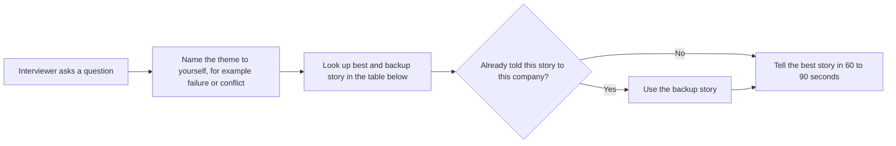

# Behavioral prep grid: question type by project

**Track:** Final Java + AI (IA = Py/Go). **Resume PDF:** `Tarun_Mittal_SSE_5yr_Java_PyGo_AI.pdf`

<b>How to use this page</b>
<ul>
<li>This is a one-page drill sheet. When an interviewer asks a behavioral question, it tells me which story to tell and which number to say.</li>
<li>Read it right before a behavioral round, after I've studied the full stories once.</li>
<li>Memorise the first table: question type, best story, backup story. The full stories are in <a href="07_behavioral_star_stories.md">STAR stories</a>, and all the common questions are in the <a href="39_behavioral_question_bank.md">question bank</a>.</li>
</ul>

**Stack wording on this track.** Uber FRM is Java with Spring Boot, Spring Data JPA and Hibernate. Impact Analytics platform APIs are Go with the Gin framework, and the AI agent side is Python (FastAPI and LangGraph). Masters India is Spring Boot microservices.

**What the tags mean.** MEASURED means there is a log, document or code behind the number. TARGET means a design goal. ESTIMATED means arithmetic I can show. HISTORICAL means it comes from past work records. "Verbal only" means I can talk about it but it is not a resume bullet.

---

## How to pick a story in the moment

*What to notice:* the only check that matters in the moment is "have I used this story already in this loop?" Plan 2 or 3 stories before the loop so this is easy.

---

## The main table: question type to story

The story numbers match the [STAR stories page](07_behavioral_star_stories.md).

| Question type | What they're really testing | Best story | Backup story | Number to say |
|---|---|---|---|---|
| Ownership | Did you own an outcome end to end? | 8. Masters India migration | FRM reconciliation version 2 (in [why switch](13_behavioral_why_switch.md)) | From 1.2 seconds to 300 milliseconds p95 |
| Disagreement or conflict | Can you disagree well and then commit? | 1. The ClickHouse decision | 7. The rulebook disagreement | Mutation queue at zero at 10 times scale (from my notes) |
| Conflict with a manager | Can you push back upward respectfully? | 7. The rulebook disagreement, framed upward | 1. The ClickHouse decision | None needed |
| Failure or mistake | Do you own mistakes and fix the system? | 5. The "pure refactor" that wasn't | 10. The double-filing near-miss | 31 files, zero test changes after the fix |
| Dive deep or debugging | Can you find a non-obvious root cause? | 6. Coverage that lied | 11. The connection leak (prep story, not a resume bullet) | From 34.6% to 100% module coverage |
| Hardest technical problem | Depth, and how you reason under constraints | 12b. The weekly rollup out-of-memory problem | 3. The malformed-plan validator (verbal only) | 170GB, sliced to one fiscal week per insert |
| Deadline or pressure | Do you deliver without cutting corners? | 8. Masters India migration | Holding the 80% CI gate at Impact Analytics | No outage during deadline windows |
| Customer focus | Do you start from the user's pain? | 4. Inverting the clustering workflow (verbal only) | 9. The anti-bot arms race | From 24 hours to 2 hours onboarding (Menu) |
| Mentorship or leadership | Do you grow other people? | Led 3 at Uber via EPAM (in [why switch](13_behavioral_why_switch.md)) | Mentored 2 at Masters India | 3 and 2. Never merge them |
| Initiative or bias for action | Do you act without being told? | 12. The ClickHouse RFC and migration | The Go data pump (in [why switch](13_behavioral_why_switch.md)) | From 189 seconds to 12 seconds |
| Ambiguity | Can you make progress with unclear inputs? | 1. The ClickHouse decision | 2. The ingestion lane design (written, not executed) | Three measurable gates |
| Integrity or ethics | Do you do the right thing when nobody is watching? | 10. The double-filing near-miss | Freezing the blend weights instead of retuning (Impact Analytics) | Zero duplicate filings after rollout |
| Most proud of | What do you value? | 1. The ClickHouse decision | 12. The ClickHouse RFC and migration | 15.5 times faster pivots |

Stories 1 and 12 are the same ClickHouse decision from two angles. Use only one of them per company.

---

## The project grid: one example per project for each theme

Use this when they say "give me an example from your time at Uber" or "anything from Masters India?" A dash means I don't have a strong example there, so pick another project.

| Theme | Impact Analytics | Uber FRM | Uber Menu | Masters India | GeeksforGeeks |
|---|---|---|---|---|---|
| Ownership | Go/Gin platform at 10k peak RPS. Shipped Ask Iris. Built the 300-case evaluation harness | Owned the backend: 36 endpoints, $340M threshold, led 3 | Selenium, Kafka and Flink pipeline. From 24 hours to 2 hours. About $600K a year | Spring Boot migration. 1M+ submissions a day. Mentored 2 | PHP to Django migration |
| Disagreement | Story 1 | Story 7 | Dash | Sequencing the migration (Story 8) | Dash |
| Failure | Story 11 (prep only) or Story 12b | Story 5 | Early losses to bot defences (Story 9) | Story 10 | Dash |
| Dive deep | Keeping the LLM away from 2.11B rows. Division-by-zero guard in the formula parser | Story 6 | Block-rate metrics (Story 9) | Idempotency keys (Story 10) | Dash |
| Deadline | Holding the 80% gate under shipping pressure | Quarterly close timelines with Finance and PwC | Partner onboarding expectations (keep qualitative) | Freezing cutovers in GST deadline weeks | Dash |
| Customer | Ask Iris access scope frozen at connection time | PwC and Finance materiality needs | Multilingual menus | 1,500+ enterprise filers | Dash |
| Mentorship | Dash | Led 3 | Dash | Mentored 2 | Dash |
| Initiative | ClickHouse PoC and the KPI formula parser | Reconciliation moved to MySQL on SOADB | Strict catalog schema checks | Idempotency keys and dead-letter queue | Dash |
| Ambiguity | Story 1. Deciding what to do when the blend scored below the 74% baseline | Turning materiality rules into code | Sources that actively fight back | Peak traffic during a migration | Dash |
| Ethics | A promotion gate instead of shipping on gut feel | Audit reproducibility | Low-confidence review idea (design idea only) | Story 10 | Dash |
| Why it matters | Protecting a 2.11B-row table from bad AI writes | Finance's system of record | About $600K a year saved | Government compliance filings | Learning and growth |

### What the less obvious cells mean

**Impact Analytics, Ownership.** The Go platform is a multi-tenant API built with Go and the Gin framework. "Multi-tenant" means many retail clients share it, with their data kept apart. It handles 10k peak requests per second. Ask Iris is a shipped copilot where planners ask about their KPIs over a secure WebSocket connection. The 300-case harness is a fixed test set every model change runs against. A related claim, 100% Go statement coverage with 1,200+ tests, is from LinkedIn and verbal. It is not on the PDF.

**Impact Analytics, Dive deep.** The AI never queries the 2.11-billion-row ClickHouse table. It gets prepared JSON context, and if the LLM times out, the system falls back to the deterministic baseline score. In the KPI formula parser, every user-written formula is wrapped in `ifNotFinite(toFloat64(expr), 0)`, so dividing by zero returns 0 instead of breaking the query.

**Impact Analytics, Deadline and Ethics.** The 80% CI gate means a model change must hit 80% accuracy on the evaluation set before it can be promoted. Holding that gate, even under pressure to ship, is the example. "Vibe-shipping" (shipping because it looks good in a demo) is what the gate prevents.

**Impact Analytics, Ambiguity.** On a separate 200-case gold benchmark, the deterministic baseline scored 74%. The blended LLM score came in at about 63%, below that baseline. So we froze the blend weights instead of retuning them to chase the benchmark. That was a judgment call with no perfect answer.

**Impact Analytics, Customer.** In Ask Iris, the user's access scope (which part of the product hierarchy they may see) is fixed when the WebSocket connection opens. That prevents one client's planner from ever seeing another client's data mid-conversation.

**Uber FRM, Deadline and Customer.** FRM supports Uber Finance's quarterly close, with PwC as a user of the process. Older prep wrote "PwC trains" here without explanation. Keep it qualitative: the deadlines were the quarterly close calendar. The $340M materiality threshold is the line that decides which items matter enough to scope.

**Uber FRM, Initiative.** SOADB is Uber's standard service-owned MySQL setup. Moving reconciliation from Google Sheets to MySQL there (reconciliation version 2) was work I owned end to end.

**Uber Menu, Ethics.** "Low-confidence review" means routing extractions the model is unsure about to a check before they reach the catalog. In my prep it is a design idea. Don't claim it shipped. The 98% field fidelity is from offline evaluation.

**Masters India, Disagreement.** The disagreement was about order: what to migrate first. I argued for read paths and bulk background paths before interactive filing, and for freezing cutovers during deadline weeks.

---

## One paragraph per project

**Impact Analytics (on the PDF).** I build a multi-tenant Go/Gin platform at 10k peak requests per second. It uses Google Wire for compile-time dependency injection, native HTTP/2 without TLS (h2c), and Datadog tracing. I built a ClickHouse pre-aggregation layer of six rollup tables that made planner pivots 15.5 times faster, from 189 seconds to 12 seconds on a 250M-row harness. Separately, I prevented a 170GB out-of-memory failure on weekly rollup builds. I built a KPI formula parser with an `ifNotFinite` division-by-zero guard, and data isolation across Postgres and ClickHouse with Google OIDC sign-in. On the AI side, the decision engine (Keep/Drop, Missed Opportunities, Top Style) evaluates 348k article-seasons, 88k items per pass, across 7 AI lenses. It feeds the LLM JSON context instead of letting it touch the 2.11B-row table. I shipped Ask Iris. There is a 300-case harness with an 80% CI gate. The 74% baseline is from a separate 200-case benchmark, and 80% is a gate, not live accuracy for all clients. The Cluster Recommendation Copilot and Hindsight are verbal only.

**Uber FRM (via EPAM).** Java, Spring Boot, Spring Data JPA and Hibernate. 36 Spring Boot endpoints. 19M raw general-ledger rows migrated off Google Sheets into MySQL. A nested four-level line-item hierarchy (L1 to L4). An 8-table normalized schema on SOADB. SHA-256 natural keys to stop duplicate rows across quarters. Quarterly reconciliation cut 70%, from 14 days to 3 days, against a $340M materiality threshold. Led 3 engineers. 100% module statement coverage. SOX compliance gates with 50% delta-variance checks.

**Uber Menu (via EPAM).** Restaurant onboarding from 24 hours to 2 hours. About $600K a year saved. 30K+ menus a month. Extraction success 95%+. 98% field fidelity, measured in offline evaluation, using Gemini and LangChain retrieval over Milvus. A Kafka and Flink pipeline with exactly-once catalog upserts, which in practice means at-least-once delivery plus idempotent writes. Spark is not on the PDF. Don't mention fine-tuning (SFT), because there was none.

**Masters India.** Spring Boot. p95 from 1.2 seconds to 300 milliseconds (75%). 1M+ government submissions a day. From 700 to 4,000 requests per minute. Test coverage from 35% to 82%. 98% deployment success. Mentored 2 engineers.

**GeeksforGeeks.** Migrated the doubt-support backend from PHP to Django for 10K+ daily queries and 10x contest traffic spikes. 20% lift in premium subscriptions, 30% lift in course sales, 70% engineering ops efficiency. Keep it short, and say "I owned the engineering, and the business team attributed the lift."

---

## Checklist before every loop

- [ ] I have picked 2 or 3 stories for this company, and I know my backups.
- [ ] I know each number's tag (on the PDF, MEASURED, TARGET, ESTIMATED, HISTORICAL, or a CI gate).
- [ ] I'll say "Uber via EPAM" at least once.
- [ ] Ask Iris is a shipped capability. I won't invent usage or SLA numbers. 80% is a promotion gate.
- [ ] I won't claim the Cluster Recommendation Copilot or Hindsight as resume bullets.
- [ ] Masters India's Kafka and Uber Menu's Kafka are different products. Don't blend them.
- [ ] No Spark, no fine-tuning, no Kubernetes operations, no extra throughput numbers for Impact Analytics.
- [ ] "Led 3" is Uber. "Mentored 2" is Masters India.
