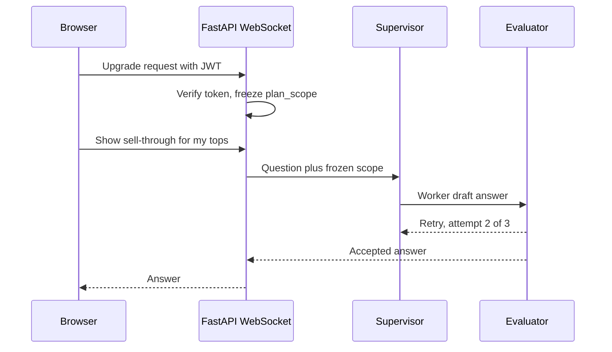

# IA bullet defense: Agentic + Core (PDF Sep 2026)

<div class="callout highlight">
<b>How to use this page</b>
<ul>
<li><b>What it covers:</b> every Impact Analytics line on <code>Tarun_Mittal_SSE_5yr_Java_PyGo_AI.pdf</code>, one by one. For each: the exact PDF text, what it means in plain words, how it works, why it was built that way, what each number means, and the questions interviewers ask with answers you can say out loud. It ends with four screening answers (why hire me, a production bug, a complex system, an agentic pipeline).</li>
<li><b>When to read it:</b> after the <a href="10_impact_analytics_deep_dive.md">deep dive (10)</a>, when you want to rehearse follow-up questions. Use the <a href="23a_ia_interview_pack.md">interview pack (23a)</a> for the short pitches.</li>
<li><b>What to memorise:</b> the "Split these numbers" box, the first sentence of every answer, and every "Do not say" line.</li>
</ul>
</div>

**PDF:** `Tarun_Mittal_SSE_5yr_Java_PyGo_AI.pdf` · Canonical: [`docs/ASSORTSMART_TAB_RESUME.md`](../../docs/ASSORTSMART_TAB_RESUME.md)

Every answer here uses real AssortSmart work. None of them import Kafka, Flink, CDC, Kubernetes operations, Milvus, sub-second ClickHouse, or a 70% document-RAG pipeline onto Impact Analytics.

<div class="callout note">
<b>Tags used here.</b> <b>MEASURED</b> means there is a log, benchmark report, config or code behind it. <b>ESTIMATED</b> means arithmetic I can show. <b>TARGET</b> means a design goal, so say "targeting". <b>HISTORICAL</b> means from my past work records. <b>VERBAL</b> means true but not printed on the PDF.
</div>

<div class="callout warn">
<b>Split these numbers.</b>
348k article-seasons is the scored Keep/Drop volume on the PDF. 1.6M is the full catalog (VERBAL). $100 per pass is off the PDF.
300 cases and 80% are the CI gate. "73% cheaper at 100% coverage" is the gold-200 model benchmark (n = 200). 74% is the production deterministic threshold's accuracy on that same 200 set.
55 GB, 16 GB and one fiscal week are VERBAL OOM settings. The PDF says "temporal chunks" and "memory and disk-spill caps".
Partition rollback means DROP PARTITION then recopy. It is not a live reader swap. The 4.09B copy was in flight.
A gate is not "all tenants live". Ask Iris is a shipped capability with no SLA.
</div>

---

## Words you need

- **Article-season.** One product in one selling season. The unit we score, like a report card per student per school year.
- **Sell-through.** The share of available stock that sold. 84 sold of 100 is 84%.
- **Rate of sale (ROS).** Units sold per selling store per week.
- **Lens.** One focused question the LLM answers about an article, like one specialist on a panel of doctors.
- **Structured LLM invoke.** An LLM call whose output must match a JSON schema. A form with fixed boxes, not a blank page.
- **s_det, s_agent, s_final.** The rule score, the LLM score, and the blend `0.4 × s_det + 0.6 × s_agent`. Keep if `s_final` is at least 0.55.
- **ClickHouse.** A columnar analytics database that reads only the columns a query needs.
- **MergeTree and ReplacingMergeTree.** MergeTree writes sorted chunks and merges them in the background. ReplacingMergeTree also keeps only the newest version per key, like a notebook where old lines get crossed out later by a cleaner.
- **argMax.** A ClickHouse function: `argMax(value, time)` returns the value from the row with the latest time. It is how a reader gets "the newest line" without waiting for the cleaner.
- **Circuit breaker.** Stops calling a failing dependency after too many failures, like the breaker in your fuse box.
- **Checkpoint.** Saved progress so a job resumes after a crash. A save point.
- **config_hash.** A SHA-256 fingerprint of guardrails, parameters, prompts and catalog. SHA-256 turns any input into a fixed 64-character fingerprint, and any change gives a totally different one.
- **LangGraph supervisor.** The routing node in an LLM graph, like a triage nurse.
- **Evaluator loop.** A checker that sends an answer back for another try, capped at 3 attempts.
- **LangSmith.** A tracing tool for LLM runs.
- **JWT.** A signed token that proves identity without a server call, like a stamped wristband.
- **WebSocket handshake.** The first HTTP "upgrade" request that opens a long-lived two-way connection.
- **OIDC.** OpenID Connect, the standard behind "Sign in with Google".
- **Constant-time compare.** Comparing secrets in a fixed amount of time so timing leaks nothing.
- **Wire.** Compile-time dependency injection for Go. It generates the wiring code, so a missing piece fails the build.
- **h2c.** HTTP/2 without TLS on that hop. Many requests share one connection.
- **Nested timeouts.** Deadlines inside deadlines: server, then request, then each database call. Russian dolls.
- **Rollup.** A pre-summed table, like a monthly statement instead of every card swipe.
- **OOM and spill.** Out of memory means the query is killed. Spill means writing overflow aggregation state to disk to avoid that.
- **Native protocol.** ClickHouse's binary protocol for moving columnar blocks. Port 9440 adds TLS.
- **Double buffering.** Fill batch B while batch A is sending. Two kitchen trays.
- **DROP PARTITION.** Delete one whole season's data at once, like emptying one drawer.
- **Ghost rows.** Leftover rows from a failed partial write that make a table look complete.

---

# SECTION 1: Agentic Flows & Orchestration

## A1. Multi-pipeline engine: 348k article-seasons, 88k per pass, 7 lenses

**PDF:** Architected a multi-pipeline AI merchandise decision engine (Keep/Drop, Missed Opportunities, Top Style) evaluating **348k article-seasons**. Optimized inference at scale, processing **88k items per pass**, by blending deterministic KPI math with structured LLM invokes across **7 AI lenses**.

**In plain words.** A batch system with three named pipelines. For every product in every season, code computes the hard numbers, an LLM answers seven focused questions about patterns, and the two are combined into a keep or drop recommendation.

**What.** Batch scoring across Keep/Drop, Missed Opportunities and Top Style. Deterministic Python owns the KPI math. The LLM sees packed JSON and returns structured lens scores. The seven active lenses are trend_velocity, size_curve, colour_cannibalization, channel_divergence, multi_season_consistency, discount_dependency and margin_resilience.

**Why.** LLMs are bad at arithmetic. Hardcoded KPI math stays financially correct. Lenses do the qualitative pattern work a planner would otherwise do by eye.

**How (with an example).** A tee with sell-through 84% and ROS 1.168 gets `s_det ≈ 0.65` from code. A cheap gate sees five sizes, two colours and 12 weeks on sale, so size_curve, colour_cannibalization and trend_velocity are eligible. The batch of up to 64 articles goes through peer benchmark, then decider, then lenses, then blend, then explanation, in that fixed order. If `s_agent = 0.711`, then `s_final = 0.4 × 0.65 + 0.6 × 0.711 ≈ 0.687`, which is a keep.

**Design decisions.** Keep the deterministic layer separate from prompt payloads. Use strict JSON schemas. Cap batch size for memory and provider rate limits.

- *Alternative: one big prompt per article.* Harder to evaluate and fix. Narrow lenses each have a rubric and can be fixed alone.
- *Alternative: rules only.* Coarse and tends to over-keep.
- *Trade-off.* More LLM calls per article, kept in check by the gate and batching.
- *What I'd do differently.* Get planner-labelled gold data earlier.

**The numbers.**
- *348k* is the count of article-seasons the engine has evaluated. Say "348 thousand article-seasons". Don't equate it with the 1.6M catalog.
- *88k* is the size of one pass. Say "about 88 thousand items per pass". Don't invent how many passes add up to 348k.
- *7* is the number of active lenses. An eighth lens exists but is switched off. Not every lens fires on every article.
- *$100 per pass* (VERBAL) is the token spend. Mention only if they ask about cost.

**Q: Why not let the LLM calculate KPIs through Python tools?**
A: "For security, speed and determinism. A scoring agent with a code or SQL tool across 88k items is a latency and injection surface. We pre-compute the KPIs in code and pass JSON, so math accuracy never depends on the model. The model's job is judgement, not arithmetic."

**Q: How did you handle rate limits at 88k items?**
A: "Parallel article batches with a global cap on in-flight LLM calls, hard per-batch timeouts, backoff, and a circuit breaker in the orchestration registry. A throttle doesn't wipe the run. Checkpoints let it resume the LLM phase without recomputing the deterministic scores."
*Follow-up they may ask:* "What's the batch size?" Up to 64 articles per LLM call.

**Q: How do you choose which lenses run?**
A: "A cheap Python gate runs before any LLM call. A lens only runs if the article has the data for it. A single-size product skips size_curve, and a single-colour product skips colour_cannibalization. That saves money and stops a lens from returning a meaningless middle score."

**Do not say:** 348k is the 1.6M catalog. $100 is on this PDF. It's one giant chatbot.

---

## A2. JSON payloads, ReplacingMergeTree, timeout fallback

**PDF:** Decoupled AI inference from a **2.11B-row** ClickHouse master by asynchronously serving context via JSON payloads rather than direct database querying. Engineered an eventually consistent write pattern via `ReplacingMergeTree` that guaranteed system availability by gracefully falling back to deterministic baselines during LLM timeouts.

**In plain words.** The LLM never gets database access. We query, we pack JSON, we send it. Results are written so that duplicates are harmless. If the LLM is slow, the rule score stands and the run keeps going.

**What.** Scoring LLMs do not query the 2.11B-row master. Context is packed JSON. Writes go through our engine code onto ReplacingMergeTree tables. A timeout means the deterministic score stands and the run continues.

**Why.** Direct SQL from an LLM against a production analytical table risks runaway queries, connection-pool exhaustion and prompt injection.

**How.**

```json
{"article": "TEE-0412", "season": 74,
 "kpis": {"sell_thru_eop_pct": 84.0, "ros": 1.168},
 "size_count": 5, "style_color_count": 2,
 "week_series": [{"w": 1, "qty": 210}, {"w": 2, "qty": 238}]}
```

```sql
-- Readers always take the latest version per key
SELECT article, argMax(s_final, computed_at) AS s_final
FROM reco_final_score
WHERE season_code = 74
GROUP BY article;
```

**Design decisions.** No database tool on the scoring path. An async batch mapper. A version column on the ReplacingMergeTree so retries do not duplicate articles. On the Keep/Drop path the default output is still CSV first, and publishing to ClickHouse is a separate operator step, so a bad config shows up in a CSV diff before any planner sees it.

- *Alternative: give the agent a SQL tool.* Rejected for safety, cost and latency.
- *Alternative: delete then insert on retry.* Deletes are heavy mutations in ClickHouse. Append with "latest wins" is cheaper.
- *Trade-off.* For a short window two versions of a row can exist, so every reader must ask for the latest.

**The numbers.** *2.11B* is the row count of the ClickHouse master that the agents are kept away from. Say "a 2.11-billion-row master". Don't confuse it with the 4.09B copy set or the 250M benchmark harness.

**Q: Why ReplacingMergeTree instead of plain MergeTree?**
A: "Because retries and overlapping waves can land the same article twice. ReplacingMergeTree keeps the latest version per key during background merges. Readers don't wait for that. They query with `argMax` or `LIMIT 1 BY`, so we never need `OPTIMIZE FINAL` as a runtime requirement."

**Q: What happens on an LLM timeout?**
A: "Every batch has a hard timeout that scales with batch size and has a ceiling. When it fires, the batch is marked as a fallback and the article keeps its precomputed deterministic score. One vendor 504 never blocks the other 88k items."
*Follow-up they may ask:* "Doesn't fallback hide problems?" No, fallbacks are counted in the run telemetry, so a spike is visible.

**Q: So the LLM still queries ClickHouse, just asynchronously?**
A: "No, and that's an important correction. 'Async' describes the batch executor. The model never gets a SQL tool. It's JSON in and engine writes out."

**Do not say:** "Physical air-gap" as the PDF phrase (that was older wording). "Zero corruption" as if it were a two-phase-commit guarantee. "The LLM issues ClickHouse writes." "I authored CDC" (pg2ch_cdc was Ashvin Sharma).

---

## A3. Registry: timeouts, breakers, checkpoints, config_hash

**PDF:** Engineered a **shared orchestration registry** to guarantee **88k-article** batch runs survive provider failures by implementing hard timeouts, circuit breakers, and durable checkpoints that bypass redundant deterministic scoring. Ensured full observability by stamping every output row with a frozen config hash and custom JSON telemetry tracking tokens, USD cost, step duration, and batch fallbacks.

**In plain words.** One shared harness runs all three pipelines. It sets deadlines, stops hammering a dead provider, saves progress so a crash resumes, and records which config produced each row and what the run cost.

**What.** The harness freezes the config, keeps a claim ledger, runs timed LLM batches, has a circuit breaker, writes resume files, and emits telemetry JSON.

**Why.** A provider 502 or 504 halfway through 88k items must not force a full deterministic recompute.

**How.**

```text
Step 1  Deterministic scores for all articles   -> det.json            (saved first)
Step 2  LLM chunks finish one by one            -> agent_progress.json (appended)
Crash
Step 3  Rerun with --resume                     -> reload det.json, skip finished articles,
                                                   continue only the LLM work
```

The circuit trips after about 5 consecutive failures or once the failure fraction passes a threshold. `config_hash` is a SHA-256 of the frozen guardrails, parameters, prompts and catalog. Because prompt text is in the hash, changing one word of a prompt creates a new hash, so you can always tell which prompts produced a row.

- *Alternative: Airflow or Temporal.* See the answer below.
- *Alternative: a run UUID instead of a config hash.* A UUID tells you which run, not which configuration.
- *Trade-off.* We own the orchestration code and its bugs, and there is no built-in UI.
- *What I'd do differently.* Turn the run ledger and cost telemetry on by default.

**Q: How do checkpoints work?**
A: "Deterministic results land first. As LLM chunks complete, we append per-article progress. A restart reloads the deterministic results, skips finished articles and continues the LLM map. That's what 'bypass redundant deterministic scoring' means on the resume."

**Q: Why not Airflow or Temporal?**
A: "This workload needed resume logic tightly coupled to ClickHouse inserts, config hashing and per-run token and USD accounting. We already owned a batch CLI and an HTTP start path. A heavy external orchestrator would have been extra infrastructure without a clear payoff."
*Follow-up they may ask:* "When would you pick Temporal?" When workflows are long-lived, span many services, and need durable timers and signals beyond one batch job.

**Q: What does the circuit breaker actually do?**
A: "It's a deterministic run controller, not an agent. It counts failures. If about five fail in a row, or too large a fraction of calls fail, it stops the step and exits with a clear code instead of burning money on a dead provider."

**Do not say:** HITL validation queues (not in this system). LangSmith on this bullet (on this PDF, LangSmith belongs to Ask Iris). Netflix Hystrix as the product.

---

## A4. Ask Iris: JWT WebSocket, 3-attempt evaluator, frozen handshake

**PDF:** Shipped "Ask Iris," a JWT-secured WebSocket copilot enabling planners to interactively query KPIs and inspect AI decisions on a multi-billion-row database. Prevented infinite LLM loops and multi-tenant data leaks by orchestrating a **LangGraph** supervisor with a **3-attempt** evaluator loop, utilizing **LangSmith** for observability, and strictly freezing hierarchy access on the initial socket handshake.

**In plain words.** A chat assistant in AssortSmart. Identity and permissions are locked once when the connection opens. A routing node sends each question to the right worker, and a checker can send an answer back at most three times.

**What.** A FastAPI WebSocket chat. The JWT arrives at the handshake as `Authorization: Bearer ...` or `?token=`. `plan_scope` is frozen once. The supervisor routes to workers, the evaluator retries up to `MAX_ATTEMPTS = 3`, and LangSmith traces every run.

**Why.** Chat is a tenant-bleed and token-loop surface if scope can change mid-session.

**How.**



*What to notice: scope is set once at the top and never read from chat text.*

- *Alternative: re-check permissions per message.* Scope could then depend on message content. Freezing at the handshake makes widening scope structurally impossible.
- *Alternative: uncapped loops.* Runaway cost and latency.
- *Trade-off.* If permissions change mid-session, the user must reconnect to pick them up.

**Q: How do you prevent multi-tenant leaks?**
A: "Tenant, hierarchy and plan scope are bound at the JWT handshake. Every tool call inherits that frozen `plan_scope`. A later chat message can't pivot into another tenant's hierarchy, because nothing in the message can change the scope."

**Q: How do you stop infinite LangGraph loops?**
A: "The evaluator loop is capped at three attempts, and there's a recursion limit on the supervisor graph as a second guard. When the cap is hit, it fails closed with a graceful answer instead of another tool hop."

**Q: How do you debug a bad answer?**
A: "LangSmith. I open the trace for that run and see which worker the supervisor picked, what the tool calls returned, what the evaluator rejected and how many tokens it took."

**Do not say:** a tenant-wide SLA, questions per week, "generates dynamic charts" as a PDF claim (it was dropped), or an HITL review queue.

---

## A5. 300-case proxy, 80% CI gate, 73% cost, 74% baseline, frozen weights

**PDF:** Built a **300-case** proxy evaluation harness and an **80%** accuracy CI gate to enforce strict deployment guardrails. Reduced live execution costs by **73%** at **100% coverage** by benchmarking models against a **74%** deterministic baseline, strategically freezing final decision weights when the LLM underperformed the baseline.

**In plain words.** Nothing ships unless it scores at least 80% on a fixed 300-case test set. On a separate 200-case benchmark, I picked a model that cost 73% less while still completing every case. The plain rule scored 74% on that set and the LLM blend scored lower, so I froze the blend weights instead of tuning them to a small sample.

**Split (say this unprompted if they fuse the numbers):**

| Number | Source | Meaning |
|---|---|---|
| 300 cases, 80% | `eval.json` (`gold_min_accuracy: 0.8`) and `cases.json` | CI **promotion gate** |
| 73% cheaper, 100% coverage | gold-200 bench, `gpt-5.6-luna` vs `gpt-5.4-mini`, 200 of 200 complete | Model pick for live scoring |
| 74% | Production deterministic threshold 0.65 on that 200 set | The free rule the LLM must beat |
| Frozen blend weights | Same bench: blended LLM about 63%, below the rule's 74% | Do not retune 0.4 and 0.6 on a small proxy |

**How the 300 proxy labels are made.** We score season A and label using only season B, which the pipeline never sees. Strong next-season sell-through and rate of sale is a KEEP. Weak is a DROP. The middle band is skipped. The builder avoids circularity (labelling on the pipeline's own inputs) and treatment leakage (an article a planner already dropped sells zero next season by construction).

**The numbers.**
- *80%* is a promotion gate, not live accuracy. Say "an 80% accuracy CI gate".
- *73%* means the chosen model's run cost about 27% of the previous model's run on the same 200 cases. Say "73% lower live execution cost at full coverage".
- *74%* is the rule baseline on the 200 set. Say "a 74% deterministic baseline".
- Model names are not on the PDF. Use them only if asked.

**Q: What did you do when the LLM scored below the deterministic baseline?**
A: "I held the blend weights frozen. We don't ship a 'smarter' model that loses to a free rule on the proxy set. Promotion still requires the 80% CI gate on the 300-case file. The gap told us to improve the lenses and the labels, not to bend the weights."

**Q: How did you choose the model?**
A: "On the gold-200 set, Luna completed 200 out of 200 with full lens coverage and was 73% cheaper than mini. A nano-tier option was slightly cheaper but left pending rows. Completion reliability won. That 73% comes from the 200-case benchmark, not the 300-case suite."

**Q: Isn't accuracy alone a weak gate?**
A: "Yes, and the config knows it. A set that is mostly keeps can clear 80% while missing half the drops. That's why the gate config also supports a drop-recall threshold, and raising it is the lever against over-keeping."

**Do not say:** "All tenants are live at 80%." "gpt-5.6-luna is on the PDF." "The 73% came from the 300-case file."

---

# SECTION 2: Core Infrastructure & Pipeline

## C1. Go/Gin at 10k peak RPS, Wire, h2c, Datadog

**PDF:** Architected a multi-tenant **Go/Gin** platform scaling to **10k peak RPS**, utilizing **Google Wire** for compile-time DI. Deployed as a self-protecting HTTP edge without a reverse proxy, guaranteeing high availability through native **h2c**, nested timeouts, and **Datadog** distributed tracing.

**In plain words.** The API the planner UI talks to is a Go service. Nothing sits in front of it, so it protects itself with deadlines, size limits and graceful shutdown.

**How.**

```go
// Illustrative: h2c plus nested deadlines
srv := &http.Server{
	Handler:           h2c.NewHandler(router, &http2.Server{}),
	ReadHeaderTimeout: 5 * time.Second,                  // outer
}
ctx, cancel := context.WithTimeout(c.Request.Context(), 20*time.Second) // request
qctx, qcancel := context.WithTimeout(ctx, 15*time.Second)               // query
```

Plus a request body cap, a SIGTERM drain so in-flight requests finish during deploys, and Datadog spans across handler, cache and database calls. The values are illustrative.

**The numbers.** *10k peak RPS* is the peak request rate of the Go edge. Say "10k peak requests per second". Don't add an uptime percentage or a tenant count.

**Q: Why Wire over Fx or Dig?**
A: "Wire is compile-time. It generates plain Go, so wiring errors fail the build instead of a request path, and there's zero reflection at runtime. Fx and Dig resolve dependencies at runtime with reflection."

**Q: Why no reverse proxy?**
A: "The process owns h2c, nested context timeouts and traces. That's one less hop and one less ops surface, and all the timeout logic lives in one place. The trade-off is that the service has to protect itself. I don't invent a 99.9% SLA for it."
*Follow-up they may ask:* "When would you add one?" For multi-region routing or if we needed edge features like a WAF.

**Q: What are nested timeouts?**
A: "Deadlines inside deadlines. The server has an outer deadline, each request gets a smaller budget, and each database call inside gets a smaller one again. A slow ClickHouse query fails cleanly before the connection does."

**Do not say:** Nginx or Envoy as the timeout story. Kubernetes cluster operations.

---

## C2. KPI configurator, tokenizer, division-by-zero protection

**PDF:** Eliminated deployment bottlenecks by architecting a dynamic KPI configurator and custom formula parser. Engineered a real-time compilation layer that tokenizes operator-authored math into parameterized ClickHouse SQL fragments with native division-by-zero protection, decoupling business logic from code releases.

**In plain words.** Operators type a KPI formula. A Go parser turns it into safe ClickHouse SQL immediately, so a new KPI no longer needs a code release.

**What actually ships.** A Go tokenizer and parser, allowlisted functions, logical names mapped to physical columns, and a SELECT wrapped as `ifNotFinite(toFloat64(<expr>), 0)`.

```text
Input:   margin_pct = margin / revenue * 100
Output:  ifNotFinite(toFloat64(sum(margin) / sum(revenue) * {p1:Float64}), 0)   p1 = 100
Input:   revenue; DROP TABLE x
Output:  rejected: unknown token ";"
```

*`ifNotFinite(x, 0)` returns 0 if x is Infinity or NaN, so a zero-revenue row gives 0 instead of breaking the planner's JSON.*

- *Alternative: let operators paste SQL.* Injection risk.
- *Alternative: hardcode every KPI.* Safe but needs a release per change, which was the bottleneck.
- *Trade-off.* We own a small language, so the grammar must stay small and well tested.

**Q: How do you prevent SQL injection?**
A: "We never concatenate raw operator text into SQL. Tokens must parse, functions must be on an allowlist, identifiers resolve through a catalog, and constants are bound as parameters. Anything unknown fails closed, so the formula is rejected, not guessed at."

**Q: How does division by zero work?**
A: "Compilation wraps the whole expression in `ifNotFinite(..., 0)`, so Infinity and NaN never reach planner JSON. That's the 'native division-by-zero protection' on the resume."

**Do not say:** "Operators can paste arbitrary SQL." If they press on implementation, don't call it a generic prepared statement around free-form SQL. The guard is parse plus allowlist plus catalog plus `ifNotFinite`.

---

## C3. Isolation, the OIDC waterfall, constant-time keys

**PDF:** Guaranteed strict multi-tenant data isolation and UAM-scoped hierarchy access control across PostgreSQL and ClickHouse. Redis-fronted Firebase Admin to JWT/Google OIDC waterfall, constant-time API keys, Postgres-backed role resolution.

**In plain words.** Each request proves identity through one of several methods tried in order, Redis caches the result, Postgres says what the user may see, and every query on both databases is filtered to that scope.

**How.** Check Redis for an already-verified token. On a miss, try Firebase Admin, then JWT or Google OIDC verification. API keys are checked with a constant-time compare. Roles and the UAM hierarchy come from Postgres. The same tenant ID filters ClickHouse queries as bound parameters, for example `tenant_id = {t:String} AND l1_name IN {l1:Array(String)}`.

```go
import "crypto/subtle"
ok := subtle.ConstantTimeCompare([]byte(given), []byte(stored)) == 1
```

- *Alternative: a database per tenant.* Strongest isolation, heavy to operate across many tenants.
- *Trade-off.* Cached auth means revocation waits for cache expiry, so cache lifetimes stay short.

**Q: What does constant-time comparison protect against?**
A: "A normal `==` stops at the first mismatched byte. An attacker can time responses and guess the key one character at a time. A constant-time compare takes the same time on any mismatch, so timing reveals nothing."

**Q: What about auth latency?**
A: "Redis fronts verified tokens, so we're not calling Firebase or the OIDC provider on every API call. A miss falls through to real verification and then Postgres. It never degrades open."

**Q: Is this encryption?**
A: "No. It's access control and data isolation. Encryption at rest and in transit is a separate concern."

**Do not say:** "encryption product", "privacy program", Milvus, or a sub-millisecond SLA. Keep the cache benefit qualitative ("Redis-fronted").

---

## C4. 15.5×, the 170GB OOM, temporal chunks, spill caps

**PDF:** Reduced planner pivot latency by **15.5×** (**189s to 12s** on **250M-row** operations) by building a ClickHouse pre-aggregation layer for season and weekly rollups. Prevented **170GB** OOM crashes by slicing batch inserts into temporal chunks and enforcing strict distributed memory and disk-spill caps.

**In plain words.** Two stories in one bullet. Pivots got much faster by reading pre-summed ClickHouse tables. Separately, building the weekly tables crashed from memory, and I fixed that by building one week at a time with hard limits.

**Split.** 15.5× is **query time**, the pivot on a 250M-row harness. 170GB is **load time**, a whole-season weekly `GROUP BY`. They are not cause and effect.

**The six tables.** product, store and attribute, each at season and weekly grain, all MergeTree with `PARTITION BY season_code`. Planners read rollups, not raw daily facts.

**The numbers.**
- *15.5×* is 189,408 ms divided by 12,256 ms on the 250M harness (Postgres versus ClickHouse on the same heavy pivot, row-identical data). The PDF rounds 12.3 s to 12 s. Say "from 189 seconds to 12 seconds". MEASURED POC. Don't call it sub-second or a production p95.
- *170 GB* is the estimated aggregation memory for a whole-season weekly insert. It failed at 80 GB and at 200 GB caps.
- *VERBAL settings (true, off the PDF):* one fiscal week per insert, 55 GB memory cap, 16 GB spill, 8 threads, 4 weeks in flight. A product week is about 11 GB. An attribute week is over 40 GB.

**Q: Why did it OOM?**
A: "ClickHouse holds aggregation state in RAM for every group. A whole-season weekly GROUP BY, with lots of `any()` and `argMax` states over wide strings, pushed about 170 GB. It failed even at 200 GB, so I sliced the work to one fiscal week per insert and enabled external GROUP BY spill to disk."

**Q: What's the rollup shape?**
A: "Six MergeTree tables partitioned by season: product, store and attribute, each at season and weekly grain. Planners read rollups, not raw daily facts. Store totals are re-weighted so they match the sum of SKUs."

**Q: Was the 12 seconds measured on the rollups?**
A: "The 189-to-12 figure is from the 250-million-row harness, where ClickHouse ran the same heavy pivot that took Postgres 189 seconds. In production, planners read the rollup tables, which do less work per query. I don't quote a production latency number on top of that."

**Q: Was the benchmark fair?**
A: "It was tilted toward Postgres. Postgres ran on a 48 GB host and ClickHouse on a 10-CPU, 3.3 GB Docker VM. Honestly, most of the gap came from the option-count distinct, which Postgres can't parallelise. Without it, ClickHouse is more like 2 to 3 times faster on typical aggregates."

**Do not say:** sub-second pivots. "The OOM fix caused the 15.5×." "4.09B is this bullet."

---

## C5. Go native-TLS pump, about 344k rows/s, 4.09B, TSV, partition rollbacks

**PDF:** Migrated ClickHouse rollups across Cloud clusters at **~344k rows/s** by writing a custom Go native-TLS data pump to bypass strict cross-cluster IP allowlist restrictions. Processed partitions up to **4.09B** rows using **500k-row** double-buffered batches, and eliminated partial-commit ghost rows using TSV ledgers and atomic partition rollbacks.

**In plain words.** The two ClickHouse clusters couldn't talk directly. An allowlisted machine could reach both, so I wrote a Go program there that reads from one and writes to the other in big columnar batches, with bookkeeping so a crash never leaves fake-complete data.

**How.** One season per worker. 500k-row columnar buffers. Two buffer sets, so reading the next batch overlaps sending the previous one. A `.done` checkpoint file per table and season. A per-table file lock. SIGINT finishes the in-flight batch but does not checkpoint that season. An incomplete season gets `DROP PARTITION` and a full recopy.

```text
season 6:  read A ──► send A
                read B ──► send B        (read and send overlap)
                     read C ──► send C
           all sent ──► write migrate-checkpoints/attr_weekly.done
```

**The numbers.**
- *About 344k rows/s* is combined native-protocol ingest from two season streams of roughly 150k to 190k rows/s each, at a live snapshot. Say "about 344 thousand rows per second". It is not RPS or TPS.
- *4.09B* is 2,779,317,472 plus 1,311,108,195 rows of attribute weekly data across two seasons. Say "measured on a 4.09-billion-row set". The copy was in flight.
- *500k* is the batch size in rows.

**Q: Why not `remoteSecure` or distributed tables?**
A: "Cross-cluster IP allowlists blocked the clusters from talking to each other. An operator machine was allowlisted, so a Go pump over native TLS on port 9440 was the workaround. The PDF says 'allowlist', not the name of the function that failed."

**Q: How do you avoid ghost rows, and what are the TSV ledger and the rollback?**
A: "A failed INSERT can still commit some blocks, so `count() > 0` is a lie. The weekly loader keeps a TSV ledger of finished chunks and confirms completion in `system.query_log`. The copier has its own `.done` files per table. On restart, any season without a checkpoint gets `DROP PARTITION` and a full recopy. That's the 'atomic partition rollback' on the PDF. It is not an atomic swap with live readers."

**Q: Is 344k HTTP requests per second?**
A: "No. It's combined native-protocol ingest from two season streams, using 500k-row columnar batches and double buffering, where we read the next batch while `Send()` runs on the previous one. It's not REST traffic."

**Q: What's the biggest risk in this design?**
A: "There's no atomic swap. If it crashes mid-season, the target has a truncated season until we drop and recopy, and readers could see partial data in that window. A `REPLACE PARTITION` design from scratch tables would fix that. It was written but not executed. For a real production cutover I'd allowlist the clusters to each other or go through object storage."

**Do not say:** "I finished the 4.09B cutover." "344k TPS." "We open-sourced the copier." "TSV is the copier's ledger."

Full whiteboard: [`42_clickhouse_rollup_migration.md`](42_clickhouse_rollup_migration.md).

---

# SECTION 3: Screening answers that match this PDF

Use these instead of generic drafts that put Kafka, Flink, CDC, Kubernetes or Milvus on AssortSmart.

## Why should we hire you? (senior level)

"You should hire me because I own systems end to end: design, failure and measurement. That goes for both classical backends and production AI.

At Uber, through EPAM, I owned the FRM scoping backend. I built 36 Spring Boot endpoints over 19 million GL rows with a four-level L1 to L4 hierarchy and SHA-256 natural keys, and cut quarterly reconciliation by 70%, from 14 days to 3 days, against a $340M materiality threshold, while leading 3 engineers. On Uber Eats I owned menu ingestion with Selenium, Kafka, Flink and exactly-once catalog upserts. That took restaurant onboarding from 24 hours to 2 hours and saved $600K a year, plus Gemini RAG over Milvus at 98% field fidelity in offline evaluation.

At Impact Analytics I own AssortSmart across two chapters. On the agentic side: Keep/Drop, Missed Opportunities and Top Style over 348k article-seasons, 88k items per pass, seven lenses, JSON payloads instead of LLM access to a 2.11-billion-row ClickHouse master, Ask Iris as a JWT WebSocket copilot with a three-attempt LangGraph evaluator, and an 80% CI gate on 300 cases, with a model 73% cheaper at full coverage against a 74% rule baseline and frozen weights. On the platform side: a Go and Gin edge at 10k peak RPS, a KPI parser with `ifNotFinite` protection, pivots from 189 seconds to 12 seconds on 250 million rows, a 170 GB OOM fixed with temporal chunks and spill caps, and a Go native-TLS pump at about 344k rows per second on partitions up to 4.09 billion rows.

If you need someone who can design independently, debug at scale, and refuse a bad agent with a gate, that's the work I already do."

**Do not** say Kubernetes as Impact Analytics production work, Kafka on Impact Analytics, or "sub-second ClickHouse".

## A production bug you resolved (use the 170 GB OOM)

- **Situation.** Weekly ClickHouse rollups feed the planner pivots.
- **Task.** Keep weekly grain, because planners need fiscal-week views, without crashing the replica.
- **Crisis.** The whole-season weekly `INSERT SELECT` built about 170 GB of aggregation state and hit `MEMORY_LIMIT_EXCEEDED`. It failed even at 80 GB and 200 GB caps.
- **Investigation.** I profiled by grain instead of throwing RAM at it. A product week peaked around 11 GB. An attribute week peaked above 40 GB. The unit of work was simply too big.
- **Fix.** One fiscal week per INSERT, a 55 GB memory cap, 16 GB spill, and a bounded number of weeks in flight.
- **Prevention.** Spill settings are now in the generated SQL, and we never GROUP BY a whole season at weekly grain.

**Say it like this:** "The build kept dying even at 200 GB, so I stopped adding memory and measured per week. Attribute weeks alone needed over 40 GB. I rebuilt it as one week per insert with a 55 GB cap and 16 GB of spill, and weekly grain finally built reliably."

**Alternate (Masters India, people and process):** the IRP timeout canary. Timeouts on government portal calls were too aggressive, and we moved to non-blocking calls with idempotency keys. Do **not** lead with the connection-leak OOM or the Kafka heap-leak story as if it were an Impact Analytics bullet. Those are packet stories, not PDF bullets.

## A complex system you developed (AssortSmart, not CDC)

- **Problem.** Planner pivots on PostgreSQL were too slow (about 189 seconds on the 250M harness), and agents could not be allowed to run SQL against a 2.11B-row fact table.
- **Architecture.** A Go and Gin edge (Wire, h2c, Datadog), then Postgres UAM with the Redis-fronted OIDC waterfall, then six ClickHouse rollup tables for reads, then Python batch agents working only on JSON payloads, and Ask Iris over a WebSocket with a frozen plan scope.
- **Hard part.** The weekly-grain OOM, and a cluster copy blocked by allowlists. I solved them with temporal INSERT chunks and a Go native-TLS pump, not with Kafka or CDC.
- **Result.** 15.5× on the 250M harness, 348k article-seasons scored by Keep/Drop, Ask Iris shipped, and an 80% CI gate guarding promotions.

**Do not** draw Kafka to Flink to ClickHouse for Impact Analytics. That picture is Uber Menu.

## An agentic pipeline you owned (Keep/Drop and Ask Iris, not document RAG)

- **Business.** Keep/Drop, Missed Opportunities and Top Style recommendations for merchandise planners.
- **Stack.** Python batch plus LangGraph for Ask Iris. Not Milvus. Milvus is Uber Menu.
- **Loop.** Deterministic KPI JSON, then 7 structured lenses, then the blend, then a ReplacingMergeTree insert or a CSV bake. Failures: a timeout falls back to the deterministic score, the circuit breaker stops a dead provider, and checkpoints let the run resume.
- **Interactive path.** JWT WebSocket, then the frozen hierarchy, then the supervisor, then the 3-attempt evaluator, with LangSmith tracing.
- **Guardrails.** The 300-case proxy set, the 80% CI gate, and frozen weights when the LLM loses to the 74% rule.

**Do not** tell a 70% invoice-extraction RAG story as this bullet. Menu RAG is a different PDF chapter.

---

# SECTION 4: Do not import

| Draft idea | Verdict |
|---|---|
| Impact Analytics architecture is Kafka plus Flink plus CDC plus Kubernetes | **No.** Menu owns Kafka and Flink. The CDC author is Ashvin Sharma. Kubernetes is skills-level literacy |
| Sub-second ClickHouse dashboards | **No.** The PDF says 189 seconds to 12 seconds |
| HITL queues or human review of low-confidence scores | **No.** Offline evals replaced the critic and evaluator agents |
| Open-sourcing the copier | **No.** Whiteboard it instead |
| "I streamed 4.09B at 344k" as a finished job | **No.** It was measured in flight |
| 70% document extraction as AssortSmart | **No.** |
| A connection-leak OOM or Kafka memory leak as the Impact Analytics outage story | **No.** Use the 170 GB OOM or the Masters IRP story |

**Related:** [Deep dive (10)](10_impact_analytics_deep_dive.md) · [Interview pack (23a)](23a_ia_interview_pack.md) · [ClickHouse rollups and copier (42)](42_clickhouse_rollup_migration.md) · [Ground truth](GROUND_TRUTH.md)
