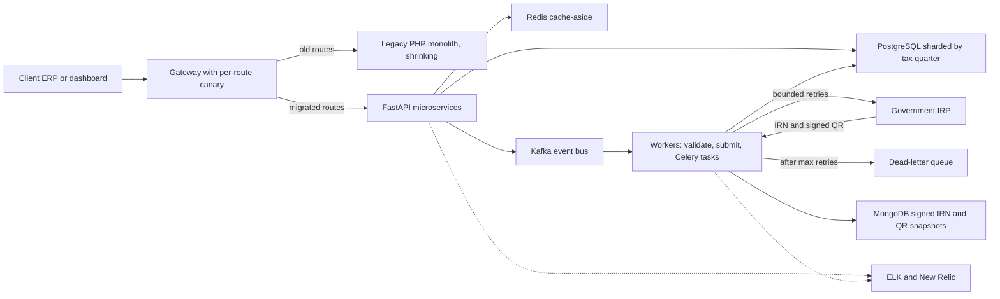
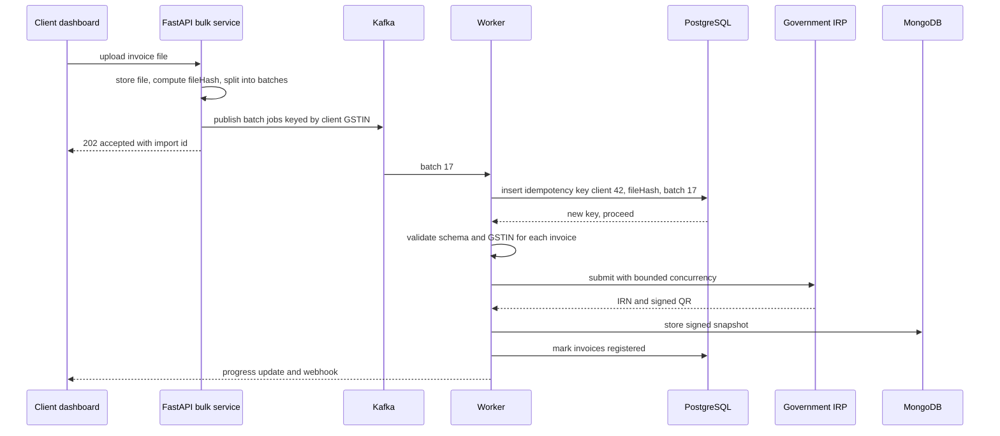

# Architecture: Masters India GST and E-Invoicing

<div class="callout note">
<b>How to use this page</b>
<ul>
<li><b>What it covers:</b> the GST e-invoicing platform at Masters India. That means the strangler migration from a PHP monolith to FastAPI microservices, the Kafka bulk pipeline to the government portal, quarter sharding in PostgreSQL, idempotency and dead-letter queues, and the observability and caching work.</li>
<li><b>When to read it:</b> before system design rounds on high-volume pipelines, idempotency, migrations or third-party integrations.</li>
<li><b>What to memorise:</b> the diagram, one bulk import traced end to end with the idempotency key, and the numbers: p95 from 1.2 seconds to 300 milliseconds, 700 to 4,000 requests per minute, 1M+ submissions a day, 1,500+ clients.</li>
</ul>
</div>

**Tags on this page.** MEASURED means there is a log, a doc or code. ESTIMATED means arithmetic I can show. TARGET means a design goal (say "targeting"). HISTORICAL means from past work records.

**Stack on this track (PyGo):** Python, FastAPI, Kafka, PostgreSQL, MongoDB, Redis, Elasticsearch, Celery, Docker, ELK, New Relic, AWS.

---

## 1. The one-paragraph version

In India, larger businesses must register every B2B invoice with a government system called the IRP (Invoice Registration Portal) before the invoice is legally valid. The IRP returns an IRN (Invoice Reference Number) and a digitally signed QR code. Masters India sells a SaaS product that does this for enterprises: clients send invoices to our APIs, we validate them, register them with the IRP, and return the signed result. I led the migration of the legacy PHP monolith to FastAPI microservices, which cut p95 latency **from 1.2 seconds to 300 milliseconds** for **1,500+ enterprise clients**, and I built the bulk pipeline that handles **1M+ government submissions a day** on Kafka and PostgreSQL sharded by tax quarter.

---

## 2. Words you need

- **GST (Goods and Services Tax).** India's indirect tax. Businesses file returns per period.
- **E-invoicing.** Registering each B2B invoice with the government before it is valid.
- **IRP (Invoice Registration Portal).** The government system that accepts invoices and returns an **IRN** and a **signed QR code**. It can be slow or flaky, especially near filing deadlines.
- **GSTIN.** A business's GST registration number, validated on every invoice.
- **Monolith.** One big application where all features are deployed together. One slow part can block everything.
- **Microservices.** Smaller services, each owning one area, deployed separately.
- **Strangler pattern.** Replacing a legacy system piece by piece. New services take over one route at a time while the old system keeps serving the rest, until the old one is "strangled". Like renovating a house room by room while still living in it.
- **Canary release.** Sending a small percentage of traffic to the new version first, watching errors and latency, then ramping up. Named after canaries miners carried to detect gas early.
- **p95 latency.** The response time that 95% of requests beat. It shows the slow tail that averages hide.
- **Async IO.** While waiting for a slow network call (like the IRP), the process handles other requests instead of sitting idle. Like a waiter taking other orders while the kitchen cooks.
- **Connection pooling.** Reusing a set of open database connections instead of opening a new one per request.
- **Kafka.** A durable, ordered event log. Producers write events, consumer groups read them at their own pace, and the log can be replayed.
- **Celery.** A Python task queue. Code puts a task on a queue, and worker processes pick it up and run it, with retries. Used here for background and scheduled tasks.
- **Sharding.** Splitting data across separate tables or databases by a key. Here the key is the **tax quarter**.
- **Idempotency.** Doing the same operation twice has the same effect as doing it once. Critical here, because registering one invoice twice with the government cannot be undone.
- **Idempotency key.** A unique key for an operation, here `client + fileHash + batchIndex`. If the key has been seen, the work is not repeated.
- **Dead-letter queue (DLQ).** A side queue where messages that keep failing are parked, so they do not block everything else and can be replayed after a fix.
- **Bounded retries.** A fixed maximum number of retries with growing waits (exponential backoff), so a failing portal is not hammered forever.
- **Cache-aside.** The app checks Redis first. On a miss it reads the database and writes the result to Redis with an expiry. Like checking your desk drawer before walking to the filing room.
- **ELK.** Elasticsearch, Logstash and Kibana: collect, store, search and visualise logs.
- **New Relic.** An APM (application performance monitoring) tool that traces requests and shows slow calls.

---

## 3. The architecture diagram



*What to notice: the gateway is where the migration happens, one route at a time. Nothing talks to the government portal synchronously from the request path. Workers do it, with idempotency, bounded retries and a dead-letter queue.*

---

## 4. Box-by-box walkthrough

### Client ERP or dashboard
Enterprise clients send single invoices from their ERP (enterprise resource planning system) through our API, or upload bulk files from the dashboard.

### Gateway with per-route canary
The gateway (Nginx) decides, per route, whether traffic goes to the old PHP code or the new FastAPI service. A new route starts with a small percentage, we watch error rates and latency, then ramp to 100%. Rollback is a config change, not a deploy.

### Legacy PHP monolith
The old system. It was synchronous: one slow IRP call held a PHP worker for the whole round trip, deployments were all-or-nothing, and filing-deadline spikes caused pile-ups and timeouts. It kept serving un-migrated routes during the strangler migration. It shared the database during traffic cutover, so there were no dual writes. Table splits came after.

### FastAPI microservices
The new services: submit, bulk import, reconciliation and others.
- **Why FastAPI:** async-native for IRP calls, Pydantic validation at the boundary, automatic OpenAPI docs for enterprise clients, small footprint per service.
- **Where the latency win came from:** async IO for IRP and internal calls, connection pooling instead of per-request connects, fixing N+1 queries and adding indexes, and Redis for hot reads.
- **Mentoring:** I set the conventions (router, service and repository layers, Pydantic schemas, retry and idempotency helpers) and mentored **2 engineers**, who each extracted a service.

### Redis cache-aside
Caches data read on almost every invoice: client config, GSTIN master lookups, tax-rate masters and short-lived IRP auth tokens. Config keys are deleted on write so nobody sees stale settings. TTL (time to live) values get random jitter so many keys do not expire at the same moment. This cut database read load by about **30%**.

### PostgreSQL sharded by tax quarter
The transactional store for invoices and their status.
- **Why by quarter:** GST reporting is quarter-scoped. Writes concentrate in the current quarter. Older quarters are mostly read for reconciliation and audits. Separate quarter tables keep the hot write set and its indexes small, and let us archive a whole cold quarter cleanly.
- **How:** the quarter is derived from the invoice date at the API boundary, and the data layer picks the matching quarter table. Example: an invoice dated 14 February 2024 belongs to Indian financial year 2023-24, quarter 4 (January to March).
- **Trade-off:** routing lives in application code, which is more moving parts than native database partitioning. A wrong-quarter write is the main risk, so mismatches are rejected at the boundary.
- **Idempotency:** a unique constraint on the idempotency key makes a second attempt fail safely instead of double-registering.

### Kafka event bus
Carries the asynchronous stages: accepted import chunks, IRP submit jobs, signed-response persistence and client webhooks.
- **Why Kafka:** per-client ordering (partition key is the client GSTIN), durable replay for compliance disputes and bug fixes, and several consumer groups reading the same topic (IRP workers, audit, metrics).
- **Alternatives:** SQS (no cheap multi-consumer replay) or RabbitMQ (could have worked at this scale, honestly). Replay and multiple consumer groups tipped it to Kafka.

### Workers (validation, submission, Celery tasks)
Kafka consumers validate chunks and submit to the IRP with bounded concurrency and exponential backoff. Celery runs background and scheduled tasks such as PDF generation, webhooks and email, with retries and idempotency keys, so request threads never block on third parties.

### Government IRP
The external portal. Volatile near deadlines. Treated as unreliable: never called from the request path, always with retries and limits.

### Dead-letter queue
After the maximum retries, a failing batch is parked here with its error, so the rest of the import keeps flowing and operators can replay it after a fix.

### MongoDB
Stores the signed IRP responses (IRN, signed QR, raw payload) as documents. Their shape varies, and a document store fits that well.

### ELK and New Relic
Structured JSON logs with request IDs go to Elasticsearch and Kibana. New Relic traces requests. One request ID follows a request across the API, the Kafka consumer and the IRP worker. This cut incident triage time by about **70%**.

---

## 5. One job, step by step: a bulk import

**Example (illustrative).** Client 42 uploads a file of invoices before the filing deadline. Follow batch 17.



1. The client uploads the file. The API stores it, computes a hash of the file contents (`fileHash`), splits it into batches, and returns **202 Accepted** with an import ID immediately. The client never waits on the government.
2. Each batch becomes a Kafka message keyed by the client's GSTIN, so one taxpayer's batches stay in order.
3. A worker picks up batch 17 and inserts the idempotency key `client_42 + fileHash + 17` into PostgreSQL under a unique constraint.
4. The key is new, so the worker proceeds. If the client had accidentally uploaded the same file again, or a worker had crashed and Kafka redelivered the batch, the insert would hit the unique constraint and the batch would be skipped. **No invoice is registered twice.**
5. The worker validates each invoice (schema, GSTIN format and status) and submits valid ones to the IRP with bounded concurrency.
6. The IRP times out on the first try. The worker retries with exponential backoff (for example after 1 second, then 2, then 4), up to a fixed limit.
7. The IRP returns an IRN and signed QR. The worker stores the signed snapshot in MongoDB and marks the invoices registered in the quarter table for financial year 2023-24 quarter 4.
8. The dashboard shows progress, and a webhook tells the client's ERP.
9. If batch 17 had failed every retry, it would go to the dead-letter queue with the error, and the other batches would continue.

Idempotency check (teaching sketch):

```sql
INSERT INTO import_batches (idempotency_key, client_id, status)
VALUES ('42:9f2c...e1:17', 42, 'processing')
ON CONFLICT (idempotency_key) DO NOTHING
RETURNING id;   -- no row returned means this batch was already processed
```

On a conflict the worker looks up the existing row's status. It skips the IRP call only if the batch is already `registered`. A `PENDING` or failed batch (including a DLQ replay) retries through the same key, so the key prevents a double registration without blocking a legitimate retry.

---

## 6. Design decisions

### Decision 1: strangler migration instead of a big-bang rewrite
- **What:** move one route at a time behind the gateway with canaries.
- **Why:** a compliance product cannot have a broken filing day. Per-route cutover gives instant rollback.
- **Alternatives:** rewrite everything and switch over in one night. Faster on paper, very risky.
- **Trade-off:** two systems run side by side for months, and the shared database must stay compatible.
- **What I'd do differently:** agree timeout budgets per route before the first canary (see the failure story below).

### Decision 2: Kafka for the bulk pipeline
- **What:** a durable event bus between API and workers.
- **Why:** per-taxpayer ordering, replay for disputes, several consumer groups.
- **Alternatives:** SQS or RabbitMQ. RabbitMQ could have handled the volume. Replay decided it.
- **Trade-off:** Kafka costs more to operate.

### Decision 3: shard PostgreSQL by tax quarter
- **What:** one table set per GST quarter.
- **Why:** writes hit the current quarter, old quarters are read-mostly, and archiving a quarter must be simple.
- **Alternatives:** native range partitioning in PostgreSQL, which keeps routing inside the database. Also a good option.
- **Trade-off:** application-level routing means a wrong-quarter write is possible, so the boundary validates it.

### Decision 4: idempotency key of client, fileHash and batchIndex
- **What:** a unique key per batch, enforced by the database.
- **Why:** retries, redeliveries and duplicate uploads are normal. Double registration with the government is not reversible.
- **Trade-off:** a client who edits one row and re-uploads gets a new fileHash, so the batch is treated as new. Client-supplied invoice references give a second line of defence.

### Decision 5: cache-aside on Redis for hot reads
- **What:** cache client config, GSTIN lookups, tax masters and IRP tokens.
- **Why:** the same config and GSTIN checks ran on every invoice in a large import. Caching removed most of those repeated reads.
- **Trade-off:** invalidation. Config keys are deleted on write. Masters use TTL with jitter. A lock stops many workers rebuilding the same key at once.

---

## 7. The numbers on this diagram

| Number | What it measures | Tag |
|---|---|---|
| p95 from 1.2s to 300ms, about 75% lower | API response time tail | On PDF |
| 1,500+ | Enterprise clients served | On PDF |
| 700 to 4,000 requests per minute | Sustained API throughput | On PDF |
| 1M+ a day | Government IRP submissions | On PDF |
| 100K+ | Concurrent imports processed idempotently | On PDF |
| 2 | Engineers I mentored | On PDF |
| 70% faster triage | Incident triage time, about 30 minutes to under 10 | On PDF, baseline ESTIMATED |
| 30% | Database read load removed by Redis | On PDF |
| 35% to 82% | Test coverage | On PDF |
| 98% | Deployment success rate | On PDF |

**p95 from 1.2 seconds to 300 milliseconds.** (1.2 − 0.3) / 1.2 = 0.75, so 75% lower. Say "p95 went from 1.2 seconds to 300 milliseconds". The tail moved because of async IO and removing synchronous PHP bottlenecks. Redis mostly helped the middle of the distribution.

**700 to 4,000 requests per minute.** 700 / 60 ≈ 12 requests per second. 4,000 / 60 ≈ 67 requests per second. Say "from 700 to 4,000 requests per minute, about 12 to 67 per second".

**1M+ submissions a day.** 1,000,000 / 86,400 seconds ≈ 11.6, so about 12 per second on average (ESTIMATED). Filing deadlines bring peaks of roughly 8 to 10 times that, around 100 per second (ESTIMATED). Say "over a million submissions a day, around 12 a second on average, with deadline peaks we sized at roughly 8 to 10 times that". The requests-per-minute number and the daily submissions number measure different things: API capacity versus registered documents.

**100K+ concurrent imports.** The resume says 100K+ concurrent imports processed idempotently. Older prep phrased it as 100K+ invoices per bulk import. Use the resume wording, and explain that idempotency is what makes that volume safe.

**70% faster triage.** Roughly from 30 minutes to under 10 minutes per incident (ESTIMATED baseline). Before: SSH and grep across servers with no request correlation. After: one request ID across services in Kibana and New Relic.

**Mentored 2.** This is Masters India. Never merge it with "led 3" at Uber FRM.

---

## 8. Failure modes and what the system does

| What breaks | How you notice | What happens |
|---|---|---|
| IRP slow or down near a deadline | Error rate and latency in New Relic | Workers retry with backoff up to a limit. Clients already got 202, so the API stays fast. |
| A batch keeps failing | Retry limit reached | Batch goes to the dead-letter queue. Other batches continue. Replay after fix. |
| Same file uploaded twice | Idempotency key conflict | Second attempt skipped. No double registration. |
| Worker crashes mid-batch | Kafka redelivers | Idempotency key stops duplicate work. |
| Bad consumer deploy | Wrong outputs | Fix, reset offsets, replay from Kafka. |
| Canary route has errors | Error rate on the canary slice | Roll back by gateway config, no deploy. |
| Wrong-quarter write | Validation at the boundary | Rejected before it reaches the database. |
| Cache stampede when a hot key expires | Spike in DB reads | TTL jitter and a lock so one worker rebuilds. |

**A real failure story.** During an early canary, the old PHP path allowed 60-second timeouts while the new service used 10 seconds. Some IRP calls legitimately took longer, so they failed on the new path. The fix was to move those calls fully async and return 202 with polling, instead of raising the timeout.

---

## 9. Say this, not that

| Say this | Not this |
|---|---|
| "Strangler migration with a canary per route." | "We rewrote everything in one go." |
| "Exactly-once in practice means idempotent processing with a unique key." | "Kafka guarantees exactly-once end to end with the government." |
| "Around 12 per second on average, deadline peaks roughly 8 to 10 times that, estimated." | A peak number stated as measured. |
| "Mentored 2 engineers." | "Led a team of 5." |
| "Kafka here is for compliance ordering and replay." | Flink at Masters India. |

---

## 10. How to draw it in 3 minutes

**Minute 1: the migration.** Draw the client, a gateway, and two boxes behind it: PHP monolith and FastAPI services. Say: "Masters India registers enterprise invoices with the government's IRP. The PHP monolith blocked a worker on every slow IRP call. I led a strangler migration to FastAPI microservices, route by route with canaries at the gateway, and mentored 2 engineers. p95 went from 1.2 seconds to 300 milliseconds for 1,500+ clients, and throughput from 700 to 4,000 requests per minute."

**Minute 2: the bulk pipeline.** Draw Kafka, workers and the IRP, with a DLQ box under the workers. Say: "Bulk imports return 202 immediately. Batches go to Kafka keyed by GSTIN, workers validate and submit with bounded retries, and failing batches go to a dead-letter queue. That carries over a million submissions a day."

**Minute 3: data and safety.** Draw PostgreSQL split into quarter boxes, plus Redis and MongoDB. Write the key `client + fileHash + batchIndex`. Say: "PostgreSQL is sharded by tax quarter because GST is quarter-scoped and old quarters are read-mostly. Every batch has an idempotency key under a unique constraint, so retries never double-register an invoice. Redis cache-aside cut read load by 30%, and ELK plus New Relic cut triage by about 70%."

---

## Related

- Masters and GeeksforGeeks deep dive: [../projects/04_masters_gfg_deep_dive.md](../projects/04_masters_gfg_deep_dive.md)
- Masters and GeeksforGeeks pack: [../projects/04_05_masters_gfg.md](../projects/04_05_masters_gfg.md)
- Kafka depth: [../tech_depth/kafka_streaming.md](../tech_depth/kafka_streaming.md)
- Postgres, MySQL and Redis depth: [../tech_depth/postgres_mysql_redis.md](../tech_depth/postgres_mysql_redis.md)
- Observability depth: [../tech_depth/observability_cloud.md](../tech_depth/observability_cloud.md)
