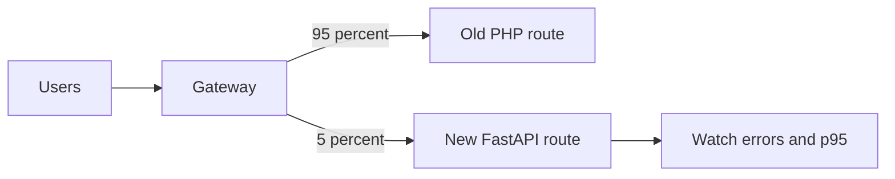
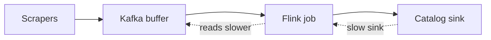

# Deployment and Scale for Every Resume Project

<div class="callout note">
<b>How to use this page</b>
<ul>
<li>Part 1 explains deployment and scaling ideas from zero: canary, rollback, blue-green, autoscaling, rate limiting, circuit breakers, backpressure, caching, sharding and more. Each one ends with where it honestly shows up in my work.</li>
<li>Part 2 goes project by project: how each system shipped, how it scaled, how it rolled back, and which numbers I can defend.</li>
<li>Read it before system-design rounds and "how did you deploy this / what happens at 10x" questions.</li>
<li>Memorise the per-project "deploy story" paragraphs in Part 2 and the honesty lines. They're what you'll actually say.</li>
</ul>
</div>

**Tags:** MEASURED means there's a benchmark, log or doc behind it. TARGET means a design goal (say "targeting"). ESTIMATED means arithmetic I can show. HISTORICAL means from past work records, not re-measured. DESIGN means designed but not claimed as running.

<div class="callout warn">
<b>The one honesty rule for this page.</b> I have deployed and consumed containerised services (Docker on GCP and AWS). I have <b>not</b> operated Kubernetes clusters, written Terraform, or run multi-region setups. Those are study topics. When an interviewer asks about them, explain how they work and say plainly that I didn't own them.
</div>

---

# Part 1: The concepts, from zero

## 1. Build, image, release

**Plain English.** Deploying means getting new code running for real users. First you *build* the code. Then you package it into a *container image*, a sealed box holding the app and everything it needs. A *release* starts new copies of that image and stops the old ones.

**Analogy.** A container image is like a meal-prep box: same ingredients, same recipe, so it tastes the same on any stove.

**Where it shows up in my work.** Every project shipped as Docker images: Impact Analytics on GCP, Masters India on AWS, Uber Menu on GCP, and Uber FRM through Uber's release process with Bazel builds.

## 2. Rolling, blue-green and canary deployments

These are three ways to swap old code for new without a big outage.

- **Rolling deploy.** Replace copies one at a time. Like changing the tyres on a bus one by one while it's parked at different stops.
- **Blue-green deploy.** Run two full environments. "Blue" serves users while "green" gets the new version. When green looks healthy, flip all traffic over in one step. Rollback means flipping back.
- **Canary deploy.** Send a small share of real traffic, say 5%, to the new version. Watch errors and latency. If it's healthy, increase step by step to 100%. The name comes from canaries that miners carried to detect gas early.



*What to notice:* only a small slice of real users hit the new code first. If the metrics look bad, the gateway sends everyone back to the old route.

**Tiny example.** Week 1, `/invoice/status` sends 5% of traffic to FastAPI. Error rate matches PHP, and p95 is lower. Week 2 it's 50%. Week 3 it's 100%, and the PHP route is retired.

**Where it shows up in my work.**
- **Masters India: canary per route.** This is my real canary experience. During the strangler migration (replacing the monolith one endpoint at a time), each route moved to FastAPI behind the gateway with a canary percentage. Rollback was a traffic flip, not a rebuild.
- **Blue-green: not claimed.** The closest idea in my work is the ClickHouse *REPLACE PARTITION* design at Impact Analytics, which loads data into a staging table and swaps it in one step. That design was written but not executed. Don't present it as running.

## 3. Rollback

**Plain English.** Rollback means returning to the last known good state when a release goes wrong. There are three kinds, and interviewers like it when you separate them.

1. **Code rollback.** Run the previous version again. Easy if the deployment is a traffic flip or an image tag change.
2. **Data rollback.** Undo or redo data changes. Much harder, because data has already been written.
3. **Schema rollback.** Undo a database structure change. The safe pattern is *expand and contract*: first add the new column (expand), make the code use it, and only later remove the old one (contract). At every step, both the old and the new code still work.

**Tiny example of expand and contract.** You want to rename `amount` to `amount_usd`. Release 1 adds `amount_usd` and writes to both columns. Release 2 reads from `amount_usd`. Release 3 drops `amount`. If release 2 breaks, you roll back to release 1 and nothing is lost.

**Where it shows up in my work.**
- **Masters India.** Code rollback was flipping the canary traffic back to the PHP route.
- **Uber FRM.** Rollback was the previous service revision plus migration discipline in the expand-and-contract style. Releases went out as stacked Bazel PRs (a chain of small, dependent pull requests), so each step was small enough to revert.
- **Uber Menu.** Data rollback by replay. If a bad parser shipped, we rewound the Kafka consumer offsets to before the bad release and reprocessed events with the fixed parser.
- **Impact Analytics (data).** For the cluster migration, a failed season copy was handled by `DROP PARTITION` for that season, then recopying it. That's a "drop and redo", not an atomic swap with live readers.
- **Impact Analytics (AI).** Every output row is stamped with a `config_hash`, a fingerprint of the prompts, parameters, guardrails and catalog used. If a config turns out bad, the hash tells you exactly which rows came from it and need rerunning.

## 4. Feature flags and config-driven changes

**Plain English.** A *feature flag* is an on/off switch in configuration that turns a feature on for some users without a new deployment. *Config-driven* means behaviour comes from data or config, not hard-coded logic.

**Analogy.** A light switch versus rewiring the house.

**Tiny example.** `if flags.enabled("new_scoping_screen", user): show_new()` lets you turn the screen on for the Finance team first.

**Where it shows up in my work.**
- **Impact Analytics, KPI configurator.** Operators change KPI formulas as configuration. A Go parser turns them into safe ClickHouse SQL, so business logic changes without a code release.
- **Uber FRM.** Older notes describe staged rollout and feature flags inside the finance tooling path. Keep it general if asked.
- **Uber Menu.** Proxy pools and IP settings for anti-bot handling were configuration, not code.

## 5. Zero-downtime deploys, health checks and graceful shutdown

**Plain English.** Zero-downtime means users never see an error during a release. Three pieces make it work:

- **Health checks.** The platform asks each copy "are you ready?" and only sends traffic to copies that say yes.
- **Graceful shutdown.** When the platform wants to stop a copy, it sends a signal called SIGTERM. A well-behaved service stops accepting new requests, finishes the ones in flight, then exits. This is called *draining*.
- **Backward-compatible changes.** Old and new versions must both work during the overlap, which is why expand-and-contract matters.

**Where it shows up in my work.**
- **Impact Analytics Go edge.** There's no reverse proxy in front, so the Go process itself has to handle slow clients, request-size limits and draining on SIGTERM. That's part of what "self-protecting edge" means.
- **Uber FRM.** Zero-downtime releases via stacked Bazel PRs (on the PDF).
- **Masters India.** Canary per route meant no single release could take the whole system down. We had no outage during deadline windows throughout the migration.

## 6. Horizontal versus vertical scaling, and statelessness

**Plain English.**
- **Vertical scaling** means a bigger machine: more CPU and memory. It's simple, but there's a ceiling and it gets expensive.
- **Horizontal scaling** means more machines running copies of the same service, with a load balancer spreading requests across them.
- **Stateless** services keep no user data in memory between requests, so any copy can serve any request. Stateless services are easy to scale horizontally.

**Analogy.** Vertical is hiring one faster cashier. Horizontal is opening more checkout lanes.

**Where it shows up in my work.**
- **Impact Analytics.** The Go/Gin edge is stateless. Auth results are cached in Redis, not in process memory, so it can scale out by adding copies. The 170 GB out-of-memory story is a lesson in *not* scaling vertically: a bigger memory cap still failed, and slicing the work into one-week chunks fixed it.
- **Masters India and Uber Menu.** Kafka consumers scale horizontally, up to the number of topic partitions.

## 7. Autoscaling

**Plain English.** Autoscaling automatically adds copies when load rises and removes them when it falls. It's usually based on a metric like CPU usage, request rate or queue length.

**Tiny example.** "Keep average CPU around 60%. If it goes above that for 3 minutes, add a copy. Never run fewer than 2 or more than 20." For queue workers a better signal is often queue lag: "if more than 10,000 messages are waiting, add a worker."

**Things interviewers like to hear.**
- Autoscaling reacts with a delay, so you still need headroom for sudden spikes.
- Scaling the app without scaling the database just moves the bottleneck.
- For queue consumers, you can't usefully run more consumers than there are partitions.

**Where it shows up in my work (honestly).** I didn't own autoscaling policies on any project. What I did own is designing services so they *can* scale out: a stateless Go edge, Kafka consumers that scale with partitions, and Menu scrapers and stream consumers that scale as separate jobs. If asked "how was it autoscaled?", say: "The platform team owned scaling policies. My part was making the services stateless and the work partitionable."

## 8. Load balancers and reverse proxies

**Plain English.** A *load balancer* spreads incoming requests across copies of a service. A *reverse proxy*, like Nginx, sits in front of an app and can also enforce timeouts, size limits and TLS.

**Where it shows up in my work.**
- **Impact Analytics.** The Go edge deliberately runs *without* a reverse proxy, so it handles HTTP/2 and timeouts itself.
- **Masters India.** The canary split happened at the gateway in front of the PHP and FastAPI services. Older notes say that gateway was Nginx.

## 9. Rate limiting and quotas

**Plain English.** Rate limiting caps how many requests a client can make in a time window, so one noisy client can't starve everyone else. Servers usually reply with HTTP 429 "Too Many Requests" when the limit is hit.

**How a token bucket works.** Each client has a bucket that holds, say, 10 tokens and refills at 5 tokens per second. Each request takes one token. A burst of 10 requests is fine. After that, the client is limited to 5 per second. An empty bucket means a 429.

```text
t=0s   bucket=10  -> 10 requests pass, bucket=0
t=1s   bucket=5   -> 5 pass
t=1s   11th request in that second -> 429 Too Many Requests
```

**Two kinds of limits for AI products.** Request limits protect the API. AI systems also need *budgets*: maximum tokens, maximum cost, maximum tool calls or retries per session. An HTTP 429 doesn't stop an agent that is already looping. You need limits inside the agent too.

**Where it shows up in my work.**
- **Impact Analytics, AI side.** The Ask Iris evaluator is capped at 3 attempts, so a chat can't loop forever. The batch engine has hard timeouts and circuit breakers for LLM provider failures, and it logs tokens and USD cost per run as JSON telemetry.
- **Impact Analytics, API side.** The PDF claim is a self-protecting edge with nested timeouts. If asked whether the Go edge has per-tenant request rate limits, keep it qualitative unless you can point to the code.
- **Masters India.** We were on the receiving end of the government portals' limits and instability. Bounded retries with backoff kept us from hammering them. Bulk work went through Kafka instead of the HTTP tier, so the API wasn't the bulk throttle. Celery (a Python background-task queue on the Masters stack) handled background tasks, and older notes mention task rate limits there.
- **Uber Menu.** Also on the receiving end, from restaurant and aggregator websites blocking bots. We used proxy pools, adaptive retries and per-source retry budgets.

## 10. Timeouts, retries with backoff, and circuit breakers

**Plain English.**
- **Timeout.** Stop waiting after a set time. Without one, a slow dependency ties up your workers forever.
- **Nested timeouts.** An outer limit on the whole request, inner limits on each call inside it. The inner ones must be shorter.
- **Retry with exponential backoff.** If a call fails, wait and try again, doubling the wait each time (1 s, 2 s, 4 s), usually with some randomness (jitter) so clients don't all retry at once.
- **Circuit breaker.** After several failures in a row, stop calling the failing service for a while and use a fallback. Like a fuse that trips to protect the house.

**Tiny example.** An LLM call has a 30-second timeout. Five calls in a row time out, so the breaker opens. For the next minute, items get the deterministic score instead of waiting on the LLM. Then the breaker lets one test call through.

**Where it shows up in my work.**
- **Impact Analytics.** The orchestration registry has hard timeouts and circuit breakers that trip after about 5 consecutive failures or a high failure fraction. On an LLM timeout the item falls back to the deterministic baseline score, and the batch continues. The Go edge uses nested timeouts.
- **Masters India.** Bounded retries against the government portal, with a dead-letter queue for messages that keep failing.
- **Uber Menu.** Adaptive retries with per-source budgets for scrapers.

## 11. Queues and backpressure

**Plain English.** A queue sits between a producer and a consumer, so bursts don't crush the consumer. *Backpressure* means a slow consumer pushes back, so the producer slows down instead of everything overflowing memory.

**Analogy.** A restaurant's order rail. If the kitchen is slow, tickets pile up on the rail, and the host stops seating new tables.



*What to notice:* when the catalog slows down, Flink reads from Kafka more slowly, and events wait safely in Kafka instead of piling up in memory.

**Where it shows up in my work.**
- **Uber Menu.** Kafka buffered bursty scrapers. Flink's built-in backpressure slowed consumption when the catalog sink slowed down.
- **Masters India.** Kafka absorbed bulk import spikes around filing deadlines.
- **Impact Analytics.** No Kafka. The batch engine controls its own pace through batch sizes (about 88k items per pass), and the data pump through 500k-row double-buffered batches.

## 12. Idempotency and dead-letter queues

**Plain English.** *Idempotent* means doing something twice has the same effect as doing it once. That matters because retries and message re-delivery always happen eventually. A *dead-letter queue* (DLQ) holds messages that keep failing, so a human can inspect and replay them instead of the system retrying forever.

**Tiny example.** Key = `client_42:filehash_ab12:batch_3`. The first attempt registers the invoice and stores the key. A retry with the same key returns the stored result and doesn't submit to the government again.

**Where it shows up in my work.**
- **Masters India.** Idempotency keys (client plus file hash plus batch index) across the whole bulk pipeline, plus a DLQ with replay. This is the double-filing near-miss story.
- **Uber Menu.** "Exactly-once catalog upserts" in practice means at-least-once delivery plus idempotent upserts keyed by vendor or menu and content hash.
- **Impact Analytics.** ReplacingMergeTree keeps the newest version of a row with the same key, so a retried batch doesn't leave duplicate decisions.

## 13. Caching

**Plain English.** A cache keeps a copy of frequently read data somewhere fast, usually in memory with Redis, so you don't hit the database every time. *Cache-aside* means the app checks the cache first. On a miss it reads the database and fills the cache. The hard part is staleness: deciding how long a cached value may live.

**Where it shows up in my work.**
- **Masters India.** A Redis cache-aside layer cut database read load by 30%.
- **Impact Analytics.** Redis fronts the auth waterfall, so verified identities don't get re-checked against Firebase or OIDC on every request.

## 14. Sharding and partitioning

**Plain English.** *Partitioning* splits a big table into slices inside one database, often by date. *Sharding* splits data across separate databases. Both keep each piece small and let queries skip irrelevant data.

**Where it shows up in my work.**
- **Masters India.** PostgreSQL sharded by tax quarter.
- **Impact Analytics.** ClickHouse rollup tables partitioned by season code. Migration and rollback happen one season partition at a time.

## 15. Pre-aggregation and batching

**Plain English.** *Pre-aggregation* means computing totals ahead of time, so queries read small summary tables. *Batching* means processing many items together to reduce per-item overhead.

**Where it shows up in my work.**
- **Impact Analytics.** Six rollup tables took planner pivots from 189 seconds to 12 seconds on a 250-million-row benchmark. The weekly rollups are built one fiscal week at a time to keep memory bounded.

## 16. Observability: logs, metrics, traces

**Plain English.**
- **Logs** are timestamped text records of what happened.
- **Metrics** are numbers over time, like requests per second or error rate.
- **Traces** follow one request across services, showing where the time went.
- For LLM apps, *LLM tracing* records every prompt, tool call and model response.

**Where it shows up in my work.**
- **Impact Analytics.** Datadog distributed tracing on the Go edge. LangSmith traces for Ask Iris. Custom JSON telemetry for the batch engine, covering tokens, USD cost, step duration and batch fallbacks.
- **Masters India.** ELK (Elasticsearch, Logstash, Kibana, a log search stack) plus New Relic tracing cut incident triage time by about 70%. The baseline is ESTIMATED: from about 30 minutes to under 10.

## 17. Load testing and capacity planning

**Plain English.** Load testing sends realistic traffic at a system to find where it breaks before users do. Capacity planning uses those results plus growth estimates to decide how much headroom to keep.

**Tiny example.** If normal peak is 1,000 requests per second, test at 3,000 and watch p95 latency, error rate, connection pools and memory.

**Where it shows up in my work.** The connection-leak STAR story (a packet story, not on the PDF) ended with a load test at 3 times peak added to CI. The ClickHouse PoC was a benchmark on 250 million rows, which is a form of capacity test for reads. Don't invent other load-test numbers.

## 18. Kubernetes (literacy only)

**Plain English.** Kubernetes runs containers across a cluster of machines. You describe what you want ("3 copies of this image, with this health check") and it keeps reality matching: restarting crashed copies, rolling out new versions and scaling.

**Words worth knowing.** A *pod* is one or more containers running together. A *Deployment* manages rolling updates of pods. A *Service* gives pods a stable address. *Readiness and liveness probes* are health checks. The *Horizontal Pod Autoscaler* adds or removes pods based on metrics.

**Where it shows up in my work.** Skills-level only. It's on my skills line as literacy. I haven't operated clusters. If asked, explain the concepts above and say: "I've deployed services that ran on container platforms, but I didn't own the cluster operations."

---

# Part 2: Project by project

## Impact Analytics: AssortSmart (Platform and AI)

| | |
|---|---|
| **Scale (PDF)** | Go/Gin edge at 10k peak requests per second. A 2.11B-row ClickHouse master. Six rollup tables. Pivots from 189 s to 12 s on a 250M-row benchmark. 348k article-seasons scored, 88k items per pass. Data pump at about 344k rows per second, on partitions up to 4.09B rows |
| **Deploy shape** | Docker services on GCP. The Go/Gin platform and the Python agent service (FastAPI, LangGraph) are separate deployables and ship independently. ClickHouse holds analytics. PostgreSQL holds roles and access rules. Redis caches auth |
| **Why this shape** | The Go tier scales with request volume. The agent tier scales with LLM latency and cost. Keeping them separate means one doesn't drag the other down |
| **Change without deploy** | KPI formulas are configuration, compiled by the Go parser into safe ClickHouse SQL |
| **Release gates** | A 300-case evaluation set with an 80% accuracy gate in CI blocks AI changes that regress. Model choice came from a separate 200-item benchmark |
| **Failure handling** | Nested timeouts on the edge. Hard timeouts and circuit breakers in the batch registry. Deterministic fallback on LLM timeouts. Checkpoints (`det.json`, `agent_progress.json`, `--resume`) so a restart skips finished work |
| **Observability** | Datadog tracing for Go. LangSmith for Ask Iris. JSON telemetry (tokens, USD, step duration, fallbacks) for batches |
| **Data migration** | Custom Go native-TLS pump across ClickHouse Cloud clusters. TSV ledgers and `.done` checkpoint files. Failed seasons handled with drop partition and recopy |

**Deploy story (say this).**
> "The services are Docker containers on GCP. The Go platform and the Python agent service ship independently, because one scales with request volume and the other with LLM latency and cost. Business formulas change through configuration, not releases. AI changes have to pass an 80% accuracy gate in CI before promotion. In production, every LLM call has a hard timeout, a circuit breaker protects against provider outages, and if the LLM fails we fall back to the rule-based score. So a batch run finishes even on a bad provider day."

**Say this carefully.**
- No Kafka, Flink, CDC or Kubernetes operations at Impact Analytics.
- 10k peak RPS is the stated peak. Don't invent averages, latency SLAs or TPS.
- 344k is rows per second, an ingest rate, not requests per second.
- The 4.09B copy was measured in flight. Don't say the cutover finished.
- Ask Iris is a shipped capability. No usage or uptime numbers.
- The Cluster Recommendation Copilot and Hindsight are verbal only. Older notes for those mention a pending load test, extra product analytics and per-tenant ClickHouse. Those belong to verbal design work, not the resume.

## Uber via EPAM: FRM Scoping Platform

| | |
|---|---|
| **Scale (PDF)** | 36 FastAPI endpoints. 19M raw general-ledger rows migrated off Sheets. $340M materiality threshold. Reconciliation from 14 days to 3 days. Led 3 engineers. Module coverage 100% |
| **Verbal depth** | 8 screens. 11 ORM models. 1,100+ tests. Residual materiality $170M on the Q4 2025 close |
| **Deploy shape** | FastAPI services with MySQL on SOADB (Uber's standard service-owned MySQL) as the source of truth, and a React UI. Bazel monorepo builds and tests. Docker images through Uber's release process |
| **Why** | Sheets couldn't be the audit source of truth. MySQL gives a line-level trail tying the finance system's numbers to the filed 10-Q report |
| **Release gates** | Design reviews, API contracts, and tests run through Bazel. Automated state-machine gates with 50% delta-variance checks for SOX |
| **Rollback** | Previous service revision, plus expand-and-contract schema discipline. Small stacked PRs so each step is revertible |

**Deploy story (say this).**
> "It shipped through Uber's monorepo with Bazel, as small stacked PRs, so every release was small and zero-downtime. Schema changes were reviewed with the audit trail in mind, and we used expand-and-contract so old and new code always worked side by side. Rollback meant going back to the previous revision. During the reconciliation move from Sheets to MySQL, we ran the old and new versions in parallel to compare results before cutting over."

**Say this carefully.** 70% from 14 days to 3 days is on the PDF and you defend it as written. If pressed: "The technical design doc framed that cut, and that's what the platform delivered for the close." Older prep said "30+ endpoints" and called 70% a "target". That's obsolete. Don't claim multi-region ownership or the collaboration/Slack notification service.

## Uber via EPAM: Menu Ingestion (Uber Eats)

| | |
|---|---|
| **Scale (PDF)** | 30K+ menus a month. Onboarding from 24 hours to 2 hours. $600K a year saved. Extraction success 95%+. 98% field fidelity on offline evaluation |
| **Deploy shape** | Selenium scraper fleet on GCP. Kafka ingestion bus. Flink jobs for keyed dedupe and normalisation. Python RAG workers (LangChain, Gemini 2.5 Pro, Milvus). All in Docker |
| **Why Kafka** | Scrapers are bursty and flaky. Kafka buffers bursts and allows replay and multiple consumers |
| **Why Flink** | Stateful keyed dedupe as events stream in, with lower latency than micro-batches for catalog freshness |
| **Why not Spark on the hot path** | Spark isn't on the PDF. Mention it only as a verbal option for backfills |
| **Rollback** | Rewind Kafka offsets to before a bad parser release and reprocess |

**Deploy story (say this).**
> "Scrapers and stream consumers scaled as separate jobs, so a scraping spike didn't overload processing. If we shipped a bad parser, we rewound the Kafka offsets to before it and reprocessed. Proxy pools and IP settings were configuration, so we could react to new bot defences without a deploy."

**Say this carefully.** 98% is offline evaluation. $600K is about $2 per menu × 30K menus × 12 months, which is $720K, floored to $600K. The Kafka peak of roughly 200 to 500 events per second is a prep-only estimate. Exactly-once means at-least-once plus idempotent upserts. No ClickHouse here.

## Uber via EPAM: ANZ Document Compliance (HISTORICAL)

| | |
|---|---|
| **Scale** | 99.9% regulatory compliance. 20 hours a week of manual work removed |
| **Shape** | A deterministic validation backend checking driver and vehicle documents against local authority rules |

**Say this carefully.** This is Uber Mobility in Australia and New Zealand, not Uber Eats. No Selenium or RAG here.

## Masters India: GST and e-invoicing

| | |
|---|---|
| **Scale (PDF)** | 1,500+ clients. p95 from 1.2 s to 300 ms. Throughput from 700 to 4,000 requests per minute (about 12 to 67 per second). 1M+ government submissions a day (about 12 per second on average, ESTIMATED). 100K+ concurrent imports. Redis cut database reads by 30%. Triage down 70%. Coverage from 35% to 82%. Deployment success 98% |
| **Deploy shape** | Strangler migration: FastAPI services cut over behind the gateway endpoint by endpoint, with a canary per route. Shared database during the move. Kafka consumers for bulk work. Celery for background tasks. Docker on AWS |
| **Why** | The PHP monolith was synchronous. One slow government portal call blocked a worker. Deploys were all-or-nothing, and filing-deadline spikes caused pile-ups |
| **Release gates** | Test coverage gate in CI. Contract tests against the old PHP responses. ELK and New Relic alerts |
| **Rollback** | Flip the route's traffic back to PHP. No rebuild needed |

**Deploy story (say this).**
> "We moved one route at a time behind the gateway, starting with a small canary share. Rollback was a traffic flip, not a rebuild. We froze cutovers during filing-deadline weeks. Bulk submissions went through Kafka, with idempotency keys and a dead-letter queue, so a replay could never file the same invoice twice."

**Say this carefully.** The triage baseline of about 30 minutes to under 10 is ESTIMATED behind the HISTORICAL 70%. Peaks of roughly 8 to 10 times average around deadlines are ESTIMATED. This Kafka is a different product from the Uber Menu Kafka. No Flink at Masters. Older notes call the monolith Laravel, a PHP framework. The resume says PHP monolith.

## GeeksforGeeks

| | |
|---|---|
| **Scale (PDF, HISTORICAL)** | 10K+ daily queries. 10x traffic spikes during live coding contests. 20% lift in premium subscriptions. 30% course-sales lift. 70% ops efficiency |
| **Deploy shape** | Django application services with MySQL, MongoDB, Redis and Elasticsearch, on a normal web release cadence |
| **Why** | Reliability under contest spikes, plus monetisation features |

**Say this carefully.** The business lifts were attributed by business teams. Say "I owned the engineering". Don't claim Kubernetes or modern platform ownership at GFG. Older prep said "+15 to 20%" for premium. The resume says 20%.

---

## Quick comparison

| Project | What gets deployed | Data and messaging | Headline scale number | How rollback works |
|---|---|---|---|---|
| IA AssortSmart | Go/Gin service, Python agent service | ClickHouse, PostgreSQL, Redis | 10k peak RPS. Pivots from 189 s to 12 s on 250M rows | Config hash identifies runs. Drop partition and recopy for migration |
| Uber FRM | FastAPI service | MySQL on SOADB | 36 endpoints. 14 days to 3 days. $340M | Previous revision, expand and contract |
| Uber Menu | Scraper jobs, Flink jobs, RAG workers | Kafka, Flink, catalog | 30K+ menus a month. 24 h to 2 h | Rewind Kafka offsets |
| Masters | FastAPI services, Kafka consumers | Kafka, PostgreSQL shards, Redis | 1M+ a day. 700 to 4,000 requests per minute | Flip canary traffic back |
| GFG | Django web app | MySQL, MongoDB, Redis, Elasticsearch | 10K+ daily queries. 10x spikes | Normal web release |

---

## Practice questions

**"How did you roll out the Masters migration safely?"**
> One route at a time, behind the gateway, with a canary share first. We shadowed read routes before moving them, moved bulk Kafka paths before interactive filing, and froze cutovers in deadline weeks. Rollback was flipping a route's traffic back to PHP.

**"What happens if the LLM provider goes down mid-batch at Impact Analytics?"**
> Each call has a hard timeout. After about five failures in a row, a circuit breaker stops calling the provider for a while. Items get the deterministic score instead, so the batch finishes. When the provider recovers, we resume from the checkpoint and skip work that's already done.

**"How would you autoscale your Go service?"**
> It's stateless, with auth cached in Redis, so it scales horizontally. I'd scale on request rate or CPU, keep headroom for spikes, and watch ClickHouse, because scaling the edge just moves load to the database. To be clear, I didn't own the autoscaling policies there.

**"How do you roll back bad data?"**
> It depends on the system. On Uber Menu we rewound Kafka offsets and reprocessed. On the ClickHouse migration we dropped the failed season's partition and recopied it. For AI outputs, every row carries a config hash, so we know exactly which rows came from a bad config and need rerunning.

**"Have you used Kubernetes?"**
> At skills level. I understand pods, deployments, probes and autoscalers, and my services ran in containers. I haven't operated clusters myself.

**"What's the difference between a canary and blue-green?"**
> A canary sends a small share of real traffic to the new version and ramps up gradually. Blue-green runs two full environments and flips all traffic at once. Canary limits blast radius. Blue-green makes rollback a single flip. I used canaries per route at Masters India.

## Related

- [Numbers defense](numbers_defense.md)
- [Design decisions](design_decisions_tradeoffs.md)
- [Architecture index](architecture/00_index.md)
- [Auth, tenancy and rate limits](tech_depth/auth_tenancy_rate_limits.md)
- [Senior systems study-only topics](../../prep/17_senior_systems_study_only.md)
