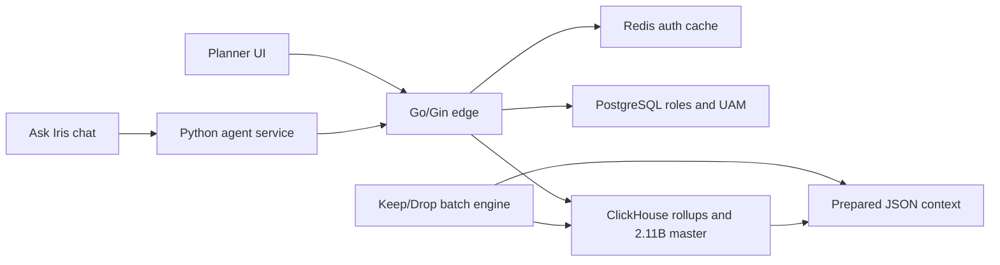
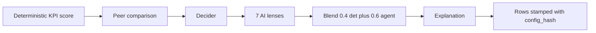
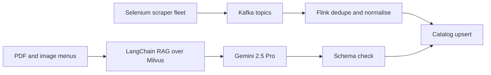

# Design Decisions and Trade-offs (resume-aligned)

<div class="callout note">
<b>How to use this page</b>
<ul>
<li>It walks through every major design decision behind <code>Tarun_Mittal_SSE_5yr.pdf</code>, one project at a time. Each has the same six parts: What, Why, How (with a small example), Alternatives and why not, Trade-off, and What I'd do differently.</li>
<li>Read it before system-design rounds and "tell me about a technical decision" questions.</li>
<li>Memorise the <b>Why</b> and the <b>Trade-off</b> lines. Interviewers mostly probe those two.</li>
<li>Code and SQL snippets are illustrative. They show the idea with simplified names, not production code.</li>
</ul>
</div>

Canonical IA claims: `docs/ASSORTSMART_TAB_RESUME.md`. Numbers and their derivations: [Numbers defense](numbers_defense.md). Architecture diagrams per project: [Architecture index](architecture/00_index.md).

**Tags used:** MEASURED means there's a benchmark, log or doc behind it. DESIGN means I designed it but it isn't claimed as running. HISTORICAL means it comes from past work records. "Verbal" means real work that isn't a resume bullet.

## Decisions at a glance

| # | Project | Decision | One-line reason |
|---|---|---|---|
| 1 | IA platform | Go/Gin edge with no reverse proxy | One process owns timeouts, HTTP/2 and tracing |
| 2 | IA platform | ClickHouse plus rollup tables for planner pivots | Columnar reads won the benchmark, from 189 s to 12 s |
| 3 | IA platform | Slice weekly rollup builds into one-week inserts | A whole season needed about 170 GB of memory |
| 4 | IA platform | Custom KPI formula parser | Business formulas change without code releases |
| 5 | IA platform | Auth waterfall and tenant isolation | A cross-tenant leak is a company-ending bug |
| 6 | IA platform | Custom Go data pump for cluster migration | IP allowlists blocked cluster-to-cluster copy |
| 7 | IA platform | Ledgers plus drop-and-recopy against ghost rows | A failed insert can still leave partial data |
| 8 | IA agentic | Blend rule-based math with LLM lenses | Merchandising math must stay auditable |
| 9 | IA agentic | Keep the LLM away from the 2.11B-row table | A bad generated query or write is too costly |
| 10 | IA agentic | App-native orchestration registry, not Airflow | Resume logic is tied to inserts and config hashing |
| 11 | IA agentic | Ask Iris: supervisor, capped evaluator, frozen scope | Stops infinite loops and cross-tenant reads |
| 12 | IA agentic | Evaluation gate and frozen weights | A model must beat the free rule before it ships |
| 13 | Uber FRM | Sheets to a normalised MySQL schema | Sheets had no stable ids or safe collaboration |
| 14 | Uber FRM | Optimistic locking and SHA-256 natural keys | Safe concurrent edits, no duplicate rows across quarters |
| 15 | Uber FRM | ORM migration with query methods on models | Kills the column-aliasing bug class |
| 16 | Uber FRM | State-machine gates with 50% variance checks | SOX controls enforced by code, not memory |
| 17 | Uber Menu | Kafka plus Flink for ingestion | Bursty, flaky scrapers need a buffer and stateful dedupe |
| 18 | Uber Menu | "Exactly-once" as at-least-once plus idempotent upserts | Honest, achievable correctness |
| 19 | Uber Menu | RAG over Milvus with Gemini, behind a schema check | Grounded extraction from messy multilingual PDFs |
| 20 | Uber ANZ | Deterministic validation backend | Compliance rules need predictable answers |
| 21 | Masters | Strangler migration, not a big-bang rewrite | No downtime allowed during filing deadlines |
| 22 | Masters | Kafka with idempotency keys and a dead-letter queue | Never double-file with the government |
| 23 | Masters | PostgreSQL sharded by tax quarter, Redis cache-aside | Filing data is naturally split by quarter |
| 24 | GFG | PHP to Django, async scheduled workflows | Survive contest spikes, automate manual ops |

---

# Impact Analytics: Core Infrastructure and Pipeline

**The product in plain words.** AssortSmart helps retailers plan assortments: which products (articles) to keep, drop or add each season. Planners look at big grids of sales numbers, called pivots, and the AI engine recommends decisions. Many retailers (tenants) share the same platform.



*What to notice:* the Go edge is the only public door for the planner UI. The AI batch engine reads prepared JSON, not the database, and writes results back through the engine's own insert path.

## 1. Go/Gin edge with no reverse proxy

**What.** The planner-facing API is a multi-tenant Go service built on Gin, handling peaks of about 10,000 requests per second. It is wired with Google Wire, serves HTTP/2 directly, uses nested timeouts, and reports Datadog distributed traces. There's no Nginx-style reverse proxy in front doing the protective work.

**Words.**
- A *reverse proxy* is a server that sits in front of your app, like Nginx, and handles things like timeouts and size limits before requests reach you.
- *Google Wire* is a dependency injection tool. Dependency injection means a component is handed what it needs, like a database client, instead of building it itself. Wire generates the wiring code at compile time, so a missing dependency breaks the build instead of a live request.
- *h2c* is HTTP/2 over plain TCP without TLS, used inside a trusted network. HTTP/2 lets many requests share one connection.
- *Distributed tracing* follows one request across services with a shared trace id, so you can see where time went.

**Why.** At 10k peak RPS, the process that serves traffic should own its own protection. With the timeouts, HTTP/2 handling and tracing in one process, there's one less network hop and one less system to operate. A wiring mistake fails at compile time, not at 2 a.m.

**How (illustrative).** "Nested timeouts" means an outer limit on the whole connection and inner limits per request and per downstream call. The values below are only examples.

```go
srv := &http.Server{
    Handler:           h2c.NewHandler(router, &http2.Server{}),
    ReadHeaderTimeout: 5 * time.Second,   // slow clients can't hold sockets
    WriteTimeout:      60 * time.Second,  // outer cap per response
}

func pivotHandler(c *gin.Context) {
    ctx, cancel := context.WithTimeout(c.Request.Context(), 20*time.Second) // per request
    defer cancel()
    rows, err := chClient.Query(ctx, sql) // the ClickHouse call inherits the deadline
    // ...
}
```

**Alternatives and why not.**
- *Put the Python service at the public edge.* Python is fine for the agent plane, but Go handles high concurrency with less memory per request.
- *Hide it behind Nginx or a cloud load balancer and let them handle protection.* That works, but timeouts and limits then live in two places and drift apart. The PDF claim is a self-protecting edge.
- *Uber Fx or Dig for dependency injection.* Those wire things at runtime using reflection, so a wiring error shows up only when the code runs.

**Trade-off.** You own what a proxy would have given you for free: body-size caps, slow-client protection and graceful shutdown when the process gets a stop signal (SIGTERM). That's more code to own and test.

**What I'd do differently.** I'd write down the timeout budget per route in one table early, so the outer and inner limits are reviewed together instead of route by route.

**Say this carefully.** No invented uptime SLA. No claim that you operated Kubernetes clusters for this.

## 2. ClickHouse plus rollup tables for planner pivots

**What.** Planner pivots moved from PostgreSQL to ClickHouse, with a pre-aggregation layer of six rollup tables: product, store and attribute, each at season and weekly level, partitioned by season. On a 250-million-row benchmark a pivot went from 189 seconds to 12 seconds (MEASURED). Postgres kept the thin metadata: users, roles, access rules.

**Words.**
- *Row store versus column store.* Postgres stores each row together, like reading a full index card for every product even if you need one field. ClickHouse stores each column together, so a query that sums "sales" reads only the sales column.
- *Vectorised execution* processes a batch of values at once instead of one at a time.
- A *rollup* is a table of pre-computed totals, like keeping weekly totals instead of re-adding every receipt.
- *ReplacingMergeTree* is a ClickHouse table type that keeps only the newest version of rows with the same key. Think of a notebook where you never erase. You write the new value below, and a cleaner later crosses out the old lines.

**Why.** Pivots group many columns over hundreds of millions of rows. Postgres had to scan whole rows and slowed down badly. POCs comparing the two on identical data showed ClickHouse winning the large analytical reads.

**How (illustrative).** A season-level product rollup, and the planner query that reads it:

```sql
CREATE TABLE product_season_rollup (
    tenant_id String, season_code String, article_id String,
    sales_units Float64, sales_value Float64, eop_units Float64
) ENGINE = MergeTree
PARTITION BY season_code
ORDER BY (tenant_id, season_code, article_id);

SELECT article_id, sum(sales_units), sum(eop_units)
FROM product_season_rollup
WHERE tenant_id = {tenant:String} AND season_code = 'S26'
GROUP BY article_id;
```

The pivot reads pre-summed rows instead of the raw fact table.

**Alternatives and why not.**
- *Tune Postgres harder.* We tried in-stack fixes first. Row storage is the limit for wide analytical GROUP BYs.
- *BigQuery or Snowflake for the interactive UI.* Good for batch analytics, but shared compute means latency varies. BigQuery probes we measured ranged from about 1 to 20 seconds for the same query. That's poor for an interactive screen.
- *Move everything, including users and roles, to ClickHouse.* ClickHouse is weak at updating single rows in place, so small, often-changed records stay in Postgres.

**Trade-off.** ClickHouse is a poor fit for keyed updates. Writes become insert-only with versioned rows, and you run two databases instead of one.

**What I'd do differently.** I'd lead the first RFC with the insert-only write model. The debate (see STAR story 1) got stuck on the old update-in-place habit, and that framing would have saved weeks.

## 3. Slice weekly rollup builds into one-week inserts

**What.** Building the weekly rollups for a whole season in one INSERT SELECT needed about 170 GB of memory and crashed. Even 80 GB and 200 GB caps failed. I sliced the build into one fiscal week per insert, with memory and disk-spill caps.

**Words.** *INSERT SELECT* reads, aggregates and writes in one statement. *Disk spill* lets a big GROUP BY write temporary data to disk instead of failing when memory runs out. *OOM* means out of memory.

**Why.** Shrinking the unit of work is cheaper and more predictable than buying more RAM, and it makes each piece retryable.

**How (illustrative).** The real caps are verbal detail: 55 GB memory, 16 GB spill, 8 threads, 4 weeks in flight.

```sql
INSERT INTO attr_weekly_rollup
SELECT tenant_id, season_code, fiscal_week, attribute_value,
       sum(sales_units), sum(sales_value)
FROM sales_fact
WHERE season_code = 'S26' AND fiscal_week = 202614   -- one week per insert
GROUP BY tenant_id, season_code, fiscal_week, attribute_value
SETTINGS max_memory_usage = 55000000000,
         max_bytes_before_external_group_by = 16000000000,
         max_threads = 8;
```

With that slicing, a product week needed about 11 GB. An attribute week went above 40 GB but stayed inside the caps.

**Alternatives and why not.**
- *Bigger machine.* It failed even at a 200 GB cap, and it would just move the cliff.
- *Drop the weekly level.* Planners need weekly detail.
- *Stream the aggregation with an external system.* Kafka or Flink would be new infrastructure for a batch problem. Not used at IA.

**Trade-off.** More inserts to orchestrate and track, and a longer total build. In return, each week is predictable and can be retried on its own.

**What I'd do differently.** I'd run a single-week trial and measure its memory before ever attempting a whole-season build.

**Say this carefully.** This is load time. The pivot speed-up in decision 2 is query time. One did not cause the other.

## 4. Custom KPI formula parser

**What.** Operators write KPI formulas, like sell-through, in a simple formula language. A Go tokenizer and parser turn them into parameterised ClickHouse SQL fragments. Only allowlisted functions are accepted. Logical names map to physical columns. Every expression is wrapped to protect against division by zero.

**Words.** A *tokenizer* splits text into pieces like names, numbers and operators. A *parser* checks those pieces follow the grammar and builds a tree. *Parameterised SQL* means values are passed separately from the SQL text, so they can't change its meaning. *Fail closed* means anything unknown is rejected, not guessed.

**Why.** Business teams change KPI definitions often. Without a parser, every change is a code release. And a NaN or infinity from dividing by zero would poison the planner's numbers.

**How (illustrative).**

```text
Operator writes:   sell_through = sales_units / (sales_units + eop_units)

Parser output:     ifNotFinite(toFloat64(sum(sls_u) / (sum(sls_u) + sum(eop_u))), 0)
```

If a product sold nothing and has no stock, the division is 0 / 0. ClickHouse returns NaN, and `ifNotFinite(..., 0)` turns it into 0. A formula with an unknown token, like `DROP` or a function not on the allowlist, fails to parse and is rejected.

**Alternatives and why not.**
- *Hard-code each KPI in SQL.* Every change needs a release.
- *Let operators type raw SQL.* That's a SQL injection and runaway-query risk.
- *A general expression library.* It wouldn't know about our column catalog or the ClickHouse functions we allow.

**Trade-off.** We own a small language: its grammar, error messages and tests. Operators can only use what the allowlist supports.

**What I'd do differently.** I'd add a preview step that shows the operator a sample result before a formula is saved.

## 5. Auth waterfall and tenant isolation

**What.** Every request is authenticated through a Redis-fronted waterfall: try Firebase Admin first, then JWT or Google OIDC. API keys are compared in constant time. Roles come from Postgres. Every query in Postgres and ClickHouse is scoped to the caller's tenant and their allowed product hierarchy, which is UAM (User Access Management).

**Words.** A *JWT* is a signed token that says who you are. *OIDC* (OpenID Connect) is a standard way to log in with an identity provider like Google. A *waterfall* tries checks in order until one succeeds. *Constant-time comparison* takes the same time whether the first character or the last is wrong, so an attacker can't guess a key by timing responses.

**Why.** In a multi-tenant product, one retailer seeing another's data is a company-ending bug. Different clients arrive with different identity types, so the waterfall accepts each safely. Redis caches verified results so the edge doesn't re-verify every request.

**How (illustrative).**

```go
if subtle.ConstantTimeCompare([]byte(given), []byte(stored)) != 1 {
    return errUnauthorized // same cost on every mismatch
}
```

The tenant id always comes from the verified token, never from the request body.

**Alternatives and why not.**
- *Trust a header from the gateway.* There's no gateway in front of this edge, and a header is easy to forge.
- *One identity provider only.* Existing clients use different ones.

**Trade-off.** More code paths to test, and a Redis dependency on the hot path.

**What I'd do differently.** I'd keep a dedicated suite of cross-tenant negative tests from day one, where tenant A tries to read tenant B and must fail.

**Say this carefully.** Isolation is access control, not encryption.

## 6. Custom Go data pump for cluster migration

**What.** To move rollups between ClickHouse Cloud clusters, I wrote a Go program that reads from one cluster and writes to the other over ClickHouse's native protocol with TLS. It reached about 344k rows per second combined, using 500k-row double-buffered batches, on partitions up to 4.09 billion rows.

**Words.** *IP allowlist* means a server only accepts connections from listed addresses. *Native protocol* is ClickHouse's own fast binary protocol. *Double-buffered* means reading the next batch while the previous one is being sent.

**Why.** The clusters' IP allowlists blocked them from connecting to each other directly, so ClickHouse's built-in copy couldn't run. A pump that connects to both from an allowed machine sidesteps that.

**How (illustrative).**

```go
next := readBatch(src, 500_000)
for next != nil {
    cur := next
    go func() { next = readBatch(src, 500_000) }() // read ahead
    writeBatch(dst, cur)                           // send current
    waitForRead()
}
```

**Alternatives and why not.**
- *ClickHouse's own remote copy.* Blocked by the allowlists.
- *Export to files and re-import.* That adds a storage step and doubles the data handling. You can discuss it as an option, but the pump was the direct path.

**Trade-off.** We own a migration tool, including its retries and ledgers. It ran from one machine, so throughput depended on that machine's network.

**What I'd do differently.** See decision 7.

**Say this carefully.** 344k is rows per second, not requests per second. The 4.09B copy was measured in flight. Don't say the cutover finished. Never suggest open-sourcing the copier.

## 7. Ledgers plus drop-and-recopy against ghost rows

**What.** A failed insert can still commit some blocks, leaving "ghost rows". To prevent that, the weekly loader records each finished chunk in a TSV ledger and skips it on restart. The copier writes a `.done` checkpoint file per table. If a season's copy fails, we drop that partition and recopy the season.

**Why.** "Count greater than zero" doesn't prove a partition is complete. A ledger of finished work does.

**How.**

```text
migrate-checkpoints/attr_weekly_rollup.done   <- table finished
loader_skip.tsv:  attr_weekly  S26  202614  OK  <- week finished
On failure:  ALTER TABLE attr_weekly_rollup DROP PARTITION 'S26';  then recopy S26
```

**Alternatives and why not.**
- *Atomic swap with REPLACE PARTITION.* That's cleaner: load into staging, then swap in one step so readers never see partial data. The incremental REPLACE PARTITION design was written, but not executed.
- *Trust insert success codes.* A failed insert can still leave partial data.

**Trade-off.** Drop-and-recopy repeats a whole season on failure, and there's a window where that season is missing. It is **not** an atomic swap with live readers.

**What I'd do differently.** I'd execute the REPLACE PARTITION design, so a retry swaps in a staged copy instead of recopying in place.

---

# Impact Analytics: Agentic Flows and Orchestration

**The AI engine in plain words.** For each article-season (one product in one selling season), the engine computes a rule-based score from sales metrics, asks an LLM to judge it from seven angles ("lenses"), blends the two, and writes a keep or drop recommendation with an explanation. It runs as batches of about 88k items per pass, across 348k article-seasons.



*What to notice:* the order is fixed. There is no LLM deciding which step runs next.

## 8. Blend rule-based math with LLM lenses

**What.** A deterministic score `s_det` comes from sell-through and rate of sale. An AI score `s_agent` comes from seven lenses combined by a decider. The final score is `s_final = 0.4 × s_det + 0.6 × s_agent`, and the item is kept if `s_final ≥ 0.55`.

**Words.** *Sell-through* is the share of stock that sold. *Rate of sale* is units sold per week. A *lens* is one focused angle of analysis, like one specialist's opinion.

**Why.** Merchandising decisions have to be explainable to planners and auditable. The math is the anchor. The LLM adds judgment the math can't capture, like context from peers. Neither alone is enough.

**How (worked example).** `s_det = 0.70`, `s_agent = 0.45`. Then `s_final = 0.28 + 0.27 = 0.55`, which meets the threshold, so it's a keep. If the LLM times out, `s_agent` is missing and the deterministic baseline is used, so the run continues.

**Alternatives and why not.**
- *LLM only.* Not auditable, and on our benchmark the LLM blend lost to the rule (decision 12).
- *Rules only.* Misses context and can't explain itself in planner language.
- *Give the LLM a SQL tool to look things up.* See decision 9.

**Trade-off.** Two scoring systems to maintain, and weights that need evidence before anyone changes them.

**What I'd do differently.** I'd build the gold benchmark before setting the first blend weights, not after.

**Say this carefully.** Offline evaluations replaced critic or evaluator agents in Keep/Drop. There's no human review queue, and no LangSmith on this batch (LangSmith is Ask Iris).

## 9. Keep the LLM away from the 2.11B-row table

**What.** The scoring LLM never queries the 2.11-billion-row ClickHouse master. The engine prepares context as JSON payloads and sends that in. Results are written by the engine, not the model, into a ReplacingMergeTree table. That makes writes eventually consistent: retries may write a row twice, and the newest version wins. If the LLM times out, the deterministic score is written instead.

**Words.** *Eventually consistent* means duplicates or older versions may briefly exist, but reads settle on the right answer. *Async* here describes how batches run in parallel. It does not mean the LLM queries the database later.

**Why.** An LLM with database access can generate runaway queries, exhaust connection pools, or be steered by prompt injection. On a table this big, a bad query is expensive and a bad write is very hard to undo.

**How (illustrative).**

```sql
CREATE TABLE kd_decisions (
    tenant_id String, season_code String, article_id String,
    s_det Float64, s_agent Float64, s_final Float64, decision String,
    config_hash String, version UInt64
) ENGINE = ReplacingMergeTree(version)
ORDER BY (tenant_id, season_code, article_id);

-- read the latest version per article
SELECT * FROM kd_decisions
ORDER BY version DESC
LIMIT 1 BY tenant_id, season_code, article_id;
```

**Alternatives and why not.**
- *A read-only SQL tool for the LLM.* It still risks runaway queries and is hard to evaluate.
- *Plain MergeTree.* Retries would leave duplicate decisions.
- *Two-phase commit for exact-once writes.* Heavy, and not needed when the newest version wins.

**Trade-off.** We decide in advance what context the model sees, so it can't explore. Readers must pick the latest version, because merges happen in the background.

**What I'd do differently.** I'd version the JSON payload shape explicitly, so prompt changes and context changes are tracked separately.

**Say this carefully.** No Kafka, Flink or CDC here. CDC work at IA (pg2ch) was a colleague's, not mine.

## 10. App-native orchestration registry, not Airflow or Temporal

**What.** One shared registry runs all three pipelines (Keep/Drop, Missed Opportunities, Top Style). It provides hard timeouts, circuit breakers, durable checkpoints, a frozen `config_hash` on every output row, and JSON telemetry for tokens, USD cost, step duration and batch fallbacks.

**Words.**
- A *circuit breaker* stops calling a failing service for a while after repeated failures, like a home fuse that trips. Ours trips after about 5 consecutive failures or a high fail fraction.
- A *checkpoint* is saved progress, so a restart picks up where it left off.
- A *config hash* is a SHA-256 fingerprint of the guardrails, parameters, prompts and catalog used for a run. Two rows with the same hash were produced under identical settings.

**Why.** A provider error halfway through 88k items must not force a full rerun. And for any output row, we must be able to say exactly which prompts and settings produced it.

**How.** Deterministic scores are saved first to `det.json`. As LLM chunks finish, progress is appended to `agent_progress.json`. Running with `--resume` reloads both and skips finished work.

```python
config_hash = sha256(json.dumps(
    {"guardrails": g, "params": p, "prompts": prompts, "catalog": cat},
    sort_keys=True).encode()).hexdigest()
```

**Alternatives and why not.**
- *Airflow or Temporal.* Both are good workflow engines, but they're extra infrastructure. We needed resume logic tied closely to ClickHouse inserts, config hashing and per-run cost telemetry, inside a batch tool we already owned.
- *No checkpoints.* Every failure would mean recomputing everything.

**Trade-off.** We own retry, breaker and checkpoint code ourselves, without a workflow UI.

**What I'd do differently.** If the number of pipelines keeps growing, I'd re-evaluate Temporal, because its durable execution would replace some of our own code.

## 11. Ask Iris: supervisor, capped evaluator, frozen scope

**What.** Ask Iris is a shipped chat copilot for planners. It runs over a JWT-secured WebSocket. A LangGraph supervisor routes each question to worker agents. An evaluator checks the answer and retries at most 3 times (`MAX_ATTEMPTS = 3`). The user's hierarchy access (`plan_scope`) is frozen at the socket handshake. LangSmith records traces.

**Words.**
- A *WebSocket* is a connection that stays open for live two-way messages.
- *LangGraph* builds agents as a graph of steps with explicit loops and exits.
- A *supervisor* is the node that decides which worker handles a question.
- An *evaluator* is a node that checks whether an answer is good enough.
- *LangSmith* is a tracing tool that records each step an LLM app took.

**Why.** Chat is where two things go wrong: agents loop forever, and a clever message tries to read another tenant's data. A capped evaluator stops the first. A scope fixed at connect time stops the second, because no later message can widen it.

**How.**

```text
1. Client connects: Authorization: Bearer <JWT>
2. Server verifies the JWT, resolves plan_scope = {tenant: T1, hierarchy: Mens/Denim}
3. plan_scope is frozen for this socket. Every tool call inherits it.
4. User: "compare with tenant T2"   ->  tools still run with T1 scope only
5. Evaluator rejects the answer 3 times  ->  graceful "here's what I found" reply
```

**Alternatives and why not.**
- *Check scope per message.* Every check is another chance to get it wrong.
- *No evaluator.* Lower quality answers.
- *Unbounded evaluator.* Infinite loops and runaway token cost.

**Trade-off.** To change scope, the user has to reconnect. Three attempts can sometimes stop just short of a better answer.

**What I'd do differently.** I'd add usage and answer-quality metrics from day one, so I'd have real numbers to show. Today it's a shipped capability, with no usage or uptime numbers to claim.

## 12. Evaluation gate and frozen weights

**What.** A 300-case proxy evaluation set and an 80% accuracy gate in CI block any model or prompt change that scores lower. Separately, a 200-item gold benchmark picked the scoring model. The new model was 73% cheaper and completed 200 of 200 items. The deterministic rule scored 74% on that benchmark. The LLM blend scored about 63%, so the blend weights were frozen instead of retuned.

**Words.** A *proxy evaluation set* is a fixed set of cases with known answers that stands in for real decisions. A *promotion gate* is a CI check that must pass before a change is promoted to production.

**Why.** The free rule is the bar. If AI can't beat it, it shouldn't drive more of the decision. And retuning weights on a small set to make AI look better would be overfitting.

**How.** The gate config is `gold_min_accuracy: 0.8`. On model choice, a "nano" option was slightly cheaper but left items pending, so completion reliability won.

**Alternatives and why not.**
- *Ship on demo quality.* No protection against regressions.
- *Retune weights until the AI wins.* Overfitting on 200 items.
- *Pick the cheapest model.* It didn't complete every item.

**Trade-off.** Some AI improvements wait longer to ship. The gold sets need upkeep.

**What I'd do differently.** I'd grow the gold set so retuning the blend would become statistically safe.

**Say this carefully.** 80% is a CI gate, not live accuracy for all tenants. 73% and 74% come from the gold-200 benchmark, not the 300-case file. Model names aren't on the PDF.

## Verbal only: Cluster Recommendation Copilot and Hindsight

These are real design and build work but not resume bullets. Discuss them only if asked about the broader AI roadmap. Details: [Hindsight defense](projects/01b_hindsight_defense.md) and [Agent read-tools defense](projects/01c_agent_read_tools_defense.md).

---

# Uber via EPAM: FRM Scoping Platform

**The product in plain words.** Each quarter Uber Finance decides which accounts and entities need audit attention, based on materiality (the money amount above which errors matter to auditors). Before this platform much of it lived in Google Sheets. The platform has 36 FastAPI endpoints and a four-level line-item hierarchy (FSLI L1 to L4). It cut reconciliation from 14 days to 3 days.

## 13. Sheets to a normalised MySQL schema on SOADB

**What.** An 8-table normalised MySQL schema on SOADB, Uber's standard service-owned MySQL. It has a polymorphic review-status model, meaning one status model (Draft, Review, ReOpen, Closed) reused across all 8 screens. It migrated 19M raw general-ledger rows off Sheets.

**Words.** *Normalised* means each fact lives in one place, linked by keys, instead of being copied around. *Polymorphic* means one structure works for many kinds of things.

**Why.** Sheets had no stable ids, no safe concurrent editing, and no audit trail tying the finance system's numbers to the filed 10-Q report. ETL jobs locking big tables during close also blocked users. Smaller normalised tables reduce that contention.

**How (illustrative).**

```text
review_status(entity_type, entity_id, status, version, updated_by, updated_at)
  entity_type = 'materiality' | 'group_scoping' | 'residual_risk' | ...
  status      = Draft -> Review -> Closed  (ReOpen -> Review)
```

One table and one state machine serve every screen.

**Alternatives and why not.**
- *Keep Sheets with scripts.* No audit trail or concurrency control.
- *A status column per screen.* Eight copies of the same logic that drift apart.
- *A document store.* Finance data is relational and needs transactions.

**Trade-off.** Polymorphic rows are harder to enforce with foreign keys. Migration needed a parallel run of the old and new reconciliation (v1 on Sheets, v2 on MySQL).

**What I'd do differently.** I'd start the parallel run earlier, so differences surfaced before the close deadline.

## 14. Optimistic locking and SHA-256 natural keys

**What.** Updates check a version number, so two people editing the same row can't overwrite each other silently. Cross-table syncs happen in one transaction. Rows get deterministic SHA-256 natural keys, for example a hash of the question text plus the normalised page name.

**Words.** *Optimistic locking* assumes conflicts are rare. Read the version, update only if it hasn't changed, otherwise reload. *Pessimistic locking* locks the row while you edit. A *natural key* is an id built from the data itself, so the same item always gets the same id.

**Why.** Many Finance users edit at once during close. Locking rows would block them. Random ids create duplicates when the same question is loaded again next quarter. Hash-based ids make reloading idempotent.

**How (illustrative).**

```sql
UPDATE scoping_row SET status = 'Review', version = version + 1
WHERE id = :id AND version = :seen_version;
-- 0 rows updated means someone else changed it: reload and retry
```

```python
uuid = hashlib.sha256(f"{question_text}|{normalize(page_name)}".encode()).hexdigest()
```

**Alternatives and why not.**
- *Pessimistic locks.* They block users and risk deadlocks during close.
- *Auto-increment or random ids.* They duplicate across quarterly reloads.

**Trade-off.** Users sometimes see "this changed, please reload". If the normalisation rule for the key changes, the hashes change too, so that rule is frozen.

**What I'd do differently.** I'd document the key normalisation rule as a contract from the first release.

## 15. ORM migration with query methods on models

**What.** I led 3 engineers moving the data layer to SQLAlchemy 2.0. We raised the module's statement coverage to 100%, shipped through stacked Bazel PRs with zero downtime, and kept reporting SQL on an allowlist. Query methods live on the ORM model classes, an exception to the team's "repository only" rule.

**Words.** An *ORM* maps rows to code objects. *Stacked PRs* are a chain of small dependent pull requests. *Bazel* is Uber's build and test system. A *reporting SQL allowlist* is a fixed list of approved raw queries for reports.

**Why.** Raw SQL joins had duplicate column names, so some rows silently mapped to the wrong id. That was the column-aliasing bug. Typed models with explicit labels remove that bug class. Query methods next to column definitions mean a renamed column breaks the type checker immediately.

**How.** The fix pattern for remaining raw SQL was aliased selects with explicit labels, like `SELECT a.uuid AS account_uuid, b.uuid AS fsli_uuid`.

**Alternatives and why not.**
- *Patch each raw query.* The bug class stays.
- *Strict repository-only layout.* Queries end up far from the columns they depend on (see STAR story 7).

**Trade-off.** A documented exception to the team's rulebook, and a migration in the middle of feature work.

**What I'd do differently.** I'd do the ORM migration before building more screens on raw SQL.

## 16. State-machine gates with 50% variance checks

**What.** Moves between review statuses are automated gates in a finite state machine (FSM). One gate flags any line whose value moved more than 50% against its comparison period, so it can't pass automatically. This supports SOX compliance.

**Words.** An *FSM* is a fixed set of states and allowed moves between them. *SOX* (Sarbanes-Oxley) is the US law that requires controls over financial reporting.

**Why.** Controls that depend on someone remembering to check are weak controls. Code-enforced gates are reproducible and auditable.

**How (illustrative).**

```python
if abs(current - comparison) / abs(comparison) > 0.50:
    raise GateBlocked("variance above 50%, needs explicit review")
```

**Alternatives and why not.** *Manual checklist.* It isn't enforced and isn't auditable.

**Trade-off.** Legitimate big swings need an extra review step.

**What I'd do differently.** I'd show the reason for each flag directly in the review screen, so reviewers see why a line was blocked without digging.

**Say this carefully.** Keep the exact transition rules qualitative in interviews.

---

# Uber via EPAM: Menu Ingestion (Uber Eats)

**The product in plain words.** Restaurants send menus as websites, PDFs and images, often in several languages. The pipeline turns them into Uber Eats' strict catalog format. It processes 30K+ menus a month and cut onboarding from 24 hours to 2 hours.



*What to notice:* structured pages go through Kafka and Flink. Messy PDFs go through retrieval plus an LLM, and both paths pass a check before writing to the catalog.

## 17. Kafka plus Flink for ingestion

**What.** Scrapers publish to Kafka. Apache Flink deduplicates by key (vendor or menu, plus a content hash), normalises the schema, and upserts into the catalog.

**Words.** *Kafka* is a durable log of events that consumers read at their own pace and can replay. *Flink* is a stream processor that keeps state per key, like "the last content hash I saw for this menu".

**Why.** Scrapers are bursty and flaky. Kafka absorbs bursts and allows replay after a bad parser release. Flink's keyed state makes deduplication natural as data streams in.

**How.** Rewinding consumer offsets to before a bad release replays events through the fixed parser.

**Alternatives and why not.**
- *Scrapers write straight to the catalog.* No buffer, no replay, no dedupe.
- *Spark micro-batches.* Higher latency for catalog freshness. Spark isn't on the PDF. Mention it only as a verbal backfill option.

**Trade-off.** Two systems to run, and stateful jobs need checkpointing.

**What I'd do differently.** I'd add per-source lag dashboards from the start, next to block rates.

**Backpressure (Menu only).** If the catalog sink slows down, Flink's buffers fill and it reads from Kafka more slowly, instead of running out of memory. Events wait in Kafka until the sink catches up.

## 18. "Exactly-once" as at-least-once plus idempotent upserts

**What.** The PDF says "exactly-once catalog upserts". In practice, messages may arrive more than once, and the upsert is keyed so applying it twice has the same effect as once.

**Why.** True exactly-once across third-party systems would need distributed transactions, which aren't realistic here. Idempotency gives the same visible result.

**How (illustrative, generic SQL to show the idea).**

```sql
INSERT INTO catalog_item (menu_key, item_key, content_hash, payload)
VALUES (...)
ON CONFLICT (menu_key, item_key) DO UPDATE SET payload = EXCLUDED.payload
WHERE catalog_item.content_hash <> EXCLUDED.content_hash;
```

**Trade-off.** Every write needs a stable key and a content hash.

**Say this carefully.** No claim of zero message loss and no two-phase commit across third parties.

## 19. RAG over Milvus with Gemini, behind a schema check

**What.** For unstructured PDFs, LangChain retrieves similar labelled menus from Milvus (a vector database) and gives them to Gemini 2.5 Pro as examples. Gemini then fills in the catalog schema. The output is validated before upsert. Offline field accuracy was 98%.

**Words.** *RAG* (retrieval-augmented generation) means fetching relevant examples or facts and putting them in the prompt. An *embedding* turns text into a list of numbers, so similar texts end up close together. *Milvus* stores embeddings and finds the nearest ones quickly.

**Why.** Menus vary wildly in layout and language. Showing the model similar, correctly labelled menus grounds its output in our schema.

**Alternatives and why not.**
- *Template parsers per restaurant.* They break on every new layout.
- *Fine-tuning a model.* Not on the PDF, and slower to iterate than retrieval.

**Trade-off.** Retrieval quality limits output quality, and there's an LLM cost per menu.

**What I'd do differently.** I'd set up the offline evaluation set before scaling volume, so every prompt change is measured.

**Say this carefully.** 98% is offline evaluation. Milvus is Uber Menu only, never Impact Analytics.

## 20. ANZ document compliance: deterministic validation (HISTORICAL)

**What.** Driver and vehicle document checks for Uber Mobility in Australia and New Zealand were automated against local authority rules with a deterministic validation backend. That gave 99.9% compliance and removed 20 hours a week of manual review.

**Why.** Regulators need predictable, explainable answers. Rules give the same answer every time.

**Alternatives and why not.** *ML classification.* It's harder to explain to regulators.

**Say this carefully.** This is Uber Mobility, not Uber Eats. No Selenium or RAG here.

---

# Masters India: GST and E-invoicing

**The product in plain words.** Enterprise clients send invoices. The platform validates them and registers them with the government's IRP (Invoice Registration Portal), which returns an invoice reference number and a signed QR code. It serves 1,500+ clients and handles over a million submissions a day.

## 21. Strangler migration, not a big-bang rewrite

**What.** A PHP monolith was moved to FastAPI microservices one endpoint at a time, with a canary per route. p95 latency went from 1.2 seconds to 300 milliseconds.

**Words.** The *strangler pattern* routes one endpoint at a time to the new service until the old app has nothing left. A *canary* sends a small share of traffic to the new version first and watches for errors.

**Why.** No downtime was allowed during monthly filing deadlines. One endpoint at a time keeps every step small and reversible.

**How.** We shadowed read endpoints first, moved bulk async paths before interactive filing, kept the data in place during cutover, and froze cutovers in deadline weeks. Latency came from async IO for portal calls, connection pooling, query and index fixes, and Redis for reads.

**Alternatives and why not.** *Big-bang rewrite.* All risk lands on one day.

**Trade-off.** Two systems run side by side for months, with a shared database during the move.

**What I'd do differently.** I'd write the contract tests against the old PHP responses even earlier.

## 22. Kafka with idempotency keys and a dead-letter queue

**What.** Bulk e-invoicing ran on a Kafka event bus, with exactly-once idempotent processing for 100K+ concurrent imports, bounded retries against the unreliable government portals, and a dead-letter queue.

**Words.** An *idempotency key* is a unique id per request, so duplicates are recognised and done once. A *dead-letter queue* holds messages that keep failing, for inspection and replay.

**Why.** Submitting the same invoice twice to the government is a compliance error. Portals were flaky, so retries were unavoidable. Retries without idempotency are dangerous.

**How (illustrative).**

```python
key = f"{client_id}:{file_hash}:{batch_index}"
if seen(key):
    return previous_result(key)   # retry-safe
```

**Alternatives and why not.**
- *Synchronous bulk requests.* They block workers during peaks.
- *Unbounded retries.* They hammer a failing portal.

**Trade-off.** A key store to maintain, and DLQ messages need someone to look at them.

**What I'd do differently.** I'd add idempotency keys from day one, not after a near-miss (STAR story 10).

**Say this carefully.** This Kafka is a different product from the Uber Menu Kafka. No Flink at Masters.

## 23. PostgreSQL sharded by tax quarter, Redis cache-aside

**What.** Filing data was split across PostgreSQL shards by tax quarter. A Redis cache-aside layer cut database read load by 30%.

**Words.** *Sharding* splits a table across separate databases by a key. *Cache-aside* means the app checks the cache first and only reads the database on a miss, then fills the cache.

**Why.** Every filing belongs to a tax quarter, so the quarter is a natural split key that keeps each shard smaller. Redis absorbs repeated reads of hot data so they don't hit Postgres every time.

**Trade-off.** Queries across quarters are harder. A cache can serve stale data until it expires.

---

# GeeksforGeeks

## 24. PHP to Django, and async scheduled workflows

**What.** The doubt-support platform moved from PHP to Django, so it could handle 10K+ daily queries and 10x spikes during live coding contests. REST APIs for voting, pinning and locking threads used MySQL, MongoDB, Redis and Elasticsearch. Asynchronous scheduled workflows automated video processing, reminders and data cleanup.

**Why.** Contest spikes overwhelmed the old backend. Manual ops tasks were slow and error-prone.

**Trade-off.** Four data stores (MySQL, MongoDB, Redis, Elasticsearch) to keep consistent, in exchange for using each where it fits best.

**Say this carefully.** Business lifts (20% premium, 30% course sales) were attributed by the business teams. "I owned the engineering."

---

## Related

- [Numbers defense](numbers_defense.md)
- [Deployment and scale](deployment_and_scale.md)
- [Architecture index](architecture/00_index.md)
- [Tech depth index](tech_depth/00_index.md)
