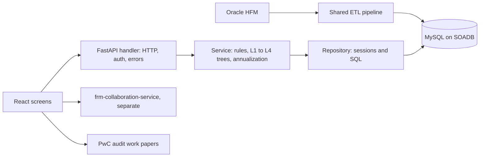
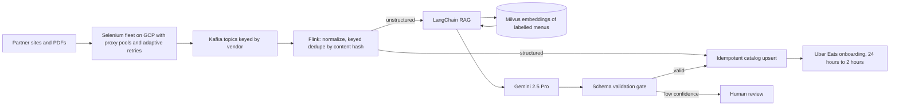
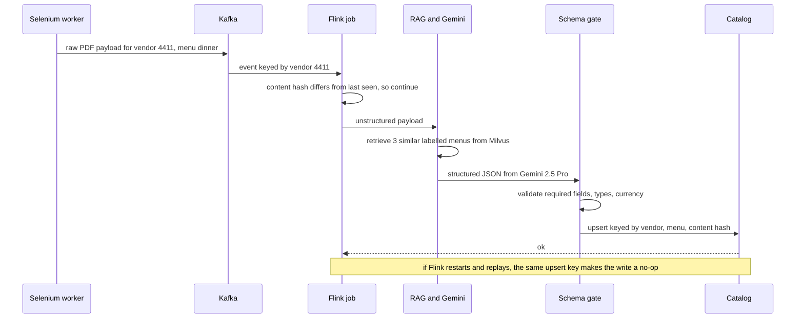

# Uber FRM and Uber Menu: Interview Packs

<div class="callout note">

**How to use this page**

- **What it covers:** the two Uber projects (both "Uber via EPAM", July 2024 to May 2026) in a compact, interview-ready form. Part A is FRM (Uber Finance scoping backend). Part B is Menu Ingestion (Uber Eats), plus the separate ANZ Document Compliance project (Uber Mobility).
- **When to read it:** as a refresher the day of an interview, after you have read the full deep dives once: [FRM deep dive](02_frm_deep_dive.md) and [Menu deep dive](03_menu_deep_dive.md).
- **What to memorise:** the two 30-second versions, the numbers tables, and the two "Say this / don't say this" boxes.
- **Canonical sources:** [23b_uber_interview_packs.md](../../../prep/23b_uber_interview_packs.md), [prep/11_uber_frm_deep_dive.md](../../../prep/11_uber_frm_deep_dive.md), [GROUND_TRUTH.md](../../../prep/GROUND_TRUTH.md).

</div>

**What the tags mean.** **PDF** means printed on the current resume, defend as written. **MEASURED** means there is a log, doc or code behind it. **ESTIMATED** means arithmetic you can show ("roughly, derived from..."). **HISTORICAL** means it comes from past work records and was not re-measured. **VERBAL** means true depth that is not printed on the resume.

**Resume stack lines (this track).** FRM: Python, FastAPI, SQLAlchemy 2.0, Pydantic, MySQL, Bazel, Docker. Menu: Python, Selenium, Kafka, Flink, LangChain, Gemini, RAG, Milvus, GCP, Docker.

---

# Part A: Uber FRM (Financial Risk Management) Scoping Platform

## A1. The 30-second and 2-minute versions

**30 seconds.** "At Uber, via EPAM, I owned the FRM scoping backend for Uber Finance, a FastAPI and MySQL platform that replaced a quarterly Google Sheets close. It cut quarterly reconciliation by 70%, from 14 days to 3 days, against a $340M materiality threshold. I migrated 19 million raw general-ledger rows off Sheets, shipped 36 FastAPI endpoints for the financial math and a four-level line-item hierarchy with quarter-annualization, designed an 8-table normalized schema with optimistic locking and SHA-256 natural keys, and led 3 engineers on a SQLAlchemy 2.0 migration that took module statement coverage to 100%."

**2 minutes.** "Scoping is a SOX compliance process that runs every quarter during the financial close. Finance decides which balance-sheet and income-statement lines, and which legal entities, PwC will test. Before the tool it was a Sheets workbook with no stable line IDs, no audit trail and constant overwrite risk. I owned the backend replacement: a handler, service and repository layering over MySQL on Uber's SOADB standard. Uber's gateway injects the user's email in a header and every write records it, so every decision is attributable.

The rules are deterministic Python. A line is quantitatively material if its HFM amount is above materiality, $340 million on the Q4 2025 close. It's qualitatively material if a manager flags it on a scoping question. It's significant if either is true. Components are significant if they carry more than 5% of revenue or assets. Residual risk measures what's left uncovered in multiples of materiality. Part-year income figures are annualized so they compare fairly.

For integrity during close, I designed an 8-table normalized schema with a shared Draft, Review, ReOpen, Closed status model, optimistic row-locking, atomic cross-table writes, and SHA-256 natural keys so reloads never duplicate audit rows. I also migrated reconciliation from Sheets-backed v1 endpoints to MySQL-backed v2 endpoints running in parallel. Then I led 3 engineers through a SQLAlchemy 2.0 migration that removed a silent column-aliasing bug class, reached 100% statement coverage on those modules, and shipped as stacked Bazel PRs with SOX gates. Reconciliation went from 14 days to 3."

---

## A2. Finance in 90 seconds

Full explanations with worked examples are in the [FRM deep dive, section 3](02_frm_deep_dive.md). The short version:

- **Close:** the period-end routine that finalises a quarter's books. Scoping runs inside it, against a deadline.
- **GL (general ledger):** the master record of every account balance per entity per period. Individual quarterly extracts were about 38K to 95K rows (MEASURED). The resume's 19M is the total raw GL migrated off Sheets (PDF).
- **HFM vs 10-Q:** HFM (Oracle Hyperion Financial Management) is the consolidation system. The 10-Q is the quarterly SEC filing. Reconciliation checks they agree per line: `difference = hfm_amount_in_millions - financial_statement_amount_in_millions`.
- **FSLI, L1 to L4:** a Financial Statement Line Item is one line like Cash or Revenue. Lines nest four levels deep, for example Assets, then Current assets, then Cash and cash equivalents, then Cash in bank. A parent must equal the sum of its children.
- **Materiality, $340M:** the size of a mistake that would matter to a reader. Illustrative: Cash at $6,120M is above $340M, so it's quantitatively material. Prepaid expenses at $95M is not, unless a manager flags it qualitatively.
- **Scoping and the 5% rule:** group scoping asks "is this line significant to Uber?". Component scoping asks "which entities under it get tested?". A component is financially significant if revenue share is over 5% or absolute assets share is over 5%.
- **Residual risk:** residual balance = HFM amount minus total in scope. Residual multiple = residual balance / materiality. Illustrative: $200M left uncovered is 0.59 × $340M, over 50%, so it's flagged. The residual threshold on Q4 2025 was $170M.
- **Quarter-annualization:** scaling part-year income-statement figures to a full-year equivalent, for example × 4/2 at the end of Q2, so they compare fairly with annual thresholds.
- **SOX and PwC:** SOX (Sarbanes-Oxley) makes management responsible for financial controls and has the external auditor, PwC, test them. In engineering terms: traceable numbers, attributable changes, repeatable and evidenced controls.

---

## A3. Architecture



*What to notice: the ETL and the collaboration service sit outside my boundary. I owned the handler, service, repository and schema.*

```text
Oracle HFM (consolidation)
        |  ETL (shared pipeline; my service consumes it)
        v
+-----------------------------------------------------------+
|  MySQL (SOADB): 8-table normalized core schema            |
|  (11 SQLAlchemy 2.0 model classes in the scoping service) |
|  level_mapping <-- balance_sheet / income_statement       |
|                <-- component_entity                       |
|  recon_* (v2), frm_metrics_table, threshold_table_v2      |
|  emi_data, scoping_questions / scoping_assessments        |
+-----------------------------------------------------------+
        ^
        |  repository (sessions, SQL) -> service (rules, trees)
        |  -> handler (HTTP, auth, errors)   /frm-scoping/*
+-------+---------------------------------------------------+
|  FastAPI (langfx), Pydantic, asyncio.to_thread for DB     |
|  x-auth-params-email -> created_by / updated_by           |
+-----------------------------------------------------------+
        ^
        |  36 endpoints across the FRM backend surface
+-------+--------------+     +-----------------------------+
|  React (Fusion.js)   |     |  frm-collaboration-service  |
|  8 screens           |     |  comments / notifications   |
|  -> PwC work papers  |     |  (separate, not my build)   |
+----------------------+     +-----------------------------+
```

**Walkthrough.** HFM-loaded data lands in MySQL through a shared ETL that I consume but did not own end to end. The gateway authenticates the user and adds the `x-auth-params-email` header. The handler validates input with Pydantic and maps errors to status codes. The service applies the finance rules and builds the trees. The repository owns every session and query, pushed off the event loop with `asyncio.to_thread`. The screens (Reconciliation, Materiality, EMI Scoping, Group Scoping, Threshold Setup, Component Scoping, Residual Risk, Summary) call the API. I owned the backend, not the React UI.

---

## A4. Design decisions

| Decision | Choice | Why | Trade-off |
|---|---|---|---|
| Datastore | MySQL on SOADB, InnoDB | Platform standard, ACID multi-user edits in close | No recursive SQL, hierarchy flattened in the ETL |
| Layering | Handler, service, repository | Testability, 3 engineers on one feature without collisions | More files per change |
| Hierarchy | `level_mapping` + `level_id`, no ORM foreign keys | Stable IDs, renames don't rewrite facts | Logical joins only, the app enforces consistency |
| Concurrency | Optimistic row-locking (version check on update) | No locks held during think time, no ETL blocking | Client must reload and retry on conflict |
| Duplicates | SHA-256 natural keys + upsert | Reloads and reseeds are replay-safe | Rewording a question creates a new ID by design |
| Multi-table edits | One transaction per sync | All-or-nothing, no half-applied decisions | Slightly longer transactions |
| Materiality rules | Quantitative OR qualitative, 5% component benchmarks | Auditable, deterministic, matches the finance process | Qualitative stays a human judgment |
| Recon cutover | Parallel v1 Sheets + v2 MySQL | Zero downtime, side-by-side QA | Two paths until the UI cutover |
| Column identity | SQLAlchemy `aliased()` + `.label()` | Kills silent last-write-wins on joined `uuid` | Strict select discipline on every join |
| Releases | Stacked Bazel PRs | Small, reviewable, each tested, zero downtime | More PRs to sequence |
| SOX controls | Reporting SQL allowlists, FSM gates with 50% delta-variance | Evidenced, automatic controls | Gates add friction to status changes |
| Auth | Trust gateway header, record email | Audit trail without duplicating Uber auth | Fine-grained authorization is upstream |
| Blocking DB | `asyncio.to_thread` | Keeps the event loop responsive | Thread pool is the ceiling under load, fine at this rate |

The main alternative questions: PostgreSQL was rejected because the platform standard was MySQL and the hierarchy is flattened anyway. Pessimistic locking was rejected because it would block the ETL and other editors for the whole time someone has a record open. A big-bang rewrite was rejected in favour of stacked PRs and a parallel v2 path.

---

## A5. Each bullet decoded

### F1: ownership, 70%, 19M, 36 endpoints

> Owned the Financial Risk Management scoping backend, reducing quarterly reconciliation time by **70%** (from **14 days to 3 days**) against a **$340M** materiality threshold. Engineered the Sheets-to-MySQL migration across **19M** raw GL rows, shipping **36 FastAPI** endpoints to automate custom financial math and a nested 4-level FSLI (L1–L4) hierarchy with dynamic quarter-annualization.

- **In plain words:** I owned the server side. The close's reconciliation went from two weeks of spreadsheet work to three days. Data moved from Sheets to MySQL, and 36 endpoints now do the math that used to be spreadsheet formulas.
- **Own:** backend design and architecture of the scoping service. The ETL was shared. The collaboration service was separate. The UI was not mine.
- **36, if asked:** about 31 functional routes in the scoping service handler (32 registrations including `/health`) plus the collaboration-service comment and notification APIs from the design doc.
- **19M, if asked:** raw GL rows migrated off Sheets. Per-quarter extracts were tens of thousands of rows, so the value was correctness, hierarchy and auditability, not throughput.
- **70%, if pressed:** "The technical design doc framed that cut and that's what the platform delivered for the close." If someone does the arithmetic, 14 to 3 days is about 79%, so 70% is the conservative figure.

### F2: schema and integrity

> Resolved ETL pipeline lock contention during financial close by designing an 8-table normalized MySQL schema on Uber's SOADB featuring a polymorphic review-status model. Guaranteed real-time, multi-user collaboration integrity by implementing optimistic row-locking, atomic cross-table syncs, and deterministic SHA-256 natural-key hashing to eliminate data duplication across quarterly audit trails.

- **In plain words:** the ETL and the managers both hit the data during close. Narrow normalized tables plus short transactions plus optimistic locks mean they rarely block each other. Multi-table updates are all-or-nothing, and content-derived IDs stop duplicates.
- **Polymorphic review-status:** one status vocabulary (Draft, Review, ReOpen, Closed) reused on `group_status`, `component_status`, `residual_status` and the threshold table's `review_status`.
- **Optimistic row-locking:** `UPDATE ... WHERE uuid = :id AND version = :version_read`. Zero rows updated means someone else saved first, so reload.
- **Atomic syncs (real code):** the EMI Total patch mirrors into `balance_sheet` or `income_statement` in one transaction. An assessment write with `sync_required` rolls back if the line sync touches zero rows.
- **SHA-256 natural keys (real code):** `scoping_questions.uuid` = SHA-256 of `question_text` + normalized `page_name`, upserted by the bulk endpoint.
- **8 vs 11, if asked:** 8 is the core normalized schema. The scoping service code has 11 SQLAlchemy model classes, including supporting tables such as the recon v2 leaves and the metrics store.
- **Careful:** "real-time collaboration integrity" means the integrity of concurrent writes. The real-time push and Slack notifications were the separate collaboration service and the frontend.

### F3: leadership, ORM migration, SOX gates

> Led **3 engineers** in a core SQLAlchemy 2.0 ORM migration that eliminated latent column-aliasing bugs and raised module statement coverage to **100%**. Orchestrated zero-downtime releases via stacked Bazel PRs, embedding reporting SQL allowlists and automated FSM gates with **50%** delta-variance checks to enforce SOX compliance.

- **In plain words:** raw SQL mapped result columns by name and broke silently on joins. I led a pod of 3 moving it to typed SQLAlchemy 2.0 selects with explicit labels, tested to 100% statement coverage on the migrated modules, shipped in small stacked PRs. Reporting queries were limited to an approved list, and status changes were gated on large swings.
- **Own:** tech lead of a 3-engineer EPAM pod, not a people manager. API contracts and layered design reviews.
- **FSM gate:** the Draft, Review, ReOpen, Closed state machine. On a transition, a line whose amount moved more than 50% against its comparison value cannot silently advance. Keep the exact formula qualitative.
- **Tests:** 1,100+ (VERBAL, a grep finds about 1,288).

---

## A6. FRM numbers at a glance

| Number | Meaning | How to say it |
|---|---|---|
| 70%, 14 to 3 days | Quarterly reconciliation time, before and after (PDF) | "from 14 days to 3 days, a 70% cut" |
| $340M | Group materiality, Q4 2025 close (PDF) | "against a $340 million materiality threshold" |
| $170M | Residual threshold, Q4 2025 (VERBAL) | "with a $170 million residual threshold that quarter" |
| 19M | Raw GL rows migrated off Sheets (PDF) | "19 million raw GL rows" |
| 36 | FastAPI endpoints, FRM backend surface (PDF) | "36 FastAPI endpoints" |
| L1 to L4 | FSLI hierarchy depth (PDF) | "a nested four-level line-item hierarchy" |
| 8 | Core normalized tables (PDF) | "an 8-table normalized schema" |
| 3 | Engineers led (PDF) | "led a pod of 3 engineers" |
| 100% | Module statement coverage after the ORM migration (PDF) | "100% statement coverage on the migrated modules" |
| 50% | Delta-variance threshold in FSM gates (PDF) | "50% delta-variance checks" |
| 5% | Component significance benchmark (VERBAL) | "the 5% revenue and assets rule" |
| ~55 × 14 | FSLIs × entities on the Q4 2025 sample (VERBAL) | "about 55 line items across 14 entities" |
| 18 files, +1,268 | Recon v1 to v2 migration (VERBAL) | "an 18-file migration" |

---

## A7. Hard problem in one paragraph: the column-aliasing bug

The legacy read path did `dict(zip(result.keys(), row))` on raw SQL. A join of a fact table and `level_mapping` returned two columns both named `uuid`. `zip` pairs by position and `dict` keeps the last value, so each row silently took the mapping's ID instead of the fact's ID. Edits and comments then pointed at the wrong line, which is how it surfaced: editing one recon line seemed to change another. The fix was SQLAlchemy `select()` on `aliased()` models with an explicit label on every column, for example `func.min(i.uuid).label("fsli_id")` and `func.max(lm.uuid).label("level_mapping_uuid")`. The lesson: in finance code, bugs that raise no error are the dangerous ones, so you need explicit naming plus invariants like "parent equals sum of children".

```python
keys = ["uuid", "level_1", "uuid"]
row  = ("fact-123", "Assets", "map-999")
dict(zip(keys, row))   # {'uuid': 'map-999', 'level_1': 'Assets'}  fact identity lost, no error
```

---

## A8. FRM mock interview (10 questions)

**Q1. Prove "36 endpoints" isn't padding.**
The scoping handler registers 32 routes, one of which is `/health`, so about 31 functional scoping routes. The collaboration-service comment and notification APIs from the design doc bring the FRM backend surface to 36. None are duplicate verbs for padding: the PATCH and PUT routes carry distinct logic like status transitions and benchmark recomputation.

**Q2. Why MySQL and not Postgres?**
SOADB is Uber's MySQL standard for service-owned data, and InnoDB gives the ACID multi-user edits the close needs. Per quarter the working set is tens of thousands of rows, so it's a correctness problem, not a scale problem. I don't need recursive SQL because the ETL flattens the hierarchy into a stable `level_id`.

**Q3. Walk the materiality rule in code terms.**
Quantitative is YES if the HFM amount is above the materiality metric. Qualitative is YES from the manager's assessment. Overall is Significant if either is YES. A component is financially significant if revenue share is over the benchmark or absolute assets share is over it, 5% by default and configurable through `PUT /update_benchmark_thresholds`.

**Q4. Explain residual risk.**
Residual balance is HFM amount minus total in scope, and residual multiple is that divided by materiality. It flags leftovers that are still audit-relevant, for example over 50% of materiality. It's served by `GET /residual_risk` with `fsli_type` set to `bs` or `is`.

**Q5. Tell me the column-aliasing bug precisely.**
A raw SQL join projected two columns named `uuid`, and `dict(zip(keys, row))` kept the mapping uuid, so a PATCH hit the wrong line. I fixed it with labelled selects, `fsli_id` versus `level_mapping_uuid`. Then I led the SQLAlchemy 2.0 migration so the whole read layer uses labelled selects, not just that one query.

**Q6. How do you stop two managers clobbering each other?**
Optimistic row-locking: the update only applies if the row still has the version the editor read, otherwise zero rows change and they reload. Writes are single transactions keyed by `uuid`, and multi-table syncs are atomic. Every write records `updated_by`. The real-time push to other screens was the collaboration service, which I didn't build.

**Q7. How would you scale it?**
It barely needs it. The engine is memoized with `pool_pre_ping`. I'd add read replicas, a per-period GET cache because closed periods are immutable, and indexes on `(fiscal_quarter, fiscal_year, level_id)`. There's no Redis in the shipped service, and I won't invent one.

**Q8. Auth is one header. Secure enough?**
The gateway authenticates the user and injects `x-auth-params-email`. The service returns 401 if it's missing and records the email on every write. Authorization was enforced upstream. Standalone, I'd verify a signed token and add role checks.

**Q9. Did you build the HFM ETL?**
No. The service consumes HFM-loaded tables, and the pipeline was a shared responsibility. I owned the scoping backend, the schema, the recon v2 migration, and led the ORM migration.

**Q10. Is this just a spreadsheet with APIs?**
Not on risk. The hard part is tree correctness, parent equals sum of children, running v1 and v2 in parallel, and identity bugs under a close deadline. A wrong number becomes PwC audit evidence. That's also why the SOX controls, allowlisted reporting SQL and FSM gates matter.

---

## A9. FRM: say this / don't say this

<div class="callout warn">

**Say this:** "Uber via EPAM." 70%, from 14 days to 3 days, against $340M. 19M raw GL rows migrated off Sheets. 36 FastAPI endpoints. L1 to L4 with quarter-annualization. 8-table normalized schema on SOADB. Optimistic row-locking, atomic syncs, SHA-256 natural keys. Led 3 engineers. 100% module statement coverage. Stacked Bazel PRs, SQL allowlists, FSM gates with 50% delta-variance for SOX.

**Don't say this:**
- "30+ endpoints", "70% was only a target", or "don't count the 19M". Older prep said those things. The current resume states 36, 70% and 19M, so defend them. Don't walk them back unprompted.
- An invented breakdown of the 19M beyond "raw GL rows migrated off Sheets".
- "The whole service is at 100% coverage." It's the migrated modules. The 35% to 82% coverage story is Masters India.
- "I built the HFM ETL" or "I built the real-time collaboration, WebSockets or Slack notifications."
- Invented FRM p95 latency, Redis or a response cache.
- React or Fusion.js ownership.
- Materiality as fixed forever. Qualify it as the Q4 2025 close.
- Merging "led 3" (FRM) with "mentored 2" (Masters India).

</div>

---

# Part B: Uber Menu Ingestion and Automation (Uber Eats), plus ANZ

## B1. The 30-second and 2-minute versions

**30 seconds.** "At Uber Eats, via EPAM, I built the menu ingestion pipeline. It took restaurant onboarding from 24 hours to 2 hours, saves $600K a year, and processes 30K+ menus a month. Unstructured, multilingual PDF menus are converted into the strict catalog schema at 98% field fidelity in offline evaluation, using Gemini 2.5 Pro with LangChain RAG over Milvus embeddings. I also raised extraction success to 95%+ by hardening a Selenium fleet with dynamic proxy pools and adaptive retries, and designed a Kafka and Apache Flink pipeline with stateful keyed deduplication and schema normalization for exactly-once catalog upserts."

**2 minutes.** "Restaurant partners send menus as JavaScript-heavy websites, PDFs and images, often in several languages. Acquisition is a Python Selenium fleet on GCP. Anti-bot defences used to kill a lot of runs, so I added dynamic proxy pools and adaptive retries, and success went from an estimated 60 to 65% to 95%+.

Everything lands on Kafka. Flink consumes it, keyed by vendor and menu. It normalizes to the catalog schema, deduplicates using a content hash held in keyed state, and routes unstructured payloads to the AI path. That path uses LangChain to retrieve similar, already-labelled menus from Milvus as context, Gemini 2.5 Pro generates structured output, and a hard schema validation gate checks it before anything is written. Low-confidence results go to human review. On an offline labelled set, field fidelity is 98%.

The catalog write is an idempotent upsert, so in practice 'exactly-once' means at-least-once delivery with idempotent writes: replays never create duplicates. The business result is onboarding from 24 hours to 2 hours, 30K+ menus a month, and $600K a year saved versus a roughly $2-per-menu third-party cost. Separately, under Uber Mobility, I automated driver and vehicle document checks for ANZ to 99.9% compliance, removing 20 hours a week of manual review."

---

## B2. Words you need

| Term | Plain meaning |
|---|---|
| Selenium | A tool that drives a real web browser from code. Needed because many menu sites only show items after JavaScript runs. |
| Proxy pool | A rotating set of outbound IP addresses. Like sending letters from many post offices so one site doesn't block you. |
| Adaptive retries | Retrying with growing waits and per-site budgets, so one hostile site doesn't burn the whole fleet. |
| Kafka | A durable, replayable log of events. Producers append, consumers read at their own pace. Like a conveyor belt that also records everything that passed. |
| Apache Flink | A stream processor that keeps state per key and checkpoints it, so it can resume after a crash without losing its place. |
| Keyed state | Memory Flink keeps per key (for example per vendor and menu), such as "the last content hash I saw". |
| Exactly-once vs at-least-once | At-least-once means a message may be processed twice after a retry. Exactly-once means the effect happens once. In practice you get it with at-least-once delivery plus idempotent writes. |
| Idempotent upsert | "Insert or update" keyed so that doing it twice gives the same result as doing it once. |
| Embedding | A list of numbers that captures meaning, so similar menus have nearby vectors. |
| Milvus | A vector database that finds the nearest embeddings quickly. |
| RAG | Retrieval-Augmented Generation. Fetch relevant examples first, then give them to the LLM as context. Like an open-book exam. |
| LangChain | A Python framework for wiring retrieval, prompts and LLM calls into a pipeline. |
| Gemini 2.5 Pro | Google's LLM, used here to turn messy menu text into structured fields. |
| Field fidelity | The share of extracted fields that match a human-labelled ground truth. |
| Offline evaluation | Measured on a fixed labelled test set, not continuously on live traffic. |

---

## B3. Architecture



*What to notice: Kafka decouples scraping from processing, Flink does dedupe before anything is written, and nothing reaches the catalog without passing the schema gate.*

**Walkthrough.**

1. **Selenium fleet on GCP** loads each partner's site or file like a real user would, behind rotating proxies, with per-site retry budgets.
2. **Kafka** receives raw payloads keyed by vendor. Scrapers never block on slow catalog writes, and a bad parser deploy can be fixed by replaying from an earlier offset.
3. **Flink** consumes by key. It normalizes fields to the catalog schema, compares the content hash with what it saw last for that vendor and menu, drops unchanged duplicates, and routes structured items straight to the catalog and unstructured ones to the AI path.
4. **RAG path.** LangChain embeds the menu, retrieves similar labelled menus from Milvus, and gives them to Gemini 2.5 Pro as examples. Gemini returns structured fields.
5. **Schema gate.** Strict validation. Valid output is upserted. Low-confidence output goes to human review.
6. **Catalog upsert** is idempotent by vendor, menu and version or content hash.

**Separate track (not on the menu path):** ANZ driver and vehicle documents go through a deterministic validation backend for 99.9% compliance.

---

## B4. One menu, step by step



*What to notice: a replay after a crash produces the same key and the same content, so the catalog does not get a second copy.*

Sample input and output (illustrative):

```text
Input (French PDF text):  "Croque Monsieur ...... 9,50 €   (jambon, fromage)"
```

```json
{
  "vendor_id": "4411",
  "menu_id": "dinner",
  "items": [
    {"name": "Croque Monsieur", "price": 9.50, "currency": "EUR",
     "description": "ham, cheese", "section": "Mains"}
  ]
}
```

Illustrative keyed dedupe in Flink-style pseudo-code (teaching shape, not a paste of the repo):

```python
class DedupeByContent(KeyedProcessFunction):          # keyed by (vendor_id, menu_id)
    def open(self, ctx):
        self.last_hash = ctx.get_state(ValueStateDescriptor("last_hash", Types.STRING()))

    def process_element(self, menu, ctx):
        h = sha256(canonical_json(menu)).hexdigest()
        if self.last_hash.value() == h:
            return                                    # unchanged menu, drop it
        self.last_hash.update(h)
        yield menu                                    # downstream upsert is idempotent anyway
```

---

## B5. Design decisions

| Decision | Choice | Why | Trade-off |
|---|---|---|---|
| Acquire | Selenium on GCP | JavaScript-rendered sites need a real browser | Fragile when site layouts change, needs monitoring |
| Anti-bot | Dynamic proxy pools + adaptive retries | Lifted success from an estimated 60 to 65% to 95%+ | Proxy cost and latency |
| Bus | Kafka keyed by vendor | Decouples bursty scrapers from processing, replay after bad deploys, per-vendor order | Another system to operate |
| Processing | Flink with keyed state | Stateful per-vendor dedupe, normalization, checkpointed recovery | Heavier than a simple consumer |
| Delivery | At-least-once + idempotent upsert ("exactly-once" effect) | Replays never duplicate catalog items | No two-phase commit across third parties |
| Unstructured | Gemini 2.5 Pro + LangChain RAG over Milvus | PDFs lack stable HTML, retrieved examples keep output on schema | LLM cost, offline eval is not a live SLA |
| Schema gate | Validate before any catalog write | Malformed output never reaches the catalog | Rejects go to a queue, review capacity is a bound |
| Human loop | Review low-confidence results | Protects catalog quality | Throughput bound by reviewers |
| Money model | Replace a roughly $2-per-menu third-party cost | In-house pipeline at 30K+ menus a month | We own the reliability burden |
| Backfills | Spark as a verbal option only | Large historical reprocessing is batch-shaped | Not on the PDF, don't lead with it |

**Alternatives and why not.** A plain HTTP client instead of Selenium misses JavaScript-rendered items and prices. Direct HTTP writes from scrapers to the catalog would make scrapers block on slow writes and lose replay. Kafka Streams instead of Flink could work at this event rate, and is worth admitting if asked. Flink was chosen for richer keyed state and checkpointing. Prompt-only extraction without retrieval drifts off schema more often. Retrieved labelled examples anchor the format.

---

## B6. Each bullet decoded

### M1: onboarding, money, volume, 98% offline

> Accelerated restaurant onboarding from **24 hours to 2 hours** and saved **$600K** annually by architecting an automated ingestion pipeline processing **30K+** menus monthly. Converted unstructured, multilingual PDFs into a strict catalog schema at **98%** field fidelity utilizing a **Gemini 2.5 Pro** and **LangChain RAG** pipeline over **Milvus** vector embeddings.

- **In plain words:** a new restaurant's menu used to take a day to get onto Uber Eats. Now it takes two hours. We stopped paying a third-party per menu, and PDFs in any language become clean catalog records.
- **Money:** about $2 per menu × 30K menus × 12 months ≈ $720K list. The resume floors it conservatively to $600K a year (ESTIMATED arithmetic, HISTORICAL ops claim).
- **24 to 2 hours:** the onboarding cycle time, HISTORICAL. Roughly a 90% cut if anyone asks for a percentage, but say it as "from 24 hours to 2 hours".
- **98%:** field fidelity on an offline labelled evaluation set. Always say "offline evaluation". It is not a live production SLA.
- **How:** chunk, retrieve similar labelled menus from Milvus, generate with Gemini 2.5 Pro, hard schema validation, human review on low confidence.
- **Own:** the ingestion pipeline and its reliability. Not all of the Uber Eats catalog platform.

### M2: 95%+ extraction, Kafka + Flink, exactly-once upserts

> Scaled menu extraction success to **95%+** by hardening a Selenium fleet with dynamic proxy pools and adaptive retries. Designed a **large-scale data ingestion and processing pipeline** using **Kafka** and **Apache Flink**, with stateful keyed deduplication and schema normalization to guarantee exactly-once catalog upserts.

- **In plain words:** most scrape failures were anti-bot blocks. Rotating proxies and smarter retries fixed most of them. Then a Kafka and Flink pipeline cleaned, deduplicated and normalized everything before it touched the catalog, so nothing landed twice.
- **95%+:** the endpoint after hardening. The baseline of about 60 to 65% is ESTIMATED. Say so if pressed.
- **Mechanics:** rotate egress IPs, refresh proxy pools when ban signals appear, back off with per-source retry budgets.
- **Exactly-once, said honestly:** at-least-once delivery from Kafka through Flink, with Flink checkpoints restoring state and offsets, plus idempotent catalog upserts keyed by vendor, menu and content hash. The effect is exactly-once in the catalog. Do not claim zero message loss or two-phase commit across third-party sites or Gemini.
- **Not on this project:** ClickHouse. Spark is not on the PDF. It is a verbal backfill option only.
- **Load, if asked:** peaks of roughly 200 to 500 events a second during fleet runs is an ESTIMATE for prep only (30K menus a month is about 1K menus a day, amplified by item-level events, retries and health checks). Don't put it on the table unprompted.

### ANZ: Document Compliance (Uber Mobility), a separate project

> Achieved **99.9%** regulatory compliance for Uber Mobility ANZ by automating driver and vehicle document verification workflows against local authority requirements. Eliminated **20 hours** of manual operational overhead per week by replacing manual review queues with a deterministic validation backend.

- **Not Uber Eats.** Uber Mobility, drivers and vehicles in Australia and New Zealand.
- **HISTORICAL:** 99.9% compliance and 20 hours a week removed come from past work records and were not re-measured.
- **How:** a deterministic validation backend that checks documents against local authority rules. Do not invent Selenium or RAG here.
- **Framing:** "same Uber employment, separate compliance project". Lead with that so interviewers don't look for Kafka in ANZ.

---

## B7. Menu numbers at a glance

| Number | Meaning | Tag | How to say it |
|---|---|---|---|
| 24 hours to 2 hours | Restaurant onboarding cycle time | PDF, HISTORICAL | "from 24 hours to 2 hours" |
| $600K a year | Third-party cost avoided (about $2 × 30K × 12 = $720K, floored) | PDF, ESTIMATED derivation | "$600K a year, a conservative floor" |
| 30K+ menus a month | Pipeline volume | PDF | "more than 30 thousand menus a month" |
| 98% | Field fidelity on an offline labelled set | PDF, offline | "98% field fidelity in offline evaluation" |
| 95%+ | Extraction success after hardening | PDF | "95%-plus, from an estimated 60 to 65%" |
| ~60 to 65% | Pre-hardening success | ESTIMATED | only if pressed |
| ~200 to 500 events/s | Peak event rate | ESTIMATED, prep only | only if asked about load |
| 99.9% | ANZ document compliance | PDF, HISTORICAL | "99.9% compliance" |
| 20 hours/week | ANZ manual effort removed | PDF, HISTORICAL | "20 hours a week" |

---

## B8. Menu mock interview (10 questions)

**Q1. Why Selenium and not a simple HTTP client?**
Partner menus are rendered by JavaScript, so a static fetch misses items and prices. Browser automation is the acquisition layer. The cost is maintenance when site layouts change, which is why scrape-health checks and the schema gate matter.

**Q2. Derive the $600K.**
We replaced a roughly $2-per-menu third-party cost. $2 times 30K menus a month times 12 is about $720K list, and the resume uses $600K a year as a conservative floor. It's arithmetic on historical ops numbers, and I say that if asked.

**Q3. Is 98% live or offline?**
Offline. It's field fidelity against a labelled evaluation set, and the schema gate validates every record before it's written. I don't present it as a live production SLA.
*Follow-up they may ask:* "How would you monitor it live?" "Sample production outputs into a review queue and track the human-correction rate as an online proxy."

**Q4. How does RAG help Gemini here?**
For each menu, LangChain retrieves similar already-labelled menus from Milvus and passes them as examples. That keeps Gemini's output on our schema and familiar with cuisine and layout patterns, even across languages. The hard schema gate then catches anything that still drifts.

**Q5. Did you fine-tune the model?**
Fine-tuning is not on my resume, so I don't claim it. The resume pipeline is retrieval plus Gemini 2.5 Pro plus a schema gate. Conceptually, supervised fine-tuning would teach consistent field layout and enum adherence so fewer invalid structures hit the gate, and it's a lever I'd consider if gate rejections stayed high.

**Q6. What fails without proxies?**
IP bans, CAPTCHA walls and soft 403s, and success collapses. Rotating IPs, refreshing pools on ban signals and adaptive backoff with per-site budgets brought it back to 95%+. One hostile site can't burn the whole fleet's retry budget.

**Q7. What does "exactly-once catalog upserts" really mean?**
In practice it's at-least-once delivery plus idempotent writes. Kafka and Flink checkpoints mean that after a crash Flink restores its state and rewinds offsets, so some events are processed again. The catalog upsert is keyed by vendor, menu and content hash, so the replay is a no-op. I don't claim zero message loss or two-phase commit across third-party sites.

**Q8. Why Kafka and Flink at 30K menus a month? Isn't that overkill?**
Volume is modest on average, but scrapes are bursty, and the real value is decoupling and replay. Kafka lets scrapers finish without waiting on catalog writes and lets us replay after a bad parser deploy. Flink gives per-vendor keyed state for deduplication and checkpointed recovery. Kafka Streams could also work at this rate, and I'd say so.

**Q9. Where's Spark?**
Not on the resume. Spark is a verbal option for large historical backfills, which are batch-shaped, but the pipeline on the resume is Selenium, Kafka, Flink and the RAG path. Masters India's Kafka is a different product, the GST e-invoicing pipeline, so I keep the two stories separate.

**Q10. What's the biggest silent failure mode?**
A site layout change or CAPTCHA shift that returns empty or partial menus that still look successful. Defences are scrape-health checks, the schema gate, and human review on low confidence. Plus Kafka replay to reprocess once the parser is fixed. I don't claim we never failed.

---

## B9. Menu: say this / don't say this

<div class="callout warn">

**Say this:** "Uber via EPAM." From 24 hours to 2 hours. $600K a year, derived from about $2 × 30K × 12 and floored. 30K+ menus a month. 98% field fidelity in offline evaluation, using Gemini 2.5 Pro and LangChain RAG over Milvus. 95%+ extraction success with dynamic proxy pools and adaptive retries. Kafka and Apache Flink with stateful keyed deduplication and schema normalization. Exactly-once catalog upserts, meaning at-least-once delivery plus idempotent upserts. ANZ is a separate Uber Mobility project.

**Don't say this:**
- "98% in production" or any live SLA. It's offline evaluation.
- Zero message loss, or two-phase commit across third-party sites or Gemini.
- Spark as part of the resume pipeline. It is verbal backfill only.
- ClickHouse on Menu. Pinot. Merging Menu with Impact Analytics or Masters India Kafka stories.
- The ~200 to 500 events/sec peak as a measured number. It is a prep-only estimate.
- The 60 to 65% baseline as measured. It is estimated.
- Fine-tuning (SFT) as something you shipped. It is not on the resume.
- "100% schema consistency" as a resume number. Older prep used that phrase for the offline eval. Say instead that the schema gate validates every record before write.
- That you owned all of the Uber Eats catalog platform.
- Selenium or RAG in the ANZ project. Calling ANZ "Uber Eats".

</div>

**Older prep vs current resume (for the lead's records):** older versions of this pack said Kafka and Flink were not on the Menu resume and that Menu was "Selenium + RAG/Gemini + ANZ only". The current resume includes Kafka and Apache Flink, so this pack now defends them, with exactly-once explained honestly as at-least-once plus idempotent upserts.

---

# Practice drill (both projects)

1. **FRM in one breath?** I owned the Uber Finance scoping backend that replaced a Sheets close, cutting reconciliation from 14 days to 3 against $340M materiality.
2. **Why 36 endpoints?** About 31 functional scoping routes plus the collaboration-service comment and notification APIs from the design doc.
3. **19M versus per-quarter size?** 19M raw GL rows migrated off Sheets. Per-quarter extracts were 38K to 95K rows. The value was correctness and auditability.
4. **Significance rule?** HFM amount above materiality, or a manager's qualitative YES.
5. **Optimistic locking in one sentence?** Update only if the version still matches what you read, otherwise reload.
6. **The aliasing bug?** Two joined columns named `uuid`, `dict(zip)` kept the last one, edits hit the wrong line. Fixed with labelled SQLAlchemy selects.
7. **What does 100% mean?** Statement coverage on the modules the ORM migration touched.
8. **Menu in one breath?** Onboarding from 24 hours to 2, $600K a year, 30K+ menus a month, PDFs to catalog at 98% offline fidelity with Gemini, RAG and Milvus.
9. **Derive $600K.** About $2 × 30K × 12 ≈ $720K, floored to $600K.
10. **Exactly-once, honestly?** At-least-once delivery plus idempotent upserts keyed by vendor, menu and content hash.
11. **Is Spark on the resume?** No. Verbal backfill option only.
12. **Is ANZ part of Menu?** No. Separate Uber Mobility project, 99.9% compliance and 20 hours a week, HISTORICAL.

---

# Two-minute whiteboard scripts

**FRM.** Draw HFM, the ETL and MySQL on the left. Draw handler, service and repository stacked in the middle. Draw the screens and the gateway on the right, with the collaboration service off to the side. Say: "36 endpoints, an 8-table normalized schema, every write records the user." Then draw a small L1 to L4 tree and write "HFM > $340M OR qualitative". Say: "Rules in Python, parent equals sum of children." Then draw two managers and "version = 7". Say: "Optimistic locking, atomic syncs, SHA-256 keys. No locks while people think, no duplicates." Finish with "dict(zip) → .label()": "Led 3 on the SQLAlchemy 2.0 migration to 100% module coverage. Reconciliation from 14 days to 3."

**Menu.** Draw Selenium with a proxy pool, an arrow to Kafka, an arrow to Flink. Split Flink into "structured" going to the catalog, and "unstructured" going to RAG with Milvus, then Gemini, then a schema gate, then the catalog, with a side arrow to human review. Say: "Proxies and retries took extraction to 95%+. Kafka decouples and replays. Flink dedupes by content hash per vendor. The upsert is idempotent, so exactly-once in effect. Gemini with retrieved examples hits 98% field fidelity offline. Onboarding from 24 hours to 2, $600K a year, 30K+ menus a month." Then draw ANZ as a separate box: "Different project, Uber Mobility, 99.9% compliance."
