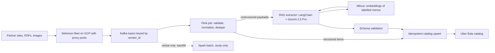
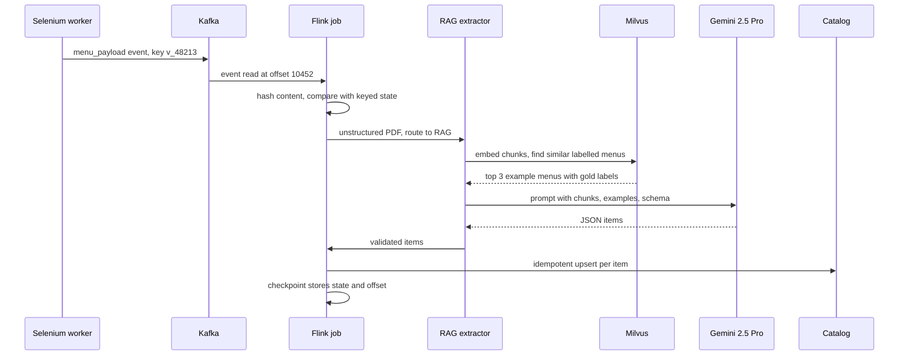

# Uber Eats Menu Ingestion Deep Dive (Uber via EPAM)

<div class="callout highlight">

**How to use this page**

- **What it covers:** the Uber Eats Menu Ingestion and Automation project end to end. That means the business problem, every technology in plain words, the architecture, one menu traced step by step, both resume bullets decoded, the numbers with their arithmetic, failure scenarios, and a practice drill. It also covers the separate ANZ Document Compliance bullet (Uber Mobility), because it sits under the same Uber stint.
- **When to read it:** before any Uber-heavy loop, any data or streaming round (Kafka, Flink), and any GenAI round that asks about RAG in production.
- **What to memorise:** the one-minute version, the four outcome numbers (from 24 hours to 2 hours, $600K a year, 30K+ menus a month, 98% field fidelity in offline evaluation), the 95%+ extraction success number with its estimated baseline, the $600K derivation, and the honesty box near the end.
- **Shorter pack:** for the quick interviewer pack, start with [`23b_uber_interview_packs.md`](../../../prep/23b_uber_interview_packs.md) § Menu. Related depth: [Flink notes](../tech_depth/flink.md), [Kafka and Flink scale defense](../tech_depth/kafka_flink_scale_defense.md), [Selenium scraping](../tech_depth/selenium_scraping.md), [Menu architecture](../architecture/03_uber_menu.md).

</div>

**What the tags mean.** Numbers on this page carry a tag. **MEASURED** means there is a log, doc or code behind it. **ESTIMATED** means it is arithmetic I can show on a whiteboard, so I say "roughly" and give the derivation. **HISTORICAL** means it comes from my past work records and earlier resumes. **TARGET** means a design goal, so I say "targeting". Every number here matches `GROUND_TRUTH.md` and `09_metrics_derivations.md` in the track's `prep/` folder.

<div class="callout note">

**Current resume bullets (the PDF, word for word in meaning)**

- **M1.** Accelerated restaurant onboarding **from 24 hours to 2 hours** and saved **$600K** annually by architecting an automated ingestion pipeline processing **30K+ menus monthly**. Converted unstructured, multilingual PDFs into a strict catalog schema at **98% field fidelity** using a **Gemini 2.5 Pro** and **LangChain RAG** pipeline over **Milvus** vector embeddings.
- **M2.** Scaled menu extraction success to **95%+** by hardening a Selenium fleet with dynamic proxy pools and adaptive retries. Designed a large-scale data ingestion and processing pipeline using **Kafka** and **Apache Flink**, with stateful keyed deduplication and schema normalization to guarantee exactly-once catalog upserts.
- **Tech line:** Python, Selenium, Kafka, Flink, LangChain, Gemini, RAG, Milvus, GCP, Docker.

**Not on the PDF:** Spark (study-only and verbal backfill option, labeled as such below), peak events per second (an estimate for prep only), Pinot, SFT, and "100% schema consistency" (older prep wording). ANZ Document Compliance is a **separate Uber Mobility project**, not Uber Eats. Kafka at Masters India is a different product (GST e-invoicing).

</div>

---

## 1. The one-minute version (say this out loud)

"At Uber, through EPAM, I worked on menu ingestion for Uber Eats. When a new restaurant joins, its menu has to land in Uber's catalog in a strict structured format: items, prices, sections, options. Menus arrive as partner web pages, PDFs and images, often in more than one language. Before this pipeline, a lot of that was manual or done by a paid third-party tool, and onboarding took about a day.

I architected an automated pipeline. A Selenium fleet acquires the menus, hardened with dynamic proxy pools and adaptive retries, which lifted extraction success to 95% plus. Events go onto Kafka, and Apache Flink does stateful keyed deduplication and schema normalization before an idempotent catalog upsert. For the unstructured PDFs I built a LangChain RAG pipeline with Gemini 2.5 Pro over Milvus embeddings that converts them into the catalog schema at 98% field fidelity in offline evaluation.

The result: onboarding went from 24 hours to 2 hours, we process 30K plus menus a month, and we saved about $600K a year, which is a conservative floor on roughly $2 per menu of third-party and manual cost."

**Follow-up they may ask:** "Which part did you own?" Answer: "I architected the pipeline: the acquisition hardening, the Kafka and Flink processing shape, and the RAG extraction path. I'm careful to say 98% is an offline evaluation number."

---

## 2. The business in plain English

**Who the users are.** Restaurants that want to sell on Uber Eats, and the Uber operations teams who onboard them. A restaurant cannot take orders until its menu is in the catalog.

**What they do.** The restaurant hands over its menu in whatever form it has. That might be a page on its own website, a listing on a partner site, a scanned PDF, or a photo of a printed menu. Uber has to turn that into a clean list of items, each with a name, description, price, section ("Starters", "Mains") and modifiers ("extra cheese +$1").

**What hurt before.** Menus are messy. Layouts differ for every restaurant. Some are bilingual. Prices hide in tables or footnotes. Vendor websites are JavaScript-heavy and block scrapers. So onboarding leaned on manual data entry and a paid third-party extraction tool. It took about a day per restaurant, cost money on every menu, and a day of delay is a day of lost orders for both the restaurant and Uber.

**Why Uber paid for this.** Faster onboarding means restaurants start earning sooner, and every menu that no longer goes through manual entry or the paid tool is money saved. At 30K+ menus a month, a couple of dollars per menu adds up to hundreds of thousands of dollars a year.

---

## 3. Words you need

Each term gets a plain definition and an everyday analogy. Read this once and the rest of the page will make sense.

| Term | Plain meaning | Analogy |
|---|---|---|
| **Menu ingestion** | Getting a restaurant's menu from wherever it lives into Uber's catalog. | Moving house: pack everything from an unfamiliar flat into labelled boxes that fit your new shelves. |
| **Catalog schema** | The strict structure every menu must fit: item, price, section, modifiers, language. | A government form with fixed boxes. You cannot write a paragraph where it asks for a number. |
| **Field fidelity** | The share of extracted fields (name, price, section and so on) that exactly match a human-checked answer. | A spelling test marked word by word: 98 of every 100 words correct. |
| **Offline evaluation** | Measuring quality on a fixed, labelled test set, not on live traffic. | A practice exam with an answer key, not the real exam. |
| **Selenium** | A tool that drives a real web browser from code, so it can load JavaScript-heavy pages like a human would. | A robot sitting at a laptop, clicking and scrolling for you. |
| **Headless browser** | A browser that runs without a visible window, used by Selenium on servers. | The same robot, working with the screen switched off. |
| **Proxy pool** | A rotating set of intermediate IP addresses that requests go through, so one site does not see thousands of hits from one machine. | Sending letters from many different post offices instead of one. |
| **Adaptive retries** | Retrying a failed scrape with smarter timing and a different proxy, within a budget per source. | If a shop is busy, come back later and use a different door, but give up after a few tries. |
| **Anti-bot defences** | Things sites do to block scrapers: rate limits, CAPTCHAs, fingerprinting. | A bouncer checking whether you look like a regular customer. |
| **Kafka** | A durable, ordered log of events. Producers append messages, consumers read at their own pace, and messages can be replayed. | A conveyor belt with a CCTV recording, so you can rewind and re-watch what passed. |
| **Topic, partition, key** | A topic is a named stream. It is split into partitions for parallelism. Messages with the same key always go to the same partition, so they stay in order. | A post office with numbered counters. Everyone with the same surname always queues at the same counter. |
| **Offset and consumer lag** | An offset is a consumer's bookmark in a partition. Lag is how far the bookmark is behind the newest message. | Your place in a TV series versus the newest episode. Lag is episodes left to watch. |
| **Apache Flink** | A stream processing engine that runs continuous jobs over events, with memory (state) per key and recovery on failure. | A factory line that never stops, where each worker keeps a notebook about each customer. |
| **Keyed state** | Data Flink remembers per key, for example "last content hash seen for vendor v_48213". | A loyalty card per customer at the till. |
| **Event time and watermark** | Event time is when something happened (scrape timestamp), not when it arrived. A watermark tells Flink "events older than this have probably all arrived". | Sorting postcards by the date written on them, and deciding at some point that late postcards have stopped arriving. |
| **Checkpoint** | A consistent snapshot of Flink's state and the Kafka offsets it had read, used to resume after a crash. | Saving a video game before the boss fight. |
| **RocksDB state backend** | An embedded on-disk key-value store Flink uses to hold large state. | A filing cabinet next to each worker instead of keeping everything in their head. |
| **Deduplication by content hash** | Hash the normalised menu content. If the hash matches what we stored last time for that vendor, it is a duplicate and we skip it. | A fingerprint check: same fingerprint, same person. |
| **Schema normalization** | Converting different shapes into one standard shape: "Rs. 250", "250.00 INR" and "₹250" all become `{amount: 250, currency: "INR"}`. | Converting every recipe to grams before cooking. |
| **Upsert and idempotent upsert** | Upsert means insert if new, update if it exists. Idempotent means doing it twice has the same result as doing it once. | Setting a thermostat to 21 degrees. Pressing "21" twice still gives 21. |
| **Exactly-once vs at-least-once** | At-least-once means a message may be processed more than once but never lost. Exactly-once means the effect happens one time. In practice we get exactly-once *effect* by combining at-least-once delivery with idempotent writes. | A courier might ring twice, but you only sign for the parcel once. |
| **Backpressure** | When a slow downstream step makes upstream steps slow down instead of crashing. | Traffic backing up behind a narrow bridge. |
| **RAG (Retrieval-Augmented Generation)** | Before asking the language model, retrieve relevant examples or context and include them in the prompt, so the model is grounded. | An open-book exam where you first find the right pages, then answer. |
| **Embedding** | A list of numbers that represents the meaning of text, so similar text has nearby numbers. | Coordinates on a map of meaning. "Paneer tikka" and "chicken tikka" live close together. |
| **Milvus** | A vector database that stores embeddings and finds the nearest ones quickly. | A librarian who finds the books most similar to the one in your hand. |
| **LangChain** | A Python framework for chaining LLM steps: load documents, split, retrieve, prompt, parse output. | Plumbing fittings that connect the pipes between your tools and the model. |
| **Gemini 2.5 Pro** | Google's large multimodal language model, which can read text and images. | A very capable reader who can also look at pictures. |
| **Chunking** | Splitting a long document into pieces small enough to embed and to fit in a prompt. | Cutting a long article into paragraphs before filing them. |
| **Spark (study-only)** | A batch and micro-batch data processing engine. **Not on the PDF.** I only discuss it as a verbal option for backfills. | A huge kitchen that cooks a whole banquet in one go, not one order at a time. |

---

## 4. Architecture



*What to notice: Kafka sits in the middle so scrapers never wait on slow downstream steps, and both the structured path and the RAG path end in the same idempotent upsert. The dotted Spark box is not on the resume.*

**Box by box.**

1. **Sources.** Partner web pages, PDFs and images, in many layouts and languages.
2. **Selenium fleet on GCP.** Python Selenium workers in Docker containers load JavaScript-heavy pages through rotating proxies and download files. They emit three kinds of events: menu payloads, item rows, and scrape-health events (success, failure, blocked, retry).
3. **Kafka.** Topics keyed by `vendor_id`. Same key means same partition, so all events for one restaurant stay in order. Kafka also lets us replay after a bad deploy, and lets several consumers read the same log.
4. **Flink job.** Reads Kafka, keys the stream by vendor, validates against the schema, normalises fields (prices, currencies, section names), and deduplicates using keyed state that remembers the last content hash per vendor and menu. Structured items go straight to the upsert. Unstructured payloads (scanned PDFs, images) are routed to the RAG extractor.
5. **RAG extractor.** Chunks the document, embeds it, retrieves similar already-labelled menus from Milvus as examples, and asks Gemini 2.5 Pro to output items in the catalog schema.
6. **Schema validation.** Rejects anything that does not fit the strict schema (missing price, wrong type, unknown currency).
7. **Idempotent catalog upsert.** Writes using a deterministic key, so a replayed or duplicated message updates the same row instead of creating a second one.
8. **Spark (dotted, study-only).** If asked how I would reprocess months of history after a schema change, I describe a Spark batch job reading from raw storage. It is not a resume claim.

---

## 5. One menu, step by step

Here is one illustrative menu traced through the system. The data is made up but realistic.

**The input.** A bilingual French and English café, "Café Lumière", vendor id `v_48213`, uploads a scanned two-page PDF. Page 1 has "Entrées / Starters". Page 2 has "Plats / Mains" with prices like "Croque-monsieur ....... 12,50 €".



*What to notice: dedupe happens before the expensive LLM call, and the checkpoint at the end is what makes a crash safe to recover from.*

**Step 1. Acquire.** A Selenium worker downloads the PDF through a proxy and emits an event to Kafka:

```json
{
  "event_type": "menu_payload",
  "vendor_id": "v_48213",
  "menu_version_hint": "2025-03",
  "scraped_at": "2025-03-14T09:12:44Z",
  "content_type": "application/pdf",
  "blob_uri": "gs://menus-raw/v_48213/menu.pdf",
  "languages_detected": ["fr", "en"]
}
```

**Step 2. Dedupe.** Flink computes a hash of the normalised content. Keyed state for `v_48213` says the last hash was different, so this is a new version and it proceeds. If the same PDF had been scraped twice in an hour, the hash would match and Flink would drop the second copy before any LLM cost is spent.

**Step 3. Route.** It is a scanned PDF, not structured HTML, so Flink routes it to the RAG path.

**Step 4. Retrieve.** The extractor splits the PDF into chunks (roughly one menu section each), embeds them, and asks Milvus for the most similar labelled menus. Milvus returns three bilingual French café menus whose correct catalog output is already known.

**Step 5. Generate.** Gemini 2.5 Pro gets the chunks, the three examples, and the target schema, and returns JSON:

```json
{
  "vendor_id": "v_48213",
  "sections": [
    {
      "name": {"fr": "Plats", "en": "Mains"},
      "items": [
        {"name": {"fr": "Croque-monsieur", "en": "Croque-monsieur"},
         "price": {"amount": 12.50, "currency": "EUR"},
         "modifiers": []}
      ]
    }
  ]
}
```

**Step 6. Validate.** The output is checked against the schema. "12,50 €" became `12.50` with currency `EUR`, which is exactly the normalisation we want. A missing price or an unknown currency would fail validation.

**Step 7. Upsert.** Each item is written with a deterministic key, for example a hash of vendor id, section and normalised item name. If Kafka redelivers the event after a crash, the same keys are written again and nothing duplicates.

**Step 8. Checkpoint.** Flink snapshots its keyed state and the Kafka offset (10452). If the job crashes later, it resumes from here.

---

## 6. Bullet M1 decoded: onboarding, money, and the RAG extractor

> Accelerated restaurant onboarding from 24 hours to 2 hours and saved $600K annually by architecting an automated ingestion pipeline processing 30K+ menus monthly. Converted unstructured, multilingual PDFs into a strict catalog schema at 98% field fidelity utilizing a Gemini 2.5 Pro and LangChain RAG pipeline over Milvus vector embeddings.

### In plain words

I built the automated pipeline that turns a restaurant's messy menu into clean catalog data. It made onboarding take 2 hours instead of a day, it handles more than 30,000 menus a month, and it replaced enough manual work and paid-tool usage to save about $600K a year. For the hardest inputs, the scanned and multilingual PDFs, I used an LLM with retrieval so the output fits the catalog schema almost perfectly.

### How it works

The RAG extractor has five steps.

1. **Load and chunk.** Read the PDF or image and split it into section-sized chunks.
2. **Embed and retrieve.** Turn each chunk into an embedding and ask Milvus for the nearest labelled menus. These act as worked examples ("here is a similar menu and its correct output").
3. **Prompt.** Give Gemini 2.5 Pro the chunks, the retrieved examples, and the exact target schema, and ask for JSON only.
4. **Parse and validate.** Parse the JSON with a strict schema. Anything that does not fit is rejected.
5. **Hand back.** Valid items go to the idempotent catalog upsert.

An illustrative sketch (not the production code) of how the chain fits together in LangChain:

```python
from pydantic import BaseModel
from langchain_core.prompts import ChatPromptTemplate

class Price(BaseModel):
    amount: float
    currency: str

class Item(BaseModel):
    name: dict[str, str]          # language code -> text
    price: Price
    modifiers: list[str] = []

class Section(BaseModel):
    name: dict[str, str]
    items: list[Item]

class Menu(BaseModel):
    vendor_id: str
    sections: list[Section]

retriever = milvus_store.as_retriever(search_kwargs={"k": 3})
prompt = ChatPromptTemplate.from_template(
    "Convert this menu into the schema.\nExamples:\n{examples}\nMenu:\n{chunk}"
)
chain = prompt | gemini_25_pro.with_structured_output(Menu)

examples = retriever.invoke(chunk_text)
menu = chain.invoke({"examples": examples, "chunk": chunk_text})
```

The key idea is that the schema is enforced twice: once by asking the model for structured output, and again by validation before anything touches the catalog.

### Why this design

- **Why an LLM at all?** Layouts vary endlessly. Hand-written templates or regex per restaurant do not scale to 30K+ menus a month in many languages.
- **Why RAG and not just a prompt?** Retrieved examples of similar, already-labelled menus show the model what a correct answer looks like for that style of menu. That grounds the output and improves field accuracy, especially for prices and section names.
- **Why Milvus?** It is a purpose-built vector database for fast nearest-neighbour search over many embeddings.
- **Why Gemini 2.5 Pro?** It is multimodal, so it can read scanned PDFs and images, and it handles multilingual text well. It was also a natural fit on GCP.
- **Why LangChain?** It gives ready building blocks for loading, splitting, retrieval, prompting and structured output, so the team writes glue, not plumbing.

### Alternatives and why not

| Alternative | Why not |
|---|---|
| OCR plus regex or per-restaurant templates | Breaks on every new layout. Too much maintenance at this volume. |
| Keep the paid third-party extraction tool | Costs about $2 per menu and was part of the slow onboarding path. |
| Fully manual data entry | Slow (the day-long onboarding) and expensive. |
| LLM prompt with no retrieval | Less grounded. More format drift and mistakes on prices and sections. |
| A different vector store (for example pgvector) | Workable at small scale. Milvus was the dedicated vector store on this project. pgvector is only skills-level for me. |

### Trade-off and what I'd do differently

The trade-off is cost and nondeterminism. Every LLM call costs money and the model can occasionally produce a wrong field. That is why dedupe runs before the LLM and validation runs after it. If I did it again I would add a small gold set per language and track field fidelity per language over time, so a drop in one language shows up early. *(This is a reflection, not a claim that it already existed.)*

### The numbers

**From 24 hours to 2 hours (HISTORICAL).**
- *What it measures:* the onboarding cycle time for a restaurant menu, from receiving the menu to it being usable in the catalog.
- *Derivation:* before and after cycle time from my work records. 22 of 24 hours saved is about a 92% cut. Older notes rounded this to "90%".
- *Why it mattered:* a restaurant cannot take orders until its menu is live. Same-day onboarding means revenue starts the same day.
- *Say it:* "We took restaurant onboarding from 24 hours to 2 hours."
- *Don't say:* "Menus go live in real time" or "sub-minute".

**30K+ menus a month (HISTORICAL).**
- *What it measures:* the volume the pipeline processes.
- *Derivation:* 30,000 menus a month is about 1,000 a day (30,000 divided by 30), or roughly 40 an hour if spread evenly. Real traffic is bursty because scrape runs happen in fleet windows.
- *Say it:* "It processes more than 30,000 menus a month."

**$600K a year (HISTORICAL, conservative floor).**
- *What it measures:* annual cost avoided by replacing the third-party tool and manual work.
- *Derivation:* about $2 per menu of third-party and manual cost, times 30,000 menus a month, times 12 months, is $720,000 list. I floor it to $600K to stay conservative.

```text
$2 per menu  x  30,000 menus per month  x  12 months  =  $720,000 per year (list)
Resume figure: $600K (conservative floor, below the list value)
```

- *Say it:* "Roughly $2 a menu at 30,000 a month is about $720K a year. I quote $600K as the conservative number."
- *Don't say:* an exact dollar figure from a finance report. It is arithmetic, not an audited savings statement.

**98% field fidelity (offline evaluation).**
- *What it measures:* the share of extracted fields that match a human-labelled answer on a held-out evaluation set.
- *Derivation:* offline evaluation against labelled menus. If asked for the size of the evaluation set, keep it qualitative. I do not have a number to quote.
- *Why it mattered:* the catalog schema is strict, so wrong fields mean wrong prices for customers. 98% is what made automation trustworthy.
- *Say it:* "98% field fidelity in offline evaluation."
- *Don't say:* "98% accuracy in production" or "98% of live menus are perfect".

### Older prep vs current resume

Older prep described this path as "RAG plus Gemini plus SFT, 98% fidelity, 100% schema consistency", with low-confidence results going to human review. The current PDF claims only **98% field fidelity in offline evaluation** with Gemini 2.5 Pro, LangChain RAG and Milvus. Do not volunteer SFT or "100% schema consistency". If asked what happens to low-confidence extractions, you can say older notes describe routing them to a review step, and keep it at that level.

### Questions they will ask

**Q: Why RAG instead of fine-tuning?**
"RAG let us improve quality by adding labelled examples to Milvus, without retraining a model every time a new menu style showed up. The retrieved examples show Gemini what a correct output looks like for that style. It is faster to iterate and cheaper to maintain. Fine-tuning can be layered on later, but it is not what the resume claims."

**Q: What does 98% field fidelity actually mean?**
"It is field-level agreement with a human-labelled answer key, measured offline. If a menu has 100 fields across items, prices and sections, about 98 match. It is not a live production accuracy number, and I always say offline."

**Q: How do you stop the LLM from inventing items?**
"Three ways. The prompt includes the actual chunks and real retrieved examples, so the model is grounded. The output must fit a strict schema, so free text cannot sneak in. And validation rejects anything missing a required field like price."
*Follow-up they may ask:* "What about a hallucinated item that fits the schema?" "That is exactly what the offline evaluation set catches, because it compares against labelled menus."

**Q: How did you get to $600K?**
"About $2 per menu of third-party and manual cost, times 30,000 menus a month, times 12, is $720K. I floor it to $600K to be conservative."

---

## 7. Bullet M2 decoded: Selenium hardening, Kafka, Flink, exactly-once

> Scaled menu extraction success to 95%+ by hardening a Selenium fleet with dynamic proxy pools and adaptive retries. Designed a large-scale data ingestion and processing pipeline using Kafka and Apache Flink, with stateful keyed deduplication and schema normalization to guarantee exactly-once catalog upserts.

### In plain words

Two things. First, I made the scrapers much more reliable, so 95%+ of menu extractions now succeed. Second, I designed the streaming backbone behind them: Kafka to buffer and replay events, and Flink to clean, standardise and deduplicate them so each menu item lands in the catalog exactly once in effect.

### How it works: Selenium hardening

- **Dynamic proxy pools.** Requests rotate through a pool of IP addresses. Blocked or slow proxies are taken out of rotation.
- **User-agent rotation (spoofing).** Each session presents a realistic, varied browser identity.
- **Adaptive retries with per-source budgets.** A failure is retried with backoff and a fresh proxy, but each source has a retry budget so one hostile site cannot eat the fleet.
- **Scrape-health events.** Every attempt emits success, blocked or failed to Kafka, so success rate per source is visible.

Illustrative sketch of the retry loop:

```python
def scrape(vendor, max_attempts=4):
    for attempt in range(1, max_attempts + 1):
        proxy = proxy_pool.pick(exclude=vendor.recent_bad_proxies)
        try:
            page = fetch_with_selenium(vendor.url, proxy=proxy, user_agent=random_ua())
            emit("scrape_health", vendor.id, status="ok", attempt=attempt)
            return page
        except (Blocked, Timeout) as e:
            proxy_pool.penalize(proxy)
            emit("scrape_health", vendor.id, status=type(e).__name__, attempt=attempt)
            sleep(backoff_with_jitter(attempt))
    emit("scrape_health", vendor.id, status="gave_up")
```

### How it works: Kafka

Topics are keyed by `vendor_id`, so all events for one restaurant land on the same partition and stay in order. Kafka gives three things the scrapers need: a buffer so scrapers never block on slow downstream writes, replay so we can reprocess after a bad parser deploy, and fan-out so several consumers (the Flink job, audit, any reprocessing job) read the same log. The main health signal is **consumer lag**: if lag climbs, something downstream is slow.

### How it works: Flink keyed dedupe and normalisation

The Flink job keys the stream by vendor (and menu), keeps the last content hash in keyed state (backed by RocksDB), uses event time from the scrape timestamp with watermarks for late pages, and checkpoints state plus Kafka offsets together.

Illustrative PyFlink-style sketch:

```python
class DedupeAndNormalize(KeyedProcessFunction):
    def open(self, ctx):
        self.last_hash = ctx.get_state(ValueStateDescriptor("last_hash", Types.STRING()))

    def process_element(self, event, ctx):
        normalized = normalize(event)          # prices, currency, section names, languages
        h = sha256(canonical_json(normalized))
        if self.last_hash.value() == h:
            return                              # duplicate: same vendor, same content
        self.last_hash.update(h)
        if normalized.is_structured:
            yield ("upsert", normalized)
        else:
            yield ("rag", normalized)

stream.key_by(lambda e: (e.vendor_id, e.menu_id)).process(DedupeAndNormalize())
```

### How it works: "exactly-once" catalog upserts

Say this carefully. Across Selenium, Kafka, Flink and an external catalog, what you really get is **at-least-once delivery plus idempotent upserts**. Kafka and Flink can redeliver after a crash. The upsert uses a deterministic key, so writing the same item twice leaves one row. The *effect* is exactly-once. I do not claim zero message loss, and I do not claim two-phase commit across Gemini or third-party sites.

```sql
-- Illustrative: deterministic key makes the write idempotent
INSERT INTO catalog_items (item_key, vendor_id, section, name, price_amount, currency, content_hash)
VALUES (:item_key, :vendor_id, :section, :name, :price, :currency, :hash)
ON CONFLICT (item_key) DO UPDATE
SET price_amount = EXCLUDED.price_amount,
    currency     = EXCLUDED.currency,
    content_hash = EXCLUDED.content_hash
WHERE catalog_items.content_hash IS DISTINCT FROM EXCLUDED.content_hash;
```

*The catalog's real storage is not something I quote. The SQL is a teaching sketch of the idempotent pattern.*

### Why this design

**Why Kafka and not direct HTTP from scrapers to the catalog?** Scrapers must not block on slow catalog writes. We need replay after a bad parser deploy. And several consumers share one log. Direct HTTP gives none of that.

**Why Flink for the online path?** Scrapes are bursty. We need keyed state for per-vendor dedupe, event-time ordering when late pages arrive, and low latency so catalog freshness stays at minutes, not hours.

**Why keyed by vendor?** Ordering per restaurant matters (an old version must not overwrite a newer one), and per-key state is exactly what dedupe needs.

### Alternatives and why not

| Alternative | Why not here |
|---|---|
| Direct HTTP writes from scrapers | No buffer, no replay, scrapers stall on slow writes. |
| Kafka Streams | A valid option for lighter transforms. Flink was chosen for richer event-time handling, larger keyed state, and a clearer ops story for a dedicated processing cluster. I admit Kafka Streams could work at this event rate if the team standard were Streams only. |
| Spark Structured Streaming (study-only) | Micro-batch latency (seconds) is weaker for live catalog freshness under scrape bursts. Not on the resume. |
| A plain Python Kafka consumer | Fine for volume this size, but you hand-build state, checkpoints and event time. Flink gives these out of the box. |
| Two-phase commit for true exactly-once | The external catalog and Gemini do not participate in transactions. Idempotent upserts give the same effect with far less complexity. |

### Trade-off and what I'd do differently

Flink is more infrastructure to operate than a simple consumer. At 30K menus a month the volume is moderate, so the argument for Flink is the *shape* of the problem (stateful dedupe, event time, replay), not raw throughput. If the team had no Flink platform, I would start with a plain consumer plus a dedupe table and move to Flink only when state and event-time needs grew.

### The numbers

**95%+ extraction success (HISTORICAL outcome, ESTIMATED baseline).**
- *What it measures:* the share of scrape attempts that end in a usable menu.
- *Derivation:* the outcome is from my work records. The starting point was **roughly 60 to 65%**, which is an estimate, not a logged figure.
- *Why it mattered:* every failed scrape becomes manual work or a delayed onboarding.
- *Say it:* "We took extraction success to 95% plus, from what I'd estimate was around 60 to 65%."
- *Don't say:* "+95%" or "improved by 95%". Older prep wrote "+95% success", which sounds like a 95% increase. The resume says success **reached** 95%+.

**Peak events per second (ESTIMATED, prep only, not on the PDF).**
- Roughly **200 to 500 events per second** at peak during fleet runs.
- *Derivation:* 30K menus a month is about 1,000 menus a day. Each menu emits many item events, plus retries and health events. Fleet runs compress that into short windows, so peaks reach hundreds of events per second. Steady state is much lower.
- *Say it only if asked:* "Order of a few hundred events per second at peak. That's an estimate, not a dashboard number."

### Questions they will ask

**Q: Is it really exactly-once?**
"In effect, yes, but I'm precise about how. Delivery is at-least-once, because Kafka and Flink can replay after a failure. The catalog upsert is idempotent on a deterministic item key, so replays don't create duplicates. I don't claim two-phase commit across Gemini or third-party sites, and I don't claim zero message loss."

**Q: Why not Kafka Streams?**
"Kafka Streams is a good choice for lighter transforms. We chose Flink for richer event-time handling and bigger keyed state, and a clearer operating model for a dedicated processing cluster. Honestly, at this event rate Streams could have worked if that were the team standard."

**Q: Why key by vendor_id?**
"Two reasons. Ordering per restaurant, so an older menu version can't overwrite a newer one. And dedupe state is per vendor and menu, so keying by vendor puts the state right next to the events that need it."

**Q: How did you get extraction success up?**
"Dynamic proxy pools that drop bad IPs, rotating user agents, and adaptive retries with backoff and a per-source budget. Every attempt emits a health event, so we could see which sources were failing and why. That took success from an estimated 60 to 65% to 95% plus."

---

## 8. Flink deep dive (must-know for streaming rounds)

Flink is the piece interviewers probe hardest. Know these seven ideas.

| Topic | What to say |
|---|---|
| API | DataStream (or Table API), keyed by `vendor_id`. |
| Time | Event time from the scrape timestamp. Watermarks with bounded out-of-orderness handle late pages. |
| State | Keyed dedupe state (last content hash or menu version) in the RocksDB state backend. |
| Fault tolerance | Checkpoint barriers flow through the job. On a TaskManager loss, the job restores from the last successful checkpoint. |
| Delivery | Kafka source is at-least-once (or exactly-once with a transactional sink if required). The catalog sink is idempotent either way. |
| Backpressure | A slow catalog fills Flink's network buffers, Flink reads Kafka more slowly, and consumer lag rises. Rising lag is the alert. |
| Failure mode | A bad normalizer deploy is fixed by rewinding Kafka offsets to before the bad window and reprocessing. |

**How checkpoints work, in plain words.** Every so often Flink injects a "barrier" marker into the stream. When each operator sees the barrier it saves its state. When all operators have saved, Flink records the checkpoint together with the Kafka offsets it had read. After a crash it reloads that state and rewinds Kafka to those offsets. Events after the checkpoint are processed again, which is why the sink must be idempotent.

**Official Flink references**
- https://nightlies.apache.org/flink/flink-docs-stable/
- https://nightlies.apache.org/flink/flink-docs-stable/docs/concepts/stateful-stream-processing/
- https://nightlies.apache.org/flink/flink-docs-stable/docs/deployment/ha/overview/

---

## 9. Spark: study-only (verbal backfill option, not on the PDF)

<div class="callout warn">

**Say this carefully.** Spark is **not on the current PDF**. Older prep put "Spark backfills" inside the Menu bullet. That is now study-only. If an interviewer asks how you would reprocess months of menu history, you can describe a Spark design as "how I'd approach it". Do not say "I ran Spark in production on Menu", and do not claim Spark at Impact Analytics.

</div>

**Why Spark would fit backfills (study notes).** Reprocessing, say, 90 days of item rows after a schema change is batch-shaped: big shuffles, SQL joins, reading from object storage. Spark's DataFrame API fits that. Spinning up Flink state for a one-shot backfill is the wrong cost curve. Older prep sized a typical 90-day reprocess at roughly 1 to 2 million item rows (ESTIMATED: about 1,000 menus a day times items per menu times the reprocess window). Treat that as a study figure only.

| Topic | Study answer |
|---|---|
| Role | Backfill, reprocess, large joins. Not the hot online path. |
| API | Spark SQL and DataFrames over object-storage dumps or a Kafka batch read. |
| Skew | Hot vendors with huge menus: salt the keys or isolate the "whale" vendors. |
| AQE | Adaptive Query Execution handles skew and coalesces partitions on backfills. |
| Structured Streaming | Exists for near-real-time work, but on this design Flink owns the online path. Do not claim both for the same hot path. |

**Q: Why not only Spark Structured Streaming?**
"Micro-batch latency of seconds is weaker for live catalog freshness under scrape bursts, so Flink fits the online path. Spark is what I'd reach for if we had to rewrite millions of historical rows. To be clear, Spark isn't a resume claim for me. It's how I'd design a backfill."

**Q: Spark versus ClickHouse, if they mix up Impact Analytics and Menu?**
"Different problems. A Menu backfill is ETL over scrape history. Impact Analytics is interactive analytics on ClickHouse, for example planner pivots going from 189 seconds to 12 seconds. I keep the two stories separate." *(Older prep also cited an IA Order Batching benchmark of 3.86 seconds on ClickHouse versus minutes on PostgreSQL. That is not on the PDF. Use the 189-to-12-seconds pivot number instead.)*

**Official Spark references (study)**
- https://spark.apache.org/docs/latest/cluster-overview.html
- https://spark.apache.org/docs/latest/structured-streaming-programming-guide.html

---

## 10. Why the streaming story lives on Menu (resume strategy note)

This section explains why Kafka and Flink sit on the Menu bullet rather than elsewhere. It is useful if someone asks "why does your streaming experience show up here?"

| Option | Verdict | Why |
|---|---|---|
| **Uber Menu** | **Selected** | Bursty scrapers need a durable bus (Kafka) and online normalise and dedupe (Flink). This matches the original event-driven resume claim and the pattern Uber-scale ingestion teams use. |
| Masters India | Not used for Flink | Masters already has Kafka and Celery for the government e-invoicing bulk path. Adding Flink there would duplicate without stronger evidence. Never put Flink at Masters. |
| Impact Analytics | Not used | IA analytics is ClickHouse. No Kafka, Flink or CDC claims at IA. |
| Skills line only | Too weak | Big-tech data and backend screens want streaming in an experience bullet, not only a skills chip. |

Industry grounding for interviews (general references, not personal claims): Flink for true streaming and stateful Kafka consumers, Spark for unified batch and lakehouse ETL. See [Confluent: Flink vs Spark](https://www.confluent.io/compare/spark-streaming-vs-flink/) and [Estuary comparison](https://estuary.dev/blog/apache-spark-vs-flink/).

---

## 11. Tech used in this project and why

| Tech | What it is in one line | Why here | Alternative considered |
|---|---|---|---|
| Python | General-purpose language with strong scraping and ML libraries. | Selenium, LangChain and Flink's Python API all fit. | Go, but the ML and scraping ecosystem is weaker. |
| Selenium | Drives a real browser from code. | Vendor sites are JavaScript-heavy and need a real browser. | Plain HTTP scraping, which fails on dynamic pages. |
| Kafka | Durable, replayable event log. | Buffer bursts, replay after bad deploys, fan-out. | Direct HTTP, or a simple queue without replay. |
| Apache Flink | Stateful stream processor. | Keyed dedupe, event time, checkpointed recovery. | Kafka Streams, plain consumer, Spark Structured Streaming. |
| LangChain | LLM pipeline framework. | Ready pieces for chunking, retrieval, prompting, structured output. | Hand-written glue code. |
| Gemini 2.5 Pro | Multimodal LLM. | Reads scanned PDFs and images, handles many languages. | Other hosted LLMs. |
| RAG | Retrieve examples, then generate. | Grounds output on similar labelled menus. | Prompt-only, or fine-tuning only. |
| Milvus | Vector database. | Fast nearest-neighbour search over menu embeddings. | pgvector (skills-level for me). |
| GCP | Google Cloud. | Hosts the scraper fleet and the Gemini integration. | Other clouds. |
| Docker | Container packaging. | Reproducible scraper and job images. | Bare VMs. |

---

## 12. Hard problems and failure scenarios

These are the scenarios interviewers push on. They come from my prep answers. Present them as "here is what happens and how we handle it". Do not dress them up as specific dated incidents.

**Anti-bot blocks dragging success down.** *What breaks:* sites rate-limit or fingerprint the fleet, and success drops. *How you see it:* scrape-health events show blocked rates rising per source. *Fix:* dynamic proxy pools that penalise bad IPs, rotating user agents, backoff with jitter, and per-source retry budgets. *Lesson:* make every attempt observable, or you cannot tell a hostile site from a broken parser.

**A bad normalizer deploy writes wrong data.** *What breaks:* a parser change mangles prices for some vendors. *How you see it:* validation failures spike or downstream checks flag bad values. *Fix:* roll back the job, rewind Kafka offsets to before the bad window, and reprocess. Idempotent upserts mean the reprocess overwrites cleanly. *Lesson:* this is exactly why Kafka's replay matters. (For a very large window, a batch backfill would be the study-only answer.)

**A Flink checkpoint fails mid-fleet run.** *What happens:* the job restores from the last successful checkpoint, Kafka offsets rewind to the checkpointed positions, events are reprocessed, idempotent upserts prevent duplicates, and the lag alert fires until the job catches up.

**Late pages arrive out of order.** *What breaks:* page 2 of a menu arrives after a newer version's page 1. *Fix:* event time from the scrape timestamp, watermarks with bounded out-of-orderness, and dedupe by content hash and version so an older version never overwrites a newer one.

**The catalog slows down.** *What happens:* backpressure. Flink's buffers fill, it reads Kafka more slowly, and consumer lag rises. Nothing crashes. Lag is the alert, and scrapers keep producing into Kafka.

**Hot vendors with huge menus.** One giant menu can overload a single partition or key. Mitigation in the streaming path is to key by vendor plus menu. The salting and whale-isolation ideas belong to the study-only Spark discussion.

---

## 13. Document Compliance (Uber Mobility ANZ): the separate bullet

> Achieved 99.9% regulatory compliance for Uber Mobility ANZ by automating driver and vehicle document verification workflows against local authority requirements. Eliminated 20 hours of manual operational overhead per week by replacing manual review queues with a deterministic validation backend.

**In plain words.** This is **Uber Mobility** (rides), not Uber Eats. In Australia and New Zealand (ANZ), drivers and their vehicles must hold valid documents (licences, registrations, inspections) that meet local authority rules. I automated checking those documents with a deterministic rules backend, replacing a manual review queue.

**Words you need.** *Deterministic validation* means fixed rules that always give the same answer for the same input, with no model guessing. Analogy: a checklist at airport security, not a guard's hunch. *Manual review queue* means people opening each document and ticking boxes by hand.

**The numbers (HISTORICAL).** 99.9% regulatory compliance, and 20 hours a week of manual effort eliminated. Both come from my past work records and earlier resumes. They were not re-measured from logs for this prep.

**Say this carefully.**
- Say "Uber Mobility ANZ", never "Uber Eats" and never "main app".
- Do not invent Selenium, RAG or LLMs for this project. It is a deterministic validation backend.
- If asked for implementation detail beyond "rules checked against local authority requirements", keep it qualitative.

**Q: How do you get to 99.9% compliance?**
"Because the validation is deterministic. Every document is checked against the same encoded local-authority rules, every time, instead of depending on a reviewer's attention on a busy day. That's where both the compliance number and the 20 hours a week of saved manual review came from. Both numbers are from my work records at the time."

---

## 14. Money and rate math (rapid fire)

| Claim | Arithmetic | Tag |
|---|---|---|
| $600K a year | $2 per menu × 30K × 12 = $720K list, floored to $600K | HISTORICAL |
| From 24 hours to 2 hours | Onboarding cycle time, about a 92% cut | HISTORICAL |
| 30K+ menus a month | About 1,000 a day | HISTORICAL |
| 98% field fidelity | Offline evaluation against labelled menus | Offline eval |
| 95%+ extraction success | From roughly 60 to 65% after proxy and retry hardening | HISTORICAL, baseline ESTIMATED |
| About 200 to 500 peak events per second | Menus a day × item events × retries, compressed into fleet windows | ESTIMATED, prep only |
| About 1 to 2M rows per backfill | About 1K menus a day × items × multi-day window | ESTIMATED, Spark study-only |
| ANZ 99.9% and 20 hours a week | Work records | HISTORICAL |

---

## 15. Mock interview: hardest questions

**Interviewer:** You previously said Menu was only Selenium. Which is it?
**Candidate:** "Both layers. Selenium acquires the pages and files. Kafka and Flink process them and land catalog data. An earlier one-page version dropped the streaming part to save space. The fuller claim matches the original event-driven resume bullet and is what I defend now. Kafka at Masters India was a different product, GST e-invoicing."

**Interviewer:** Derive 200 to 500 events per second.
**Candidate:** "30,000 menus a month is about 1,000 a day. Each menu emits many item events, plus retry and health events during a fleet run. Those runs concentrate into short windows, so peaks reach hundreds of events per second. Steady state is much lower. It's an order-of-magnitude estimate, not a Grafana screenshot, and it isn't on my resume."

**Interviewer:** A Flink checkpoint fails mid-fleet. What happens?
**Candidate:** "The job restores from the last successful checkpoint and Kafka offsets rewind to the checkpointed positions. Events after that point are reprocessed, and idempotent catalog upserts stop duplicates. The lag alert fires until we catch up. If a whole window were corrupt, I'd rewind offsets and reprocess, and for a very large historical window I'd use a batch backfill."

**Interviewer:** Is Flink overkill at 30K menus a month?
**Candidate:** "Volume is moderate, so the case for Flink is the shape of the problem, not raw throughput. The online path needs per-vendor state for dedupe, event-time handling under scrape jitter, and safe replay. At this scale a single consumer with a dedupe table could work. Flink gave us those features out of the box with checkpointed recovery, and kept the blast radius small when reprocessing."

**Interviewer:** A Databricks-style team asks about Spark depth. How far do you go?
**Candidate:** "I'm upfront that Spark isn't a production claim on my resume. My streaming production work is Kafka and Flink on Menu, and my analytics work is ClickHouse at Impact Analytics. I can design a Spark backfill well: DataFrames over raw storage, handling skew by salting hot keys, AQE. I don't claim Spark internals or Delta Lake ownership."
*(Older prep answered this by claiming a production Spark backfill role on Menu. That is replaced, because Spark is not on the current PDF.)*

**Interviewer:** Exactly-once end to end?
**Candidate:** "Across Selenium, Kafka, Flink and an external catalog you get at-least-once plus idempotent upserts. True exactly-once needs a transactional sink and a store that participates in the transaction. I don't claim two-phase commit across Gemini or third-party sites."

---

## 16. Say this / don't say this

<div class="callout warn">

| Say this | Don't say this |
|---|---|
| "Uber via EPAM." | "I worked at Uber" with no EPAM mention. |
| "98% field fidelity in offline evaluation." | "98% accuracy in production." |
| "Extraction success reached 95%+, from an estimated 60 to 65%." | "+95%" or "improved 95%". |
| "Exactly-once effect through at-least-once delivery and idempotent upserts." | "Zero message loss" or "two-phase commit across third parties." |
| "$600K is a conservative floor on about $720K of arithmetic." | An exact audited savings figure. |
| "Spark is how I'd do a backfill. It's not on my resume." | "I ran Spark backfills in production." |
| "ANZ is Uber Mobility, a deterministic validation backend." | "ANZ was Eats" or "ANZ used Selenium or RAG." |
| "Kafka at Masters was a different product." | Merging Menu Kafka with Masters Kafka. |
| Milvus belongs to Menu only. | Milvus at Impact Analytics. |

Also: do not claim Pinot, Flink at Masters India, Spark at Impact Analytics, ClickHouse on Menu, SFT, or "100% schema consistency" from the current PDF.

</div>

### Confidence audit

| Resume claim | Rating | Fallback if pressed |
|---|---|---|
| Onboarding from 24 hours to 2 hours, 30K+ menus a month, $600K | Solid on outcomes | Show the $720K list math and the $600K floor. |
| Gemini 2.5 Pro, LangChain RAG, Milvus, 98% field fidelity | Solid if "offline" is stated | Always say offline evaluation. |
| 95%+ extraction success | Needs care on the baseline | "From an estimated 60 to 65%." |
| Kafka and Flink, keyed dedupe, exactly-once upserts | Solid with the at-least-once caveat | "Idempotent upserts give the exactly-once effect." |
| Peak events per second | Off the PDF | Verbal only, ESTIMATED, if asked. |
| ANZ 99.9% and 20 hours a week | Solid, HISTORICAL | Keep it separate from the streaming story. |

---

## 17. Practice drill

1. **What problem did Menu Ingestion solve?** Restaurants couldn't sell on Uber Eats until their messy menus were in the strict catalog schema. Onboarding was slow and partly manual or paid-tool based. The pipeline automated it, from 24 hours to 2 hours.
2. **Walk me through the architecture.** Selenium fleet on GCP with proxy pools, Kafka keyed by vendor, a Flink job that validates, normalises and dedupes, then an idempotent catalog upsert. Unstructured PDFs detour through a RAG extractor using LangChain, Gemini 2.5 Pro and Milvus.
3. **Derive $600K.** About $2 per menu × 30,000 a month × 12 is $720K. I floor it to $600K to be conservative.
4. **What is 98% field fidelity?** Field-level match against a labelled answer key in offline evaluation. Not a live production accuracy number.
5. **Why RAG?** Retrieved, already-labelled similar menus ground the model, so prices and sections come out right more often. Adding examples is cheaper than retraining.
6. **What does Milvus do here?** Stores embeddings of labelled menus and returns the nearest ones as examples for the prompt.
7. **How did you raise extraction success?** Dynamic proxy pools, rotating user agents, adaptive retries with backoff and per-source budgets, plus health events per attempt. From an estimated 60 to 65% to 95%+.
8. **Why Kafka?** Buffer bursts so scrapers never block, replay after bad deploys, and multiple consumers on one log.
9. **Why Flink?** Keyed state for per-vendor dedupe, event-time handling for late pages, and checkpointed recovery. The shape of the problem, not raw volume.
10. **Is it really exactly-once?** Exactly-once in effect: at-least-once delivery plus idempotent upserts on a deterministic key. No two-phase commit across third parties.
11. **What happens when the catalog is slow?** Backpressure. Flink slows its reads, Kafka lag rises, and lag is the alert. Nothing is lost because Kafka holds the events.
12. **What about Spark?** Not on my resume. For a large historical reprocess I'd design a Spark batch job, but I present it as a design answer only.
13. **Is ANZ part of Menu?** No. It's Uber Mobility in Australia and New Zealand: deterministic validation of driver and vehicle documents, 99.9% compliance and 20 hours a week saved, from my work records.
14. **What would you improve?** Per-language field fidelity tracking on a gold set, so quality drops in one language show up early.

---

## 18. 3-minute whiteboard script

**First (30 seconds): the problem.** Write "Messy menus in, strict catalog out". Say: "Restaurants can't sell until their menu is in Uber's catalog schema. Menus are web pages, PDFs and images, often multilingual. Onboarding took about a day."

**Second (90 seconds): the pipeline.** Draw left to right: Sources, then Selenium fleet with proxies, then Kafka keyed by vendor_id, then Flink (validate, normalise, dedupe), then Idempotent upsert, then Catalog. Under Flink, draw a branch to "RAG: LangChain + Gemini 2.5 Pro + Milvus", then Schema validation, rejoining at the upsert. Say: "Selenium hardening took extraction success to 95%+. Kafka buffers and lets us replay. Flink keeps per-vendor state to drop duplicates before we spend LLM money. The RAG path handles scanned and multilingual PDFs at 98% field fidelity in offline evaluation. Everything lands through an idempotent upsert, which is how we get exactly-once in effect."

**Third (60 seconds): the numbers and the caveats.** Write the four outcomes in a box: "24h to 2h, 30K+/month, $600K/yr, 98% offline". Say: "$600K is $2 a menu times 30,000 times 12, which is $720K, floored to be conservative. Exactly-once means at-least-once plus idempotent writes. If you want, I can walk through what happens when a Flink checkpoint fails or a bad parser ships."
